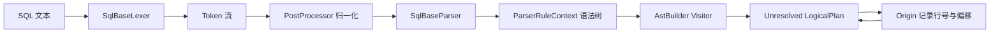
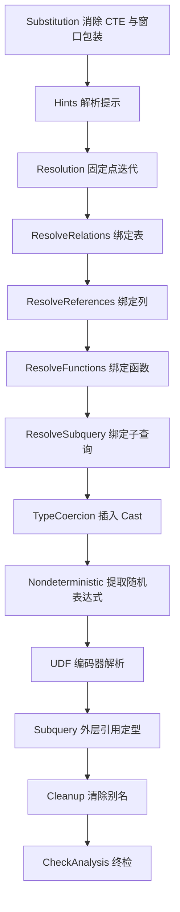
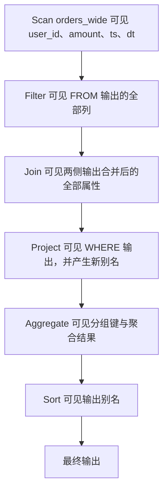
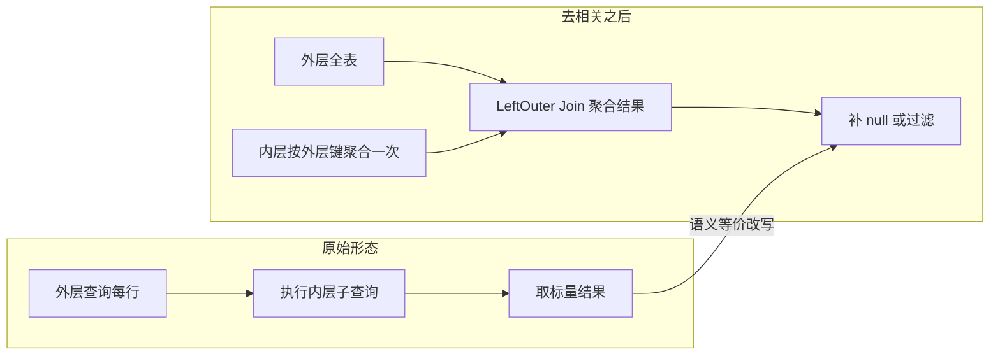
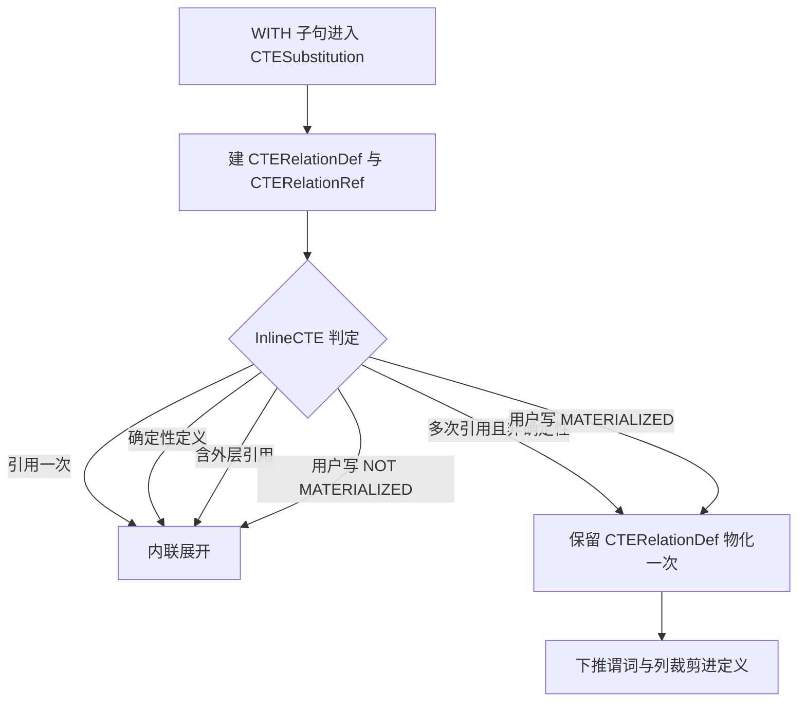

# 02 Catalyst 解析与分析：从 AST 到 Analyzed LogicalPlan

**摘要：**

一条 SQL 从字符串到可执行计划，中间要跨过两次身份转换。Antlr4 先把字符流变成语法树，`AstBuilder` 再把语法树翻译成一棵"只有名字、没有身份"的逻辑计划，此时表是 `UnresolvedRelation`、列是 `UnresolvedAttribute`、函数是 `UnresolvedFunction`；真正给这些名字配上目录、类型与作用域，是 Analyzer 的活。本文只处理这一段的两个动作：名字怎么被绑定，类型怎么被推断，失败落在哪一步。行文按真实执行顺序展开：`SqlBaseLexer` 与 `SqlBaseParser` 的语法层产出什么，为什么这一层的产物必然全是 Unresolved；Analyzer 的批次为什么被切成 Resolution、Nondeterministic、UDF、Subquery、Cleanup 这样一组，组与组之间的顺序又为什么不能随意调换；Catalog 的两级结构与三、四级命名空间如何把 `catalog.database.table` 落到一张 Hive 表上；作用域栈如何把 `nameParts` 绑成带 `exprId` 的 `AttributeReference`；TypeCoercion 在哪个位置插入 Cast，为什么"字符串列和数字字面量比较"与"数字列和字符串字面量比较"的后果完全不同；相关子查询的相关谓词被提升到哪里；CTE 在 4.x 里默认被内联还是物化；View 里存的到底是 SQL 还是计划。结尾给出三个反例与量化，并把逻辑优化、统计与 CBO 的边界划给后续篇目。

---

## 第 1 章 分析阶段的职责边界

### 1.1 一条查询的两个身份

Spark SQL 的论文把 Catalyst 描述成一个"用规则重写树"的框架，但真正把一棵树干上语义的，是 Analyzer 手里那几十条规则和一张 Catalog。在进入细节之前，笔者先把边界划清：本文只谈 Parser 与 Analyzer 两段，逻辑优化的等价变换留给第 03 篇，统计信息与代价模型留给第 04 篇，物理算子如何被选中留给第 05 篇。换句话说，本文结束时查询还停在 `Analyzed LogicalPlan`，一行数据都没有动。

一条查询在这两段里获得两种身份。第一种是**语法身份**：这段文本在语法上是不是一个合法的查询，它的结构是什么，`SELECT` 后面挂几个表达式，`FROM` 后面是表还是子查询。第二种是**语义身份**：`orders_wide` 这张表在哪个 catalog、哪个 database 下，它有没有 `user_id` 这一列，这一列是 `StringType` 还是 `BigInteger` 类型，`SUM` 能不能吃 `Decimal`，`o1.user_id` 这个三段的引用到底指内层还是外层。

这两种身份之间没有必然联系，一段语法完全正确的 SQL 可以通不过语义检查，`SELECT nonexist_col FROM orders_wide` 就是最直白的例子。

### 1.2 为什么语法与语义必须分成两段

把两段合并，意味着解析器在逐字符扫描文本的同时要去查 Hive Metastore。这在工程上有两处硬伤：其一，Catalog 访问是网络 RPC，解析一次 SQL 的耗时会在毫秒级，而一次 Metastore 查询可能是几毫秒到几十毫秒，两者纠缠在一起，语法错误与元数据错误也会互相遮蔽；其二，语法分析的结果只依赖文本，可以缓存、可以复用，语义分析的结果依赖当时的 Catalog 快照，表结构一变结论就作废，两种生命周期不同的产物放在一起，缓存策略没法设计。

更深一层的理由是方法论的差异。语法分析是上下文无关的，可以用形式文法完整描述，交给生成器做；语义分析是上下文敏感的，它的答案取决于运行时的 Catalog 状态、会话配置、甚至当前 catalog 与 namespace，没法用形式方法一次性写死。Spark 的选择是把前者的产物定成一个公开的中间表示，也就是逻辑计划，让后者在这个表示上反复迭代。

### 1.3 分析阶段真正做的三件事

分析阶段的工作可以归纳成三件事，它们交织在同一个批次循环里，但意图不同。

第一件是**绑名字**。把 `UnresolvedRelation` 换成具体的表关系节点，把 `UnresolvedAttribute` 换成带唯一 `exprId` 的 `AttributeReference`，把 `UnresolvedFunction` 换成内置函数或已注册的 UDF。这件事依赖 Catalog 与作用域栈。

第二件是**定类型**。给每个表达式算出 `dataType`，在两侧类型不匹配但可以安全转换的地方插入 `Cast`，在无法转换的地方抛出类型错误。这件事依赖 `TypeCoercion` 那一组规则，它排在 Resolution 批次的末尾，前提是两侧子表达式都已经是 resolved 的。

第三件是**补结构**。用户的 SQL 里省略的东西在这一段被补齐：`SELECT *` 展开成列清单，没有别名的表达式生成 `Alias`，`GROUP BY` 与聚合函数之间的合法性被校验，标量子查询被绑定上外层属性，CTE 被替换成定义或引用。这些动作严格说不属于"解析名字"，但没有它们，优化器拿到的计划是不完整的。

### 1.4 analyzed 是惰性的

一个容易被忽略的工程事实是：`QueryExecution` 里的 `parsed`、`analyzed`、`optimized`、`executedPlan` 全是 `lazy val`。执行 `spark.sql("...")` 只是构造了一个 `DataFrame`，文本甚至还没被解析；只有触发 action，或者显式访问 `df.queryExecution.analyzed`，整条管道才会往下走。这个设计让"计划什么时候算出来"与"数据什么时候读"解耦，也让错误的暴露时机变得难以预期：语法错误可能在你 `show()` 的那一刻才抛出，语义错误也一样。

下图把整条管道摊开，并标出本文覆盖的区间。

```mermaid
%%{init: {'theme': 'dracula'}}%%
flowchart LR
    A[SQL 文本] --> B[Parser 语法分析]
    B --> C[Unresolved LogicalPlan]
    C --> D[Analyzer 语义分析]
    D --> E[Analyzed LogicalPlan]
    E --> F[Optimizer 逻辑优化]
    F --> G[Physical Planner]
    G --> H[RDD 执行]
    style C fill:#44475a,stroke:#ff79c6
    style D fill:#44475a,stroke:#ff79c6
    style E fill:#44475a,stroke:#ff79c6
```



Parser 这一层对外暴露的入口不止 `parsePlan` 一个，Spark 在 `ParserInterface` 上按"要解析的语法单位"做了切分，因为一个完整语句、一个表达式、一个标识符的语法规则完全不同，混用一个入口会让错误信息与产物类型都变得模糊。

| 入口方法 | 输入形态 | 产物 | 典型调用方 |
|---|---|---|---|
| `parsePlan` | 完整语句 | `LogicalPlan` | `spark.sql`、`SessionState.sqlParser` |
| `parseQuery` | 单个查询 | `LogicalPlan` | 视图文本、子查询 |
| `parseExpression` | 表达式片段 | `Expression` | 分区表达式、`DataFrame` 列表达式 |
| `parseTableIdentifier` | 表标识符 | `TableIdentifier` | `spark.table`、`INSERT INTO` |
| `parseMultipartIdentifier` | 多段名字 | `Seq[String]` | Catalog V2 的表名、`SET PATH` |
| `parseFunctionIdentifier` | 函数名 | `FunctionIdentifier` | `CREATE FUNCTION`、函数查找 |

这种切分带来一个副作用：同一种文本在不同入口下的报错不同。`parsePlan` 期望的是语句，你给它一个裸表达式，报的是"语句不支持"；`parseExpression` 期望的是表达式，你给它一个 `SELECT`，报的是语法错误。定位问题时要先确认文本走的是哪个入口。

---

## 第 2 章 语法解析：从 SQL 文本到 ParserRuleContext

### 2.1 语法文件在 4.x 的位置与拆分

关于 Spark SQL 的语法文件，流传最广的一句话是"去看 `SqlBase.g4`"。这句话在 1.x 与 2.x 上是对的，在 3.x 之后已经过时。3.x 把单一的 `SqlBase.g4` 拆成了 `SqlBaseLexer.g4` 与 `SqlBaseParser.g4` 两份，词法规则与语法规则分开维护，因为 Antlr4 允许 Lexer 与 Parser 各自独立生成，分开之后语法文件的可读性与编译速度都有改善。到 4.x，随着 SQL 相关模块重构，这两个文件搬到了 `sql/api` 模块下，路径是 `sql/api/src/main/antlr4/org/apache/spark/sql/catalyst/parser/`。

这个位置变化不只是仓库整理。语法定义跟着 API 模块走，意味着解析器被打包进了更底层的产物里，`sql/api` 是 `sql/catalyst` 与 `sql/core` 的共同依赖，任何扩展实现（第三方的 `ParserInterface`、外部的 SQL 方言适配）都能拿到同一份语法产物。笔者在排查"自定义 Parser 与内置 Parser 行为不一致"这类问题时，第一件要确认的事就是两边引的是不是同一个版本的语法生成类。

语法文件本身不描述语义。`SqlBaseParser.g4` 里有几百条规则，从 `compoundOrSingleStatement` 一直到最基本的 `identifier`、`literal`，它关心的是"这段文本能不能用这棵树表示"，不关心"这棵树对应哪张表"。

### 2.2 词法与 Token 归一

词法分析把字符流切成 Token。`SqlBaseLexer.g4` 用正则规则定义了各类 Token：关键字（Antlr4 里以大写字母开头的规则生成 Token 类型）、标识符、带反引号的标识符、字符串字面量、数字字面量、运算符、注释。这里有两个细节会影响后续行为。

其一是**关键字与标识符的边界**。Antlr4 的最长匹配与规则顺序共同决定一个词被当成关键字还是标识符，`SELECT` 永远是关键字，`select` 会因为大小写不敏感而落到同一条规则上；而 `` `select` `` 走了 `BACKQUOTED_IDENTIFIER`，被还原成普通标识符。这就是为什么在 Spark 里要引用一个与关键字同名的列，必须加反引号。

其二是**Token 归一化**。Spark 在 Lexer 之后挂了一个 `PostProcessor`，把关键字统一成大写、处理字符串字面量的转义与后缀（`X'...'`、`DATE '...'` 这类带修饰符的字面量），并给某些 Token 加上语义标记。归一化的位置很关键，它发生在语法分析之前，所以 Parser 看到的是一套规范化后的 Token 流，语法规则因此可以少写大量大小写分支。

### 2.3 从 Token 流到 ParserRuleContext

语法分析的入口是 `SqlBaseParser` 的一条规则。`parsePlan` 走的是 `compoundOrSingleStatement`，`parseQuery` 走 `singleQuery`，`parseExpression` 走 `singleExpression`。Antlr4 生成的 Parser 用自顶向下的 LL(*) 算法在 Token 流上行走，产出的是**具体语法树（Concrete Syntax Tree，CST）**，树上每个节点是一个 `ParserRuleContext` 子类，例如 `QuerySpecificationContext`、`FromClauseContext`、`SelectClauseContext`。

CST 与语法规则一一对应，紧贴文本，保留了几乎所有冗余信息：括号、逗号、`AS` 关键字都在树上。`ParserRuleContext` 提供了三样后面要用的东西：子节点列表（按规则里的出现顺序）、`getText`（把该子树覆盖的原文原样取出来）、以及起止 Token 的位置（`start`、`stop`），后者是错误定位与 `Origin` 的来源。

### 2.4 AstBuilder：Visitor 的落点

Antlr4 提供 Listener 与 Visitor 两种遍历方式。Listener 是回调式的，进入与离开节点时被通知，没有返回值；Visitor 是主动访问式的，每个 `visit*` 方法返回一个值，父节点的结果由子节点的返回值拼装。Spark 选 Visitor，原因很直接：它要从子计划构建父计划，`Filter` 需要 `FROM` 子句的产物作为 child，`Aggregate` 需要 `GROUP BY` 的表达式列表，这种自底向上的拼装天然是带返回值的递归。

`AstBuilder` 继承 Antlr4 生成的 `SqlBaseBaseVisitor`，重写每个语法规则对应的 `visit*` 方法。它的产物就是 `Unresolved LogicalPlan`，每个 `visit*` 都只做结构翻译，不做任何语义判断。

```scala
// AstBuilder 中一个查询规格的翻译流程（简化示意，非源码原文）
override def visitQuerySpecification(ctx: QuerySpecificationContext): LogicalPlan = {
  // FROM 最先翻译：后面所有表达式都挂在这棵子树上
  val from = ctx.fromClause().map(visitFromClause).getOrElse(OneRowRelation())

  // WHERE 紧随其后包一层 Filter，此时条件里的列还只是字符串
  val withWhere = ctx.whereClause().map { w =>
    Filter(expression(w.booleanExpression()), from)
  }.getOrElse(from)

  // GROUP BY / HAVING / SELECT 依语法顺序逐层包裹，
  // 顺序不能改：SQL 的求值顺序由这层包裹关系表达
  val withAgg = ctx.aggregation().map(visitAggregation(_, withWhere)).getOrElse(withWhere)
  val withProject = Project(namedExpressions(ctx.select()), withAgg)
  ...
}
```

这段代码说明了三件事。第一，`FROM` 的产物在最内层，所有后续算子都是它的祖先节点，这决定了作用域栈的增长方向；第二，`WHERE` 里引用的列在翻译完成时仍然是 `UnresolvedAttribute("amount")` 这样的字符串，`AstBuilder` 并不知道 `amount` 属于哪张表；第三，聚合、投影、排序的包裹顺序编码了 SQL 的语义顺序，后面 Analyzer 之所以能按位置找到正确的列，靠的就是这层结构。

把这一层的完整链路画出来，可以看到"文本"与"计划"之间并没有直接通道，所有语义信息都在 `AstBuilder` 之后才可能出现。



### 2.5 Origin：错误为什么能指到行号

`AstBuilder` 的每个 `visit*` 方法外层都套着 `withOrigin(ctx, sqlText)`，作用是把当前 `ParserRuleContext` 的位置信息写进新建节点的 `Origin` 里。`Origin` 记录四个值：SQL 文本的行号、起始偏移、文本片段、以及对象名。它不会影响执行，但决定了报错质量。

一个语义错误最终抛出 `AnalysisException` 时，`line`、`startPosition` 两个字段就来自这里。没有 `Origin`，你只能拿到"cannot resolve `amount`"，有了它，你能拿到"第 3 行第 8 位附近"。

```scala
def withErrorHandling[T](ctx: ParserRuleContext, sqlText: Option[String])(toResult: => T): T = {
  withOrigin(ctx, sqlText) {
    try toResult
    catch {
      // 嵌套过深的 SQL 会把递归解析栈撑爆，这里转成一个可读的错误
      case _: StackOverflowError => throw QueryParsingErrors.parserStackOverflow(ctx)
    }
  }
}
```

那个 `StackOverflowError` 分支值得单独说一句。Antlr4 的解析是递归的，理论上深到几千层的嵌套（例如由代码生成的超长 `CASE WHEN` 或上千个 `UNION ALL`）就能把线程栈耗尽，Spark 把它转成明确的解析错误，而不是让 JVM 打出一堆栈溢出日志。遇到这类报错，处置方向是减少嵌套，而不是调大 `-Xss`。

### 2.6 语法层的内存账：DFA 缓存

Antlr4 的 Parser 内部有一张 DFA 缓存，用来加速后续相同模式的解析，这是它性能好的原因之一。但这张缓存没有上限，解析过的输入越多样，缓存里的状态越多。对于一个常驻数天、每天解析成千上万条生成式 SQL 的 Thrift Server 而言，这不是理论问题：缓存对象长期存活在 driver 上，推高老年代占用，最终表现为 GC 时间上升甚至 OOM。

Spark 4.1 起提供了三个内部配置来管这件事：`spark.sql.parser.manageParserCaches` 决定是否接管 Antlr 的缓存，`spark.sql.parser.parserDfaCacheFlushThreshold` 按 DFA 状态数触发清理，`spark.sql.parser.parserDfaCacheFlushRatio` 按 driver 内存百分比触发清理。三者的默认值都是关闭（分别是 `false`、`-1`、`-1`），也就意味着默认行为仍然是"缓存无限增长"。这是一个典型的权衡点：打开它换来内存稳定，代价是解析变慢，官方文档里明确写了"可能显著拖慢解析"。

语法层值得记住的失败模式不多，但每一条都很典型：

| 症状 | 典型 errorClass | 根因 | 处置方向 |
|---|---|---|---|
| 关键字当列名报错 | `PARSE_SYNTAX_ERROR` | 未加反引号 | 用 `` `select` `` 形式引用 |
| 字符串里的反斜杠被吃掉 | `PARSE_SYNTAX_ERROR` / 结果不符预期 | 转义模式差异 | 核对 `spark.sql.parser.escapedStringLiterals` |
| 深嵌套 SQL 栈溢出 | 解析器栈溢出错误 | 递归深度过大 | 拆分语句或减少嵌套 |
| 大 SQL 集合下 driver GC 抖动 | 无异常，仅表现为延迟与 GC | DFA 缓存无上限 | 打开缓存清理配置，评估解析耗时 |
| 表达式入口报"语句不支持" | `PARSE_SYNTAX_ERROR` | 走错 `ParserInterface` 入口 | 确认调用的是 `parseExpression` |

---

## 第 3 章 Unresolved 家族：延迟绑定的设计与代价

### 3.1 一棵"只有名字"的树

`AstBuilder` 交付的计划里，凡是需要查元数据才能确定的东西，都保持未解析状态。这些节点散落在 `Unresolved` 系列里，它们共同的特征是：只携带字符串标识符，`dataType` 要么是占位要么不可用，`resolved` 恒为 `false`。

| 节点 | 携带信息 | 解析后变成 |
|---|---|---|
| `UnresolvedRelation` | 多段表名 `Seq[String]` | `DataSourceV2Relation`、`HiveTableRelation`、`View` |
| `UnresolvedAttribute` | `nameParts: Seq[String]` | `AttributeReference`（带 `exprId`、`qualifier`、类型） |
| `UnresolvedFunction` | 函数名 + 参数 + `isDistinct` | `AggregateExpression`、`ScalarFunction`、`WindowExpression` |
| `UnresolvedStar` | 可选的表限定符 | 一列或多列的 `AttributeReference` 序列 |
| `UnresolvedRegex` | 正则模式 + 表前缀 | 匹配到的列集合（`spark.sql.parser.quotedRegexColumnNames`） |
| `UnresolvedExtractValue` | 子表达式 + 提取键 | `GetStructField`、`GetMapValue`、`GetArrayItem` |
| `UnresolvedAlias` | 表达式 + 可选别名 | `Alias`（输出列名确定） |
| `UnresolvedOrdinal` | 序号（`GROUP BY 1`） | 对应位置的表达式 |
| `UnresolvedTableValuedFunction` | 函数名 + 参数 | 生成器关系节点 |
| `UnresolvedGenerator` | 表生成函数名 | `Generate` 节点 |

这张表可以当作阅读 `EXPLAIN` 的速查表。如果在 `analyzed` 计划里还看到任何一个 `Unresolved` 前缀的节点，说明 Analyzer 没有跑完或者被绕过，这时候不要去看优化阶段，问题在更前面。

### 3.2 nameParts 与 multipartIdentifier

`UnresolvedAttribute` 的字段叫 `nameParts: Seq[String]`，这是一个刻意保持笼统的设计。`a`、`t.a`、`db.t.a`、`s.x.y` 在解析阶段都是同一类对象，只是 `nameParts` 的长度不同。真正的语义要到解析时才确定：末段是"要找的名字"，前面各段是"限定符"，限定符可以指向表别名、catalog、namespace，也可以指向结构体字段。

`UnresolvedRelation` 用的是另一个字段名 `multipartIdentifier`，原因类似但约束更强：一张表的名字最多三段（catalog、namespace、table），超过三段在关系位置上是语法错误，而在表达式位置上是合法的结构体路径。`a.b.c` 在 `FROM` 后面解析不出东西，在 `SELECT` 后面却可能是三层的字段访问，这种"同一个字符串在不同位置有不同语义"的情况，是延迟绑定必须付出的复杂度。

### 3.3 Unevaluable 与 resolved 标志

这些节点全部继承 `Unevaluable`，也就是它们在物理上不允许被求值。这个约束不是形式主义：它保证了即使某条分析规则漏掉了一个节点，执行阶段也不会拿一个"没有类型的占位表达式"去算数，而是会在检查阶段被抓出来。

`resolved` 的判定是递归的：一个表达式 resolved，要求它的所有子表达式 resolved，且 `checkInputDataTypes` 返回成功。这个定义解释了一条贯穿整个 Analyzer 的编码习惯：几乎每条类型相关规则的第一行都是"如果子节点没 resolved，原样返回"。

```scala
object ImplicitTypeCasts extends TypeCoercionRule {
  override val transform: PartialFunction[Expression, Expression] = {
    // 子节点未解析时不能猜类型，否则会把 Cast 加到错误的位置，
    // 下一个固定点迭代还要再拆掉，纯属浪费
    case e if !e.childrenResolved => e
    case withChildrenResolved => ImplicitTypeCoercion(withChildrenResolved)
  }
}
```

这段守卫同时解释了为什么 Resolution 批次必须是 `FixedPoint`：一条规则今天因为子节点没解析而放弃，下一轮子节点解析好了，它就该生效了。

### 3.4 延迟绑定的收益与代价

收益有三层。计划可以在没有 Catalog 的情况下被构造与比较，这让 `DataFrame` API 与 SQL 共用同一套中间表示；同一段 SQL 文本可以在不同 catalog 上下文里被分析出不同结果，这对多租户与跨库查询是必需的；错误报告能带上原文位置，因为 `Origin` 在语法阶段就写进了节点。

代价同样有三层。错误被推迟到首次 action，一个跑了两小时的作业可能在第 90 分钟才因为一个列名拼错而失败；"同样的代码在不同环境表现不同"变得常见，因为分析结果依赖当时的 Catalog 快照；调试时不得不区分"语法通过但语义失败"与"语法就失败"，而这在日志里只差一个异常类名。

最后一道闸门是 `CheckAnalysis`。它在 Analyzer 的规则跑完之后执行，逐节点检查是否还有未解析的表达式、属性是否都在作用域内、聚合是否合法。很多看起来像"某条规则抛的错"，其实来自这里，例如 `Resolved attribute(s) missing from ...`。

---

## 第 4 章 Analyzer 的批次结构：顺序即语义

### 4.1 RuleExecutor 的执行模型

Analyzer 继承 `RuleExecutor[LogicalPlan]`，后者提供了一个"批次化的固定点迭代"引擎。每个批次由名字、策略、规则列表三部分组成；策略有三种：`Once`（跑一遍）、`FixedPoint(n)`（最多迭代 n 轮，直到计划不变）、`FixedPoint`（n 取默认上限，通常是 100）。

一轮迭代里，批次内的规则按声明顺序依次对整棵树应用；一轮结束后比较新旧计划，如果 `fastEquals` 为真就退出，否则再来一轮。这里有两个工程细节。其一，收敛判断用的是结构相等（含表达式 `exprId`），所以规则必须保证幂等，否则会一直迭代到上限。其二，达到迭代上限仍未收敛时，引擎只记录警告并把当前计划交出去，不会失败，这意味着"规则写错了"在某些情况下表现为"计划差一点"，而不是报错。

### 4.2 4.x 的批次全貌

Spark 4.x 的 `Analyzer.batches` 由前期批次与主批次拼成，顺序如下（括号内是策略）。

| 批次 | 策略 | 关键规则 | 为什么在这个位置 |
|---|---|---|---|
| Substitution | FixedPoint | `CTESubstitution`、`WindowsSubstitution`、`EliminateUnions` | 先消除语法层的包装，后面所有规则才面对统一形态 |
| Apply Limit All | Once | `ApplyLimitAll` | 把 `LIMIT ALL` 归一成无限制 |
| Disable Hints / Hints | Once / FixedPoint | `ResolveJoinStrategyHints`、`ResolveCoalesceHints` | 提示要在关系解析前解析，否则拿不到表名 |
| Simple Sanity Check | Once | `LookupFunctions` | 早失败，函数名写错不必等到最后 |
| Keep Legacy Outputs | Once | `KeepLegacyOutputs` | 保留旧输出兼容行为 |
| Unresolve Relations | Once | 事务内关系反解析 | 事务场景下需要重新绑定关系 |
| Resolution | FixedPoint | `ResolveRelations`、`ResolveReferences`、`ResolveFunctions`、`ResolveAliases`、`ResolveSubquery`、`typeCoercionRules()` | 主体，反复迭代直到全部绑定 |
| Remove TempResolvedColumn | Once | `RemoveTempResolvedColumn` | 清掉解析过程中使用的临时列 |
| Post-Hoc Resolution | Once | `ResolveCommandsWithIfExists` + 扩展规则 | 依赖解析完成后的信息 |
| Remove Unresolved Hints | Once | `RemoveAllHints` | 解析不掉的提示在这里丢弃 |
| Nondeterministic | Once | `PullOutNondeterministic` | 在类型转换之后、执行之前把非确定性表达式提取出来 |
| ScalaUDF Null Handling | FixedPoint | `HandleNullInputsForUDF`、`UpdateAttributeNullability` | 两条规则互相依赖，必须迭代到稳定 |
| UDF | Once | `ResolveEncodersInUDF` | 依赖解析后的类型 |
| Subquery | Once | `UpdateOuterReferences` | 子查询外层引用在这里定型 |
| Cleanup | FixedPoint | `CleanupAliases` | 别名清理必须在所有引用解析完之后 |
| HandleSpecialCommand 等 | Once | 命令处理、水位线清理 | 收尾 |

`Resolution` 批次内部还有一层更细的顺序，这一层是整个 Analyzer 里最不能动的地方。顺序大致是：先解析 catalog 与插入目标，再解析关系（`ResolveRelations`），然后解析列引用（`ResolveReferences`），接着陆续处理生成器、函数、别名、子查询、窗口帧、自然连接、输出关系、聚合、lambda 变量、时区、随机种子，最后才是 `typeCoercionRules()`。

### 4.3 三条硬顺序依赖

为什么关系解析必须早于列解析？因为列解析的输入是子节点的 `output`，也就是一张关系被解析之后才有的属性列表。`UnresolvedRelation` 没有输出列，`ResolveReferences` 面对它只能放弃。这个依赖是单向的，反过来了没有意义。

为什么类型转换必须排在最后？因为 `TypeCoercion` 的规则对"两侧已解析"有强假设。`ImplicitTypeCasts` 要拿到两侧的 `dataType` 才能决定是否插 Cast，而 `dataType` 只有在属性绑到具体列、函数绑到具体实现之后才存在。更麻烦的是，Cast 本身会改变表达式类型，进而改变上层比较与运算的目标类型，所以它必须在一轮里尽可能靠后，让前面的规则先做完结构性的绑定。

为什么 `CleanupAliases` 必须放在整个批次的末尾？因为别名节点在解析早期起到了"命名锚点"的作用，`ORDER BY`、`HAVING`、窗口定义都可能引用别名。过早清掉别名，后面的规则就找不到名字了。反过来，如果别名留到优化阶段，列裁剪与投影合并会被多余的 `Alias` 节点干扰，所以它必须被清掉，而且要在所有名字都用完之后。

下面这张图把批次之间的依赖关系画成一条主线，支线是那些"跑一次就够"的检查。



### 4.4 几个流传甚广的错位说法

对照源码，有几个说法需要修正。**TypeCoercion 不是一个独立批次**，它是挂在 `Resolution` 末尾的一组规则；把它当成批次会让人误以为类型推断独立于名字解析，实际上它完全依赖名字解析的结果。**Analyzer 没有 TableAliases 批次**，表别名的处理分散在关系解析与作用域建立里。**`Subquery` 批次只做 `UpdateOuterReferences`**，真正的子查询改写在优化器的 `RewriteSubquery` 批次里，不在分析阶段。**`HiveOnlyCheck`** 在 4.x 的批次列表里已经找不到，早期版本它排在首位，用于在非 Hive 会话里拒绝 Hive 专属命令。

这些错位说法有个共同起源：把不同版本、不同阶段的规则混在一张表里。Spark 的规则在版本间移动频繁，4.x 更是一次大重构，`ResolveReferences` 内部被拆成了 `resolver` 包里的一整套框架，包括 `NameScope`、`AttributeScopeStack`、`SubqueryScope` 等几十个类。读规则表时先确版本，比背规则名有用。

---

## 第 5 章 Catalog 与命名空间：名字怎么落到一张表

### 5.1 两级结构

Spark 的元数据访问是两层结构。上面一层是 `CatalogManager`，它管理多个已注册的 catalog，维护"当前 catalog"与"当前 namespace"，并为每个 catalog 名字找到对应的 `CatalogPlugin` 实现。下面一层是每个 catalog 内部自己的两级命名空间：namespace（database 或 schema）与 table。

内置的 `spark_catalog` 是个特殊存在。它是一个 V2 接口的包装器，背后委托给 V1 的 `SessionCatalog`，而 `SessionCatalog` 再委托给 `ExternalCatalog`，生产环境里就是 Hive Metastore。这条链看着绕，但它保住了兼容性：老的 Hive 表、临时视图、全局临时视图都能被同一套名字查找访问到。

名字的分段规则决定了每一段被解释成什么：

| 名字段数 | 例子 | 解释 | 查找位置 |
|---|---|---|---|
| 1 段 | `orders_wide` | 表名 | 当前 namespace |
| 2 段 | `dwd.orders_wide` | namespace.table | 当前 catalog |
| 3 段 | `spark_catalog.dwd.orders_wide` | catalog.namespace.table | 指定 catalog |
| 表达式位置任意段 | `r.user_id`、`s.addr.city` | 限定符 + 列名 + 字段路径 | 作用域栈 |

`spark.sql.defaultCatalog` 决定"当前 catalog"的初值，默认就是 `spark_catalog`。会话里执行 `USE database` 或 `SET PATH` 会改变会话状态，进而改变单段名字的查找顺序，这个状态是会话级的，不同连接的解析结果可以完全不同。

### 5.2 一段名字怎么落到一张表

`ResolveRelations` 面对 `UnresolvedRelation(Seq("dwd","orders_wide"))` 时，实际发生的事是：先取当前 catalog 名，把名字补全成三段；用 catalog 名在 `CatalogManager` 里找 `CatalogPlugin`；如果是 `spark_catalog`，委托给 `SessionCatalog.lookupRelation`；`SessionCatalog` 先查临时视图与全局临时视图，再调 `ExternalCatalog.getTable`；`ExternalCatalog` 通过 Hive Metastore Client 发一个 Thrift RPC，拿到 `CatalogTable` 描述符；最后把描述符翻译成逻辑计划节点，V1 表翻译成 `HiveTableRelation`，V2 表翻译成 `DataSourceV2Relation`。

这条链上最贵的一步是那个 RPC。一个涉及 20 张表的复杂查询，分析阶段就要付 20 次 Metastore 往返，如果这几张表还分散在不同 database 甚至不同 catalog 上，数字还要往上走。这段开销在慢查询归因时经常被忽略，因为它不出现在 SQL 的 stage 里，只体现在 driver 侧的解析耗时上。

### 5.3 临时视图的优先级

`SessionCatalog` 的查找顺序是**临时视图优先于持久表**，这条规则制造了相当多的误判。一个会话里 `createOrReplaceTempView("orders_wide")` 之后，`SELECT * FROM orders_wide` 命中的是临时视图，不是 Hive 里那张表，而且不会报任何错。跨会话排查时最典型的场景是：调度平台上跑得好好的任务，在交互式会话里手动重跑就结果不对，原因是那个会话里挂了一个同名临时视图。

全局临时视图多了一层 `global_temp` 前缀，它的作用域是整个 `SparkContext`，查找路径上先查临时视图、再查全局临时视图、最后才是持久表。

### 5.4 大小写与 Metastore 的成本

`spark.sql.caseSensitive` 默认是 `false`，名字匹配走大小写不敏感的 `CaseInsensitiveMap`，但元数据里保留用户写入时的原始大小写。这个默认值是从 Hive 继承来的，改起来代价很大：把它设成 `true`，历史 SQL 里所有大小写不一致的写法都会立刻失败。配置项自己也标了"强烈不建议开启"。

Metastore 侧还有一层历史包袱。Hive 表在历史上可能存在大小写混用的 schema，3.x 时代有专门的配置控制"推断真实大小写并写回 Metastore"的策略，4.x 的 `HiveExternalCatalog` 里已经找不到这条配置，说明这块逻辑被重做过。这类版本敏感的配置项在升级时要按 `spark.sql.*` 的全量清单逐项核对，凭记忆沿用旧参数是升级期最常见的一类凭空故障。

找不到表时的报错长这样：`TABLE_OR_VIEW_NOT_FOUND`，消息里带上完整的查找路径与候选建议。读这个报错的正确方式是先看路径，它告诉你 Spark 在哪个 catalog 的哪个 namespace 下找了；如果路径是 `spark_catalog.default`，而你以为自己在 `dwd` 库，那问题就是 "没有 `USE dwd`" 或者连错了会话。

---

## 第 6 章 作用域栈：列名如何被绑定

### 6.1 解析状态是一个栈

4.x 的列解析不再是一个大而全的 `ResolveReferences` 规则，而是 `resolver` 包里的一套框架。框架的核心状态是 `NameScope` 与它的栈（`NameScopeStack`），加一个专门做校验的 `AttributeScopeStack`。每个算子在被解析时向栈里压入自己的输出属性，离开时弹出，于是"当前能看到哪些列"就成了栈顶的内容。

这个结构解释了 SQL 的一条基本规则：子查询里的列可见性由位置决定，`WHERE` 能看见 `FROM` 的输出，`SELECT` 能看见 `WHERE` 的输出，但同层 `SELECT` 里定义的别名不能在同层 `WHERE` 里被引用，因为 `WHERE` 解析时 `Project` 还没入栈。

`AttributeScopeStack` 只支持一层外引用（源码里的 `supportNestedCorrelations` 是常量 `false`），也就是说相关子查询只能引用一层外层作用域。两层嵌套的相关子查询在分析阶段就会被拒绝，这不是实现疏漏，而是有意维持的边界，避免任意深度的关联带来无法控制的计划复杂度。

### 6.2 nameParts 的右对齐匹配

`UnresolvedAttribute(Seq("r","user_id"))` 的匹配方式是从右往左：末段 `user_id` 是名字，前段 `r` 是限定符。限定符的匹配对象是属性自带的 `qualifier`，也就是解析关系时从表名或别名上继承下来的那一段。`FROM dwd.orders_wide r` 会让该关系输出的每个属性带上 `qualifier = ["r"]`，所以 `r.user_id` 能命中，`dwd.orders_wide.user_id` 命中不了，因为限定符只存了别名。

匹配失败时还有一次机会：把 `r` 当成一列去解析，如果它恰好是结构体或 map，再尝试取字段。这个回退就是 `a.b.c` 能同时表示"表 a 的列 b 的字段 c"和"列 a 的字段 b 的字段 c"的原因。回退的存在让错误信息变得复杂，`cannot resolve` 的候选列表里经常同时出现列名与字段名。

### 6.3 歧义

`JOIN` 之后，两个子节点的输出属性被拼进同一个作用域。如果两边都有 `user_id`，而查询里写的是不带限定符的 `user_id`，解析器看到两个候选，直接抛 `AMBIGUOUS_REFERENCE`，消息里会列出所有候选的完整限定名。这与"找不到"是两种不同的错，处置也不同：前者补限定符，后者查拼写或作用域。

自连接还有一个额外陷阱。用同一个 `DataFrame` 变量做自连接时，两侧的属性带着相同的 `exprId`，形状上是同一个属性的两次出现，语义上却应该是两份数据。`spark.sql.analyzer.failAmbiguousSelfJoin` 默认 `true`，会在分析阶段直接拒绝这种查询，而不是让执行阶段产出错误结果。解法是先用 `withColumnRenamed` 或者 `alias` 把两侧区分开，让 `exprId` 不同。

### 6.4 别名的可见性与生成规则

`SELECT amount * 1.1 AS amount_with_tax` 里的 `amount_with_tax` 是一个 `Alias` 节点，它的名字在解析完成后才确定。对于没有别名的表达式，Spark 会自动生成一个名字，规则大致是"表达式的字符串形式"再转小写，所以 `sum(amount)` 的输出列名就是 `sum(amount)`。这个自动命名机制让不写别名的 SQL 也能产出稳定的列名，但它是通过表达式的 `sql` 字符串拼出来的，表达式一改，列名就变，下游按名取列会静默失败。

4.x 引入了横向列别名（lateral column alias），让同一层 `SELECT` 里后面的表达式可以引用前面刚定义的别名，这改变了 `NameScope` 的优先级顺序：列引用优先，其次才是横向列别名。源码注释里给了一个反直觉的例子，`SELECT 1 AS col1, col1 FROM VALUES (2)` 的结果是 `[1, 2]` 而不是 `[1, 1]`，因为列引用优先级高于别名解析。

### 6.5 cannot resolve 的三个成因

`UNRESOLVED_COLUMN` 是分析阶段最常见的错误，它的成因可以归成三类，每类的判据不同。

第一类是名字根本不存在：拼写错误、大小写不一致、或者在错误的表上引用。判据是错误消息里的 "Did you mean" 建议，如果建议里有高度相似的名字，基本可以确认。

第二类是限定符对不上：给了一个表别名之外的限定符，或者在子查询外面引用了子查询没有输出的列。判据是看 `analyzed` 计划里该位置的作用域，以及子查询的 `output` 列表。

第三类是作用域时机：别名在错误的层被引用，或者窗口函数、`HAVING` 里引用了聚合之前的东西。这类错误最容易被误判成"列不存在"，实际上列存在，只是那一刻不在作用域里。

下图用一条查询演示作用域栈的推进过程，标注了每一层能看到什么。



---

## 第 7 章 类型推断：Cast 的插入点与代价

### 7.1 规则集合与顺序

`TypeCoercion` 在 `Resolution` 批次的末尾以一组规则的形式被调用，4.x 里这组规则由 `typeCoercionRules()` 返回，ANSI 开与关拿到的是两套不同的清单。非 ANSI 的顺序是：`CollationTypeCasts`、`InConversion`、`PromoteStrings`、`DecimalPrecision`、`BooleanEquality`、`FunctionArgumentConversion`、`ConcatCoercion`、`MapZipWithCoercion`、`EltCoercion`、`CaseWhenCoercion`、`IfCoercion`、`StackCoercion`、`Division`、`IntegralDivision`、`ImplicitTypeCasts`、`DateTimeOperations`、`WindowFrameCoercion`、`StringLiteralCoercion`。ANSI 版本去掉了 `BooleanEquality` 与 `StringLiteralCoercion`，加了 `GetDateFieldOperations`。

顺序在这里承担语义。这一组规则被包在 `CombinedTypeCoercionRule` 里，对每个表达式按顺序逐一尝试，第一个命中的规则改写表达式，后面的规则看到的是改写后的形态。所以 `PromoteStrings` 必须先于 `ImplicitTypeCasts`：前者处理字符串参与算术与比较的特殊情况，后者处理面向函数签名的一般性转换。如果顺序颠倒，`ImplicitTypeCasts` 会先给字符串加上一个到目标类型的 Cast，`PromoteStrings` 再去处理时形态已经变了，或者干脆不匹配。

### 7.2 字符串与数字：谁被 cast

这是本文最值得记住的一张表。同样是"字符串与数字比较"，两侧的类型组合决定了 Cast 插在哪一边，而**谁被 Cast** 决定了谓词还能不能被下推。

| 左 | 右 | 目标类型（非 ANSI） | 插入位置 | 后果 |
|---|---|---|---|---|
| `STRING` 列 | 整数字面量 | 整型 | 列被 Cast | 谓词无法下推到存储层 |
| 整数字面量 | `STRING` 列 | 整型 | 列被 Cast | 同上 |
| 整型列 | 字符串字面量 | 整型 | 字面量被 Cast，随后由优化阶段折叠掉 | 谓词可下推，但非法字面量静默为 null |
| `STRING` 列 | `DECIMAL(s,p)`，p>0 | `DOUBLE` | 两侧都被 Cast | 精度丢失，统计信息失效 |
| `DECIMAL` 列 | 字符串字面量 | `DOUBLE` | 列被 Cast 到 double | 列统计失效，decimal 精度优势归零 |
| `STRING` 参与算术 | 数字 | `DOUBLE` | 字符串侧 Cast | 结果类型被抬到 double |

非 ANSI 模式的判定逻辑写在 `findCommonTypeForBinaryComparison` 里：当一侧是字符串、另一侧是原子类型且可以提升时，目标类型取那个原子类型；当另一侧是小数位不为零的 `Decimal` 时，目标类型退化成 `DoubleType`，因为不存在一个"足够宽"的 decimal 类型能同时容纳任意字符串与任意精度的小数。算术运算走的是另一条路，`PromoteStrings` 直接把字符串侧 Cast 成 `DoubleType`。

ANSI 模式的判定不同。`findWiderTypeForString` 的规则是：字符串配整型转 `LongType`，字符串配浮点转 `DoubleType`，字符串配其他原子类型就转成那个类型。差异不在"转不转"，而在"转失败了怎么办"：非 ANSI 下 `CAST('abc' AS BIGINT)` 返回 null，比较结果为 null，行被过滤掉；ANSI 下直接抛 `CAST_INVALID_INPUT`。4.x 的 `spark.sql.ansi.enabled` 默认是 `true`（除非环境变量 `SPARK_ANSI_SQL_MODE` 被显式设成 `false`），这一点与 3.x 的默认值相反，是升级时最容易踩空的一处。

### 7.3 decimal 的精度推导

`Decimal` 是 Spark 里唯一带参数的数值类型，`DecimalType(p, s)` 的 `p` 是总位数、`s` 是小数位，两者都有上限：精度 38 位，小数位 38 位。任何 decimal 运算都要先算出一个结果类型，再决定要不要为溢出做让步。

结果类型的推导有固定公式，加减法是"整数位取最大者加一，小数位取最大者"，乘法是"精度相加加一，小数位相加"，除法是"整数位取左整数位加右小数位，小数位取 `max(6, 左小数位 + 右精度 + 1)`"。算出来的精度超过 38 时，`spark.sql.decimalOperations.allowPrecisionLoss`（默认 `true`）决定怎么收场：`true` 走 `adjustPrecisionScale`，按比例牺牲小数位把精度压回 38，结果是"精度损失但不出错"；`false` 走 `bounded`，直接截断，溢出时返回 null 或按 ANSI 报错。

这里有个反直觉的细节值得单独提。`spark.sql.legacy.literal.pickMinimumPrecision` 默认 `true`，它让整数字面量在参与 decimal 运算时只占用刚好够的精度，而不是按 `IntegerType`/`LongType` 的默认精度算。假设一个 `DECIMAL(38,18)` 的列乘以字面量 `2`，若不启用这个优化，`2` 被当成 `DECIMAL(10,0)`，结果精度 `38+10+1` 远超上限，被压成 `DECIMAL(38,7)`，小数位一下丢了 11 位；启用之后 `2` 只占 `DECIMAL(1,0)`，结果精度压成 `DECIMAL(38,16)`，损失小得多。同一个 SQL，在同一版本里因为一个内部配置的差异，能得到精度差 9 位的结果。

### 7.4 写入时的 cast：storeAssignmentPolicy

分析阶段的 Cast 不只出现在查询里。插入数据时，目标表列的 schema 是已知的，源表达式的类型不一定要匹配，这一段的转换由 `spark.sql.storeAssignmentPolicy` 控制，默认 `ANSI`。ANSI 策略按 SQL 标准做转换，拒绝不合理转换，例如 `STRING` 转 `INT`、`DOUBLE` 转 `BOOLEAN`；`legacy` 策略只要能 cast 就放行，最宽松，是 2.x 的行为；`strict` 策略不允许任何精度损失。

这条配置影响的是"看起来能跑、数据悄悄变了"的一类事故。宽松策略下 `INSERT INTO t(a_int) VALUES ('123abc')` 可能写入 null 或者被截断，而 ANSI 策略会直接拒绝。默认值从 2.x 的 `legacy` 改到 3.0 起的 `ANSI`，已经让大量历史 ETL 脚本在升级时报错，报错信息里的 `DATATYPE_MISMATCH` 前缀就是这条策略发出的。

### 7.5 优化器能救回来的那部分

Cast 插进计划不一定意味着下推彻底没戏。优化器里有一条 `UnwrapCastInBinaryComparison`，它尝试把一个被 Cast 包裹的列与常量比较的谓词，改写成对原始列的范围谓词。典型场景是 `cast(int_col as bigint) > 5`，因为向上转宽不会丢信息，可以被反解成 `int_col > 5`，谓词重新变得可下推。

但这条规则有边界：它只处理"无损且可逆"的转换方向。`cast(string_col as bigint) > 5` 不在其列，因为从字符串到数字的反解需要知道每一行的原始文本，没法用一个范围表达。这也解释了一个常见困惑：同样是隐式转换，为什么有的查询计划里 Cast 消失了，有的 Cast 一直留着。

把这条判据放到数字上看（以下为示例推算，不是实测基准）：一张按天分区的宽表，单日 3000 个 Parquet 文件、12 亿行、压缩后约 380GB。谓词写成 `dt = '2026-11-01'` 时只读一个分区，扫描量约 380GB。若改写成 `cast(dt as int) = 20261101`，分区裁剪与行组统计同时失效，扫描范围从 1 天扩到 30 天，读入量约 11TB，是原来的 30 倍。若保留分区谓词、只把另一个字符串列与数字比较，代价换了个地方体现：扫描范围仍是一天，但该列的 min/max 统计无法参与行组裁剪，命中的 row group 从少量变成全部。两种症状在 Spark UI 上的观测点不同，前者看 Input Size，后者看扫描的 row group 数与 filter 命中率。

---

## 第 8 章 子查询：绑定、去相关与它们的边界

### 8.1 三类子查询

按位置分，子查询出现在三个地方：`SELECT` 列表里的标量子查询，`WHERE`/`HAVING` 里的谓词子查询（`IN`、`EXISTS`、比较运算），以及 `FROM` 里的派生表。按相关性分，子查询可以引用外层列（相关），也可以完全不引用（非相关）。这两个维度交叉出六种形态，代价差别极大。

`FROM` 里的派生表在逻辑上等价于一个嵌套的查询块，没有额外代价；`WHERE` 里的非相关 `IN` 子查询只需算一次；相关子查询的理论代价是"外层行数乘以子查询代价"，这才是需要优化器介入的那一类。

### 8.2 Analyzer 只做绑定

分析阶段对子查询的处理只有两件事：把子查询计划解析出来，把外层引用绑定成 `OuterReference` 包装的属性。`ResolveSubquery` 在 `Resolution` 批次里完成前者，`UpdateOuterReferences` 在 `Subquery` 批次里完成后者。

绑定之后，子查询表达式的形态是 `ScalarSubquery(plan, outerAttrs)`、`InSubquery(values, ListQuery(...))`、`Exists(plan)` 这样的 Catalyst 表达式，`outerAttrs` 里存的就是从外层捕获的属性。此时子查询还是一棵"树中树"，逻辑上仍然是"对每一行执行一次"，分析阶段不改变这个语义。

### 8.3 去相关发生在优化器

真正的改写发生在优化器的三个批次里，这也是把"子查询优化"归给 Analyzer 会出错的原因。

`Pullup Correlated Expressions` 批次里的 `PullupCorrelatedPredicates` 做的是相关谓词上提：把子查询内部引用外层列的谓词从子查询里提出来，改写成连接条件。`RewriteSubquery` 批次里的 `RewritePredicateSubquery` 把 `IN` 与 `EXISTS` 改写成半连接或反连接，同时插入 `NullPropagation`、`PushPredicateThroughJoin`、`ColumnPruning` 等规则来处理改写后产生的新结构。`RewriteCorrelatedScalarSubquery`（在算子优化规则集里）把相关标量子查询改写成左外连接加聚合，对可能无匹配的分组用 `AlwaysNull` 标记补 null。

三种形态改写后的计划形状不同，代价特征也不同：

| 形态 | 改写结果 | 计划形状 | 主要代价点 |
|---|---|---|---|
| 非相关 `IN` | 半连接 | `Join(LeftSemi)` | 右侧去重与广播判定 |
| 相关 `EXISTS` | 半连接，条件带外层引用 | `Join(LeftSemi)` + 子查询过滤 | 连接键的去相关是否彻底 |
| 相关标量子查询 | 左外连接 + 聚合 | `Join(LeftOuter)` + `Aggregate` | 聚合的开销与 null 填充 |
| `NOT IN` | 反连接（null-aware） | `Join(LeftAnti)` + null 判定 | NULL 语义带来的额外判定 |

写法相关子查询时，直觉上"对每一行跑一次子查询"，改写之后是"一次连接加一次聚合"，形状的差别可以用下图对照。



把多层嵌套的相关子查询拿去跑 `EXPLAIN`，会看到典型的展平形状。以三层嵌套为例做一次结构性推算（示例推算）：每层相关子查询去相关后变成一次左外连接加一次聚合，三层展开就是 3 个聚合加 3 个连接，连接键的粒度从内到外逐层变粗；如果每层还带一个 `EXISTS` 谓词，半连接的数目再翻一倍。计划节点数会从"三棵树嵌套"的几十个涨到一百多个，其中相当一部分是 `Project` 与 `Alias`，它们是去相关时为区分内外层属性而产生的重命名。这类计划的瓶颈一般不在节点数，而在连接键的选择性与聚合中间结果的大小，所以读到一连串 `Aggregate` 与 `Join` 交替出现的计划时，先看每个连接的键是不是真的把数据缩小了，再怀疑是否过度改写。

### 8.4 语义边界

两条边界必须记住。第一条是 `NOT IN` 的 NULL 语义：如果右侧结果集含 NULL，`x NOT IN (…)` 对任何 `x` 都不会返回真，结果是空集，而 `NOT EXISTS` 不会。优化器生成 null-aware 反连接来处理这个差异，但用户写的 `NOT IN` 与 `NOT EXISTS` 在语义上就**不等价**，不能互换。

第二条是标量子查询必须返回单行单列。分析阶段能检查列数（`Scalar subquery must return only one column`），但行数要到运行时才知道，多行时抛 `SCALAR_SUBQUERY_TOO_MANY_ROWS`。这是延迟绑定在子查询上的直接体现：一个语法与语义都通过的查询，可能在执行到一半时失败。

---

## 第 9 章 CTE：内联还是物化

### 9.1 4.x 不再无条件内联

`WITH` 子句在早期 Spark 里的处理很直接：`CTESubstitution` 把每个 CTE 的引用原地替换成它的定义，等价于文本展开。展开之后，每处引用都是一份独立的子计划，引用两次就扫两遍表。

4.x 改变了这个实现。`CTESubstitution` 现在做两件事：解析 CTE 定义之间的依赖，把定义放进 `CTERelationDef` 节点，把引用改成 `CTERelationRef`；具体内联与否，交给优化器 `Inline CTE` 批次里的 `InlineCTE` 规则决定。这个变化带来一个能力：CTE 可以被真正物化一次，多次引用共享同一份计算结果。

### 9.2 InlineCTE 的判定

判定条件有三条，满足任意一条就内联：CTE 只被引用一次；CTE 的定义是确定性的（不含 `rand()`、`uuid()` 之类的非确定性表达式）；CTE 定义里含有外层引用，无法脱离外层而单独物化。

用户可以在 SQL 里直接覆盖这个判定，写 `WITH t AS MATERIALIZED (...)` 强制物化，写 `NOT MATERIALIZED` 强制内联。

这里要纠正一个流传很广的结论。"CTE 被内联展开，所以多次引用会执行多次"这句话在 3.x 完全成立，在 4.x 只对了一半。按上面的判定，一个纯 `SELECT` 的 CTE 是确定性的，即使被引用十次也不会物化，照样执行十次；只有含非确定性表达式、又被多次引用的 CTE 才会保留定义只算一次。换句话说，默认情况下**CTE 不等于缓存**这个结论依然成立，只是机制从"语法阶段展开"变成了"优化阶段判定后展开"。

### 9.3 物化之后仍然可以被下推

保留定义不等于黑盒。优化器里有 `PushdownPredicatesAndPruneColumnsForCTEDef` 规则，会把各个引用位置上的过滤条件与所需列推进 `CTERelationDef` 里面。这意味着物化出来的中间结果只包含必要列、只保留必要行，不会出现"物化了一张全表然后各取所需"的浪费。`UpdateCTERelationStats` 则在统计信息层面把定义的行数与大小传播给引用，让 CBO 决策有依据。

对递归 CTE，这套机制还要多一层处理。递归 CTE 被表示成 `UnionLoop`，锚点部分是初始结果，递归部分反复求值，直到不再产生新行。4.1 起有两个限制配置：`spark.sql.cteRecursionLevelLimit` 默认 100，限制递归层数；`spark.sql.cteRecursionRowLimit` 默认 1000000，限制产出总行数。锚点结果小于 100 行（`spark.sql.cteRecursionAnchorRowsLimitToConvertToLocalRelation`）时会被转成 `LocalRelation`，省掉一次扫描。

### 9.4 命令里的 CTE

`INSERT INTO ... SELECT` 这类命令里的 CTE 有独立的兼容配置 `spark.sql.legacy.inlineCTEInCommands`，4.0 引入，默认 `false`。打开它回到"命令里一律内联"的旧行为，官方文档明确写了这可能导致 CTE 被求值多次，而非确定性 CTE 被多次求值会给出错误结果。默认关闭，代表 4.x 在命令语句里也走"先建定义、再决定内联"的新路径。

把上面的判定画成决策树，就是下面这张图。



| CTE 形态 | 引用次数 | 是否内联 | 执行次数 |
|---|---|---|---|
| 纯 `SELECT` 读表 | 1 | 是 | 1 |
| 纯 `SELECT` 读表 | 2 及以上 | 是（确定性） | 等于引用次数 |
| 含 `rand()`/`uuid()` | 2 及以上 | 否 | 1 |
| 含 `rand()` | 1 | 是 | 1 |
| 用户标 `MATERIALIZED` | 任意 | 否 | 1 |
| 递归 CTE | 任意 | 否 | 受递归限制约束 |

---

## 第 10 章 View 的解析时机：存 SQL 还是存计划

### 10.1 CREATE VIEW 存了什么

`CREATE VIEW v AS SELECT ...` 在 Catalog 里留下的是 `CatalogTable`，其中视图相关的字段是 `viewText`（规范化后的 SQL 文本）与 `schema`（当时推断出来的输出结构）。存的是文本，不是计划。

这个设计选择决定了视图的语义边界。视图是"定义级"的抽象，访问时按定义重新求值，如果底表新增了列，`SELECT *` 的视图能否看到新列，取决于视图的 schema 是否被固定；如果底表改了类型，视图可能在下次访问时分析失败。它也让视图与当前会话的配置、时区等运行时状态绑定，同一份视图在不同会话里可以有不同的解释。

### 10.2 访问时的重新分析

`ResolveRelations` 遇到视图时叫 `resolveViews`，流程是：从 Catalog 取出视图定义，把 `viewText` 用 Parser 重新解析成未解析计划，再在当前 Analyzer 的上下文中分析这棵子计划，最后用 `View` 节点（或直接展开）替换引用。

这里有一个容易忽略的细节：视图定义里的单段名字是在"视图自己创建时的 catalog 与 namespace"下解析的，而不是在当前会话的 catalog 下。4.x 用 `AnalysisContext` 保存这个上下文，解析视图时切换过去，解析完再切回来。这条规则保证了视图的行为稳定，也解释了为什么 `USE` 到一个新库之后，视图里的表名不会被解释到新库里。

分析阶段结束后，`View` 节点在优化器的 `Finish Analysis` 批次里被 `EliminateView` 消掉，优化器面对的是展开后的计划。也就是说视图对优化不构成障碍，谓词依然能穿过视图下推到底表。

### 10.3 两种临时视图的区别

临时视图有两条创建路径，行为不同。用 `df.createOrReplaceTempView` 创建时，`DataFrame` 的 analyzed plan 被直接存进会话，后续每次引用直接复用这份计划，不再重新解析；用 `CREATE TEMPORARY VIEW ... AS SELECT` 创建时，存的是 SQL 文本，每次引用都要重新解析与分析。

这个差异在 schema 漂移时会暴露。底层表结构变了之后，前者会直接报错或者用到旧的属性绑定，后者会在下次访问时重新分析、可能悄悄适配新结构。它同样影响解析开销：一个被高频引用的临时视图，走 DataFrame 路径省掉的是每次的解析成本。

### 10.4 嵌套视图的成本

视图可以引用视图，每层引用都要重新解析一层 SQL 文本。三层嵌套的视图每次访问要解析三次、分析三次。这个成本在交互式查询里感知不明显，在每天几十万次查询的平台上会累加成一个可观的 driver CPU 开销，也是"把这些视图改成物理表或者缓存起来"这类优化建议的由来。

---

## 第 11 章 分析期报错：从 message 到根因

### 11.1 AnalysisException 的字段

`AnalysisException` 是分析阶段统一的异常类型，它的字段比一般异常多：`message`（最终消息）、`errorClass`（错误类名，4.x 的错误体系核心）、`messageParameters`（模板参数）、`line` 与 `startPosition`（来自 `Origin`）、`sqlState`（SQL 标准状态码）、`context`（查询上下文栈）。

4.x 的错误信息由 errorClass 加模板生成，`SparkThrowableHelper.getMessage` 把 errorClass 对应的 JSON 模板与参数拼成消息。这带来两个好处：错误消息可本地化，程序可以按 errorClass 而不是按字符串匹配做容错。坏处是消息文本本身会随版本变化，用正则去匹配老消息的运维脚本会失效。

### 11.2 五类报错的判据

| 报错 | 典型 errorClass | 判据 | 处置方向 |
|---|---|---|---|
| 表或视图不存在 | `TABLE_OR_VIEW_NOT_FOUND` | 消息里的查找路径 | 补 catalog/namespace，检查 `USE`、临时视图遮盖 |
| 列解析不到 | `UNRESOLVED_COLUMN.WITH_SUGGESTION` | 候选建议是否有相似名 | 改拼写、补限定符、检查子查询输出 |
| 引用有歧义 | `AMBIGUOUS_REFERENCE` | 消息列出多个候选 | 加表别名限定，或用 `exprId` 区分自连接两侧 |
| 类型不匹配 | `DATATYPE_MISMATCH.*` | 消息给出期望类型与实际类型 | 显式 `CAST`，或在 ETL 侧统一类型 |
| 聚合不合法 | `MISSING_AGGREGATION`、`GROUP_BY_*` | 消息指出非聚合列 | 补 `GROUP BY`，或改用窗口函数 |
| 标量子查询多行 | `SCALAR_SUBQUERY_TOO_MANY_ROWS` | 运行期抛出而非分析期 | 给子查询加聚合或 `LIMIT 1` |

还有一个特殊的报错来自 `CheckAnalysis`：`Resolved attribute(s) missing from ...`。它的意思不是"用户写错了列名"，而是"某条规则产生了引用不在子节点输出里的属性"，通常是自定义规则或扩展注入的规则破坏了作用域约束。看到它应该去查扩展代码，而不是查 SQL。

### 11.3 读计划的三个入口

定位分析问题有三个成本递增的入口。最轻的是 `df.queryExecution.analyzed`，直接打印分析后的计划，看有没有残留的 Unresolved 节点。其次是 `df.explain(true)` 或 `EXPLAIN EXTENDED`，能看到 parsed、analyzed、optimized、physical 四个阶段的计划，对照着看哪一步引入了不期望的节点。最重的是开 `spark.sql.debug.maxToStringFields` 与日志级别，把规则迭代过程打出来，一般只在怀疑规则引入问题时才用。

计划字符串的长度上限由 `spark.sql.maxPlanStringLength` 控制，它的默认值实际上是数组长度上限，等同于不截断；把这条配置调低是为了避免超长计划吃掉 driver 或 UI 内存。如果某个环境里把它调低了，排查前先确认计划有没有被截断，否则容易把"输出到一半"误读成"计划就长这样"。

---

## 第 12 章 三个反例与量化

### 12.1 反例一：把 CTE 当缓存

最常见的写法是把一段昂贵的计算抽成 CTE，然后在主查询里引用两次，指望它只算一次。

```sql
WITH daily AS (
  SELECT user_id, sum(amount) AS amt
  FROM dwd.orders_wide
  WHERE dt BETWEEN '2026-10-01' AND '2026-11-01'
  GROUP BY user_id
)
SELECT a.user_id FROM daily a JOIN daily b ON a.user_id = b.user_id
WHERE a.amt > b.amt
```

这段 CTE 是确定性定义，被引用两次，按 `InlineCTE` 的判定会被内联，`orders_wide` 那段聚合因此执行两遍。症状是 Spark UI 里同一个 SQL 出现两个相同的聚合与扫描阶段，扫描字节数是预期的两倍。判据是 `EXPLAIN` 里出现两个结构相同的 `Aggregate` 子树。处置有三条：写 `MATERIALIZED` 强制物化（4.x 起），或者先 `cache()` 中间结果，或者把两次引用改写成一次聚合加一次自连接。

### 12.2 反例二：靠隐式转换做 join

宽表的 `user_id` 是 `STRING`，维表的 `id` 是 `BIGINT`，直接写 `ON r.user_id = u.id` 不报错，但计划里多了一个 Cast。

```sql
SELECT u.level, count(*) AS cnt, sum(r.amount) AS amt
FROM dwd.orders_wide r
JOIN dim.user u ON r.user_id = u.id
WHERE r.dt = '2026-11-01' AND u.status = 'active'
GROUP BY u.level
```

非 ANSI 模式下，`STRING` 与整型比较的目标类型是整型，于是 `r.user_id` 被 `Cast(..., LongType)` 包住。这个 Cast 带来三重代价：每一行都要做一次字符串解析，宽表侧的**连接键统计信息失效**（min/max/NDV 对 Cast 表达式不可用），如果后续有基于连接键的优化（桶连接、排序合并的区间裁剪）也会一并失效。ANSI 模式下更糟，遇到无法解析的字符串会直接抛 `CAST_INVALID_INPUT`，一个历史脏数据就能让整批作业失败。

处置方向是在写入侧统一类型，让 `user_id` 在宽表里就是 `BIGINT`；如果改不了 schema，至少在查询里把常量侧转换，或者用 `try_cast` 明确兜住脏数据，把失败模式从"运行时中断"变成"可统计的空值"。

### 12.3 反例三：WHERE 里对列做函数

`WHERE date_format(ts, 'yyyy-MM-dd') = '2026-11-01'` 与 `WHERE cast(dt as int) = 20261101` 是同一类错误的两个变体：把变换加在了列上，而不是常量上。

后果不是正确性，而是**裁剪全线失效**。分区裁剪要求分区列上出现的是可识别的常量比较，`cast(dt as int)` 不满足，扫描计划退化成读全部 30 个分区；Parquet 的行组统计裁剪同理，谓词里出现函数后无法与 row group 的 min/max 比较，只能整组读入再过滤。

改写很机械：把函数挪到常量侧，`ts >= '2026-11-01 00:00:00' AND ts < '2026-11-02 00:00:00'`；`dt = '20261101'`。如果原始 SQL 里的时间列已经是字符串且格式与分区列不一致，正确做法是在 ETL 阶段额外物化一个对齐格式的列，而不是在查询里做转换。

### 12.4 量化对照

下面的数字是按一个具体场景做的推算，只用来建立量级感，不是实测基准：宽表 20 列、按天分区、单日 12 亿行、单日 3000 个 Parquet 文件、平均文件 128MB，维表 200 万行。

| 场景 | 扫描范围 | 相对 I/O | 主要成本 |
|---|---|---|---|
| 正常写法（分区列直接过滤） | 1 天 | 1 倍 | 基本 I/O 与聚合 |
| 分区列被函数包裹 | 30 天 | 约 30 倍 | 全分区扫描加宽表聚合 |
| CTE 引用两次被内联 | 1 天但两遍 | 约 2 倍 | 重复的扫描与聚合 |
| 连接键隐式转换 | 1 天 | 1 倍左右 | 每行 Cast、统计失效导致的连接策略劣化 |

第四行的"1 倍左右"需要解释一句：Cast 本身不会让 I/O 变多，一行的字符串转长整型的成本在微秒以下，12 亿行摊到整个集群的各核上只是秒级到十秒级的差别。真正的影响在计划选择上，连接键的统计信息没了，优化器对两侧大小的判断变粗，本该广播的一侧可能没被广播，本该走排序合并的场景可能退化。这类退化不体现在扫描量上，体现在 shuffle 量与 stage 耗时上，靠 `EXPLAIN` 看连接类型比看扫描字节数有效。

---

## 第 13 章 边界与路由：分析阶段的取舍

### 13.1 三条权衡

第一条是内联与物化之间的权衡。内联让优化器看到完整的表达式上下文，谓词、列裁剪、常量折叠都能穿进去，代价是同一定义被多次求值；物化省掉重复计算，代价是把优化边界收窄到定义内部，并且要为中间结果付存储与序列化。默认策略站在内联一侧，是因为大多数 CTE 只被引用一次，内联没有额外成本，而物化有实打实的代价。需要物化的时候，得自己说清楚。

第二条是名字匹配严格程度的权衡。大小写不敏感是 Hive 时代的兼容遗产，它在多来源、多方言的环境里降低了迁移门槛，代价是隐性的重名与覆盖问题被隐藏起来。把它调严，历史 SQL 会大面积失败；保持宽松，就要接受"临时视图覆盖同名表"这类事故的概率。

第三条是类型安全与兼容性之间的权衡。ANSI 模式默认打开之后，隐式转换中的很多"静默为 null"变成显式报错，这提高了正确性，也提高了迁移成本。`storeAssignmentPolicy` 的三档策略是同一个权衡的另一个切面，选哪一档，本质上是在"早失败"与"不打断存量作业"之间选位置。

### 13.2 分析阶段的配置

| 配置 | 4.x 默认 | 调整方向与代价 |
|---|---|---|
| `spark.sql.ansi.enabled` | `true` | 关掉可容忍脏数据转换，代价是重新引入静默 null 与错误结果 |
| `spark.sql.caseSensitive` | `false` | 打开可消除重名歧义，代价是历史 SQL 大面积失败 |
| `spark.sql.storeAssignmentPolicy` | `ANSI` | 放宽到 `legacy` 减少升级中断，代价是脏数据写入不报错 |
| `spark.sql.decimalOperations.allowPrecisionLoss` | `true` | 关掉避免精度悄悄损失，代价是溢出场景改为报错或 null |
| `spark.sql.parser.manageParserCaches` | `false` | 打开可稳定 driver 内存，代价是解析变慢 |
| `spark.sql.parser.parserDfaCacheFlushThreshold` | `-1` | 调到正数开始按状态数清理缓存，代价同上 |
| `spark.sql.cteRecursionLevelLimit` | `100` | 调大支持更深递归，代价是单查询耗时不可控 |
| `spark.sql.cteRecursionRowLimit` | `1000000` | 调大允许更大结果，代价是内存与 spill 风险 |
| `spark.sql.legacy.inlineCTEInCommands` | `false` | 打开回到旧行为，代价是非确定性 CTE 可能被多次求值 |
| `spark.sql.analyzer.failAmbiguousSelfJoin` | `true` | 关掉允许自连接通过，代价是可能静默产出错误结果 |
| `spark.sql.parquet.filterPushdown` | `true` | 关掉仅用于排查，代价是扫描量上升 |
| `spark.sql.maxPlanStringLength` | 依版本 | 调大便于排查超长计划，代价是日志体积 |

### 13.3 与后续篇目的边界

分析阶段做的事可以概括成一句话：把一个只有名字的树，变成一棵名字、类型、作用域三者都确定的树，同时把用户的写法翻译成优化器能理解的规范形态。它决定了查询"能不能跑"，也决定了一部分"跑得快不快"，因为 Cast 插在哪里、子查询是否还带着外层引用、CTE 有没有被物化，这些形态都会限制后续优化的空间。

但分析阶段不做等价变换。谓词是否下推、列是否被裁剪、`IN` 是否变成半连接、连接顺序如何选择，这些是逻辑优化的职责，规则体系与失效条件见 [[大数据/Spark/Spark-SQL深度解析与性能调优/03 Catalyst 逻辑优化：Rule-Based Optimizer 的核心规则|第 03 篇：逻辑优化]]。统计信息的采集与代价模型的误差，见 [[大数据/Spark/Spark-SQL深度解析与性能调优/04 CBO 代价模型：统计信息驱动的执行计划选择|第 04 篇：CBO]]。物理执行最终落到 RDD 与 Shuffle 上，那部分机制属于执行层，Shuffle 的细节见 [[大数据/Spark/读书笔记-spark内核/05_Shuffle核心机制/1. Spark_Shuffle机制深度解析|Shuffle 机制]]。

由此看来，分析阶段最容易被低估的地方不在于它有多复杂，而在于它的输出形态会一路约束后面所有阶段。迁移到 4.x 时先跑一遍 `EXPLAIN` 看 analyzed 计划里的 Cast 与连接键，比事后调参数有效得多；升级 ANSI 默认值时先扫一遍存量 SQL 里的隐式类型比较，比等作业失败后再补更省事。至于这些取舍在新版本里会不会再变，目前的答案仍然是言之尚早。

---

> [!note] 思考题
> 1. 4.x 的 `InlineCTE` 用"确定性"作为内联条件之一。如果一个 CTE 的查询体里包含 `rand()`，但它只被引用一次，内联与否对结果没有影响；那么"确定性"这条判据真正保护的是什么场景？
> 2. 非 ANSI 模式下 `CAST('abc' AS BIGINT)` 返回 null，比较结果也是 null，行被静默过滤；ANSI 模式下直接抛错。对一个日均百万次查询的平台，这两种行为分别会在什么环节造成更大的运维负担？
> 3. 视图存的是 SQL 文本，每次访问都要重新解析与分析。如果一个视图被嵌套五层并且被高频引用，你会选择把它物化成表、换成临时视图，还是维持现状？判断依据是哪几个指标？
> 4. 分析阶段的 `CheckAnalysis` 会兜底抓出残留的未解析节点。如果一条自定义 Analyzer 规则产生了越界引用，它会以什么形式暴露，与用户写错列名的报错有什么区别？
> 5. 相关子查询只支持一层外引用。这个边界是为了实现简单，还是为了避免计划复杂度失控？如果放开到两层，去相关后的连接图会变成什么形状？

## 参考资料

- [Deep Dive into Spark SQL's Catalyst Optimizer（Databricks Blog，2015）](https://www.databricks.com/blog/2015/04/13/deep-dive-into-spark-sqls-catalyst-optimizer.html)
- [Spark SQL: Relational Data Processing in Spark（SIGMOD 2015，Armbrust 等）](https://people.csail.mit.edu/matei/papers/2015/sigmod_spark_sql.pdf)
- [Spark SQL 官方文档：ANSI Compliance](https://spark.apache.org/docs/latest/sql-ref-ansi-compliance.html)
- [Spark 官方配置文档](https://spark.apache.org/docs/latest/configuration.html)
- [ANTLR 4 官方站点与文档](https://www.antlr.org/)
- [Apache Spark 源码：`Analyzer.scala`（批次定义）](https://github.com/apache/spark/blob/master/sql/catalyst/src/main/scala/org/apache/spark/sql/catalyst/analysis/Analyzer.scala)
- [Apache Spark 源码：`InlineCTE.scala`（内联判定）](https://github.com/apache/spark/blob/master/sql/catalyst/src/main/scala/org/apache/spark/sql/catalyst/optimizer/InlineCTE.scala)
- [Apache Spark 源码：`SqlBaseParser.g4`（语法定义）](https://github.com/apache/spark/blob/master/sql/api/src/main/antlr4/org/apache/spark/sql/catalyst/parser/SqlBaseParser.g4)
- [Catalyst Optimizer in Spark SQL（waitingforcode）](https://www.waitingforcode.com/apache-spark-sql/catalyst-optimizer-in-spark-sql/read)