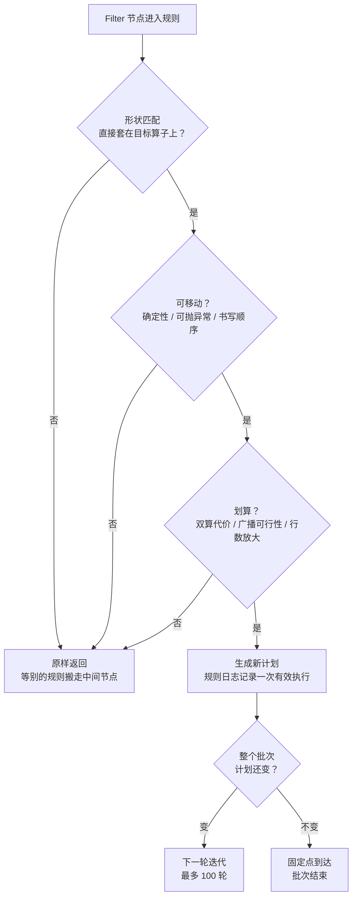
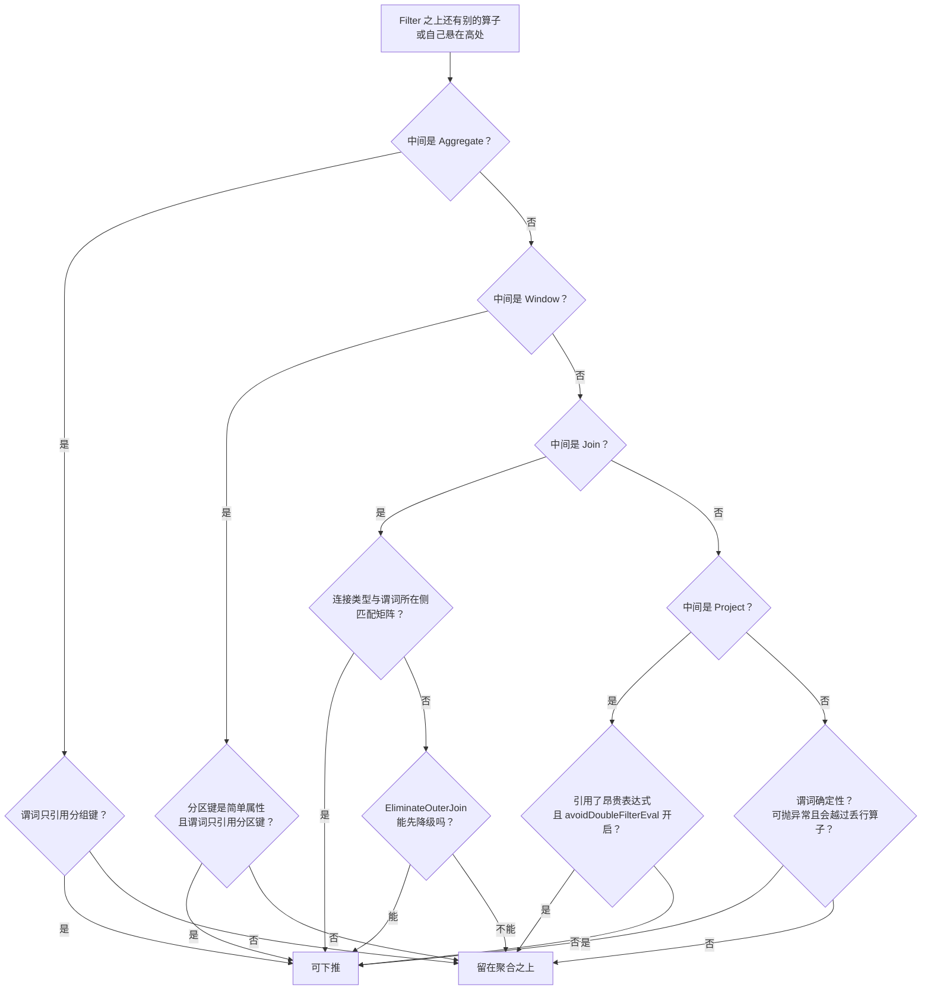
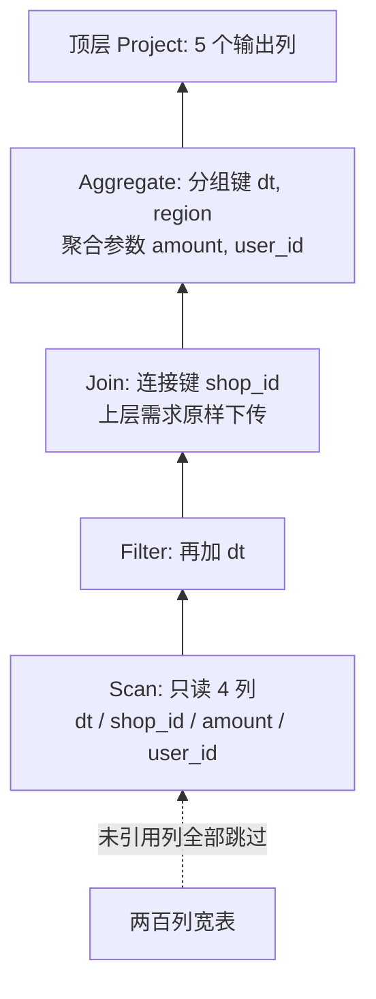
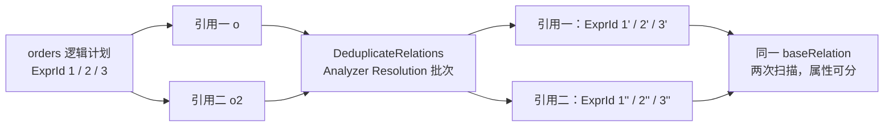
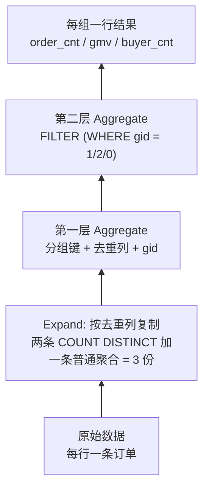
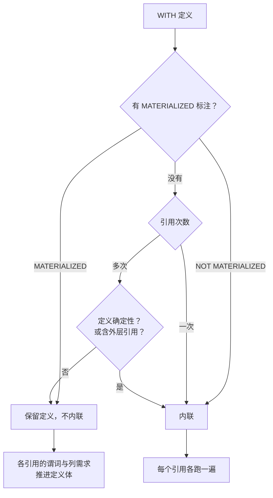

# 03 Catalyst 逻辑优化：Rule-Based Optimizer 的核心规则

**摘要：**

Rule-Based Optimizer（RBO，基于规则的优化器）通常被描述成"几十条等价变换规则"，这种说法解释了它是什么，却解释不了排障时最常撞上的那个问题：我的谓词为什么没有下推。一条规则能否生效取决于三个前提——计划树的形状与规则的模式匹配、谓词本身的可移动性、规则对"这样做是否划算"的判断，任何一个不成立，规则就会安静地返回原计划，EXPLAIN 里看不出任何异常。本文以一条订单宽表 join 维表再按天聚合的查询为主线，逐类拆解谓词下推、列裁剪、常量折叠与空值传播、算子合并、别名消除与自连接去重、Join 重排的归属、IN 列表与去重计数、CTE 内联与谓词下推，每一类都给出触发条件与失效条件；随后讨论规则之间的先后依赖与冲突，包括 `PushDownPredicates` 与 `ReorderJoin` 的批次次序、`ColumnPruning` 与 `CollapseProject` 的相互喂养、`FixedPoint` 批次 100 轮上限与"规则没收敛"的后果；最后给出用 `EXPLAIN` 与 `spark.sql.planChangeLog` 系列配置验证规则是否生效的方法，以及七类反例。全文口径为 Spark 4.3.0。

---

## 第 1 章 一个没有生效的 Filter

### 1.1 三种症状，一个原因

设想一张按天分区的订单宽表 `dwd_order_wide`，两百列，三十一个分区，每个分区一亿行；一张店铺维表 `dim_shop`，几万行；一张用户画像表 `dim_user_profile`，上千万行。业务方要的是按天、按大区统计单量和 GMV：

```sql
SELECT o.dt,
       s.region,
       count(*)                    AS order_cnt,
       sum(o.amount)               AS gmv,
       count(DISTINCT o.user_id)   AS buyer_cnt
FROM dwd_order_wide o
JOIN dim_shop s ON o.shop_id = s.shop_id
WHERE o.dt BETWEEN '2024-01-01' AND '2024-01-31'
  AND s.region = 'east'
GROUP BY o.dt, s.region
```

这条 SQL 在 `EXPLAIN EXTENDED` 下会给出三种截然不同的输出，每一种都对应一类"规则没生效"：

- `Filter (dt >= ...)` 悬在 `Join` 之上，`Join` 的两个子节点都是裸 `Scan`；
- `Filter` 已经在 `Join` 之下了，但 `Scan` 的 `PartitionFilters` 里没有 `dt`，只有一个 `PushedFilters` 里包含 `dt` 的字符串谓词；
- 换成 `WHERE o.shop_id IN (SELECT shop_id FROM dim_shop WHERE region = 'east')` 后，转出来的 `LeftSemi Join` 卡在 `Aggregate` 上面，一行都没下移。

三者看起来是三件事，但在 Catalyst 里是同一个问题的三种表现：规则是"模式匹配 + 替换"的函数，模式匹配不上、谓词不可移动、或者移动后不划算，它就原样返回。

### 1.2 规则生效的三个前提

每个优化规则都是一个 `Rule[LogicalPlan]`，本质是 `PartialFunction`：只对特定的节点形状有定义，其余输入原样返回。这决定了规则生效的第一前提是**形状匹配**——`PushPredicateThroughJoin` 只认 `Filter` 直接套在 `Join` 上的形态，中间隔着一个 `Project`、一个 `Union`、或者一个 `Aggregate`，它就不会在这里动手，只能等别的规则先把中间节点搬走。

第二前提是谓词**可移动**。Spark 4.x 在谓词搬移上引入了一个统一的判定函数 `splitMovable`，把条件按合取项切开，逐个判断能不能挪位置：非确定性表达式（`rand()`、`uuid()`）不挪，因为它每行的取值依赖被处理行的顺序；可抛异常的表达式（ANSI 模式下的除法、`raise_error`、`assert_true`）不挪，因为挪到会减少输入行数的算子下面之后，它看到的行集变了，原本不该被求值的行可能被求值；被这些条件挡住的谓词后面的合取项也跟着留在原位，以保持书写顺序。

第三前提是**划算**。下推谓词本身是等价变换，但等价不等于免费：把谓词推到 `Project` 下面意味着 `Project` 里的表达式可能被算两遍，于是规则要判断这个表达式贵不贵；把 `LeftSemi Join` 推到 `Aggregate` 下面意味着要多扫一次聚合前的数据，于是规则要判断这个 join 能不能走广播。Spark 4.3.0 的 `PushPredicateThroughNonJoin` 与 `PushDownLeftSemiAntiJoin` 里，这类"值不值"的判断和形状判断混在一起写，这正是很多"看起来显然应该下推"的谓词没有动的原因。



### 1.3 批次、迭代与收敛

规则不是一条条独立跑的，`Optimizer` 把规则编成批次（`Batch`），每个批次带一个执行策略：`Once` 只跑一轮，`FixedPoint` 反复跑直到计划不再变化或者撞上迭代上限。批次与 `FixedPoint` 这个执行骨架本身属于 `RuleExecutor` 的职责，它在 [[大数据/Spark/Spark-SQL深度解析与性能调优/01 Spark SQL 全局架构：从 SQL 文本到 RDD 执行的完整旅程|01 Spark SQL 全局架构]] 里已经铺开，分析阶段如何用同一套骨架组织解析规则见 [[大数据/Spark/Spark-SQL深度解析与性能调优/02 Catalyst 解析与分析：从 AST 到 Analyzed LogicalPlan|02 Catalyst 解析与分析]]。4.3.0 的优化器默认批次如下，规则顺序就是源码里的顺序。

| 批次 | 策略 | 主要规则 | 这一批在解决什么 |
|---|---|---|---|
| `Finish Analysis` | `FixedPoint(1)` | `EliminateSubqueryAliases`、`ComputeCurrentTime`、`ReplaceExpressions` | 把分析期的临时结构与时间函数钉死 |
| `Eliminate Distinct` | `Once` | `EliminateDistinct` | 去掉被 `GROUP BY` 覆盖的 `DISTINCT` |
| `Inline CTE` | `Once` | `InlineCTE` | 决定 CTE 内联还是保留为可复用的定义 |
| `Union` | `FixedPoint` | `CombineUnions`、`RemoveNoopUnion` | 先塌一次 Union，减少后续迭代次数 |
| `LocalRelation early` | `FixedPoint` | `ConvertToLocalRelation`、`PropagateEmptyRelation` | 空结果尽早短路，避免触发重型规则 |
| `Subquery` | `FixedPoint(1)` | `OptimizeSubqueries` | 递归优化子查询（子查询内部独立跑一遍优化器） |
| `Replace Operators` | `FixedPoint` | `RewriteExceptAll`、`ReplaceIntersectWithSemiJoin`、`ReplaceDistinctWithAggregate` | 把集合算子改写成 join 或聚合 |
| `Aggregate` | `FixedPoint` | `RemoveLiteralFromGroupExpressions`、`RemoveRepetitionFromGroupExpressions` | 清理分组键里的常量与重复项 |
| `Operator Optimization`（前后各一轮） | `FixedPoint` | 见 1.4 节的规则序列 | 主体：谓词下推、列裁剪、算子合并、常量折叠 |
| `Infer Filters` | `Once` | `InferFiltersFromConstraints` | 从约束反推新谓词 |
| `Early Filter and Projection Push-Down` | `Once` | `V2ScanRelationPushDown` 等 | 把谓词与列裁剪推进数据源 |
| `Join Reorder` | `FixedPoint(1)` | `CostBasedJoinReorder` | 代价驱动重排（CBO 默认关闭，见 04 篇） |
| `Eliminate Sorts` | `Once` | `EliminateSorts`、`RemoveRedundantSorts` | 去掉不影响结果的排序 |
| `Distinct Aggregate Rewrite` | `Once` | `RewriteDistinctAggregates` | `COUNT(DISTINCT)` 改写为两阶段聚合 |
| `RewriteSubquery` | `Once` | `RewritePredicateSubquery`、`ColumnPruning`、`CollapseProject` | 子查询转 join 后再补一轮下推与裁剪 |
| `Check Cartesian Products` | `Once` | `CheckCartesianProducts` | 拦住没有连接条件的笛卡尔积 |

主体批次是两轮 `Operator Optimization`，夹着一轮 `Infer Filters`，两轮用的是同一套规则序列。源码里这条序列的顺序是：`PushProjectionThroughUnion`、`PushProjectionThroughLimitAndOffset`、`ReorderJoin`、`EliminateOuterJoin`、`PushDownPredicates`、`PushDownLeftSemiAntiJoin`、`PushLeftSemiLeftAntiThroughJoin`、`OptimizeJoinCondition`、`LimitPushDown`、`ColumnPruning`、`CollapseRepartition`、`CollapseProject`、`CollapseWindow`、`CombineUnions`、`NullPropagation`、`OptimizeIn`、`ConstantFolding`、`BooleanSimplification`、`ReplaceNullWithFalseInPredicate`、`PruneFilters`、`RewriteCorrelatedScalarSubquery`、`RemoveRedundantAliases`、`RemoveNoopOperators`、`PushdownPredicatesAndPruneColumnsForCTEDef`，最后接上用户注入的自定义规则。

### 1.4 读这张表的三个要点

第一，找问题的位置要看批次而不是看规则名。"谓词没下推"要查的是 `Operator Optimization` 那一轮里 `PushDownPredicates` 前后的计划差异，而不是笼统地看 `Optimized Logical Plan`；如果谓词在 `Optimized` 里仍然悬着，说明规则确实没动它，如果 `Analyzed` 里有而 `Optimized` 里没有，说明它被折叠、被消除或者被并进了连接条件。

第二，`Once` 与 `FixedPoint` 的区别决定了你能不能看到中间态。`FixedPoint` 批次会在同一批里反复跑同一套规则，直到某一轮跑完计划结构完全不变（`fastEquals` 判定），这意味着"规则一次没生效"不等于"规则永远没生效"——这一轮不匹配，下一轮上游节点被别的规则改写之后可能就匹配了。反过来，`Infer Filters` 是 `Once`，它只在两轮主体优化之间插一次，所以由它推导出来的新谓词只有第二轮主体优化去消化。

第三，`EliminateOuterJoin` 排在 `PushDownPredicates` 前面，这个次序本身就是一条规则：外连接在下推之前可能已经不存在了。第 3 章会展开这一点，它是"外连接上的谓词被推下去了"的答案。

---

## 第 2 章 谓词下推：能穿过什么

### 2.1 一条规则，其实是三条

`PushDownPredicates` 不是一个原子规则，它是一条**复合规则**，在源码里是这样的组合：

```scala
object PushDownPredicates extends Rule[LogicalPlan] {
  def apply(plan: LogicalPlan): LogicalPlan = plan.transformWithPruning(
    _.containsAnyPattern(FILTER, JOIN)) {
    CombineFilters.applyLocally
      .orElse(PushPredicateThroughNonJoin.applyLocally)
      .orElse(PushPredicateThroughJoin.applyLocally)
  }
}
```

三个 `Locally` 变体都是针对单个节点的局部重写，`orElse` 把它们串成一条链，在一个 `transformWithPruning` 里自顶向下地对每个节点依次尝试。所以 `Filter` 套 `Filter` 会先被合并，合并后的条件再判断能否穿过下面的算子；如果穿不过去，就停在原地等下一轮。这条组合的存在意味着，追一条谓词的去向时不能只看 `PushPredicateThroughJoin`，同名规则可能在另两个分支里把它处理掉了。

### 2.2 白名单：哪些一元算子可以穿过

`PushPredicateThroughNonJoin` 对大部分一元算子走一个通用分支：只要算子满足 `canPushThrough` 并且其表达式全部确定，就把谓词搬到算子下面。白名单是显式枚举的，只有这些：

| 算子 | 能否穿过 | 前提与说明 |
|---|---|---|
| `Sort` | 能 | 排序不改变行集，谓词先过滤再排序更省 |
| `Repartition` / `RepartitionByExpression` / `RebalancePartitions` | 能 | 分区不改变行集，过滤后 Shuffle 数据量更小 |
| `Distinct` | 能 | 去重不改变"哪些行存在"这一事实 |
| `Generate` | 能 | 非 outer 的 `Generate` 可能丢行，被推下去的谓词会看到它本不该看到的行，4.x 用 `canDropRows` 与书写顺序约束兜底 |
| `Pivot` / `BinBy` / `AppendColumns` | 能 | 不改行集的一元变换 |
| `Expand` | 能 | 行数放大，但谓词对放大后的每一份副本都成立 |
| `BatchEvalPython` / `ArrowEvalPython` / `ExecuteExternalUDF` | 能 | 谓词与 UDF 求值互不影响（UDF 不为该谓词求值） |
| `Aggregate` | 有条件 | 只有引用分组键的谓词能推，见 3.1 节 |
| `Window` | 有条件 | 只有引用分区键的谓词能推，见 3.2 节 |
| `Limit` / `Offset` | 不能 | `Filter` 在 `Limit` 之上与之下语义完全不同 |
| `Sample` | 不能 | 先采样再过滤与先过滤再采样，结果集不同 |
| `Deduplicate` | 不能 | 去重键可能不覆盖被过滤的列，过滤后去重与去重后过滤不等价 |
| `Join` / `Union` / `Intersect` / `Except` | 专门分支 | 不在一元白名单里，由图结构与集合语义单独处理 |

### 2.3 Project 的两个时代

`Filter` 穿过 `Project` 看上去最无害，实际上是整个谓词下推里唯一有版本分水岭的地方。`Project` 的投影表达式可能是昂贵的 UDF、正则匹配、复杂字符串处理；把谓词搬下去，等于让这些表达式对更多行求值（谓词没滤掉的行要重算一遍）。3.x 的选择是无条件下推，4.2 之后改成按昂贵程度决定，两者的取舍恰好相反。

4.2 之前的行为是无条件下推，代价是投影表达式可能被算两遍；4.2 起引入 `spark.sql.optimizer.avoidDoubleFilterEval`（默认 `true`），恢复"昂贵表达式不下推"的老行为，于是 4.3.0 的处理变成：谓词引用的是投影里的廉价表达式，或者完全不引用投影，就下推；引用昂贵表达式，就留在 `Project` 上面。这条配置是"谓词明明引用的是投影出来的列，为什么没下推"在 4.x 上的标准答案，它换来的正是**避免双算**。

判断"贵"的标准是 `CollapseProject.isCheap` 一类的方法：属性引用、字面量、简单的算术与比较算廉价，包含了 `UDF`、`PythonUDF`、子查询的算昂贵。实践含义很直接：把 UDF 的计算塞进 `Project` 再用谓词过滤它的结果，不要期待谓词下推。

### 2.4 逻辑层不是终点

逻辑优化只把 `Filter` 搬到 `Scan` 附近，真正把 `dt` 变成"只读这个目录"的动作发生在更后面：`Early Filter and Projection Push-Down` 批次的扫描下推把谓词交给数据源，得到 `PartitionFilters`、`PushedFilters`、`DataFilters` 三类分工不同的过滤信息，物理层再决定哪些能免读、哪些只能读后过滤。这一段在 [[大数据/Spark/Spark-SQL深度解析与性能调优/09 数据源与 IO 优化：让数据少读、快读、不重读|09 数据源与 I/O 优化]] 展开，此处只需记住：`Optimized Logical Plan` 里已经下推，不代表 I/O 真的减少了，要看 `EXPLAIN` 里 `Scan` 节点的过滤信息分到哪一类。

---

## 第 3 章 谓词下推：穿不过什么

### 3.1 聚合：只有分组键上的谓词能过

`Filter` 套在 `Aggregate` 上时，源码的条件是：`Aggregate` 的所有聚合表达式必须是确定性的，分组表达式不能为空，然后逐个合取项判断——别名展开后只引用 `Aggregate` 子节点输出的谓词，可以推下去，其余留在上面。

这条条件的含义是：`WHERE` 里针对原始列的过滤能穿过聚合，`HAVING` 里针对聚合结果的过滤不能。`HAVING count(*) > 10` 里的 `count(*)` 在聚合之前根本不存在，没有下推可言。而 `WHERE o.amount > 0` 在 `GROUP BY o.user_id` 之上时能穿过聚合，因为过滤金额不影响分组键的去重集合，先滤后聚合与先聚合后滤结果一致。

有两个容易忽略的边界。其一，全局聚合（没有 `GROUP BY`，譬如 `SELECT sum(amount) FROM t`）的 `groupingExpressions` 为空，分支直接不匹配，任何 `Filter` 都穿不过这一层——全局聚合的输出只有一行，之上的 `Filter` 只能在聚合算完之后才谈得上求值。其二，`GROUP BY` 的键是 `double` 或 `float` 时，聚合会把 `-0.0` 规范化成 `0.0`、把各种 `NaN` 归并成同一个值，被推下去的谓词会在规范化之前读到原始值，源码里专门为此做了 `normalizeGroupingExpressions` 处理，遇到无法证明安全的情形就让谓词留在上面。用浮点数当分组键本来就是坏主意，这一条只是让坏主意的结果不至于出错。

### 3.2 窗口：只有分区键上的谓词能过

`Filter` 套在 `Window` 上时，条件是：分区表达式必须全部是简单的属性引用，且谓词只引用这些分区键属性。满足就推到 `Window` 下面，不满足就留在上面。

这解释了两种相反的观察。窗口按 `PARTITION BY dt, user_id` 分区，外层再写 `WHERE dt = '2024-01-15'` 时，`dt` 是分区键，谓词能穿过窗口直达扫描，窗口要处理的行数直接砍掉一个数量级。反过来，最常见的"每组取第一条"写法：

```sql
SELECT * FROM (
  SELECT o.*, row_number() OVER (PARTITION BY o.user_id ORDER BY o.amount DESC) AS rn
  FROM dwd_order_wide o
) t
WHERE t.rn = 1
```

`rn` 是窗口函数的输出，在窗口算完之前不存在，谓词只能留在 `Window` 之上。想让过滤提前生效，可行的办法是把窗口改成"先按组求极值再回表"的半连接写法，这属于改写查询而不是期待优化器。

分区表达式不是简单属性时同样不推。`PARTITION BY date_trunc('day', o.ts)` 这类写法会让 `w.partitionSpec.forall(_.isInstanceOf[AttributeReference])` 直接不成立，整条规则对该 `Window` 失效，连引用原始分区列的谓词也一并失去下推机会。想兼顾可下推与可读性，把分区键在子查询里先用 `Project` 算出来并命名，再在外层按名字分区。

### 3.3 外连接：WHERE 与 ON 的语义不同

外连接是三类阻断里唯一"推错会算错"的一类，因此规则的条件写得最细。它的思路是：`Filter` 挂在 join 之上时，条件来自 `WHERE` 子句，而 `WHERE` 是对连接结果求值；join 的 `condition` 字段里的是 `ON` 子句，是对连接匹配关系求值。两者的可推方向正好相反。

| 连接类型 | `WHERE` 谓词（join 之上） | `ON` 谓词（join 条件之内） |
|---|---|---|
| `Inner` / `LeftSemi` | 左表侧、右表侧都可推 | 左表侧、右表侧都可推 |
| `LeftOuter` / `LeftSingle` | 只有左表侧可推，右表侧与两侧条件留在上面 | 只有右表侧可推，左表侧留在连接条件里 |
| `RightOuter` | 只有右表侧可推 | 只有左表侧可推 |
| `LeftAnti` | 只有左表侧可推 | 只有右表侧可推 |
| `FullOuter` | 都不推 | 都不推 |

`LeftOuter` 那一行值得逐字读一遍。左表是**保留侧**，右表是不保留侧：`WHERE` 里针对左表的条件先过滤左表再连接，与先连接再过滤结果相同，所以可推；`WHERE` 里针对右表的条件意味着"右表匹配不上（补 `NULL`）的行必须被丢掉"，这等于把外连接变成了内连接，如果直接推到右表扫描之前，保留下来的左表行会丢掉本该输出的 `NULL` 行，结果就错了。`ON` 里的右表条件则可以推：它只是缩小"算作匹配"的右表范围，左表行的保留性不受影响。

> [!warning] 条件写错位置，优化器会顺着错的位置优化下去
> 把右表的过滤条件从 `ON` 挪到 `WHERE`，`EliminateOuterJoin` 会立刻把 `LeftOuter` 降成 `Inner`，之后的谓词下推完全合法，结果集却少了那些"右表没有匹配"的行。反过来，把本该过滤结果集的右表条件挪进 `ON`，计划里 join 类型仍是 `LeftOuter`、右表谓词被推到扫描层，看起来"优化更彻底"，实际输出的行数变多了。这两种情况都表现为"优化器很配合"，错误藏在语义层而不是计划层，只能靠对照 `Analyzed` 段确认自己原本想要的连接类型。

顺带把第 1 章埋的伏笔收掉。既然 `WHERE` 里针对右表的条件会把外连接退化成内连接，为什么不直接把它改写掉再推？因为 Catalyst 已经这么做了，而且做得更早：`EliminateOuterJoin` 排在 `PushDownPredicates` 之前，它检查可空侧是否存在拒绝 `NULL` 的谓词（`IS NOT NULL`、与常量的比较、参与内连接等），满足就把 `LeftOuter` 改成 `Inner`，把 `FullOuter` 降成 `LeftOuter` 或 `RightOuter`。所以在 `EXPLAIN` 里看到"我写的外连接不见了、右表谓词被推到了扫描层"，通常不是规则越界，而是这一步先把连接类型改了；`EXPLAIN` 对比 `Analyzed` 与 `Optimized` 两段能立刻确认。

`EliminateOuterJoin` 还有一条常被当成"优化器把 join 吃掉了"的路径：左外连接只选择左表列，且右表的连接键被证明唯一时，整条 join 可以删掉。前面那条查询如果 `dim_user_profile` 只参与连接、不参与输出，就会走到这个分支；一旦把 `u.city` 加进 `GROUP BY`，外连接才会留下来，上面那张矩阵才开始起作用。

### 3.4 非确定性与可抛异常

`rand() < 0.5` 这类谓词不能动。它每行的取值依赖被处理行的顺序，而谓词下推会改变求值位置与求值行集，采样比例随之改变，结果集就不再等价。源码注释里引的 SPARK-13473 讲的就是这一条：非确定性表达式的状态性使得下推改变结果。

可抛异常的表达式的约束更细。以 ANSI 模式下的整数除法为例，`WHERE a / b > 1 AND ...` 中 `a / b` 在 `b = 0` 时抛异常；如果它被推到某个会丢行的算子下面，原本因为前面的条件已经不满足而被跳过、根本不会求值的行，现在会被求值并抛错。4.x 的 `splitMovable` 因此规定：可抛异常的合取项不越过会减少行集的算子，后面的合取项也不越过它，以保持"前面的条件先过滤"的书写顺序。这会产生"谓词还剩一半在上面"的计划形态，看着别扭，但它换来的是"查询不该因为一行脏数据而失败"。

### 3.5 Semi / Anti Join 的专有规则

`IN` 与 `EXISTS` 子查询在 `RewritePredicateSubquery` 里被改写成 `LeftSemi` / `LeftAnti` join，这个改写发生在 `RewriteSubquery` 批次，晚于主体优化。为了让这些 join 也能下移，Spark 专门给了它们一条规则 `PushDownLeftSemiAntiJoin`，它处理和普通 `Filter` 不一样的四类算子：

| 被穿过的算子 | 条件 | 失效条件 |
|---|---|---|
| `Project` | 投影列表全部确定性，且不含相关标量子查询 | 投影里含相关标量子查询 |
| `Aggregate` | 聚合表达式全部确定性，分组非空，且该 join 能被规划成广播 Hash Join | 不能广播（join 两侧都超阈值、或 hint 明确禁止） |
| `Window` | 分区键全是简单属性，且 join 条件只引用分区键与右表输出 | 分区键是复合表达式 |
| `Union` | 每个分支都能独立求值该条件 | 分支输出中找不到语义等价的属性 |

`Aggregate` 那一行是最容易被忽略的失效条件：能不能下推不取决于语义，而取决于物理可行性——规划不出广播 join，就不下推。这意味着同一句 `IN` 子查询，在右表小的时候会把 `LeftSemi Join` 推到聚合下面，右表涨到阈值以上就停在聚合上面，计划形态随数据量漂移，而 `EXPLAIN` 里看不出"为什么昨天不一样"。

### 3.6 一张判断图

把三章的判据收成决策路径，遇到"谓词为什么没下去"时按图走一遍，通常能落到某个具体条件上。



---

## 第 4 章 列裁剪

### 4.1 需求列自根向下传播

`ColumnPruning` 的机制与谓词下推相反：谓词从根往叶找"哪些行不要"，列裁剪从根往叶找"哪些列不要"。它不做全局分析，只在每个节点上看父节点引用了自己的哪些输出，把不需要的部分剪掉，由 `transformWithPruning` 自顶向下把**需求列**一路带下去。

以第 1 章那条查询为例，宽表两百列，最终只用 `dt`、`shop_id`、`amount`、`user_id`：

| 节点 | 需要向下索取什么 | 依据 |
|---|---|---|
| 根 `Project`（`GROUP BY` 的输出） | `dt`、`region`、`order_cnt`、`gmv`、`buyer_cnt` | 最终输出 |
| `Aggregate` | `dt`、`region`、`amount`、`user_id` | 分组键 + 聚合函数参数 |
| `Join` | 两表的连接键 + 上述列 | join 条件与上层需求 |
| `Filter`（`dt` 区间与 `region`） | 追加 `dt`、`region` | 自身条件 |
| `Scan(dwd_order_wide)` | `dt`、`shop_id`、`amount`、`user_id` | 累计需求 |



两百列里读四列，按列式存储的理论模型 I/O 降到 2%，实践中因为元数据、字典页、压缩块对齐，通常落在 60% 到 85% 的节省区间（示例推算，具体按文件实测）。

### 4.2 Project 与 Aggregate 的传播

两个传播细节决定了裁剪能走多远。

`Project` 套 `Project` 时，外层用不到的列直接从内层投影列表里删掉，这是最常见的形态，视图、子查询、DataFrame 的链式 `select` 叠出来的多层投影都靠它收拢。

`Project` 套 `Aggregate` 时，裁剪作用在 `aggregateExpressions` 上：外层只要 `gmv`，那么 `count(*)` 与 `count(DISTINCT user_id)` 的计算可以被整条剪掉，连带着 `user_id` 也不必从宽表里读。这一点在实验性查询时很实用——`EXPLAIN` 里 `Aggregate` 的表达式列表比 SQL 少，说明确实剪掉了，而不是没生效。

反向的裁剪由 `prunedChild` 完成：`Aggregate`、`Expand`、`Generate`、`FlatMapGroupsInPandas`、`MergeRows` 这些节点的子节点会被剪到只剩自己引用的列。`Generate` 还多一步，它把不用的子节点输出记进 `unrequiredChildIndex`，物理层据此跳过对应列的读取。`LeftSemi` / `LeftAnti` 的右侧输出全都被剪掉，因为这些算子只输出左表列，右表只需要连接键。

### 4.3 Union 与 SetOperation 的例外

`Union` 的裁剪不能只看一个分支。所有分支必须同步剪到相同的列集合，否则列位置错乱，因此规则先按第一个分支算出的需求剪，再给每个分支套一个 `Project` 把列对齐。这也是 `Union` 之上经常会多出一个 `Project` 的原因，它不是冗余，而是列对齐的产物，紧接着会被 `CollapseProject` 收掉。

`EXCEPT`、`INTERSECT` 这类 `SetOperation` 则被直接放过：`Project` 套 `SetOperation` 时规则原样返回，因为两个分支的列必须逐位对齐，裁剪一个分支就意味着改写整个集合语义。遇到这类算子，列裁剪基本不产生收益，能指望的只有分区裁剪与行组统计。

### 4.4 `SELECT *` 伤在哪里

`SELECT *` 之后抱怨列裁剪没生效，是很常见的误判。多数情况下 `Project` 套 `Project` 那一支能把它救回来：外层只引用三列，内层的 `*` 展开出的二十列会被剪到三列。真正会吃亏的是三种情形。

其一，嵌套字段。`SELECT *` 取整列 `struct`，`NestedColumnAliasing` 与 `spark.sql.optimizer.nestedSchemaPruning.enabled` 提供的**字段级裁剪**要在能证明"只用到 `s.a` 和 `s.b`"时才生效，整取 `struct` 就只能读整个 `struct`。宽表里一个 `struct` 有几十个字段时，这一项的差距比列数本身更大。

其二，物化与缓存。`CACHE TABLE`、临时表、写出的中间结果，物化的是 `SELECT *` 那一刻的列集合，后续查询再裁剪也裁不掉已经落地的列。视图被反复引用且不做内联时同理。

其三，多消费方共享的视图。视图定义里写 `SELECT *`，只要有一个消费方引用了全部列，其它消费方就无法把投影统一剪窄；把视图定义成明确列清单，可以避免这类牵连。

### 4.5 子查询的列引用

相关子查询会把外层引用的列带进内层，从而扩大内层的裁剪需求。`WHERE EXISTS (SELECT 1 FROM dim_shop s WHERE s.shop_id = o.shop_id)` 这条子查询本身不输出任何列（`SELECT 1`），但它引用了外层的 `o.shop_id`，被改写成 `LeftSemi Join` 后，右表只需要 `shop_id`，左表只需要连接键与上层需求，裁剪反而比手写 join 更彻底。非相关标量子查询被提出来独立执行，它的列需求与外层完全解耦，这也是标量子查询改写之后往往能顺带减一轮扫描的原因。

---

## 第 5 章 常量折叠与空值传播

### 5.1 折叠的边界

`ConstantFolding` 把可以在优化期算出结果的表达式提前算掉。它折叠的前提是 `hasNoSideEffect`：属性引用、字面量、确定性的数组与结构体构造可以折叠；其它表达式一律不动。折不动的原因有两类，一类是会抛异常，另一类是结果不确定，这两条边界合起来就是折叠的**副作用边界**。

会抛异常的情形直接与 ANSI 模式挂钩：`Cast` 只有在非 ANSI 会话里才进入折叠判断，因为 ANSI 下的类型转换失败会抛错，优化期求值等于把一个"运行到那一行才失败"的查询提前失败。同理，条件表达式（`CASE WHEN`、`COALESCE`）里的分支不能被折叠成"必须求值"，源码用一个 `FAILED_TO_EVALUATE` 标记记住"这个分支折叠过且失败"，避免反复试错把开销变成平方级。

结果不确定的情形里，`current_date()` 与 `now()` 常被误认为"由 `ConstantFolding` 折叠"。实际上它们在 `Finish Analysis` 批次就被 `ComputeCurrentTime` 替换成同一个字面量了——每次查询取一次当前时间，之后整条计划里都是常量，折叠只是顺手完成最后一步。`rand()`、`uuid()` 则永远不折叠，因为它们的语义就是"每行不同"，折叠会改变结果。

### 5.2 折叠之后谁来回收

把条件折叠成字面量只是第一步，回收由同一批次里排在后面的两条规则完成。`ReplaceNullWithFalseInPredicate` 把谓词位置上的 `NULL` 换成 `false`——`Filter` 对 `NULL` 的处理本来就等价于丢弃该行，但它只在这个位置上等价，别处不能乱换。`PruneFilters` 则对 `Filter` 做最终裁决：条件是 `Literal(true)` 就把 `Filter` 整个删掉；条件是 `Literal(false)` 或 `Literal(null)` 就把子树替换成 `LocalRelation`（空结果），一次真实扫描都不发生。

`EXPLAIN` 里看到 `Filter` 直接退化成空结果，源头是 `PruneFilters` 而不是 `ConstantFolding`。这个区分在排障时有意义：如果 `EXPLAIN` 显示结果为空但你确信数据存在，去看 `Analyzed` 阶段的条件是不是被折叠成了 `false`——常见于日期字面量写错格式、类型转换失败被 TRY 语义吞掉、以及 `current_date()` 与数据分区时区错位。

### 5.3 NullPropagation 改写了什么

`NullPropagation` 利用 SQL 三值逻辑"大多数运算遇到 `NULL` 返回 `NULL`"这一事实做静态简化。4.3.0 里它做的主要改写如下，每一条都带着前提：

| 原表达式 | 改写成 | 前提 |
|---|---|---|
| `count(NULL)` | `0` | 参数全是 `null` 字面量 |
| `count(col)` | `count(1)` | `col` 不可空，且不是 `count(DISTINCT col)` |
| `isnull(col)` | `false` | `col` 不可空 |
| `isnotnull(col)` | `true` | `col` 不可空 |
| `a <=> NULL` | `isnull(a)` | 空安全等于的一侧是 `null` 字面量 |
| `coalesce(NULL, a, b)` | `coalesce(a, b)` | 参数是 null 字面量时直接去掉 |
| `coalesce(a, b)` | `a` | `a` 不可空，后面的参数不必再求值 |
| `x IN ()` | `false` | 空列表，且未开 legacy 行为 |
| `NULL IN (a, b)` | `NULL` | 左侧是 `null` 字面量 |

这些改写里，`count(col)` 变 `count(1)` 与 `isnull(col)` 变 `false` 依赖"列不可空"这个前提，而列的**不可空性**来自表定义、连接键约束、`WHERE col IS NOT NULL` 推出来的约束，甚至 `PropagateEmptyRelation` 对 `Union` 分支的化简结果。也就是说，NullPropagation 的效果会随着约束推导而变化，同一个查询改一行 `WHERE` 就可能让某条改写生效或失效。

### 5.4 null 语义被改变的两个现场

第一条现场是 `IN` 空列表。`x IN ()` 在新行为下是 `false`，在 legacy 行为下是 `NULL`；`NOT IN ()` 的命运相同。方言迁移、跨引擎比对、从别的引擎搬过来的 SQL 在这里出现结果差异，往往是这条 legacy 开关的事，而不是数据问题。

第二条现场是 `NOT IN` 与子查询里的 `NULL`。`NOT IN (SELECT ...)` 当子查询结果含 `NULL` 时，SQL 标准下整条条件恒为 `UNKNOWN`，过滤不返回任何行，很多人把这当成 bug。Spark 的处理是把 `NOT IN` 改写成 `LeftAnti` join，连接条件写成 `Or(EqualTo(a, b), IsNull(EqualTo(a, b)))`，物理层识别成空值感知的反连接（null-aware anti join），从而在语义正确的前提下保留 hash join 的形态。这解释了为什么 `NOT IN` 的执行计划里 join 条件看着比手写的 `a = b` 复杂，也解释了为什么右表含 `NULL` 时 `NOT IN` 与 `NOT EXISTS` 结果不同——后者对 `NULL` 是安全的。

---

## 第 6 章 算子合并

### 6.1 CollapseProject

多层相邻 `Project` 合成一层，判据是上层投影的每一项能否在保持语义的前提下塞进下层。别名展开、`isCheap` 判断、Python UDF 的求值类型（Arrow 批量、批处理、逐行）都参与其中，合并的前提是不能打乱 UDF 的求值方式；`spark.sql.optimizer.collapseProjectAlwaysInline` 控制是否无条件下推别名，默认为假，避免把昂贵表达式复制到多处。

不合并的几种典型情形值得单独记。上层投影里出现非确定性表达式（`rand()`、`uuid()`）时，把它内联进下层等于让它在不同的行集上求值，结果就不一样了；投影里含相关子查询时同理，相关子查询的求值依赖外层行，位置一挪语义就变；上层的别名带元数据、或者别名改变了列名时，合并要么被跳过，要么必须显式保留元数据（4.1 起默认开启 `spark.sql.optimizer.preserveAliasMetadataWhenCollapsingProjects`），否则元数据会丢、根计划的输出列名会变。看到计划里"明明可以合成一层却留着两层 `Project`"，先查投影里有没有这三样东西。

合并的收益不只是少一层算子。`Project` 少一层，`Filter` 就少一层阻力，谓词下推与列裁剪都能多走一步，所以 `CollapseProject` 与前两者之间是互相喂养的关系，这也是第 10 章要展开的冲突点之一。

### 6.2 CollapseRepartition

`Repartition`、`RepartitionByExpression`、`RebalancePartitions` 相邻时会合并或消除，分三种情形：上层是不触发 Shuffle 的 `coalesce`、下层是触发 Shuffle 的 `repartition` 时，若上层分区数不小于下层，返回下层、把 `coalesce` 摘掉，否则保留 `coalesce` 并接到下层的子节点上；上层是 `RepartitionByExpression` 而下层是全局 `Sort` 或任意重分区时，下层被整个删掉，因为上层的重分区已经覆盖了下层的分布需求；`RebalancePartitions` 叠加 `Sort`、重分区或另一个 `RebalancePartitions` 时，下层同样被删掉。

失效条件同样清楚：下层不是 `Sort` 或重分区操作时规则不触发，中间夹一个 `Project`、`Filter`、`Aggregate` 都会打断这一次合并；上层 `coalesce` 的分区数小于下层时，规则保留的是 `coalesce` 而不是"省事"的那一个，因为把 `coalesce` 摘掉会让输出分区数变多。

这里有一条容易踩空的语义：`coalesce` 本身不保证数据分布，它只是在现有分布上合并分区，所以"先 `repartition` 再 `coalesce`"这个组合的最终分布本来就没有保证；规则把中间那次重分区删掉之后，这一点没有任何改变，但若下游存在依赖分布的假设（下一次 join 的分区假设、写文件的并行度），后果会以"多一次 Shuffle"或者"并行度变了"的形式出现。计划里看到 `Exchange` 消失就要警惕，`EXPLAIN` 里 `Exchange` 的 `partitioning` 是唯一可靠的判据。

### 6.3 CollapseWindow

相邻窗口合并的条件比 `CollapseProject` 严：分区规格必须逐项语义相等，排序规格要么相同、要么其中一个是空的且空排序的那个窗口表达式在任意行序下求值都一样（帧是整分区 `UNBOUNDED PRECEDING` 到 `UNBOUNDED FOLLOWING`）。排序规格不同就不能合并，因为窗口函数的结果依赖行序。

合并窗口有代价：一个窗口算子内部的窗口函数越多，物理执行时共享一次排序，看起来更省；但 `InferWindowGroupLimit` 与 `LimitPushDownThroughWindow` 这类"把 `LIMIT` 推进窗口"的优化需要独立而清晰的窗口结构，合并过度反而会把它们挡在门外。4.x 为此把"空排序子窗口并入有序父窗口"这个方向单独加开关控制。窗口合并是典型的**少一个算子未必更快**。

### 6.4 CombineFilters 与 CombineUnions

`CombineFilters` 把相邻两层 `Filter` 的合取项去重合并，它是 `PushDownPredicates` 组合链里的第一环，谓词能否继续往下走往往取决于这一步有没有先把两层并成一层。它的前提写得很明确：内层 `Filter` 的条件必须是确定性的，外层条件里非确定性的合取项不下并——两层合并意味着求值位置统一，而两处非确定性条件各自求值时状态是分开的，合到一处结果就不一样。

`CombineUnions` 把嵌套的 `Union` 拍平成单层，让所有分支并列。拍平有两个硬性前提：`byName` 与 `allowMissingCol` 必须一致，否则列对齐规则不同、合并会算错；`UNION`（去重）与 `UNION ALL` 不能混拍。拍平之后，谓词与投影可以逐分支下推（`PushProjectionThroughUnion`），每个分支都能独立裁剪，不必先合并出一份中间结果再过滤；计划树变浅也让规则遍历少走几轮。

---

## 第 7 章 别名、自连接与 Join 重排的归属

### 7.1 RemoveRedundantAliases

`RemoveRedundantAliases` 删掉"名字没变"的别名，`SELECT a AS a` 这类写法被剥掉。它的判据里有两个细节值得记住：带元数据的别名不能剥，因为元数据会丢；别名把属性改名了也不能剥，因为会改掉根计划输出的列名。反过来说，`AUTO_GENERATED_ALIAS` 这种自动生成的元数据可以在确定不流向视图的前提下去掉，这条宽松处理是为了让 `DataFrame` 链式操作产生的别名能被清干净。

别名消除的目标不是省一个 `Alias`，而是让属性引用回到最简形态。属性引用越简单，`ColumnPruning` 的 `references` 判断、`PushDownPredicates` 的 `references.subsetOf` 判断就越容易命中，规则生效的概率随之上升。手工写 `SELECT col AS col` 这种"占位别名"没有性能收益，但给视图、临时表加一层无谓的别名表达式（譬如 `col + 0 AS col`）会让下游规则全部失效。

### 7.2 自连接与 DeduplicateRelations

写自连接时同一张表出现两次，两个引用共享同一个逻辑计划对象，`ExprId` 也相同，后续按属性集合判断归属（左表还是右表）就全乱了。负责分化的是 `DeduplicateRelations`，它不在 `Optimizer` 里，而在 `Analyzer` 的 `Resolution` 批次中：发现同一个逻辑计划被引用多处，就给每一处生成新的 `ExprId`，让两个引用在属性层面彻底可分，这一步可以叫作 **`ExprId` 分化**。

这条事实改变了对两类现象的解读。其一，自连接执行计划里看到两次扫描，不是优化器"没识别出是同一张表"，而是分析期就把它们当成了两个独立关系，扫描两次是语义决定的；想省一次扫描要靠缓存或者显式物化。其二，`DeduplicateRelations` 之后 `baseRelation` 仍然指向同一个表，所以数据源层面的缓存、广播、统计信息还能共享，只是行级的重算免不掉。



### 7.3 ReorderJoin 到底做了什么

`ReorderJoin` 常被说成"RBO 阶段的 join 重排"，这个说法只对一半。它的触发条件是连接链上超过两个输入且存在条件；它做的事有两件：把 `Filter` 与内连接链上的条件全部收集起来，按"哪一侧能求值"重新分配到各次 join 或两侧的 `Filter` 上；然后按"优先选择能提供条件的输入"这个结构启发式，贪心地决定连接的左右顺序。

它不比较代价，也不看行数，这是它与代价重排最根本的分界。真正的代价重排在 `CostBasedJoinReorder`，那是独立的 `Join Reorder` 批次，策略是 `FixedPoint(1)`，而且源码第一行就写着：`if (!conf.cboEnabled || !conf.joinReorderEnabled)` 直接返回原计划。4.x 里这两个开关默认都是关闭的，所以默认情况下这条路根本不走，RBO 阶段确实**不重排** join。

还有两个边界。只有两张表时 `ReorderJoin` 不匹配，两表 join 的左右关系由物理层的 join 策略选择决定，不在逻辑优化这里。`spark.sql.cbo.enabled` 关闭而 `spark.sql.cbo.starSchemaDetection` 开启时，`ReorderJoin` 会用星型模型的启发式把维表排到前面去，这是"关掉 CBO 之后三表 join 顺序也变了"的原因。这条代价路径与统计信息的依赖关系，在 [[大数据/Spark/Spark-SQL深度解析与性能调优/04 CBO 代价模型：统计信息驱动的执行计划选择|04 CBO 代价模型]] 里展开。

### 7.4 谁先谁后

同一轮迭代里，`ReorderJoin` 排在 `EliminateOuterJoin` 与 `PushDownPredicates` 之前。这个顺序意味着：连接链先被拍平、条件先被分配到各个 join，然后外连接降级，最后才是谓词下推。把顺序倒过来会出问题——谓词先下推，join 条件与两侧 `Filter` 混在一起，`ReorderJoin` 收集条件时就要处理已经被搬走的节点。

跨批次看，`Join Reorder`（代价重排）在 `Early Filter and Projection Push-Down` 之后，源码注释给了理由：重排依赖准确的统计信息，而数据源关系要等扫描下推之后才报告统计。这也说明 RBO 定下的连接形态是 CBO 的输入，而不是反过来——`ReorderJoin` 拍出来的连接链如果没有条件可用，CBO 拿到的初始计划就已经是一个笛卡尔积。

---

## 第 8 章 IN 列表与去重计数

### 8.1 OptimizeIn 的两条路

字面量 `IN` 列表的处理由 `OptimizeIn` 负责，阈值是 `spark.sql.optimizer.inSetConversionThreshold`，默认 10：列表长度达到阈值，整个 `In` 被替换成 `InSet`，内部是 `HashSet`，每行一次哈希探测；不到阈值，保持 `In`，代码生成时展开成逐项比较。这条阈值是内部配置，调小会让更多短列表走哈希集合、省掉逐项比较，代价是每行都要查集合；调大则回到逐项比较，短列表更省、长列表开始线性退化。确认阈值有没有越过的判据很直接：`EXPLAIN` 的过滤条件里出现 `InSet` 就是已经转成了哈希集合，仍然写作 `In` 就说明还停在逐项比较。

`InSet` 之上还有一层优化：`spark.sql.optimizer.inSetSwitchThreshold` 默认 400，集合规模在 400 以内且类型是 `byte`、`short`、`int`、`date` 时，代码生成走 `switch` 语句，编译成一次跳表分支；超过 400 或者类型是字符串，就退化成哈希集合探测。这两个阈值一起决定了"大 `IN` 列表"的实际执行形态。

| 列表规模 | 逻辑形态 | 运行时形态 | 代价特征 |
|---|---|---|---|
| 1 到 9 | `In` | 逐项比较，可短路 | 列表越长线性开销越明显 |
| 10 到 400 | `InSet` | `switch` 跳表或哈希探测 | 近似 O(1)，编译产物较短 |
| 400 以上 | `InSet` | 哈希集合探测 | 近似 O(1)，但集合构造与内存占用随规模上涨 |

### 8.2 "大 IN 转 join"是误传

一句流传很广的说法是"`IN` 列表太大会被优化成 join"。**字面量列表不进 join**——`In` 里的值在优化期就确定，与任何表无关，没有 join 的对象。会被改写成 join 的是 `IN` 子查询：`RewritePredicateSubquery` 把它变成 `LeftSemi Join`，然后 `PushDownLeftSemiAntiJoin` 再推它下移。两件事发生在不同阶段，针对不同语法，混为一谈会让人在字面量列表上找 join，在子查询上等阈值。

字面量列表该不该手写 join，答案取决于列表规模与选择性。几千个值的列表，`InSet` 一次哈希探测比构建一张只有几千行的表再广播 join 更省，因为没有 shuffle、没有广播、没有额外的 stage。列表涨到几十万值，SQL 文本本身就成了负担（解析、计划序列化、程序生成代码的长度都有上限风险），此时把值落成临时表再 `LEFT SEMI JOIN` 才是正解，收益来自"值在存储层而不是 SQL 文本里"。

量级示例推算：十亿行的表配一千个值的列表，逐项比较最坏情况是万亿次比较，`InSet` 是十亿次哈希探测，两者相差三个数量级；如果这张表先被 `dt` 分区裁剪到一亿行，两边的绝对开销都降到原来的十分之一，倍数关系没有变，是否还值得在这上面做文章，取决于 I/O 是否已经成了主要成本——真到了那个阶段，`IN` 列表的形态就不再是主要变量。

### 8.3 COUNT(DISTINCT) 的两阶段

`COUNT(DISTINCT)` 在物理层没法直接用哈希聚合一次算完：一个分组里可能同时有多个去重计数与普通聚合，去重集合不能合并成一个状态。`RewriteDistinctAggregates` 把它改写成一次 `Expand` 加两层聚合：`Expand` 按每个去重列复制行并打上分组标记（`gid`），第一层聚合按"分组键 + 去重列 + `gid`"聚合，第二层聚合用 `FILTER (WHERE gid = n)` 把各标记的行聚合回最终结果。



代价写在图上：`Expand` 把行数放大了"去重组数 + 可选的一份普通聚合"倍，两个 `COUNT(DISTINCT)` 配一个 `sum` 就是**行数放大**三倍。这条改写之后才有机会走部分聚合与 Shuffle 合并（Shuffle 侧的聚合与排序结构见 [[大数据/Spark/读书笔记-spark内核/05_Shuffle核心机制/6. Spark_Shuffle聚合与排序结构|Shuffle 聚合与排序结构]]），所以整体通常仍然划算，但它决定了"带多个 `COUNT(DISTINCT)` 的查询，Shuffle 数据量天然比行数大几倍"。

并不是所有 `COUNT(DISTINCT)` 都会被改写，触发条件比想象中窄：去重聚合只有一个、且不带 `FILTER` 子句时，物理聚合策略自己就能处理，规则不动它，也就不会有 `Expand`；反过来，只要出现 `FILTER`，或者去重聚合不止一个，改写就必须发生——`FILTER` 需要先用 `max` 把过滤结果汇总成全局条件，一个去重聚合处理不了。改写之后还有一个可以省 `Expand` 的细节：多个去重聚合如果共享同一组去重键，它们会共用一份 `Expand` 投影，放大倍数按"去重组数"而不是"去重聚合个数"计算，所以把去重键相同的几个计数写在一起不会成倍放大代价；`spark.sql.optimizer.rewriteCountDistinctConditional.enabled` 则让全带 `FILTER` 的去重组用受过滤保护的去重键，把输出基数拉回未改写时的量级。这条规则排在 `Decimal Optimizations` 之后，因为十进制精度改写可能修改去重列本身，顺序颠倒了就会基于过时的列做 `Expand`。

---

## 第 9 章 CTE：内联、还是看起来像物化

### 9.1 分析期先接住

`WITH` 子句在 `Analyzer` 的 `Substitution` 批次里由 `CTESubstitution` 处理。3.x 之后它不再把 CTE 无条件复制进每个引用位置，而是构造 `CTERelationDef`（定义）与 `CTERelationRef`（引用）两种节点，把"定义一次、引用多次"的结构保留下来，交给优化器决定后续。

### 9.2 Inline CTE 批次的判定

`Inline CTE` 是主体优化之前的 `Once` 批次，规则是 `InlineCTE`。判定逻辑可以概括成：引用只出现一次，内联；定义里没有非确定性表达式、或者引用了外层查询的列，内联；否则保留定义，后续由 `PushdownPredicatesAndPruneColumnsForCTEDef` 把各引用的谓词与列需求推进定义体。用户可以在 CTE 上写 `MATERIALIZED` 或 `NOT MATERIALIZED` 覆盖默认判断：前者永不内联，后者总是内联。



### 9.3 不内联时的谓词下推，以及它的失效条件

定义被保留下来之后，各引用上的谓词还有机会进入定义体，负责这件事的是 `PushdownPredicatesAndPruneColumnsForCTEDef`，它排在主体规则序列的末尾。机制是两遍扫描：先按 `PhysicalOperation` 模式把所有引用点上的谓词与引用到的属性收集起来，按 CTE 定义分组；然后把同一组谓词用析取（`Or`）合并、属性取并集，一起推进定义体，于是定义体只需要算出"任何一个引用可能用到"的行与列。

这条路径有一个反直觉的失效条件：合并用的是析取，只要有一个引用点上没有可下推的谓词，合并结果就退化成 `TRUE`，整个定义体的谓词下推全部作废——包括那些本来带着强选择性谓词的引用。也就是说，同一份 CTE 被两个地方引用，一处带 `WHERE dt = '2024-01-15'`，另一处裸引，两处都享受不到过滤下推；把裸引的那一处补上谓词，两处一起受益。非确定性谓词在这一步被直接排除，理由与第 3 章相同。

列裁剪的传播不受这条析取规则影响：属性取并集之后，定义体里没有被任何引用读到的列仍会被剪掉，所以"引用多、列用得少"的 CTE 即使谓词下推失败，I/O 上也还有收益。

### 9.4 CTE 不是物化视图

图里最要紧的一条箭头是 `I --> M`：**内联等于重复执行**，每个引用各跑一遍。下面这种写法在小数据上完全正常，在宽表上会把同一份聚合算两次、扫两次：

```sql
WITH daily AS (
  SELECT dt, shop_id, sum(amount) AS gmv
  FROM dwd_order_wide
  WHERE dt BETWEEN '2024-01-01' AND '2024-01-31'
  GROUP BY dt, shop_id
)
SELECT * FROM daily WHERE gmv > 10000
UNION ALL
SELECT * FROM daily WHERE gmv <= 10000
```

两次引用、定义里含聚合、结果是确定性的，按默认判断会被内联成两份聚合，数据源被扫两遍。改写方式有三种：加 `MATERIALIZED` 让它保留定义（此时各引用的谓词会被推进定义体，但整体只算一次）；把两次引用合成一次（本例中 `UNION ALL` 两侧互补，等价于直接取全部）；或者先写临时表再查两次，用存储换计算。

我们需要把期望摆正：`MATERIALIZED` 让定义只算一次，但"只算一次"不等于"结果常驻"，它仍在同一个查询内有效，不跨查询复用。跨查询复用要靠 `CACHE TABLE` 或者落表。反过来，CTE 被内联也不等于一定差——如果某个引用上带强选择性的谓词能推进定义体，内联后的计划可能比"先算全量再过滤"更快，判据是 `EXPLAIN` 里定义体被扫了几次、每次带不带过滤。

---

## 第 10 章 规则冲突与收敛

### 10.1 四个真实冲突

规则之间不是正交的，前一条规则的产物会成为后一条规则的输入，方向错了就互相拆台。下面四个是本专栏范围内最常见的。

| 冲突组合 | 表面现象 | 机理 |
|---|---|---|
| `PushDownPredicates` × `ReorderJoin` | 三表 join 的谓词位置与预期不符 | 同批次内 `ReorderJoin` 先拍平连接链并分配条件，`PushDownPredicates` 再处理剩余 `Filter` |
| `ColumnPruning` × `CollapseProject` | 计划里 `Project` 层数反复变化 | 裁剪在算子之间插入 `Project`，`CollapseProject` 又把它合掉，下一轮裁剪再插 |
| `NullPropagation` × 子查询改写 | 出现计划里本没有的 `Exists` 子查询 | `NullPropagation` 的某些改写会引入 `Exists`，故 `RewriteNonCorrelatedExists` 紧排其后 |
| `EliminateOuterJoin` × `PushDownPredicates` | 外连接消失、右表谓词被推下去 | 前者先把外连接降级为内连接，后者才按内连接矩阵下推 |

第一条冲突的根源是"条件在谁手里"。`ReorderJoin` 把条件收进 join 条件之后，`PushDownPredicates` 看到的 `Filter` 已经变少；而 `PushDownPredicates` 把条件搬到两侧 `Filter` 之后，`ReorderJoin` 下一轮又要重新收集。两者在同一 `FixedPoint` 批次里反复互相改写，收敛的前提是每一轮之后计划结构确实在减少而不是来回摆动——大多数情况下它会收敛，因为拍平与下推都是单向收缩的。

第二条冲突是"裁剪与合并赛跑"。`ColumnPruning` 需要在算子之间插 `Project` 才能把列集合收窄，`CollapseProject` 看到相邻 `Project` 就合并。合并之后列集合可能又变宽（外层投影里引用了更多列），下一轮裁剪再剪一次。这一对是良性的互相喂养，代价是迭代轮数，收益是最终计划里既没有多余 `Project` 也没有多余列。它也是"计划里 `Project` 数量在不同 Spark 版本不一样"的常见原因。

### 10.2 FixedPoint 的收敛判据与 100 轮上限

`RuleExecutor.execute` 的循环写得很直白：一轮里按顺序把批次内所有规则作用一遍，然后比较这一轮结束时与开始时计划是否 `fastEquals`，相等就认为到达固定点、退出；不等就再跑一轮，直到 `iteration > maxIterations`。上限由 `spark.sql.optimizer.maxIterations` 控制，默认 100，超过就打一条 warning，内容是"Max iterations (100) reached for batch ..."，然后带着当前计划继续往下走。

这条 warning 的语义是"规则没收敛"，**没收敛不等于算错**。计划停在半路，正确性由等价变换保证，性能可能不是最优；同时它意味着优化阶段烧掉了远超正常水平的 CPU——一个正常查询的主体批次通常两三轮回就收敛，撞到几十上百轮说明某几条规则在互相拆台。排查方向是把 `spark.sql.planChangeLog.level` 打到 `INFO`，看这批规则里哪些在反复生效：如果每一轮都是同样的两条规则在改同一处，就是互相拆台；如果每一轮改动位置都不同，可能只是计划太大，规则传播需要的轮数本来就多。

`maxIterations` 的取值方式还有一个细节：它是从配置文件读取的配置，运行时 `SET` 不生效，要改只能改 `spark-defaults.conf` 一类的配置文件。多数情况下把它调大不是解法——调大只是让两条打架的规则多打几十轮，真正的解法是改写查询，让参与冲突的结构消失。

### 10.3 计划校验与"规则写坏了"的暴露

4.x 在 `RuleExecutor` 里加了计划变化校验：每条规则改写之后检查新计划是否仍然合法（输出属性是否完整、有无悬空引用），不合法就抛 `PLAN_VALIDATION_FAILED_RULE_IN_BATCH` 并指出规则名与批次名。`spark.sql.planChangeValidation` 的默认值在测试环境开启、生产关闭，另有一个轻量版默认开启。这条机制对自定义规则尤其重要：规则返回的计划如果属性集合与父节点期望不一致，会在这里被当场抓住，而不是等到执行时抛一个毫无头绪的空指针。

### 10.4 冲突的处置顺序

遇到"规则互相打架"，笔者建议的处置顺序是：先用 `planChangeLog` 定位到具体规则与批次，再判断是否有配置能在不改变语义的前提下绕开（`avoidDoubleFilterEval`、`collapseProjectAlwaysInline` 这类），然后是改写查询结构（把外连接改成显式 `CASE WHEN`、把窗口改成半连接），最后才是调整 `maxIterations` 这类兜底手段。把顺序倒过来，等于用调参掩盖结构问题。

### 10.5 几个开关的代价面

与本文相关的开关不多，但每一个都有两个方向，调之前最好把两边都算一遍。

| 配置 | 默认 | 往一个方向调的代价 | 往另一个方向调的代价 |
|---|---|---|---|
| `spark.sql.optimizer.maxIterations` | 100 | 调大：规则振荡时多烧优化 CPU，计划可能仍不收敛 | 调小：正常计划停在半路，`FixedPoint` 批次提前退出 |
| `spark.sql.optimizer.inSetConversionThreshold` | 10 | 调大：长列表回到逐项比较，线性退化 | 调小：短列表也构造集合，每行多一次集合探测 |
| `spark.sql.optimizer.avoidDoubleFilterEval` | `true` | 置否：投影表达式对更多行求值，UDF 场景 CPU 上涨 | 置是（默认）：昂贵谓词停在上层，可能多扫一批数据 |
| `spark.sql.optimizer.collapseProjectAlwaysInline` | `false` | 置是：表达式被复制到多处，可能双算 | 置否（默认）：留着两层 `Project`，下游规则少走一步 |
| `spark.sql.optimizer.nestedSchemaPruning.enabled` | `true` | 置否：嵌套字段级裁剪失效，宽 `struct` 全读 | 置是（默认）：需要额外的列别名分析，规则开销略增 |
| `spark.sql.planChangeLog.level` | `TRACE` | 调高：日志量随规则数放大，磁盘与 I/O 有成本 | 调低：看不到中间计划，只能靠 `EXPLAIN` 的首尾对比 |

需要提醒的是 `spark.sql.optimizer.maxIterations` 只能通过配置文件修改，运行时 `SET` 不生效，这一点与其它几个可以在会话级调整的开关不同。

---

## 第 11 章 让计划自己说话

### 11.1 EXPLAIN 的几种形态

| 命令 | 输出 | 适用场景 | 代价 |
|---|---|---|---|
| `EXPLAIN` | 物理计划 | 日常看 join 策略、`Exchange`、扫描节点 | 无 |
| `EXPLAIN EXTENDED` | 解析、分析、优化后逻辑计划 + 物理计划 | 对比 `Analyzed` 与 `Optimized`，判断哪条规则改了计划 | 计划文本很长，需要按算子名搜索 |
| `EXPLAIN COST` | 带统计信息与代价的优化后计划 | 确认 CBO 是否拿到统计、代价是否合理 | 依赖 `ANALYZE` 结果 |
| `EXPLAIN FORMATTED` | 每个节点的细节段（条件、输出、统计） | 精确定位谓词落在哪个节点 | 输出结构化，适合逐节点读 |
| `EXPLAIN CODEGEN` | 生成的 Java 源码 | 判断某段逻辑是否真的被代码生成 | 输出极大，只看目标片段 |

对比 `Analyzed` 与 `Optimized` 两段是定位"规则生效没生效"最直接的方法。`Analyzed` 里的是用户写法的直译，`Optimized` 里的是消化的结果，两段的差异就是整个 RBO 的净效果。差异出现在哪个算子上，就回到第 1 章那张批次表里找负责它的规则。

### 11.2 计划变化日志

`EXPLAIN` 只给首尾，`spark.sql.planChangeLog` 系列给**全过程**。三个配置分工如下：

| 配置 | 作用 | 取值与说明 |
|---|---|---|
| `spark.sql.planChangeLog.level` | 是否记录、记录到哪个级别 | `TRACE`（默认）、`DEBUG`、`INFO`、`WARN` 等；会话级生效，不必重启 |
| `spark.sql.planChangeLog.rules` | 只记录指定规则的变化 | 逗号分隔的规则名，精确匹配 |
| `spark.sql.planChangeLog.batches` | 只记录指定批次的结果 | 逗号分隔的批次名，精确匹配 |

开启之后日志里会出现成对的计划对比，格式是左右并排的树，每条记录带 `Applying Rule` 与规则名，批次结束再记一条 `Result of Batch`，最后还有一张按规则统计的指标表（执行次数、有效次数、耗时）。这条链路的门槛在于日志级别：这三个配置本身是内部配置，还需要把 `PlanChangeLogger` 所在包的日志级别放开，否则记录语句根本不会执行。

> [!info] 日志没输出时先查三件事
> `spark.sql.planChangeLog.level` 只决定"允许记录到哪个级别"，真正落盘还要求日志框架对 `org.apache.spark.sql.catalyst.rules.PlanChangeLogger` 放行到同一级别；两者都满足还没有输出，再看 `spark.sql.planChangeLog.rules` 与 `spark.sql.planChangeLog.batches` 里的名字——它们是精确匹配，不认通配符，也区分大小写，批次名要照第 1 章那张表抄。

`spark.sql.planChangeLog.rules` 的精确匹配有个实用技巧：只填你怀疑的那条规则名（譬如 `PushDownPredicates`），日志量会从几百 KB 降到几 KB，扫一眼就知道它到底动没动、动了哪一处。对 `ColumnPruning` 这种"到处插 `Project`"的规则，把批次名限定到 `Operator Optimization before Inferring Filters` 也能显著收窄。

### 11.3 反事实：把规则拿掉看看

`spark.sql.optimizer.excludedRules` 可以按类名排除规则，用来做反事实实验：怀疑某条规则改坏了计划，把它排除，再看计划形态与耗时。这是调试专用配置，不该出现在生产配置里——排除规则可能直接破坏正确性，源码里有一批"不可排除"的规则（`nonExcludableRules`），对它们设置排除不会生效，优化器只会记录实际被排除掉的是哪几条，这也是"排除了却没效果"的常见原因。

### 11.4 优化耗时也要看

规则生效是有成本的。`RuleExecutor` 会为每次执行维护指标，`planChangeLog` 的最后一段就是按规则统计的执行次数、有效次数与耗时。宽表、深嵌套、几百个 `UNION` 分支的计划，优化阶段消耗几秒甚至几十秒并不罕见（量级判断）；如果调度系统的观测显示"SQL 提交到第一个 stage 启动之间隔了很久"，而 `EXPLAIN` 显示计划并不复杂，那么瓶颈可能在规则迭代次数而不是数据规模。把指标里的有效执行次数除以总执行次数，得到的比值接近零说明大部分规则在空转，计划里能匹配的东西太少，或者规则之间在反复触发。

---

## 第 12 章 反例与边界

### 12.1 用内连接的思路给外连接写谓词

`LEFT JOIN` 之后在 `WHERE` 里写右表条件，是语义事故的高发地。`WHERE b.status = 'active'` 会把外连接退化成内连接（`EliminateOuterJoin` 干的就是这件事），原本应该输出 `NULL` 的左表行消失了。如果业务要的是"右表匹配且状态为 active，右表不匹配的行保留"，条件必须写在 `ON` 里：`LEFT JOIN b ON a.id = b.aid AND b.status = 'active'`。两种写法在 `EXPLAIN` 里长得完全不同——前者 join 类型是 `Inner`，后者是 `LeftOuter` 且条件在 join 节点里——把计划当作文档读，这类错误一眼可见。

### 12.2 `SELECT *` 之后期望列裁剪

`SELECT *` 的宽表查询，在视图定义、`CACHE TABLE`、嵌套 `struct` 三种场景下会实打实地挡住列裁剪。把"我要哪些列"写清楚，是唯一稳定有效的做法；指望优化器从两百列里猜出你用哪四列，只在投影链能一路剪到底时才成立。

### 12.3 大 `IN` 列表不落表

几万个值写在 `IN` 里，解析、计划文本与计划序列化的体积都会膨胀，`InSet` 也救不了"值在 SQL 文本里"这件事。正确做法是把值写成临时表或维度表，用 `LEFT SEMI JOIN`。判据不是阈值，而是"值的来源"——值来自上游计算结果时，它天然就该是一张表。

### 12.4 把 CTE 当物化视图

CTE 默认按引用内联（见第 9 章），两次引用就是两次计算。要只算一次得写 `MATERIALIZED`，要跨查询复用得上 `CACHE TABLE`。把 CTE 当成"写了 WITH 就只算一次"，是宽表查询里最常见的性能误判，根子上是混淆了"只写一次"与"**只算一次**"。

### 12.5 调大 `maxIterations`

撞到 100 轮上限时调大，让规则多打几轮，通常只是把问题推后。计划没收敛说明规则之间在互相拆台，先定位是哪一对，再改写查询结构。

### 12.6 指望 UDF 谓词推进数据源

自定义 UDF 出现在谓词里，`PushPredicateThroughNonJoin` 会把它当作昂贵表达式（4.2 起），数据源层也无法把一个 Scala 闭包下推成文件过滤条件。UDF 谓词只能在上层过滤，分区裁剪与行组裁剪都拿不到它。把过滤逻辑改写成内建表达式，是让谓词真正到达存储层的唯一办法。

### 12.7 自定义规则的三条硬约束

扩展点允许往优化器里插规则，但约束比想象中严。注入位置是 `extendedOperatorOptimizationRules`，它接在主体规则序列的末尾，处在两个 `FixedPoint` 批次内部，因此自定义规则会被反复执行，必须幂等；规则必须保持等价变换，而计划校验只检查结构是否合法（输出属性完整、无悬空引用），查不出语义上的不等价；规则不能假设"只跑一次"，也不能依赖某个特定的上游形态。除了常规注入点，4.x 还提供两个 `Once` 时机的注入点（`Pre Operator Optimization` 与 `Pre CBO Rules`），需要观察"折叠之前"的计划时用前者，需要影响代价重排输入时用后者。

```scala
// 注入的是"从会话到规则"的函数，规则对象随会话创建
val spark = SparkSession.builder()
  .withExtensions { ext =>
    ext.injectOptimizerRule(_ => MaskSensitiveColumns)
  }
  .getOrCreate()
```

改写表达式的规则要格外小心 `ExprId`：替换属性和别名时必须保持 `ExprId` 一致，否则列裁剪与谓词下推里所有基于属性集合的判断都会失效，症状是"规则插进去之后所有优化都不生效了"。

---

## 小结

笔者把这篇的结论压成几句可以直接用的判断。

规则生效的前提是形状匹配、谓词可移动、动作划算三件事同时成立；不成立时规则静默返回，`EXPLAIN` 里只留下一个位置奇怪的 `Filter`。谓词下推的边界由算子语义决定：`Aggregate` 只放行分组键、`Window` 只放行分区键、外连接按 `WHERE` 与 `ON` 分侧放行，`EliminateOuterJoin` 会在下推之前先把外连接降级；`Project` 上的昂贵表达式在 4.2 之后不再被无条件穿过。列裁剪靠引用传播，`Union` 需要各分支对齐、`EXCEPT`/`INTERSECT` 直接放弃，`SELECT *` 的伤害集中在嵌套字段与物化场景。常量折叠受 ANSI 与副作用约束，折叠产物由 `ReplaceNullWithFalseInPredicate` 与 `PruneFilters` 回收；空值传播改变的是 `NULL` 与"不存在"的边界，`IN` 空列表与 `NOT IN` 是两个高发现场。算子合并里 `CollapseWindow` 是典型的"少一个算子未必更快"。join 重排在 RBO 阶段只做拍平与结构启发式，代价重排要等 CBO（见 04 篇）打开。规则之间的冲突本质是"谁先拿到条件、谁先收缩结构"，`FixedPoint` 的收敛判据与 100 轮上限决定了冲突是良性迭代还是空转。

---

## 参考资料

- Apache Spark 4.3.0 官方文档：SQL 性能调优（CBO、join 策略、AQE 开关） —— https://spark.apache.org/docs/latest/sql-performance-tuning.html
- Apache Spark 4.3.0 官方文档：配置项总表（`spark.sql.optimizer.*` 系列、`spark.sql.planChangeLog.*`） —— https://spark.apache.org/docs/latest/configuration.html
- Apache Spark 4.3.0 官方文档：CTE 语法与 `MATERIALIZED` 语义 —— https://spark.apache.org/docs/latest/sql-ref-syntax-qry-select-cte.html
- Apache Spark 4.3.0 官方文档：`EXPLAIN` 语法 —— https://spark.apache.org/docs/latest/sql-ref-syntax-qry-explain.html
- 源码：`Optimizer.scala`（批次定义与规则序列） —— https://github.com/apache/spark/blob/branch-4.3/sql/catalyst/src/main/scala/org/apache/spark/sql/catalyst/optimizer/Optimizer.scala
- 源码：`PushDownLeftSemiAntiJoin.scala`（semi/anti join 下推的四类算子与广播条件） —— https://github.com/apache/spark/blob/branch-4.3/sql/catalyst/src/main/scala/org/apache/spark/sql/catalyst/optimizer/PushDownLeftSemiAntiJoin.scala
- 源码：`InlineCTE.scala`（CTE 内联判定与 `MATERIALIZED` 覆盖） —— https://github.com/apache/spark/blob/branch-4.3/sql/catalyst/src/main/scala/org/apache/spark/sql/catalyst/optimizer/InlineCTE.scala
- 源码：`RuleExecutor.scala`（`FixedPoint` 收敛判定、`maxIterations` 与 `PlanChangeLogger`） —— https://github.com/apache/spark/blob/branch-4.3/sql/catalyst/src/main/scala/org/apache/spark/sql/catalyst/rules/RuleExecutor.scala
- SPARK-13473：非确定性表达式不能穿过投影做谓词下推 —— https://issues.apache.org/jira/browse/SPARK-13473
- Armbrust M. 等：Spark SQL: Relational Data Processing in Spark（SIGMOD 2015）
- Catalyst Optimizer 的规则化设计综述（waitingforcode） —— https://www.waitingforcode.com/apache-spark-sql/catalyst-optimizer-in-spark-sql/read

---

> [!note] 思考题
> 1. 同一条 `WHERE dt = '2024-01-15'` 的查询，一处能推进数据源的 `PartitionFilters`，另一处只能停在 `Filter` 节点上。这两处的差别分别由哪条规则的哪个条件决定？`PARTITION BY date_trunc('day', ts)` 这种写法为什么会让引用原始分区列的谓词也一并失去下推机会？
> 2. `COUNT(DISTINCT)` 改写成 `Expand` 加两层聚合之后，行数按去重组数成倍放大（两个去重计数加一个普通聚合是三倍）。如果查询里有五个 `COUNT(DISTINCT)` 且分组基数很高，这条改写还划算吗？判断时该看哪几个指标？
> 3. 自连接里的两次扫描是 `DeduplicateRelations` 造成的还是数据源限制造成的？如果两次引用都需要同一份聚合结果，用 `CACHE TABLE`、`MATERIALIZED` CTE、临时表三种方式，各自在这个场景下的边界是什么？
> 4. `spark.sql.planChangeLog.level` 设为 `INFO` 之后日志仍然没有输出，最可能的原因是什么？如何用 `planChangeLog.rules` 把范围缩到一条规则？
> 5. 一个计划在 `Operator Optimization before Inferring Filters` 批次里撞到了 100 轮上限。你如何用日志判断是两条规则互相拆台，还是规则传播本身需要的轮数多？两种情况下的处置有什么不同？