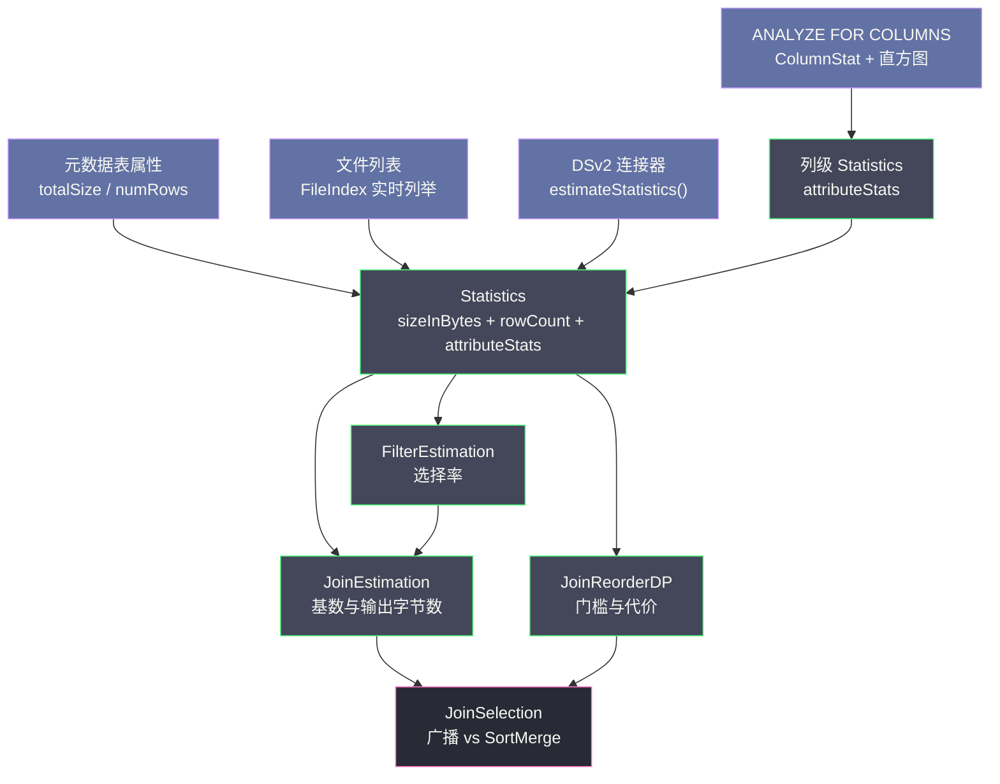
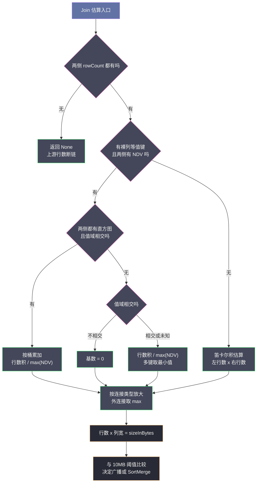
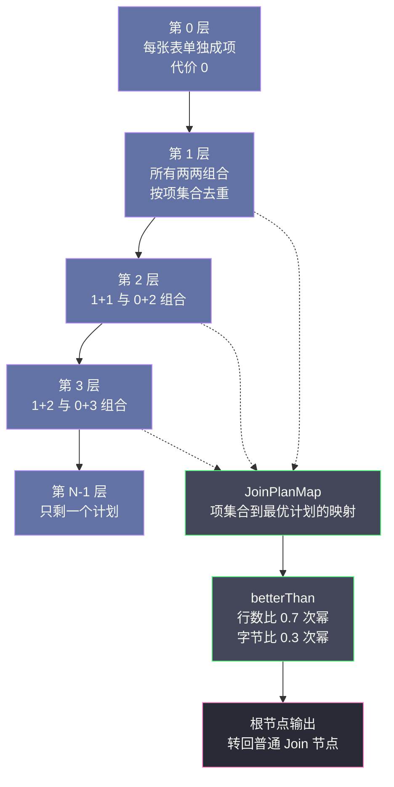
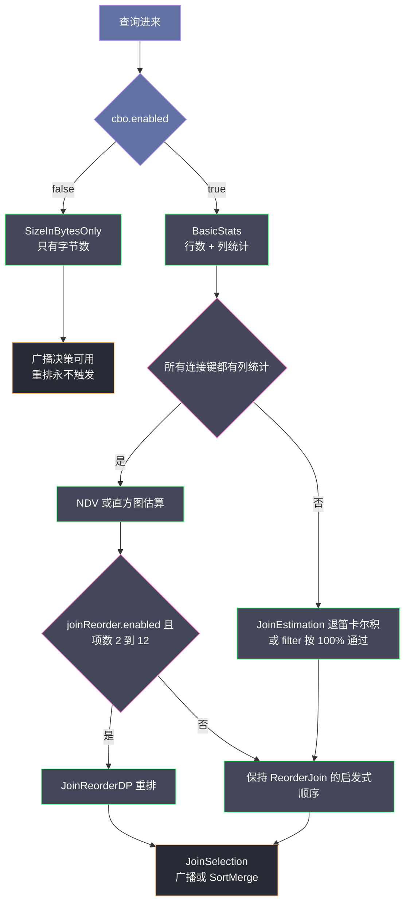
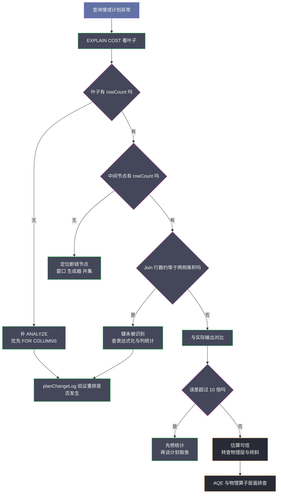

# 04 CBO 代价模型：统计信息驱动的执行计划选择

**摘要：**

Rule-Based Optimizer（RBO）只看查询的骨架、不看数据的规模，于是三张表以上的连接顺序、广播侧的选择、聚合的落点，都只能由固定规则拍板；Cost-Based Optimizer（CBO）正是为了把这类规模问题换算成可比较的代价而引入，但它的全部判断都建立在另一套东西上——统计信息。本文按统计信息的三个来源展开：表级（`numRows` 与 `sizeInBytes`，来自元数据表属性、文件列表或数据源自报）、列级（`ColumnStat` 的 NDV、min/max、nullCount、avgLen 与直方图，只能由 `ANALYZE TABLE ... FOR COLUMNS` 产生）、以及算子估算的逐层传播（`BasicStats` 的 estimate 系列，一旦某层返回 None 就整条链上的行数一起失效）。在此基础上拆开四件事的真实行为：`AnalyzeTableCommand` 默认只算表级、`JoinEstimation` 在缺列统计时退化为笛卡尔积、`JoinReorderDP` 的动态规划门槛与几何均值代价函数、以及 `spark.sql.cbo.enabled` 与 `spark.sql.cbo.joinReorder.enabled` 在 4.x 里双双默认关闭的事实。把这些机制串起来看，CBO 出错的成因可以归到四处：表级统计过期或被写入清空、列级统计缺失或随表达式化失效、谓词相关性打破独立性假设、以及数据倾斜让平均值失去意义；对应的判据也只有三层，叶子节点有没有行数、中间节点是否断链、连接行数是否恰好等于两侧乘积，再叠加一条估算与实际相差 10 倍的经验线。全文落点不在"怎么开 CBO"，而在"怎么判断它算错了、错在哪一层"，以及判断清楚之后该修统计还是该换工具。

---

## 第 1 章 从"看不见大小"到"看见错的数"

RBO 与 CBO 的分工，如果只记一句话，那就是：前者决定以什么形状执行，后者决定以什么顺序、什么代价执行。这句话背后藏着两种完全不同的失效方式，很难被同一种经验覆盖。RBO 的规则只匹配树的形状，谓词能下推就下推、列能裁就裁、常量能折就折，它手里根本没有"行数"这个维度，所以它的失效是看不见差异；CBO 把代价写成可计算的函数，可这个函数的自变量并非来自查询本身，而是来自别人事先量好、随时会过期的数据画像，所以它的失效是差异看反了。RBO 那套规则如何逐条匹配树形、谓词下推的次序为何那样排，已经在 [[大数据/Spark/Spark-SQL深度解析与性能调优/03 Catalyst 逻辑优化：Rule-Based Optimizer 的核心规则|逻辑优化一篇]] 里拆开过，这里只关心它对规模的盲区。

这个分野的源头可以追到 1979 年。Selinger 等人在 System R 的存取路径选择论文里第一次把连接顺序枚举写成动态规划，用一个基于统计信息的代价函数挑计划，此后四十多年里几乎所有商业优化器的骨架都从这里长出来。Spark 在 2.2 引入 CBO 时沿用的正是这条路线，`spark.sql.cbo.enabled` 与 `spark.sql.cbo.joinReorder.enabled` 两个配置项的版本号至今仍写着 2.2.0。

### 1.1 一个具体查询与它需要的四个数

抽象地说"统计信息很重要"没有说服力，不妨拿一个查询把需要的东西摊开。下面这条语句是数据仓库里最常见的形状：事实表按天分区，两张维表一大一小，最后按维表的属性聚合。

```sql
SELECT r.region_name,
       count(*)         AS order_cnt,
       sum(o.amount)    AS gmv
FROM fact_order o                        -- 10 亿行，按 dt 分区
JOIN dim_user   u ON o.uid = u.id        -- 1000 万行
JOIN dim_region r ON u.region_id = r.id  -- 200 行
WHERE o.dt = '2026-11-18'
  AND u.status = 'active'
GROUP BY r.region_name
```

要让 CBO 为它挑一个计划，需要四个数：`fact_order` 落在 `dt='2026-11-18'` 这一个分区里的行数；`u.status = 'active'` 的选择率；`o.uid = u.id` 这一对等值键的 NDV；以及三次连接各自输出的中间结果字节数。四个数里只有第一个有机会从表级统计里粗估，其余三个全部依赖列级统计，而列级统计在默认配置下根本不存在。这就是本文要反复回到的事实：CBO 不是一条规则，而是一条从元数据出发、经过选择性公式与基数传播、最后落到重排与广播决策的推理链，链上任何一环缺失，结论都不会报错，只会悄悄变错。

### 1.2 两个问题

本篇只回答两个问题。第一，CBO 依赖什么，这些依赖分别存放在哪里、由谁产生、成本是多少。第二，它在什么情况下会把计划做错，以及在没有 profiler、没有内部指标的黑盒里，用什么可观察的信号判断它错了、错在哪一层。第一个问题是理解，第二个问题是判据，后者才是这类文章真正稀缺的部分。

---

## 第 2 章 统计信息的三层来源

把统计信息当成"一堆数字"是不够的，它在 Spark 里其实是三套彼此衔接的机制：表级的元数据、列级的画像、以及算子层面的传播。三者产生的成本、失效的方式、可以修复的手段都不一样，混在一起谈就必然得出"多跑 ANALYZE 就好了"这种似是而非的结论。

### 2.1 表级：两个数，三条来路

表级统计只有两个数：`sizeInBytes` 与 `rowCount`，加上可能附带的列统计一起构成 `CatalogStatistics`。它们的来路有三条，混淆这三条会直接影响排障方向。

第一条是元数据表属性。Spark 把 `CatalogStatistics` 落成 Hive 表属性，键名分别是 `spark.sql.statistics.totalSize` 与 `spark.sql.statistics.numRows`，源码里对应 `HiveExternalCatalog` 的 `STATISTICS_TOTAL_SIZE`、`STATISTICS_NUM_ROWS` 两个常量。这两个属性靠 `ANALYZE TABLE` 写入，写入命令不会替你更新；打开 autoUpdate 时也只刷新 `totalSize`。

第二条是文件列表。`HadoopFsRelation.sizeInBytes` 来自 `FileIndex`，是在表被解析时列举文件清单算出来的真实字节数。这条路不依赖任何元数据维护，代价是驱动端要扫一遍文件清单，分区多、文件碎的表上这一步本身就要几秒到几十秒，而它永远给不出行数。

第三条是数据源自报。实现了 `SupportsReportStatistics` 的连接器（Iceberg、Delta 这类表格式通常都实现）在 `estimateStatistics()` 里直接返回字节数与行数，4.x 的 `DataSourceV2Relation.computeStats` 会经 `transformV2Stats` 把它折算成 Catalyst 的 `Statistics`。

三条路都没有结果时，落点是一个哨兵值：`spark.sql.defaultSizeInBytes`，默认 `Long.MaxValue`。源码注释把设计意图写得很直白，这个默认值故意比 `spark.sql.autoBroadcastJoinThreshold` 更大，因此优化器在不确定表到底多小的时候会选择不广播。请注意这个值的语义——它表示"未知"，而不是"很小"，把它当成"没有统计就按大表猜"的粗略说法会掩盖一个更要紧的后果：未知的不仅是字节数，还有行数，而行数缺失会让后面的连接重排连尝试的机会都没有。

### 2.2 列级：ColumnStat 的七个字段

列级统计的结构体叫 `ColumnStat`，字段是 `distinctCount`、`min`、`max`、`nullCount`、`avgLen`、`maxLen`、`histogram`，另带一个版本号标记格式代际。其中有一对字段的组队关系值得单独记住：`hasCountStats` 为真的条件是 `distinctCount` 与 `nullCount` 同时存在。连接估算只认同时具备这两个字段的键列，缺一个就当作没有列统计处理，这一点在下一章会直接改变估算结果。

字段的具体行为有几处与直觉不符。字符串与二进制类型**不收集 min/max**，`CommandUtils.statExprs` 里对这两类显式传入 null 字面量，只计算 `avg(length(col))` 与 `max(length(col))`；所以 `DESCRIBE EXTENDED` 里字符串列的 min/max 显示为空，任何依赖 min/max 做值域推断的估算对字符串都不成立。类型的准入也很硬：`AnalyzeColumnCommand.supportsType` 只允许数值、Decimal、Boolean、时间、Binary、String，遇到 struct、array、map 直接抛错终止，不是静默跳过——这意味着宽表里只要挑中一个嵌套列，整条分析命令就会失败。

直方图的门槛更低一层，只为数值、Decimal 与时间类型生成，Boolean 虽然能转成 double 也不收集，纳秒时间戳则被显式排除；形态上 Spark 只用等高直方图（equi-height histogram）。它的构造要两次扫描：先按 255 个分位点（`histogram.numBins` 默认 254，端点比桶数多一个）算出每个分位的位置，再按分位区间统计每个区间的 NDV，`percentile.accuracy` 默认 10000 决定分位近似精度。收集直方图之所以默认关闭，配置文档给出的理由就是这次额外扫描；此外它序列化之后要写进表属性，源码用 `splitLargeTableProp` 按 4KB 分片塞进多个键，元数据的体积限制也是原因之一。

### 2.3 算子估算的传播：行数断链

第三层最容易被忽略：即使表和列的统计都齐全，从叶子节点到根节点的路上，行数是靠每个算子自己算出来并往上递的。入口在 `LogicalPlanStats.stats`，它按 `spark.sql.cbo.enabled` 分岔：开则走 `BasicStatsPlanVisitor`，产出带 `rowCount` 与 `attributeStats` 的 `Statistics`；关则走 `SizeInBytesOnlyStatsPlanVisitor`，只产出 `sizeInBytes`，`rowCount` 恒为 `None`。

`BasicStatsPlanVisitor` 对每个节点调用对应的估算器：Filter 交给 `FilterEstimation`，Join 交给 `JoinEstimation`，Aggregate 交给 `AggregateEstimation`，Project 交给 `ProjectEstimation`，其余节点落到 `default`——非叶节点把子节点的行数相乘、字节数相乘。每个估算器返回的都是 `Option`，一旦返回 `None`，该节点会 fallback 到只算字节数的版本，而那个版本**不会保留子节点的 `rowCount`**。于是传播链上出现一个断点，断点之上所有节点的行数都变成未知，无论它们本身的估算逻辑多精细。

这条机制解释了生产上一种很难理解的症状：某些查询的 `EXPLAIN COST` 里叶子节点明明有行数，往上两层却全空。原因往往不是统计没收集，而是中间夹了一个估算器不支持的节点——一个 `WINDOW`、一个 `GENERATE`、一个子查询展开后的 `UNION`，就足以让行数断在那里。把三层来源与三条消费路径画在一起，链路关系会清楚得多：



图中从来源层汇入 `Statistics` 的几条边对应几次不同的采集：表级与文件列表决定"多大"，列级决定"长什么样"，估算器再把两者变成每个节点的 `Statistics`，最终只有两个消费者真正拿它做决定——物理规划阶段的连接策略选择，以及逻辑优化阶段的连接重排。

| 层次 | 粒度 | 产生方式 | 典型成本 | 失效方式 |
|---|---|---|---|---|
| 表级（元数据） | 表/分区 | `ANALYZE TABLE ... COMPUTE STATISTICS` | 一次文件列表 + 一次全表 count | 写入后被清空、长期不刷新 |
| 表级（文件列表） | 表/分区 | 查询时由 `FileIndex` 现算 | 每次规划都扫文件清单 | 只有字节数，没有行数 |
| 列级 | 列 | `ANALYZE TABLE ... FOR COLUMNS` | 一次聚合扫描，直方图翻倍 | 默认不存在、表达式化后失效 |
| 直方图 | 列的分位区间 | 同上，需额外配置开启 | 额外一次分位扫描 + 表属性膨胀 | 仅数值/时间类型可用 |
| 算子传播 | 计划节点 | `BasicStats` 系列估算器 | 规划期纯内存计算 | 遇不支持节点即断链 |

三层里任何一层的缺口都不会报错，只会让下层的结论退化。表级缺行数时，连接重排连候选都进不去；列级缺失时，等值连接退化成笛卡尔积估算；传播断链时，上层节点拿不到行数，只能按字节数拍板广播。把这三种退化混为一谈，就会出现"ANALYZE 也跑过了、CBO 也开了，计划还是不对"的僵局。

---

## 第 3 章 ANALYZE TABLE 到底做了什么

关于 `ANALYZE TABLE`，流传最广的一句是"收集统计信息"，这句话本身没错，但它掩盖了三个关键差异：默认只收表级、列级要显式指定、而写入会把已有统计清掉。这三个差异合起来，足以解释大部分"开了 CBO 没效果"的现场。

### 3.1 四种语法，两条实现路径

语法层面有四种写法，它们并不等价：

```sql
-- 只列表、不算行数：读文件元数据，不触发作业
ANALYZE TABLE fact_order COMPUTE STATISTICS NOSCAN;

-- 列表 + 行数：会触发一次全表 count 作业
ANALYZE TABLE fact_order COMPUTE STATISTICS;

-- 列级统计：指定列，顺带更新表级行数与大小
ANALYZE TABLE fact_order COMPUTE STATISTICS FOR COLUMNS uid, amount;

-- 列级统计：全部列，宽表上非常贵
ANALYZE TABLE fact_order COMPUTE STATISTICS FOR ALL COLUMNS;
```

前两条落到 `AnalyzeTableCommand(tableIdent, noScan)`，最后两条落到 `AnalyzeColumnCommand(tableIdent, columnNames, allColumns)`。`noScan` 的语义要精确理解：为真时跳过 `count()`，所以只写 `totalSize`；为假时执行一次 `count()` 拿到行数。注意 `NOSCAN` 并不会加速文件列表这一步，字节数始终要算，省掉的只是那次全表扫描。

### 3.2 表级：一次文件列表加一次 count

表级分析的实现是 `CommandUtils.analyzeTable`，步骤可以干净地拆成四步。第一步用 `calculateTotalSize` 算总字节数：非分区表按表目录列举文件，分区表先 `listPartitions` 再逐分区求和，文件多时这一步的开销与文件数成正比，日志里那句"算总大小花了多少毫秒"就是给这一步留的观测点；`spark.sql.statistics.parallelFileListingInStatsComputation.enabled`（2.4.1 起，默认 true）让它走并行列举，专为目录多、文件碎的表准备。第二步，若非 `NOSCAN`，执行 `sparkSession.table(...).count()` 得到行数。第三步 `compareAndGetNewStats` 与旧值比较，只有发生变化才写回。第四步 `alterTableStats` 落盘。

4.0 起多了一个容易踩的开关：`spark.sql.statistics.updatePartitionStatsInAnalyzeTable.enabled`，默认 false。它关闭时，`ANALYZE TABLE` **只更新表级统计**，分区级统计不再顺带更新；开启后命令会额外为每个分区算行数，代价是"命令变得更贵"——配置文档的原话就是 becoming more expensive。分区表上这一点影响很大，因为分区裁剪后的行数估算依赖分区级统计。

### 3.3 列级：HLL 与两次扫描

列级分析的实现是 `CommandUtils.computeColumnStats`，它把整张表当成一次聚合的输入，用一个 `Aggregate(Nil, 表达式列表, relation)` 同时算出总行数与每列统计。NDV 用 `HyperLogLogPlusPlus` 近似，`spark.sql.statistics.ndv.maxError`（内部配置，默认 0.05）是它的相对标准差上限，源码还加了一层 `Least(HLL, count(col))` 的兜底，保证估计值不超过非空行数。

0.05 这个数字值得停一下：它意味着 NDV 本身就有约 ±5% 的统计误差，而连接基数的分母正是 NDV，所以即便所有统计都是新鲜的，等值连接的估算也天然带着这个量级的不确定度。把它当成"永远精确的元数据"，是以 5% 的误差去解释几十倍的偏差，方向从一开始就错了。

直方图的收集另外走一次 `Aggregate`：先对可生成直方图的列跑 `ApproximatePercentile` 拿 255 个分位点，再在主聚合里用 `ApproxCountDistinctForIntervals` 统计每个分位区间内的 NDV，拼成 `HistogramBin` 序列。这也是配置注释里"收集列统计通常一次扫描，生成等高直方图会多一次扫描"的来源。有两点容易被忽略：分位近似用的是 `percentile.accuracy`（默认 10000），误差量级是它的倒数；而直方图只为数值、Decimal 与时间类型生成，`nanosecond` 时间戳被显式排除，因为 `percentile_approx` 不接受它。

列级命令还有一个副作用值得记住：它在写完列统计之后，会**顺带重算并写回表级的 `rowCount` 与 `sizeInBytes`**，源码注释说的是"保持表级与列级统计一致"。所以 `FOR COLUMNS` 实际上是最彻底的一次分析，代价也最高。

### 3.4 写入会清掉统计

这一节的事实来自 `CommandUtils.updateTableStats`，它在每次成功的 `INSERT`（走 `InsertIntoHadoopFsRelationCommand`）之后被调用，行为按开关分两种。

`spark.sql.statistics.size.autoUpdate.enabled` 关闭（默认）时，如果表已有统计，代码直接 `alterTableStats(identifier, None)`——**把统计整个删掉**。理由是数据变了，旧的行数不可信；但后果是行数与列统计一起消失，下一次查询只能靠文件列表算字节数，行数回到未知。

开关打开时，代码重算总大小，然后写入一个只含 `sizeInBytes` 的新 `CatalogStatistics`；而 `HiveExternalCatalog.alterTableStats` 的实现是先 `filterNot(_.startsWith(STATISTICS_PREFIX))` 清掉所有统计属性，再按传入对象重新生成。新对象里没有 `rowCount`，也没有列统计，于是属性被删而不被重建。也就是说，**打开自动大小更新的直接效果是把行数和列统计一起抹掉**，只留下字节数。

> [!warning] autoUpdate 不是自动维护统计
> 这个结论反直觉，但完全可以从源码推出来，也是"开了 CBO 却越跑越差"的一类真实成因：ETL 每天写一次，统计每天被清一次，而 ANALYZE 每周才跑一次，中间的查询全都处在无行数状态。想靠 autoUpdate 自动维护统计，恰好维护掉了最不该维护的那部分。

| 形态 | 写入内容 | 成本 | 主要风险 |
|---|---|---|---|
| `COMPUTE STATISTICS NOSCAN` | 表级 `totalSize` | 文件列表 | 行数仍未知，CBO 重排不触发 |
| `COMPUTE STATISTICS` | 表级 `totalSize` + `numRows` | 文件列表 + 一次全表 count | 大表上 count 很贵，且很快过期 |
| `... FOR COLUMNS c1, c2` | 列统计 + 表级两个数 | 一次聚合扫描（+ 直方图再一次） | 只覆盖点名的列，遗漏 join 键等于白跑 |
| `... FOR ALL COLUMNS` | 全部列统计 | 与列数正相关，宽表极贵 | 类型不支持时直接报错终止 |
| 写入触发的 autoUpdate | 仅表级 `totalSize` | 每次写都算文件列表 | 行数与列统计被清空 |

---

## 第 4 章 过滤的选择性估算

选择性（selectivity）是谓词在估算世界里唯一的存在形式：它把"这个条件筛掉多少行"压缩成一个 0 到 1 之间的比例。CBO 里专门做这件事的是 `FilterEstimation`，它把条件拆成一条条单条件谓词，逐条给出比例，再按逻辑连接词合成。理解它的关键在于两点：哪些条件它认得，以及认不得的时候它怎么办。

### 4.1 认不得的时候，它按 100% 通过处理

入口 `FilterEstimation.estimate` 先看子节点的 `rowCount`，为空直接返回 `None`，上游随之落入只算字节数的 fallback——这就是行数断链的第一处也是最常见的一处触发点。接下来逐条计算选择性，返回 `Option[Double]`；最终那句兜底是 `calculateFilterSelectivity(condition).map(boundProbability).getOrElse(1.0)`，注释写得很清楚：对不支持的条件，按保守值 100% 处理。

这个 100% 的含义需要正面理解：不是"估算不准"，而是"在估算里这个过滤器不存在"。于是 `WHERE json_value(meta, '$.type') = 'order'` 这样的条件，在 CBO 眼里完全不筛数据，后续连接仍按全量行数计算。估算器的保守方向和直觉相反——它宁可高估中间结果，也不愿低估，因为低估会让优化器挑一个"看起来便宜"的计划。

### 4.2 等值：先看值域，再除 NDV

等值谓词走 `evaluateEquality`，逻辑分三步。第一步判断字面量是否落在列的 `[min, max]` 内：字符串与二进制类型跳过这一步（它们没有 min/max），其余类型若缺少 min/max 就把值域当下未知，只有确定越界才直接返回 0。第二步算比例：没有直方图时用 `1/NDV`，有直方图且 min/max 可用时用桶密度，即"覆盖该值的桶数 / 覆盖当前值域的桶数"。第三步在 `update` 为真时改写列统计：`distinctCount` 置 1、`nullCount` 置 0、min/max 收窄到字面量。

第二步是误差的主要来源。`1/NDV` 的前提是每个不同值出现次数相同，现实数据几乎从不满足；直方图把均匀假设从"整列"缩到"单个桶"，精度提高一个量级，但桶内仍然按均匀处理，254 个桶对于热点值极其集中的列依然不够。

### 4.3 范围：线性比例加边界修正

数值范围谓词走两条分支。没有直方图时按值域比例线性插值，`(literal - min) / (max - min)`，并在三个边界上做 `1/NDV` 的修正：`<` 恰好等于 max 时减掉一个值的份额，`<=` 恰好等于 min 时只留一个值的份额，`>` 与 `>=` 对称处理。代码里对这些边界单独判断，是因为线性插值在端点上会把离散值当成连续分布，正好算错那一个值的量。有直方图时改为统计谓词区间覆盖了多少个桶，再折算成行数。

字符串与二进制类型的范围比较则完全不支持。源码注释给的理由是"没有 min/max 和直方图就难以支持 String/Binary 的二元比较"，于是 `WHERE u.user_name > 'm'` 这类条件落到 100% 通过。这个约束波及面比想象中大：凡是按字符串字典序切分的条件，在 CBO 里都是"不存在"的过滤器。

日期与时间和数值走同一条路径，前提是能转成 double；注意 `cast` 过的时间列会先被规则 `UnwrapCastInBinaryComparison` 处理掉，尽量还原成原始列与字面量的比较，这一步对估算能否生效至关重要。

### 4.4 LIKE、Contains、StartsWith：明确不支持

`LIKE`、`CONTAINS`、`STARTSWITH`、`ENDSWITH` 四类在 `calculateSingleCondition` 的兜底分支里被点名，注释是"没有高级统计就难支持字符串操作符，因此暂不支持"。它们的结果和前面一样：选择性 1.0。这里需要纠正一个在中文资料里流传很广的说法——"复杂条件回退到 0.33 之类的默认选择率"。Spark 的 `FilterEstimation` 里没有这样的默认常数，不认识的谓词直接返回 `None`，上层按 100% 通过处理。分清这两个方向很重要：0.33 会让估算变小，100% 会让估算变大，对计划的影响恰好相反。

### 4.5 AND 的顺序更新，OR 与 NOT 的不更新

`And` 的处理是把左右选择性相乘，但有一个细节：它按顺序逐条估算并在每条之后更新列统计，所以在 `WHERE amount > 100 AND amount <= 500` 这类同列范围条件上，第二条是在第一条收窄后的值域上算的，结果比"两个独立比例相乘"更接近现实。这也是为什么把同列条件写在一起、而不是散落在不同子查询里，对估算是有利的。

`Or` 用 `1 - (1-p1)(1-p2)`，等价于假设两个条件独立；它不更新列统计，因为无法判断哪一列被筛过。`Not` 直接用 `1 - p`。`IsNull` 与 `IsNotNull` 只在子节点是叶子时估算，原因是中间节点的 `nullCount` 不可信——源码注释直言"缺少高级统计，左外连接的行数估算不能准确更新 nullCount"。

独立假设是这一章所有误差的总根源。`WHERE city = 'Shanghai' AND province = 'Shanghai'` 两个条件高度相关，独立假设会把选择率乘两次，把行数压低一个数量级；同列冗余谓词反倒是良性的：`dt = '2026-11-18' AND dt >= '2026-11-01'` 的第二个条件在收窄后的值域上算出来接近 1，不会被乘两次；真正危险的是跨列的条件组合，`dayofweek(dt) = 2 AND dt = '2026-11-18'` 里前一个按 100% 处理、后一个照常除 NDV，两个条件的相关关系在数字上彻底丢失。

| 谓词类型 | 估算方式 | 前置条件 | 失效后的偏差方向 |
|---|---|---|---|
| `col = 常量` | `1/NDV`，有直方图则取桶密度 | 有 `distinctCount` | 倾斜列上严重低估 |
| `col > / < 常量`（数值） | 值域线性插值 + 边界 `1/NDV` 修正 | 有 min/max 或直方图 | 值域宽而数据集中时高估 |
| `col > / < 常量`（字符串） | 不支持，按 1.0 | 无 | 高估，过滤器等于不存在 |
| `col LIKE / CONTAINS / STARTSWITH` | 不支持，按 1.0 | 无 | 高估 |
| `col IS NULL` | `nullCount / rowCount` | 子节点为叶子 | 中间节点上不估 |
| `col IN (...)` | 集合大小与 NDV 的比例，先按值域过滤无效值 | 有 `distinctCount` 与 min/max | 越界值多时低估 |
| `A AND B` | 顺序相乘并逐条更新统计 | 两者都认得 | 相关谓词上低估 |
| `A OR B` | `1-(1-pA)(1-pB)` | 两者都认得 | 相关谓词上高估 |
| `NOT A` | `1 - pA` | A 认得 | 反向继承 A 的误差 |

---

## 第 5 章 Join 的基数估算

连接是 CBO 里唯一真正做乘法的地方，也是误差被放大得最厉害的地方。`JoinEstimation` 的入口只有一行判断就能说明问题的严重性：只要两边的 `rowCount` 有一个为空，整个连接返回 `None`，上游直接失去行数。也就是说，连接估算不是"粗略估一下"，而是"要么给数，要么断路"。

### 5.1 什么样的键才算键

`extractJoinKeysWithColStats` 只接受一种形态：左右都是裸的 `AttributeReference`，且两侧都有 `hasCountStats`（`distinctCount` 与 `nullCount` 同时存在）。`ExtractEquiJoinKeys` 拆出来的键只要套了函数、做了类型转换、或者用了 `<=>`，就会被 `collect` 过滤掉，键对列表变短甚至为空。源码注释还专门点名了 `key1 = key2 + 5` 这种形态目前不处理，`EqualNullSafe` 因为会转成 `Coalesce` 同样出局。

这条限制的工程后果是：`ON cast(o.uid as string) = u.id_str`、`ON concat(o.dt, o.region) = dim.day_region`、`ON coalesce(o.uid, -1) = u.id`，在业务代码里都很常见，而在 CBO 眼里它们都等于"没有等值键"。

### 5.2 公式与"取最选择性键"

等值连接的基数公式是 `左行数 × 右行数 / max(左NDV, 右NDV)`。推导不复杂：假设键值域被较大的一侧覆盖，每个键在两侧的平均行数分别是 `T(A)/V` 与 `T(B)/V`，两边的笛卡尔积再除以键的数量。

真实实现比这个公式多两条约束，源码注释都交代了。第一，多键连接不把分母连乘，而是对每个键对单独算一次基数、取最小值。注释给的理由很实在：连乘会让分母爆炸，结果被压得过小，所以改用"最选择性键"的保守策略。第二，不同统计来源（NDV 与直方图）给出的基数也取最小，同样是为了避免低估。这两条约束合起来说明 Spark 的取舍方向：**宁可高估连接结果，也不轻易低估**。

另有一条容易被误读的逻辑：当两侧都声明了唯一性（`distinctKeys` 覆盖了连接键）时，基数取两侧行数的较小值；一侧唯一时取另一侧的行数。唯一性信息来自数据源约束而不是 ANALYZE，所以带主键声明的表格式在这一点上占便宜。

### 5.3 没有列统计就按笛卡尔积算

这是本章最需要强调的事实，也是很多排障卡住的地方。`computeCardinalityAndStats` 的初始值按唯一性的四种组合取值，默认是 `左行数 × 右行数`；如果键对列表为空，循环一次都不进，直接返回这个笛卡尔积。非等值连接同理，`estimateInnerOuterJoin` 的兜底分支注释写的就是"没有等值条件时按笛卡尔积估算"。

> [!info] 判据：谓词不认识偏高，键不认识高得离谱
> 谓词不认识时估算偏高（100% 通过），键不认识时估算**高得离谱**（笛卡尔积）。10 亿行乘 1000 万行是 10 的 16 次方量级，而真实结果可能只有 10 亿行，误差七个数量级。这种量级的误差不会让计划"稍微差一点"，它直接改变重排结果：那个被估成天文数字的连接会被 DP 排到最后，甚至让重排因为中间结果过大而选出奇怪的顺序。

### 5.4 直方图路径与"区间不相交"

当两侧键都有直方图、min/max 已知、类型能转 double 时，估算改走 `computeByHistogram`：先求两侧值域的交集，把直方图按交集裁剪，再在每个重叠区间上套用 `行数积 / max(NDV)` 并累加。桶级累加能捕捉值域分布的不均匀，代价是要求两侧都收集了直方图——注意这个"都"字，只要一侧没开直方图，路径立刻退回 NDV。

另一条不那么显眼但很有用的逻辑是区间判断：两侧值域不相交（`ValueInterval.isIntersected` 为假）时，连接基数直接置 0。这等于用 min/max 推出了"结果为空"这个强结论，比任何比例估算都准。反过来说，一旦某侧缺少 min/max（字符串列、或者统计本身不全），这个判断就失效，估算回到均匀假设。

### 5.5 外连接、半连接与行数放大

不同连接类型的输出行数规则并不相同。左外连接取 `max(左行数, 内连接基数)`，右外连接对称，全外连接是 `左外 + 右外 - 内连接`，这些规则的共同点是"外连接不会比外侧少行"。内连接与交叉连接直接用内连接基数。

半连接与反连接则是明显的缺口。`estimateLeftSemiAntiJoin` 的注释直接说明了现状：基于基础列统计估算 semi/anti 容易出错，因此目前只把左侧统计原样透传，并留了一个 TODO。后果是 `LEFT SEMI JOIN` 与 `EXISTS` 子查询在估算里**完全不减少行数**，它们下游的连接会把上游高估一大截。第 4 章与本节的结论拼起来是一个完整的判据：过滤条件不认识会高估，半连接不估也会高估，两个高估叠在一张宽表上，行数很快就失去参考价值。

### 5.6 从行数到字节数：广播决策的最后一跳

行数估出来之后，还要换算成字节数才能参与物理规划。`EstimationUtils.getOutputSize` 的算法是"行数 × 每行字节数"，每行字节数来自各列的 `avgLen`；缺列统计时退回数据类型的默认宽度（`IntegerType` 4 字节、`LongType` 8 字节、`StringType` 20 字节这类常量）。`JoinSelection` 之后拿 `sizeInBytes` 与 `spark.sql.autoBroadcastJoinThreshold`（默认 10MB，4.x 未改）比较，决定广播哪一侧、还是走 SortMerge。

这一跳把前面所有的误差做了乘法：行数高估 100 倍、列宽又用了固定默认值，字节数就可能高估两三个数量级，本来 5MB 的维表被当成 500MB，广播被放弃，计划退化成 SortMerge 加大 Shuffle。广播侧真的溢出内存时，承接它的是 Executor 的内存布局，再加上 Shuffle 的落盘与合并，这两块机制见 [[大数据/Spark/读书笔记-spark内核/04_存储与容错机制/1. Spark内存管理机制|内存管理机制]] 与 [[大数据/Spark/读书笔记-spark内核/05_Shuffle核心机制/1. Spark_Shuffle机制深度解析|Shuffle 机制深度解析]]，本文不再重复。很多"明明是小维表却不广播"的现场，根因不在 `autoBroadcastJoinThreshold` 设小了，而在这张维表没有列统计、行数被高估。连接估算的分支可以画成一张判定图，判断一次估算是否可信，于是变成了判断这次查询走了哪条分支：



从图里可以看出，只有"裸列等值 + 两侧有 NDV"这一条主路径真正利用了列统计；直方图是它上面的精化，缺键或缺统计则直接掉进笛卡尔积。判断一次连接估算是否可信，本质上就是判断查询走了哪条分支。

| 分支 | 触发条件 | 估算方式 | 偏差方向与量级 |
|---|---|---|---|
| 直方图累加 | 两侧键都有直方图、值域相交 | 按重叠区间累加行数积比 NDV | 接近真实，误差取决于桶数 |
| NDV 主路径 | 裸列等值键、两侧有 `distinctCount` | `行数积 / max(NDV)`，多键取最小 | 均匀假设，倾斜与相关性下可差两个数量级 |
| 值域不相交 | 两侧 min/max 明确无交集 | 直接 0 | 精确，但依赖 min/max 存在 |
| 唯一性约束 | `distinctKeys` 覆盖连接键 | 取较小侧行数 | 偏准，取决于约束是否可信 |
| 笛卡尔积 | 无等值键，或键缺列统计 | 左行数 × 右行数 | 严重高估，可达数个数量级 |
| 半连接透传 | `LEFT SEMI` / `LEFT ANTI` | 原样透传左侧统计 | 高估，过滤效果被忽略 |

---

## 第 6 章 Join 顺序重排：DP 与它的门槛

在 CBO 的全部能力里，连接顺序重排是唯一可能带来数量级收益的一项，也是唯一在实现上真正动用了动态规划的一项。但围绕它的误解也最多：很多资料把重排算法记在 `ReorderJoin` 名下，把代价函数写成"构建代价加探测代价"，把搜索空间描述成左深树枚举。这三处说法都与 4.x 的实现不一致，而它们恰恰决定了你会不会误判"重排到底有没有生效"。

### 6.1 顺序为什么敏感

三张表的连接顺序有 12 种，四张表 120 种，五张表 1680 种，八张表 1729 万种，十二张表约 28 万亿种。这些数字来自带括号的二叉连接树计数公式 `(2n-2)!/(n-1)!`，它统计的是所有可能的分组方式，包括左深、右深与浓密（bushy）三种形态。

顺序之所以值得枚举，是因为中间结果的规模可以差好几个数量级。仍用第 1 章的查询：如果先做 `fact_order JOIN dim_user`，那是 10 亿行与 1000 万行的等值连接，输出行数取决于 NDV，但无论怎么估都在 10 亿量级，连接本身要走 Shuffle；如果先做 `fact_order JOIN dim_region`，右侧只有 200 行，广播之后是一次纯本地的 map 端过滤，10 亿行数据的上游不需要重分布。同样三张表、同样的条件，一次是全量 Shuffle，一次是零 Shuffle。

这个例子还说明重排的收益并不只体现在"中间结果小"，更体现在"能不能把连接变成广播连接"。而广播与否的判断依赖字节数估算，所以重排与广播决策其实共享同一份统计：统计错，两件事一起错。

### 6.2 两条规则，各管一段

必须先把责任划清。`ReorderJoin` 是一条**启发式规则**，位于优化器的算子优化规则集里，行为是按从左到右的顺序拼接内连接，每一步优先挑选"与已连接集合之间存在连接条件"的那张表。它看的是形状和条件，不看行数。星型模型检测（`spark.sql.cbo.starSchemaDetection`，默认 false）挂在它这里，而且生效条件是 `starSchemaDetection && !cboEnabled`——一旦 CBO 打开，这条启发式主动让位。

真正做动态规划的是 `CostBasedJoinReorder`，它独占一个只跑一次的批：`Batch("Join Reorder", FixedPoint(1))`。这个批的位置很讲究，排在"早期过滤与投影下推"之后，源码注释说明了原因：在下推之前，逻辑计划里可能还有不报统计的节点，任何依赖统计的规则都必须等它们消解。它后面紧跟着"把连接下推到 Union 各分支"的规则，注释也交代了顺序理由：先让代价重排看到完整的连接图，再让后者把它拆开。

所以当有人说"`ReorderJoin` 用 DP 重排了顺序"，准确的说法应该是：`ReorderJoin` 决定了连接的初始拼接形态，`CostBasedJoinReorder` 在统计齐备时把整个内连接图重新枚举一遍。

### 6.3 JoinReorderDP 的 memo 与代价函数

DP 的实现是 `CostBasedJoinReorder.scala` 里的 `JoinReorderDP` 对象。它的记忆结构是逐层的 `JoinPlanMap`：第 0 层是每张表单独成项、代价为零的初始计划；之后每层从已算出的层里两两组合，第 k 层与第 (lev-k) 层配对，同层组合时只做一次避免重复。每一层的结果按"项集合"索引，同一个项集合只保留当前最优的那一个计划。

代价模型的载体是两个 case class：`Cost(card, size)` 与 `JoinPlan(itemIds, plan, joinConds, planCost)`。`planCost` 是这棵树所有中间连接代价的累加，`rootCost` 取根节点统计里的行数与字节数。比较两个计划优劣的 `betterThan` 用的是**加权几何均值**：

```
相对行数比 = 本计划代价行数 / 对手代价行数
相对字节比 = 本计划字节数 / 对手字节数
判定更优的条件：
  相对行数比 ^ w × 相对字节比 ^ (1 - w) < 1
```

`w` 就是 `spark.sql.cbo.joinReorder.card.weight`，内部配置，默认 0.7。源码注释专门解释了为什么不用另外两种更朴素的做法：算术平均会给"10 倍"过高的权重、对"0.1 倍"却几乎无感，而绝对代价把行数与字节数直接相加，两种量纲混在一起会互相淹没。几何均值让"放大 10 倍"和"缩小 10 倍"在评价上对称，这是它被选中的原因。

需要强调的是，这里的代价**不是**物理代价。4.x 没有为逻辑计划提供 CPU、I/O、内存的物理代价模型，CBO 能拿到的只有基数与字节数，所以"代价最低"在这个实现里的准确含义是"中间结果最小"。这一点决定了 CBO 的能力边界：它能判断谁该先连，不能判断 SortMerge 与 Broadcast 谁更快——后者交给物理规划阶段的策略选择，也就是 [[大数据/Spark/Spark-SQL深度解析与性能调优/05 Physical Planning：从逻辑计划到物理算子的策略选择|物理规划一篇]] 里的 `JoinSelection` 要处理的事。

### 6.4 四个前置条件，缺一即静默跳过

重排不是"尽力而为"，而是"条件不满足就完全不做"，而且不留任何报错。`reorder` 方法里的判断是四连与：项数大于 2、项数不超过 `spark.sql.cbo.joinReorder.dp.threshold`（默认 12）、存在连接条件、所有项的行数都已定义。此外还有几条隐含约束：只处理 `InnerLike`（内连接与交叉连接），带 `JoinHint` 的连接跳过，`Project` 必须是纯列投影才能被纳入。

"所有项的行数都已定义"这一条最容易被忽略，也最能解释"开了 CBO 但计划没变"。它要求的是每一个参与重排的项都有 `rowCount`，只要有一张表缺统计，整个重排就放弃，没有任何降级方案。也就是说，CBO 的连接重排是全有或全无的。

### 6.5 星型过滤是另一回事

`spark.sql.cbo.joinReorder.dp.star.filter`（默认 false）与前面的星型检测不是同一个东西。它作用在 DP 的搜索过程中：先用 `StarSchemaDetection.findStarJoins` 从连接图里识别出星型连接的那组表，然后在 DP 组合两侧计划时加一道过滤器，只允许"两侧并集是星型连接的子集"、"星型连接是两侧并集的子集"、"两侧并集是非星型表子集"这三种组合通过。效果是把星型连接内部的表强制一起规划，避免出现"星型还没连完就去连外围表"的中间结果。

启用它的理由是星型模型里事实表与维表的连接条件明确、基数可控，先连星型再连外围通常更优；不启用它的理由是这笔启发式会缩窄搜索空间，遇到非典型图结构时可能错过更优解。这也是它默认关闭的原因。

### 6.6 复杂度与阈值的取舍

DP 要枚举的是关系的所有子集划分，量级在 `3^N` 附近，N 为参与重排的表数：N=8 时约 6,561 个划分，N=12 时约 53 万，N=16 时约 4,300 万。这些数字是按子集划分数做的量级推算，实际还会因 `betterThan` 的剪枝与同层去重而减少，但增长趋势不变。12 这个默认阈值正好落在"规划期开销可以接受"的位置，超过它 Spark 选择的不是近似算法，而是彻底不重排。

这里有一个很少被提及的运维后果：13 张表以上的内连接永远不会被 CBO 重排，无论统计多准确。想改变这一点只能调大阈值，而调大之后规划时间会随之上升，且这种开销发生在驱动端、单线程，代价很直观。

| 配置 | 默认值 | 作用 | 调大的代价 | 调小的代价 |
|---|---|---|---|---|
| `spark.sql.cbo.enabled` | false | 决定统计按"只算字节"还是"算行数与列统计"传播 | 规划期开销上升，统计不准时反而做出坏决定 | 行数全为未知，重排不可能发生 |
| `spark.sql.cbo.joinReorder.enabled` | false | 是否执行连接重排 | 规划期多一次 DP 枚举，估算不准时选出坏计划 | 保持 SQL 书写顺序，多表查询失去优化 |
| `spark.sql.cbo.joinReorder.dp.threshold` | 12 | 参与 DP 的最大表数 | 规划时间按 `3^N` 增长，驱动端压力大 | 超过阈值的表数静默不重排 |
| `spark.sql.cbo.joinReorder.card.weight` | 0.7 | 行数在代价中的权重 | 更偏向中间结果行数，可能忽略宽行开销 | 更偏向字节数，宽表上的行数差异被弱化 |
| `spark.sql.cbo.joinReorder.dp.star.filter` | false | 星型连接强制成组 | 搜索空间被启发式收窄，可能错过更优顺序 | 星型结构需要更长的搜索才能收敛 |
| `spark.sql.cbo.starSchemaDetection` | false | `ReorderJoin` 的星型启发式 | 只在 CBO 关闭时生效，星型误判会锁死顺序 | 星型查询回到书写顺序 |
| `spark.sql.statistics.histogram.enabled` | false | 收集直方图 | 分析成本翻倍，元数据膨胀 | 连接与范围过滤回到均匀假设 |

DP 逐层推进的结构值得单独看一眼，因为"阈值该不该调"这个问题的答案就藏在它的层级里：



同一层的每个项集合只保留一个计划，这正是 DP 能把组合爆炸压下来的原因；也正因为如此，一旦某一层的估算把错误的方向判成"更优"，后面所有层都会被这个错误引导，而且无法回头。

---

## 第 7 章 两个默认关闭的开关

到这里可以回答一个更基础的问题：大多数人说"我们用了 CBO"，用的到底是什么。在 Spark 4.x 里，`spark.sql.cbo.enabled` 与 `spark.sql.cbo.joinReorder.enabled` 的默认值都是 false，从 2.2.0 引入至今没有改过。这不是一个调优偏好的问题，而是一个功能有无的问题。

### 7.1 关闭时到底发生了什么

回到 2.3 节的机制：`spark.sql.cbo.enabled=false` 时，`LogicalPlanStats.stats` 走 `SizeInBytesOnlyStatsPlanVisitor`，它算出的 `Statistics` 里 `rowCount` 恒为 `None`。于是整棵计划树没有行数，`JoinReorderDP` 的前置条件"所有项行数都已定义"永远不成立，重排在每个查询上都被跳过；`FilterEstimation` 与 `JoinEstimation` 连入口都进不去，因为入口第一句就是判空。

所以关闭状态下的 Spark SQL 依然有"代价"这个概念，但它只用得到字节数一个维度：广播阈值判断、文件裁剪、分区裁剪、`LIMIT` 下推这些依赖字节数或结构的地方照常工作。真正依赖行数的那部分——连接顺序与连接形态的代价比较——全部缺席。这也解释了为什么很多团队"从来没开 CBO，查询也跑得不错"：AQE 在运行时用真实的中间结果重新规划连接策略，把静态估算缺失的影响挡掉了一部分（机制见 [[大数据/Spark/Spark-SQL深度解析与性能调优/06 AQE：运行时自适应查询优化|AQE 一篇]]）。不过它补的是运行时，不是编译期。

### 7.2 打开的顺序

如果决定要用 CBO，顺序比开关本身重要。第一步先补统计，至少覆盖所有参与连接的键列和主要过滤列：`ANALYZE TABLE ... FOR COLUMNS`，必要时先开 `spark.sql.statistics.histogram.enabled` 对数值过滤列生成直方图。第二步打开 `spark.sql.cbo.enabled`，此时 `EXPLAIN COST` 里应该开始出现 `rowCount`。第三步打开 `spark.sql.cbo.joinReorder.enabled`，观察是否出现计划变化。第四步用第 9 章的手段验证，而不是用"感觉快了"验证。

`spark.sql.cbo.planStats.enabled`（3.0 引入，默认 false）常被误解为"CBO 总开关"，其实它只做一件事：让叶节点在读取元数据时把行数与列统计带进 `Statistics`（`LogicalRelation.computeStats` 里的条件是 `cboEnabled || planStatsEnabled`）。由于传播仍按 `cboEnabled` 分岔，单独打开它只能让叶子节点带行数，上层照样在第一个 Filter 或 Join 处丢掉。它的实际价值是"只开 planStats 不开 cbo"时让 `LIMIT` 这类直接读子统计的节点受益，对整体计划的帮助很有限。

### 7.3 四种组合的实际效果

| `cbo.enabled` | `joinReorder.enabled` | `planStats.enabled` | 实际效果 |
|---|---|---|---|
| false | false | false | 默认状态，只有字节数，无行数、无重排、无代价比较 |
| false | true | false | 无意义，重排因缺少行数被静默跳过 |
| true | false | 任意 | 有行数与列统计传播，`EXPLAIN COST` 可见行数，但顺序仍按 `ReorderJoin` 的启发式 |
| true | true | 任意 | 完整形态，DP 在统计齐备的查询上生效 |

第三种组合是一个常被忽视的中间态：它能让物理规划阶段的广播决策用上更准的字节数，却不改变连接顺序。对于"维表没被广播"这类问题，只开 `cbo.enabled` 就够了；对于"三表以上连接顺序不合理"，两个都必须开。

### 7.4 打开之后的新风险

CBO 不是单调变好的开关。打开之后，估算的误差会从"不参与决策"变成"参与决策"，这带来两个新风险：一是统计不准时，CBO 会以很高的置信度选一个更差的顺序，而 RBO 的书写顺序至少是可预测的；二是重排产生的广播计划如果估算偏小，会在运行时直接把 Executor 撑爆，而这类失败比慢更难回滚。所以打开 CBO 的前提不是"想更快"，而是"统计能被稳定维护"。做不到后者，打开它只是把不确定性从编译期挪到了运行期。两个开关的组合效果可以画成一条决策路径，路径上每一道门都可能把执行流打回启发式那一侧：



这张决策图里，左侧分支是默认状态，右侧分支是完整形态。可以看到"打开 CBO"并不保证走到重排：键的列统计、项数上限这两道门随时会把执行流打回启发式那一侧。

---

## 第 8 章 CBO 做错的四种成因

有了三层来源与两个开关的认识，就可以把"CBO 做错"拆成可归因的四类。它们的共同点是都不会报错，区别在于错在哪一层、往哪个方向错、以及用什么信号能看见。

### 8.1 统计过期，以及比过期更糟的清空

过期是最经典的一类。假设 `fact_order` 上线时 `ANALYZE` 得到 1000 万行，此后日增 270 万行，三个月后实际已经 2.5 亿行，而元数据里仍然写着 1000 万（示例推算）。这时字节数估算按 1000 万行推算，可能只有 80MB 左右，于是 CBO 认为它"不小但也不大"，广播决策把这侧排除；反过来，如果某个维表在统计时很大、后来被裁剪成小表，CBO 会坚持认为它不能广播，让一个本该广播的连接走了 SortMerge。

比过期更常见的其实是清空。3.4 节已经给出机制：默认配置下每次 `INSERT` 之后 `updateTableStats` 会把已有统计整体删掉；打开 `spark.sql.statistics.size.autoUpdate.enabled` 则写入一个只有字节数的新统计，行数与列统计一起消失。前者让表回到"无统计"状态，后者让表停在"只有字节数"状态——两种状态都比"过期"更彻底，因为过期至少还有数，而这两种连数都没有。

| 场景 | 元数据里是什么 | CBO 的行为 | 典型后果 |
|---|---|---|---|
| 从未 ANALYZE | 无统计，字节数靠文件列表 | 无行数，重排不触发，广播按现算字节数 | 计划停在启发式顺序 |
| 表级过期 | 行数与字节数都是旧值 | 按旧值算选择率与基数 | 广播判断反向，DP 顺序失真 |
| 默认 INSERT 后 | 统计被整体删除 | 同"从未 ANALYZE" | ETL 高频表长期无统计 |
| 开了 autoUpdate | 只有最新字节数 | 行数与列统计缺失 | 看起来在维护，实际只剩一半 |

判断这一类问题的动作很直接：`DESCRIBE EXTENDED 表名` 看 `Statistics` 那一行有没有 `rows`，有的话与真实 `count(*)` 对比。差 10 倍以上就说明统计不可信，这一步不需要看优化器任何日志。

### 8.2 列级统计缺失：最常见的一种失效

如果只允许留一条建议，"`FOR COLUMNS` 必须覆盖连接键与过滤列"大概是最值钱的一条。原因在 5.3 节：键列没有 `distinctCount`，等值连接的估算直接掉进笛卡尔积，10 亿行乘 1000 万行估出 10 的 16 次方。这个数字会通过 `betterThan` 影响 DP 在每一层的取舍，也会通过字节数影响广播决策。

列级统计缺失有四种具体形态，排查时值得逐一核对：只跑了 `COMPUTE STATISTICS` 或 `NOSCAN`（只有表级）；`FOR COLUMNS` 列表里漏了某张维表的键（提示是"其他连接都正常，只有这一对估得离谱"）；键被函数或类型转换包过（`cast`、`concat`、`coalesce`、`<=>` 都在 5.1 节的排除名单里）；列是嵌套结构或不被支持的类型（`FOR ALL COLUMNS` 直接报错，`FOR COLUMNS` 点名则在该列上失败）。

这一类的判据有一个很好的形状特征：`EXPLAIN COST` 里 Join 节点的 `rowCount` 恰好等于两侧行数的乘积，或者在其基础上又被放大若干倍。看到"连接行数等于左行数乘右行数"，几乎可以断定这个连接没有被识别出等值键。

### 8.3 谓词相关性：独立性假设被违反

第 4 章末尾已经给出机理：`AND` 的选择率是相乘，前提是两个条件互相独立。现实数据里这个前提经常不成立，最典型的是层级列同时被过滤（`city` 与 `province`、`dt` 与 `ts`、`category_id` 与 `category_name`）。两个各 1/1000 的条件如果完全相关，真实选择率是 1/1000，估算会给出 1/1000000，低估三个数量级。

低估的后果和高估完全不同。高估让优化器保守，最多是放弃一个本该广播的计划；低估会让它冒险——把实际很大的中间结果当成很小，选择广播一侧、或者相信某个顺序能产生很小的中间结果。运行时的表现就是广播侧 OOM、或者某个 stage 的 Shuffle 数据量远超预期。

这类误差的判据是"单个条件可信、组合不可信"：分别用 `EXPLAIN` 跑只带一个条件的子查询，估算都在合理范围；加上第二个条件后估算掉了一个数量级以上，而真实结果是几乎没变。处置手段有限，因为估算器无法知道两列的联合分布：能做的只有去掉冗余谓词、把层级条件合并成单列条件（用分区列或字典表先归约），或者干脆用 hint 固定连接形态。

### 8.4 数据倾斜：平均值掩盖热点

CBO 的估算维度里没有"分布形状"的完整信息。`1/NDV` 假设每个值一样多，直方图把均匀假设缩到桶内，254 个桶对于"少数值占据一半数据"的长尾分布仍然太粗：一个占 50% 数据量的热点值，在直方图里只占一个桶、约 1/254 的宽度，估算器看到的是一个普通的高频值，而不是压倒性的热点。

所以倾斜这一类的特殊之处在于：**估算可能完全正确，计划依然很糟**。连接基数按平均值算出来是准的，中间结果总量也是准的，但物理执行时某一个 shuffle 分区承载了绝大部分数据，长尾任务把整个 stage 拖住。指望 CBO 处理倾斜是方向性错误，它没有能力为倾斜改计划，能处理的是 AQE 的运行时倾斜拆分。

倾斜还有一种更隐蔽的变体，出在值域判断上。5.4 节说过两侧值域不相交时连接基数直接置 0，这个结论依赖 min/max 与类型一致；一旦 join 键做过类型转换、或者一侧 `distinctCount` 为 0（全为 NULL），区间判断可能给出"不相交"的错误结论，连接被估成空结果，计划随之走上一条完全不同的路径。这种错误极其难查，因为 `EXPLAIN COST` 上那个 0 看起来很合理。四类成因错在不同的层，但都沿着同一棵树向上传播，而且误差在传播中不是相加而是相乘：


一个 2 倍的偏差经过三层连接就是 8 倍，再加上字节数换算时的列宽假设，量级偏差很容易积累到让计划彻底改变的程度。

| 成因 | 典型症状 | 判据 | 处置 |
|---|---|---|---|
| 统计过期 | 计划随数据增长逐渐变差，重启无效 | `DESCRIBE EXTENDED` 的 rows 与实际 `count(*)` 差 10 倍以上 | ETL 末尾串 ANALYZE，按分区增量收集 |
| 统计被清空 | 每次写入后计划退化，隔天又"正常" | 元数据里没有 rows，或只有 bytes | 写入后补 ANALYZE，不要依赖 autoUpdate |
| 列统计缺失 | 某个连接估得离谱，其他连接正常 | Join 的 rowCount 约等于两侧行数乘积 | `FOR COLUMNS` 覆盖键与过滤列 |
| 键表达式化 | 补了统计仍不生效 | `EXPLAIN COST` 里仍走笛卡尔积形态 | 重写为裸列比较，或预计算派生列 |
| 谓词相关性 | 组合条件后估算骤降，实际不变 | 单条件估算合理，组合差一个数量级以上 | 去冗余谓词，合并层级条件 |
| 数据倾斜 | 估算正常但单 task 长尾 | Spark UI 上分区耗时与数据量极不均衡 | AQE 倾斜拆分，或加盐与广播 |

---

## 第 9 章 判据：怎么知道 CBO 算错了

到此为止讨论的都是机制，最后要落回可操作的动作。在没有 profiler 的现场，判断"CBO 是否算错、错在哪一层"其实只需要三个观察点和一条经验阈值。

### 9.1 EXPLAIN COST 的三个读法

`EXPLAIN COST` 输出的是带统计的优化后逻辑计划，每个节点后面跟着 `Statistics(sizeInBytes=..., rowCount=...)`。它有三种读法。

第一种看叶子节点有没有 `rowCount`。没有就说明元数据里没有行数，问题出在采集而不是优化，后面的分析都没有意义，直接去补 ANALYZE。第二种看中间节点有没有 `rowCount`。如果叶子有、往上两层没了，说明传播链在某个估算器上断掉，去定位那个节点（常见的是窗口、生成器、子查询展开后的并集）。第三种看 Join 节点的 `rowCount` 与两侧行数的关系：接近 `左×右/1000` 量级说明走的是 NDV 路径；恰好等于 `左×右` 说明键没被识别，正在用笛卡尔积估算。

```sql
EXPLAIN COST
SELECT r.region_name, count(*)
FROM fact_order o
JOIN dim_user   u ON o.uid = u.id
JOIN dim_region r ON u.region_id = r.id
WHERE o.dt = '2026-11-18' AND u.status = 'active'
GROUP BY r.region_name;
```

输出里值得盯着看的是三行：`fact_order` 的扫描节点是否带 `rowCount`；`Join o.uid = u.id` 的 `rowCount` 与两侧乘积的比例；`Aggregate` 的 `rowCount` 是否约等于 `region_id` 的 NDV 乘积（被两侧行数封顶之后）。任何一行明显不合理，就沿着它往上走。

### 9.2 估算与实际：10 倍这条线

Spark UI 的 SQL 页里，每个物理节点都有实际输出的行数指标。把 `EXPLAIN COST` 的 `rowCount` 与它对照，就得到这个节点的估算误差。工程上常用的经验线是 10 倍：差在一个数量级以内，估算基本可信，计划的好坏更多取决于代价模型本身的取舍；差一个数量级以上，估算已经不足以支撑决策，讨论"为什么选了这个计划"就没有意义，应该先修统计。

这条线是经验阈值，不是 Spark 的官方口径。它的依据来自代价比较本身：误差在一个数量级以内，不同计划之间的代价差异还压得住估算噪声；超过这个量级，噪声就会盖过计划之间的真实差异。用 10 倍作为分界，比纠缠于"到底差 3 倍还是 5 倍"更实用。

### 9.3 planChangeLog：看它改了什么

`spark.sql.planChangeLog.level` 控制计划变更日志的级别，默认是 TRACE；它从 3.1 引入起就是内部配置，不在公开配置表里。设成 WARN 之后，规则改计划的前后差异会以 WARN 级别打出来，在默认日志配置下就能看到；`spark.sql.planChangeLog.rules` 可以只保留关心的规则，比如填 `CostBasedJoinReorder`，避免全量规则刷屏。

这个工具的价值在于回答"重排到底发生没发生"。它给出的是变更前后的计划树，能直接看出连接顺序有没有换、广播提示有没有变。但它**不解释原因**，也不告诉你改完是不是更好——后者仍然要靠 9.2 的估算与实际对照。

### 9.4 两个反证动作

第一个是关掉 CBO 对照跑一次：`SET spark.sql.cbo.enabled=false`，再 `EXPLAIN` 一次。两次计划如果完全一样，说明 CBO 在你的查询上根本没参与决策（可能统计缺失、可能项数超限），此前所有关于"CBO 选错"的猜测都不成立。第二个是 hint 固定连接形态：`/*+ BROADCAST(dim_region) */` 强制广播，看耗时与 Shuffle 字节的变化。如果 hint 之后明显变好，说明估算确实把这张表当成了大表，问题在统计或阈值；如果 hint 之后更差，说明估算的判断方向是对的，应该往别处找原因。把上面几条判据串起来，就是一条可以照着走的检查流程：



这条流程的核心思想是**先确认估算层是否可信，再讨论计划层是否合理**。顺序反过来就会陷入"猜优化器为什么选它"的无底洞，而多数情况下优化器只是在忠实地执行一份错误的估算。

---

## 第 10 章 反例清单与能力边界

把机制讲完之后，剩下的是最容易出错的部分：在什么样的组合下，CBO 的投入会变成负收益。下面五个反例都来自真实配置的排列组合，不是假设。

### 10.1 五个反例

其一，开了 CBO 却从不 `ANALYZE`。此时 `BasicStats` 传播能拿到的只有文件列表算出的字节数，行数全为未知，重排永远不触发，`EXPLAIN COST` 里中间节点一行 `rowCount` 都没有。这种状态最危险的地方在于"开关是开的"，所有讨论都会默认它在工作，而实际上它连一次决策都没参与过。

其二，对连接键做函数。`ON date_format(o.dt, 'yyyyMM') = d.month`、`ON cast(o.uid as string) = u.id_str`、`ON coalesce(o.uid, -1) = u.id`，三种写法在业务代码里都很常见，而它们都让键对识别失败，估算掉进笛卡尔积。补救方式不是调参数，而是改写：把月份预先算成物化列、把类型在写入时就对齐、把 NULL 处理放到连接之后的过滤里。

其三，指望 CBO 处理倾斜。估算器能算的是平均值的世界，热点值的实际分布不在它的决策维度里；即便直方图收集了，254 个桶对一个占据半壁江山的键值来说也过于粗糙。倾斜的正确工具是运行时的倾斜拆分与业务侧的加盐，不是打开 CBO。

其四，用 `spark.sql.statistics.size.autoUpdate.enabled` 维护统计。3.4 节已经给出源码层面的解释：打开它之后每次写入都只写回字节数，行数与列统计被清掉。这个开关设计给的是"让字节数不陈旧"，不是"维护 CBO 所需的统计"；把它当成自动 ANALYZE 使用，恰好会把最需要的那部分删掉。

其五，13 张表以上的内连接指望重排。`dp.threshold` 默认 12，超过阈值的连接图会被静默跳过，日志里只有一条 debug。这类查询的正确做法是把连接图拆成多个 CTE 分阶段物化，让每一段的表数落进阈值内，而不是把阈值调到 20 让驱动端去枚举 `3^20` 量级的划分。

### 10.2 能力边界清单

除反例之外，还有一组"已知不覆盖"的边界值得记住，它们不是 bug，而是设计的取舍：

- 流式与增量表：统计天然滞后于数据，CBO 对连续写入的表几乎无效，运行时自适应才是主线。
- 视图：普通视图不支持直接 `ANALYZE`，只有被缓存的视图才能收集列统计，这限制了 CBO 在视图层做重排的可能。
- 嵌套列：struct、array、map 无法收集列统计，`FOR ALL COLUMNS` 会直接报错终止。
- 分区表：4.0 起默认只更新表级统计，分区级要靠 `updatePartitionStatsInAnalyzeTable` 显式打开，而打开后命令变贵。
- 统计兜底：`spark.sql.statistics.fallBackToHdfs` 只对非分区 Hive 表有效，配置注释写明了这条限制，指望它对数据源表生效是常见的误读。
- 代价模型：只有基数与字节数两个维度，没有 CPU、I/O、内存的物理代价，所以它比较的是"中间结果大小"，不是"真实执行成本"。
- 估算缺口：半连接透传左侧、字符串范围比较与 `LIKE` 按 100% 通过、非等值连接按笛卡尔积，这三处缺口一律偏向高估。

### 10.3 什么情况下不开

如果统计无法被稳定维护（ETL 每日重建表、表结构频繁变更、团队没有可用的调度挂载点），打开 CBO 的期望收益会被"统计错误导致的坏计划"抵消，甚至变成负值。此时更稳的做法是保持默认关闭，把优化重心放在 AQE 与物理层，同时用 hint 处理少数关键连接。

反过来，如果查询以多表星型连接为主、维表相对稳定、ETL 有明确收尾点可以挂 ANALYZE，那么 CBO 是少数几个"开了就能看到计划差异"的开关，投入产出比很高。

---

## 小结

CBO 在 Spark SQL 里不是一条规则，而是一条从元数据到决策的推理链，链上有三层输入：表级的 `numRows` 与 `sizeInBytes` 来自元数据表属性、文件列表或数据源自报；列级的 `ColumnStat` 只能由 `ANALYZE TABLE ... FOR COLUMNS` 产生，缺了它，等值连接的估算会掉进笛卡尔积；算子层的 `BasicStats` 负责把行数逐层往上递，一旦某个节点返回 `None`，断点之上全部失效。

`ANALYZE TABLE` 的默认行为只覆盖表级，写入之后统计要么被删除、要么只剩字节数，这是"统计过期"之外更常见的失效形态。连接估算的主路径是 `行数积 / max(NDV)`，多键取最选择性的一项；重排走 `JoinReorderDP` 的浓密树记忆化搜索，用行数比与字节比的加权几何均值比较计划，门槛是项数不超过 12 且所有项行数已知。两个总开关在 4.x 里默认关闭，关闭状态下整棵计划树没有行数，重排从第一步就被跳过。

做错的四种成因可以按"错在哪一层"归位：过期与清空错在表级，列统计缺失错在列级，相关性与倾斜错在假设层。判据也只有三层：叶子无行数说明采集问题，中间断链说明估算器覆盖问题，Join 行数等于两侧乘积说明键识别问题；再叠加"估算与实际差 10 倍"这条经验线，就足以把"猜优化器"变成"查估算"。这件事没有一劳永逸的配置，只有随数据形态持续校准的维护动作。

---

## 参考资料

1. [Spark SQL Performance Tuning（官方文档，含 CBO 与统计信息章节）](https://spark.apache.org/docs/latest/sql-performance-tuning.html)
2. [Spark Configuration（官方配置参考，CBO 与 statistics 相关项）](https://spark.apache.org/docs/latest/configuration.html)
3. [ANALYZE TABLE 语法参考（官方 SQL 文档）](https://spark.apache.org/docs/latest/sql-ref-syntax-aux-analyze-table.html)
4. Selinger P G, Astrahan M M, Chamberlin D D, et al. [Access Path Selection in a Relational Database Management System](https://dl.acm.org/doi/10.1145/582095.582099). SIGMOD 1979：动态规划连接重排的原始论文。
5. Leis V, Gubichev A, Mirchev A, et al. [How Good Are Query Optimizers, Really?](https://www.vldb.org/pvldb/vol9/p204-leis.pdf) PVLDB 2015：基数估算误差的实证研究。
6. Apache Spark 源码 [`JoinEstimation.scala`](https://github.com/apache/spark/blob/master/sql/catalyst/src/main/scala/org/apache/spark/sql/catalyst/plans/logical/statsEstimation/JoinEstimation.scala)：连接基数与直方图估算。
7. Apache Spark 源码 [`CostBasedJoinReorder.scala`](https://github.com/apache/spark/blob/master/sql/catalyst/src/main/scala/org/apache/spark/sql/catalyst/optimizer/CostBasedJoinReorder.scala)：`JoinReorderDP`、`JoinPlan` 与代价比较。
8. Apache Spark 源码 [`CommandUtils.scala`](https://github.com/apache/spark/blob/master/sql/core/src/main/scala/org/apache/spark/sql/execution/command/CommandUtils.scala) 与 [`HiveExternalCatalog.scala`](https://github.com/apache/spark/blob/master/sql/hive/src/main/scala/org/apache/spark/sql/hive/HiveExternalCatalog.scala)：统计的采集、落盘与清理。

---

> [!note] 思考题
> 1. 如果一个查询的叶子节点有 `rowCount`、`Join` 节点却是 `None`，最可能断在哪一类算子上？为什么该算子返回 `None` 之后，上层不会退化成"用子节点行数近似"？
> 2. `1/NDV` 的均匀假设与 `distinctCount` 的 5% 近似误差，两者叠加之后，等值连接估算最好情况下能准到什么程度？实际现场为什么常常远超这个量级？
> 3. 默认配置下每次 `INSERT` 都会删掉表统计，这个设计在什么样的一致性要求下是合理的？如果要让它与 CBO 共存，你会把 ANALYZE 挂在链路的哪个位置？
> 4. `JoinReorderDP` 用行数比与字节比的加权几何均值比较计划，如果把 `card.weight` 从 0.7 调到 0.1，什么形状的查询会变好、什么形状会变差？
> 5. 半连接不做基数估算、字符串范围比较与 `LIKE` 按 100% 通过，这两处缺口都偏向高估。高估在什么场景下反而比低估更安全，又在什么场景下会掩盖真正的瓶颈？
