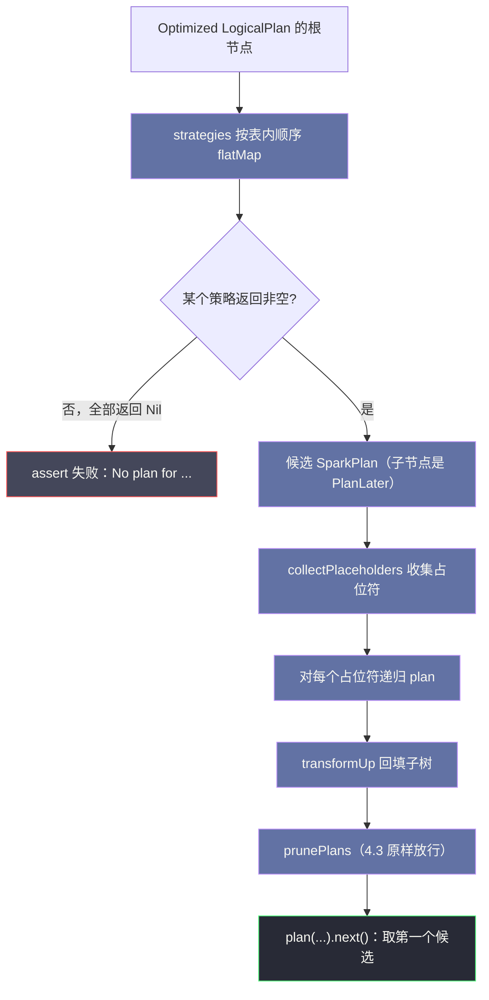
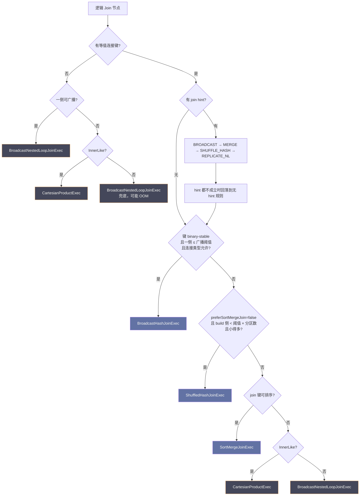
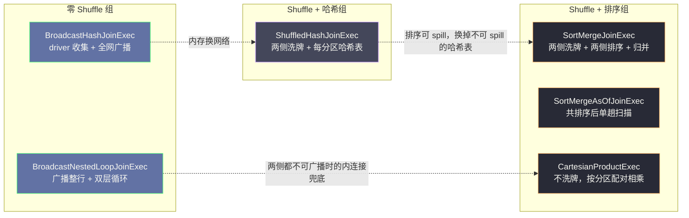
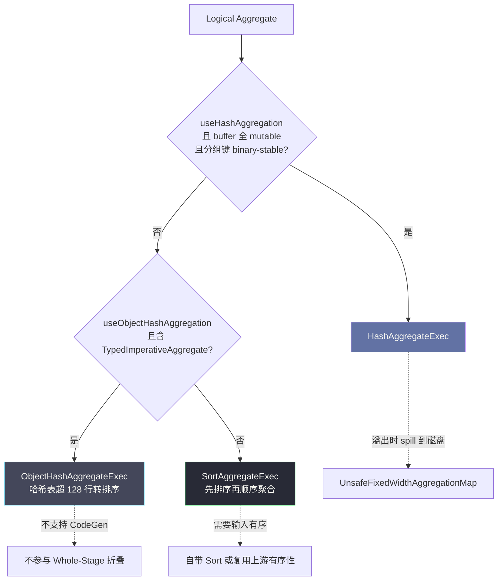
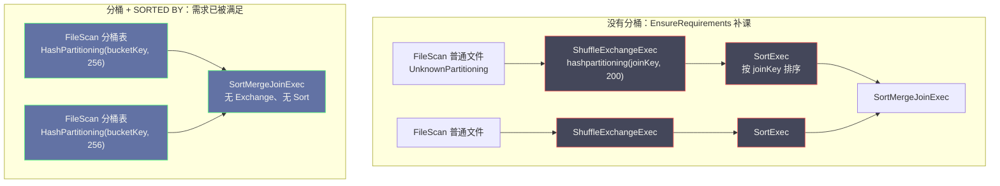

# 05 Physical Planning：从逻辑计划到物理算子的策略选择

**摘要：**

一条 `JOIN` 在逻辑计划里只是一个节点，落到物理层却有六种执行算子可以承接，同一句 SQL 由不同的人、在不同的配置下提交，拿到的可能是相差一个数量级的计划。本文顺着 `QueryPlanner.plan()` 的两段结构往下走：先看策略表如何在一个逻辑节点上排队、`planLater` 占位符如何驱动子树递归、为什么 `prunePlans` 并不剪枝（第一个能用的候选就是最终计划）；再进 `JoinSelection`，把 `BroadcastHashJoinExec`、`ShuffledHashJoinExec`、`SortMergeJoinExec`、`BroadcastNestedLoopJoinExec`、`CartesianProductExec` 与 4.3 新增的 `SortMergeAsOfJoinExec` 的入选判据逐条落到源码条件上，包括 `canBroadcastBySize` 的两套阈值、`canBuildBroadcastLeft/Right` 的连接类型白名单、`hashJoinSupported` 对 binary-stable 的要求、`preferSortMergeJoin` 与 `shuffledHashJoinFactor` 的联合约束。`spark.sql.autoBroadcastJoinThreshold` 在静态规划与 AQE 重规划里各被读一次，同一个数字因此有两重身份；聚合的 `HashAggregateExec`、`ObjectHashAggregateExec`、`SortAggregateExec` 三选一，则由聚合 buffer 是否 mutable、聚合函数是否 `TypedImperativeAggregate` 决定。最后拆开 `EnsureRequirements`，看清 `Distribution` 与 `Partitioning` 的对账如何凭空插出 `Exchange`，回答"没有写 distinct 为什么多出两次 shuffle"；并给出广播阈值的可用边界与三个反例（阈值调大不提内存、hint 强行广播大表、关掉 `preferSortMergeJoin` 期待一定更快）各自的症状、判据与处置。贯穿全篇的判断是：物理层不做代价比较，它只是按顺序试判据，所以调优的着力点在统计、配置与 hint，而不在"让优化器更聪明"。

---

## 第 1 章 同一句 join，六种活法

一张订单宽表 `dwd_order_wide`，按 `dt` 分区，日增一亿两千万行；一张门店维表 `dim_store`，四万八千行，常用的只有 `store_id` 与 `city` 两列。每天要跑的查询是一句再普通不过的日汇总：

```sql
SELECT o.dt, s.city, sum(o.amount) AS gmv, count(1) AS cnt
FROM dwd_order_wide o
JOIN dim_store s ON o.store_id = s.store_id
WHERE o.dt = '2026-11-18'
GROUP BY o.dt, s.city;
```

优化器交出来的逻辑计划对这两张表的规模一无所知，它只知道这里有一个 `Join(o, s, Inner, o.store_id = s.store_id)` 和一个 `Aggregate([dt, city], [sum(amount), count(1)])`。物理层要做的是把每个逻辑节点翻译成一个可执行的 `SparkPlan`，而翻译的选项从来不唯一：`Join` 有五种通用实现，4.3 起还多了一个专供 ASOF 语义的 `SortMergeAsOfJoinExec`，`Aggregate` 有三种。不同组合之间的差距不是百分比级别的：维表侧做广播，probe 端只顺序读一遍分区数据，一次 Shuffle 都不用；改走 `SortMergeJoinExec`，两侧各洗一次、各排一次；若不幸落进 `CartesianProductExec`，四万八千行乘上一亿两千万行，这个查询不会有结束的时候。

同一个逻辑 join 有六种物理实现，这不是 Spark 的实现冗余，而是六条资源曲线：有的把内存压在每个 Executor 的堆上，有的把压力转移到网络与磁盘，有的用 CPU 排序换内存，有的用内存换掉整轮 Shuffle。选择错了，十倍差距是常态，爆炸式退化也不是小概率事件。

### 1.1 物理规划在管线中的位置

Spark SQL 的主干是 Parser → Analyzer → Optimizer → Planner → RDD 五段（全貌见 [[大数据/Spark/Spark-SQL深度解析与性能调优/01 Spark SQL 全局架构：从 SQL 文本到 RDD 执行的完整旅程|01 全局架构]]）。物理规划（Physical Planning）吃进去的是 `Optimized LogicalPlan`，吐出来的是 `SparkPlan` 树，此后 `SparkPlan.execute()` 才把树翻译成 RDD 作业提交给调度器。

它与 CBO 的分工值得单独说清：CBO 负责把"每个子树大概多大、每列有多少不同值"算出来，结果挂在 `LogicalPlan.stats` 上；物理规划只负责拿着这些数字按规则挑实现（代价模型的细节见 [[大数据/Spark/Spark-SQL深度解析与性能调优/04 CBO 代价模型：统计信息驱动的执行计划选择|04 CBO]]）。这种分工带来一个容易被忽略的后果：物理规划本身不做代价比较，统计错了它就忠实地执行错误决定——一张实际 5GB 的表如果 `stats.sizeInBytes` 写着 5MB，`JoinSelection` 会毫不犹豫地把它送进 `BroadcastExchangeExec`。

### 1.2 一个反复出现的误解

笔者见过的多数关于物理规划的叙述，会把这一层描述成"枚举所有候选计划，按代价选最优"。4.3 的代码不是这样：策略按固定顺序排队，第一个能返回非空结果的策略胜出，`prunePlans` 默认把候选原样放行，源码里那句 TODO 从 2.x 一直留到现在——"RIGHT NOW ONLY ONE PLAN IS RETURNED EVER... PLAN SPACE EXPLORATION WILL BE IMPLEMENTED LATER"。

物理规划是"第一个可用的赢"，不是"最优的赢"。这个认知决定了后续所有调优动作的性质：你能动的只有三样东西，策略的先后（由版本决定，改不了）、判据里的统计与配置（能改）、`hint` 的显式干预（能改）。任何"让优化器更聪明一点"的期待，在物理层都落不到实处。

### 1.3 本文路线

先拆规划器本身的两段结构（第 2 章），再沿 `JoinSelection` 的判据树逐条走（第 3 章），然后逐个看六种 join 算子的资源形态与失效条件（第 4 章）。广播阈值这个被引用最多、被理解最浅的配置单独占一章（第 5 章），聚合的三选一跟在后面（第 6 章）。第 7 章处理"凭空多出来的 Exchange"，第 8 章回答"广播为什么被禁"，第 9 章把量级与三个反例摊开。

---

## 第 2 章 QueryPlanner 的两阶段：策略表与占位符

### 2.1 一个节点，一串策略

规划器的入口比想象中短：

```scala
// org.apache.spark.sql.catalyst.planning.QueryPlanner
def plan(plan: LogicalPlan): Iterator[PhysicalPlan] = {
  // Collect physical plan candidates.
  val candidates = strategies.iterator.flatMap(_(plan))
  // The candidates may contain place holders marked as planLater,
  // so try to replace them by their child plans.
  val plans = candidates.flatMap { candidate => /* 回填占位符，见 2.2 */ }
  val pruned = prunePlans(plans)
  assert(pruned.hasNext, s"No plan for $plan")
  pruned
}
```

`strategies` 是一串 `GenericStrategy`，每个策略的 `apply(plan)` 返回 `Seq[SparkPlan]`，空 Seq 表示"这个节点不归我管"。`flatMap` 把各层策略的产出摊平成一条候选流，注意这里全程惰性：排在后面的策略，在被取用之前根本不会执行。

取用发生在 `QueryExecution` 里，一句 `planner.plan(ReturnAnswer(optimizedPlan)).next()` 把候选流的第一个元素取走。于是"策略在表里的先后"直接等于"优先级"，而 `Strategy` 注释里所说的"returns a list of possible physical plan options"在实现中几乎没有兑现——绝大多数策略只返回 0 个或 1 个候选。

这也解释了为什么策略的写法是"偏函数式"的：`apply` 里一个 `plan match`，匹配不上就 `Nil`，匹配上就构造一个物理算子并把子树交给 `planLater`。策略从不关心子树长什么样，它只关心自己这一层。

### 2.2 planLater：递归由占位符驱动

`JoinSelection` 命中一个 `Join` 时，交给 `BroadcastHashJoinExec` 的左右孩子并不是子树的物理计划，而是两个 `PlanLater` 占位节点：

```scala
joins.BroadcastHashJoinExec(
  leftKeys, rightKeys, joinType, buildSide, nonEquiCond,
  planLater(left), planLater(right))
```

`QueryPlanner` 拿到候选后，用 `collectPlaceholders` 把这些占位符连同它们包着的逻辑计划收出来，对每个逻辑计划递归调用 `plan`，最后用 `transformUp` 把占位符替换成递归得到的子树。`SparkPlanner` 的实现很直白：

```scala
override protected def collectPlaceholders(plan: SparkPlan): Seq[(SparkPlan, LogicalPlan)] = {
  plan.collect { case placeholder @ PlanLater(logicalPlan) => placeholder -> logicalPlan }
}
```

这里有两个容易讲错的地方。其一，物理规划不是"对逻辑计划做一次自顶向下的 `transformDown`"，而是"逐节点匹配 + 占位符递归 + 自底向上回填"，那个 `transformUp` 是必要的：占位符可能嵌在候选树的任意深度，只有自底向上替换才能保证替换完成后树里不再残留占位符。其二，`transformDown` 并非不存在，它出现在别处，譬如 AQE 里给 join 追加 `NO_BROADCAST_HASH` 的逻辑规则 `DemoteBroadcastHashJoin`；物理层的规则则大多自底向上，`EnsureRequirements` 用的恰恰是 `transformUp`。

占位符机制带来两个可观察的后果。一个逻辑节点要么有策略认领，要么整条规划直接失败（`assert(pruned.hasNext, s"No plan for $plan")`），不存在"跳过这一层往下走"的兜底路径，这也是自定义数据源必须配 `Strategy` 的原因。另一头，策略只能决定自己这一层的算子形态，管不了子树：`JoinSelection` 决定了用 `SortMergeJoinExec`，却无法阻止子树的顶端被插入 `Exchange`——那件事发生在规划之后的 `EnsureRequirements` 里。

### 2.3 策略表的顺序就是优先级

4.3.0 的 `SparkPlanner.strategies` 内置十七项（下表编号 1 到 17），用户在 `SparkSessionExtensions` 里注入的策略会插到整张表之前（编号 0）：

| 序号 | 策略 | 负责的逻辑节点 | 顺序意义 |
|---|---|---|---|
| 0 | `extraStrategies` / `extraPlanningStrategies` | 用户注入 | 排在最前，可覆盖任何内置策略 |
| 1 | `LogicalQueryStageStrategy` | `LogicalQueryStage` | AQE 重规划时先认领已物化的 QueryStage |
| 2 | `PythonEvals` | Python UDF、Pandas UDF | 必须在通用算子之前，否则被当普通表达式 |
| 3 | `DataSourceV2Strategy` | V2 表扫描、V2 命令 | V2 数据源专用 |
| 4 | `V2CommandStrategy` | V2 命令 | 命令类节点 |
| 5 | `FileSourceStrategy` | 文件表 `LogicalRelation` | 文件表优先于通用数据源 |
| 6 | `DataSourceStrategy` | 其余 `LogicalRelation` | 通用扫描兜底 |
| 7 | `SpecialLimits` | `TakeOrdered`、`CollectLimit` | 专用 LIMIT 算子先于通用算子 |
| 8 | `Aggregation` | `Aggregate` | 聚合在本篇第 6 章展开 |
| 9 | `Window` | `Window` | 窗口 |
| 10 | `WindowGroupLimit` | `WindowGroupLimit` | 窗口上的 Top-N 下推 |
| 11 | `JoinSelection` | `Join` | 本篇主体 |
| 12 | `AsOfJoinSelection` | `AsOfJoin` | 紧跟在通用 join 之后，只认领 ASOF |
| 13 | `InMemoryScans` | `InMemoryRelation` | 缓存表扫描 |
| 14 | `SparkScripts` | `ScriptTransformation` | 脚本变换 |
| 15 | `Pipelines` | 声明式管道 | 专用扩展 |
| 16 | `BasicOperators` | `Project`、`Filter`、`Sort`、`Limit` 等 | 通用算子，几乎排在最后 |
| 17 | `EventTimeWatermarkStrategy` | 事件时间水位 | 流处理无状态查询的水位 |

这张表里有三处顺序是刻意安排的。`LogicalQueryStageStrategy` 必须最先，因为 AQE 重规划时逻辑树里已经嵌着 `LogicalQueryStage`，它得先被认领成 `QueryStageExec`，否则后续策略会把它当普通未解析节点处理。`JoinSelection` 与 `AsOfJoinSelection` 相邻且前后有序，ASOF 的逻辑节点是一个独立类型，专用策略放在通用策略之后，语义边界才不会糊。`BasicOperators` 压在倒数第二位，是因为它足够宽——`Project`、`Filter`、`Sort`、`Union` 几乎能匹配一切没被前面认领的节点，一旦提前就会吞掉本该由专用策略处理的节点。

规划的两段结构可以画成这样：



### 2.4 prunePlans 不剪枝的后果

`SparkPlanner` 对 `prunePlans` 的实现就是 `plans`，一行注释都没有：

```scala
override protected def prunePlans(plans: Iterator[SparkPlan]): Iterator[SparkPlan] = {
  // TODO: We will need to prune bad plans when we improve plan space exploration
  //       to prevent combinatorial explosion.
  plans
}
```

注释里的 "when we improve plan space exploration" 是整段设计的关键背景：Spark 从未实现物理计划的代价比较，`JoinSelection` 里没有一个 `Cost` 对象，也没有 `CostEvaluator` 参与静态规划。所谓"Spark 选择了 SortMergeJoin"，准确说法是"排在前面的三条判据都没命中，第四条命中"。

想改变结果，只有三个入口：改统计与配置去改变判据的真假、写 `hint` 抢占 hint 段、或者用 `SparkSessionExtensions.injectPlannerStrategy` 把自己的策略插到表头。第三种在数据源厂商的实现里很常见，把自家扫描算子放在 `FileSourceStrategy` 之前，内置策略就再没有机会接管。

---

## 第 3 章 JoinSelection：判据与顺序

### 3.1 两段式：hint 优先，规则兜底

`JoinSelection` 的 `apply` 先把等值 join 抽出来（`ExtractEquiJoinKeys`），然后分成两段。有 hint 时走 hint 段，`orElse` 链的先后就是优先级：

```scala
if (hint.isEmpty) {
  createJoinWithoutHint()
} else {
  createBroadcastHashJoin(onlyLookingAtHint = true)
    .orElse { if (hintToSortMergeJoin(hint)) createSortMergeJoin() else None }
    .orElse(createShuffleHashJoin(onlyLookingAtHint = true))
    .orElse { if (hintToShuffleReplicateNL(hint)) createCartesianProduct() else None }
    .getOrElse(createJoinWithoutHint())
}
```

hint 段的顺序是 `BROADCAST` → `SHUFFLE_MERGE` → `SHUFFLE_HASH` → `SHUFFLE_REPLICATE_NL`，最后落回无 hint 的规则。注意 `orElse` 链的短路语义：只要 `BROADCAST` hint 被满足，后面三个 hint 根本不会被检查，两个 hint 同时写在一句 SQL 里时，先命中的那个生效，另一个被静默忽略。

无 hint 段的顺序则是另一条链：

```scala
createBroadcastHashJoin(false)
  .orElse(createShuffleHashJoin(false))
  .orElse(createSortMergeJoin())
  .orElse(createCartesianProduct())
  .getOrElse {
    // This join could be very slow or OOM
    Seq(joins.BroadcastNestedLoopJoinExec(...))
  }
```

广播哈希 → Shuffle 哈希 → 排序归并 → 笛卡尔积 → 广播嵌套循环兜底。这条链与 `hint` 段有一处不对称：hint 段里 `SHUFFLE_MERGE` 排在 `SHUFFLE_HASH` 之前，无 hint 段里则是 `ShuffledHashJoin` 在 `SortMergeJoin` 之前。原因不神秘——无 hint 时 `ShuffledHashJoin` 的判据本身就含 `!preferSortMergeJoin`，默认配置下它是关着的，顺序排在前面也不会被选中；一旦把 `preferSortMergeJoin` 关掉，它才真正插到 `SortMergeJoin` 前面。

hint 段还有一道静默的校验。当 hint 指定的 build 侧在该连接类型下不成立时（例如 `BROADCAST` 指定了 `FullOuter` 的左侧），`checkHintBuildSide` 会通过 `hintErrorHandler` 记录一条 "build left for full outer join" 的告警，然后让这条 hint 的候选返回空，`orElse` 链继续往下走。也就是说 hint 不成立时不会报错、也不会失败，查询照常跑，只是 hint 被丢掉。排查"hint 写了没生效"时先看 Driver 日志里有没有这类 warning，比对着 `EXPLAIN` 猜要快得多。

### 3.2 决策树

把上面的两条链与判据合起来，等值 join 的选择过程是这样一棵树：



图里每一个菱形都是一个可以被配置或统计改写的布尔判断，这也是为什么同一个查询在不同环境里会落到不同算子——变的不是版本，是那几个布尔值。

### 3.3 每一个判据的确切条件

**广播的体积判据。** 判定只有一行，但阈值的取值分两种情况：

```scala
def canBroadcastBySize(plan: LogicalPlan, conf: SQLConf): Boolean = {
  val autoBroadcastJoinThreshold = if (plan.stats.isRuntime) {
    conf.getConf(SQLConf.ADAPTIVE_AUTO_BROADCASTJOIN_THRESHOLD)
      .getOrElse(conf.autoBroadcastJoinThreshold)
  } else {
    conf.autoBroadcastJoinThreshold
  }
  plan.stats.sizeInBytes >= 0 && plan.stats.sizeInBytes <= autoBroadcastJoinThreshold
}
```

`stats.isRuntime` 为真，说明这份统计是 AQE 从已物化的 QueryStage 上量出来的，此时优先读 `spark.sql.adaptive.autoBroadcastJoinThreshold`，没有配置才回落到静态值。`sizeInBytes >= 0` 这个前置条件顺带解释了 `-1` 的禁用语义：阈值取 `-1` 时右侧的比较恒假，任何正数的估算都进不了广播。

**连接类型的白名单。** 广播不是"小就能播"，还要看连接类型是否允许把某一侧做成 build 端：

```scala
def canBuildBroadcastLeft(joinType: JoinType): Boolean = joinType match {
  case _: InnerLike | RightOuter => true
  case _ => false
}
def canBuildBroadcastRight(joinType: JoinType): Boolean = joinType match {
  case _: InnerLike | LeftOuter | LeftSingle | LeftSemi | LeftAnti | _: ExistenceJoin => true
  case _ => false
}
```

读这段白名单的正确方式是记住"哪一侧必须被完整保留"：`LeftOuter` 要保住左表所有行，所以只能广播右表（probe 端是左表，未匹配的行照常输出空值），`RightOuter` 反过来；`FullOuter` 两侧都不能广播，因为用哈希探测的模型无法在收尾阶段把两侧未匹配的行补出来。`LeftSingle` 出现在 3.x 之后（用于标量子查询消除），只允许广播右侧。

**哈希键的可哈希性。** 这一条最容易被忽略：

```scala
protected def hashJoinSupported(leftKeys: Seq[Expression], rightKeys: Seq[Expression]): Boolean = {
  val result = leftKeys.concat(rightKeys).forall(e => UnsafeRowUtils.isBinaryStable(e.dataType))
  if (!result) { logWarning("Hash based joins are not supported ...") }
  result
}
```

`isBinaryStable` 的判定范围窄得惊人——它只在遇到**不支持二进制相等语义的字符串类型**时返回 `false`，也就是带非二进制排序规则（collation）的 `StringType`。4.x 引入 collation 之后，这类列做 join 键时 `BroadcastHashJoinExec` 与 `ShuffledHashJoinExec` 会被整体否决（否则哈希按字节比较、语义按排序规则比较，结果会错），于是即使小表只有 300KB，也会直接落到 `SortMergeJoinExec`。日志里那句 warning 是排查这类"明明很小却不广播"最直接的线索。

**Shuffle 哈希的表大小判据。** `ShuffledHashJoinExec` 的入选要同时满足三件事：`preferSortMergeJoin = false`（默认 `true`）、build 侧总大小小于「广播阈值 × Shuffle 分区数」、并且 build 侧乘上 `spark.sql.shuffledHashJoinFactor`（默认 3）后仍不大于另一侧：

```scala
private def canBuildLocalHashMapBySize(plan: LogicalPlan, conf: SQLConf): Boolean =
  plan.stats.sizeInBytes < conf.autoBroadcastJoinThreshold * conf.numShufflePartitions
private def muchSmaller(a: LogicalPlan, b: LogicalPlan, conf: SQLConf): Boolean =
  a.stats.sizeInBytes * conf.getConf(SQLConf.SHUFFLE_HASH_JOIN_FACTOR) <= b.stats.sizeInBytes
```

按默认值算，第一条给的上界是 10MB × 200 = 2GB（示例推算：阈值 10MB、`spark.sql.shuffle.partitions` 200），这个数字的含义是"整张 build 侧摊到每个 Shuffle 分区后，仍能装进一张本地哈希表"。第二条的 3 倍因子来自一个经验判断：建哈希表的单位代价高于排序，只有当 build 侧确实"小得多"时才值得，否则不如两侧排序归并。

**排序归并的判据。** 只剩两个条件，键可排序、且连接类型不是 `LeftSingle`：

```scala
def canMerge(joinType: JoinType): Boolean = joinType match {
  case LeftSingle => false
  case _ => true
}
def createSortMergeJoin() = {
  if (canMerge(joinType) && RowOrdering.isOrderable(leftKeys)) { ... } else None
}
```

`RowOrdering.isOrderable` 覆盖了绝大多数常见类型，`MapType`、`StructType` 的某些组合以及自定义类型会被判为不可排序，这类键一旦同时不满足广播与哈希条件，就会继续往 `CartesianProduct` 走。

**笛卡尔积与嵌套循环。** 笛卡尔积只对 `InnerLike` 开放，还会被 `NO_BROADCAST_AND_REPLICATION` hint 否决；两侧都不可广播的等值 join 在键不可排序时才会落到它。`BroadcastNestedLoopJoinExec` 是最后的兜底，源码注释自己承认 "This join could be very slow or OOM"。

### 3.4 顺序敏感的两个反事实

第一个反事实关于"关掉 `preferSortMergeJoin` 到底能改变什么"。假设维表 800KB，远小于广播阈值：`createBroadcastHashJoin` 先命中，`createShuffleHashJoin` 的判据根本不会被评估。所以对"能广播的小表"调 `preferSortMergeJoin` 毫无作用，它只影响那些**大到不能广播、又确实小得多**的中间结果。

第二个反事实关于"调大阈值能不能强制广播"。把 `spark.sql.autoBroadcastJoinThreshold` 调到 1GB，遇到 `FullOuter` join 依然不会广播，因为 `canBuildBroadcastLeft` 与 `canBuildBroadcastRight` 对它同时返回 `false`。结构性的否决在判据之上，阈值管不到。

| 物理算子 | 键要求 | 连接类型限制 | 触发条件 | 典型失效原因 |
|---|---|---|---|---|
| `BroadcastHashJoinExec` | 等值、binary-stable | InnerLike、LeftOuter、LeftSingle、Semi/Anti、ExistenceJoin、RightOuter（各自限定可广播侧） | build 侧 `sizeInBytes <=` 广播阈值，或 `BROADCAST` hint | FullOuter；collation 键；统计缺失；超过 `maxBroadcastTableSize` |
| `ShuffledHashJoinExec` | 等值、binary-stable | 左侧：InnerLike、LeftOuter、FullOuter、RightOuter；右侧另含 Semi/Anti、LeftSingle | `preferSortMergeJoin=false` 且两侧大小满足阈值 × 分区数与 3 倍关系，或 `SHUFFLE_HASH` hint | 默认 `preferSortMergeJoin=true`；单分区过大导致 OOM |
| `SortMergeJoinExec` | 等值、可排序 | 除 `LeftSingle` 外全部 | 前面三条都不成立时的默认路径，或 `MERGE` hint | 键不可排序；倾斜键导致归并放大 |
| `BroadcastNestedLoopJoinExec` | 不要求等值 | 全部（部分类型只能广播特定侧） | 无等值键且一侧可广播；其余路径全失败时兜底 | 两侧都大；`O(M×N)` 复杂度 |
| `CartesianProductExec` | 不要求 | 仅 InnerLike | 无等值键且两侧都不可广播，或 `SHUFFLE_REPLICATE_NL` hint | 输出行数等于两侧行数之积 |
| `SortMergeAsOfJoinExec` | 等值 + ASOF 排序键 | ASOF 语义定义的连接类型 | `AsOfJoin` 逻辑节点且 `spark.sql.join.sortMergeAsOfJoin.enabled` 或 `spark.sql.join.asofJoin.enabled` 开启 | 两个开关在 4.3 默认都是 `false` |

---

## 第 4 章 六种实现与它们的资源曲线

判据只回答"能不能选"，选完之后真正决定性能的是算子内部的资源形态。六种实现可以按"要不要 Shuffle、要不要排序、内存放在哪"分成三组来看。



### 4.1 BroadcastHashJoinExec：用网络带宽换掉一整轮 Shuffle

广播哈希连接（Broadcast Hash Join）的思路是让每个 Executor 都持有一份小表的哈希表，另一侧的数据在本地直接探测，因此 probe 端既不洗牌也不排序。代价集中在 Driver 与广播路径上：`BroadcastExchangeExec` 先在 Driver 上把小表全量收集成 `HashedRelation`，再通过 TorrentBroadcast 分块（`spark.broadcast.blockSize` 默认 4MB，`spark.broadcast.compress` 默认开启）分发到所有 Executor。

这条路径上有三道硬闸，全都写在 `BroadcastExchangeExec` 里：

| 闸门 | 默认值 | 触发后的行为 |
|---|---|---|
| `spark.sql.maxBroadcastTableSize` | 8GB | 抛 `cannotBroadcastTableOverMaxTableBytesError` |
| 行数上限 | 多列键的哈希广播取 `BytesToBytesMap.MAX_CAPACITY / 1.5`，identity 广播与单列 `LongType` 键的哈希广播取 5.12 亿 | 抛 `cannotBroadcastTableOverMaxTableRowsError` |
| `spark.sql.broadcastTimeout` | 300 秒 | Driver 侧 Future 超时，任务失败 |

行数上限那一栏值得多看一眼：多列键的哈希广播受 `BytesToBytesMap` 容量约束（源码注释给的口径是"不应超过 3.4 亿"），而 `LongHashedRelation`（单列 `LongType` 键）与 identity 广播走的是另一条分支，上限固定为 5.12 亿。也就是说"广播阈值只按字节算"是一种简化，真正的准入在执行期还有行数与总字节两道检查，超出时不会静默降级成别的 join，而是直接报错。

广播哈希的第二个特性容易被忽略：它的输出分区直接继承 probe 端（`streamedPlan.outputPartitioning`），内连接还允许把这种继承"展开"成至多 8 个候选分区（`spark.sql.execution.broadcastHashJoin.outputPartitioningExpandLimit`，默认 8，由 3.1 引入）。这条设计的意义在于让上层的聚合或 join 认得出"分区还在"，从而免掉一次 Shuffle——`EnsureRequirements` 在 7.4 节会用到它。

一句 EXPLAIN 就能认出广播：

```
+- BroadcastHashJoin [store_id#8], [store_id#21], Inner, BuildRight, false
   :- FileScan parquet dwd.dwd_order_wide[...] Batched: true, ...
   +- BroadcastExchange HashedRelationBroadcastMode(List(input[0, string, true]),false), [plan_id=7]
      +- FileScan parquet dim.dim_store[store_id#21, city#31] ...
```

`BuildRight` 说明维表在右侧被建成了哈希表；`HashedRelationBroadcastMode` 里的 `false` 表示这不是 null-aware anti join。

### 4.2 ShuffledHashJoinExec：把哈希表切到每个分区里

Shuffle 哈希连接（Shuffled Hash Join）同样用哈希表，但它不广播：两侧按 join 键做哈希洗牌，保证同键数据进同一分区，然后在每个分区内用较小的一侧建表、较大的一侧探测。与广播哈希相比，它省掉了 Driver 收集与全网分发；与排序归并相比，它省掉了两侧排序。

它的代价写在源码注释里，而且写得很直白——"a shuffled hash join builds a non-spillable local hash map"，不可 spill 的本地哈希表。这句话解释了默认配置为什么把它压在 `SortMergeJoinExec` 之下：一旦某个分区的 build 侧超出可用内存，没有磁盘退路可走。`preferSortMergeJoin` 这个开关的真实含义不是"更偏爱排序"，而是"更偏爱可 spill 的执行路径"。

EXPLAIN 中的形态是两侧各一个 `Exchange`、没有 `Sort`：

```
+- ShuffledHashJoin [store_id#8], [store_id#21], Inner, BuildRight
   :- Exchange hashpartitioning(store_id#8, 200), ENSURE_REQUIREMENTS, [plan_id=11]
   :  +- FileScan parquet dwd.dwd_order_wide[...]
   +- Exchange hashpartitioning(store_id#21, 200), ENSURE_REQUIREMENTS, [plan_id=12]
      +- FileScan parquet dim.dim_store[...]
```

4.3 里把排序归并改成 Shuffle 哈希的决定，已经从静态规划搬到了 AQE 的物理规则 `ConvertSortMergeJoinToShuffledHashJoin`（开关 `spark.sql.adaptive.convertSortMergeJoinToShuffledHashJoin.enabled`，默认 `true`）。但它的判据要求 `spark.sql.adaptive.advisoryPartitionSizeInBytes`（默认 64MB）不大于 `spark.sql.adaptive.maxShuffledHashJoinLocalMapThreshold`（默认 `0`），两数一比，默认状态下这条转换实际上不会发生。开关写着 true、行为却被另一个默认值卡住，这类组合在配置表里必须逐条核对，不能按字面理解。运行时的细节见 [[大数据/Spark/Spark-SQL深度解析与性能调优/06 AQE：运行时自适应查询优化|06 AQE]]。

### 4.3 SortMergeJoinExec：默认路径的理由是可预测

排序归并连接（Sort Merge Join）把两侧都按 join 键排好序，再用两个迭代器归并。它对子节点的要求写在两个方法里，一个是分布、一个是排序：

```scala
// ShuffledJoin（另一个分支带 allowNullKeySpreading = true，此处按常规情形简写）
override def requiredChildDistribution: Seq[Distribution] =
  ClusteredDistribution(leftKeys) :: ClusteredDistribution(rightKeys) :: Nil
// SortMergeJoinExec
override def requiredChildOrdering: Seq[Seq[SortOrder]] =
  requiredOrders(leftKeys) :: requiredOrders(rightKeys) :: Nil
```

需求本身不复杂，但它触发的连锁反应是这个算子的全部代价：两侧各一次 `Exchange`、两侧各一个 `SortExec`，排序过程还要占用执行内存并在压力下 spill。换来的是三样东西——内存占用与数据规模近似无关（归并只维护两个游标与一段缓冲）、排序阶段可以落盘、输出天然按 join 键有序。

缓冲区的阈值在 4.x 里有两档：`spark.sql.sortMergeJoinExec.buffer.in.memory.threshold` 默认取 `ByteArrayMethods.MAX_ROUNDED_ARRAY_LENGTH`（数量级在 2^31 字节附近，等于不按行数设限，量级判断），`spark.sql.sortMergeJoinExec.buffer.spill.threshold` 决定何时强制落盘，4.1 起又补了一个按字节的 `buffer.spill.size.threshold`。默认语义是"信任统一内存管理器，压力来了自己 spill"。

排序归并最著名的失效场景是热点键：左侧 1000 万行 `store_id = 'HOT'`、右侧 500 万行同键，归并阶段要输出 5×10^13 行中间结果。这不是内存问题，是输出规模问题，任何 spill 都救不回来，只能靠 AQE 的倾斜处理或改写查询（见 [[大数据/Spark/Spark-SQL深度解析与性能调优/10 数据倾斜：诊断、根因与系统性解决方案|10 数据倾斜]]）。

排序归并还是代码生成的一个天然断点。`CollapseCodegenStages` 在插入 `WholeStageCodegenExec` 时会特殊处理两个算子——`SortMergeJoinExec` 与 `ShuffledHashJoinExec` 的孩子各自被包上 `InputAdapter`："The children of SortMergeJoin should do codegen separately"，因为它们的孩子要先把整段数据排序并写成 `UnsafeExternalSorter` 的分区，归并端才能以迭代器方式读取，中间的物化点无法折叠进同一个 stage。广播哈希则相反，probe 端从头到尾是流式的，可以被折叠成一整段生成代码。同一个逻辑 join 在 EXPLAIN 里 `*(n)` 的编号段数不同，根源就在这里，编译期的细节归 [[大数据/Spark/Spark-SQL深度解析与性能调优/07 Whole-Stage CodeGen：JVM 字节码级别的性能飞跃|07 CodeGen]] 展开。

SQL 侧还有一处容易被忽略的交互：`SortMergeJoinExec` 声明的 `requiredChildOrdering` 是 join 键升序，如果上游恰好有一个 `ORDER BY` 也按同一组列升序，那一次排序会被复用；如果上游是 `ORDER BY ... DESC`，两者方向不一致，`EnsureRequirements` 只能再插一个 `SortExec`，排序次数从两次变三次。排序需求的对账与分区需求的对账在同一个方法里完成，但前者的可复用性比后者差得多。

### 4.4 BroadcastNestedLoopJoinExec：非等值 join 的现实选择

没有等值键时，哈希与排序归并都失去依据，只剩嵌套循环。广播嵌套循环连接把一侧整行广播出去（`IdentityBroadcastMode`，不建哈希表），另一侧的每一行与广播集合逐行比较条件，复杂度 `O(M×N)`。源码注释写明它对几种组合做过优化：右外连接广播左侧、左外/半/反连接广播右侧、内连接广播任意侧；其余组合需要多次扫描广播侧，会明显更慢。

它也是等值 join 的最后兜底：键既不可哈希（collation）又不可排序（复杂类型）时，前面四条路全部失败，`JoinSelection` 会走到 `getOrElse` 分支，用 `BroadcastNestedLoopJoinExec` 收场，并把"可能很慢或 OOM"留在注释里。

非等值 join 里有一个容易被误判的现象：条件写成 `a.start <= b.ts AND b.ts < a.end` 这类区间比较时，`JoinSelection` 走的是非等值分支——先看有没有一侧可广播，可广播就用广播嵌套循环，两侧都大且是内连接才退到笛卡尔积。4.4 引入了 `spark.sql.join.broadcastRangeJoin.enabled` 与 `BroadcastRangeJoinExec`，把"值落在区间内""两区间相交""单侧比较"三类谓词做成带索引的广播区间连接，默认关闭；4.3.0 上没有这条路，非等值 join 仍然是"广播嵌套循环或笛卡尔积"的二选一。

### 4.5 CartesianProductExec：合法但几乎总是错的输出

笛卡尔积是 `JoinSelection` 允许产出的合法计划，代码里没有任何警告：只要连接类型是 `InnerLike`、没有 `NO_BROADCAST_AND_REPLICATION` hint、并且两侧都不可广播，它就会接手。它不插 Shuffle，按分区配对相乘，输出行数等于两侧行数之积。

`spark.sql.crossJoin.enabled`（默认 `true`）经常被误认为能拦住它，其实那条配置管的是分析阶段的 `CheckCartesianProducts`——它检查的是"查询里有没有隐含的笛卡尔积并且没有显式写 `CROSS JOIN`"，属于语法层面的门禁；物理层兜底产生的笛卡尔积不经过那道检查。这句配置的真实作用是让 `FROM a, b WHERE a.x > b.y` 这类写法在分析期就报错，而不是在执行期跑上几天。

### 4.6 SortMergeAsOfJoinExec：第六个实现在 4.3 才出现

ASOF join 的语义与普通等值 join 不同：每个左行按某个有序维度（通常是时间）去找右表中"最近且满足方向"的那一行，典型写法是行情快照对齐、设备状态回溯。它不能表达成普通 join 的哈希查表，早期实现是把 ASOF 改写成相关子查询（correlated subquery），代价是一次逐行子查询。

4.3 引入了专用算子 `SortMergeAsOfJoinExec`：两侧按 ASOF 键共排序，然后单趟扫描，复杂度 `O(N log N)`。它由独立的策略 `AsOfJoinSelection` 认领，正是策略表里紧跟在 `JoinSelection` 之后的那一项：

```scala
case j: AsOfJoin if conf.useSortMergeAsOfJoinOperator(j.requiresSortMergeAsOfJoin) =>
  joins.SortMergeAsOfJoinExec(leftKeys, rightKeys, leftSort, rightSort,
    j.asOfCondition, j.orderExpression, j.joinType, residual,
    planLater(j.left), planLater(j.right)) :: Nil
```

两个开关在 4.3 默认都是 `false`：`spark.sql.join.sortMergeAsOfJoin.enabled` 控制 DataFrame ASOF 是否走专用算子（不开启时改写成相关子查询），`spark.sql.join.asofJoin.enabled` 控制 SQL 里 `ASOF JOIN ... MATCH_CONDITION` 语法是否可解析（关闭时解析期直接报错）。`useSortMergeAsOfJoinOperator` 的判断是"开关打开，或逻辑节点本身要求"——SQL 语法路径算"本身要求"，只要语法开着就一定走专用算子。

把这个算子当成第六种实现，除了技术形态完整，还有一层方法论意义：它的入选不由 `JoinSelection` 的判据决定，而由"逻辑节点类型 + 一个默认关闭的开关"决定。同一个 ASOF 查询在 4.2 与 4.3 上的物理形态完全不同，EXPLAIN 里一个是相关子查询、一个是排序归并算子，版本升级带来的计划变化不一定出现在 join 判据上。

### 4.7 ShuffledHashJoin 与 SortMergeJoin 的取舍

这两个算子是日常最需要判断的一对，因为它们服务于同一个区间——"大到不能广播、又没大到只能排序归并"。取舍可以压成一张表：

| 维度 | `ShuffledHashJoinExec` | `SortMergeJoinExec` |
|---|---|---|
| Shuffle | 两侧各一次 | 两侧各一次 |
| 排序 | 无 | 两侧各一次 `SortExec` |
| 内存形态 | 每分区一张哈希表，不可 spill | 归并缓冲 + 排序缓冲，可 spill |
| 单分区 build 侧大小 | 必须能整块放进执行内存 | 无硬性要求 |
| 输出有序性 | 丢失（外连接更复杂） | 按 join 键有序 |
| 热点键表现 | 哈希桶膨胀，无退路 | 输出行数线性放大，内存仍受控 |
| 进入门槛 | `preferSortMergeJoin=false` + 两条大小判据，或 hint | 键可排序即可 |

判据的算术值得单独算一遍。设 `spark.sql.autoBroadcastJoinThreshold` 保持 10MB、`spark.sql.shuffle.partitions` 保持 200，则 `canBuildLocalHashMapBySize` 给 build 侧的上界是 2GB；再叠加 3 倍因子，要求 build 侧不超过大侧的 1/3。两个条件都成立、且 build 侧在各分区之间分布均匀时，`ShuffledHashJoin` 比 `SortMergeJoin` 省掉两次全量排序与归并游标的建立，是更划算的一条；一旦 build 侧逼近 2GB 或分区倾斜让某个分区的哈希表膨胀，它就会从"更快"直接翻到"OOM"，中间没有过渡带。这种收益与风险相邻的曲线，需要靠外部保障（内存配额、分区大小上限）来兜住，而不是靠判据本身。

---

## 第 5 章 广播阈值的两重身份

### 5.1 一个数字，两处读点

`spark.sql.autoBroadcastJoinThreshold`（默认 10MB）在 4.3.0 的静态规划里有明确读者：`canBroadcastBySize`。但同一个判据方法在 AQE 重规划时会被再调用一次，那时统计对象换成了带 `isRuntime` 标记的运行时统计，读的配置也随之变成 `spark.sql.adaptive.autoBroadcastJoinThreshold`。

后者的定义是 `createOptional`，默认没有值。没有值时 `getOrElse(conf.autoBroadcastJoinThreshold)` 生效，于是默认行为是"运行时沿用静态阈值"，两处一致。一旦显式设置，两处就分叉：静态规划按 10MB 决定要不要广播，AQE 重规划按新值再决定一次。

这个分叉修正了一个相当普遍的误解——把静态阈值设成 `-1` 并不等于全局禁用广播。如果同时把 `spark.sql.adaptive.autoBroadcastJoinThreshold` 设成 `20MB`，静态阶段确实不广播，但 AQE 在 QueryStage 物化之后仍可能把一个小侧改写成广播哈希。真正要禁用，得两个都设成 `-1`，或者用 `NO_BROADCAST_HASH` hint 逐条压制。

双重身份的另一种表述是：这个数字同时充当"静态规划里可广播的判据"和"AQE 眼里的 `smallRelation` 判据"（`smallRelation` 是描述层面的叫法，对应代码里 `canBroadcastBySize` 那一段）。两处判据共用同一段实现，因此也共用同一类失效方式——统计偏小就误广播，统计缺失就永不广播。区别只在于 AQE 拿到的统计是量出来的，静态规划拿到的是估出来的；同一份阈值配在两处，误差特征完全不同。

### 5.2 统计缺失时到底发生什么

关于"没有统计会误判成小表，于是误广播"，事实与这个说法相反。关系自身算不出大小、目录里又没有统计时，`sizeInBytes` 取 `spark.sql.defaultSizeInBytes`——分区 Hive 表与分区数据源表在缺少统计时就是这条路径，而非分区数据源表会重新列文件自算大小。`defaultSizeInBytes` 的默认值是 `Long.MaxValue`，配置文档写得很清楚："by default it is set to Long.MaxValue which is larger than `spark.sql.autoBroadcastJoinThreshold` to be more conservative. That is to say by default the optimizer will not choose to broadcast a table unless it knows for sure its size is small enough."

所以统计缺失的后果是**结构上不可能入选广播**，而不是可能被误判成小表。真正会造成误广播的是"有统计、但统计严重偏小"：分区表只对基表做过 `ANALYZE`，新分区没进 `_statistics`；或者统计采集之后又灌进了十倍数据。这类偏小的估算过了 `canBroadcastBySize`，然后在 `BroadcastExchangeExec` 里被 `maxBroadcastTableSize` 拦住，或者更糟——通关成功，把 Driver 与全部 Executor 一起拖进 OOM。

`spark.sql.statistics.fallBackToHdfs`（默认 `false`）是另一条影响"缺失统计"行为的开关：开启后非分区 Hive 表在元数据没有统计时会去 HDFS 拿文件总大小，代价是一次 `getContentSummary`。它对非分区数据源表无效（那类表会自动重算），对分区表也无效（仍然是 `defaultSizeInBytes`）。

### 5.3 三种"广播被禁"的结构成因

排查"为什么这张小表没有广播"时，笔者习惯按验证成本从低到高排三个方向：连接类型白名单（第 3.3 节）、键的 binary-stable（第 3.3 节）、统计与阈值（本节）。三者的表现都是"没有 `BroadcastExchange`"，但处置完全不同。

| 配置 | 默认值 | 语义 | 调大的代价 | 调小的代价 |
|---|---|---|---|---|
| `spark.sql.autoBroadcastJoinThreshold` | 10MB | 静态规划的广播体积上限，`-1` 禁用 | Driver 收集与每 Executor 一份哈希表的内存、广播网络流量同步放大 | 小维表退化为排序归并，多两轮 Shuffle 与排序 |
| `spark.sql.adaptive.autoBroadcastJoinThreshold` | 未设置（沿用静态值） | 仅 AQE 重规划生效的广播上限，`-1` 禁用 | 运行时判据放宽，计划在 Stage 之间突然改写，可观测性下降 | 已物化的 QueryStage 不再被广播，静态阶段的广播计划可能被撤下 |
| `spark.sql.maxBroadcastTableSize` | 8GB | 广播数据总量的硬上限，超出报错 | 只提高报错阈值，不增加任何内存，调到 64GB 只是让失败更晚发生 | 正常大小的广播可能提前失败，不建议下调 |
| `spark.sql.broadcastTimeout` | 300 秒 | Driver 收集与广播的超时 | 慢广播从失败变成长时间占住 Driver | 大表广播容易超时误杀 |
| `spark.sql.defaultSizeInBytes` | `Long.MaxValue` | 关系自身算不出大小时的兜底值 | 已经是 `Long` 的最大值，没有可调大的空间 | 一旦调到广播阈值以下，**所有**无统计关系都会被当成小表，风险极高 |
| `spark.sql.shuffledHashJoinFactor` | 3 | `ShuffledHashJoin` 要求 build 侧"小得多"的倍数 | 更难进入 Shuffle 哈希，倾向排序归并 | 更容易进入 Shuffle 哈希，OOM 风险上升 |

### 5.4 阈值与内存的换算

把 10MB 当作"广播只花 10MB 内存"是这类事故的共同起点。实际的放大链条是：Parquet 压缩数据 10MB 先在 Driver 上解压成 `UnsafeRow`，再构造成 `HashedRelation`（含哈希桶与指针开销），最后按 4MB 一块压缩后分发给每个 Executor，每个 Executor 收到后解压并重建自己那份哈希表。

按经验口径做一次示例推算：压缩比 3:1 的宽表，10MB 解压后约 30MB；`UnsafeHashedRelation` 的桶利用率上限约 70%，扩容后连同指针开销按 1.5 倍估算，常驻约 45MB。二百个 Executor 就是 9GB 的集群内存总量，Driver 侧还要额外承担收集与分块存储的那一份。这个数量级解释了为什么"默认 10MB"是个保守值：它换来的是每 Executor 几十兆的常驻开销，而不是每个 Executor 十兆。反过来说，把阈值调到 200MB 时，上式的输出是每 Executor 约 900MB、二百个 Executor 合计 180GB（示例推算，口径同上）——这不是一个靠"集群内存够大"就能随便接受的数字。

---

## 第 6 章 聚合的物理实现：三个算子的判定链

### 6.1 判定链

`Aggregation` 策略只负责把 `Aggregate` 逻辑节点拆成 Partial/Final 两段或带 DISTINCT 的多段，具体用哪个执行算子由 `AggUtils.createAggregate` 决定。4.3.0 的判定顺序是三段式：

```scala
val useHash = child.conf.useHashAggregation && Aggregate.supportsHashAggregate(...)
if (useHash && !forceObjHashAggregate) {
  HashAggregateExec(...)
} else {
  val objectHashEnabled = child.conf.useObjectHashAggregation
  val useObjectHash = Aggregate.supportsObjectHashAggregate(...)
  if (forceObjHashAggregate || (objectHashEnabled && useObjectHash)) ObjectHashAggregateExec(...)
  else SortAggregateExec(...)
}
```

三个算子不是并列候选，而是有先后的一串否决：`HashAggregateExec` 先被检查，不支持才看 `ObjectHashAggregateExec`，两个都不行才落到 `SortAggregateExec`。4.3 新增的 `spark.sql.execution.useHashAggregateExec`（默认 `true`）是这条链上最前的一道总闸，它关掉之后 `HashAggregateExec` 直接出局；而第二段判据要求至少一个 `TypedImperativeAggregate`，普通 `sum`、`count` 不满足，于是整条链会一路落到 `SortAggregateExec`。把一个开关理解成"切到对象哈希"，实际效果却是"切回排序聚合"，这是 4.3 新增这道闸门后最容易被误读的地方。

这条判定链的走向可以画成这样：



### 6.2 两个 supports 判据的实质

`supportsHashAggregate` 检查的是"聚合缓冲能不能用 UnsafeRow 表示"：

```scala
def supportsHashAggregate(aggregateBufferAttributes: Seq[Attribute],
    groupingExpression: Seq[Expression]): Boolean = {
  val aggregationBufferSchema = DataTypeUtils.fromAttributes(aggregateBufferAttributes)
  isAggregateBufferMutable(aggregationBufferSchema) &&
    groupingExpression.forall(e => UnsafeRowUtils.isBinaryStable(e.dataType))
}
```

`isAggregateBufferMutable` 逐个字段问 `UnsafeRow.isMutable(dataType)`。`ObjectType` 是天然的否决项——`collect_list`、`collect_set`、`percentile_approx` 这些函数的聚合状态是 JVM 对象（`TypedImperativeAggregate` 的 `createAggregationBuffer` 返回任意对象），装不进定长 UnsafeRow，于是 `HashAggregateExec` 直接不适用。

`supportsObjectHashAggregate` 的判据宽松得多：

```scala
aggregateExpressions.map(_.aggregateFunction).exists {
  case _: TypedImperativeAggregate[_] => true
  case _ => false
}
```

留意是 `exists` 而不是 `forall`：一句 `sum(amount), collect_list(sku)` 里只要有一个函数是 `TypedImperativeAggregate`，整个聚合就整体走 `ObjectHashAggregateExec`，用安全的 `GenericInternalRow` 做缓冲。这也意味着一个 UDAF 是否手写 `TypedImperativeAggregate`，会直接改变整条聚合链的算子与内存布局。

### 6.3 Partial 与 Final，以及 4.3 的第三条路

没有 DISTINCT 时，`planAggregateWithoutDistinct` 生成两个算子：Shuffle 之前一个 `Partial` 模式的聚合做本地预聚合，Shuffle 之后一个 `Final` 模式做合并。预聚合是 Hash 聚合最值钱的地方——一亿行原始数据按 `(dt, city)` 预聚合后可能只剩几百行进入 Shuffle，网络传输量下降几个数量级。

4.3 加了 `spark.sql.execution.bypassPartialAggregation`（默认 `false`），跳过预聚合，直接在 Shuffle 之后做一次 `Complete` 聚合。它的适用场景在配置文档里写得很清楚：分组基数高、预聚合几乎没有削减效果时。此时预聚合只是把每行数据搬进哈希表再吐出来，白白消耗内存与 CPU。判据里还有两个保护条件——只有存在分组键时才允许跳过（全局聚合的预聚合必然把数据压成一行，跳过纯属浪费），带 `session_window` 时必须保留 Partial/Merge/Final 路径，因为 `MergingSessionsExec` 要靠它工作。

带 DISTINCT 的聚合不受这个配置影响。`planAggregateWithOneDistinct` 会生成四段：按「分组键 + distinct 列」做 Partial、再做一次以同样的键为分布的 PartialMerge、按 distinct 列做局部聚合、最后按分组键做 Final。这就是"我明明没写 DISTINCT，EXPLAIN 里却有两个 Exchange"的常见来源之一——`count(distinct)` 这类写法在语义上就是两次不同粒度的分组。

### 6.4 ObjectHashAggregateExec 的退化与边界

`ObjectHashAggregateExec` 的注释把自己的取舍讲得很清楚：它用安全行（safe row）做缓冲，用哈希表条目数而不是字节数决定何时退化，因为任意 JVM 对象的大小无法轻量估算；一旦退化，剩余输入全部交给外部排序器，而不是再建哈希表——"having too many JVM object aggregation states floating there can be dangerous for GC"。

退化阈值是 `spark.sql.objectHashAggregate.sortBased.fallbackThreshold`，默认 `128` 行。128 这个数字小得反常，配置注释解释了原因：某些 `TypedImperativeAggregate` 的状态对象可能非常大（比如 `percentile_approx` 的草图），保守阈值是为了避免在 GC 上翻车。

另一个常被忽略的事实是它不支持 CodeGen——源码注释直书 "CodeGen is not supported yet"。于是在 Whole-Stage CodeGen 的视角里，一个 `ObjectHashAggregateExec` 就是天然的折叠边界：它自己不会被包进 `WholeStageCodegenExec`，父算子会在它之上插一个 `InputAdapter`，它的孩子则各自独立成段（细节见 [[大数据/Spark/Spark-SQL深度解析与性能调优/07 Whole-Stage CodeGen：JVM 字节码级别的性能飞跃|07 CodeGen]]）。若一个查询里用了 `collect_list`，整条聚合链的代码生成收益会明显缩水，原因不在表达式复杂度，而在算子本身没进代码生成框架。

### 6.5 三个算子的对比

| 维度 | `HashAggregateExec` | `ObjectHashAggregateExec` | `SortAggregateExec` |
|---|---|---|---|
| 缓冲表示 | `UnsafeRow`，堆外定长 | `GenericInternalRow` + JVM 对象 | 仅当前分组的缓冲 |
| 支持 `TypedImperativeAggregate` | 否 | 是 | 是 |
| 退化/溢出行为 | 哈希表溢出时 spill 到磁盘 | 超过 128 行转外部排序 | 不适用 |
| CodeGen | 支持 | 不支持 | 支持 |
| 输入要求 | 无 | 无 | 按分组键排序 |
| 典型触发 | `sum`、`count`、`avg` 等常规聚合 | `collect_list`、`collect_set`、`percentile_approx` | buffer 含不可变类型、开关关闭、UDAF 不兼容 |

`SortAggregateExec` 在新版本里出现得越来越少，因为 4.x 的默认值把前两条路都打开了。它真正出现的场合有三类：聚合缓冲含 `ObjectType` 但同时没有任何 `TypedImperativeAggregate`（例如返回结构体数组的自定义 UDAF）；把 `spark.sql.execution.useHashAggregateExec` 或 `spark.sql.execution.useObjectHashAggregateExec` 手动关掉；以及聚合表达式全是 `PythonUDAF` 或 `PythonAggregate` 的情况——`Aggregation` 策略在那两个分支上根本不调用 `createAggregate`，直接交给 `ArrowAggregatePythonExec` 之类的 Python 执行器，三个 Java 算子一个都不参与。

---

## 第 7 章 EnsureRequirements：多出来的那些 Exchange

### 7.1 需求与产出之间的对账

物理算子用三个方法声明自己对子节点的要求：`requiredChildDistribution`（分区需求）、`requiredChildOrdering`（排序需求）、`outputPartitioning`（自己的产出）。规划阶段结束时的树是"每个算子都知道自己想要什么，但没有任何人保证孩子给得起"的状态，`EnsureRequirements` 就是那次对账。

```scala
def apply(plan: SparkPlan): SparkPlan = {
  plan.transformUp {
    case operator: SparkPlan =>
      val reordered = reorderJoinPredicates(operator)
      val newChildren = ensureDistributionAndOrdering(
        Some(reordered), reordered.children,
        reordered.requiredChildDistribution, reordered.requiredChildOrdering,
        ENSURE_REQUIREMENTS)
      reordered.withNewChildren(newChildren)
  }
}
```

自底向上（`transformUp`）这个方向是刻意的：先把子树修好，父节点看到的才是孩子最终的 `outputPartitioning`，判断能不能免掉洗牌才有意义。如果反过来自顶向下，父节点只能对着未加工的孩子猜。

### 7.2 两个孩子的分区数必须对上

单孩子的算子（`Aggregate`、`Window`、`Sort` 之上）逻辑简单：需求不满足就插一个 `Exchange`。真正复杂的是双孩子的算子，也就是 join。

`EnsureRequirements` 先让每个孩子各自满足 `ClusteredDistribution`，然后处理一个额外约束：两个孩子最终的分区数必须一致，否则同键数据会散在不同数量的分区里，哈希与归并都无法进行。它的做法是从两个孩子的分区方案里挑一个"能作为布局"的（`canCreatePartitioning`），优先挑那个本来没有 `ShuffleExchangeLike` 的孩子，其次挑分区数更大的那个，然后把另一侧改写成同样的分区：

```scala
// 简化后的主干：pick the spec with the best parallelism
val bestSpecOpt = ...  // maxBy(_.numPartitions)
children = children.map {
  case (child, dist) if bestMemberOpt.isDefined && matched(child) => child
  case (child, dist) => ShuffleExchangeExec(newPartitioning, child)  // 或多一层 Exchange
}
```

这段代码解释了一个常见观感：一侧本来已经洗好了（比如上游聚合刚按同一个键洗过 200 个分区），另一侧是 256 桶的分桶表，对账的结果往往是给分桶表那一侧再加一次洗牌，把 256 改成 200，而不是让 200 那一侧改成 256。挑布局的规则是"优先复用没有 Exchange 的一侧、其次取分区数更大的一侧"，两个规则冲突时前者优先。

源码里还有一处注释值得留意：最优策略在三个孩子时并不最优（分区数 `(10, 10, 11)` 时选 10 只需洗一侧，选 11 要洗两侧），但 Spark 的多孩子算子目前最多两个孩子，所以没有处理。

### 7.3 "我明明没写 distinct"

物理计划里出现两三个 `Exchange`，绝大多数时候不是规划器犯了错，而是某些算子对分布的隐含需求被兑现了。按出现频率列一遍：

| 现象 | 需求来源 | 为什么逻辑计划里看不到 |
|---|---|---|
| join 两侧各一个 `Exchange` | `ClusteredDistribution(joinKeys)` | `Join` 逻辑节点没有"按 join 键分区"这一说 |
| join 之上再一个 `Exchange` | 上层 `Aggregate` 的 `ClusteredDistribution(groupingKeys)`，且分组键与 join 键不同 | `GROUP BY` 只声明分组，不声明分区 |
| 末尾一个 `Exchange` | 全局 `ORDER BY` 的 `RangePartitioning`、全局 `LIMIT` 的 `SinglePartition` | `ORDER BY` 的"全局"语义只在物理层兑现 |
| 多一个 `Exchange` | 窗口函数的 `ClusteredDistribution(partitionSpec)` | `over(partition by ...)` 隐含分区 |
| 两个 `Exchange` | `count(distinct x)` 的两次不同粒度分组 | `DISTINCT` 关键字藏在聚合函数里 |
| 同一份数据洗两次 | `ReuseExchangeAndSubquery` 没能复用 | 复用只认规范化后完全相同的 `Exchange` |

以本文开头的查询为例：`GROUP BY dt, city` 与 join 键 `store_id` 不一致，于是 `BroadcastHashJoinExec` 之上必然有一个 `Exchange hashpartitioning(dt, city, 200)`。这个 Exchange 与 join 无关，是聚合要的；如果写法改成 `GROUP BY store_id`，广播哈希的输出分区恰好能被聚合认领，这一次 Shuffle 就省掉了。判断一个 `Exchange` 该不该存在，看它的 `hashpartitioning(...)` 里是哪几列就够了。

### 7.4 三个能省掉 Exchange 的例外条款

**单分区捷径。** 两个孩子都是 `SinglePartition`、且逻辑上估算的大小都不超过 `spark.sql.maxSinglePartitionBytes`（默认 `128m`）时，`EnsureRequirements` 不再做分区数对齐，直接让两侧在单分区上 join。小表 join 小表的场景里，这条规则省掉的正是"为了对齐而引入的 Shuffle"。

**广播输出分区的展开。** 内连接的 `BroadcastHashJoinExec` 可以把 probe 端的分区方案展开成至多 `spark.sql.execution.broadcastHashJoin.outputPartitioningExpandLimit`（默认 8）个候选，供上层需求匹配。若把这个值设成 0，广播 join 的输出分区就退化成一个不可用的整体，上层聚合或 join 会立刻多出一次 Shuffle。这是一个"调小反而更贵"的配置。

**聚类键的宽松匹配。** `ClusteredDistribution` 的匹配有严格与宽松两种口径。严格口径要求分区表达式与聚类键完全一致（键的数量与顺序都对齐），宽松口径只要求分区表达式是聚类键的子集。控制前者的是 `spark.sql.requireAllClusterKeysForDistribution`（默认 `false`，即宽松）。宽松口径下，按 `store_id` 分区的数据可以满足 `ClusteredDistribution(dt, store_id)` 的聚合需求——分区表达式是聚类键的子集，同一个 `store_id` 的行必然同区，分组不会被打断；反过来则不成立，按 `(dt, store_id)` 分区的数据满足不了 `ClusteredDistribution(store_id)`，因为多出来的 `dt` 会把同一个门店拆到若干个分区里，聚合结果会碎掉。

与之相邻的 `spark.sql.requireAllClusterKeysForCoPartition`（默认 `true`）管的是另一件事：当一侧已有的分区键不是完整的 join 键时，是否允许把它当作两侧共同的布局。默认不允许，理由写在注释里——用部分 join 键做分区会放大倾斜，宁可让两侧都按完整 join 键洗一遍。这条默认值解释了为什么"只按 join 键的一部分分区"的优化常常不生效。

### 7.5 复用只在完全相同时发生

`ReuseExchangeAndSubquery` 把物理计划里重复的 `Exchange` 合并成一个，判定键是 `exchange.canonicalized`——分区方式、分区列、子树的规范化形式全都要一致：

```scala
case exchange: Exchange if conf.exchangeReuseEnabled =>
  val cachedExchange = exchanges.getOrElseUpdate(exchange.canonicalized, exchange)
  if (cachedExchange.ne(exchange)) ReusedExchangeExec(exchange.output, cachedExchange) else cachedExchange
```

`spark.sql.exchange.reuse` 默认 `true`，所以失效的原因几乎总在 `canonicalized` 上：一侧的分区数是 200、另一侧是 256；一侧在洗牌前多了一个 `Filter`；两侧的列别名不同导致规范化形式不同（别名本身会被规范化掉，但投影产生的新 `ExprId` 不一定）；一侧走的是 `REPARTITION_BY_COL` 起源、另一侧是 `ENSURE_REQUIREMENTS`。这些差异都不会出现在逻辑计划里，所以"两份数据明明一样却洗了两次"在物理层是完全合理的。

### 7.6 Bucket Join：让需求一开始就被满足

分桶（Bucketing）是另一条思路：与其在查询时插 `Exchange`，不如在写入时把数据按桶键预先分区，让读取端的分区方案天然满足 join 的需求。`EnsureRequirements` 并不知道"桶"这个概念，它只看到 `FileScan` 的 `outputPartitioning` 是一个按桶键哈希的分区，而这个分区恰好满足 `ClusteredDistribution(joinKeys)`，于是对账通过，不插 `Exchange`。

触发条件可以归纳成四条：`spark.sql.sources.bucketing.enabled` 为 `true`（默认）；两张表的桶键都**包含在** join 键里（默认宽松匹配，判定是"分区表达式 ⊆ 聚类键"）；桶数必须完全相同——哈希共分区的对账要求两侧分区数相等（`HashShuffleSpecCompatibility.isCompatible` 里的 `leftNumPartitions == rightNumPartitions`）；`spark.sql.sources.bucketing.autoBucketedScan.enabled`（默认 `true`）判断这次查询确实有能利用分桶的算子，否则不启用分桶扫描。桶数上限由 `spark.sql.sources.bucketing.maxBuckets`（默认 100000）约束。

两种路径在对账环节的差别可以这样看：



退化路径同样由对账逻辑决定。桶数 256 对 128 时，分区数对不上，`EnsureRequirements` 会给 128 桶的那一侧补一次洗牌改成 256；桶键是 `(dt, store_id)` 而 join 只用 `store_id` 时，分区表达式 `{dt, store_id}` 不是聚类键 `{store_id}` 的子集，对账不通过，两侧照常洗牌（分桶带来的只有"文件组织"上的好处，Shuffle 一个都省不掉）；没有 `SORTED BY` 时 `Exchange` 可以省，`SortMergeJoinExec` 要的 `SortExec` 仍然得插，而 `SortExec` 的代价常常不比 `ShuffleExchangeExec` 低。

---

## 第 8 章 广播为什么被禁

### 8.1 结构性不可广播

第 3.3 节的白名单已经给过答案，这里补一层直觉。广播哈希的执行模型是"用 probe 端逐行查一张静态哈希表"，它天然无法在收尾阶段为某一侧补出未匹配的行。`FullOuter` 要求两侧未匹配的行都出现，与这个模型根本冲突；`LeftOuter` 里左表是 probe 端，若把左表做成广播，右表的未匹配行就无从补出，所以只能广播右表。这也是 `LeftSingle` 只允许广播右侧的原因——标量子查询的右表必须唯一匹配，probe 端必须是左表。

### 8.2 hint 只改路线，不改结构

| hint | 语义 | 结构性限制 | 常见误用 |
|---|---|---|---|
| `BROADCAST(t)` | 强制把 `t` 作为广播侧 | `FullOuter` 两侧都不可广播；collation 键不可哈希 | 对大表使用，触发 `maxBroadcastTableSize` 或 OOM |
| `MERGE(t)` / `SHUFFLE_MERGE` | 强制排序归并 | 键必须可排序 | 在倾斜键上强制，归并输出爆炸 |
| `SHUFFLE_HASH(t)` | 强制 `ShuffledHashJoinExec` 并把 `t` 作为 build 侧 | 键必须 binary-stable | build 侧过大，不可 spill 直接 OOM |
| `SHUFFLE_REPLICATE_NL(t)` | 强制笛卡尔积（内连接） | 仅 `InnerLike` | 误当成"更快的嵌套循环" |
| `NO_BROADCAST_HASH(t)` | 禁止按大小把 `t` 广播 | 不阻止 `BROADCAST(t)` 显式广播 | 以为它是全局关广播 |
| `NO_BROADCAST_AND_REPLICATION(t)` | 既禁止广播、也禁止复制 | 同时否决笛卡尔积兜底 | 用于外连接时效果与预期不符 |

这张表里最容易踩的是最后两行。`NO_BROADCAST_HASH` 的实现位置在 `getBroadcastBuildSide` 的"按大小判断"分支里：`canBroadcastBySize(...) && !hintToNotBroadcastLeft(hint)`。而 `onlyLookingAtHint = true` 的那条分支只看 `BROADCAST` hint，完全不看 `NO_BROADCAST_HASH`。两句话合起来的意思是：`NO_BROADCAST_HASH` 压不住一个显式的 `BROADCAST` hint，它们同时出现时，广播照样发生。

`NO_BROADCAST_AND_REPLICATION` 的作用面更宽，它除了否决按大小广播，还会让 `createCartesianProduct` 里的 `!hintToNotBroadcastAndReplicate(hint)` 返回 false——内连接的最后一条兜底路也被堵上，于是只能走嵌套循环。

反方向的误用同样常见：譬如在一张几百 KB 的维表上写 `SHUFFLE_HASH`，它确实会生效——hint 段排在按大小的规则之前，广播判据根本没机会被评估，结果是一条本来就该走广播的 join 被强行改成两侧洗牌加每分区建表。这类"hint 写对了但写反了方向"的配置，在 `EXPLAIN` 里表现为 `ShuffledHashJoinExec` 与两个 `Exchange`，而阈值配置完全正常，光看配置表是查不出来的。

### 8.3 AQE 会在运行时反向打 hint

`DemoteBroadcastHashJoin` 是 AQE 优化器里的一条逻辑规则，它做的事与用户写 hint 恰好相反：当一侧的 `ShuffleQueryStageExec` 物化后发现空分区比例过高（`spark.sql.adaptive.nonEmptyPartitionRatioForBroadcastJoin`，默认 `0.2`），它会自动在该侧加上 `NO_BROADCAST_HASH`，把这个广播计划撤下。理由写在注释里：一侧绝大多数分区是空的时，洗牌后很多 task 可以瞬间完成，而广播反而要在每个 Executor 上建一张几乎用不到的表。

这也意味着"我明明什么都没改，第二次跑却换了计划"有相当一部分来自这条规则。这条 hint 加在重规划阶段，静态 `EXPLAIN` 上看不到，要确认它只能看 Spark UI 里 SQL 详情页的最终计划（`isFinalPlan=true` 之后的那份），或者把 `spark.sql.adaptive.optimizer.excludedRules` 设成 `DemoteBroadcastHashJoin` 做一次对照实验。机制细节在 [[大数据/Spark/Spark-SQL深度解析与性能调优/06 AQE：运行时自适应查询优化|06 AQE]]。

---

## 第 9 章 量级、边界与三个反例

### 9.1 三种 join 的资源量级

| 算子 | Shuffle 量 | 排序 | 内存驻留 | 失效边界 |
|---|---|---|---|---|
| `BroadcastHashJoinExec` | 0 | 无 | Driver 一份 + 每 Executor 一份哈希表 | 广播侧超过阈值、`maxBroadcastTableSize`、行数上限 |
| `ShuffledHashJoinExec` | 两侧全量 | 无 | 每分区一张哈希表，不可 spill | 单分区 build 侧放不进执行内存 |
| `SortMergeJoinExec` | 两侧全量 | 两侧各一次 | 排序缓冲 + 归并缓冲，可 spill | 倾斜键导致输出放大 |
| `BroadcastNestedLoopJoinExec` | 0 | 无 | 广播侧常驻 + `O(M×N)` CPU | 两侧都大时等价于不可完成 |
| `CartesianProductExec` | 0 | 无 | 无缓冲上限，输出 `M×N` 行 | 输出规模 |
| `SortMergeAsOfJoinExec` | 两侧全量 | 两侧共排序 | 归并缓冲 | ASOF 键的重复度 |

广播哈希的内存不能只按阈值算，前面第 5.4 节的换算给了一个口径：压缩数据 10MB、解压 30MB、哈希表常驻 45MB 每 Executor（示例推算）。排序归并的峰值内存由 spill 阈值与排序缓冲决定，不随总规模线性上涨，这是它在"大表 × 大表"场景成为默认的全部理由。

### 9.2 三个反例

**反例一：只调大广播阈值，不提内存。** 症状是"调完阈值后查询从慢变成失败"，报错可能是 Driver 的 `OutOfMemoryError`、`notEnoughMemoryToBuildAndBroadcastTable`、或者 `broadcastTimeout` 超时。判据是 `EXPLAIN` 里出现了 `BroadcastExchange`，且广播侧的 `dataSize` 指标（`BroadcastExchangeExec` 有 `dataSize` 与 `buildTime` 指标）接近或超过阈值。根因是阈值只是准入条件，真正的内存开销由"解压后大小 × 每 Executor 一份"决定。处置是把静态与 AQE 两个阈值一起评估、按 Executor 内存配额反推安全上限，或者干脆用 `hint` 只对确知的小表广播。

**反例二：用 `BROADCAST` hint 强行广播大表。** 症状是任务在广播阶段长时间挂住然后失败，Driver 日志里出现收集耗时以分钟计。判据是 `BroadcastExchange` 的 `collectTime` 与 `dataSize`；若 `dataSize` 超过 `spark.sql.maxBroadcastTableSize`（默认 8GB），会直接抛 `cannotBroadcastTableOverMaxTableBytesError`。这与阈值无关——hint 绕过了体积判据，绕不过执行期的硬闸。处置是撤掉 hint，改用 `MERGE` 或接受洗牌。

**反例三：期望 `preferSortMergeJoin=false` 一定更快。** 症状是关掉之后部分查询变快、部分查询 OOM。判据是 `EXPLAIN` 里 `ShuffledHashJoinExec` 出现且某个 task 的 spill 指标为 0、GC 时间很长。根因是这条闸门只管"要不要尝试 Shuffle 哈希"，不管 build 侧摊到单个分区后到底多大——判据用的是总大小除以分区数，倾斜时单分区可以是平均值的几十倍，而哈希表没有 spill 退路。处置是保持默认 `true`，把个别确知均匀且 build 侧小的查询用 `SHUFFLE_HASH` hint 定点开启。

笔者把这三个反例放在一起，是因为它们共享同一个结构：配置或 hint 改变的是"判据"，而失败发生在"执行期资源"。判据与资源之间隔着一层估算误差，误差在统计陈旧、倾斜、序列化放大三种情况下最大。

---

## 第 10 章 收束：被约束的选择

物理规划这一层没有"最优解"这个概念可供追求。`prunePlans` 不剪枝，候选流的第一个元素就是答案，源码里那句 TODO 从 2.x 留到 4.3 也没有实现，所以讨论"Spark 为什么选了这条计划"时，问的其实是"哪几条判据被满足、哪些被否决"。

六个 join 算子的排列组合看似复杂，落到判据上只有三个变量在起作用：键能不能哈希（binary-stable）、键能不能排序（orderable）、以及最大的一侧能不能放进内存或广播。三者的组合空间有限，剩下的都是资源形态的差别——广播用网络换掉 Shuffle、Shuffle 哈希用内存换掉排序、排序归并用磁盘换掉内存峰值。

真正的工程判断在判据之外：统计是否可信、倾斜是否会突破平均值、阈值放大后的内存倍数是否在配额之内。`spark.sql.autoBroadcastJoinThreshold` 从 10MB 调到 200MB 只需要改一行配置，而它背后的内存需求按 Executor 数量线性放大；`preferSortMergeJoin` 从 `true` 改成 `false` 也只需要一行，代价是把可 spill 的路径换成不可 spill 的路径。这两行配置的风险收益比，比任何执行计划都更值得先算清楚。

---

## 参考资料

1. Apache Spark v4.3.0 源码 `SparkStrategies.scala`（`JoinSelection`、`AsOfJoinSelection`、`Aggregation`）：[GitHub](https://raw.githubusercontent.com/apache/spark/v4.3.0/sql/core/src/main/scala/org/apache/spark/sql/execution/SparkStrategies.scala)
2. Apache Spark v4.3.0 源码 `QueryPlanner.scala`（策略匹配与 `planLater` 占位符回填）：[GitHub](https://raw.githubusercontent.com/apache/spark/v4.3.0/sql/catalyst/src/main/scala/org/apache/spark/sql/catalyst/planning/QueryPlanner.scala)
3. Apache Spark v4.3.0 源码 `joins.scala`（`JoinSelectionHelper`：`canBroadcastBySize`、`canBuildBroadcastLeft/Right`、`hashJoinSupported`）：[GitHub](https://raw.githubusercontent.com/apache/spark/v4.3.0/sql/catalyst/src/main/scala/org/apache/spark/sql/catalyst/optimizer/joins.scala)
4. Apache Spark v4.3.0 源码 `EnsureRequirements.scala`（分布对账、分区数对齐、单分区捷径）：[GitHub](https://raw.githubusercontent.com/apache/spark/v4.3.0/sql/core/src/main/scala/org/apache/spark/sql/execution/exchange/EnsureRequirements.scala)
5. Apache Spark v4.3.0 源码 `AggUtils.scala`（`createAggregate` 三选一判定链）：[GitHub](https://raw.githubusercontent.com/apache/spark/v4.3.0/sql/core/src/main/scala/org/apache/spark/sql/execution/aggregate/AggUtils.scala)
6. Apache Spark v4.3.0 源码 `SQLConf.scala`（广播阈值、`preferSortMergeJoin`、聚合与自适应相关配置的默认值）：[GitHub](https://raw.githubusercontent.com/apache/spark/v4.3.0/sql/catalyst/src/main/scala/org/apache/spark/sql/internal/SQLConf.scala)
7. Spark 官方文档：Performance Tuning（广播阈值、Shuffle 分区、AQE 相关配置）：[spark.apache.org](https://spark.apache.org/docs/latest/sql-performance-tuning.html)
8. Spark 官方文档：Hints（`BROADCAST`、`MERGE`、`SHUFFLE_HASH`、`SHUFFLE_REPLICATE_NL` 的语义）：[spark.apache.org](https://spark.apache.org/docs/latest/sql-ref-syntax-qry-select-hints.html)

---

> [!note] 思考题
> 1. `prunePlans` 不剪枝意味着物理层从不比较代价。如果让你在 `SparkSessionExtensions` 里注入一个策略，把"大表 × 大表"的等值 join 从 `SortMergeJoinExec` 改成 `ShuffledHashJoinExec`，你需要自己实现哪些判据，才能不重蹈"默认 `preferSortMergeJoin=false` 引起 OOM"的覆辙？
> 2. `spark.sql.autoBroadcastJoinThreshold` 在 AQE 下有两个读者。若只把静态值设为 `-1`、把 adaptive 值设为 20MB，`EXPLAIN` 会显示 `BroadcastExchange` 还是不显示？在什么时间点才能观察到它出现？
> 3. 桶键是 `(dt, store_id)`、join 只按 `store_id` 进行时，`EnsureRequirements` 为什么不会认为分桶已经满足需求？把 `spark.sql.requireAllClusterKeysForDistribution` 改成 `true` 会让情况变好还是更糟？
> 4. `ObjectHashAggregateExec` 的退化阈值只有 128 行，而 `HashAggregateExec` 溢出时是 spill 到磁盘。为什么两者的退化策略不能统一？从 GC、状态对象大小与代码生成三个角度各给一个理由。
> 5. 一个查询在 `EXPLAIN` 里出现了三个 `Exchange`，分别位于 join 两侧与聚合之上。若把 `GROUP BY` 的列改成 join 键，能省掉哪一个？剩下两个是否还有办法靠 `hint` 或表设计省掉？