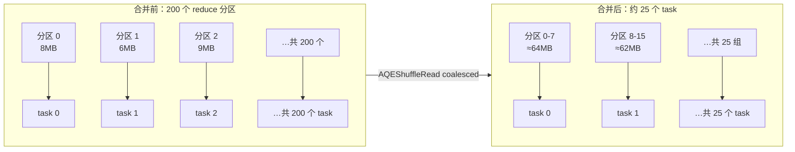
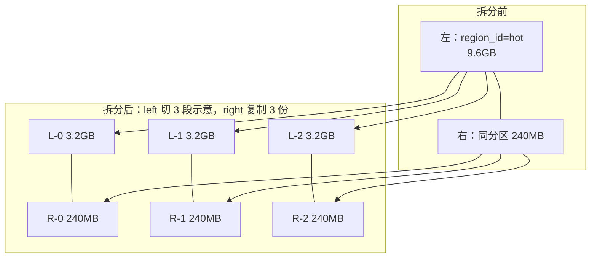
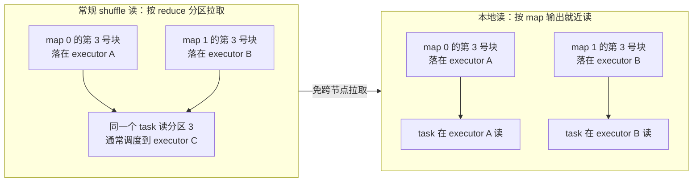
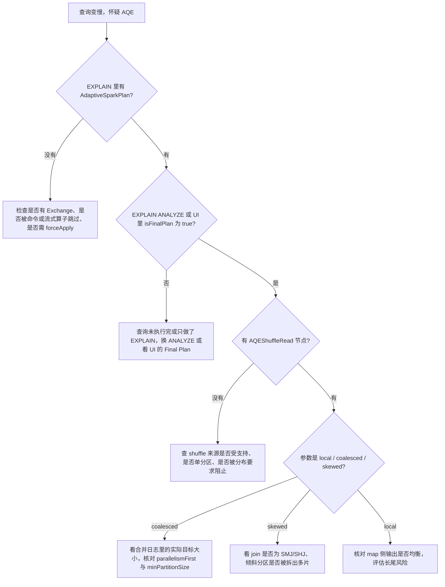

# 06 AQE：运行时自适应查询优化

**摘要：**

AQE 常被描述成"运行时把计划改好"，这个说法掩盖了它真正的机制：先把物理计划沿着 Exchange 切成若干可物化的 QueryStage，每完成一个 stage 就取到该段输出在磁盘上的真实字节数与行数，再用这些数字重写"尚未执行的那一段"。这套机制同时划定了 AQE 的能力与边界——能改的是分区的读法与 join 的物理实现，改不了的是已经物化的数据、join 的逻辑顺序，以及任何没有 shuffle 参与的执行链。本文沿三条主线展开：其一，QueryStage 与 `AdaptiveSparkPlanExec` 的重规划循环，包括 `LogicalQueryStage` 怎样把运行时统计注入逻辑优化、`SimpleCostEvaluator` 怎样决定是否采纳新计划；其二，三个运行时优化器以及广播化、本地读这一对降级动作，重点解释 `parallelismFirst` 默认 true 时合并目标为何不是 64MB、倾斜拆分的目标大小为何不是 `advisoryPartitionSizeInBytes`、本地读为什么省了网络却放大倾斜；其三，边界、代价与判读方法，给出 `EXPLAIN`、UI 指标、日志三层证据链。全文以一条"订单宽表 join 维表再按天聚合"的查询贯穿，配置默认值按 Spark 4.3 核对。

---

## 第 1 章 前提：把计划切成可物化的段

### 1.1 从一次默认开启说起

2020 年 6 月发布的 Spark 3.0 引入了一套重写过的自适应执行框架，把原本零散在若干角落的实验特性收拢成一个统一的运行时重规划循环；到 2021 年 Spark 3.2 发布时，`spark.sql.adaptive.enabled` 的默认值从 false 改成 true，此后新建的集群不需要任何配置就运行在这套机制上。这个时间点值得记住，因为它解释了为什么今天讨论 AQE，重点已经不是"要不要开"，而是"它到底改了什么、没改什么"——默认开启意味着大量作业在不知不觉中依赖它，而误判它的边界往往比不开更糟。

笔者用一个具体查询贯穿全文。数仓里有一张订单宽表 `dwd_order_wide`，按天分区，单日分区约十二亿行；另有一张地区维表 `dim_region`，压缩后不到两兆；下游需要按天、按地区聚合出成交额与订单数。查询形态大致是宽表先按分区过滤，再按 `region_id` 关联维表补上地区名称与层级，最后按 `dt, region_id` 做聚合写入结果表。这条查询里有两个 shuffle：join 两侧各按 `region_id` 重分布一次，聚合再按 `dt, region_id` 重分布一次——这两个 shuffle 就是后文所有讨论的物理基础。

### 1.2 静态规划在三个位置失配

静态规划的问题不在于"估算不准"这句老话，而在于它的三种失配方式各自对应一类线上症状。

第一种是分区数的全局一刀切。`spark.sql.shuffle.partitions` 默认 200，对一个应用里所有 shuffle 生效，但同一条 SQL 里不同 shuffle 的数据量可以差四个数量级：join 前两侧要搬运几百 GB，聚合时上游已经聚成几千行。200 个分区对前者意味着每个 task 要处理一两 GB，对后者意味着 199 个空 task 陪跑。这个参数无法同时满足两个阶段，因为它在编译期就是一个常数，而每个阶段的真实数据量只有在运行时才知道。

第二种是倾斜在执行前不可见。宽表的 `region_id` 分布并不均匀，个别业务大区的订单量是其他区域的数十倍，再叠加若干 `region_id` 为空的脏数据被哈希到同一个分区，join 之后有一个分区会比中位数大出两个数量级。静态规划能看到的最多是一张列直方图，而直方图的分桶数有限，桶内的长尾完全不可见；至于哈希之后哪个分区会聚集，静态阶段根本没有这个信息。

第三种是过滤效果偏离估算，方向可好可坏。宽表上 `dt = '2026-11-18' AND channel = 'app'` 这类组合谓词的选择率极难估准，估高了会让本该广播的维表走 shuffle join，估低了会让本该 shuffle 的大表被误判成可广播。前者浪费一次 shuffle，后者直接把 driver 或 executor 打爆，两种错误的代价并不对称。

这三种失配有一个共同点：正确答案只在数据被真正读出来之后才存在。而 Spark 的执行模型里恰有一个位置能低成本地拿到这个答案，那就是 shuffle 的落盘点。

### 1.3 物化点：Exchange 是唯一的分段器

Exchange 是物理计划里唯一一类"把上游结果完整写出去、再让下游重新读进来"的节点，它天然构成一个**物化点**（materialization point）。`ShuffleExchangeExec` 把上游每个分区的数据按分区函数写成 shuffle 文件，`BroadcastExchangeExec` 把上游结果收集到 driver 再广播出去，`InMemoryTableScanExec`（4.x 归入 `InMemoryTableScanLike`）则把缓存表当成一个已物化的输入。这三种节点之外，`Sort`、`HashAggregate`、`Window`、`Project`、`Filter` 全是窄依赖，数据以流水线方式流过，中间不落地，因此也就没有"停下来看一眼真实大小"的机会。

这里有一个容易被忽略的推论：AQE 不是"给整个查询加一层运行时优化"，而是"在物化点上重写还没执行的那部分"。`InsertAdaptiveSparkPlan` 这个规则在包装计划之前会先判断这条查询值不值得包，判据是计划里是否存在 Exchange、是否有节点要求非 `UnspecifiedDistribution` 的分布、是否包含子查询或已被 AQE 化的缓存表；一条只有 scan、filter、project 的窄依赖链，除非显式打开 `spark.sql.adaptive.forceApply`，连 `AdaptiveSparkPlan` 这一层包装都不会出现。很多人抱怨"开了 AQE 没效果"，第一步就该确认计划里到底有没有那个包裹节点。

从调度视角看，一个 QueryStage 的物化就是提交一个 Spark job，job 内部再按 DAGScheduler 的规则划分 stage，两者并非一一对应：当 map 侧还包含对上游 shuffle 的读取时，一个 QueryStage 的 job 里会再切出多个调度 stage。这个区别在实际排障时很重要，因为 AQE 的 stage 编号（`QueryStage` 的 id）与 Spark UI 里的 stage id 是两套编号，对照着看才不会错位。

下图是一次 stage 物化到下一次重规划的时序，注意"重新优化"发生在两个 stage 之间，而不是在 stage 内部。

```mermaid
%%{init: {'theme': 'dracula'}}%%
sequenceDiagram
    participant ASP as AdaptiveSparkPlanExec
    participant QS as QueryStage
    participant DS as DAGScheduler
    participant OPT as AQEOptimizer
    participant CE as SimpleCostEvaluator

    ASP->>QS: 提交本轮新建的 stage（可并行）
    QS->>DS: 提交物化 job
    DS-->>QS: 完成，shuffle 文件与分区大小就绪
    QS-->>ASP: StageSuccess 事件
    ASP->>OPT: 把物化子树替换为 LogicalQueryStage 后重优化
    OPT-->>ASP: 候选逻辑计划
    ASP->>ASP: 重新物理规划得到候选物理计划
    ASP->>CE: 比较候选计划与当前计划的代价
    alt 候选更优
        ASP->>ASP: 采纳，取消不再需要的旧 stage
    else 候选不更优
        ASP->>ASP: 保留当前计划
    end
    ASP->>QS: 依据新计划创建下一批 stage
```

### 1.4 QueryStage 的三种形态

物化点在 AQE 里被包装成 `QueryStageExec` 的子类，共有三类：`ShuffleQueryStageExec` 对应一次 shuffle 的 map 侧结果，它携带的 `MapOutputStatistics` 是后续所有决策的数据来源；`BroadcastQueryStageExec` 对应一次广播，构建侧的大小在这里被精确知道；`ResultQueryStageExec` 对应查询的最后一段，它不再产生新的 stage，而是把剩余计划当作一个整体执行。三种形态的统计可信度并不相同，广播 stage 只知道自己被收集了多少字节，不知道各分区的分布；shuffle stage 则精确到"第 i 个 reduce 分区有多少字节、来自哪些 map 输出块"。

| 物化点 | 触发来源 | 可获得的统计 | AQE 在此处能做的调整 |
|---|---|---|---|
| `ShuffleQueryStageExec` | `ShuffleExchangeExec`、`EnsureRequirements` 插入的 exchange | 每个 reduce 分区的字节数与行数、每个 map 输出块的字节数 | 合并读取范围、拆分倾斜分区、改成本地读、据此切换 join 策略 |
| `BroadcastQueryStageExec` | 显式广播、join 构建侧被判定可广播 | 广播结果的总字节数 | 决定构建侧是否仍然成立，必要时反向降级 |
| `ResultQueryStageExec` | 剩余计划的末尾 | 无（不再产生新 stage） | 只做最后一次读侧优化，不再重规划 |

这张表也说明了 AQE 的信息来源有多窄：它所有的判断都建立在"已经落盘的那一段有多大"之上，对落盘之前的算子、对没有落盘机会的算子，一律没有运行时信息。**信息的边界，就是能力的边界。**

## 第 2 章 重规划循环：一个 stage 完成之后

### 2.1 主循环在做什么

`AdaptiveSparkPlanExec` 被设计成一个叶节点包装在整棵物理计划之外，它的执行入口（`executeCollect`、`doExecute` 等）统统委托给 `withFinalPlanUpdate`，由后者跑完整个重规划循环再把控制权交还给具体的结果处理器。循环体可以拆成**五步**：自底向上遍历计划，遇到 Exchange 且其子 stage 都已物化，就为它创建一个新 stage；把本轮所有新 stage 并发提交物化；阻塞等待至少一个完成事件（同一批里已经完成的会一并取走，以减少重规划次数）；用最新统计重优化并重新物理规划出候选计划；比较代价决定是否采纳，然后回到第一步，直到计划里只剩下 `ResultQueryStageExec`。

第三步的"等待"是 AQE 代价的直接来源，也是它区别于普通调度的关键：没有 AQE 时，reduce 侧可以在 map 侧陆续完成时就开始拉取，形成流水线；有 AQE 时，必须等这一批 stage 全部完成才能知道完整的分区大小分布，之后才决定 reduce 侧怎么读。批的大小取决于计划形状，一个 join 的两侧会被放进同一批并发物化，因此等待的其实是"这一批里最慢的那个 stage"。

### 2.2 物化子树怎样回到逻辑计划

重优化不是对着物理计划做的，而是在逻辑计划上做的。`replaceWithQueryStagesInLogicalPlan` 把每个已物化的 stage 所对应的逻辑子树，替换成一个 `LogicalQueryStage` 叶子节点，其 `logicalPlan` 指向原始子树、`physicalPlan` 指向物化后的物理计划。第二步重优化时，`AQEOptimizer` 看到的就是一棵"上半部分是逻辑算子、下半部分是已完成 stage"的混合树。

这个替换带来一个非常关键的能力：`LogicalQueryStage.computeStats` 会优先返回物理计划的运行时统计，而这个 `Statistics` 上的 `isRuntime` 标记为真。也就是说，逻辑优化器在这一轮里看到的基数与字节数不是估算值，而是硬盘上那份 shuffle 文件的真实大小。Spark 官方文档在讲统计信息时给出过一个判读方法：在 SQL UI 的 Details 里找 `Statistics(..., isRuntime=true)`，指的就是这条通道。宽表 join 维表那次转换之所以能发生，靠的正是这条通道把"维表侧只有 1.2MB"这个事实喂给了 join 策略选择。

也正因为如此，`LogicalQueryStage` 的统计是"该侧已被物化"时才精确。两侧都还没物化的 join（例如三段 join 的最上层），`computeStats` 落到 `logicalPlan.stats`，仍然是估算；AQE 只能等到它的某个输入先物化，才有机会修正。

### 2.3 AQEOptimizer 只跑四个 batch

一个常见的误解是"AQE 会在运行时把 Catalyst 的优化规则重跑一遍"。事实并非如此。`AQEOptimizer` 是一个独立的 `RuleExecutor`，它的固定批次只有**四个**：传播空关系（`AQEPropagateEmptyRelation`，把运行时发现为空的分区/关系短路掉，避免空 stage 继续跑）、降级广播哈希 join（`DemoteBroadcastHashJoin`）、消除 Limit、单行计划优化，此外还允许挂用户自定义的运行时规则。除此之外，join 顺序重排、谓词下推、列裁剪、常量折叠这些规则在 AQE 的重优化里不会再跑一次。

这条事实直接解释了后文的一条边界：AQE 改不了 join 的逻辑顺序。静态阶段定下来的关联顺序，在物化成 `LogicalQueryStage` 之后更是被钉死在树叶上，AQE 手中的四个 batch 里没有任何一个规则会去动它。

第一个 batch 中的 `AQEPropagateEmptyRelation` 值得单独说一句，因为它是 AQE 里投入产出比最高、却最少被提到的能力。当宽表某个 `dt` 分区的数据被上游过滤清空时，join 的一侧物化出来是零行，这个规则会把整棵上层计划折成空或者折成对另一侧的直通，省掉其余 stage 的调度与 shuffle。夜里补数任务里"当天分区为空"的场景，收益往往比合并分区大得多，而它在 `EXPLAIN` 的初始计划里完全看不出来。

### 2.4 采纳与否由代价评估器裁决

候选计划算出来不等于会被采纳。`AdaptiveSparkPlanExec` 用 `SimpleCostEvaluator` 对当前计划和候选计划各算一个代价，规则很简单：代价等于 shuffle 的个数（4.x 里还可以选择把本地排序数作为次一级的 tie-breaker 计入），只有在候选代价严格更小、或者代价相等但计划文本不同时，才替换当前计划。

```scala
// AdaptiveSparkPlanExec.withFinalPlanUpdate 中的采纳判断，节选并简化
val origCost = costEvaluator.evaluateCost(currentPhysicalPlan)
val newCost = costEvaluator.evaluateCost(newPhysicalPlan)
if (newCost < origCost || (newCost == origCost && currentPhysicalPlan != newPhysicalPlan)) {
  currentPhysicalPlan = newPhysicalPlan
  currentLogicalPlan = newLogicalPlan
}
```

这个判据带来两个容易被忽略的后果。其一，AQE 做决策的目标函数是"减少 shuffle 次数"，不是"减少耗时"：一个能把倾斜 task 从三十分钟压到两分钟、但需要多引入一次 shuffle 的方案，在默认判据下会被直接否掉，除非打开 `spark.sql.adaptive.forceOptimizeSkewedJoin`。其二，代价相等也会触发替换，所以在日志里看到"Plan changed"不代表一定变得更快，只代表 shuffle 数量没有增加。

### 2.5 两套规则：建 stage 之前与 stage 之后

AQE 的优化规则分成两组，理解分组比记住名字有用。第一组在建 stage 之前跑，作用于整棵物理计划，负责把计划整理成"stage 边界确定、没有多余交换"的形态，包含合并 buckets、去重 project、`EnsureRequirements`、sort-merge join 转 shuffled hash join、去冗余排序等，顺序有讲究，源码注释里明确写了某条规则必须在另一条之前，否则前面插入的本地排序会被后面的规则破坏。`OptimizeSkewedJoin` 在 4.x 各小版本里落在这两组中的哪一组有过调整，理解方式不变：它在分区描述生成之后、下一次合并之前生效。第二组在每个新 stage 建立时对新 stage 的内部计划跑一次，只做与 stage 无关的局部优化，主要是动态分区裁剪的注入、子查询复用，以及三条读侧规则：`OptimizeSkewInRebalancePartitions`、`CoalesceShufflePartitions`、`OptimizeShuffleWithLocalRead`。

读侧三条规则的顺序同样有依赖：`CoalesceShufflePartitions` 先给每个 shuffle stage 生成 `CoalescedPartitionSpec`，`OptimizeShuffleWithLocalRead` 必须在这之后跑，因为它要利用这些 spec 判断能不能整体改成按 map 输出块读取。把它们调换，本地读就会在合并之前改掉分区描述，后续合并只能放弃。

| 规则 | 作用位置（4.x） | 默认状态 | 不生效的典型条件 |
|---|---|---|---|
| `CoalesceShufflePartitions` | 每个 stage 建立时 | 开启 | shuffle 来源是显式 `repartition(n)`、输出为单分区、同组 shuffle 分区数不一致 |
| `OptimizeShuffleWithLocalRead` | 合并之后 | 开启需要 `localShuffleReader.enabled` | 下游需要特定分区分布、shuffle 来源不受支持、单分区 |
| `OptimizeSkewedJoin` | 建 stage 前后（随小版本） | 开启需要 `skewJoin.enabled` | join 非 SMJ/SHJ、shuffle 来源不是 `EnsureRequirements`、拆分后破坏分布要求 |
| `ConvertSortMergeJoinToShuffledHashJoin` | 建 stage 之前 | 4.3 起有独立开关，默认开启 | 构建侧分区超过 `maxShuffledHashJoinLocalMapThreshold`、中间夹了未放行的算子 |
| `DemoteBroadcastHashJoin` | 重优化的逻辑批次 | 开启 | 构建侧非空分区占比不低于阈值、join 类型不支持 |
| `OptimizeSkewInRebalancePartitions` | 每个 stage 建立时 | 开启 | shuffle 来源不是 `RebalancePartitions` |

### 2.6 stage 复用：同一份 shuffle 只物化一次

重规划会反复创建 stage，如果每轮都把同样的 shuffle 重新算一遍，AQE 的开销会大到不可用。框架用一张以规范化计划为键的 **stage 缓存**避免重复计算：同一个 shuffle 的第二次出现会复用一个已物化或正在物化的实例，计划里体现为 `ReusedExchange`。这条机制对自关联查询与公共子查询尤其重要，`spark.sql.exchange.reuse` 打开时（默认 true），同一份宽表被两条分支各读一次的场景只会物化一次。

复用的另一面是可观测性变差：UI 上同一个 shuffle 的产出只出现一次，多个消费方各自挂一个 `ReusedExchange`，此时判断 AQE 对哪一侧做了合并需要顺着复用节点往上找，不能只看某一次 shuffle 的分区数。宽表 join 维表之后再与自身历史做对比的那种查询，最容易在这里看错。

## 第 3 章 合并小分区：CoalesceShufflePartitions

### 3.1 合并的目标不是配置里那个 64MB

`spark.sql.adaptive.advisoryPartitionSizeInBytes` 默认 64MB，名字里就写着"建议"，但多数人把它当成硬目标，于是产生了 AQE 最常见的困惑：明明配了 64MB，shuffle 之后还是几百个分区。答案藏在 `ShufflePartitionsUtil.coalescePartitions` 的**三行算术**里。

```scala
// ShufflePartitionsUtil.coalescePartitions，节选并简化
val totalPostShuffleInputSize = mapOutputStatistics.flatMap(_.map(_.bytesByPartitionId.sum)).sum
val maxTargetSize = math.ceil(totalPostShuffleInputSize / minNumPartitions.toDouble).toLong
val targetSize = maxTargetSize.min(advisoryTargetSize).max(minPartitionSize)
```

合并目标取三者的关系：先用总 shuffle 量除以最小分区数得到一个上界，再与建议大小取小，最后以 `minPartitionSize`（默认 1MB）兜底。也就是说，实际目标 = `max(min(总数据量 ÷ 最小分区数, 64MB), 1MB)`。当总数据量不大时，第一项会远小于 64MB，真正起作用的约束是"最小分区数"，而不是那个 64MB。

### 3.2 parallelismFirst 才是头号原因

最小分区数从哪来，由 `spark.sql.adaptive.coalescePartitions.parallelismFirst` 决定，而它默认是 true。为 true 且没有显式设置 `coalescePartitions.minPartitionNum`（这个配置已标记废弃）时，最小分区数取 `sparkContext.defaultParallelism`，即集群默认并行度；为 false 时取 1，此时上界退化成总数据量，目标就回到 64MB 或 1MB 兜底。

把数字代进去就一目了然。假设某个 shuffle 阶段总量 1.6GB，集群默认并行度 200（示例推算）：true 时上界 = 1.6GB ÷ 200 ≈ 8MB，目标 = max(min(8MB, 64MB), 1MB) = 8MB，最终约 200 个分区；false 时上界 = 1.6GB，目标 = min(1.6GB, 64MB) = 64MB，最终约 25 个分区。同一份数据、同一个配置，分区数差八倍，差别只在这个开关。

反过来，大 shuffle 场景下两者几乎没差别：总量 400GB、并行度 200，true 时上界 = 2GB，目标仍是 min(2GB, 64MB) = 64MB，与 false 一致。这解释了为什么"parallelismFirst 只影响中小数据量"——它本质上是把"不要再产生比默认并行度更少的 task"作为额外约束，而在大数据量下这个约束根本不起作用。

> [!info] SPARK-46760 澄清的正是这件事
> 早期文档只写了"parallelismFirst 为 true 时不尊重 `advisoryPartitionSizeInBytes`"，容易让人以为它会一直按 1MB 合并。官方的后续修订把机制写清楚了：为 true 时按集群默认并行度推算目标大小，通常小于配置的建议大小；`minPartitionSize` 只在推算出的目标小于 1MB 时兜底，并不是合并目标本身。

### 3.3 合并只改读取端，写端一个文件都没少

第二件必须说清的事：合并发生在**读侧**。shuffle 的 map 端在规划阶段就按初始分区数写好了文件，这个初始分区数来自 `spark.sql.adaptive.coalescePartitions.initialPartitionNum`，未设置时等于 `spark.sql.shuffle.partitions`。`CoalesceShufflePartitions` 做的是把"第 i 个到第 j 个连续 reduce 分区交给同一个 task 读取"这件事记进 `CoalescedPartitionSpec`，最终体现为一个 `AQEShuffleReadExec` 节点。

由此得到两个推论。第一，调大 `spark.sql.shuffle.partitions` 并不会让 map 端少写或多写文件，它只决定了初始分区粒度，而 map 端的写文件数、索引文件数、序列化开销与这个值线性相关，所以"AQE 开了，把 shuffle.partitions 调到 4000 让它自己去合并"这种说法只对了一半：读侧的 task 数确实会被合并压下来，写侧的成本已经被 4000 这个数字锁死了。第二，合并不会减少最终输出的小文件数，除非写路径恰好读的是一个被合并的 shuffle 分区；想把一天的数据从一个目录里的一百个文件变成一个文件，靠的是 `repartition`、`coalesce` 或写前聚合，不是 AQE。

下图是合并前后 partition 与 task 的映射变化，可以看到 task 变少但 shuffle 文件数量未变。



图中按 64MB 一档合并，对应 `parallelismFirst` 为 false 或数据量足够大的情形；默认配置下中小数据量的合并结果更接近第 3.2 节算出的 8MB 一档，task 数也因此接近默认并行度而不是几十个。

### 3.4 哪些 shuffle 会被跳过

合并逻辑先按"合并组"切分计划：Union、CartesianProduct 与广播类 join 的各子分支可以各自合并，因为它们之间不需要分区对齐。譬如 Union 下两个独立聚合分支，各自的分区数可以完全不同，合并时按组各算各的；其他节点要求子节点分区兼容，于是每个组内的所有 shuffle 必须一起合并。进入合并之前还有几道门：

- shuffle 来源（`ShuffleOrigin`）必须在支持列表内，即 `EnsureRequirements` 插入的 exchange、`repartition(列)`，以及 `rebalance` 的带分区列与不带分区列两种来源；显式 `repartition(n)` 产生的 shuffle 不在列表里，分区数原样保留，因为用户显式指定了分区数，框架不去改它。
- 输出为 `SinglePartition` 的 shuffle 直接跳过，合并单分区没有意义。
- 同一个合并组内若有 shuffle 的分区数不一致，整组放弃并打一条 warning，因为合并的本质是"把相同下标的连续区间一起读"，下标对不上就无从合并。
- 合并后分区数没有真正减少时放弃，避免生成一份与原来等价的 spec。

这四道门合起来解释了另外一类"没合并"：不是目标大小的问题，而是这条 shuffle 根本没进合并流程。

### 3.5 扇入上限与批量拉取

Spark 4.3 给合并加了一个上限控制 `spark.sql.adaptive.coalescePartitions.maxReducerPartitionsPerTask`，默认 `Int.MaxValue` 等于不限制，含义是单个 task 最多读取多少个 reduce 分区。它解决的是"目标大小达标但扇入过大"的问题：当 reduce 分区本身很小、数量极多时，按 64MB 打包可能让一个 task 去拉取上千个分区的数据块，网络连接数与 fetch 请求数成为瓶颈，此时把上限压到几十，宁可多几个 task 也要把扇入降下来。

另一个与合并配套的开关是 `spark.sql.adaptive.fetchShuffleBlocksInBatch`（3.0 起默认开启），让连续的 shuffle 块合并成一次 fetch 请求。它的生效前提恰恰是合并已经发生：只有在一次 fetch 里存在多个连续块，批量拉取才有意义；此外还要求序列化器可重定位、编解码器支持拼接、shuffle fetch 协议为新版本。遇到自研序列化器或者开了加密的集群，这个优化会静默失效，属于典型的"配置看着是开的、实际没生效"。

| 配置 | 默认值 | 调大的代价 | 调小的代价 |
|---|---|---|---|
| `advisoryPartitionSizeInBytes` | 64MB | task 内存压力上升、单 task 时长变长、失败重算代价变大 | task 数增多，调度与 fetch 开销上升，小分区更碎 |
| `coalescePartitions.parallelismFirst` | true | 提高并行度，但小数据量下分区过碎、调度开销压不住 | 尊重 64MB 目标，但小集群上可能压出超过核数的长 task |
| `coalescePartitions.minPartitionSize` | 1MB | 更少的小 task，但会强行把碎分区粘到相邻分区，可能造成轻度不均 | 碎分区被保留，task 数上升；低于 1MB 的 task 基本都是调度浪费 |
| `coalescePartitions.minPartitionNum` | 未设置 | 分区数下限抬高，并行度有保障，但小数据量时目标被压低 | 分区数可压到很少，单 task 变长，宽表聚合时容易打满内存 |
| `coalescePartitions.maxReducerPartitionsPerTask` | `Int.MaxValue` | 单 task 扇入受限，task 数上升，但 fetch 压力可控 | 单个 task 拉取分区过多，长尾与连接数风险上升 |

### 3.6 合并与拆分的先后关系

倾斜拆分在建立 stage 之前完成，合并随后在建立 stage 时完成，两者作用在同一批分区描述上，因此 `ShufflePartitionsUtil` 里专门有一段"带倾斜 spec 的合并"逻辑：遇到被拆开的分区段（连续的相同 reducer 下标），原样保留，只对倾斜段之外的普通分区继续按目标大小打包。若没有这段逻辑，前面辛苦拆出来的分片会被后面的合并重新粘回一个 task，等于白拆。

顺序反过来也不成立。合并发生在读侧，改变的是分区区间，不改变 map 块归属；如果把合并放在拆分之先，拆分拿到的分区大小已经是被压平之后的结果，倾斜可能被掩盖。这也是两条规则被放进不同批次、且批次顺序被源码注释明确固定的原因。

## 第 4 章 拆倾斜分区：OptimizeSkewedJoin

### 4.1 倾斜的判定用中位数，不用平均值

倾斜判定只有两个条件，必须同时满足：分区字节数超过 `skewedPartitionThresholdInBytes`（默认 256MB），并且超过该侧所有分区中位数的 `skewedPartitionFactor` 倍（默认 5 倍）。源码里把它合成为一个阈值取两者较大值：

```scala
// OptimizeSkewedJoin.getSkewThreshold，节选
def getSkewThreshold(medianSize: Long): Long =
  conf.getConf(SQLConf.SKEW_JOIN_SKEWED_PARTITION_THRESHOLD)
      .max((medianSize * conf.getConf(SQLConf.SKEW_JOIN_SKEWED_PARTITION_FACTOR)).toLong)
```

用**中位数**而不是平均值，是为了让判定对"少数极端分区"稳健：一批分区里只要有一两个巨型分区，平均值就会被拉高，用平均值做基准会让倾斜自己抬高自己的门槛，越倾斜越判不出来。用中位数则只要多数分区是正常大小，阈值就稳定在它们的五倍附近。

注意两个细节。第一，判定单位是字节，不是行数，同样行数的宽行与窄行会被区别对待，这对宽表 join 宽表尤其明显。第二，两侧各自算各自的中位数与阈值，两侧都有倾斜时，拆分后是左右分片的笛卡尔组合，源码注释里给的四分区例子会从四个 task 扩成九个，这个代价必须提前意识到。

### 4.2 拆分的目标大小来自非倾斜分区

一种流行的算法是"拆分数约等于倾斜分区大小除以 `advisoryPartitionSizeInBytes`"，这个算法不对。目标大小由 `targetSize` 决定：取所有不超过倾斜阈值的分区，算它们的平均值，再与 `advisoryPartitionSizeInBytes` 取大。

```scala
// OptimizeSkewedJoin.targetSize，节选
val advisorySize = conf.getConf(SQLConf.ADVISORY_PARTITION_SIZE_IN_BYTES)
val nonSkewSizes = sizes.filter(_ <= skewThreshold)
if (nonSkewSizes.isEmpty) advisorySize
else math.max(advisorySize, nonSkewSizes.sum / nonSkewSizes.length)
```

这个设计有它的道理：拆分的目的是让倾斜分区回到"和邻居差不多大"，如果邻居普遍是 200MB，把倾斜分区切成若干 64MB 的碎片只是在制造一批与邻居不匹配的小 task，反而不如切到 200MB 一档。所以真实的目标大小常常明显大于 64MB，拆出来的片数比用 64MB 估算的少得多。

用贯穿案例算一遍（示例推算）。宽表按 `region_id` shuffle 后共 200 个分区，中位数 220MB，非倾斜分区均值 200MB，最热的那个分区 9.6GB。阈值 = max(256MB, 220MB × 5 = 1100MB) = 1100MB，9.6GB 远超阈值，判为倾斜。目标大小 = max(64MB, 200MB) = 200MB，于是大致切出 9.6GB ÷ 200MB ≈ 48 片。若按 64MB 估算会得到 150 片，两者相差三倍，而前者才是框架实际会做的事。

### 4.3 切分的粒度是 map 输出块

拆分的实现不是"把行重新分桶"，而是"把读一个小分区的动作拆成读若干段 map 输出块"。`createSkewPartitionSpecs` 先向 MapOutputTracker 拿到该 reduce 分区在每个 map 输出里的字节数，然后按目标大小把这些 map 块切成连续区间，每段生成一个 `PartialReducerPartitionSpec(reducerId, startMapIndex, endMapIndex)`，交给一个 task 去读。另一侧对应的分区则整块复制，每个分片各读一份。

这个实现决定了三件事。其一，拆分的下界是单个 map 输出块：如果热点分区的数据集中在极少数几个巨大的 map 块里，无论目标设多小都切不开，因为不能把一个 map 块从中间劈开；反过来，只要热点 key 分散在成百上千个 map 块上，即使全部是同一个 key 也能被均匀摊到各片，这一点比"单一热点 key 无法优化"的流行说法要乐观。其二，拿到 map 块大小的前提是 MapOutputTracker 里信息完整，一旦 executor 丢失导致部分 map 输出缺失，`createSkewPartitionSpecs` 会返回空，规则放弃这次拆分而不是猜。其三，拆出来的片数与 map 数相关，map 数很少的 shuffle（例如上游已经是聚合后的小结果）天然没有多少可切空间。

下图是倾斜分区拆分与另一侧复制的关系，右侧每个分片都要完整读一遍对方分区。



### 4.4 生效前提比想象中窄

`OptimizeSkewedJoin` 的模式匹配写得很具体，任何一条不满足就整条 join 不优化：

- join 必须是 `SortMergeJoinExec`（排序归并，下称 SMJ）或 `ShuffledHashJoinExec`（哈希 join，下称 SHJ）。广播哈希 join 不在常规匹配里，只有在 `localShuffleReader.enabled` 关闭时才会去尝试拆它的流式侧，这是 4.x 才有的补充行为；广播 join 的构建侧永远不参与拆分。
- 两侧都必须是已物化的 `ShuffleQueryStageExec`，且该 shuffle 的来源必须是 `EnsureRequirements`。用户手写的 `repartition(n, region_id)` 来源是 `RepartitionByExpression`，不在这个范围里，倾斜再严重也不会被拆。
- 拆分之后整棵计划仍要满足分布要求。规则会重新跑一次 `EnsureRequirements` 校验，如果插入额外的 shuffle 会破坏上层要求，默认选择放弃，逐 join 回退；只有 `spark.sql.adaptive.forceOptimizeSkewedJoin` 为 true 才强行接受额外 shuffle。这条约束是很多"明明识别出倾斜却没拆"的真实原因。
- 拆出来的计划会被标记 `isSkewJoin = true`，这个标记同时告诉后续的合并规则：这一段的分区描述已经被改写，不要按普通连续区间去重新打包，否则会把刚拆开的分片又粘回去。

### 4.5 聚合侧的倾斜不归它管

一组容易混淆的场景：join 之后的聚合出现长尾。宽表按 `dt, region_id` 聚合时，某个大区的数据量是其他区域的几十倍，最终聚合阶段的某个 task 慢得离谱。这时 `OptimizeSkewedJoin` 帮不上忙，因为它只检查 join 两侧的 shuffle 分区，不检查聚合输入的分区。聚合倾斜的常规解法是两阶段聚合、加盐或者打开倾斜感知的聚合策略，属于另一个话题。

同理，上游 map 侧的倾斜也不归 AQE 管：如果宽表读取时某个文件远大于其他文件，map 阶段就会先慢下来，此时数据还没进入 shuffle，AQE 唯一的观测点是 stage 完成之后的总时长，它无法把时间倒回去重新切分输入。

收益的量级可以估一下（示例推算）。拆分前，200 个分区在一个拥有 200 个并发槽位的集群上并行推进，最慢的那个 task 要处理 9.6GB，耗时半小时量级，整个 stage 的墙钟时间由它决定，其余槽位早已空转。拆分后，最热的 48 片各约 200MB，若单槽处理 200MB 需要一分钟量级，最慢 task 降到分钟级，stage 墙钟时间随之下降一个数量级。代价是另一侧分区被复制了 48 份，多出的读取量约 48 × 240MB ≈ 11GB；相较多等半个小时，这笔交换通常划算，但当对方分区本身有几十 GB 时，**副本放大**会把网络与磁盘读打满，收益可能被完全抵消。

| 配置 | 默认值 | 调大的代价 | 调小的代价 |
|---|---|---|---|
| `skewJoin.enabled` | true | 关闭后倾斜只能靠改写 SQL 解决，长尾直接暴露 | 开启时会产生倾斜分片与副本读取，极端情况下增加 I/O |
| `skewJoin.skewedPartitionFactor` | 5 | 判定变宽松，更多分区被拆，副本放大与调度开销上升 | 判定变严格，轻度倾斜被放过，长尾仍在 |
| `skewJoin.skewedPartitionThresholdInBytes` | 256MB | 小分区的相对倾斜不再处理，判定更稳但漏掉中等规模的倾斜 | 大量分区被判为倾斜，拆分收益低于副本成本 |
| `advisoryPartitionSizeInBytes` | 64MB | 拆分目标变大，分片变少，长尾缓解有限 | 与非倾斜分区均值取大后影响变小；单独调小通常无效 |
| `forceOptimizeSkewedJoin` | false | 强行优化可能引入额外 shuffle，整体耗时未必下降 | 保持保守，遇到分布要求冲突时放弃倾斜优化 |

## 第 5 章 两种降级：广播化与本地读

### 5.1 广播化不是物理规则，是逻辑重优化

把 sort-merge join 改成广播哈希 join（下称 BHJ），听起来像一条物理优化规则，实际机制要绕一层：重优化时 `LogicalQueryStage` 把物化后的真实字节数写进逻辑计划的统计，`JoinSelection` 在规划阶段按这个真实大小判断构建侧能否广播，阈值取 `spark.sql.adaptive.autoBroadcastJoinThreshold`（未设置时回落到 `spark.sql.autoBroadcastJoinThreshold`，默认 10MB）。于是同一条 SQL 在静态规划时可能得到 SMJ，在重规划时得到 BHJ，差别只在于"那一侧的统计是估算还是实测"。

贯穿案例里，`dim_region` 压缩后 1.2MB，如果在静态阶段因为缺统计被估成几百 MB，计划里就是 SMJ；等宽表侧与维表侧都 shuffle 完，维表侧物化结果只有 1.2MB，重优化立刻把 join 改成 BHJ，维表侧的物化结果被直接广播出去，宽表侧的 shuffle 读取改成本地读。省下的是两侧各自的排序与宽表侧的跨节点拉取，代价只是一次 1.2MB 的广播，收益不大但几乎无成本。

这条路径有几个失效条件，值得逐条记住：构建侧如果是广播 join 的 probe 侧（大表侧），即使实测很小也要看 join 类型是否允许对调构建侧；用户写了 `/*+ MERGE */` 之类 hint 时，`JoinSelection` 以 hint 为先，AQE 不会覆盖；某一侧的非空分区占比低于 `spark.sql.adaptive.nonEmptyPartitionRatioForBroadcastJoin`（默认 0.2）时，即使总字节数很小也可能不被选作广播的构建侧。最后一条恰好引出反向操作。

### 5.2 反向降级：把广播改回 shuffle join

`DemoteBroadcastHashJoin` 是 AQE 里少见的**反向降级**规则，运行在重优化的逻辑批次里。它的判据是构建侧的非空分区占比：如果构建侧的 shuffle 输出里绝大多数分区是空的，说明这一侧虽然总字节数不大，但分区极度稀疏，广播出去会让下游每个 task 都持有一份几乎用不上的数据副本，反而不如走 shuffle join 让空分区自然消失。

这个规则解决的是一个很实际的场景：维表按某个高基数键分区后，大量分区为空，静态规划看到总大小只有几 MB 就选了广播，结果几百个 task 各持一份广播副本，内存与 GC 压力全都上来了。默认阈值 0.2 意味着"非空分区不到两成就不再适合做构建侧"，这条规则与 5.1 的广播化构成一对方向相反的修正，也是 AQE"根据实测调整"这一设计哲学的完整体现。

### 5.3 本地读：把 shuffle 读变成"只读自己写的"

`OptimizeShuffleWithLocalRead` 处理的是另一类浪费：既然数据已经 shuffle 完，而下游不再需要按 reduce 分区重新组织，那么每个 task 完全可以只读"自己所在的 executor 上产出的那些 map 输出"，省掉跨节点拉取。实现方式是把 `ShuffleQueryStageExec` 包成 `AQEShuffleReadExec`，分区描述改成 `PartialMapperPartitionSpec`，每个 task 对应一个 map 的输出，或若干 map 输出的一段。

它的适用条件比倾斜优化更窄：shuffle 来源只能是 `EnsureRequirements` 或 `rebalance`（无分区列那种），显式 repartition 不支持；输出不能是单分区；更关键的是，改成按 map 读之后分区分布就不再是哈希分布，如果下游还要求"同 key 同分区"，规则会先尝试改，再运行 `EnsureRequirements` 校验，一旦校验发现引入了新 shuffle，就整体回退。



### 5.4 本地读的隐性代价

本地读省掉的是网络，付出的是均衡性。按 map 输出均分意味着 task 的数据量取决于 map 侧产出的大小，如果上游 map 输出本身不均，本地读会把这种不均原样放大到下游：原来哈希分区的 task 至少能把不同 map 的同一分区合并，现在每个 task 只盯住自己那份 map 输出，一个慢 map 直接变成一个慢 task。因此本地读最适合"分区语义已经不重要"的位置，其中最典型的就是广播 join 的 probe 侧：probe 侧只需要按行流式探测，谁先读谁后读不影响结果。

判断本地读是否值得，除了看 `AQEShuffleRead local` 这个节点是否出现，还要看 map 侧输出是否均衡。宽表读取这种按文件切分的 map 侧通常比较均匀，而经过聚合的 map 侧往往差异很大，后者开本地读大概率得不偿失。

### 5.5 什么时候该主动关掉本地读

本地读的收益是省网络，代价是均衡性，判断标准落在这条链路上"网络是不是瓶颈、map 侧是不是均匀"。跨机架、跨可用区拉 shuffle 的集群，网络往往是瓶颈，本地读收益明显；单机多核、shuffle 数据本来就近的集群，收益有限而长尾风险实在。map 侧按文件切分、文件大小接近时，按 map 读近乎天然均衡；map 侧经过聚合或过滤后差异巨大时，本地读等于把差异直接分给 task。

`spark.sql.adaptive.localShuffleReader.enabled` 可以按会话关闭，先关掉观察 stage 墙钟时间的变化，再决定是否长期关闭，这比逐条 SQL 加 hint 更实用。要注意关掉它同时会去掉"SMJ 转 BHJ 时用本地读避免网络"这条收益，两种效应叠加，必须用实测数据而不是推理来定。

## 第 6 章 AQE 改不了什么

### 6.1 已物化的段不能重来

shuffle 文件一旦写完，AQE 对它只有"**怎么读**"的自由：可以合并读取区间、可以按 map 块拆分、可以改成本地读，但没有任何一条规则会去重新执行 map 侧。这意味着如果 map 侧本身就慢（数据倾斜在写 shuffle 之前、单文件过大、UDF 低效），AQE 的观测点只会看到一个慢 stage，它做不了任何补救。很多"AQE 没用"的案例，瓶颈其实在第一个 stage 的 map 任务上，而那部分从头到尾都不在 AQE 的调整范围内。

### 6.2 join 逻辑顺序不能改

AQEOptimizer 只跑四个 batch 这件事前文已经说明，四个批次里没有 join 重排。更根本的原因是信息形态：重优化面对的是一棵已经物化了下半部分的混合树，join 的输入如果是 `LogicalQueryStage`，它的顺序由原逻辑计划决定；即使在统计精确的情况下，要重排 join 顺序也需要 CBO 的代价模型与 join 重排规则同时在场，而这两者在 4.x 默认都是关闭的（`spark.sql.cbo.enabled`、`spark.sql.cbo.joinReorder.enabled` 均为 false）。

所以一条"三表关联、顺序选错"的查询，指望 AQE 自动纠正是不可能的。AQE 能纠正的是 join 的实现方式（SMJ 换 BHJ、SMJ 换 SHJ），不是 join 的先后。想让顺序正确，要么打开 CBO 并保证统计准确，要么用 hint 手工指定，这两件事都在静态阶段。

> [!info] 分工与定位
> 静态阶段的分区数、join 顺序与统计信息决策，见 [[大数据/Spark/Spark-SQL深度解析与性能调优/03 Catalyst 逻辑优化：Rule-Based Optimizer 的核心规则|Catalyst 逻辑优化]] 与 [[大数据/Spark/Spark-SQL深度解析与性能调优/04 CBO 代价模型：统计信息驱动的执行计划选择|CBO 代价模型]]；物理算子的选择与 `EnsureRequirements` 的插入逻辑见 [[大数据/Spark/Spark-SQL深度解析与性能调优/05 Physical Planning：从逻辑计划到物理算子的策略选择|物理规划]]；shuffle 文件本身的写入与读取机制见 [[大数据/Spark/读书笔记-spark内核/05_Shuffle核心机制/1. Spark_Shuffle机制深度解析|Shuffle 机制]]。

### 6.3 优化范围止于 stage 边界

没有 shuffle 的执行链不可分段，这句话有两个具体含义。其一，整条查询没有 Exchange 时，`InsertAdaptiveSparkPlan` 按 `shouldApplyAQE` 的判断可能直接不加包装，连 `AdaptiveSparkPlan` 节点都不会出现。其二，即使查询里有 Exchange，两个 Exchange 之间的那一整段也是一个整体，中间如果有聚合、窗口、若干次 join，它们的物理实现一起在 stage 建立时被确定，之后不会因为某个中间结果偏大而被换成另一种算子。命令类计划的处理各不相同：`ExecutedCommandExec` 与 `CommandResultExec` 直接原样返回，数据写入命令只把自适应施加到子计划上，含 `StatefulOperator` 的计划整棵跳过。所以把一组 DDL 或向外部系统写入的命令塞进同一批调度，命令本身那一段始终在 AQE 之外。

### 6.4 广播阈值用实测还是估算

这个问题不能一句"用实测"回答，准确的说法是：只有当某一侧已经物化成 QueryStage 时，它的统计才是**实测**；否则仍是估算。`LogicalQueryStage.computeStats` 优先取物理 stage 的运行时统计，取不到则回落到逻辑计划估算。因此三段 join 里最上层那次 join 的两侧若都还没物化，AQE 无法为它做任何准确判断；反过来，一条 join 的两个输入都已物化，则广播决策几乎一定基于真实字节数。

阈值本身也有两层：静态规划用 `spark.sql.autoBroadcastJoinThreshold`，AQE 重优化优先用 `spark.sql.adaptive.autoBroadcastJoinThreshold`（默认未设，回落到前者）。想让 AQE 的广播判断更激进或更保守，改后者不会影响静态规划，这是一个常被忽略的隔离点。

### 6.5 倾斜的三个盲区

倾斜优化的盲区集中在"没有被观测到的分区"上。聚合与窗口的倾斜没有 join 分区可拆，属于盲区一。上游 map 侧倾斜发生在写 shuffle 之前，属于盲区二。拆分的粒度受 map 输出块限制，热点数据如果集中在少数巨大 map 块上，属于盲区三。三个盲区的共同点是观测点缺失或粒度过粗，而不是规则不够聪明。

### 6.6 输出侧与文件数

合并与拆分都作用于读侧，因此都不会改变写入的分区数与文件数。写路径上唯一可能受益的情形，是最终写入前恰好有一次 shuffle，且这次 shuffle 的读取被合并或被本地读改写，从而减少了写文件的 task 数。除此之外，小文件治理、目录压缩、分区裁剪都是另外的手段。

| 能力 | AQE 能做什么 | AQE 改不了什么 | 根本原因 |
|---|---|---|---|
| 分区数 | 在初始分区数之下合并读取区间 | 改变 map 端写出的分区数 | 合并只生成读侧 spec |
| join 策略 | 在实测大小基础上换 SMJ/BHJ/SHJ | 改变 join 的先后顺序 | 重优化不含 join 重排规则 |
| 倾斜 | 拆分 join 两侧的 shuffle 分区 | 修聚合、窗口、map 侧的倾斜 | 只观测 join 输入的分区大小 |
| 广播 | 按实测大小升级或降级广播 | 覆盖用户 hint、修改静态阈值 | hint 优先级更高，配置分层 |
| 算子实现 | 落盘后换读法 | 重跑 map 侧、换 stage 内的算子 | 物化结果不可重来 |

### 6.7 与动态裁剪、缓存表、子查询的交互

动态分区裁剪（DPP）与 AQE 是协作关系：当 join 的构建侧先物化，裁剪用的子查询会被注入到另一侧的扫描节点上，规则在建立 stage 时把广播交换补进去，这也是它属于 stage 级优化而非建 stage 前批次的原因。缓存表走另一条路：被缓存的计划如果本身已经被自适应包装，后续读取会在缓存表节点处产生一个 stage，AQE 可以像对待普通物化点一样对它做读侧调整；反过来，读进来的是一份未经包装的缓存计划，之后就没有再分段的机会。

子查询复用（`ReuseAdaptiveSubquery`）解决的是同一子查询被多次求值的问题，它与 stage 缓存配合，避免重规划把同一个子查询算两遍。这几条机制共同说明一件事：AQE 不是孤立的一层，它嵌在 Exchange、缓存、子查询、裁剪之间，任何一处绕开了物化点，AQE 就少一个着力点。

## 第 7 章 代价：物化点、重规划与调度

### 7.1 物化点就是流水线的断点

没有 AQE 时，shuffle 之间的两个 stage 也能形成有限流水：reduce 侧可以在 map 输出陆续可用时开始拉取，长尾 map 完成得晚，但它不阻塞已经就绪的那部分。AQE 要求先拿到完整的分区大小分布才能决策，于是必须等这一批 stage 全部完成，流水线在物化点被彻底切断。对一批数据分布均匀的 stage，这个等待只是把并发压平；对存在长尾 map 的 stage，这个等待等于把长尾的代价翻倍计入关键路径。

第二个代价是 shuffle 数据的保活。物化完成的 stage 结果要在整个查询期间保留，直到被最终计划读取完毕；AQE 在采纳新计划时还会取消不再需要的旧 stage 并清理由此产生的 shuffle 数据，这套取消与清理逻辑本身也带来了额外的状态管理复杂度（源码里专门维护了几张 stage 结果归属表来处理跨查询共享与取消竞态）。

### 7.2 每次 stage 完成都要重算一次计划

重规划不是免费的：一次完整的重优化包含逻辑规则迭代、`planner.plan` 重新生成物理计划、若干物理规则批次，以及代价评估器对新旧两棵计划树做遍历计数。分区数达到数千时，读侧规则的内部还要扫描全部分区大小数组，源码里甚至专门为一次数组化重构写了注释，说明用链表按下标访问会退化成平方复杂度。这些开销都在 driver 上，单次可能只有毫秒到几十毫秒，但一条有十几个 stage 的复杂查询会累积成可观的 driver CPU 占用。

第三类代价来自计划变动本身：一旦采纳新计划，旧计划里已经提交但未完成的 stage 会被取消，取消后重新提交意味着这部分工作白做。在数据分布剧烈波动的场景里，理论上可能出现"计划反复改写、stage 反复取消"的低效循环，虽然代价评估器的保守策略（新计划必须不更差）压制了大部分情况，但在 stage 数很多的长查询里仍值得关注。

### 7.3 什么时候可以考虑关掉

AQE 的收益与代价都和 stage 数量相关，判断依据可以收敛成两个问题：这条查询有几个 Exchange，每个 stage 的数据量有多大。几个典型的可关闭情形如下。

微批或极短查询：整条 SQL 只跑几百毫秒、只有一个 shuffle，重规划与等待的开销可能占到总时长的百分之几，关掉更划算。单 stage 无分区的窄依赖查询：本来就不会被包装，关不关没有区别，此时关闭只是消除不确定性。driver 资源紧张且 stage 极多的批处理：重规划在 driver 上累积的 CPU 与 GC 压力在极端情况下会变成瓶颈，需要实测确认。至于"关闭 AQE 想获得稳定的执行计划以便对比调优"，这属于调试手段而不是生产配置，用会话级参数临时关闭即可。

### 7.4 与 spark.sql.shuffle.partitions 的新分工

打开 AQE 之后，这个参数的角色从"最终分区数"退化成"初始分区数"，进一步说，它是 map 端写文件的依据，也是未设置 `initialPartitionNum` 时的默认起点。设得太小，合并无从下手，reduce 侧 task 数被上限锁死，宽表聚合时单 task 数据量过大；设得太大，map 端文件数与索引开销线性上升，而 AQE 只能把读侧合回来，写侧浪费已经发生。

实践中比较稳的取法是让初始分区数略高于"期望的读侧并行度"，再让合并去收拾碎分区，而不是把它设成一个极端值再指望 AQE 兜底。分区数的经验在两条线上是一致的：静态配置决定上限，运行时决定实际使用多少。

| 现象 | 可能的代价来源 | 判断方法 | 处置方向 |
|---|---|---|---|
| 作业比不开 AQE 慢几十秒 | stage 等待与重规划开销 | 对比 stage 数与单 stage 数据量 | 短查询会话级关闭；长查询保留 |
| driver CPU 偏高、GC 频繁 | 频繁重优化与计划树遍历 | 看 driver 线程栈与日志里的 Plan changed 频率 | 减少 stage 数、降低分区数 |
| shuffle 文件堆积、磁盘告警 | 物化结果保活 | 看 shuffle 目录生命周期与 stage 取消日志 | 缩短查询、减少中间结果 |
| stage 反复取消重提 | 计划频繁改写 | 日志中的 stage id 变化 | 调整代价评估或固定计划 |

## 第 8 章 怎么确认 AQE 到底做了什么

### 8.1 EXPLAIN 的 isFinalPlan 有两种取值

`AdaptiveSparkPlan` 节点在计划文本里带一个参数，形如 `AdaptiveSparkPlan isFinalPlan=false`。这个参数的含义是"当前展示的是初始计划还是最终计划"，而普通的 `EXPLAIN` 根本不执行查询，因此它永远是 false。想看到**最终计划**，只有三条路：`EXPLAIN ANALYZE`（真正执行并输出运行时计划）、SQL UI 的 Final Plan 视图、以及打开日志观察 `Final plan:` 的输出。把 `EXPLAIN` 里看到 `isFinalPlan=false` 当成"AQE 没生效"，是第一类常见误判。

执行完成后，`EXPLAIN ANALYZE` 的输出里会看到 `isFinalPlan=true`，同时读侧会出现 `AQEShuffleRead` 节点：

```text
AdaptiveSparkPlan isFinalPlan=true
+- AQEShuffleRead coalesced
   +- ShuffleQueryStage 2
      +- Exchange hashpartitioning(region_id#12, 200), ENSURE_REQUIREMENTS
         +- * Filter (isnotnull(region_id#12))
            +- * ColumnarToRow
               +- FileScan parquet dwd_order_wide[dt#7,region_id#12,amount#15]
```

### 8.2 节点文本与指标怎么读

`AQEShuffleReadExec` 的参数位会写出它到底做了哪种改写：`local` 表示按 map 输出读、`coalesced` 表示合并了连续分区、`skewed` 表示拆分过倾斜分区、`coalesced and skewed` 表示两者都有。join 节点上出现 `isSkewJoin=true` 是倾斜优化确实落地的直接证据。

UI 的 SQL 详情页还会给出几个由 driver 侧直接写入的指标，判读价值很高：`number of partitions` 是改写后的实际分区数，`number of empty partitions` 是原始 shuffle 里的空分区数，`number of coalesced partitions` 是被合并的分区组数，`number of skewed partitions` 与 `number of skewed partition splits` 分别是被判为倾斜的分区数与拆出来的片数，`partition data size` 是读侧每个分区的数据量。这几个数字加起来，足以判断"合并了多少、拆了哪些、还剩多少空分区"。

### 8.3 日志里的三条关键线索

第一条来自合并：`ShufflePartitionsUtil` 在每次尝试合并时会打一条 INFO 级日志，明确写出建议目标大小、实际目标大小与最小分区大小。这条日志是排查"为什么没按 64MB 合并"最直接的证据，因为实际目标大小就是那三行算术算出来的结果，一眼就能看出是被最小分区数压低了，还是被 1MB 的兜底抬高了。

第二条来自重规划：`spark.sql.adaptive.logLevel` 控制自适应执行的日志级别，默认是 debug；调到 info 之后可以看到 `Plan changed:` 与 `Final plan:` 两类输出，前者附带新旧计划的逐行对照，后者是最终采纳的计划全文。把它当成"这次到底改了什么"的权威答案，比从 UI 上逐节点比对更快。

第三条来自倾斜：识别到倾斜时，规则会在 debug 级输出两侧分区的大小统计（中位数、最大值、最小值、平均值），以及每个被拆分的分区从多大拆成了几片。配合前文的目标大小算法，可以反推为什么某个分区被判为倾斜、为什么没有拆。

> [!warning] 不要相信记忆里的日志字符串
> 网上流传的一些 AQE 日志行（例如形如"Coalesced X shuffle partitions to Y"的句子）在源码里并不存在，照着实测环境下 grep 不出来。可靠的判据是上面三类：合并的具体数值日志、`Plan changed:` 的计划对照、以及 UI 上的指标。凭印象中的字符串去验证，只会把排查引向错误方向。

### 8.4 一张诊断路径

把上面三层证据串起来，判读流程可以画成一棵决策树：先确认计划里有没有自适应包装，再确认 stage 是否真的物化，然后按"分区、join、倾斜"三个方向分别找证据。



### 8.5 四类反例

第一类是把 `parallelismFirst` 当成 64MB 的开关。现象是"配了 64MB，还是两百个分区"，成因是默认 true 时目标由总数据量除以默认并行度决定，1.6GB 的数据配 200 并行度就是 8MB 一档。处置只有两种：要么接受"小数据量下多 task"这件事，要么把这个配置改成 false 并且接受更少、更大的 task。

第二类是期 AQE 修倾斜，但查询里那次 join 是广播 join。现象是"明明有倾斜，AQEShuffleRead 却没出现 skewed"。成因是倾斜优化只匹配 SMJ 与 SHJ，广播 join 的构建侧根本不参与；此时要做的是把广播关掉、让两侧都走 shuffle，或者回头治理热点 key。方向错了，调多少参数都没用。

第三类是关掉 AQE 又想要动态合并。现象是"关掉 AQE 后分区数固定，小文件与空 task 变多"。成因是合并本身就是 AQE 的一部分，关掉它等于同时放弃合并、倾斜拆分与本地读。要固定计划可以用会话级关闭做对比，但不要长期关着再抱怨分区不自动调整。

第四类是只看 `EXPLAIN` 下结论。现象是"EXPLAIN 里还是 SMJ，说明 AQE 没换策略"。成因是普通 `EXPLAIN` 不执行，看到的永远是初始计划。要判断是否切换，必须看执行后的最终计划或者重优化日志。

## 小结

AQE 的能力边界由物化点决定：Exchange 把计划切成段，段与段之间才有"看一眼真实大小再决定"的机会，因此它能改的是读法（合并区间、拆分倾斜、本地读）与 join 的物理实现（广播化、哈希化、反向降级），改不了的是已落盘的数据、join 的逻辑顺序，以及任何没有落盘机会的执行链。它的决策依据是 `LogicalQueryStage` 注入的运行时统计，决策准则是以 shuffle 次数为代价的保守比较，这两点共同解释了它为什么"时而聪明、时而不动手"。把它当成静态优化的补丁而不是替代品，在配置上分清"写侧的上限"与"读侧的实测"，才是让这套机制真正发挥作用的用法。

---

## 参考资料

1. Apache Spark 官方文档，Performance Tuning 之 Adaptive Query Execution：<https://spark.apache.org/docs/latest/sql-performance-tuning.html#adaptive-query-execution>
2. Apache Spark 源码 `SQLConf.scala`（`spark.sql.adaptive.*` 各配置项的名称、默认值与引入版本）：<https://github.com/apache/spark/blob/master/sql/catalyst/src/main/scala/org/apache/spark/sql/internal/SQLConf.scala>
3. Apache Spark 源码 `AdaptiveSparkPlanExec.scala`（重规划主循环与代价采纳逻辑）：<https://github.com/apache/spark/blob/master/sql/core/src/main/scala/org/apache/spark/sql/execution/adaptive/AdaptiveSparkPlanExec.scala>
4. Apache Spark 源码 `CoalesceShufflePartitions.scala` 与 `ShufflePartitionsUtil.scala`（合并目标大小的算法与倾斜切分）：<https://github.com/apache/spark/blob/master/sql/core/src/main/scala/org/apache/spark/sql/execution/adaptive/ShufflePartitionsUtil.scala>
5. Apache Spark 源码 `OptimizeSkewedJoin.scala`（倾斜判定、目标大小、生效前提）：<https://github.com/apache/spark/blob/master/sql/core/src/main/scala/org/apache/spark/sql/execution/adaptive/OptimizeSkewedJoin.scala>
6. Apache Spark 源码 `OptimizeShuffleWithLocalRead.scala` 与 `AQEShuffleReadExec.scala`（本地读条件与读侧节点指标）：<https://github.com/apache/spark/blob/master/sql/core/src/main/scala/org/apache/spark/sql/execution/adaptive/AQEShuffleReadExec.scala>
7. Apache Spark 源码 `AQEOptimizer.scala`、`LogicalQueryStage.scala`、`InsertAdaptiveSparkPlan.scala`（重优化批次、运行时统计注入、AQE 准入条件）：<https://github.com/apache/spark/blob/master/sql/core/src/main/scala/org/apache/spark/sql/execution/adaptive/LogicalQueryStage.scala>
8. Apache Spark JIRA SPARK-46760，澄清 `spark.sql.adaptive.coalescePartitions.parallelismFirst` 的文档说明：<https://issues.apache.org/jira/browse/SPARK-46760>
9. Databricks Engineering Blog，Adaptive Query Execution: Speeding Up Spark SQL at Runtime（2020）：<https://www.databricks.com/blog/2020/05/29/adaptive-query-execution-speeding-up-spark-sql-at-runtime.html>

---

> [!note] 思考题
> 1. 一条查询里如果有三个连续的 Exchange，AQE 会在两次重规划之间各做一次决策。如果把中间那个 Exchange 去掉（例如改写 SQL 让两段合并），AQE 的调整空间是变大还是变小，为什么？
> 2. `parallelismFirst` 默认 true 的设计取向是"避免开启 AQE 后并行度下降"。在一个 executor 核数远少于默认并行度的集群上，这个默认值是否仍然合理，你会用什么指标来判断该不该改成 false？
> 3. 本地读把分区语义换成了 map 输出分布。如果上游 map 侧的数据量差异来自文件大小差异，本地读会把这种差异放大到下游；反过来如果差异来自数据本身，两种读法谁更差？
> 4. AQE 的代价评估器只在"shuffle 数不增加"时采纳新计划。这个保守判据在什么场景下会让你明明看到倾斜、却没有得到任何优化，你会怎样在不改源码的前提下绕开它？
> 5. 如果只用一行日志就能判断"这次 AQE 有没有按 64MB 合并"，你会选哪一行，它为什么比 UI 上的分区数更可信？