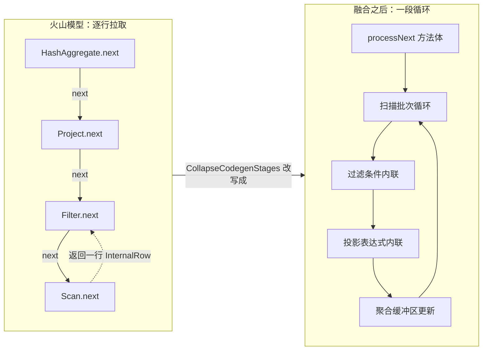
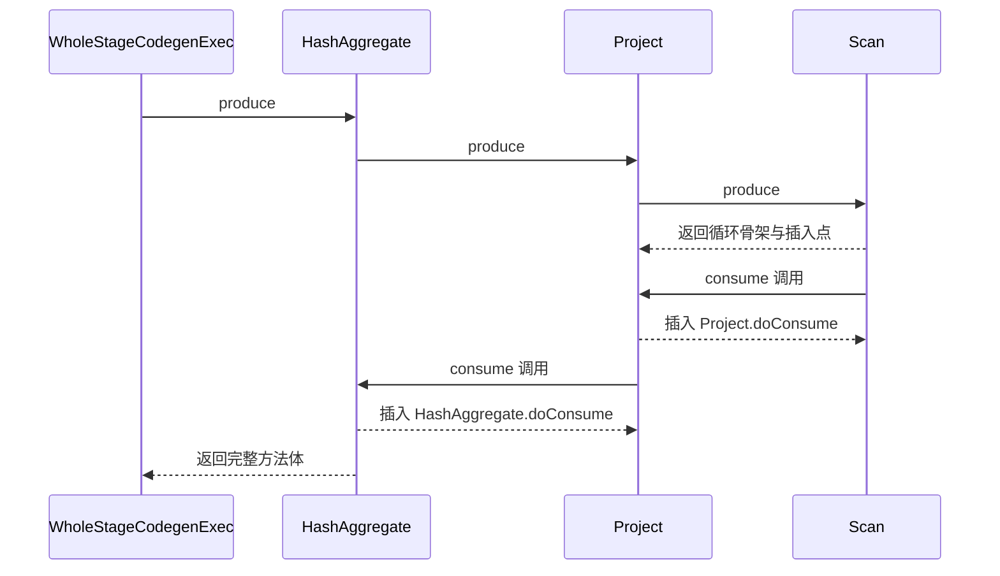
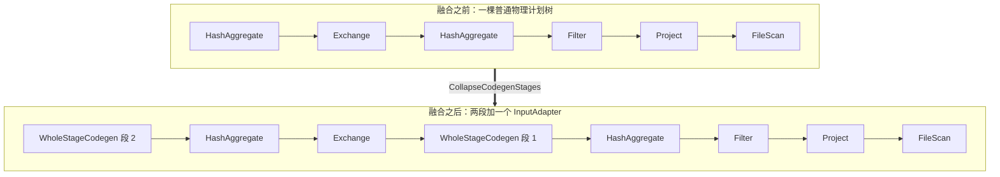
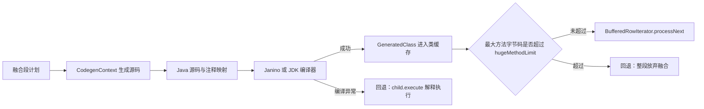
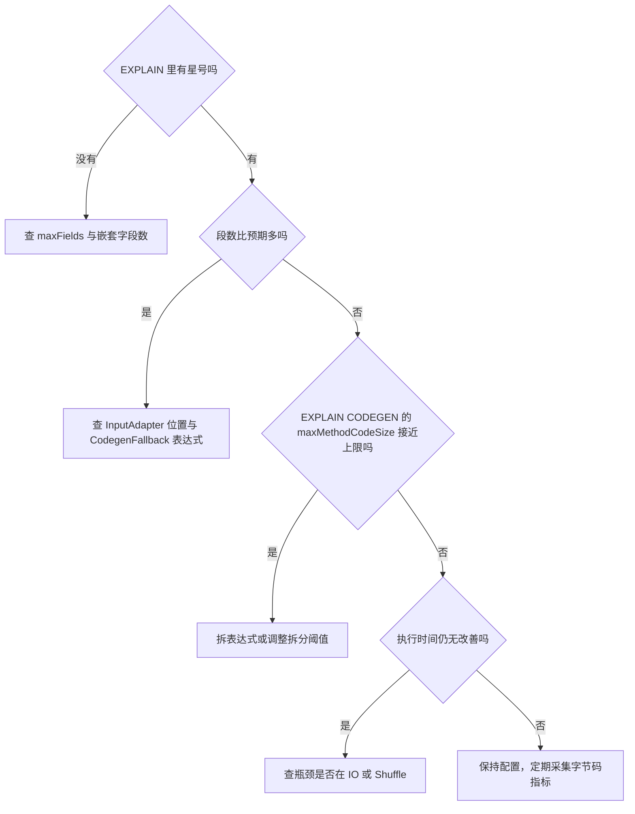
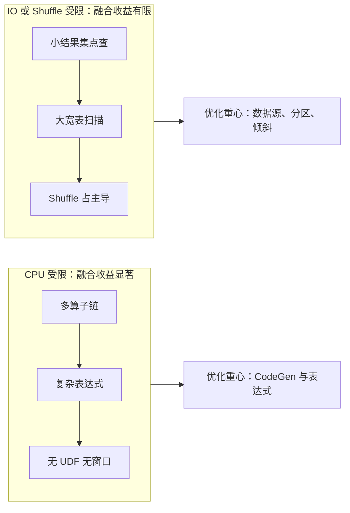

# 07 Whole-Stage CodeGen：JVM 字节码级别的性能飞跃

**摘要：**

火山模型（Volcano Model）把查询执行拆成一组各自实现 `next()` 的迭代器，模块化程度很高，代价是每一行数据都要在算子之间走一次虚方法调用，值以 `InternalRow` 的行对象流转，中间结果反复装箱拆箱与分配。Whole-Stage CodeGen 换掉了这套协议：它把一段可融合的算子树在运行时拼成一份 Java 源码，用 Janino 编译成字节码，让整段流水线跑在一个 `processNext()` 方法体里。本文按三条线拆解这套机制，第一条线是**成本线**：虚方法分派、装箱拆箱、中间对象分配这三重开销各自多大，以及为什么 JIT 内联救不了它。第二条线是**生成线**：`produce`/`consume` 的推送协议如何把父算子的逻辑嵌进子算子的循环，`CodegenContext` 如何管理变量，`ExprCode` 的三段结构如何表达可空性，子表达式去重与方法拆分如何绕开 64KB 的方法字节码上限。第三条线是**边界线**：`CollapseCodegenStages` 划出的融合段以 `Exchange` 为硬边界，被 `supportCodegen` 判定为不支持的算子、带 `CodegenFallback` 的表达式、嵌套字段超过 `maxFields` 的宽表都会把链条切开。文章最后落到量化与反例：CodeGen 只买 CPU 的时间，不减少 I/O、不减少 Shuffle、不改变并行度，因此它在一部分查询上是数量级的提升，在另一部分查询上几乎为零。

---

## 第 1 章 迭代器协议的三重税

### 1.1 一份 1994 年的协议

Goetz Graefe 在 1994 年发表于 IEEE TKDE 的论文里，把查询执行抽象成"算子即迭代器"的模型，后世称之为火山模型（Volcano Model）。每个物理算子实现 `open()`、`next()`、`close()` 三个方法，父算子在自己的 `next()` 里调用子算子的 `next()` 取下一行，取到就处理，取不到就继续拉。PostgreSQL、MySQL 的早期执行器、Spark SQL 1.x 都属于这一族。

Spark 把 `open`/`close` 折叠进 RDD 的迭代器生命周期，只留下一个 `Iterator[InternalRow]`：`SparkPlan.execute()` 返回 `RDD[InternalRow]`，每个分区内的执行就是一条由算子串起来的迭代器链。这套抽象之所以流行了三十年，是因为它把"算子组合"与"算子实现"彻底解耦，加一个新算子只要实现三个方法，任何上下游组合都不需要重新编译，内存占用也稳定在一行到几行之间。

代价藏在协议本身：迭代器约定"一次一行、调用方拉取"，于是每一行数据在每一个算子边界上都要重新走一遍方法调用与对象传递，而这条边界恰好是编译器做优化的盲区。

把这套协议想象成一家只开一个窗口的银行柜面：每个客户（每一行数据）都要走到窗口前，柜员核对一次身份、抄写一遍单据，再把单据递到下一个窗口。核对与抄写是流程上的必要动作，但从执行的角度看，它们都是为"通用"付的钱——真正的业务只有核对余额、扣减、记账三步。JVM 上的迭代器协议正是这个结构：身份核对对应虚方法分派，抄写单据对应行对象的物化，而过滤、投影、聚合这些真正的计算被压在一个极小的比例里。

### 1.2 三重开销的构成

把 `Scan → Filter → Project → HashAggregate` 这条最普通的流水线拆开看，每处理一行，JVM 至少要付三笔账。

第一笔是**虚方法分派**，它来自 `Iterator.next()` 这个接口方法，调用点在字节码里编译成 `invokeinterface`，运行时通过方法表做多态解析。JIT 并非完全无计可施：当调用点只观察到一种实现时，它可以做单态内联（monomorphic inline），观察到两种时还有双态内联，再多就退化成查表调用。问题在于算子边界上的调用点天然是多态的——`FilterExec` 的子节点可能是 `FileScanExec`、可能是 `Exchange`、也可能是另一个 `FilterExec`，同一个 `child.next()` 调用点在长生命周期里会看到多种实现，内联随之失效。更关键的不是那几纳秒，而是**内联窗口被切断**：内联一旦失败，编译器就看不到子算子的循环体，跨算子的常量传播、循环不变量外提、公共子表达式消除、寄存器分配全部无从谈起。

第二笔是**装箱与拆箱**，根源在于行式执行要求列值以统一接口暴露，`InternalRow.get(i)` 的返回类型是 `Object`，基本类型要么在写入时装箱成 `java.lang.Integer` 之类，要么走 `getInt`/`getDouble` 这类特化方法再做强制转型。Tungsten 项目引入的 `UnsafeRow` 用堆外字节数组承载行数据，`UnsafeRow.getInt(ordinal)` 通过偏移量直接读内存，绕开了装箱，但仍然保留每次访问的偏移量计算、null 位图检查与边界假设，而且 `UTF8String`、`ArrayData`、`MapData` 这类变长值依旧是堆上的对象。

第三笔是**中间对象分配**，起因是每个算子的输出都要物化成一个可被父算子读取的行对象，投影要产出新的行，聚合要把分组键包装成可哈希的对象，排序要把行写进缓冲。一个五列的行，按 `GenericInternalRow` 的口径，光对象头加引用数组就要接近一百字节，五列里若有两三个是字符串或包装类型，单行分配量轻松过百字节。这些对象几乎全部朝生夕死，落在新生代里，靠 scavenge 反复复制清理；分配速率一高，GC 线程开始和业务线程抢 CPU，缓存局部性也随之变差，因为每一行都要从堆上重新取一次指针跳转。

### 1.3 为什么 JIT 无法自己解决

有人会问，既然虚方法有开销，让 JIT 充分预热之后就自然内联、自然去虚化，为什么还要大动干戈生成代码？答案在于内联的**边界是方法**，而火山模型的优化机会恰好全在方法之外。

JIT 能看到的是"某个 `next()` 方法的字节码"，它能做循环展开、能把小方法内联进调用方，但火山模型的循环被拆散在四五个类的方法里，每个方法单独看都很简单、很规则，没有任何值得优化的地方；真正值得消除的东西——比如"这个过滤条件其实在扫描时就该判定"、"这两次 `getInt(2)` 读的是同一列"——只有在整条流水线可见时才成立。另外，行对象一旦物化，编译器就必须假设它会被别人读、被别人改，无法把它保持在寄存器里；而如果同一行数据只在一个方法体里活着，寄存器分配就有机会把列值一直留在 CPU 寄存器中。这正是 2016 年那篇工程博客把 CodeGen 的价值总结成三句的原因：消除虚函数分派、把中间数据从内存搬到 CPU 寄存器、利用循环展开与 SIMD 之类的现代 CPU 特性（原文为 "exploit modern CPU features through loop unrolling and SIMD"）。

> [!info] 成本结构的指向
> 三重开销全部与"每行、每算子边界"绑定，因此凡是能减少边界数量的手段都会有效：融合相邻算子、把行对象降级为局部变量、在融合后的循环体内做跨算子去重。Whole-Stage CodeGen 恰好同时做了这三件事，这也是它比"表达式级代码生成"更彻底的原因。

### 1.4 算一笔粗账

把数量级摆出来，比"有开销"这种定性描述更有说服力。假设一条查询扫描一亿行，物理计划是 `Scan → Filter → Project → HashAggregate`，粗算每一行要经过 4 个算子边界，每个边界至少一次 `next()`，再加上表达式求值内部的比较、算术、取值调用，每行总调用次数按十次到二十次的量级估（这是**量级判断**，随算子复杂度浮动）。一亿行就是十亿量级的间接调用，单次分派与返回按纳秒量级计，仅分派本身就能吃掉接近一秒的 CPU 时间；把行物化、装箱、字符串切片的分配算进来，分配总量会落在十 GB 量级（**示例推算**：1e8 行 × 约 150 字节），这些分配全部要走分配器与 GC。

下面这张表把三重开销按"每次操作的量级"与"一亿行合计的量级"对齐，用于说明收益的天花板在哪里，而不是用于预测某个具体查询的耗时。

| 开销项 | 单次量级 | 一亿行合计（示例推算） | CodeGen 之后 |
|--------|----------|------------------------|--------------|
| 虚方法分派 | 纳秒量级 | 十亿次调用，秒级 CPU | 融合段内消失，只留下循环与内联后的指令 |
| 装箱与拆箱 | 数十纳秒 | 数亿次装箱，秒级 CPU | 基本类型全程以局部变量传递，不装箱 |
| 中间行对象分配 | 每行百字节量级 | 十 GB 量级的分配量 | 段内不再物化中间行，只有必要的 key 与缓冲 |
| null 检查与偏移计算 | 每次取值数条指令 | 十亿量级指令 | 只保留必须的空值判断，其余在编译期折叠 |

图 1 把两种执行方式放在一起对照：左边是火山模型逐行拉取，调用次数随"行数 × 算子数"线性增长；右边是融合后的单层循环，算子边界退化成一个方法体内的顺序语句。



---

## 第 2 章 把一条流水线编译成一个方法

### 2.1 2016 年那次重构的意图

Spark 2.0 之前，表达式层面已经做了代码生成：`GenerateMutableProjection`、`GeneratePredicate`、`GenerateOrdering` 这些工厂会用 Janino 把单个表达式树编译成一个 `Projection` 或 `Predicate` 对象，博客里也明确提到 1.6 已经具备这项技术。但这只是把"一个表达式"编译掉，算子与算子之间仍然是迭代器协议，融合带来的收益拿不到。

2016 年 5 月，Databricks 的工程博客公布了第二代 Tungsten 引擎的执行层改造，对应的 JIRA 是 SPARK-12795，随 Spark 2.0.0 发布。它的目标是让多个算子的执行逻辑一起变成单个 Java 方法：叶子算子负责写循环骨架，中间算子把自己的处理逻辑插进这层循环，根算子负责把结果吐给上层。技术上借鉴的是编译式执行引擎的思路，Neumann 在 2011 年 VLDB 上提出的"把查询计划编译成机器码、用推送而不是拉取来驱动"的模型，Spark 把它落地成了 `produce`/`consume` 这对方法。

### 2.2 两层代码生成，不要混为一谈

在排查性能问题时，"CodeGen 到底开没开"经常被当一个问题，其实是两个：表达式级代码生成与全阶段代码生成是两层独立机制，开关不同、产物不同、失效表现也不同。

| 维度 | 表达式级 CodeGen | 全阶段 CodeGen |
|------|------------------|----------------|
| 作用对象 | 单个表达式树，如投影列表、过滤条件、排序键 | 一段可融合的算子树 |
| 生成产物 | `Projection`、`Predicate`、`Ordering` 等函数对象 | 一个 `BufferedRowIterator` 子类，主体是 `processNext()` |
| 触发规则 | 各类 `GenerateXxx` 工厂在算子初始化时调用 | `CollapseCodegenStages` 在物理计划准备阶段包裹算子 |
| 关闭方式 | `spark.sql.codegen.factoryMode=NO_CODEGEN` | `spark.sql.codegen.wholeStage=false` |
| 失效表现 | 退回解释执行表达式，单行变慢但计划结构不变 | 计划里的 `*` 前缀消失，算子退回迭代器协议 |
| 典型收益 | 单表达式求值快数倍 | 整段流水线快数倍到数量级，取决于融合长度 |

两层机制的耦合点在于：一个融合段内的表达式仍然由表达式级生成器编译，只是编译后的代码被拼进同一个类。所以关掉 `wholeStage` 之后，表达式级代码生成照常工作，只是算子之间重新恢复成方法调用。

### 2.3 produce 与 consume：控制流方向反过来

`CodegenSupport` 特性定义了这对协议：`doProduce` 负责生成"我如何产出数据"的代码骨架，通常包含循环；`doConsume` 负责生成"我拿到父算子传来的一行后做什么"的代码。两者并不对称，因为生成过程要分两趟走。

第一趟自上而下：根节点调用子节点的 `produce`，子节点再调用它自己的子节点，一路递归到叶子。叶子算子的 `doProduce` 写出真正的循环骨架，例如扫描算子的"取下一批、遍历批内每一行"。递归返回时，每个中间算子的 `doProduce` 把子节点返回的代码嵌进自己的结构里，并在需要的地方留下插入点。

第二趟自下而上：每个中间算子在自己的 `produce` 里调用 `child.consume(ctx, inputVars, row)`，把自己的 `doConsume` 逻辑插进子节点给出的插入点。`consume` 会先把子节点的输出列准备好——子算子已经算出列值时是一组 `ExprCode`，只交出整行时是一个行变量名——然后切换 `CodegenContext` 的输入上下文，再回调父算子的 `doConsume`。这个过程逐层上卷，最终整条流水线的逻辑被摊平到叶子算子写下的那层循环体里。

```java
// 结构示意：生成结果的主体形态（依据生成器模板重排，非逐字输出）
protected void processNext() throws java.io.IOException {
  while (scan_nextBatch()) {                       // 叶子算子写下的循环骨架
    for (int rowIdx = 0; rowIdx < numRows; rowIdx++) {
      // 扫描：把列读进局部变量
      double amount_value = amountCol.getDouble(rowIdx);
      boolean amount_isNull = amountCol.isNullAt(rowIdx);

      // Filter.doConsume 插入的逻辑
      if (amount_isNull || !(amount_value > 100.0)) continue;

      // HashAggregate.doConsume 插入的逻辑
      UTF8String key = userIdCol.getUTF8String(rowIdx);
      int idx = findOrInsert(key.hashCode(), key);
      aggBuffer_sum[idx] += amount_value;
      aggBuffer_count[idx]++;
    }
    // 聚合是阻塞算子，攒完所有行之后才在这里输出
    emitAggregateOutput();
  }
}
```

这段代码里已经没有算子之间的调用，扫描、过滤、投影、聚合是一个方法体内的顺序语句，`amount_value` 是一个 JVM 局部变量而不是行字段。JIT 在编译 `processNext` 时看到的是完整循环，可以跨算子做值域推断、把常量折叠进比较指令、把 `aggBuffer_sum` 的访问提到寄存器里。

### 2.4 阻塞算子如何留在同一段里

排序与聚合这类算子要"攒完输入才能吐输出"，看起来天然是流水线的断点，但在 Spark 的实现里它们被 `BlockingOperatorWithCodegen` 收编进了同一个融合段：它的 `doProduce` 先调用子算子的 `produce` 把数据灌进内部缓冲，再在缓冲上做排序或聚合，最后产出结果行。`SortExec` 就是这样，它的 `doProduce` 生成"调用子算子把行灌入 sorter，然后 `sort()` 得到一个迭代器，再遍历输出"的代码；`HashAggregateExec` 与 `SortAggregateExec` 都通过 `AggregateCodegenSupport` 获得同样的能力，这个特性自身混入了 `BlockingOperatorWithCodegen`，于是聚合天然是段内的阻塞节点。

`BlockingOperatorWithCodegen` 还顺带改写了几个语义标志：`needCopyResult` 返回 false（阻塞算子自己持有缓冲，不需要为下游复制结果），`needStopCheck` 返回 false（它必须消费完输入，中途不会因为上层 `Limit` 提前停止），`limitNotReachedChecks` 返回空（这段区间内的 `Limit` 检查不可能为真，生成了也是死代码）。这几处细节说明一件事：融合段不是简单地把代码拼在一起，而是要重新推导"谁负责复制、谁负责停止"这些执行契约。

从整体看，这场改造像把流水线上分散在几个工位的工序搬到一张长桌上：工件不再在工位之间搬运、登记、交接，而是在一处连续做完；代价是长桌的长度必须提前算好，超长就要拆成两张桌子，而两张桌子之间又要重新搬运一次。这个比喻里唯一不能照搬的是搬运的单价——在 JVM 上，搬运就是对象分配与虚调用，单次成本看起来微不足道，乘以亿级行数才显出分量。

图 2 展示两趟调用的方向：虚线是 `produce` 的下潜，实线是 `consume` 的上卷，标签里标出了每一次插入的位置。



---

## 第 3 章 "Stage" 指什么

### 3.1 两种 Stage 不是一回事

Spark SQL 里有两种被叫做 Stage 的东西，混淆它们会导致对执行计划的误读。调度层的 Stage 由 DAGScheduler 按 Shuffle 依赖切分，是任务提交与失败重试的单位，编号体现在 DAG 与 UI 里；代码生成层的 stage 由 `CollapseCodegenStages` 在物理计划准备阶段标出，是"一段被融合进同一个方法体的算子"，编号体现在 `EXPLAIN` 输出的 `*(N)` 里。

| 维度 | 调度 Stage | CodeGen Stage |
|------|-----------|---------------|
| 划分者 | DAGScheduler，按 Shuffle 依赖 | `CollapseCodegenStages`，按可融合性 |
| 边界判据 | 宽依赖（`ShuffleDependency`） | `Exchange`、不支持 CodeGen 的算子、`CodegenFallback` 表达式、超宽 schema |
| 编号 | Stage 0、Stage 1，全局递增 | `*(1)`、`*(2)`，单个查询内按插入顺序递增 |
| 生命周期 | 提交为一批 TaskSet，可重试 | 首次执行时生成并编译，之后由类缓存复用 |
| 观察位置 | Spark UI 的 Stages 页、DAG 图 | `EXPLAIN` 物理计划、`EXPLAIN CODEGEN` |
| 二者关系 | 一个调度 Stage 内可以存在多个 CodeGen Stage | 一个 CodeGen Stage 不会跨越调度 Stage |

最后一行是理解边界的关键：`Exchange` 既切调度 Stage，又切代码生成段，但反向不成立——一个调度 Stage 内部可以因为窗口算子、`ObjectHashAggregateExec`、Python UDF 等原因被切成好几段 CodeGen Stage，这也是"我的计划为什么被切成好几段"这个问题的直接答案。

### 3.2 Exchange 为什么是硬边界

`Exchange`（`ShuffleExchangeExec`）要做的是把上游的行分区、序列化、落盘、经由网络拉到下游再反序列化。这一步的输入输出必须是可序列化的行或列批次，无法作为局部变量留在寄存器里，也无法把两侧的逻辑拼进同一个循环体。因此 `Exchange` 不实现 `CodegenSupport`，`CollapseCodegenStages` 遇到它就直接把它留在原地，上下游各自成段。如果把这个融合段看成一条不停站的线路，`Exchange` 就是那道必须落地的换乘通道：乘客（数据）要走下站台、经过检票（序列化）、在地面上走一段（网络传输），再从另一侧重新上车。通道的存在不是为了拖慢行程，而是因为两侧线路的轨距（内存布局与分区方式）根本不同，不换乘就没法接上。

值得强调的是，Shuffle 的序列化开销远大于 CodeGen 消除的那点分派开销，所以**跨 Exchange 的融合既做不到也没有必要**。理解这一点，就能理解为什么"把整个查询编译成一个方法"从头到尾都只是一个方向而不是事实：真正的融合范围被数据交换的物理约束框死。

### 3.3 CollapseCodegenStages 的判定逻辑

这条规则在 `QueryExecution.preparations` 里排在列式规则之后执行，此时计划上已经插好了 `ColumnarToRow` 之类的转换节点。它对每个节点做的判定可以概括成四问。

第一问，这个节点是不是 `CodegenSupport` 且 `supportCodegen` 为真。第二问，它的表达式树里有没有带 `CodegenFallback` 的表达式——只要有一个，整个算子就退化成边界，因为生成的代码没法求值它。第三问，它自身输出 schema 的嵌套字段数、以及每个子节点输出 schema 的嵌套字段数，是否都不超过 `spark.sql.codegen.maxFields`（默认 100）。第四问，它是不是那几类特意不做融合根的节点，譬如输出单个 `ObjectType` 的算子、`LocalTableScanExec`、`EmptyRelationExec`、`CommandResultExec`，这些节点要让 driver 端的快速 collect 路径生效，不能包进 `WholeStageCodegenExec`。

四问全过，就在这个节点上面插一个 `WholeStageCodegenExec`，然后对子树继续递归，把不支持融合的子节点用 `InputAdapter` 包起来——`InputAdapter` 的作用就是"在融合段内部给一个非融合算子留出接口"，它在生成代码时提供 `inputRDDs`，让上层通过迭代器读取它的输出。编号按**深度优先后序**分配，从 1 开始；0 被保留给"临时构造的融合节点"，用于生成或编译失败后的兜底。

```text
# 一个典型的物理计划片段：星号标识融合段，InputAdapter 标识段内边界
== Physical Plan ==
*(3) HashAggregate(keys=[userId#1], functions=[sum(amount#2)])
+- Exchange hashpartitioning(userId#1, 200)
   +- *(2) HashAggregate(keys=[userId#1], functions=[partial_sum(amount#2)])
      +- *(2) Project [userId#1, amount#2]
         +- *(2) Filter (isnotnull(amount#2) AND (amount#2 > 100.0))
            +- *(1) ColumnarToRow
               +- FileScan parquet orders[userId#1,amount#2]
```

注意 `*(1)` 出现在 `ColumnarToRow` 上而不是扫描上：向量化读取产出的是 `ColumnarBatch`，融合框架是行式的，两者之间必须由 `ColumnarToRow` 转换，转换节点成为段内边界。

### 3.4 边界的四种来源

把上一节的判定翻过来，边界只有四类来源，排查时按这四类对号入座即可。

| 来源 | 判据 | `EXPLAIN` 里的表现 | 常见误判 |
|------|------|--------------------|----------|
| 数据交换 | 节点是 `Exchange` | 没有 `*`，上下游各自成段 | 以为是 CodeGen 没开 |
| 算子不支持 | 节点不是 `CodegenSupport`，或 `supportCodegen` 为 false | 节点被 `InputAdapter` 包住，自身无 `*` | 以为只要开了开关就必然全融合 |
| 表达式降级 | 表达式含 `CodegenFallback` | 该算子整体失去 `*`，上游仍在别的段里 | 只盯着 UDF 算子，忽略了表达式级判定 |
| schema 过宽 | 嵌套字段数超过 `maxFields` | 该算子及其所在链没有 `*`，计划完全无星号 | 只看顶层列数，忽略嵌套结构 |

第四类特别容易被忽略：`maxFields` 数的是**嵌套字段**，不是顶层列。一张只有二十列的表，若其中若干列是 `array<struct<...>>`，展开后的嵌套字段数可能远超一百，于是整条链静默地不做融合，`EXPLAIN` 里一个星号都看不到，而作业照常跑、只是慢。

### 3.5 4.3 里到底哪些算子会切开

网上流传的算子支持表大多停留在 Spark 2.x，与 4.3 的实际情况已经有出入。下面这张表按 4.3.0 源码逐一核对，是本篇最值得对照 `EXPLAIN` 反复看的一张。

| 算子 | 是否参与融合 | 边界形态 | 说明 |
|------|--------------|----------|------|
| `FilterExec`、`ProjectExec` | 是 | 无 | 自身实现 `doConsume`，逻辑内联进下游循环 |
| `HashAggregateExec` | 是 | 无 | 阻塞算子，灌完再吐，仍在同段内 |
| `SortAggregateExec` | 是（3.3 起默认） | 无 | 受 `aggregate.sortAggregate.enabled` 控制；4.3 起带分组键时还要求键类型二进制稳定 |
| `SortExec` | 是 | 无 | 阻塞算子，先灌 sorter 再输出 |
| `BroadcastHashJoinExec` | 是 | 无 | 两路输入，融合段最多支持两个输入 RDD |
| `ExpandExec` | 是 | 无 | 一行展开为多行，自带 `doProduce`/`doConsume` |
| `UnionExec` | 是（4.2 起可融合） | 视子节点而定 | 由 `wholeStage.union.enabled` 控制，子节点不支持仍在 `InputAdapter` 处断开 |
| `SortMergeJoinExec` | 是 | 两侧子节点被 `InputAdapter` 隔开 | 4.3 支持多数 join 类型，但两侧各自成段；FullOuter、ExistenceJoin 受独立开关控制 |
| `ShuffledHashJoinExec` | 是 | 两侧子节点被 `InputAdapter` 隔开 | 与 SMJ 同理，子节点不直接并进 join 所在的段 |
| `BroadcastNestedLoopJoinExec` | 部分 | 不支持时整体成边界 | 仅内连接、以及指定 build 侧的若干外连接支持 |
| `ObjectHashAggregateExec` | 否 | 整体边界 | 走对象哈希表与回退排序，没有代码生成路径 |
| `WindowExec` | 否 | 整体边界 | 需要缓冲完整窗口帧，没有 `CodegenSupport` 实现 |
| `BatchEvalPythonExec`、`ArrowEvalPythonExec` | 否 | 整体边界 | 求值发生在 Python 进程 |
| `Exchange` | 否 | 硬边界 | 序列化与网络传输要求行必须物化 |

有两处需要特别说明，其一是 `SortMergeJoinExec` 的段号：它的 join 逻辑在 `*(3)` 这样的段里，但左右两侧的 `Sort`、`Project`、`Filter` 分别在别的段里，中间隔着 `InputAdapter`，因为归并要求两侧各自先把有序数据准备好，无法把两侧的生成代码并进同一个循环。其二是 `SortAggregateExec`：早年它确实不支持代码生成，3.3 引入 `spark.sql.codegen.aggregate.sortAggregate.enabled`（默认 true）之后才支持，4.3 又加了"带分组键时键类型需二进制稳定"的约束，所以看到 `SortAggregateExec` 时不能想当然地认为它是边界，要看计划里有没有 `*`。

图 3 把一张计划树在 `CollapseCodegenStages` 前后的形态画在一起，虚线框表示融合段。



---

## 第 4 章 生成器内部

### 4.1 CodegenContext 管什么

`CodegenContext` 是生成过程的唯一状态容器，一份融合段对应一个实例。它的职责有四块，每一块都对应一类会炸掉生成代码的细节。

第一块是变量命名，`freshName` 为每次需要的局部变量生成不重复的名字，并在前缀上带上算子的变量前缀，避免不同算子在同一个方法体里撞名；第二块是可变状态管理，`addMutableState` 决定一个变量放在哪里：基本类型且外类内联变量数未到 `OUTER_CLASS_VARIABLES_THRESHOLD`（10000）时，直接声明为生成类的成员字段，让 JIT 更容易把它当作寄存器变量；否则按 Java 类型压缩进数组，数组长度上限是 `MUTABLESTATEARRAY_SIZE_LIMIT`（32768），因为 32767 是字节码里不需要常量池项的最大整数索引；第三块是对象引用，`addReferenceObj` 把算子实例、`DataType`、`Sorter` 之类的对象塞进 `references` 数组，生成代码里通过 `references[i]` 加注释的方式取用，避免生成类字段数量膨胀；第四块是函数注册，`addNewFunction` 把一段代码注册成生成类的私有方法，若函数数量或类体积超过阈值，函数会被挪进内部类，因为 JVM 单个类的常量池上限是 65535 个命名常量，代码生成器用"类体积超过 1000KB 就拆内部类"的做法规避。

此外还有几个容易忽略的上下文变量：`INPUT_ROW` 表示"当前要从中读取列的行变量名"，`currentVars` 表示"当前已经求值好的列表达式"，`currentPartitionIndexVar` 是叶子算子读取分区号的表达式（`UnionExec` 融合后会为每个子节点改写它）。`consume` 会在这几个变量之间来回切换，这也是 CodeGen 中最容易出正确性问题的地方。

### 4.2 ExprCode：一个表达式要交代三件事

任何表达式编译之后都要用 `ExprCode` 交代清楚三件事，缺一件就会生成错误的代码。

```scala
// 4.3 的定义：code 是语句块，isNull 与 value 是"值引用"，可以是字面量也可以是变量
case class ExprCode(var code: Block, var isNull: ExprValue, var value: ExprValue)
```

`code` 放置求值所需的语句，例如截取字符串、做一次除法、调用一个 UDF；`isNull` 与 `value` 是求值结果的**引用**，不是结果本身，因为它们可能被嵌入到另一个表达式里继续使用。`ExprValue` 的设计让"空标志"与"值"可以是字面量（`TrueLiteral`、`FalseLiteral`、默认字面量），也可以是变量或全局字段引用。这个抽象带来的直接好处是空判断可以被编译期消除：当一个表达式确定不可能为空时，`isNull` 就是 `FalseLiteral`，父表达式在生成代码时不需要再包一层 `if (isNull) ... else ...`，省掉一次分支。

对写 SQL 的人来说，这解释了一个现象：同样一个 `coalesce`，在不同可空性推导结果下，生成的代码长度能差出一大截；而可空性推导的准确性正是优化器在分析阶段反复做的那件事。也可以把 `ExprCode` 看成一张三联单：第一联写求值步骤，第二联写空标志，第三联写值本身；父表达式拿到这张单子，既可以只取第二联做空判断，也可以把第三联直接嵌进自己的计算，省掉一次重复求值。

### 4.3 consume 的契约细节

`consume` 是融合协议里最容易写错的一环。它接收两个互斥的参数：`outputVars`（一组已经求值好的列）或 `row`（一个行变量名），前者用于子算子已经把列值算出来的场景，后者用于子算子只给出整行的场景。拿到之后，它做四件事：把列值复制一份（因为这些值要用于构造 `UnsafeRow`，不能被后续求值覆盖）；准备行变量，并把 `currentVars` 指向这份列值、把 `INPUT_ROW` 置空，然后切到父算子的变量命名空间；最后按父算子的 `usedInputs` 只求值父算子真正用到的列。

最后这一点是隐藏的优化：列是按需物化的。如果父算子只用到三列中的一列，另外两列的 `getUTF8String`、`getArray` 根本不会被生成，省下来的是真实的 CPU 与分配。它依赖每个算子正确声明 `usedInputs`，写错就会少读数据，属于"性能优化换来正确性风险"的典型位置。

`consume` 还有一条分支决定了生成代码的形态：当 `spark.sql.codegen.splitConsumeFuncByOperator`（默认 true）、父算子确实用到了子节点全部输出、且参数个数不超过 JVM 的 255 上限时，父算子的消费逻辑会被放进一个独立的私有方法，而不是继续内联。这正是 `EXPLAIN CODEGEN` 里除了 `processNext` 还会看到一堆 `doConsume` 方法的原因。

### 4.4 子表达式去重

融合带来了一个新机会：原本分散在不同算子里的相同表达式，现在处在同一个方法体里，可以只算一次。`SubexpressionElimination` 负责这件事，做法是先用 `EquivalentExpressions` 收集整段计划中"出现两次及以上"的等价表达式，再为每个公共子表达式生成一个私有函数（或在代码较短时直接内联），后续引用替换成对这个函数或变量的读取。

去重不是无条件的：生成公共子表达式的函数需要把该表达式依赖的输入变量当参数传进去，参数个数受 JVM 的 255 上限约束；若某个表达式的参数过多，`subexpressionEliminationForWholeStageCodegen` 会打印一条 INFO 日志并放弃拆分，退回"每个表达式各自内联"的形态——功能正确，只是少了去重收益。此外，去重本身要付一次函数调用的代价，所以只有"贵"表达式才值得去重，简单算术去重反而可能因为调用开销而更慢，这个取舍由等价表达式的收集策略隐式决定。

### 4.5 方法拆分与 64KB 上限

JVM 对单个方法的字节码长度有 64KB 的硬上限，超过就无法编译；HotSpot 还有一条更严格的隐性约束，方法字节码超过 8000 字节就不再被 JIT 编译（`-XX:-DontCompileHugeMethods` 可以关闭这条限制）。生成的融合方法很容易撞上这两条线：一条宽表上的多算子链、一个几千分支的 `CASE WHEN`、一段层层嵌套的条件判断，都能把一个方法撑爆。

Spark 的对策是多层拆分，第一层是 `spark.sql.codegen.methodSplitThreshold`（默认 1024），它以生成源码的字符数（去掉注释与空行）为度量，累积超过阈值就切开成多个方法，因为无法在生成前预知字节码大小，只能拿源码长度做代理指标。第二层是 `spark.sql.codegen.splitConsumeFuncByOperator`，把每个算子的消费逻辑变成独立方法。第三层是类级别的拆分：当生成代码大到让外层类体积超过 1000KB，函数被挪进内部类，再由外层类用一个方法批量调用，避免外层类的常量池与调用方法本身溢出。第四层是兜底，`spark.sql.codegen.hugeMethodLimit` 在编译完成后检查 `ByteCodeStats.maxMethodCodeSize`，一旦超限就放弃这一段的融合。

图 4 把从计划到可执行代码的完整流水线串起来，标出每一层的产物与失败出口。



---

## 第 5 章 编译的账

### 5.1 谁在什么时候编译

生成与编译发生在 driver 与 executor 两侧。`WholeStageCodegenExec.doExecute()` 在 driver 上调用 `doCodeGen()`，用 `CodegenContext` 产出源码，然后交给 `CodeGenerator.compile`，编译结果是一个 `GeneratedClass`，内部包着类加载器与实例工厂。这份源码随后要被分发到各个 executor，每个 executor 的 JVM 在自己进程内完成编译并加载类，之后同 JVM 内相同源码的再次执行直接命中缓存。

缓存是理解编译成本的关键，`CodeGenerator` 维护一个以"类加载器 + 编译后端 + 源码"为键的非共享缓存，容量由 `spark.sql.codegen.cache.maxEntries` 控制，默认 100 条；同一份生成代码在缓存命中时编译成本为零，只有首次遇到新的代码形态才付完整代价。所以"首次执行慢、后续快"不是玄学，而是类缓存与 JIT 预热叠加的结果。

### 5.2 编译耗时是什么量级

编译耗时与生成代码的规模强相关，这里只能给**量级判断**：一个小融合段（几百行 Java 源码）用 Janino 编译通常在毫秒到数十毫秒量级；跨到上千行源码、包含若干内部类的大段，会进入数十毫秒到百毫秒量级；同一份代码在 executor 上首次执行时同样要付这笔钱，如果查询本身只有几十毫秒，编译成本会显著拉低首轮表现。

4.3 在这一点上给出了一条官方口径的对照：`spark.sql.codegen.compiler` 支持 `janino`（默认）与 `jdk` 两种后端，文档里写明 Janino "快数倍"，但上游已停止维护（最后版本 3.1.12，2024 年 2 月）；JDK 后端跟随 JDK 版本维护，代价是对大型生成单元增加约 5 倍冷启动延迟、对小型单元增加 30 到 300 倍。这组数字说明选后端不是"谁快选谁"，而是"要不要为可维护性付冷启动的代价"。

### 5.3 三条回退路径

融合失败不是异常退出，而是静默降速，理解三条回退路径才能解释"我都开了怎么没快"。

第一条是编译异常回退，`doExecute` 里对 `CodeGenerator.compile` 包了 `try`，捕获到非致命异常且 `spark.sql.codegen.fallback` 为 true（默认）时，打一条 WARN 日志说明"这一段的全阶段代码生成被禁用"，然后直接返回 `child.execute()`，也就是退化成逐算子迭代器执行。第二条是字节码超限回退，编译成功后检查 `maxMethodCodeSize` 是否超过 `hugeMethodLimit`，超过则打一条 INFO 日志并同样退回 `child.execute()`。第三条是显式关闭，`spark.sql.codegen.wholeStage=false` 让 `CollapseCodegenStages` 完全不插入融合节点，`spark.sql.codegen.factoryMode=NO_CODEGEN` 则连表达式级代码生成也关掉。

| 配置 | 默认值 | 作用 | 调大的代价 | 调小的代价 |
|------|--------|------|------------|------------|
| `spark.sql.codegen.wholeStage` | true | 是否插入全阶段融合节点 | 不能调大，只能开或关 | 关掉后整段退回迭代器，CPU 开销上升 |
| `spark.sql.codegen.maxFields` | 100 | 嵌套字段数超过即不融合 | 宽表也能融合，但生成方法巨大、编译与 JIT 时间上升 | 更多计划被切成碎段，融合长度缩短 |
| `spark.sql.codegen.fallback` | true | 编译失败是否回退解释执行 | 置 false 后编译失败直接抛错，作业失败 | 保持 true 时失败被掩盖，只能靠日志发现 |
| `spark.sql.codegen.hugeMethodLimit` | 65535 | 单方法字节码上限，超过放弃融合 | 允许更大方法，但可能生成 JIT 拒绝编译的方法 | 更早放弃融合，退回迭代器 |
| `spark.sql.codegen.methodSplitThreshold` | 1024 | 生成源码超过多少字符就拆分方法 | 方法更大更少，可能失去 JIT 优化机会 | 方法过于细碎，调用开销上升 |
| `spark.sql.codegen.splitConsumeFuncByOperator` | true | 每个算子的消费逻辑独立成方法 | 关闭后方法变长，可能超过 8KB 不再被 JIT | 开启时多一层方法调用 |
| `spark.sql.codegen.cache.maxEntries` | 100 | 生成类的缓存条数 | 占更多堆内存换取更高命中率 | 命中率下降，重复编译 |
| `spark.sql.codegen.comments` | false | 生成代码是否带注释 | 源码与编译时间明显上升，仅用于调试 | 保持 false 即可，调试时再开 |
| `spark.sql.codegen.compiler` | janino | 编译后端 | 切到 jdk 会增加冷启动延迟 | 保持 janino 则依赖一个停止维护的库 |

这张表还有一处需要提前说明：`spark.sql.codegen.*` 在 `SQLConf` 里几乎全部标记为 internal，`wholeStage`、`maxFields`、`hugeMethodLimit`、`methodSplitThreshold`、`fallback` 都在此列。标记 internal 的含义是它们不进公开配置文档、不承诺跨版本兼容，因此升级大版本时应当按源码核对默认值，而不是照抄旧文档或旧博客里的数字——本篇所有默认值都以 4.3.0 的 `SQLConf.scala` 为准。

### 5.4 默认 65535 而不是 8000 的由来

一个常见的误解是把 `hugeMethodLimit` 的默认值记成 8000。不过，默认值与推荐值并不是同一件事：4.3 的默认值是 65535，也就是 Java 方法字节码的理论上限；8000 是 HotSpot 判断"是否值得 JIT 编译"的经验阈值，在代码里以 `CodeGenerator.DEFAULT_JVM_HUGE_METHOD_LIMIT` 的形式存在，只作为文档里的推荐值出现。

这两个数字代表两种不同的失败哲学。默认 65535 意味着"只要能编译就融合"，代价是可能生成一个超过 8000 字节、永远不会被 JIT 编译的方法——它照样能跑，只是全程解释执行字节码，可能比不融合还慢。把阈值调到 8000 则反过来：宁可放弃融合退回迭代器，也不让不可 JIT 的方法存在。哪一边更好取决于生成代码的规模分布，只看配置文档无法决定，要看 `EXPLAIN CODEGEN` 里各段的 `maxMethodCodeSize` 落在什么区间。

### 5.5 编译成本被摊薄的前提

编译成本是固定投入，收益随处理行数增长，所以 CodeGen 的经济性取决于一个简单的比较：一次编译（每 JVM 一次）与"每个任务省下的 CPU 时间 × 任务数"。

这层关系像开一家店：装修费一次性付清，摊到每天的客流上才谈得上划算，客流越稀薄，装修费在单客成本里的占比就越高。这个比较解释了几类现象：大作业、每段处理上亿行、任务数成百上千，编译成本在总时长里可以忽略，收益全部落袋；相反，譬如交互式分析里的短查询、只处理几千行的过滤、单任务的 `collect`，编译成本可能比省下的执行时间还多，这也是小型数据集上"开了 CodeGen 反而更慢"的常见来源，尤其是首次执行、类缓存尚未命中的时候。

笔者见过的一类典型浪费，是每小时跑一次、每次只扫几千行的报表查询反复付编译成本，改法不是调 CodeGen 参数，而是把这类查询合并、缓存结果或者换一种执行方式。缓存命中的判断依据是"生成代码是否逐字相同"，所以同一份 SQL 反复执行会越来越快，而每次改一点参数、改一点过滤条件，都可能生成新代码、重新付编译成本。

---

## 第 6 章 看代码：生成物长什么样

### 6.1 三个观察入口

`EXPLAIN codegen` 是官方入口，输出包含三部分：找到了几个融合子树、每个子树的算子结构、以及每个子树生成的 Java 源码。源码被 `CodeFormatter` 格式化，每行前面带行号注释，便于和日志里的报错行对应。

```scala
// 入口一：直接打印，适合人眼看结构
df.explain("codegen")

// 入口二：打印每个融合子树的源码（4.x 中该方法直接输出到控制台）
df.queryExecution.debug.codegen()

// 入口三：拿到结构化结果，适合写脚本做巡检
val stats = df.queryExecution.debug.codegenToSeq()
stats.foreach { case (subtree, code, bs) =>
  println(f"sourceChars=${code.length}%6d  maxMethod=${bs.maxMethodCodeSize}%6d  " +
    f"maxConstPool=${bs.maxConstPoolSize}%6d  innerClasses=${bs.numInnerClasses}")
}
```

第三个入口最有价值，因为 `ByteCodeStats` 给出了三个可量化指标：单方法最大字节码、最大常量池占用、内部类个数。把这三个指标按天采集，就能看出某条核心查询的生成规模是否在悄悄膨胀——比如某次加了一个巨大的 `CASE WHEN`，`maxMethodCodeSize` 从两万跳到六万，融合随时会掉。

### 6.2 输出怎么读

`EXPLAIN CODEGEN` 的表头形如 `== Subtree 1 / 3 (maxMethodCodeSize:...; maxConstantPoolSize:...(x% used); numInnerClasses:...) ==`，前三个指标各自对应一种风险，第四项则是结构判据。

| 指标 | 含义 | 判据 | 风险 |
|------|------|------|------|
| `maxMethodCodeSize` | 单个方法的最大字节码长度 | 接近 65535 时融合随时失效；超过 8000 时该方法不被 JIT | 由融合变解释执行，性能断崖 |
| `maxConstantPoolSize` | 单个类的最大常量池占用 | 接近 65535 时编译大概率失败 | 编译异常，回退解释执行 |
| `numInnerClasses` | 内部类个数 | 明显增多说明代码规模已经很大 | 编译时间与类加载时间上升 |
| 子树个数 | 融合段数量 | 与预期不符时说明有新的边界 | 计划被意外切开 |

四个指标要连起来看：子树个数突然从 2 变成 6，说明某个算子或表达式让链条碎了；`maxMethodCodeSize` 突然翻倍，说明某个表达式变复杂了；两者同时恶化，通常意味着一次 schema 变更（加了嵌套列）叠加了一次表达式膨胀。我们不妨把这几个指标当成一份定期体检报告来读，比在出事之后翻日志要主动得多；笔者习惯按天采样这几个数字并随查询版本一起存档，性能回退时就能立刻区分"是数据变了"还是"代码变大了"。

### 6.3 生成代码的结构

生成的类继承 `BufferedRowIterator`，固定结构是：一个静态工厂方法 `generate`、一个 `init(index, inputs)` 初始化方法、一个 `processNext()` 主方法，加上若干私有字段与方法。字段是提前内联好的可变状态（sorter、聚合缓冲区、状态机标志），方法是被拆出来的消费逻辑与子表达式函数。

```java
// 结构示意：一个含 Sort 的融合段的骨架，字段与方法按生成器模板重排
public Object generate(Object[] references) {
  return new GeneratedIteratorForCodegenStage1(references);
}

final class GeneratedIteratorForCodegenStage1
    extends org.apache.spark.sql.execution.BufferedRowIterator {

  private Object[] references;
  private scala.collection.Iterator[] inputs;
  private boolean needToSort;                       // 阻塞算子的状态标志
  private org.apache.spark.util.collection.unsafe.sort.UnsafeExternalRowSorter sorter;
  private scala.collection.Iterator<org.apache.spark.sql.catalyst.InternalRow> sortedIter;

  public GeneratedIteratorForCodegenStage1(Object[] references) {
    this.references = references;
  }

  public void init(int index, scala.collection.Iterator[] inputs) {
    partitionIndex = index;
    this.inputs = inputs;
    sorter = ((org.apache.spark.sql.execution.SortExec) references[0]).createSorter();
  }

  protected void processNext() throws java.io.IOException {
    if (needToSort) {
      // 子算子 produce 生成的代码内联在这里：把上游所有行灌进 sorter
      addToSorter(partitionIndex);
      sortedIter = sorter.sort();
      needToSort = false;
    }
    while (sortedIter.hasNext() && !shouldStop()) {
      org.apache.spark.sql.catalyst.expressions.UnsafeRow row =
        (org.apache.spark.sql.catalyst.expressions.UnsafeRow) sortedIter.next();
      // 段内还有父算子时，父算子的 consume 代码内联在这里，行不出缓冲
      // 段根节点就是本算子时，改为写入输出缓冲，等上层 next() 取走
      append(row);
    }
  }
}
```

读这段代码有三个要点，第一，`processNext` 是整个融合段唯一的执行入口，逐行循环就写在这里；它的调用节奏由输出缓冲决定——`hasNext` 发现缓冲为空时调用它，它一直生产到 `shouldStop()` 返回真（缓冲里已经有一行待取）为止，`next()` 再把那行取走。第二，`append` 写的是**本段的输出缓冲**，不是"交给下游"：段内算子之间的行传递靠内联的 consume 代码完成，只有段根节点的产出才需要进缓冲，再由上层通过迭代器拉走。第三，`init` 里从 `references` 取算子实例（`SortExec`、`Sorter` 之类）——生成类自己不持有算子对象，只持有引用数组，这是为了避免生成类字段爆炸，也解释了为什么 `references` 的顺序在生成期必须稳定。

顺带纠正一处常见误解：融合段里的 `Limit` 并不是靠 `shouldStop()` 提前中断的。`BaseLimitExec.doConsume` 生成的是 `if (count < limit) { count++; ... }` 这样的计数检查，同时通过 `limitNotReachedChecks` 把"计数尚未达到上限"这个条件广播给上游，让上游算子省掉那些"即使算出来也不会被消费"的求值。`shouldStop()` 管的是本段输出缓冲的排空节奏，两者职责不同。

### 6.4 日志与注释

默认配置下生成的源码**不带注释**（`spark.sql.codegen.comments` 默认 false），原因是给深层嵌套表达式生成注释的开销可能比生成代码本身还大；调试时可以临时打开，但不要在常规配置里开启。日志方面，`spark.sql.codegen.logLevel` 默认 DEBUG，意味着生成代码默认打到 DEBUG 级别；`spark.sql.codegen.logging.maxLines` 默认 1000，限制单次错误日志里源码的最大行数，设成 -1 会把整份源码打进日志，在宽表场景能轻松灌满磁盘。

还有一条调试友好的配置：`spark.sql.codegen.useIdInClassName` 默认 true，把融合段号嵌进生成类名，于是异常栈里的 `GeneratedIteratorForCodegenStage3` 能直接对上 `EXPLAIN` 里的 `*(3)`，排查"到底哪个段炸了"时非常实用。

图 5 把排查流程固定下来：先看计划里有没有星号，再看段是不是被意外切开，再看字节码统计是否逼近上限，最后才怀疑配置。



---

## 第 7 章 收益边界：它只买 CPU 的时间

### 7.1 它不做的事

把 CodeGen 的能力边界列清楚，比记住"能快几倍"更有用。它不减少扫描的数据量，谓词下推、分区裁剪、列裁剪这些是扫描层与优化器的事；不减少 Shuffle 的数据量与次数，那是 `Exchange` 与聚合策略的事；不改变并行度，任务数由分区数与 `spark.sql.shuffle.partitions` 决定；不改变 join 策略，那是物理计划阶段的选择；不改善数据倾斜，某个 key 的数据量还是那么多。它做的事只有一件：把 CPU 在单位数据上的开销降下来。把 CodeGen 想象成一支只负责修 CPU 这条路的施工队：它能把路面拓宽、铺平，但如果真正的堵点在收费站或者桥梁上，路面再平也无济于事。不过，这并不意味着 CPU 侧的工作没有价值——在 CPU 受限的作业里，它往往是性价比最高的一块改动。

这个定位直接推出收益的分布规律。2016 年那篇博客在给出乐观数据的同时也写了边界：受 CPU 效率约束的负载会获得最大收益，并因此向 I/O 密集偏移；本来就受 I/O 约束的负载，收益会很有限。原文的说法是 "Workloads that were previously bounded by CPU efficiency would observe the largest gains... whereas workloads that were previously I/O bound are less likely to observe gains"。

### 7.2 用 Amdahl 定律估一下

把查询时间拆成 CPU 部分与非 CPU 部分（I/O、Shuffle、等待），就能得到收益的上限。设 CPU 占比为 p，CodeGen 把 CPU 部分加速 k 倍（简单流水线上 k 的**量级判断**是 2 到 5，复杂表达式与短循环上更接近前者），整体加速比为 1 / ((1 - p) + p / k)。

代入三组数字：第一组，p = 0.4、k = 3，加速比约 1.36 倍；第二组，p = 0.15、k = 3，加速比约 1.11 倍。这解释了为什么在扫描密集、Shuffle 密集的作业上，打开 CodeGen 后观感是"没什么变化"——瓶颈根本不在被优化的地方。第三组，p = 0.8、k = 4，加速比约 2.5 倍，这才是复杂表达式 + 多算子链 + 无 UDF 的场景能拿到的东西。

### 7.3 瓶颈转移

即便 CPU 部分被压下去，瓶颈也可能平移而不是消失。最常见的三个新瓶颈是聚合哈希表的探测、变长值的比较与拷贝、以及 Shuffle 的序列化。

聚合场景里，CodeGen 把每行的更新压成"算 hash、探测、更新缓冲区"，但探测次数与 key 的基数、哈希冲突率有关，宽表上 `UTF8String` 的 `hashCode` 与 `equals` 也要真的执行，这部分不会被消除。变长类型更吃亏：博客里明确提到字符串这类变长类型的操作天然更贵，因为它们的处理无法完全退化成寄存器运算。序列化则完全在 CodeGen 的能力之外，`Exchange` 两侧的 `UnsafeRow` 写出与读入由另一套机制负责，这也是把 CodeGen 的收益看成"只作用于 Exchange 之间的计算段"的原因。

### 7.4 什么样的查询值得期待

把上面的分析折成判据：扫描量大而输出小（聚合、过滤）、每行经过多个轻量算子、表达式复杂（多层条件、字符串函数、时间函数）、没有 Python UDF 与 Hive UDF、没有窗口算子、字段数在 `maxFields` 以内。这类查询的 CPU 占比高、融合段长，CodeGen 的收益最明显。反过来，扫描量小、结果集大、Shuffle 占主导、带 UDF、带窗口的查询，收益有限，优化重心应该放在 [[大数据/Spark/Spark-SQL深度解析与性能调优/09 数据源与 IO 优化：让数据少读、快读、不重读|数据源与 I/O 优化]] 与 [[大数据/Spark/Spark-SQL深度解析与性能调优/10 数据倾斜：诊断、根因与系统性解决方案|数据倾斜治理]] 上。

图 6 用一张对照图把这条判据画出来，左侧是 CPU 受限的链路，右侧是 I/O 与 Shuffle 受限的链路。



---

## 第 8 章 反例：五种"开了却没用"的现场

这几类现场有一个共同点：开关确实在墙上，灯却在别的房间——配置生效了，被优化的对象却不在配置覆盖的范围内；或者对象在覆盖范围内，但收益被别的瓶颈吃掉了。

### 8.1 反例一：I/O 密集的点查

现象是打开 CodeGen 前后耗时几乎不变，甚至首次执行更慢。判据是 `EXPLAIN` 里融合段很短（一两个算子）、扫描数据量很小、而任务时间主要花在文件打开、元数据查询、对象存储的 RTT 上。根因是 CPU 在总时长里的占比太低，Amdahl 上限已经封死了收益，同时首次执行还要付编译成本。

处置方向不是调 CodeGen 参数，而是减少 I/O：分区裁剪、谓词下推、小文件合并、按列存格式重写。这些内容属于 [[大数据/Spark/Spark-SQL深度解析与性能调优/09 数据源与 IO 优化：让数据少读、快读、不重读|数据源与 I/O 优化]] 的范畴，本篇只需要记住一个判据——当扫描的数据量只有几 MB 时，不必再纠结融合段的长短。

### 8.2 反例二：UDF 悄悄切断了融合

现象是加了 UDF 之后性能掉了一个档次，`EXPLAIN` 里出现 `BatchEvalPythonExec` 或者某个算子莫名其妙没有星号。根因分两类：Python UDF 的求值在 Python 进程里完成，物理计划里会出现 `BatchEvalPythonExec`、`ArrowEvalPythonExec` 这样的算子，它们不支持代码生成，天然是段边界；Hive UDF 走 `HiveGenericUDF`，它继承了 `CodegenFallback`，而 `CollapseCodegenStages` 的表达式检查会把"含 `CodegenFallback` 表达式的算子"整体降级为边界，于是连它周围的算子一起失去融合。

第二类更隐蔽，因为计划里看不到任何 Python 相关节点，只有一个普通算子没有星号。判据是 `EXPLAIN` 里该算子的表达式列表中出现 UDF 名称，同时在 `EXPLAIN CODEGEN` 里数一下子树个数是否比预期多。处置优先级是：能换内置函数就换内置函数；不能换就考虑 Scala UDF，因为 `ScalaUDF` 实现了 `doGenCode`，生成的代码会通过引用调用函数对象，不会让整个算子失去融合；确实必须用 Python 的，接受边界并为 UDF 前后的段分别做优化。

### 8.3 反例三：超宽表静默不融合

现象是整张计划一个星号都没有，作业能跑但比同类作业慢一截，`spark.sql.codegen.wholeStage` 明明是 true。根因是 `maxFields` 的判定数的是嵌套字段：`numOfNestedFields` 会把 `struct`、`array<struct>`、`map` 逐层展开计数，一张二十列的宽表，若其中若干列是嵌套结构，展开后的字段数很容易超过 100。判定不仅看本节点的输出 schema，还看每个子节点的输出 schema，所以宽表在链上多个节点都会触发。

判据是执行 `df.schema` 展开统计字段数，或者在 `EXPLAIN` 里确认没有任何 `*`；处置是列裁剪（只 `select` 需要的列）、把嵌套结构在入湖时打平、对确实必须整体处理的宽表考虑提高 `maxFields` 但接受编译时间与内存上升。这里没有免费的选项：调大阈值意味着生成更大的方法，可能撞上方法拆分与 JIT 阈值的连锁问题。

### 8.4 反例四：巨型表达式撞上方法上限

现象是偶发的"某条查询某天突然变慢"，日志里能找到整段融合被禁用的 INFO 记录，或者干脆报出编译器的 "Code too large"。根因是某个表达式膨胀了：上千分支的 `CASE WHEN`、把几十个条件用 `OR` 串起来的过滤、动态拼出来的超长 `IN` 列表，都会把生成的单个方法推向 64KB 上限。

判据在 `EXPLAIN CODEGEN` 里最直接：看该段的 `maxMethodCodeSize` 是否接近 65535，看 `numInnerClasses` 是否增多。处置有三条路径：把大 `CASE WHEN` 改成 join 一张字典表（把代码问题变成数据问题，通常最划算）、把条件拆成多个 `Filter` 让拆分机制有更多切分点、或调小 `methodSplitThreshold` 让方法更早被切开。把 `hugeMethodLimit` 调大是反向操作，等于允许更大的方法存在，只适合确认瓶颈在方法大小而非 JIT 的场景。

### 8.5 反例五：把调试配置带进常态

现象是编译时间随查询复杂度上升、日志量暴涨、driver 内存吃紧。根因通常是三类配置被顺手留下：`spark.sql.codegen.comments=true` 让每个表达式都生成注释，源码体积和编译时间同步上升；`spark.sql.codegen.logging.maxLines=-1` 在编译出错时把整份源码写进日志；`spark.sql.codegen.logLevel` 保持 DEBUG 让每次生成都输出完整代码。还有一类更危险：`spark.sql.codegen.fallback=false` 或 `factoryMode=CODEGEN_ONLY`，它们把"编译失败"从可回退的降速变成作业失败，只适合测试环境用来暴露问题。

> [!warning] 只在排查窗口内开启
> `comments=true`、`logging.maxLines=-1`、`logLevel=DEBUG`、`factoryMode=CODEGEN_ONLY` 这四类设置的作用是暴露问题，不能当成长期运行参数；把它们写进集群默认配置，等于把一次可回退的编译失败放大成一次作业失败，或者让 driver 在日志上耗尽磁盘。

| 反例 | 症状 | 判据 | 处置 |
|------|------|------|------|
| I/O 密集点查 | 开与不开耗时相同 | 融合段短、数据量小、时间花在文件操作 | 转 I/O 优化，不动 CodeGen |
| UDF 切断融合 | 加 UDF 后掉档，计划少星号 | 出现 Python 算子，或算子含 UDF 表达式 | 换内置函数或 Scala UDF |
| 超宽表不融合 | 整张计划无星号 | 嵌套字段数超过 `maxFields` | 列裁剪、打平嵌套结构 |
| 巨型表达式 | 偶发变慢或编译报错 | `maxMethodCodeSize` 逼近 65535 | 改字典表、拆条件、调拆分阈值 |
| 调试配置外溢 | 编译慢、日志暴涨 | 相关配置被显式改为非默认值 | 恢复默认，只在排查时临时开启 |

---

## 第 9 章 与其他机制的接缝

### 9.1 与物理计划的接缝

物理计划决定了哪些算子相邻、哪些地方插 `Exchange`，也就决定了融合段能有多长。这一点在 join 上最明显：`BroadcastHashJoinExec` 可以实现 `doProduce`/`doConsume`，广播侧的数据作为引用对象挂在生成类上，探测侧全内联，整段融合；而 `SortMergeJoinExec` 尽管自身支持代码生成，左右两侧的子计划仍被 `InputAdapter` 隔开，join 前后的段是分开的。物理计划的选择逻辑见 05 篇 [[大数据/Spark/Spark-SQL深度解析与性能调优/05 Physical Planning：从逻辑计划到物理算子的策略选择|Physical Planning]]，这里只需要记住结论：join 策略不只影响 Shuffle 量，还影响融合长度。

### 9.2 与 AQE 的接缝

启用 AQE 后，物理计划在运行时被切成查询阶段（QueryStage），每个阶段在物化后重新优化下游计划，融合也在每个阶段的最终计划上重新做一遍。这带来两个后果：一是融合段按"阶段内可见的计划"划分，某些跨阶段的算子会被 `Exchange` 隔开，融合长度缩短；二是阶段重优化会引入新的算子（例如合并分区的 shuffle read），这些新节点同样可能成为边界。AQE 的机制见 06 篇 [[大数据/Spark/Spark-SQL深度解析与性能调优/06 AQE：运行时自适应查询优化|AQE]]。

### 9.3 与向量化的接缝

全阶段 CodeGen 是行式框架，`CollapseCodegenStages` 里有一句断言：参与融合的计划不能同时支持列式输出。这与向量化执行构成互补而非替代关系：向量化在扫描、过滤、投影这些列式友好的算子上按批次处理，用 SIMD 提升吞吐；CodeGen 在行式算子上按单行处理，用融合消除边界开销。两者在计划里的接缝就是 `ColumnarToRow`，它出现在融合段内部时是 `InputAdapter` 的边界，出现在段外时是普通转换节点。向量化的机制见 08 篇 [[大数据/Spark/Spark-SQL深度解析与性能调优/08 向量化执行引擎：列式处理与 SIMD 的力量|向量化执行引擎]]。

### 9.4 与 CBO 的接缝

代价模型估的是算子级的行数与宽度，它不建模"融合段有多长"这件事，也不区分"这段是编译执行还是解释执行"。所以 `EXPLAIN COST` 给出的代价不能用来预测 CodeGen 的收益，两个计划的代价相同时，实际执行时间可能因为融合长度差异而差出数倍。CBO 的机制见 [[大数据/Spark/Spark-SQL深度解析与性能调优/04 CBO 代价模型：统计信息驱动的执行计划选择|CBO 代价模型]]，判断 CodeGen 收益只能靠 `EXPLAIN CODEGEN` 的字节码统计与真实执行数据。

---

## 小结

Whole-Stage CodeGen 的本质是一次协议替换：把"算子之间用迭代器传行"换成"整段流水线共用一个方法体"，代价是引入运行时的代码生成与编译。它消除的是虚方法分派、装箱拆箱、中间行对象分配这三重与算子边界绑定的开销，收益大小由融合段的长度与 CPU 在总时长中的占比共同决定。

融合段的边界不是随手划的：`Exchange` 因数据必须物化而成为硬边界，不支持的算子、带 `CodegenFallback` 的表达式、嵌套字段超过 `maxFields` 的宽表构成另外三类边界。4.3 的算子支持面比流传的版本表宽得多，`Sort`、`SortAggregateExec`、`SortMergeJoinExec`、`ExpandExec` 都已经参与融合，只是形态不同。

生成侧的核心是 `produce`/`consume` 的两趟调用、`CodegenContext` 的变量管理、`ExprCode` 的三段结构，以及围绕 64KB 方法上限设计的多层拆分；编译侧的账要看类缓存命中率与任务规模，固定成本在大作业上可以忽略，在短查询上可能反噬。

它只买 CPU 的时间。I/O、Shuffle、并行度、数据倾斜这些瓶颈不会因为融合而消失，所以判断是否值得投入优化时，先定位瓶颈在哪一侧，再决定要不要碰 CodeGen 的配置。这也是整篇的落点：机制决定了收益的形状，配置只能在这个形状里微调。

---

## 参考资料

1. Graefe G. Volcano — An Extensible and Parallel Query Evaluation System. IEEE TKDE, 1994, 6(1): 120-135. [IEEE Xplore](https://ieeexplore.ieee.org/document/273379)
2. Neumann T. Efficiently Compiling Efficient Query Plans for Modern Hardware. VLDB 2011. [PDF](http://www.vldb.org/pvldb/vol4/p539-neumann.pdf)
3. Xin R, Davies A. Apache Spark as a Compiler: Joining a Billion Rows per Second on a Laptop. Databricks Engineering Blog, 2016-05-23. [链接](https://www.databricks.com/blog/2016/05/23/apache-spark-as-a-compiler-joining-a-billion-rows-per-second-on-a-laptop.html)
4. Apache Spark JIRA: SPARK-12795 Whole-Stage Code Generation. [链接](https://issues.apache.org/jira/browse/SPARK-12795)
5. Apache Spark 4.3.0 源码：`sql/core/src/main/scala/org/apache/spark/sql/execution/WholeStageCodegenExec.scala`（`CodegenSupport`、`WholeStageCodegenExec`、`CollapseCodegenStages`）。[链接](https://github.com/apache/spark/blob/v4.3.0/sql/core/src/main/scala/org/apache/spark/sql/execution/WholeStageCodegenExec.scala)
6. Apache Spark 4.3.0 源码：`sql/catalyst/src/main/scala/org/apache/spark/sql/catalyst/expressions/codegen/CodeGenerator.scala`（`ExprCode`、`CodegenContext`、`splitExpressions`、子表达式去重）。[链接](https://github.com/apache/spark/blob/v4.3.0/sql/catalyst/src/main/scala/org/apache/spark/sql/catalyst/expressions/codegen/CodeGenerator.scala)
7. Apache Spark 4.3.0 源码：`sql/catalyst/src/main/scala/org/apache/spark/sql/internal/SQLConf.scala`（`spark.sql.codegen.*` 全部配置项与默认值）。[链接](https://github.com/apache/spark/blob/v4.3.0/sql/catalyst/src/main/scala/org/apache/spark/sql/internal/SQLConf.scala)
8. Apache Spark 4.3.0 源码：`sql/core/src/main/scala/org/apache/spark/sql/execution/debug/package.scala`（`codegenString`、`codegenStringSeq` 与 `ByteCodeStats` 输出格式）。[链接](https://github.com/apache/spark/blob/v4.3.0/sql/core/src/main/scala/org/apache/spark/sql/execution/debug/package.scala)

---

> [!note] 思考题
> 1. 在同一个 executor JVM 上反复执行同一份 SQL，第二次执行比第一次快很多。除了数据缓存，还有哪些机制在起作用？如果换一个连接池、换一个 `SparkSession`，这些机制还会生效吗？
> 2. `maxFields` 判定的是嵌套字段总数，因此一张二十列的嵌套宽表可能整段不融合。在不能改变表结构的前提下，除了列裁剪，还有哪些手段可以让关键路径重新获得融合？
> 3. `hugeMethodLimit` 默认 65535 而 HotSpot 的 JIT 阈值是 8000，这意味着存在"能编译但不被 JIT"的中间地带。什么样的生成代码更容易掉进这个地带？把阈值调到 8000 一定更安全吗？
> 4. AQE 让物理计划在运行时被反复重优化，融合段随之重新划分。这是否意味着 AQE 与全阶段 CodeGen 在优化目标上是冲突的？请用一次具体查询的执行阶段划分来论证。
> 5. 如果 `CodegenFallback` 表达式会让整个算子失去融合，为什么 Spark 不选择"把这个表达式单独降级、其余算子继续融合"这种更细粒度的方案？从生成代码的正确性与复杂度角度分析。
> 6. `CodeGenerator` 的类缓存以源码文本为键，容量默认 100 条。什么类型的负载最容易把缓存打满、从而反复付编译成本？如果你负责一个交互式查询平台，会如何观察这件事？