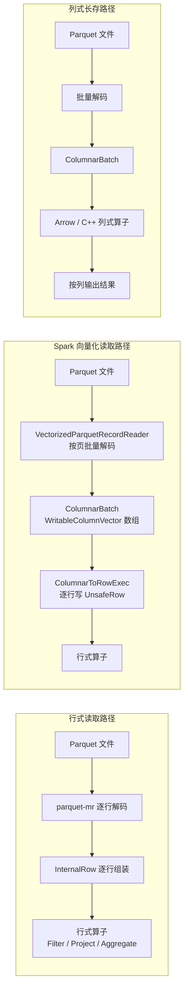
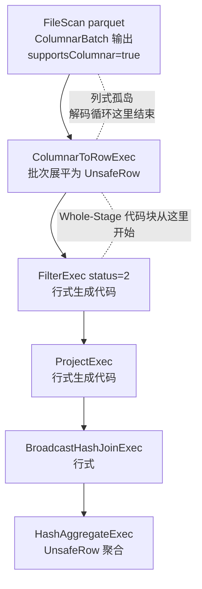
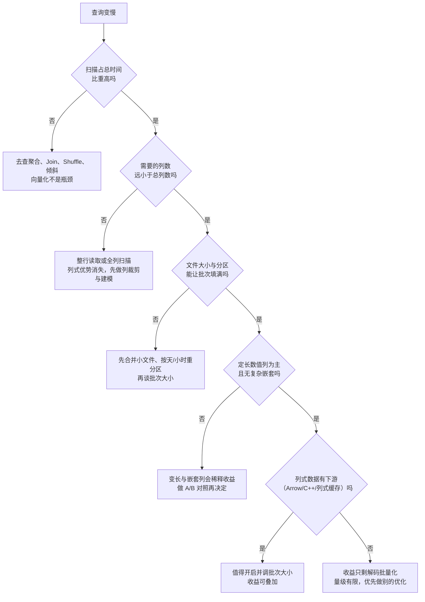

# 08 向量化执行引擎：列式处理与 SIMD 的力量

**摘要：**

"向量化"这个词在 Spark 语境里被用得远比它的实际含义宽泛：它有时指 Parquet 的批量解码，有时指 `ColumnarBatch` 这段内存结构，还经常被当成"Spark 有一套和 DuckDB 相当的列式执行引擎"。本文的立场是把这三件事分开讲清楚。先回到处理单元的粒度——行式的处理单元是一条记录，列式的处理单元是一列的一段，两者在缓存行利用、分支形态、随机访问代价上的差别是物理层面的，不是风格层面的。再落到 Spark 里向量化真正存在的三个位置：文件读取路径（`VectorizedParquetRecordReader`）、列式与行式之间的两个转换算子（`ColumnarToRowExec` 与 `RowToColumnarExec`）、以及一张短得令人意外的列式算子清单。随后要如实说明一件事：开源 Spark 并没有广泛的 SIMD，它的"向量化"是批量处理加紧凑列存，再减去一次列转行；指令级并行、selection vector、压缩执行这些让 ClickHouse 与 DuckDB 拉开身位的东西，在 Spark 的执行层里基本缺席。最后给出净收益与净损失的判断条件、配置与观测手段，以及四个反复出现的反例。本文要回答两个问题：Spark 的向量化到底改动了执行链路的哪一段，以及在什么查询形态下值得为它调参。

---

## 第 1 章 两种布局，两种处理单元

### 1.1 处理单元决定了一切

讨论行式与列式，最容易滑向"存储格式之争"，仿佛只是文件在磁盘上怎么摆。真正的分水岭在处理单元：一次抽象操作的对象是什么。

行式的处理单元是一条记录。Spark 内部的行式格式是 `UnsafeRow`，一条记录的全部字段放在一段连续字节里，null bitmap 在前，定长字段居中，变长字段的偏移与长度在后，实际字节堆在行尾。任何以它为核心的算子，循环体都长成这样：取一行，处理一行，丢掉一行。表达式的求值单位是单个值，`row.getDouble(1)` 读的是第 1 个字段在当前这一行里的那 8 个字节。控制流的粒度同样是行——过滤条件判定的是"这一行留不留"。

列式的处理单元是一列的一段。一段 `double[]` 里躺着连续 4096 个 `amount`，循环体以"一批"为单位推进，表达式的求值单位是一个数组而不是一个值，控制流被数据化：空值记在 validity bitmap 里，过滤结果记在位图或选择向量里，而不是记在 `if` 的分支结果里。

这个差别决定了后面所有讨论的走向。行式的每一个设计——`UnsafeRow` 的自包含、表达式的 `eval(InternalRow)` 接口、算子的 `next()` 契约——都在服务"一条记录是一次操作的单位"。列式的每一个设计——定长数组、位图、偏移数组、批量解码——都在服务"一列的一段是一次操作的单位"。把数据换成列式布局，却不换处理单元的粒度，收益就只能来自"少搬运"这一项，而这正是 Spark 的处境。

### 1.2 缓存行：为什么行式查一列要搬一整行

CPU 从内存取数据以缓存行（Cache Line，常见 64 字节）为单位。哪怕只读 1 个字节，整条缓存行也会被搬进 L1。这个硬件事实把两种布局的效率差距放大了。

设想一张 150 列的订单宽表，各列以 8 字节定长类型为主，一行解码后的 `UnsafeRow` 大约 1.3KB（示例推算，按 150 × 8 字节加 bitmap 与对齐开销估）。查询只取其中 4 列时，行式布局下每读一个字段都要触碰一条新的缓存行，而这条缓存行里绝大部分字节属于本次查询根本不需要的列。150 列摊到 1.3KB 上，平均每 8 字节有效数据要伴随约 56 字节的无效载荷；如果 4 个字段恰好分散在行的不同位置，那么一次取值就要拉进 4 条缓存行、共 256 字节，只为其中 32 字节有用。

列式布局把同一列的值排成连续数组。读 `amount` 时，一条 64 字节缓存行装 8 个 `double`，8 个都是本次查询需要的值；硬件预取器看到的是纯粹的顺序访问流，能提前把后续缓存行拉进来。同样是取 32 字节有效数据，列式只需 4 条缓存行，而且没有一条是白拉的。

用一句比喻收束：行式像按户装订的档案袋，为了查一个人的出生日期，得把整袋材料搬出来翻到那一页；列式像把所有人的出生日期单独抽出来排成一摞，翻一页就是 8 个人。这个比喻有明确前提——只有当你要批量看同一类字段时，抽出来的那一摞才划算；如果业务是"按人取全部材料"的点查，抽字段反而是自找麻烦。

### 1.3 分支：行式最贵的一笔隐性开销

行式处理里的过滤是一个逐行分支。`FilterExec` 的生成代码大致是：读值、比较、不满足就 `continue`。当选择率落在中间地带（譬如 30% 到 70%），分支预测器无法形成稳定的预测模式，每次误预测要付出十几个周期的流水线冲刷代价。表的列越多、过滤条件越复杂，这个代价越难被隐藏。

列式处理把过滤变成一次无分支的批量比较：对整批 4096 个值算出一个位图，后续所有算子只处理位图为真的位置。分支没有消失，而是被"数据化"了——处理哪些行由位图决定，不由控制流决定。

这里要提前点明一个事实，它决定了 Spark 向量化的天花板：**这套"位图驱动"的做法在开源 Spark 的执行层里几乎不存在**。它的过滤算子仍然是逐行的 `FilterExec`，`ColumnarBatch` 上也没有选择向量（selection vector）这种结构。位图思想只在 Parquet 页内的空值与级别解码里出现，以及在 Arrow 交接给外部引擎的那一侧出现。换句话说，列式布局带来的"分支数据化"收益，Spark 只兑现了一小部分。

### 1.4 贯穿案例：一张 150 列的订单宽表

后面的讨论都围绕同一张表展开。`orders` 是订单主表、商品明细、用户画像三层打宽之后的宽表，约 150 列，按 `dt` 做天分区，单分区 8 亿行量级（量级判断，用于推演成本比例，不代表任何基准测试），存储为 Parquet 加 Snappy。围绕它有三类查询：

1. **Q1 按天聚合**：`select o.province, sum(o.amount), count(1) from orders o join dim_province p on o.province_id = p.id where o.dt = '...' and o.status = 2 group by o.province`。只用到 5 列（`province_id`、`amount`、`status`、`dt`，以及维表一侧的 `id`），输入 8 亿行，输出不过几十行。
2. **Q2 点查对账**：`select * from orders where order_id = '...'`。一次只要一行，但要整行 150 列。
3. **Q3 抽样导出**：`select * from orders where dt = '...' limit 10000`。要整行，且只要很少的行。

这三个查询对布局的偏好完全相反：Q1 是列式的理想形态（宽表、少列、过滤后急剧收缩、输出极小），Q2 是行式的理想形态（整行、点查、无需批量），Q3 介于两者之间且对"提前终止"极其敏感。同一个存储格式要同时服务三者，取舍就不可避免——这正是后文所有结论的出发点。

### 1.5 列式要付的账

把列式当成免费的加速手段是常见的误读。列式布局在四类操作上都要额外付账。

第一是点查。Q2 这类查询在列式布局下要把分散在 150 个列数组里的值按行号各取一次，150 次随机访问换一次"行"；行式布局下就是一次连续读，一条 1.3KB 的缓存行序列打完收工。

第二是整行读取。`select *` 在列式布局下要读全部列，而且各列是独立的压缩块与独立的页，读放大从"行内浪费"变成"列间调度"；行式布局的顺序读在这里是最优解，Parquet 对 `select *` 不友好，根子在这里。

第三是更新与删除。列存改一行要改 150 个数组的同一个下标，行存改一行是就地覆盖一段字节。分析型引擎普遍回避这个问题（只追加不改写），但这恰恰说明列式不是一个无条件更优的选择。

第四是编码开销。定长列的 validity bitmap、变长列的偏移与长度数组、字典编码与运行长度编码，都是为批量处理预付的结构成本，批次越小摊到每行上的成本越高。

| 维度 | 行式（`UnsafeRow`） | 列式（`ColumnarBatch`） |
|---|---|---|
| 处理单元 | 一条记录 | 一列的一段（一批行） |
| 缓存行利用率 | 低（查一列搬整行） | 高（整条缓存行都是同类值） |
| 分支形态 | 逐行分支，选择率居中时误预测多 | 批量比较 + 位图（Spark 未完整实现） |
| 点查与整行读取 | 最优 | 需要跨列拼装，随机访问 |
| 更新与删除 | 就地覆盖 | 要改多个列数组 |
| 排序、哈希、Join key | 原生支持（字节可比较） | 需重排或物化成行 |
| 典型用途 | 算子间传递、Shuffle、聚合、排序 | 扫描、列裁剪、交给外部引擎 |

---

## 第 2 章 被夸大的叙事：Spark 里到底有多少 SIMD

### 2.1 SIMD 需要满足的四个前提

单指令多数据（Single Instruction Multiple Data，SIMD）的诱惑很直白：一条指令同时处理 4 个 `double`、8 个 `int`、16 个 `short`，理论上把吞吐乘以通道宽度。AVX2 的 256 位寄存器装得下 4 个 `double` 或 8 个 `int`，AVX-512 的 512 位寄存器装得下 8 个 `double`。这些都是指令集手册里的既定事实。

但 SIMD 要真正生效，数据得同时满足四个前提。

- **同构**：一条指令覆盖的元素类型必须一致，`int` 与 `long` 混在一段内存里就没法一次装进寄存器。
- **连续与对齐**：元素在内存中连续排列，且满足对齐要求（常见要求 16、32 或 64 字节对齐）。
- **可掩码**：遇到数据相关的分支，要么改成掩码运算，要么拆成两段标量代码；变长数据（字符串）连"连续"都不满足，只能靠 gather/scatter 这类间接访问指令，收益大打折扣。
- **编译器愿意做**：或者人工写内建函数（intrinsic），或者自动向量化器能识别循环形态。

四个前提里最后一个最容易被忽略。数据排成列只是让前三个前提"有可能满足"，第四个前提才决定最终有没有 SIMD 指令落到机器码里。

### 2.2 JVM 上自动向量化的现实

HotSpot 的 C2 编译器有一个叫 SuperWord 的自动向量化优化，能把简单的标量循环改写成向量指令。它的适用条件相当苛刻：循环次数可静态或半静态确定、循环体是纯标量运算、没有虚方法调用、没有数据相关的分支、数组访问的边界检查能被消除或提升。

拿 Spark 生成的行式代码去对照，会发现几乎每一条都不满足。循环体里有 null 检查（每列一个 `isNullAt`），有变长列的偏移查表（读 `elementOffsets` 再定长读取），有 `UTF8String` 这类对象的方法调用，有 `Unsafe` 的 `Platform.getLong(base, offset)`，还有大量"这一行读哪几个字段"由 schema 决定的运行时分支。`Platform.getLong` 本身是被 JIT 特殊处理的 intrinsic，但它所在的循环整体形态无法被 SuperWord 接手。

再看列式读取这一侧。Parquet 页解码的批量循环（RLE/bit-packing 的展开、字典索引查表）确实比"每值一次函数调用"高效得多，但这些循环形态复杂，C2 未必会把它们向量化；真正稳定拿到 SIMD 的路径是人工写 intrinsic 或换 C++ 实现，而开源 Spark 两条路都没走。

JDK 自带的 Vector API（`jdk.incubator.vector`）在这条路上是个长期未落地的选项——它长期处于孵化状态，需要以预览特性运行，而 Spark 官方发行版不会为孵化 API 打开预览特性。即便列向量已经就位，从"列向量"到"SIMD 指令"之间仍然隔着编译器的自由裁量与 JVM 的版本策略。

> [!info] 关键判断
> 开源 Spark 的执行代码里没有手写 SIMD 内建函数，"向量化"这个词描述的是"批量处理 + 紧凑列存"，不是"指令级并行"。说 Spark 有 SIMD 级优化，是把 Parquet 库与 Arrow/C++ 生态的能力记在了 Spark 执行层头上。这个判断后面所有关于收益边界的论述都依赖它。

### 2.3 Spark 实际做的三件事

把 SIMD 的滤镜拿掉之后，Spark 所谓向量化剩下三件具体的事，每一件都真实有效，但都不是"SIMD"。

**批量摊薄固定开销**。逐行读取时，每个值都要经历一次调用边界、一次偏移计算、一次 null 判定；批量读取时，这些固定开销按批摊薄，循环头与迭代器推进的次数从"每行一次"降到"每批一次"。4096 行的批次，迭代器推进次数少了三个数量级。

**紧凑列存省一次搬运**。非向量化读取在 parquet-mr 里把每个解码值交给一个转换器，逐个构造成 `InternalRow` 需要的表示；向量化读取把一页解码结果直接写进 `int[]`、`long[]`、`double[]`，中间没有逐值的对象构造与字段写入。省下的是"解码值 → 行字段"的那一次搬运。

**少一次列转行**。这句话需要小心对待，后文专门拆。

### 2.4 与 ClickHouse、DuckDB 的差距在哪

把 Spark 与两个常被拿来对标的引擎放在一起，差距不在"谁有 `ColumnarBatch`"，而在列式数据的生命长度。

DuckDB 的执行模型是向量化的推送式流水线：每个算子都以向量为单位处理，过滤产生选择向量而不是复制数据，哈希聚合与哈希连接都有列式实现，部分表达式求值直接在压缩数据上做。ClickHouse 的块（Block）以列为单位组织，函数库普遍按列实现，压缩编解码器与计算路径结合得紧。两者的共同点是"列式数据从扫描到聚合都没有变回行"。

Spark 的列式数据只活在一小段链路里：读取器解码出 `ColumnarBatch`，紧接着 `ColumnarToRowExec` 把它逐行摊成 `UnsafeRow`，此后过滤、投影、聚合、排序、连接全部回到行式。列式数据在 Spark 里更像一个转运集装箱，而不是仓库本身。

| 能力维度 | 开源 Spark | DuckDB | ClickHouse |
|---|---|---|---|
| 扫描输出列式批次 | 是 | 是 | 是 |
| 算子层列式执行 | 仅扫描、转换、Arrow 交接 | 全算子 | 全算子 |
| 选择向量贯穿过滤 | 无 | 有 | 有 |
| 表达式列式求值 | 无（逐行 + CodeGen） | 有 | 有 |
| 压缩数据上直接计算 | 无（先解压到列向量） | 部分 | 部分 |
| 手写 SIMD 内核 | 无 | 部分 | 部分 |
| 不支持的类型或 UDF | 回退到行式，代价是转换 | 回退到行式 | 少量回退 |

这张表是定性对照，依据各家公开文档与论文，不含任何基准数字。它要说的是层级差别：Spark 缺的不是某个算子，而是"列式数据能否长期存活"这件事本身。

### 2.5 列转行没有消失，只是挪了位置

非向量化读取的路径是：parquet-mr 逐行把列值组装成一个 `InternalRow`（或者先组装成 `Group` 再转换），再交给上层算子。向量化读取的路径是：按页批量解码进 `WritableColumnVector`，组成 `ColumnarBatch`，然后 `ColumnarToRowExec` 逐行把向量摊回 `UnsafeRow`。

两条路径相比，被省掉的是"parquet-mr 内部的逐行组装"，多出来的是一次"生成代码里的逐行摊平"。如果列式数据直接交给 C++ 引擎或 Arrow 侧（Pandas UDF、`mapInArrow`），这次摊平才会真正消失；只要上层是 Spark 自己的行式算子，列转行迟早要发生。

这就是 Spark 向量化收益的真实来源：**不是消除了行组装，而是把行组装从"每值一次函数调用的转换器"换成"CodeGen 生成的紧凑循环"，顺带让解码也批量化**。理解这一点，才能解释为什么同样开着向量化，有的查询快出数倍，有的查询几乎没有变化——收益来自"解码与组装的方式"，而组装这件事本身照旧要做。

下面的图把三条路径并排放开，中间的差异就是本章全部结论的图形化表达。



Spark 走的是中间那条，P2 的收益只发生在 `B2 → B3` 这一段，`B3 → B4` 是实打实的成本。P3 才是 DuckDB、ClickHouse 与 Photon 所处的形态，也是"向量化执行引擎"这个称呼名副其实的前提。

---

## 第 3 章 ColumnarBatch 与 ColumnVector：列式内存模型

### 3.1 一个数组加一个行数

`ColumnarBatch` 的定义简到近乎贫瘠：一个 `ColumnVector` 数组，加一个行数。构造时给出列数组，行数（不同版本里访问器叫 `numRows` 或 `rowCount`）在每批填充完成后由 `setNumRows` 回填；读取器在每批开始时把它重置为 0。`getRow(i)` 返回一个 `ColumnarBatchRow`，它把"批次 + 行号"钉在一起，充当 `InternalRow` 的视图；`rowIterator()` 就是这个视图的迭代器。

结构简单，使用上却有一个必须遵守的契约：批次的内存是从读取器那里租来的，下一批会就地 `reset()` 复用。消费方不能在取出下一批之后继续持有上一批的引用，否则读到的是被覆写的内存。这类"复用而非新建"的设计是整条列式路径能高效的原因——每批不重新分配几十兆内存，只把写入位置归零——也是外部代码直接操作 `ColumnarBatch` 时最容易踩空的地方。

把一个 `ColumnarBatch` 想成一排并排的货架：每列一格，格子容量固定，管理员只在整批货卸完之后，才更新"这排货架今天装了几件"。在"装了几件"更新之前，多出来的格子属于上一批的残留，读它就是读脏数据。

### 3.2 WritableColumnVector：堆内实现

`WritableColumnVector` 是列向量的可写基类，对外提供 `getInt(rowId)`、`putInt(rowId, value)`、`appendUTF8String` 这类按位置读写的方法，屏蔽定长与变长的差异。堆内实现 `OnHeapColumnVector` 用 Java 原始数组承载数据：`int[] intData`、`long[] longData`、`double[] doubleData`、`float[] floatData`。空值单独记在 `byte[] nulls` 里，每个元素占一个字节——这里刻意没用位图，用 8 倍的存储换掉"取位、移位、判位"的三步操作，批量读取时这点空间远比指令便宜。

变长列（字符串、二进制、大 Decimal）拆成三块：`byte[] byteArrayData` 装所有元素的字节，`int[] elementOffsets` 与 `int[] elementLengths` 记录每个元素的起点与长度。取一个字符串就是"按行号查偏移与长度，再从字节区切一段"，不需要对象分配；这也是 Spark 的列式路径能绕开 `UTF8String` 构造的原因。

容量在创建时按批次大小一次性定好。`reset()` 只把写入位置归零，不清零数组内容——省下的是每批一次全量 memset。代价是"行数必须可信"：消费范围由 `numRows` 兜底，行数一旦写错，读到未初始化尾部或上一批残留都不会报错。

### 3.3 OffHeapColumnVector：把列搬到堆外

`OffHeapColumnVector` 用 `MemoryBlock` 管理一块本地内存，读写走 `Platform.getInt(base, offset)`、`Platform.getLong(base, offset)` 这类基于地址的访问，空值区也变成一段地址（`nullsAddress`）而不是数组。好处有三条：不在 Java 堆上，不受 GC 扫描与对象移动影响；没有对象头与数组长度字段，地址空间连续可预测；交给 native 代码（Arrow、C++ 引擎）时不需要再拷一次。

代价同样具体。这块内存由 `TaskMemoryManager` 记账，必须显式释放；泄漏的表现不是堆内存上涨，而是本地内存持续增长直到 `Direct buffer memory` 之类的错误。启用它需要配套三件事：打开堆外开关、给 `spark.memory.offHeap.size` 留出空间、给执行器的 `spark.executor.memoryOverhead` 留出余量，因为堆外列向量的峰值不受 JVM 堆参数约束。

这里有一个源码级的细节值得记下：`spark.sql.columnVector.offheap.enabled` 在实现里回落到 `spark.memory.offHeap.enabled`，而不是一个独立的布尔量。只设前者不设后者，读到的仍然是堆内实现；反过来只开 `spark.memory.offHeap.enabled` 而不设 `spark.memory.offHeap.size`，堆外池根本不会建立。配置表里看到的"默认 false"，说的正是这条回落链末端的值。

### 3.4 其余几种 ColumnVector

`ColumnVector` 是一个抽象类，实现有四种，各自服务一条不同的数据来源。

- `WritableColumnVector`：Parquet/ORC 读取器填充用，分堆内与堆外两个子类。
- `ArrowColumnVector`：包装 `ArrowBuf`，对 Arrow 内存零拷贝。Pandas UDF、`toPandas()`、`mapInArrow` 这些跨语言路径靠它把 JVM 侧的批次直接暴露给 Python / C++ 侧，避免了解码再编码。
- `OrcColumnVector`：ORC 路径的列向量，按 ORC 的批结构组织。
- `ConstantColumnVector`：整批 4096 行共用同一个值，用于把标量或常量表达式铺成列——省掉重复存储，也让"常量列参与列式运算"不需要特殊分支。

四种实现的接口一致，这是 `ColumnarBatch` 能跨数据源与跨语言使用的原因：上层只认 `ColumnVector` 抽象，不关心底下是数组、地址还是 Arrow 缓冲区。

### 3.5 容量是一次乘法

批次大小不是孤立的数字，它要与列数相乘才是真实内存。以 Q1 为例，只读 4 列时，4 × 4096 × 8 字节 = 128KB，落在 L2 缓存（常见 256KB 到 1MB）的量级内，批内循环几乎不触碰主存。换成 Q3 的 `select *`，150 × 4096 × 8 字节 = 4.9MB，再加 150 × 4096 字节的空值标记约 614KB，一批就超过 5MB，比 L2 大一个数量级，每批的填充与遍历都要经过 L3 甚至 DRAM。

这是一个容易被配置项名称误导的地方：`spark.sql.parquet.columnarReaderBatchSize` 只给了你一个行数旋钮，而真实的内存与缓存占用是行数乘以列数。同一份配置在 4 列的表上恰好合适，在 150 列的表上就偏大；把行数调小能缓解缓存压力，代价是每批的固定开销占比上升。示例推算的这组数字说明的是关系而非绝对值：**批次大小的合适值由列数决定，而配置项不知道你在读几列**。

### 3.6 行视图不是免费的

`ColumnarBatchRow` 不复制数据，它只是把"批次 + 行号"包装成 `InternalRow`。看起来是免费的行式接口，实际每次 `getInt` 都要经过一次虚方法分发到具体实现，再算一次偏移与一次边界检查；与 `UnsafeRow` 的"取行首地址加一次偏移加法"相比，逐行取值反而更贵。

这解释了一个常见的错误用法：在自定义算子或 UDF 里拿到 `ColumnarBatch`，用 `rowIterator()` 拆成行再处理。省下的是数据拷贝，付出的是每行每列各一次间接调用，通常比直接把行式数据交上来更慢。要逐行处理，正确做法是让 `ColumnarToRowExec` 用生成代码把整批一次性展开——那是一次性代价；而不是在算子内部逐行取值——那是每行都付的代价。

下面的图把两种实现的内存形态并排放开，差别集中在"数据在哪里"与"空值怎么记"。

```mermaid
%%{init: {'theme': 'dracula'}}%%
flowchart TB
  subgraph CB[ColumnarBatch]
    direction LR
    V0[ColumnVector 0<br/>列 0]
    V1[ColumnVector 1<br/>列 1]
    V2[ColumnVector n<br/>列 n]
    RC[numRows<br/>由 setNumRows 回填]
  end
  subgraph ON[OnHeapColumnVector]
    direction TB
    O1[int[] / long[] / double[]<br/>定长值区]
    O2[byte[] nulls<br/>每元素一字节]
    O3[byte[] byteArrayData<br/>int[] elementOffsets<br/>int[] elementLengths]
  end
  subgraph OFF[OffHeapColumnVector]
    direction TB
    F1[MemoryBlock<br/>Platform.getLong base offset]
    F2[nullsAddress<br/>地址直接判空]
    F3[偏移与长度<br/>同样存放在堆外]
  end
  CB --> ON
  CB --> OFF
```

---

## 第 4 章 落点一：Parquet 与 ORC 的批量读取

### 4.1 行式读取每一步在做什么

把向量化开关关掉，`ParquetFileFormat` 走的是行式路径：Hadoop 的 `RecordReader` 从 parquet-mr 取出一行，Spark 一侧的转换器把 parquet 的 `Group` 变成 Catalyst 的 `InternalRow`。每个值都要过一遍"定位列 → 判空 → 按编码解释 → 转成目标类型 → 写进行容器"的流程，压缩块的解压、页头的解析、编码状态的推进全都发生在逐值循环里。

这条路径的问题是每值一次函数调用与一次状态推进。对 8 亿行的分区、每次取 4 个值，理论上有 32 亿次这样的调用；即使每次都只是几十纳秒，累加起来也是分钟量级（示例推算，用于说明量级而非实测）。

### 4.2 向量化读取器的执行流程

开关打开、且 schema 通过 `ParquetUtils.isBatchReadSupportedForSchema` 的判定之后，`ParquetFileFormat` 会构造 `VectorizedParquetRecordReader`。它的批次容量来自 `spark.sql.parquet.columnarReaderBatchSize`，与需要读取的列一起决定分配多少列向量。

它的执行流程可以概括成四步：

1. **initBatch**：按容量与 `requiredSchema` 分配一组 `WritableColumnVector`，堆内还是堆外取决于前述开关；只读的列才分配，未读列不占空间。
2. **nextBatch**：先把所有向量 `reset()`、把批次行数置 0，再让每列的 `VectorizedColumnReader` 把码流解码进各自的向量，读取行数取"容量"与"本 row group 剩余行数"的较小值。
3. **回填行数**：解码完成后 `setNumRows(n)`，把同一个 `ColumnarBatch` 交给上层——同一个对象反复使用，不是每批新建。
4. **换 row group**：一个 row group 读完，切下一个，直到文件分片结束。

批次既不跨文件，也不跨 row group。这条限制在小文件场景里会变成具体代价：一个只有 200 行的文件，只能产出 1 个 200 行的批次，容量 4096 里空着的部分就是白付的固定开销。

### 4.3 批量解码到底快在哪

Parquet 的页数据是编码过的：字典索引、RLE/bit-packing、DELTA 系列、PLAIN。逐行读取要为每个值解释一次编码、推进一次解码状态；批量读取按页把整段编码一次性展开成值数组。RLE 与 bit-packing 的展开天生就是"一解解出一组"的形态，循环体里没有分支，解码器可以一次性算出一页里所有值——这是向量化读取最主要、也最扎实的收益来源。

这里要纠正一个流传很广的说法。很多材料把"字典编码直传"写成 Spark 向量化读取的三大优化之一，描述成"以整数形式传递字典索引，延迟到真正需要字符串时才解码"。Spark 的实现不是这样：它按页把字典索引解析成实际的值写进列向量，所谓"延迟解码"并未发生。字典编码在 Spark 里的收益体现在压缩率与解码批量化上，而不是"免解码"。判断这类说法真伪有个简单办法：看列向量里存的是值还是索引——`WritableColumnVector` 的字符串列存的是字节与偏移，不是字典下标。

### 4.4 谓词在哪一层生效

真正决定"少解码"的是统计信息，不是批次。row group 级的 min/max/null count，以及支持时的页级统计，能让读取器整块跳过不满足谓词的数据；这一层由 `ParquetInputFormat` 的 filter predicate 完成，早于解码，也独立于是否向量化。

批次内部没有筛选。一批 4096 行解出来之后，Spark 不会在列向量上做逐行位图过滤，而是把整批交给 `ColumnarToRowExec` 摊成行，再由 `FilterExec` 逐行判断。于是高选择率的过滤（谓词只留下 1% 的行）在向量化路径上仍然要为那 99% 的行付出解码与摊平成本，除非统计信息能把它们所在的 row group 整块跳过。这与列式引擎"过滤后只处理幸存行"的形态有本质区别。

把这个差别放在 Q1 上看得更清楚：`status = 2` 是低基数枚举，如果它恰好与 `dt` 分区、写入顺序强相关，Parquet 的 row group 统计能跳掉大量数据，向量化的收益会被跳过逻辑放大；如果 `status` 随机分布，每个 row group 都混杂两种取值，统计信息失效，向量化就要为所有行解码——收益回到只与"批量解码比逐行解码快多少"有关。

### 4.5 什么情况下会回退

回退分规划期与运行期两类，症状也不同。

规划期的回退发生在 `isBatchReadSupportedForSchema`：schema 里出现当前版本不支持列式解码的类型组合时，这个扫描节点直接产出行式 RDD，计划里不会出现配套的 `ColumnarToRow`。这类回退是"整条链路都没进列式"，看计划一眼就能确认。

运行期的问题出现在读取器内部：列级加密的文件、超出支持范围的页编码，都可能让读取走入不支持的分支，表现为整条链路回退或者直接报错；这类情况在计划上看不出来，只能从日志与异常里察觉。

嵌套类型的处理需要单独说明。结构体、数组、映射在向量化路径上有专门的解码器，读出来是 `ColumnarRow`、`ColumnarArray`、`ColumnarMap` 这样的嵌套列向量；从 Spark 3.3 起这件事由 `spark.sql.parquet.enableNestedColumnVectorizedReader` 单独控制，默认开启。把它关掉通常是为了绕开某个版本里嵌套解码的正确性或性能问题，代价是相关列整体回到行式。说"Spark 不支持嵌套类型的向量化读取"是过时结论，说"嵌套列有独立开关、可以单独回退"才准确。

| 列类型 / 场景 | 能否进入列式解码 | 说明 |
|---|---|---|
| `INT32`、`INT64` | 能 | 定长数组，路径最短 |
| `FLOAT`、`DOUBLE` | 能 | 定长数组，路径最短 |
| `BOOLEAN` | 能 | 用字节数组承载 |
| 字符串、二进制 | 能 | 偏移与长度数组加字节区，变长需要拷贝 |
| `Decimal` | 能 | 精度受类型系统约束，高精度走定长字节 |
| `INT96` 时间戳 | 能 | 按 rebase 规则转换，历史文件仍可读 |
| 结构体、数组、映射 | 能 | 有独立开关，可单独关闭退回行式 |
| 列级加密文件 | 不能 | 运行期退回行式，计划上看不出 |
| CSV、JSON、Avro | 不能 | 没有向量化读取实现，不是配置问题 |

### 4.6 列裁剪不是向量化的功劳

这一点值得单独成节，因为归因错误会导错方向。

`requiredSchema` 是逻辑优化阶段 `ColumnPruning` 与扫描节点共同决定的产物，与读法无关：行式读取同样只读需要的列。把"只读 4 列而不是 150 列"记在向量化头上，是把 I/O 裁剪的收益错记成解码方式的收益。

向量化改变的是这 4 列读出来之后怎么落地，不是读几列。这个区分有实践价值：如果瓶颈是"读了不该读的列"，该查的是 `requiredSchema`、谓词下推、分区裁剪；如果瓶颈是"读出来的列怎么组装、怎么进入算子"，才轮到向量化和批次大小。两者的处置手段完全不同，把症状认错，调参会全部落空。

### 4.7 ORC 的平行实现

ORC 走的是同一套抽象：`OrcColumnarBatchReader` 负责把 stripe 解码进列向量，开关是 `spark.sql.orc.enableVectorizedReader`，批次容量是 `spark.sql.orc.columnarReaderBatchSize`，嵌套列也有独立的开关。差异在存储结构：ORC 有 stripe、row group、row index 三级结构，Parquet 有 row group 与页级统计，两边都能把跳过的粒度做到行组以内；具体谁更细取决于写入端配置的行组大小与页大小，不能一概而论。

机制的相似性说明一件事：Spark 的向量化读取是**数据源格式层的能力**，不是执行引擎的能力。换一个格式就要重写一遍读取器，而读取器之后的一切照旧是行式。

---

## 第 5 章 落点二：两种转换算子的账单

### 5.1 谁把转换插进计划

物理计划里没有哪个环节会"自然地"从列式滑到行式。两种形态之间的接缝由一条规则显式焊上：`ApplyColumnarRulesAndInsertTransitions`。它在 `QueryExecution.preparations` 阶段跑一遍，在自适应执行（AQE）每次重新规划查询阶段时再跑一遍，遍历物理计划，依据每个算子的 `supportsColumnar` 标记决定插什么：子树不支持列式，就往上插一个 `RowToColumnarExec`；子树支持列式但父节点要行，就插一个 `ColumnarToRowExec`。

用电路来打比方：列式与行式是两种电平，器件本身不能改，两种电平直接对接一定出错，于是每一处接缝都必须加一个电平转换器。转换器本身工作可靠，但它每次都要消耗能量——这就是本章的主题。

这套机制在 3.0.0 由 SPARK-27396 引入，此前的 Spark 只有扫描层的向量化读取。理解了这一点，就明白为什么"列式"在 Spark 里总是以"一小段被转换器包围的孤岛"的形态出现。

### 5.2 ColumnarToRowExec：把批次摊成行

`ColumnarToRowExec` 做的事很明确：对子节点产出的 `Iterator[ColumnarBatch]` 做 `mapPartitions`，把每一批展开成逐行的 `InternalRow`。它还有两个性能指标——输入批次数与输出行数——后面会用到。

展开的成本结构可以逐项拆开：

- 定长列：按字段宽度从列数组取值，写进 `UnsafeRow` 的定长区，一次读加一次写，外加一次空值判断与一次目标地址计算。
- 变长列：按行号查 `elementOffsets` 与 `elementLengths`，把字节从列数据区拷到行尾的变长区，再回填该字段的偏移与长度。字符串越长，拷贝量越大。
- 空值：在行的 null bitmap 上置位，同时在定长区留下占位，保证行内偏移可静态计算。
- 对齐：`UnsafeRow` 要求 8 字节对齐，变长区的起点因此要补齐，补齐的字节没有任何信息。

这个过程有一个容易被误读的性质：它本身可以参与 Whole-Stage CodeGen。它生成的循环以 `ColumnarBatch` 为输入，展平出的值直接进入下游算子的生成代码，于是"展平 + 过滤 + 聚合"可以落在同一段机器码里，中间没有算子间的虚调用。但扫描节点的列式解码不在这段代码里——那是子节点在自己的 RDD 分区里完成的另一个循环，两者之间隔着一条 RDD 边界。整段融合的边界，正好落在列式与行式的接缝上；融合的判定规则与切分条件见 [[大数据/Spark/Spark-SQL深度解析与性能调优/07 Whole-Stage CodeGen：JVM 字节码级别的性能飞跃|Whole-Stage CodeGen]]。

### 5.3 RowToColumnarExec：把行装进列

反向的转换由 `RowToColumnarExec` 完成：把逐行的 `InternalRow` 按列写进一组 `WritableColumnVector`，再由 `setNumRows` 收尾。它依赖一组生成的转换器，把"按 schema 决定每个字段写到哪个数组的哪个位置"这件事编译成代码，避免逐字段解释。

它出现的场合比前者少，但每一个都不便宜：行式上游交给 Arrow UDF 之前要装成列；V2 数据源返回行而下游要列式时要装成列；列式缓存写回时要装成列。装列的成本是一次完整遍历加一次重分配——每个字段都要算目标数组、算偏移、做一次写入，变长字段还要把字节拷进列数据区并回填偏移与长度。

一个细节值得注意：读取器里的列向量是复用的，装列器则常常要为每批准备向量；每批重新分配几十兆数组时，分配与清零本身就成了可观开销，而它在计划上完全不可见。

### 5.4 一次往返的完整账单

把 Q1 加上一段 Pandas UDF，账就变得具体了。物理计划大致是：扫描列式解码出 `ColumnarBatch` → `ColumnarToRowExec` 展平成行 → 若干行式算子 → `RowToColumnarExec` 装回列 → Arrow 交给 Python → 结果再 `ColumnarToRowExec` 展平 → 后续行式聚合。

这一趟里，数据被完整遍历了四次（解码、展平、装列、再展平），其中两次是纯粹的形态转换，不产生任何业务价值。如果中间的 Arrow UDF 每秒只处理几万行，而两侧的转换每秒能处理几千万行，那么转换的账可以忽略；但如果 UDF 很轻（譬如只是乘一个系数），转换的账就会盖过 UDF 的收益，此时正确的做法是把这段逻辑改写成一个向量化的 SQL 表达式，让整条链路留在行式生成代码里。

判断标准可以归纳成一句：**只有当列式段足够长、或者下游确实是另一个引擎时，转换才划算**。列式段只有一次扫描、中间夹着两三个行式算子、下游又是行式聚合，这类计划里的转换基本是白花钱，而 Spark 恰恰最擅长生成这种计划。

### 5.5 用两个指标判断批次是否填满

`ColumnarToRowExec` 的"输入批次数"与"输出行数"这两个指标，能直接算出平均批次大小：输出行数除以输入批次数。这个比值是现场诊断最有用的一把尺子。

理想情况下它接近 4096；如果它只有几百甚至几十，说明批次没被填满。常见原因有三类：文件本身太小（每个文件只产出一两个不满的批次）、分区数据量太少（一个分片几十行）、或者查询带 `LIMIT` 且提前终止（批次边界处停下，最后一批自然不满）。前两类是"批次的固定开销被反复支付"，第三类是"提前终止省下的解码量抵掉了不满批次的成本"，性质完全不同。

`LIMIT` 这一项还有一层机制值得点明：`ColumnarToRowExec` 的 `canCheckLimitNotReached` 恒为真，意味着限制算子可以在批次边界判断"是否已经够了"，从而停止向上游索取下一批，不必为了取 10 行而解完整个 row group。这是列式读取配合 `LIMIT` 时少数确定无疑的收益，也是 Q3 这类抽样导出查询比想象中更依赖批次结构的原因。

下图把 Q1 的计划形态画出来，标出转换点与代码块边界。



图中两条虚线标出了本篇文章最想强调的事实：列式解码与行式执行分属两个代码块，中间那次展平是不可避免的接缝，图上标出的 `ColumnarToRowExec` 就是它的代价所在。

---

## 第 6 章 落点三：列式算子的稀薄清单

### 6.1 真正消费 ColumnarBatch 的节点

把开源 Spark 里所有以 `ColumnarBatch` 为输入或输出的物理节点列出来，清单短得会让人意外。

- **扫描类**：`FileSourceScanExec`（V1 数据源）、`DataSourceV2ScanExecBase` 及其子类（V2 数据源，要求实现 `SupportsColumnar`）、`InMemoryTableScanExec`（缓存表读回，靠 `DefaultCachedBatchSerializer.convertCachedBatchToColumnarBatch` 把缓存批次转成列式）。
- **转换类**：`ColumnarToRowExec`、`RowToColumnarExec`。
- **跨语言类**：`ArrowEvalPythonExec`（Pandas UDF）、`MapInPandasExec`，以及 4.x 里新增的 `mapInArrow` 路径。它们的共同点是"列式进、列式出"，因为数据要交给外部进程，按行序列化的代价远高于按批传递。
- **自定义扩展**：`ColumnarRule` 允许插件改写列式子树，Databricks 的 Photon、Intel 的 Gluten 都通过这条路径把列式算子接进 Spark。这条路走通的前提是"你自带了一套执行层"。

除了这几类，其余节点一律不认 `ColumnarBatch`。

### 6.2 行式算子才是主力

投影、过滤、聚合、排序、连接、窗口、展开、去重、限量——每一个承担实际计算的算子都建立在 `UnsafeRow` 上：`HashAggregateExec` 用行做分组键与聚合缓冲，`SortExec` 把行写进 `UnsafeExternalSorter` 按字节比较，三种连接实现全在行上构建哈希表或做归并，`ExpandExec` 把一行复制成多行供分组集与倾斜处理使用。

这就解释了一件在日常工作中经常观察到、但很少被追问的现象：扫描之后几乎必然紧跟一个 `ColumnarToRowExec`。原因不是 Spark 懒，而是扫描之后的第一个算子通常就是 `FilterExec` 或 `ProjectExec`，它们都不支持列式，接缝只能出现在这里。

| 算子 | 输入 / 输出形态 | 是否列式 |
|---|---|---|
| `FileSourceScanExec`、V2 `BatchScanExec` | 列式输出 | 是 |
| `InMemoryTableScanExec` | 列式输出（缓存读回） | 是 |
| `ColumnarToRowExec`、`RowToColumnarExec` | 列式 / 行式互转 | 是（转换本身） |
| `ArrowEvalPythonExec`、`MapInPandasExec`、`mapInArrow` | 列式进出 | 是 |
| `ProjectExec`、`FilterExec` | 行式 | 否 |
| `HashAggregateExec`、`SortAggregateExec` | 行式 | 否 |
| `SortExec`、`TakeOrderedAndProjectExec` | 行式 | 否 |
| `BroadcastHashJoinExec`、`ShuffledHashJoinExec`、`SortMergeJoinExec` | 行式 | 否 |
| `WindowExec`、`ExpandExec`、`DeduplicateExec` | 行式 | 否 |
| `ShuffleExchangeExec` | 行式序列化 | 否 |

### 6.3 为什么改不动

缺口如此明显，社区却没有在开源版里补齐，原因不是优先级，而是代价。

第一是表达式体系。Catalyst 的表达式接口是 `eval(InternalRow)` 与 `doGenCode(CodegenContext, ExprCode)`，两者都以"求一个值"为语义。要把它们列式化，等于把几百个表达式逐个重写成"对数组求值"，并且要处理 Decimal 精度、时区转换、ANSI 溢出、字符串 collation 这些语义细节。这不是加几个算子，而是重写整个 `expressions` 包。

第二是 `UnsafeRow` 已经成了通用货币。Shuffle 的序列化格式、缓存表的存储格式、UDF 的入参出参、连接键与分组键的哈希与比较、排序的比较器，全都建立在"一条记录是一段自描述字节"这个前提上。换掉它，等于同时改掉 Shuffle、缓存、序列化与 UDF 四个子系统。

第三是类型系统的复杂度。嵌套结构、`CalendarInterval`、UDT、高精度 Decimal 在列式表示里都有额外分支，而 Spark 的兼容性承诺要求"任何 schema 都能跑"。既然必须能回退，回退成本就是转换成本；列式覆盖每扩大一步，都要为不支持的类型保留一条回退路径，而每条回退路径的两端都是转换点。

第四是商业引擎给出的反证。Photon 用 C++ 重写了一套列式执行层，把不支持的表达式退回 JVM 行式引擎，两者之间同样靠批次边界与转换衔接；Gluten 把 Velox 接进来，做的也是同一件事。它们证明的不是"Spark 可以加向量化"，而是"要在 Spark 上做真列式，必须换掉执行层"。

### 6.4 这些差距意味着什么

差距意味着不要指望通过调参把 Spark 变成列式引擎。选择 Spark 的理由通常是生态、容错与"任何 SQL 与 UDF 都能跑"的通用性，这些理由与极致的单机扫描吞吐本来就有取舍。能做的事情反而清晰：把扫描侧的收益吃干净，把计算侧交给生成代码与执行计划优化，把确实需要列式性能的部分交给外部列式实现。

行文至此，向量化的三个落点都说完了：扫描层能给出列式批次，转换层收过路费，算子层基本不参与。既然算子层不参与，就值得追问：Spark 为什么选择行式的 `UnsafeRow` 作为通用格式，这个选择付出了什么，又换回了什么。

---

## 第 7 章 UnsafeRow 与 ColumnarBatch 的取舍

### 7.1 一条记录，一段自描述字节

`UnsafeRow` 的内存布局分三段：开头的空值位图，中间每个字段一个固定宽度的槽位，行尾是变长数据区。定长字段的值直接写进槽位；变长字段的槽位里记着"数据在行尾的偏移与长度"；空值在位图上置位，槽位留作占位，保证任何字段的偏移都能在编译期算出来，不需要遍历。

这个设计的巧妙之处在于自包含。一条 `UnsafeRow` 是一段可以脱离任何上下文独立存在的字节：把它拷到另一块内存、写进排序缓冲、塞进哈希表、序列化进 Shuffle 输出、通过网络发到另一台机器，接收方只要知道 schema，就能直接解析。schema 不随行传输，行本身只带值。

自包含带来了三个能力，它们正是行式格式能成为通用货币的原因。

**可比较**。两行在同一 schema 下可以逐字段比较，定长字段比整数，变长字段比字节序列。排序时不需要把行反序列化成对象，直接对字节做比较，比较两个 `long` 就是比两个 64 位整数。

**可哈希**。行字节可以直接喂给哈希函数（Spark 用 Murmur3 系列），分组与连接用它算出桶号；哈希表里存的是行本身，不是行的引用或代理对象。

**可缓冲**。排序缓冲、聚合缓冲、连接构建侧、Shuffle 溢写，全部以行的形式持有数据；内存不够时整行溢写到磁盘，读回来照样能比较、能聚合。

### 7.2 为什么它成了通用中间格式

把这三个能力串起来看，`UnsafeRow` 承担的角色就很清楚了：它是 Spark 执行层的通用货币，所有子系统都认它。Shuffle 的序列化格式是它；缓存表的存储格式建立在它之上；UDF 的入参与返回值按它约定；连接键、分组键、排序键都是它的子集；连内存管理的记账单位也是"这个任务分配了多少行的内存"。

要让列式格式取代它，就得同时改掉 Shuffle 协议、缓存序列化器、UDF 调用约定与内存管理器，这不是性能优化的量级，而是重写执行层的量级。开源 Spark 选择不动，把列式限制在两端。

### 7.3 ColumnarBatch 为什么不适合当通用格式

`ColumnarBatch` 拿不到通用货币的地位，原因不在性能，而在语义。

它没有"行"这个一等公民。一批数据的列必须同步推进：过滤掉一行，所有列都要跟着跳过同一个下标，任何一列的处理进度落后或超前都会让整批失去意义。跨算子传递时，这个"同步推进"的约定必须被每个算子严格遵守，而 `UnsafeRow` 的约定简单得多——一行就是一个值。

它没有比较与哈希语义。连接与聚合都需要"按 key 取值、比较、哈希"，在列式格式里这意味着要么按 key 列取出下标再拼成临时行，要么为每种 key 类型写一套列式比较器。Spark 选择了前者，也就是回到行式。

它的生命周期是租借的。读取器复用向量、批次随时可能被覆写，这个约定对"搬运即用"的扫描链路没问题，对需要长期持有中间结果的算子则完全不适用。

它的 Shuffle 表示不存在。Spark 的 Shuffle 按行分片、按分区聚合，序列化器逐个写行；要把列式数据送过网络，必须先拆成行或改用另一套列协议，而 Spark 没有后者。

| 维度 | `UnsafeRow` | `ColumnarBatch` |
|---|---|---|
| 数据单位 | 一条自包含记录 | 一批同步推进的列 |
| 比较与哈希 | 原生支持，逐字节可比 | 需要按列重建比较器 |
| 随机访问 | 按字段偏移直接定位 | 先定位列，再按下标取值 |
| 生命周期 | 可长期持有、可缓冲、可溢写 | 租借，批次间复用，不可跨批持有 |
| Shuffle 序列化 | 原生 | 需先转成行 |
| 内存布局 | 行内混排，缓存行利用率低 | 列内同构连续，缓存行利用率高 |
| 适用环节 | 算子间传递、聚合、排序、Join | 扫描、列裁剪、交给外部引擎 |

### 7.4 取舍的落点

这组对比指向一个明确的结论：`UnsafeRow` 与 `ColumnarBatch` 不是"新格式淘汰旧格式"的关系，而是在不同环节服务不同目标。行式优化的是"记录的语义完整性"——一条记录可以被比较、被哈希、被缓冲、被传输；列式优化的是"同类值的批量吞吐"——一列值连续排布，批量解码、批量过滤、批量运算才有意义。

Spark 把这条边界划在扫描与跨语言交接处，是生态位选择的结果：通用性优先于单点性能。

---

## 第 8 章 净收益与净损失：什么时候值得开

### 8.1 三个条件同时成立才是净收益

向量化读取要成为净收益，需要三个条件同时成立。

**扫描是瓶颈，且列裁剪狠**。Q1 只读 5 列、输入 8 亿行、输出几十行，时间几乎全花在扫描与解码上，向量化能作用在瓶颈上。如果查询是"读全表做多表连接"，扫描只占总时间的两三成，即使扫描快一倍，端到端也就快一成左右。

**定长数值类型为主，空值比例低**。定长列在列向量里就是一段原生数组，取值是一次下标访问加一次边界检查；变长字符串则要走"查偏移、查长度、拷字节"三步，空值多还要额外判空。Q1 用的 `province_id`、`amount`、`status` 全是定长数值，是向量化最舒服的形态；如果查询大量处理长文本，向量化的相对优势会被字符串处理吃平。

**列式数据有下一站**。Q1 的列式批次读到之后立刻被聚合掉，中间的行式算子很少；如果能一路交给 Arrow 侧（Pandas UDF、`mapInArrow`）或写回列式缓存，列式数据就"活得长"，摊到每次转换上的成本就低。反过来，列式批次一读出来就被展平、之后全是行式算子、最后再装回列式，中间那两次转换就是纯粹的过路费。

### 8.2 净损失从哪里来

净损失有四类来源，每一类都能对应到具体症状。

**需要行式语义**。自定义 UDF、复杂表达式、嵌套结构的逐字段访问、高精度 Decimal 运算、依赖 ANSI 溢出的语义——这些在行式生成代码里是原生能力，在列式路径里要么没有实现，要么要付出转换代价。UDF 尤其典型：Scala UDF 的入参就是一个 `InternalRow`，列式数据必须先展平才能喂给它。

**批次填不满**。小文件是重灾区。假设一天的数据被写成了 5000 个文件、每个 300 行，那么每个文件只能产出一个 300 行的批次，容量 4096 里 93% 是空的；批次初始化、向量 reset、批次边界判断这些固定开销按批支付，等于每 300 行就要付一次。更糟的是，一个任务往往要连续处理很多个小文件分片，批次不满带来的固定开销在任务内部被反复支付。

**扫描不占主导**。以聚合与连接为主的查询，时间花在哈希表构建、探测、排序与 Shuffle 上，扫描占比很低。把扫描优化一倍，端到端只快几个百分点，而额外内存占用与批次转换反而可能让 GC 更频繁。

**内存设置不当**。开启堆外列向量却不给 `spark.memory.offHeap.size` 与 `memoryOverhead` 留够空间，结果不是变快而是失败；堆外 OOM 的表象往往是任务重试、执行器退出，而不是一句清晰的报错。

### 8.3 把三种放大分开算

关于向量化的量化讨论经常混用三种完全不同的"放大"，把它们拆开才能得到可用的判断。

第一种是**格式层面的读放大**，出现在行式文件格式上：CSV、JSON、Avro 按行存储，读 4 列要扫 150 列，读放大接近 150/4 ≈ 37 倍（示例推算）。这是选错存储格式的代价，与向量化无关——把同一份数据写成 Parquet，读放大自动消失。把这项收益算在向量化头上，是最常见的归因错误。

第二种是**物化层面的行式放大**，出现在"整行必须存在"的环节：行式读取出、行式格式解码、缓存表按行组织、上层算子需要全部 150 列。此时每一行的 1.3KB 都要被真实写出来，而只读 4 列的列式批次每行只有 32 字节，两者相差约 40 倍（示例推算，按定长 8 字节列估，未计变长列与空值位图）。Q1 这类"扫描后立即聚合"的查询确实能吃到这个差异，Q2 点查吃不到，因为它本来就要整行。

第三种是**批次与缓存的乘法**：4 列 × 4096 行 × 8 字节 = 128KB，落在 L2 缓存里；150 列的同尺寸批次是 4.9MB，超出 L2 一个数量级。这一条不是"放大倍数"，而是"合适的批次大小随列数变化"的算术来源。只调一个行数旋钮，不可能同时适配 4 列和 150 列。

还有一笔固定成本值得单独算：一次 `ColumnarToRowExec` 对 10 亿行、4 列的批次做展开，是 40 亿次取值，按每次 1 到 2 纳秒计，约 4 到 8 秒（示例推算，仅为量级判断）。这个数字决定了"列式段值不值得存在"——如果列式段只是一次扫描，随后就要付这 4 到 8 秒，那收益必须来自扫描侧省下的更多时间才成立；如果列式段之后还有大段列式处理或直接交给 C++，这笔钱才花得值。

### 8.4 一张判断表和一棵决策树

把上面的条件收成一张表，按 Q1、Q2、Q3 三种形态对照。

| 场景 | 向量化是否净收益 | 主要原因 |
|---|---|---|
| 宽表少列扫描 + 立即聚合（Q1） | 是，且收益可观 | 扫描主导，列数少，批次能在 L2 内 |
| 宽表点查整行（Q2） | 否 | 需要整行，列式要跨列拼装，批量无意义 |
| 小文件 + 少量行（每文件几百行） | 否 | 批次填不满，固定开销按批反复支付 |
| 全字符串宽表 | 边际，通常不值得折腾 | 变长列要走偏移与拷贝，收益被吃掉 |
| 扫描后接 Pandas UDF 或 `mapInArrow` | 是 | 列式数据有下一站，转换次数少 |
| 多表连接 + 排序主导 | 边际 | 瓶颈不在扫描 |
| 嵌套结构逐字段访问 | 否 | 嵌套列本身就要回退或按列展开 |
| 高选择率过滤 + 统计信息有效 | 是 | row group 跳过与批量解码叠加 |
| 高选择率过滤 + 统计信息无效 | 边际 | 仍要为被丢弃的行解码与展平 |

把这套判断画成决策顺序，适合在慢查询诊断时逐层排查。



---

## 第 9 章 配置、观测与故障

### 9.1 配置项与它们的代价

向量化相关的配置不多，但每一项都有一处"调大或调小"的代价，也都有失效条件。下面这张表按影响面归组，最后一列是代价方向。

| 配置项 | 默认值 | 作用 | 调大 / 调小的代价 |
|---|---|---|---|
| `spark.sql.parquet.enableVectorizedReader` | `true` | Parquet 是否走批量解码 | 关闭即回退行式，计划里不再出现配套的 `ColumnarToRow`；可做 A/B 对照，但会失去解码批量化 |
| `spark.sql.orc.enableVectorizedReader` | `true` | ORC 是否走批量解码 | 同上，ORC 的条带与行索引结构不同，回退后的性能落差也不一样 |
| `spark.sql.parquet.columnarReaderBatchSize` | `4096` | 每批行数（同时是列向量容量） | 调大：单批内存 = 行数 × 列数 × 8 字节，宽表容易冲出 L2；调小：固定开销占比上升，批次填充次数变多 |
| `spark.sql.orc.columnarReaderBatchSize` | `4096` | ORC 每批行数 | 同上 |
| `spark.sql.parquet.enableNestedColumnVectorizedReader` | `true` | 嵌套列是否进入列式解码 | 关闭：嵌套列回退行式，可绕开某些正确性或性能问题 |
| `spark.sql.parquet.filterPushdown` | `true` | 谓词下推到 row group 级 | 关闭后所有 row group 都要解码，只在做对照实验时用 |
| `spark.sql.inMemoryColumnarStorage.batchSize` | `10000` | 缓存表每个缓存批次的行数 | 调大：缓存内存与压缩比同时变化，OOM 风险上升；调小：缓存寻址与元数据开销占比上升 |
| `spark.sql.inMemoryColumnarStorage.enableVectorizedReader` | `true` | 缓存表读回时是否输出列式批次 | 关闭后缓存扫描回到行式，只影响读回，不影响缓存内容 |
| `spark.sql.columnVector.offheap.enabled` | `false`（回落到 `spark.memory.offHeap.enabled`） | 列向量是否放堆外 | 开启需同时配 `spark.memory.offHeap.size` 与 `spark.executor.memoryOverhead`，否则表现为失败而非变慢 |
| `spark.sql.execution.arrow.maxRecordsPerBatch` | `10000` | 跨语言传递时每批最大行数 | 调大：单批内存与首字节延迟上升；调小：跨进程调用次数上升 |

这些默认值会随版本调整，升级大版本后应以 `spark.conf.get` 实测为准，不要照抄旧文档。

### 9.2 怎么确认真的走到了向量化

计划里出现 `ColumnarToRowExec` 是很强的信号，但它不是充分证据。缓存表读回、Arrow UDF 的输入、V2 数据源的列式扫描都会产生这个节点；反过来，某些回退发生在读取器内部，计划上看不出任何异常。可靠的判断要三条证据叠加。

第一条是计划形态。`EXPLAIN` 输出里，列式扫描的典型形态是扫描节点上方紧跟 `ColumnarToRowExec`，再往上是行式算子；如果扫描节点上方直接是 `FilterExec` 而没有任何 `ColumnarToRowExec`，说明这条链路根本没进列式。

第二条是指标。`ColumnarToRowExec` 的"输入批次数"与"输出行数"两个指标相除就是平均批次大小。接近 4096 说明批次填得满，只有几百说明文件或分区太小，只有几十说明这个分区几乎没有数据。这个比值还能反推配置是否合理：如果宽表上平均批次内存已经明显超过缓存容量，调小批次大小可能有收益。

第三条是对照实验。把 `spark.sql.parquet.enableVectorizedReader` 设为 `false` 跑同一查询，对比任务耗时、GC 时间与内存峰值。这是最不容易自欺的方法：计划、指标、日志都可能被回退路径干扰，A/B 直接对比结果。

### 9.3 常见故障与处置

| 症状 | 判据 | 根因 | 处置 |
|---|---|---|---|
| 任务报堆外内存不足 | 执行器日志出现 direct buffer 或 off-heap OOM，堆内存反而不高 | 开了堆外列向量，但 `spark.memory.offHeap.size` 与 `memoryOverhead` 没有同步放大 | 调大堆外池与执行器 overhead，或先关掉堆外开关做对照 |
| 开了向量化但查询没有变快 | `EXPLAIN` 里扫描上方紧跟 `ColumnarToRowExec`，但耗时不变 | 瓶颈在行式算子、Shuffle 或倾斜 | 按第 8 章的决策树排查，不要继续调批次大小 |
| 计划里根本没有 `ColumnarToRowExec` | 扫描节点上方直接是行式算子 | schema 不支持、开关被关、或数据源不是 Parquet/ORC | 检查 schema 与开关，确认文件格式 |
| 平均批次只有几十行 | 输入批次数接近输出行数 | 小文件、分区过碎、或 `LIMIT` 提前终止 | 合并小文件、减少分区数；`LIMIT` 场景属正常 |
| 执行器 GC 时间上升 | 堆内列向量批次内存过大，宽表尤其明显 | 行数 × 列数 × 8 字节超出预期 | 调小批次行数，或改用堆外并配足 overhead |

---

## 第 10 章 四个反复出现的反例

### 10.1 以为 Spark 有一套完整的向量化引擎

最常见的误解是把"Parquet 向量化读取"当成"Spark 向量化执行"。持这种预期的人会去翻参数手册，找到一个带 `VectorizedReader` 字样的开关，打开，然后发现查询没变快，于是得出结论"向量化没用"。

真实情况是：那条开关管的是读取器，读完之后的链路本来就是行式的。要让查询变快，需要优化的对象是扫描量（分区裁剪、列裁剪、谓词下推）、执行计划（连接策略、聚合方式、AQE）与数据分布（倾斜、小文件），而不是这个开关。开关默认开着，能做的只是确认它在生效。

### 10.2 缓存之后期望整条链路变成列式

`CACHE TABLE` 之后执行变快，是常见现象；于是有人推断"缓存把数据变成了列式，所以后续算子都是列式执行"。这个推断的每一步都不成立。

缓存表内部存的是 `CachedBatch`：每个批次有行数，每一列存一段字节，这些字节是从 `UnsafeRow` 里按列切出来的紧凑表示——它是"按列组织的行式字节"，不是 Arrow 式的定长列向量。读回时如果 `spark.sql.inMemoryColumnarStorage.enableVectorizedReader` 开着，扫描节点可以输出 `ColumnarBatch`，但上层算子仍然是行式，仍然要经过 `ColumnarToRowExec`。

缓存真正改变的是数据的来源：从"每次读远端存储"变成"读执行器内存"，省掉的是 I/O 与反序列化，执行模型并未改变。期望缓存让聚合变成列式聚合，注定落空。

### 10.3 小文件上硬开向量化

一天的输出被写成几千个小文件，每个文件几百行，这时候打开向量化，收益可能为负。原因在批次容量与实际行数的错配：读取器为 4096 行分配向量，实际只填进几百行，其余容量白付；每个文件都要重新初始化读取器、重新 reset 向量，固定开销按文件数放大。

正确的顺序是先解决文件数量——合并小文件、控制写入分区数、按天或按小时重分区，具体手段见 [[大数据/Spark/Spark-SQL深度解析与性能调优/09 数据源与 IO 优化：让数据少读、快读、不重读|数据源与 I/O 优化]]；再谈批次大小与向量化。反过来调批次大小是在给"文件太小"这个根因做局部补偿，效果有限且难以解释。

### 10.4 以为 ColumnarToRow 一定打断 Whole-Stage CodeGen

这个说法在 Spark 2.x 时代成立，在 3.x 里需要修正。`ColumnarToRowExec` 本身是可以参与 Whole-Stage CodeGen 的：它生成的循环以 `ColumnarBatch` 为输入，展平出的值直接进入下游算子的代码，中间没有虚调用。真正互斥的是"支持列式的算子"与"Whole-Stage 行式代码块"——一个算子要么以列式方式执行，要么被融合进行式代码块，不会两者兼得。

所以计划里看到 `ColumnarToRowExec`，不等于 CodeGen 失效，只意味着代码块从这里开始；扫描解码覆盖不到是设计使然，不是配置问题。

---

## 小结

Spark 的向量化是一条短链路：文件读取器按批解码出 `ColumnarBatch`，转换算子把批次摊成 `UnsafeRow`，此后一切回到行式。真正带来收益的是批量解码（把每值一次的函数调用变成每页一次循环）、紧凑列存（省掉一次逐值搬运）与跳过列转行（在 Arrow 侧才完全成立）。所谓的"SIMD 加速"在开源 Spark 里基本不存在，它既没有手写内建函数（intrinsic），也不具备让自动向量化命中的循环形态。

三条边界值得记住：列式数据只活在扫描与跨语言交接处，中间的任何一次形态转换都要完整遍历一遍数据；批次大小是行数乘以列数，不是一个孤立的推荐值；列裁剪与格式选择的收益不属于向量化，把它们混为一谈会导致调参方向错误。

落点回到权衡：Spark 用通用性换掉了执行层的列式纯度，代价是扫描之后的行式开销，收益是任何 SQL、任何类型、任何 UDF 都能跑。判断要不要在意这件事，只需要问三个问题——扫描是不是瓶颈、真正需要的列有多少、列式数据有没有下一站。三个都是"是"，就值得为批次大小与堆外内存花时间；有一个是"否"，优化力气就该放到别处。

---

## 参考资料

1. Apache Spark 配置参考：<https://spark.apache.org/docs/latest/configuration.html>
2. Apache Spark SQL 性能调优指南：<https://spark.apache.org/docs/latest/sql-performance-tuning.html>
3. SPARK-27396：Spark Columnar Processing（列式执行框架的引入）：<https://issues.apache.org/jira/browse/SPARK-27396>
4. SPARK-38840：默认开启 Parquet 嵌套列向量化读取：<https://issues.apache.org/jira/browse/SPARK-38840>
5. Spark SQL Internals（列式执行、`ColumnarToRowExec`、`VectorizedParquetRecordReader` 章节）：<https://github.com/japila-books/spark-sql-internals>
6. Apache Arrow 列式内存格式规范：<https://arrow.apache.org/docs/format/Columnar.html>
7. Project Tungsten: Bringing Apache Spark Closer to Bare Metal（Databricks，2015）：<https://www.databricks.com/blog/2015/04/28/project-tungsten-bringing-spark-closer-to-bare-metal.html>
8. MonetDB/X100: Hyper-Pipelining Query Execution（CIDR 2005）——向量化执行模型的奠基性论文。
9. Photon: A Fast Query Engine for Lakehouse Systems（SIGMOD 2022）——列式执行层与行式引擎的边界设计。
10. ClickHouse: Lightning Fast Analytics for Everyone（PVLDB 2024）——列式引擎的压缩与执行一体化。
11. Apache Spark 源码：`org.apache.spark.sql.vectorized.ColumnarBatch`、`WritableColumnVector`、`org.apache.spark.sql.execution.ColumnarToRowExec`、`org.apache.spark.sql.execution.datasources.parquet.VectorizedParquetRecordReader`。

---

> [!note] 思考题
> 1. 既然 `ColumnarToRowExec` 可以参与 Whole-Stage CodeGen，为什么扫描的解码循环仍然无法被融合进同一个代码块？这与 RDD 的物理边界有什么关系？
> 2. 如果把 `spark.sql.parquet.columnarReaderBatchSize` 从 4096 调到 1024，在 4 列的宽表少列查询与 150 列的全列扫描上，收益方向会不会相反？请用"行数 × 列数"的内存脚印推一遍。
> 3. Spark 没有 selection vector，高选择率过滤仍要为被丢弃的行解码。如果要绕开这一点，除了调整存储布局（排序、分桶、分区让谓词与数据相关）之外还有哪些办法？
> 4. `CACHE TABLE` 存的是按列切分的 `UnsafeRow` 字节，而 `ColumnarBatch` 存的是定长列向量。为什么 Spark 不直接把缓存做成 Arrow 格式？这样做会破坏哪些现有约定？
> 5. 一个查询的扫描阶段用向量化读取，随后紧跟 `pandas_udf`，再回到行式聚合。请你判断这三次形态转换（列→行、行→列、列→行）里哪一次最可能白花钱，并说明依据。