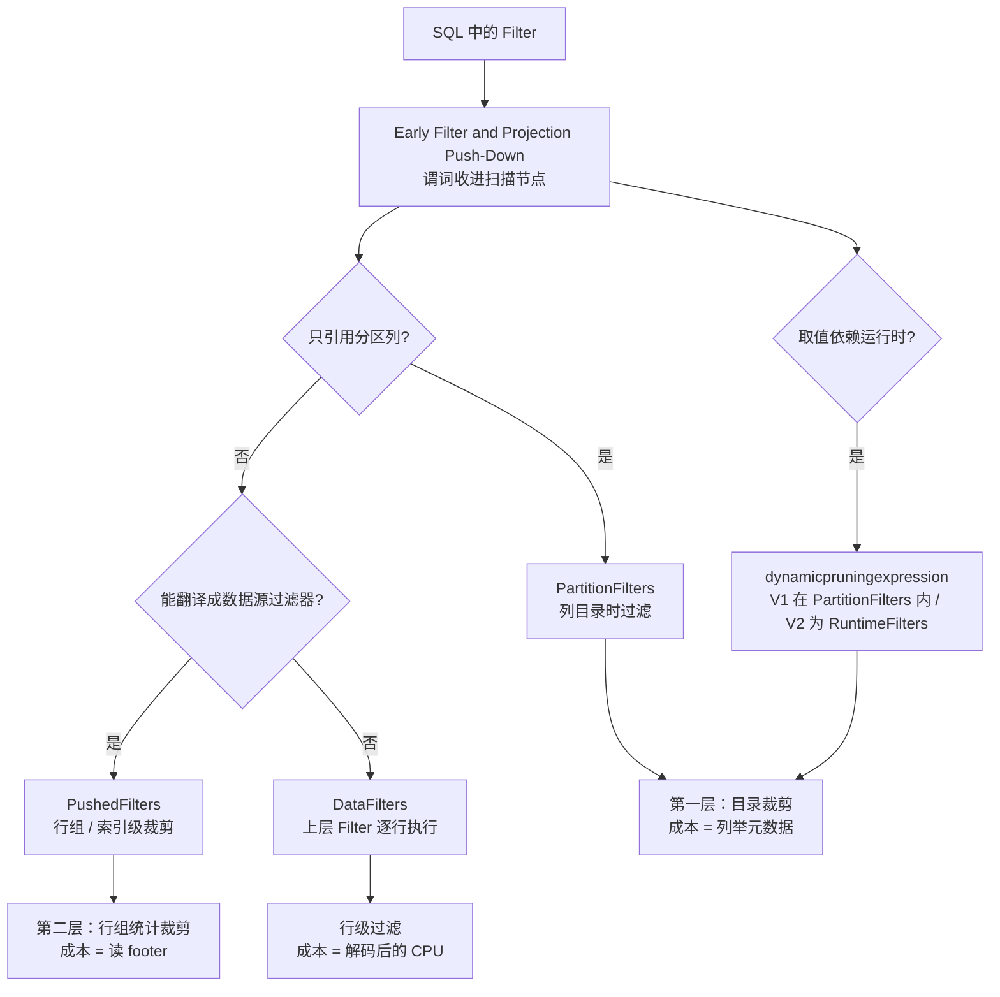
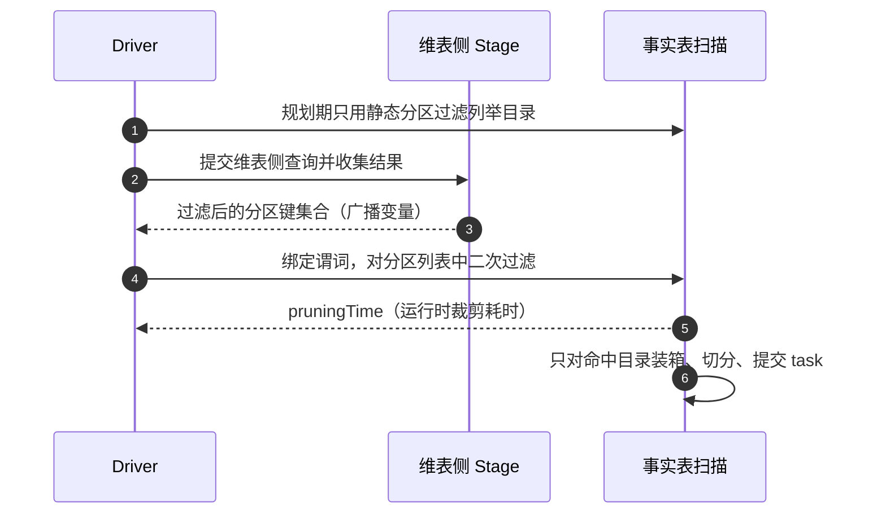
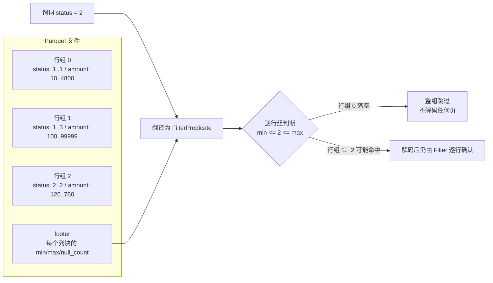
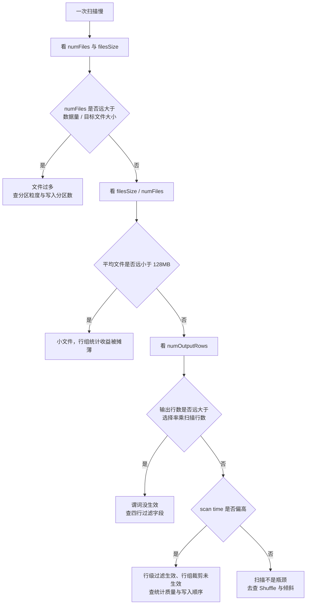
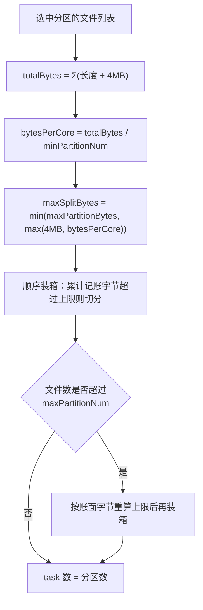
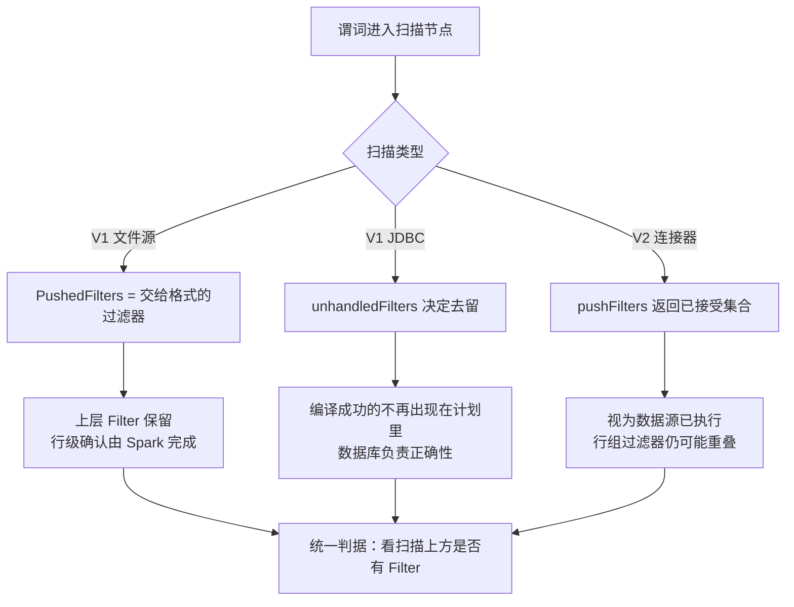

# 09 数据源与 IO 优化：让数据少读、快读、不重读

**摘要：**

计算层的优化有一个前提：数据已经被搬进内存了。真实的分析查询里，最先耗尽预算的往往不是 CPU，而是"把不该读的字节读进来"这件事——分区目录列了不该列的、行组读解码了不可能命中的、列读了解码后立刻丢弃的，以及同一份文件在一次作业里被打开了好几遍。本文把这条链路拆成三个可验证的粒度：目录级的**分区裁剪**、文件内部的**行组与条带统计裁剪**、以及正交于二者的**列裁剪与嵌套字段裁剪**，逐个说明它们依赖哪份元数据、在什么条件下失效、失效之后代价落在谁身上。诊断口径统一收在 `FileSourceScanExec` 这个节点上：`PartitionFilters`、`PushedFilters`、`DataFilters`、`RuntimeFilters` 四行描述了一个谓词的四条去向，`numFiles`、`filesSize`、`numPartitions`、`numOutputRows`、`scan time` 五个指标描述了一次扫描究竟碰了多少东西。随后处理两个常被当成"调参问题"的工程问题：文件数如何决定 task 数（`maxPartitionBytes` 与 `openCostInBytes` 的记账模型），以及"不重读"的两副面孔——缓存带来的收益、静默跳过缺失文件带来的数据风险。本文要回答的是：怎样用计划里的几行文字判断一次扫描到底读少了没有，以及在读不少的时候，该先动哪一层。

---

## 第 1 章 三层裁剪与"读得少"的判据

### 1.1 一次扫描的字节账

一次文件扫描读多少字节，由四件事相乘决定：命中多少个分区目录、每个目录里有多少文件、每个文件里有多少行组被真正解码、解码出来的行里有多少列被真正用到。前两项在驱动端就定了，第三项在打开文件的读取器时定，第四项在生成物理计划时就定了。四者之中任何一项失控，后面的计算优化都只是在为无效字节做善后。

以一张订单宽表 `orders` 为例：150 列打宽后的订单事实，按 `dt` 天分区、`region` 二级分区，一年约 10TB，Parquet 加 Snappy，单分区文件数在几十到几百之间。围绕它有三类查询，后面的讨论都拿它们做对照。

- **Q1 按天聚合**：`where dt = '2024-03-15' and status = 2`，只用到 5 列，输出几十行。
- **Q2 点查对账**：`where order_id = '...'`，整行 150 列，输出一行。
- **Q3 维表关联**：`orders join dim_province` 后按省聚合，过滤条件来自维表与时间范围。

Q1 的理想读法是：只列出一个 `dt` 目录、只打开该目录下的文件、只解码 `status`、`amount`、`province_id`、`order_id`、`dt` 这几列的页、并且只保留 `status = 2` 的行。这四步分别对应分区裁剪、文件装箱、行组统计裁剪、列裁剪。它们的成本量级完全不同：分区裁剪的判断成本是"列目录"，行组裁剪是"读一次文件 footer"，列裁剪是"少解码几个列块"，而任何一步失守，代价都是实打实的字节数与解码时间。

### 1.2 一个谓词的三条去向

`where` 里的条件在 Catalyst 里只是一个 `Filter` 节点。经过 `Early Filter and Projection Push-Down` 批次之后，它会被塞进扫描节点，此后它有且只有三条去向。

第一条是**变成目录过滤**。如果谓词只引用分区列，它有机会在列举分区目录时被求值，命中的目录之外的路径根本不会被打开，物理计划里体现为 `PartitionFilters`。第二条是**交给数据源**。谓词被翻译成数据源自己的过滤器（Parquet 的 `FilterPredicate`、JDBC 的 `WHERE` 片段），数据源在文件内部用它做粗粒度裁剪，物理计划里体现为 `PushedFilters`。第三条是**留给 Spark 自己**。翻译不成功的部分原样留在扫描节点上，由上层算子逐行执行，体现为 `DataFilters`，以及计划里那个仍然存在的 `Filter` 节点。

还有第四条不那么显眼：**推迟到运行时**。动态分区裁剪（Dynamic Partition Pruning，DPP）生成的过滤条件，其取值要等另一侧的广播结果算完才知道，它在 V1 文件扫描里表现为 `PartitionFilters` 中的一个 `dynamicpruningexpression(...)`，在 V2 扫描节点上单独成行，叫 `RuntimeFilters`。

这四行合起来，就是一次扫描的"谓词账本"。读它的意义在于：一个谓词写在 `where` 里，不代表它真的减少了读取；它落在哪一行，才决定它省的是字节、是解码，还是什么都没省。



### 1.3 三层为什么停在这三个粒度

值得追问一句：为什么裁剪的粒度恰好是目录、行组、列，而不是更细的行？答案藏在元数据的成本里。

分区把值域编码进了路径。路径本身是可枚举的、不需要打开文件就能判断的字符串，于是"这一批数据要不要读"这个问题，在读取任何字节之前就有答案，判断成本是一次目录列举。这是最便宜的一层，也是收益最陡的一层，因为它淘汰的单位是整个目录。

文件格式把值域编码进了 footer 里的统计。判断成本从"列举目录"涨到"读一次 footer"（几 KB 到几 MB，取决于列数与行组数），换来的是文件内部的粒度：一个行组（Row Group，Parquet 的默认 128MB 数据块）内某列的 min/max，能让整个行组连解码都省掉。再往下是页（Page），它需要额外的页索引结构（Column Index 与 Offset Index）以及读取器侧的支持，判断成本继续上升，而 Spark 这条读取链路的默认裁剪粒度就停在行组，页级裁剪在本篇的诊断口径里没有位置——`EXPLAIN` 不会显示它，它只能通过字节数与 `scan time` 间接观察。

还有一层不在文件格式里：**表格式的文件级统计**。Parquet 的 footer 只有行组级摘要，没有"整个文件某列的 min/max"。真正的文件级统计来自 Iceberg 的 manifest 与 Delta 的 `_delta_log`，它们把每个数据文件的列下界与上界写在元数据文件里，于是"这个文件一定不命中"可以在打开 footer 之前就判掉。这也是为什么同样的谓词在 Iceberg 表上常常比裸 Parquet 目录少读一截：多出来的那一层元数据，买到了"不打开文件就排除文件"的能力。

### 1.4 贯穿案例：订单宽表的三类查询

把三类查询放在三层裁剪下过一遍，失衡之处就显形了。

Q1 是三层都该命中的理想形态：`dt = '2024-03-15'` 是常量分区谓词，静态裁剪直接命中一个目录；`status = 2` 是整型列上的等值谓词，可以翻译成 Parquet 过滤器，用行组统计裁掉大部分行组；`select` 只取 5 列，列裁剪让其余 145 个列块完全不进解码器。

Q2 是三层里有两层注定无效的形态：`order_id` 是高基数列上的点查，行组统计对它无能为力（每个行组的 min/max 都跨越大半个值域），除非写入端为这一列建了布隆过滤器（Bloom Filter）或按它排序，否则整表所有行组都得读。它只取一行，却要读 150 列，列裁剪在这里反而是最疼的一笔——点查要整行，列就省不掉。

Q3 是谓词来自另一张表的形态：过滤条件 `dim_province.region = 'east'` 不写在事实表的 `where` 里，静态裁剪拿不到常量，只能靠 DPP 在运行时把维表的结果翻译成分区过滤；如果维表太大、广播不出去，DPP 不会触发，事实表就回到"全分区扫描 + join 后过滤"的原始形态。

同一张表、同样的三层机制，三类查询的收益差了两三个数量级。这说明"IO 优化"不是一个开关，而是三个各自有前提的机制，前提不满足时机制静默失效——计划不报错、任务不失败、结果也正确，只是慢。

### 1.5 判据先立：四个数

判断一次扫描"读得少没少"，不能看总耗时：耗时被排队、Shuffle、GC、倾斜污染，任何一项都能让一个读得很省的查询显得很慢。可靠的判断落在四个数上。

第一，**计划里读的列集合**，也就是 `ReadSchema`。它列出的是真正从文件解出来的列，`select *` 与 `select a, b` 在这里的差别一目了然。

第二，**列出的文件数**，也就是 `numFiles`。把它与"总数据量除以目标文件大小"对照，能立刻分辨"文件太大"（分区数少、并行度不够）与"文件太小"（分区过细或写入分区数过多）两种相反的毛病。

第三，**输出的行数与输入字节的比值**。`numOutputRows` 乘以估算行宽再除以 `filesSize`，得到的是有效读取率。这个数远小于 1，说明读进来的大部分字节被丢掉了——问题可能出在行组统计没生效，也可能出在谓词被写成了函数。

第四，**平均单文件大小**，`filesSize / numFiles`。它决定了行组统计裁剪有没有收益空间：文件只有几兆时，每个文件未必装满一个行组，读 footer 的成本与读数据的成本开始接近，统计裁剪的净收益被摊薄。

四个数都来自计划节点与 SQL 页签，不需要额外的工具。后面的章节逐一拆开这四层与其失效条件，最后再回到这张表上。

| 层 | 判断依据 | 判断成本 | 典型收益口径 | 决定性失效条件 |
|---|---|---|---|---|
| 目录裁剪 | 分区列谓词 + 常量 | 一次目录列举 | 跳过未命中分区的全部文件 | 谓词含函数、类型被隐式转换、谓词在聚合之后求值 |
| 行组 / 条带裁剪 | 列统计 min/max、空值计数 | 读一次文件 footer | 跳过整块行组或条带的解码 | 统计缺失、统计被追加写撑开、列不在可用统计里 |
| 列裁剪 | `ReadSchema`（叶子列） | 无额外成本 | 未选中的列块零 I/O | `SELECT *`、整个 struct 被传递、UDF 取整行 |
| 运行时裁剪（DPP） | 另一侧 join 结果 | 一次运行时列举 | 把 join 条件折成目录过滤 | 非等值连接、分区列被包裹、build 侧非广播 |

---

## 第 2 章 第一层：目录裁剪

### 2.1 裁剪发生在列目录的时候

分区裁剪的执行位置在优化器的 `PruneFileSourcePartitions` 规则里。它匹配"`Filter` 套在 `HadoopFsRelation` 之上"的形态，把谓词分成两堆：只引用分区列的那部分成为分区过滤，其余的成为数据过滤。分堆的判据在源码里只有一行——`filter.references.subsetOf(partitionSet)`，也就是"这个谓词引用的列是否全部落在分区列集合内"。

分完之后，命中的分区过滤被交给 `CatalogFileIndex.filterPartitions`，后者调用目录客户端的 `listPartitionsByFilter` 只取匹配的分区，再构造一个只包含这些目录的 `InMemoryFileIndex`。整个过程中，未命中分区的文件一次都没有被 `listStatus` 过，这是"少读"在成本上最干净的一种形态：省掉的不是字节，是元数据操作。

要紧的是这一步发生在驱动端，而且是同步的。分区目录多的时候，列举本身就是瓶颈，`metadataTime` 这个指标（"metadata time"）计量的正是它。分区数量较大时，Spark 会并行列举分区（阈值由 `spark.sql.sources.parallelPartitionDiscovery.threshold` 控制，默认 32，并行度上限 `spark.sql.sources.parallelPartitionDiscovery.parallelism` 默认 10000），但并行只摊薄墙钟时间，不减少元数据调用的总量。

### 2.2 静态裁剪的四个失效面

其一，**谓词被函数包裹**。这里要拆开讲，因为很多"分区列上不能有函数"的说法把两件事混成了一件。

判据是"引用集合是否为分区列的子集"，`to_date(dt) = date'2024-03-15'` 只引用 `dt`，所以它能成为分区过滤，架构上会被下推到文件索引。但下推之后还要看由谁来求值：如果表走的是元数据侧裁剪（把过滤条件拼成 metastore 的过滤串，或者交给表格式连接器），函数调用无法转换，框架会退化成"列举全部分区，再在驱动端逐分区求值"。这时裁剪结果依然正确，省掉的只是文件读取，代价是分区目录被完整列举了一遍。

所以函数包裹的真实代价不是"没裁"，而是"裁剪的战场从元数据侧退回了驱动端，列举成本照付"。分区目录几十个时无所谓，分区目录几万个时，这一步能吃掉分钟级的时间。

其二，**类型被隐式转换**。`where dt = 20240115` 而 `dt` 是字符串分区列时，分析器会把字符串列提升成数值再比较，表达式变成 `cast(dt as double) = 20240115.0`。这一改，谓词引用的仍然是分区列，但形态已经不可能被任何元数据侧过滤器接受，退化为驱动端逐分区求值。与之相对，`where dt = '20240115'` 是原样的字符串等值，能被直接下推。

其三，**日期与时间戳的语义错位**。分区目录里的值是字符串，它的语义是"写入端认为的日期"。把它与 `date'2024-03-15'` 或 `timestamp'2024-03-15 00:00:00'` 比较时，Spark 会按会话时区做一次类型转换，`spark.sql.session.timeZone` 一旦变化，同一个字面量对应的内部表示就变了。跨时区边界的分区（例如写入端按 UTC 切日、查询端按东八区解析）会出现固定的差一天，症状是"某些日期的数据总是少一截"，而不是整体查不出来。

其四，**谓词出现在聚合之后**。把分区条件写进 `HAVING` 是最容易被忽略的一种错位。`HAVING` 里的谓词只有在只引用分组表达式时才能被下推到聚合之前；一旦引用聚合函数或非分组列，它就留在聚合之上，而聚合之上早已没有分区裁剪的机会。此时分区过滤完全缺席，代价是全分区扫描。这也是为什么同一段查询，把条件从 `HAVING` 挪到 `WHERE` 之后，`numFiles` 能从四位数字降到两位。

### 2.3 动态分区裁剪的机制

静态裁剪需要常量，而星型模型查询的过滤条件通常在维表上。DPP 要解决的正是这件事：把维表侧的过滤结果，转换成事实表侧的目录过滤。

机制分两段。逻辑阶段，`PartitionPruning` 规则在事实表分区列与维表对应列的等值连接上，插入一个 `DynamicPruningExpression`，内部包着一个对该连接的 `InSubquery`；物理阶段，事实表的扫描节点把这个表达式与其他分区过滤分开处理，先按静态部分列举一次分区，等广播变量就绪后，再用绑定后的谓词对分区列表做二次过滤，只留下命中的目录。



图里有两个容易被忽略的细节。一是事实表在规划期已经列举过一次分区，DPP 省掉的是"文件级装箱与读取"，不是"目录列举"，所以分区数极多时 DPP 的收益要打折。二是运行时裁剪在驱动端完成，`pruningTime` 指标（"dynamic partition pruning time"）计量它；如果这个数很大，说明分区列表本身太大，DPP 的触发条件虽然满足，但过滤成本已经开始抵消收益。

### 2.4 运行时过滤器的实现细节与代价

源码里，事实表扫描节点把 `partitionFilters` 按"是否含子查询"分成静态与动态两堆，动态那堆在广播结果就绪后用 `Predicate.create` 绑定到分区列的下标上，再对已列举的分区数组做一次 `filter` 求值。也就是说，DPP 本质上是**驱动端的数组过滤**，它不需要执行器参与，也不产生额外的 Shuffle。

这套实现带来三个可观测的后果。第一，`numFiles` 与 `filesSize` 的取值是二次过滤之后的，而 `staticFilesNum`、`staticFilesSize` 两个指标保留过滤前的快照，两者相减就是 DPP 省下的文件数与字节数——这是量化 DPP 收益最直接的证据，比比较总耗时可靠得多。第二，分区表才会创建 `numPartitions` 与 `pruningTime` 两个指标（源码里它们挂在 `partitionSchema.nonEmpty` 的分支下），非分区表的 DPP 无从谈起，计划里也不会出现 `dynamicpruningexpression`。第三，DPP 的默认行为要求 build 侧走广播（`spark.sql.optimizer.dynamicPartitionPruning.reuseBroadcastOnly` 默认 `true`），因为只有广播变量是每个执行器都能廉价拿到的；把维表改成 shuffle join 之后，DPP 会静默消失，计划里那一行还在，但取值逻辑已经变了。

DPP 的失效条件可以直接列成一张表，诊断时逐条对照。

| 写法 / 环境 | DPP 是否触发 | 原因 |
|---|---|---|
| `join on e.dt = d.date_id`，`d` 有过滤 | 触发 | 分区列与另一侧列等值，build 侧可广播 |
| `join on to_date(e.dt) = d.date_id` | 不触发 | 分区列被函数包裹，等值的一端不是分区列本身 |
| `join on e.dt = cast(d.date_id as string)` | 视情况 | 等价类型仍可能匹配，但类型不同域时规则匹配失败 |
| `left join` 且维表在保留侧 | 不触发 | 外连接的保留侧不能用来裁剪探测侧 |
| 分区列谓词写成范围 `e.dt between d.start and d.end` | 不触发 | 只支持等值，范围需要另一套区间裁剪逻辑 |
| 维表超过 `autoBroadcastJoinThreshold` | 不触发 | build 侧退化为 shuffle，运行时过滤器失去载体 |
| `spark.sql.optimizer.dynamicPartitionPruning.enabled=false` | 不触发 | 规则整体关闭 |

### 2.5 分区键的设计

分区键的收益来自"过滤频率乘选择性"，而不是"基数越高越好"。目录数量是各级分区不同值个数的乘积，列举成本随它线性上升；目录过碎又会把小文件问题引进来——每个目录里只有几个文件时，一个 task 处理的行数很少，调度与打开文件的固定开销开始占主导。

按 `dt` 加 `region` 的二级分区是个常见折中：日期负责范围裁剪（`between` 与 `in` 都能落在第一级），`region` 负责点过滤。反过来，把 `region` 放在第一级、`dt` 放在第二级，两级目录数一样，但按时间范围查询时要列举所有 `region` 下的一天，路径拼接与列举次数都翻倍。

高基数列不适合做分区键，这一点在 `userId` 上体现得最充分：一千万用户就是千万级目录，元数据成本压垮 NameNode 的同时，列举分区的时间也会压垮驱动端。这类列的正确位置是排序键、布隆过滤器或分桶，而不是目录结构。

---

## 第 3 章 第二层：文件内部统计裁剪

### 3.1 footer 里的行组统计

Parquet 文件的物理结构是"数据在前、元数据在后"：文件开头是 `PAR1` 魔数，中间是若干行组的数据，末尾是 footer，里面记录每个行组、每个列块（Column Chunk）的统计信息——该列在该行组内的最小值、最大值、空值计数，以及可选的去重计数。

读这份统计的成本是一次 footer 读取，Spark 在打开 Parquet 读取器时会显式带上行组信息（`ParquetFooterReader.WITH_ROW_GROUPS`），把它一次读全，避免为了裁剪而二次打开文件。统计到手之后，判断是纯内存操作：谓词被翻译成 parquet-mr 的 `FilterPredicate`，逐个行组套用，落空的行组连页都不解码。



图里最后一步是要害：行组统计裁剪给出的是"可能命中"，不是"一定命中"。行组 2 的 min/max 全是 2，才有可能整组保留；行组 1 的范围跨过 2，就必须解码再逐行判断。统计裁掉的永远是"不可能命中"的部分，剩下的部分仍要付解码与行过滤的成本。这也解释了为什么 `PushedFilters` 非空的查询，计划里往往还能看到一个 `Filter` 节点。

### 3.2 谓词翻译与它的粒度

`ParquetFilters` 负责把 Catalyst 表达式翻译成 parquet-mr 的过滤器。翻译是逐类型的：整型与长整型的边界、浮点的精度、`Decimal` 的精度与标度、字符串的二进制比较、日期与时间戳的时区基准，任何一处不同域都会让翻译返回空，谓词原样退回 `DataFilters`。

字符串列的翻译有一个容易踩的坑：Parquet 的比较是基于 UTF-8 字节序的，而 Spark 的字符串比较依赖排序规则（collation）。两者在纯 ASCII 上一致，在非 ASCII 字符上不保证一致，于是大小写敏感配置与排序规则不一致时，翻译会被主动放弃——这是正确性优先于性能的取舍。

翻译成功之后，收益的粒度由格式决定。Spark 源码里在设置过滤器的地方留了一句注释："Notice: This push-down is RowGroups level, not individual records."。这句话是第二层的全部真相：`spark.sql.parquet.filterPushdown`（默认 `true`）买到的是行组级裁剪，不是行级过滤。

行级下推是另一个开关，`spark.sql.parquet.recordLevelFilter.enabled`（默认 `false`），而且它只在**非向量化**读取路径上生效——源码里的条件是"过滤器存在且开了记录级过滤，才把 `FilterPredicate` 交给 `ParquetRecordReader`"。默认的向量化路径下，行级确认由扫描节点上方的 `FilterExec` 完成。所以"打开了 filterPushdown，为什么还有 Filter 节点"这个问题，答案是两者本来就在管不同的粒度。

### 3.3 统计失效的六种形态

行组裁剪的收益完全依附于统计质量。统计出问题，裁剪就从"少读很多"退化为"多读了一次 footer"。

| 失效形态 | 现场表现 | 机制 |
|---|---|---|
| footer 里没有该列统计 | `PushedFilters` 有值但一个行组都没被裁 | 老文件、异构写入器、部分类型默认不写统计 |
| 统计被追加写撑开 | min/max 覆盖全值域，裁剪率趋近 0 | 无排序的持续追加，每个行组的区间都变宽 |
| 字符串统计被截断 | 前缀相同的值无法区分，等值以外的谓词失效 | 写入端对超长 binary 截断，上下界失去分辨率 |
| 类型不同域 | 谓词根本没进 `PushedFilters` | 翻译阶段返回空，退回行级过滤 |
| 谓词落在统计覆盖不到的列 | 总是返回"可能命中" | 统计只有 min/max/null_count，没有倒排索引 |
| 行组太大或太小 | 裁不掉（大）或 footer 成本占比高（小） | 粒度与统计分辨率、IO 单元三者互相牵制 |

第二行值得展开。行组统计的有效性依赖于"同一行组内的值域较窄"，而这一点完全由写入顺序决定。数据按 `dt` 顺序写入、查询也按 `dt` 过滤，每个行组的 `dt` 区间就是窄的；但查询若改成按 `order_id` 过滤，而文件是按时间写的，那么每个行组的 `order_id` 区间都横跨全表，min/max 等同于没有。这就是"统计存在但无用"的典型：`PushedFilters` 里能看到谓词，`numFiles` 也没变，唯独 `filesSize` 与 `numOutputRows` 的比值几乎不动。

第六行是写入端的取舍。行组默认 128MB，行组越大，统计的分辨率越粗，能跳过的比例越小；行组越小，footer 越大、行组数量越多，裁剪判断的绝对次数上升，且小行组本身对压缩率不友好。这是一组没有最优解的参数，只能按查询形态选。

### 3.4 Date 与 Timestamp 的时区陷阱

日期与时间戳是统计裁剪里最容易出错的类型，原因是这三者不在同一个语义层面：分区目录里的日期是字符串，语义由写入端赋予；Parquet 的 `DATE` 类型是自纪元起的天数，没有时区；`TIMESTAMP` 是自纪元起的微秒数（或旧格式的 `INT96`），语义是绝对时间点。

Spark 默认写的 `TIMESTAMP` 类型由 `spark.sql.parquet.outputTimestampType` 控制，取值是 `INT96`（为兼容 Hive 生态），而 `INT96` 没有时区语义。读取端要靠 `spark.sql.parquet.int96TimestampConversion` 与 rebase 模式去解释它，解释方式取决于文件由谁写入——源码里对每个文件都会检查 `created_by` 是不是 parquet-mr，只有不是的时候才应用时区转换。这就意味着同一张表里不同时期、不同写入器产生的文件，时间戳的解释基准可能不同。

对裁剪的影响是直接的：谓词里的时间戳常量要按 `spark.sql.session.timeZone` 换算成微秒，才会与统计里的微秒比较；会话时区变了，常量变了，统计没变，裁剪结果就变了。这类问题的症状很隐蔽——查询在某个时区下少算几个小时的数据，却从不报错。

日期与分区列的组合更危险。分区目录 `dt=2024-03-15` 表达的是"本地日期"，而 `timestamp` 类型的常量表达的是"时间点"，两者跨越时区比较时，边界日的行可能被错误地排除。要避免这一类问题，最省事的做法是让分区列始终以字符串参与比较（`dt = '2024-03-15'`），不要让分析器为它插入类型转换；表内的时间戳列则统一写入基准（写入端与会话时区一致），并把 rebase 模式显式配置清楚，不要在依赖默认值的前提下做跨时区迁移。

### 3.5 ORC 的条带与布隆过滤

ORC 的组织方式与 Parquet 同构而不同名：文件被切成条带（Stripe，默认 64MB），每个条带内部再按列组织成流（Stream），文件末尾是 file footer，记录所有条带的统计信息。条带级统计与 Parquet 的行组统计作用相同，区别有二。

一是统计的位置。ORC 的条带统计在 file footer 里就能读全，跳过条带不需要打开条带自身的 footer；Parquet 的行组统计同理，但页级索引与页头里的统计需要额外的定位信息。二是 ORC 原生支持布隆过滤器，写入时按列配置（`orc.bloom.filter.columns`），读取时可以在条带级别排除"一定有/一定没有"某个值的条带。布隆过滤器对高基数等值谓词有效（譬如 Q2 的 `order_id = '...'`），对范围谓词无效——它的语义只有"集合成员判断"，没有序。

Spark 侧的开关与 Parquet 对齐：`spark.sql.orc.filterPushdown`（默认 `true`）。需要注意的是，布隆过滤器必须在写入时显式开启，事后补建意味着整表重写，成本远高于一次查询的收益。

### 3.6 页级裁剪为何看不见

Parquet 2.0 引入的页索引（Page Index）把统计粒度推到了页一级：每列每页的 min/max 记录在 Column Index 里，页的偏移记录在 Offset Index 里。理论上，一个行组内如果只有极少数页可能命中，读取器可以只定位到那几页。

但这条能力在 Spark 的默认读取链路上不是诊断口径的一部分：`EXPLAIN` 里没有任何字段描述页级裁剪，`PushedFilters` 只能说明"谓词被交给了 Parquet"，无法说明命中了几页。要确认页级裁剪是否真的发生，只能看两个间接证据：一是 `filesSize` 与实际读取字节的差值（需要操作系统层面的 IO 计数或文件系统的读字节指标），二是 `scan time` 与 `numOutputRows` 的比值是否显著低于同类查询。

这也是笔者把"三层"而非"四层"作为诊断骨架的原因：能被 EXPLAIN 看到的只有三层，页级裁剪属于"确认收益"而非"确认机制"的范畴。机制上它存在，工程上它不该成为排障的第一站。

---

## 第 4 章 FileSourceScanExec 的四行与五个指标

### 4.1 四行分别是什么

`FileSourceScanExec` 是 DataSource V1 的文件扫描节点（它在物理计划里被哪条策略选中，机制见 [[大数据/Spark/Spark-SQL深度解析与性能调优/05 Physical Planning：从逻辑计划到物理算子的策略选择|物理规划]]），它的计划文本里除了 `Format`、`ReadSchema`、`Batched`、`Location` 之外，还有三行描述谓词去向；V2 的 `BatchScan` 节点则用 `RuntimeFilters` 承接动态过滤。四行合起来构成完整的谓词账本。

| 字段 | 归属节点 | 含义 | 为空的含义 |
|---|---|---|---|
| `PartitionFilters` | V1 文件扫描 | 用于列举目录的过滤条件（含 DPP 的动态表达式） | 表未分区，或谓词一条都没落到分区列 |
| `PushedFilters` | V1 与 V2 | 已翻译、交给数据源内部使用的过滤器 | 没有任何谓词被数据源接受 |
| `DataFilters` | V1 文件扫描 | 扫描节点上声明的数据侧过滤条件全集 | 没有数据列上的谓词 |
| `RuntimeFilters` | V2 扫描节点 | 运行时才能求值的过滤器（DPP 的 `dynamicpruningexpression`） | 没有触发运行时裁剪 |

需要更正一个常见说法：这四行并不是在所有扫描节点上同时出现的。`spark.sql.sources.useV1SourceList` 默认包含 `parquet,orc,avro,json,csv`，所以这些格式默认走 V1，计划里是 `FileScan`，字段是前三行；把某个格式移出该列表后走 V2 `BatchScan`，动态裁剪才以 `RuntimeFilters` 的形式单独成行。在 V1 上，DPP 表现为 `PartitionFilters` 里的一个 `dynamicpruningexpression(...)`，肉眼可见但容易漏读。

### 4.2 四行的组合判据

单看一行意义有限，组合起来才能定位问题。

| 组合 | 判据 | 下一步动作 |
|---|---|---|
| `PartitionFilters` 为空且表有分区 | 分区裁剪完全没生效 | 检查谓词是否引用分区列、是否含函数、是否在 `HAVING` 里 |
| `PartitionFilters` 有值，`numFiles` 仍很大 | 裁剪生效但分区设计过粗 | 看分区键的选择性，或引入 DPP |
| `PushedFilters` 为空，`DataFilters` 非空 | 一条谓词都没翻译成功 | 检查函数包裹、类型不同域、谓词形态（`LIKE` 中缀等） |
| `PushedFilters` 与 `DataFilters` 内容接近 | 谓词全部交给了数据源 | 再确认行组是否真有统计，看 `filesSize` 是否下降 |
| 扫描节点上方仍有 `Filter` | 行级过滤仍在 Spark 侧 | 正常，行组裁剪从不保证行级精确 |
| `RuntimeFilters` 为空但有 join 分区列 | DPP 未触发 | 逐条对照 DPP 的失效条件 |

第一行与第三行是最常见的两种"静默失效"：计划不报错，结果正确，只是多读了数据。它们与"查询写得对不对"无关，只与谓词形态有关。

### 4.3 指标与它们的口径

扫描节点的指标分成驱动端与执行器侧两批，口径不同，不能混着读。

| 指标（显示名） | 侧 | 含义 | 读数注意 |
|---|---|---|---|
| `numFiles`（number of files read） | 驱动端 | 选中分区的文件总数 | DPP 场景下是二次过滤后的数量 |
| `filesSize`（size of files read） | 驱动端 | 选中文件的总长度 | 是文件长度之和，不是实际读取字节 |
| `numPartitions`（number of partitions read） | 驱动端 | 选中的分区目录数 | 仅在分区表上创建，非分区表没有这个指标 |
| `staticFilesNum` / `staticFilesSize` | 驱动端 | DPP 二次过滤前的文件数与字节数 | 与 `numFiles` 相减即为 DPP 的收益 |
| `metadataTime`（metadata time） | 驱动端 | 列举目录与文件的耗时 | 分区极多时它是瓶颈本身 |
| `pruningTime`（dynamic partition pruning time） | 驱动端 | 运行时分区过滤耗时 | 仅分区表存在 |
| `numOutputRows`（number of output rows） | 执行器 | 扫描输出的行数 | 用于反推选择率 |
| `scanTime`（scan time） | 执行器 | 扫描读取器的累计耗时 | 只在列式读取（`supportsColumnar`）时创建 |

最后一行需要特别说明：`scanTime` 是在 `supportsColumnar` 为真时才挂上去的，源码注释给出的理由是按批计时才有可接受的开销，逐行计时负担不起。所以非向量化读取的扫描节点上根本没有 `scan time` 这个指标，这个缺席要读成"这条路径没有计时"，而不是"这条路径不花时间"。

> [!info] 关键判断
> 一次扫描的耗时由两段构成：驱动端的元数据时间（`metadataTime`、`pruningTime`）与执行器的读取时间（`scan time`、`numOutputRows`）。两段的瓶颈处置方向相反——前者大要动分区与文件数，后者大要动统计、列与格式；认错一段，调参就会朝反方向走。

另外，业界常说的"扫描数据量"在计划里没有名为 `dataSize` 的独立指标，与之对应的是 `filesSize`。两者口径的差别很关键：`filesSize` 是文件长度之和，压不压缩、读不读都是这个数；真正被读取的字节可能远小于它（行组裁剪生效、页级裁剪生效），也可能略大于它（footer 会被读两遍的旧路径）。想要"实际读了多少字节"，得靠文件系统的读计数，计划里给不出来。

### 4.4 三个比值与一棵诊断树

把指标两两相除，比绝对值更有信息量。

第一个比值是 `filesSize / numFiles`，平均文件大小。它低于一百兆时，行组统计裁剪的净收益开始可疑：footer 的读取成本相对数据本身变重，而小文件往往还伴随行组数量不足的问题。

第二个比值是 `numPartitions / numFiles`。大于 1 说明一个分区里装了多个文件（小文件被装箱合并），小于 1 说明单个大文件被切成了多个 task。这两个方向的异常对应完全相反的处置：前者要合文件，后者要加大 `maxPartitionBytes` 或减少 `openCostInBytes` 的记账影响。

第三个比值是 `numOutputRows` 与输入字节的关系。以 Q1 为例，若一个 `dt` 分区有 200 个文件、共 20GB、约 5 亿行，而 `status = 2` 只占 3%，那么理想输出是 1500 万行；如果 `numOutputRows` 显示 5 亿，说明谓词一条都没生效（连行级过滤都算上，`status` 条件的过滤结果会体现在输出行数里，所以这个数是"谓词是否真的作用到行"的最终证据）。若 `numOutputRows` 对了但 `scanTime` 很高，说明行级过滤生效、行组裁剪没生效——读了很多再丢掉。



这棵树的价值不在于穷尽所有情况，而在于把"慢"这个笼统的症状，逼到"读多了哪一部分"这个可验证的命题上。走完一遍，至少能确定该动分区、动文件、动谓词，还是该承认扫描没有问题。

---

## 第 5 章 列裁剪与嵌套结构

### 5.1 SELECT * 的四笔账

`SELECT *` 的代价常被简化成"I/O 变多"，实际上它同时抬高四笔成本，而且只有第一笔是 I/O。

第一笔是列块 I/O。列式格式里每列独立压缩、独立成块，读 150 列就是读 150 个列块。Q1 只需要 5 列，理论上的 I/O 削减是 (150-5)/150，约 97%（示例推算，未计入压缩率与行组统计的差异）。

第二笔是解码。列块进来之后要解压、要按编码方式展开（字典、RLE、位打包），每一列都要走一遍。解码是 CPU 密集的，宽表上它经常比 I/O 更早成为瓶颈。

第三笔是行组装。150 列组装成一个 `UnsafeRow` 的内存脚印接近 1.3KB（量级判断，按定长列为主估算），后续算子每处理一行都要搬运这段字节，缓存行利用率随之下降。

第四笔是下游放大。多余的列如果进入 Shuffle，会直接放大网络与磁盘；如果进入聚合，会放大哈希表；如果进入缓存，会放大内存占用。这一笔最容易被忽略，因为它不体现在扫描节点上。

`SELECT *` 还有一笔隐性成本：它让嵌套字段裁剪彻底失效。第 5.3 节会展开，这里只需记住结论——整行读取的代价不只是多读列，还包括放弃了"只读 struct 的一个子字段"这种更细的裁剪。

### 5.2 列裁剪的落点

列裁剪在逻辑优化阶段由 `ColumnPruning` 一类规则完成，物理阶段的落点是扫描节点的 `requiredSchema`，在计划文本里显示为 `ReadSchema`。判据只有一条：`ReadSchema` 里出现的叶子列，就是会被解码的列；没出现的列，物理上不会被读。

这条判据比 `PushedFilters` 更硬，因为它是计划结构而不是运行时行为。看到 `ReadSchema: struct<order_id:string,amount:double,status:int,province_id:int,dt:string>` 而查询只用了这五列，就能确认列裁剪生效；看到 `ReadSchema` 里排着 150 个字段，无论 `PushedFilters` 写了什么，这次扫描的 I/O 下限已经定死了。

分区列在这件事上有个特殊性：分区列的值来自目录路径，不在文件里，所以它不会出现在 `ReadSchema` 里，却会出现在输出里。这也是为什么按分区列过滤的查询，即使 `ReadSchema` 只有一列数据列，计划仍然正确——分区值是在读取器外面拼接上去的。

### 5.3 嵌套字段的部分读取

`StructType` 在 Parquet 里不是"一个列"，而是若干个叶子列的组合，`user_info.name`、`user_info.age` 各自是独立的列块。于是"只读 struct 的一个子字段"在物理上是可行的：`SELECT user_info.name FROM t` 只需要读 `name` 这一个叶子。

让这件事自动发生的是两条规则。一条是逻辑层的嵌套字段裁剪（`spark.sql.optimizer.nestedSchemaPruning.enabled`，默认 `true`），它把对整个 struct 的引用改写成对子字段的引用，从而让下游的列裁剪能裁到叶子级；另一条是嵌套谓词下推（`spark.sql.optimizer.nestedPredicatePushdown.enabled`，默认 `true`，只对 `spark.sql.optimizer.nestedPredicatePushdown.supportedFileSources` 列出的格式生效，默认是 `parquet,orc`），它让 `where user_info.age > 30` 这样的谓词也能进 `PushedFilters`，用 `age` 叶子列的统计做行组裁剪。

这里要纠正一个流传较广的配置名：`spark.sql.parquet.nestedSchemaPruning.enabled` 并不存在。Parquet 侧的嵌套裁剪没有独立开关，起作用的是优化器层的 `spark.sql.optimizer.nestedSchemaPruning.enabled`。把不存在的配置写进生产参数表，症状是"改了没反应"，排查方向会被带偏。

### 5.4 嵌套裁剪失效的条件

失效的共同特征是"整个 struct 被当成一个值传递"，一旦传递，优化器就无法把它拆成子字段。

| 写法 | 后果 | 原因 |
|---|---|---|
| `SELECT user_info FROM t` | 读全部叶子列 | 输出本身要求完整 struct |
| `SELECT * FROM t` | 读全部叶子列 | 展开后的引用覆盖所有字段 |
| `SELECT to_json(user_info) FROM t` | 读全部叶子列 | 函数以整个 struct 为参数 |
| 自定义 UDF 接收整个 struct | 读全部叶子列 | 函数边界阻断了字段级改写 |
| `WHERE concat(user_info.name, user_info.age) = '...'` | 谓词无法下推 | 函数包裹，统计裁剪同时失效 |
| 数组、Map 内部字段的读取 | 视读取器而定 | 嵌套列向量化读取开关影响性能，不影响裁剪是否可能 |

第三、四行的机制值得补一句：嵌套裁剪依赖表达式的形状，一旦整个 struct 被外部函数或 UDF 消费，优化器只能保守地保留整列，这与 `SELECT *` 的后果相同，但更隐蔽——查询里明明只写了 `user_info.name` 相关的逻辑，`ReadSchema` 却显示了全部叶子。

行式与列式在这里还有一个交汇点：嵌套列的向量化读取由 `spark.sql.parquet.enableNestedColumnVectorizedReader`（默认 `true`）控制，它影响的是解码方式，不是裁剪范围。把它关掉可以作为排查正确性问题的兜底手段，但不会让 `ReadSchema` 变小——这两件事经常被混为一谈。

---

## 第 6 章 文件数量：task 数与记账成本

### 6.1 三条式子

文件数与 task 数的关系不是"一个文件一个 task"，而是一次装箱计算的结果。源码里三条式子决定了它。

第一条是单分区上限：

```text
maxSplitBytes = min(maxPartitionBytes, max(openCostInBytes, totalBytes / minPartitionNum))
```

其中 `totalBytes` 是选中文件"长度加记账成本"的总和，`minPartitionNum` 取 `spark.sql.files.minPartitionNum`，未设置时等于叶子节点的默认并行度（通常就是集群总核数）。第二条是记账口径：每个文件占用的不是它的长度，而是长度加 `openCostInBytes`（`spark.sql.files.openCostInBytes`，默认 4MB）。第三条是装箱规则：顺序扫描文件列表，累计记账字节超过上限就开下一个分区，单个文件本身超过上限时先被切成若干片。

三条式子合起来给出一个反直觉的结论：task 数是按**账面字节**算的，不是按实际字节算的。文件名录里的 `totalBytes` 被 `openCostInBytes` 整体抬高，小文件越多，抬高得越离谱。



### 6.2 两个示例推算

第一个例子是文件偏大的常态。一万个 10MB 文件，共约 100GB，默认 `maxPartitionBytes` 128MB、记账 4MB：每个文件的记账成本 14MB，一个分区能装 9 个，于是分区数约 1112，每个 task 实际读约 89MB、账面约 126MB。这里 `maxSplitBytes` 取的是 128MB（`bytesPerCore` 约等于 700MB，被 `maxPartitionBytes` 压住），所以装箱上限就是最直观的那个数（示例推算，未考虑文件在节点上的分布偏好）。

第二个例子是小文件失控。一百万个 1KB 文件，实际数据只有 1GB，但账面字节是 100 万 ×（1KB + 4MB），约 4001GB。按 128MB 上限装箱，每个分区装 32 个文件，分区数约 31250，每个 task 实际只读 32KB，却按 128MB 记账。真正读的数据可以忽略，task 的固定开销——调度、序列化、打开文件、读 footer、初始化读取器——却要付三万多次。这就是"忽略 `openCostInBytes` 会误判 task 数"的完整含义：如果不按账面口径算，1GB 数据看起来只需要 8 个 task，实际却是三万个。

### 6.3 metadata 开销的线性增长

文件数带来三类随数量线性增长的开销，它们都不在扫描节点的读取指标里。

第一类是列举。驱动端对每个命中的分区目录做一次 `listStatus`，文件数越多，返回的 `FileStatus` 越多，`metadataTime` 越长。分区数超过并行列举阈值（默认 32）后，列举本身会并行化，但并行只摊薄时间，不减少元数据总量。

第二类是 task 侧固定成本。每个分区对应一个 task，task 启动要反序列化广播变量、初始化读取器、打开文件、读 footer。footer 的大小与列数、行组数成正比，宽表上单个 footer 到几 MB 并不罕见。这些成本与文件里的行数无关，只与文件个数有关。

第三类是调度与失败重试。task 数上升会让 DAGScheduler 的队列更长、推测执行的判定更多、失败重试的影响面更大，`spark.sql.files.ignoreMissingFiles` 之类的开关也会在大量文件上放大差异。

### 6.4 参数与代价

| 配置项 | 默认值 | 作用 | 调大 / 调小的代价 |
|---|---|---|---|
| `spark.sql.files.maxPartitionBytes` | `128MB` | 单个分区装多少字节 | 调大：task 变少、单 task 内存与 GC 压力上升，OOM 与 spill 风险增加；调小：task 变多、固定开销占比上升 |
| `spark.sql.files.openCostInBytes` | `4MB` | 每个文件的记账成本 | 调大：小文件被更分散地装箱，task 更多但更均匀；调小：小文件被大量合并进同一 task，长尾更严重 |
| `spark.sql.files.minPartitionNum` | 未设置（取默认并行度） | 分区数下限的建议值 | 调大：`bytesPerCore` 变小，分区上限被压低，task 更多；调小：分区上限回到 `maxPartitionBytes`，task 更少 |
| `spark.sql.files.maxPartitionNum` | 未设置 | 分区数上限的建议值 | 设置后超过上限会按账面字节重算，避免小文件场景生成海量 task；代价是牺牲并行度 |
| `spark.sql.files.maxRecordsPerFile` | `0`（不限） | 单文件最大行数 | 调大：文件更大、更少；调小：直接制造小文件，只在控制单文件大小时用 |

这张表里最容易误用的是第一行与第二行。把 `maxPartitionBytes` 调小去"提高并行度"是常见的反模式：并行度本应由数据量与核数决定，硬压小上限只会把一个大 task 拆成若干小 task，每个都要重新打开文件、重新读 footer，而扫描的总字节一个没少。第四行则是被低估的正向开关：小文件场景下，与其反复调 `maxPartitionBytes`，不如直接给分区数设一个上限，让装箱按账面字节重算，把 task 数从几万压回几百。

### 6.5 小文件治理的顺序

治理的顺序应当是写入端优先、读取端次之、重写兜底。

写入端控制文件数的手段是显式的，`repartition` 决定输出文件数，`coalesce` 在不触发全量 Shuffle 的前提下减少分区，`maxRecordsPerFile` 限制单文件行数。流式写入要按批次大小与触发间隔估算文件数：一天 2880 个微批次，每批写 N 个文件，累积起来就是 2880N 个文件，这个乘积应该在设计阶段算清楚。

读取端的兜底是 AQE 的分区合并，它能减少读侧的 task 数，但一个输出文件都不会少——这是理解 AQE 边界的关键，细节可以看 [[大数据/Spark/Spark-SQL深度解析与性能调优/06 AQE：运行时自适应查询优化|AQE 一篇]]。

重写兜底（Compaction）能真正减少文件数，代价是写放大：读一遍、重写一遍，期间占用双份存储与集群资源。它适合历史分区，不适合仍在写入的热分区，时机要避开写入高峰。

---

## 第 7 章 不重读：缓存、失效与静默丢数

### 7.1 同一路径的第二次读

同一个 `SparkSession` 里对同一路径连续扫描两次，第二次的 `metadataTime` 通常远小于第一次。原因是一层进程内的文件状态缓存：目录列举的结果（`FileStatus` 列表）按路径缓存在驱动端，容量由 `spark.sql.hive.filesourcePartitionFileCacheSize` 控制，默认 250MB。

缓存省掉的是列举，不省读取。第二次扫描照样要打开文件、读 footer、解码数据，省下来的只是"知道有哪些文件"这一步。这个设计对反复扫描同一批数据的长驻服务（例如 Thrift Server）是必要的，但它带来一个必须警惕的性质：缓存不会感知外部对目录的改写。文件被删除、被重命名、被新批次追加，缓存里的列表仍然是旧的。

症状因此分成两类。一类是新文件读不到：上游刚写入的分区，查询端看不到，`numFiles` 与目录实际内容不一致。另一类是旧文件明明已被清理：缓存里列出的文件其实不存在，任务尝试打开时失败；如果同时开了"忽略缺失文件"，这次失败会被吞掉，结果是静默少算。

判断缓存是否是原因，有一个简单办法：同一查询换一个全新会话执行，若 `numFiles` 不同，问题就出在缓存。处置上，刷新表元数据或重建 DataFrame 都能让它失效，但在长驻服务里更稳妥的做法是不要依赖进程内缓存的一致性，而是在读取路径上显式带上分区过滤，让每次扫描的目录集合由谓词决定。

### 7.2 缓存把裁剪决策前移

`cache()` 与 `CACHE TABLE` 的收益常被简化成"少读一次磁盘"，但更准确的描述是：它把裁剪决策从"每次查询"前移到"物化那一刻"。

物化时的读取是完整的：`cache()` 一个整表 DataFrame，会把该表当时可见的全部分区与全部列读进来，谓词裁剪、列裁剪在那一刻按当次的查询形态定死。此后对这个缓存的每次查询，读的是内存里的列式批次（`CachedBatch`），扫描节点也从 `FileScan` 变成 `InMemoryTableScan`，`PartitionFilters` 与 `PushedFilters` 随之消失。顺带提一句 4.x 的口径变化：`cache()` 与 `CACHE TABLE` 的默认存储级别由 `spark.sql.defaultCacheStorageLevel` 控制，取值 `MEMORY_AND_DISK`，把它当成"固定就是某个存储级别"的常识去写容量规划，在升级后会失准。

这意味着两件事。其一，缓存之后的查询不再有文件级裁剪的收益，只有内存寻址的收益；如果缓存的数据量本身远大于查询需要的那一小片，收益会被物化成本吃掉。其二，缓存带过滤的 DataFrame 才是正确姿势：`df.filter("dt = '2024-03-15'").cache()` 只物化一天的数据，而 `df.cache()` 物化全表——两者的内存脚印与物化耗时可能差几百倍，查询结果却一样。

还有一处细节值得知道：缓存表并非完全没有裁剪，`InMemoryTableScanExec` 对分区列仍然支持分区裁剪（缓存时按分区构建的表可以在读回时按分区过滤）。所以"缓存之后谓词全废"的说法并不准确，准确的表述是：文件级与行组级的裁剪不再生效，分区级的裁剪在缓存表上仍可能保留。

### 7.3 ignoreMissingFiles 与 ignoreCorruptFiles

两个开关的默认值都是 `false`，这个默认值是对的。

`spark.sql.files.ignoreMissingFiles` 打开后，任务在列举与打开阶段遇到不存在的文件会跳过而不是失败；`spark.sql.files.ignoreCorruptFiles` 打开后，读到损坏的文件（截断、校验失败、编码异常）会跳过剩余部分而不是失败。两者的共同点是：它们把数据完整性问题转换成了**静默的结果偏差**。

这两个开关适合的场景很窄：数据生命周期由外部系统管理，文件消失等价于"该分区没有数据"，并且读侧有独立的对账手段（例如输出行数与上游产出的批次记录比对）。在没有对账的前提下打开它们，等价于把"任务失败"换成"报表少一行且无人知晓"，后者在生产上更难发现，也更难修复。

它们与文件状态缓存的组合是事故高发区：缓存列出了已经被清理的文件，`ignoreMissingFiles` 让打开失败变成静默跳过，两个机制各自都"合理"，叠在一起就成了一次无声的数据丢失。诊断这类问题要看的是任务级别的读取计数与预期的差异，而不是日志里的异常——因为后者根本不会出现。

> [!warning] 生产避坑
> 打开这两个开关之前，先回答一个问题：读侧有没有独立对账，能在结果少了一部分时发现？答不上来就不该打开——把失败换成偏差之后，没有任何告警会替你把关。

### 7.4 快照与幂等

"不重读"还有一层含义与缓存无关：同一次查询不应该读到两份不同时刻的数据。

分区表在扫描期间被改写时，不同 task 可能在不同时刻列举目录、打开文件，于是同一个查询里，早启动的 task 读到旧文件、晚启动的读新文件。结果是一份"混合快照"，既不等于改写前，也不等于改写后。规模越大、task 越多，这个窗口越宽。

避免它的办法有两个方向。其一是使用带快照语义的表格式（Iceberg、Delta），读取时绑定一个快照 id，文件即使被 Compaction 重写也不影响本次查询的可见性。其二是写入侧的做法：新数据先写到临时目录，写完再原子地切换分区目录，读侧永远只看到完整的旧目录或完整的新目录。前者依赖表格式，后者依赖写入规范，两者都比"读的时候小心一点"可靠。

---

## 第 8 章 谓词下推的数据源适配

### 8.1 Pushed 的三种承诺强度

`PushedFilters` 里出现一个谓词，含义随扫描类型而变，这是本节最需要说清的一件事。

**V1 文件源：提示。** 文件扫描节点把 `pushedDownFilters` 交给 `ParquetFileFormat` 之类的格式去构造过滤器，但计划里的 `Filter` 节点不会因此消失。源码里 `FileSourceScanExec` 只把过滤器传给读取器，自己并不执行数据过滤；行级确认始终由上层算子完成。所以"Pushed"在这里的含义是"数据源被允许用它做粗粒度裁剪"，而不是"数据源保证结果正确"。

**V1 JDBC：承诺。** JDBC 连接器实现了 `PrunedFilteredScan` 的 `unhandledFilters`，它会用方言逐条尝试编译谓词，编译不了的原样返回。返回的那些才会留在计划里，编译成功的不再出现。这里的"Pushed"意味着数据库真的执行了这个条件，正确性由数据库保证——但注意，这仍然不等于"走了索引"，全表扫描加 `WHERE` 也是数据库在执行条件。

**V2 连接器：契约。** `SupportsPushDownFilters.pushFilters` 返回的谓词被视为已由数据源完整执行。源码注释里有一句补充：`postScanFilters` 与 `pushedFilters` 可以重叠，Parquet 的行组过滤器就是典型例子。也就是说，即使在被视为"承诺"的 V2 世界里，行组级过滤器仍然只是粗粒度裁剪，重叠部分是必要的兜底。

三者合起来给出一条判据：判断"数据源是否真的过滤了行"，不要看 `PushedFilters` 有没有值，要看扫描节点上方还有没有 `Filter`，以及数据源承诺的粒度是什么。



### 8.2 格式与连接器的支持矩阵

| 数据源 | 统计信息 | 可裁剪的粒度 | 支持的谓词（典型） | 不支持或降级的形态 |
|---|---|---|---|---|
| Parquet | 行组列统计 + 可选布隆过滤器 | 行组、页（依赖读取器） | 比较、`IN`、`IS NULL`（依空值计数）、字符串前缀 | 函数包裹、类型不同域、`LIKE` 中缀、复杂 `OR` |
| ORC | 条带统计 + 原生布隆过滤器 | 条带 | 与 Parquet 类似，另有原生布隆过滤 | 同上，且布隆过滤器需写入时开启 |
| Avro | 无列统计 | 仅分区级 | 无统计可用，下推只省反序列化 | 任何依赖统计的裁剪 |
| CSV / JSON | 无列统计 | 仅分区级 | 同上，`spark.sql.json.filterPushdown.enabled` 默认开 | 任何依赖统计的裁剪 |
| JDBC | 由目标库决定 | 由索引与库能力决定 | 方言可编译的比较、`IN`、`LIKE` 前缀 | 方言不支持的条件；无索引列仍是全表扫描 |

矩阵里有两点容易被忽略。Avro 与 CSV 的"下推"省的是解析与对象构造，不是 I/O 字节——数据仍然全量读入，只是少了解析后的无效行。JDBC 的下推效果取决于目标库的执行计划，`PushedFilters` 只能证明条件被送进了 `WHERE`，不能证明库侧用了索引，这一点在大表关联上尤其要实测。

### 8.3 连接器侧的边界

对自研连接器（HBase、Elasticsearch、Kafka 之类），`SupportsPushDownFilters` 的收益上限由"过滤能力是否与存储的索引对齐"决定。把 `= 'x'` 下推成 HBase 的 RowKey 前缀扫描，收益是整个 Region 级别的；把同一个等值条件下推成 Elasticsearch 的 `term` 查询，收益是分片内的倒排命中；两者都可能让读取量降一到两个数量级。

真正的风险在下推语义的等价性上。`StringStartsWith` 翻译成 `LIKE 'x%'` 是等价的；但大小写不敏感的比较、空值语义（SQL 的 `NULL` 三值逻辑与存储的缺失字段语义）、字符集与排序规则，都可能让"看起来一样"的谓词在存储侧与 Spark 侧给出不同结果。V1 JDBC 用 `unhandledFilters` 把不确定的谓词退回 Spark，是一种保守而正确的设计；自研连接器如果没有同等机制，就要靠连接器自己保证翻译的等价性。

---

## 第 9 章 配置、量化与反例

### 9.1 配置项与代价

| 配置项 | 默认值 | 作用 | 调大 / 调小的代价 |
|---|---|---|---|
| `spark.sql.parquet.filterPushdown` | `true` | 行组级谓词裁剪 | 关闭后全部行组都要解码，仅在对照实验时用 |
| `spark.sql.orc.filterPushdown` | `true` | 条带级谓词裁剪 | 同上，ORC 的条带结构使关闭的损失更明显 |
| `spark.sql.parquet.recordLevelFilter.enabled` | `false` | 非向量化路径上的行级下推 | 打开后行级过滤下沉到 parquet-mr，需同时关向量化读取器，通常得不偿失 |
| `spark.sql.optimizer.nestedSchemaPruning.enabled` | `true` | 嵌套字段裁剪 | 关闭后 struct 整体读取，宽表嵌套场景 I/O 显著上升 |
| `spark.sql.optimizer.nestedPredicatePushdown.enabled` | `true` | struct 内谓词下推 | 关闭后嵌套谓词退回行级过滤 |
| `spark.sql.optimizer.dynamicPartitionPruning.enabled` | `true` | 生成 DPP 谓词 | 关闭后星型查询回到全分区扫描，仅在 DPP 引发计划问题时临时关闭 |
| `spark.sql.optimizer.dynamicPartitionPruning.reuseBroadcastOnly` | `true` | DPP 是否只复用广播 | 改成 `false` 可让更多场景触发 DPP，代价是可能引入额外的广播 |
| `spark.sql.parquet.pushdown.inFilterThreshold` | `10` | `IN` 列表的翻译阈值 | 调大：长 `IN` 列表被完整翻译，过滤器体积上升；设为 0 关闭该特性 |
| `spark.sql.sources.useV1SourceList` | `avro,csv,json,kafka,orc,parquet` | 哪些格式走 V1 | 移出某格式改用 V2，诊断字段从三行变四行，行为也会变化 |
| `spark.sql.files.ignoreMissingFiles` | `false` | 缺失文件是否静默跳过 | 打开即把数据缺失转成结果偏差，只在有对账时使用 |
| `spark.sql.files.ignoreCorruptFiles` | `false` | 损坏文件是否静默跳过 | 同上，且会掩盖存储层故障 |

这些默认值以 4.x 为准，跨大版本升级后应以 `spark.conf.get` 实测，不要照抄旧文档。

### 9.2 三层收益的示例推算

以 Q1（`dt = '2024-03-15' and status = 2`，取 5 列）为例，把三层裁剪的收益分开估算，避免把总收益记在其中一层的账上。

| 起点 | 处置 | 剩余读取量 | 收益来源 |
|---|---|---|---|
| 全年 10TB，365 个 `dt` 目录 | 静态分区裁剪命中 1 天 | 约 27GB | 目录裁剪，约 1/365 |
| 选中目录 200 个文件，每个 150MB | 列裁剪保留 5/150 列 | 约 0.9GB（按列宽均匀估算） | 列裁剪，约 1/30 |
| 该目录 5 亿行，`status = 2` 占 3% | 行组统计裁掉落空行组 | 解码量取决于统计质量，乐观时可剩一成 | 行组裁剪 |

这张表只是量级推演（示例推算，列宽均匀、压缩率一致、行组统计理想三个假设都不完全成立），但它说明了一个常被忽略的事实：**三层裁剪的收益是相乘的**。分区裁剪给出 1/365，列裁剪给出 1/30，两者叠加就是三个数量级；行组裁剪再叠上去，才有"读一个分区里的一小部分"这个结果。反过来，任何一层失效，乘法的结果都会被拉回上一级的量级——只在列上省，10TB 依然要扫 365 个目录的元数据；只在分区上省，一个分区里的 150 列依然要全读。

### 9.3 六个反例

其一，`SELECT *` 之后只用一个字段。常见于临时排查被固化进生产脚本：查询只关心 `amount`，脚本用了 `SELECT *` 再在应用层取字段。代价不只在扫描——多余的列进入 Shuffle、进入缓存、进入下游 DataFrame 的 schema，每一处都在放大。改成显式列名，收益通常是立竿见影的，前提是这个 DataFrame 没有被后续逻辑依赖成"宽表"。

其二，分区列上做函数。`where to_date(dt) = '2024-03-15'` 在元数据侧裁剪上退化为"列举全部分区再求值"，在 DPP 上直接切断等值匹配。正确写法是把函数移到常量侧，或者让写入端统一分区值的类型，使比较可以原样进行。

其三，把 `maxPartitionBytes` 调到很小制造小 task。有人用它来提高并行度，实际上并行度由数据量与核数决定，压小上限只是把一个 task 拆成若干小 task，每个都要重新打开文件、读 footer、初始化读取器，扫描总字节一个没少。要提并行度应该看分区数与文件数，而不是这个上限。

其四，忽略 `openCostInBytes` 的记账。按实际字节估算 task 数，在小文件场景会低估一到两个数量级：1GB 数据、一百万个文件，实际会生成三万个左右的分区，而不是十几个。这个误判会让人在"为什么任务数这么多"上绕很久。

其五，只看 `PushedFilters` 就宣布下推成功。V1 文件源的 Pushed 只是"被交给了格式"，行级确认仍在上层 `Filter` 里；V1 JDBC 的 Pushed 才意味着数据库执行了条件，但也不代表走了索引。判断依据应当是四行的组合，加上 `numOutputRows` 与 `filesSize` 的实际变化。

其六，用 `ignoreCorruptFiles` 掩盖坏文件。打开它之后，截断的文件被静默跳过，任务成功、指标正常、结果少算。正确的路径是定位坏文件的产生端（写入端崩溃、上传中断、存储层校验失败），而不是在读侧把异常吞掉。

---

## 小结

三层裁剪各自依附于一份元数据，因此各自有一套失效条件。分区裁剪依附目录路径，判断成本最低、收益最陡，前提是谓词保持"分区列对常量"的原样形态；一旦被函数包裹或类型转换改写，裁剪不是消失，而是从元数据侧退回驱动端，列举成本照付。行组与条带裁剪依附 footer 里的列统计，前提是统计存在、未被追加写撑开、且谓词类型与存储类型同域；它给出的永远是"可能命中"，行级确认始终留给了上层的 `Filter`。列裁剪依附 `ReadSchema`，是三层里唯一没有额外判断成本的一层，代价由查询写法直接决定，`SELECT *` 与整个 struct 的传递是两个最常见的漏点。

诊断的落点集中在扫描节点上：`PartitionFilters`、`PushedFilters`、`DataFilters` 与 `RuntimeFilters` 描述一个谓词的四条去向，`numFiles`、`filesSize`、`numPartitions`、`numOutputRows` 与 `scan time` 描述这次扫描碰了多少东西。把指标两两相除，比看绝对值更能定位问题落在哪一层。

文件数是另一个独立变量。task 数按账面字节装箱，而不是按实际字节，`openCostInBytes` 的 4MB 记账在小文件场景会把分区数放大一到两个数量级；这意味着"文件太多"与"文件太大"需要用完全相反的参数处置，而判断依据只是两个比值。至于"不重读"，缓存把裁剪决策前移到物化时刻，进程内的文件状态缓存不感知外部改写，而忽略缺失与损坏的两个开关把数据问题转成了静默偏差——这三件事的共同点是：它们都不报错。

落点回到权衡。三层裁剪都不是免费的：分区裁剪要用目录数量换元数据压力，行组裁剪要用写入有序性换分辨率，列裁剪要用 schema 显式化换 I/O。想让它们同时成立，代价是写入侧必须配合——按常用过滤列分区、按过滤列有序写入、控制单文件大小、把类型写到同域。读侧的调参能补的只是边角，补不了写入侧欠下的账。

---

## 参考资料

1. Apache Spark 配置参考（`spark.sql.files.*`、`spark.sql.parquet.*`、`spark.sql.optimizer.dynamicPartitionPruning.*`）：<https://spark.apache.org/docs/latest/configuration.html>
2. Apache Spark SQL 性能调优指南（分区裁剪、连接策略、文件扫描）：<https://spark.apache.org/docs/latest/sql-performance-tuning.html>
3. Apache Parquet 文件格式规范（Row Group、Column Chunk、Page、Statistics）：<https://parquet.apache.org/docs/file-format/>
4. Apache ORC 规范（Stripe、Stream、file footer 统计、布隆过滤器）：<https://orc.apache.org/specification/ORCv1/>
5. Dynamic Partition Pruning in Apache Spark 3.0（Databricks Blog，2020）：<https://www.databricks.com/blog/2020/04/30/faster-sql-queries-on-apache-spark-3-0.html>
6. Spark 源码：`org.apache.spark.sql.execution.datasources.FilePartition`（`maxSplitBytes` 与装箱规则）：<https://github.com/apache/spark/blob/master/sql/core/src/main/scala/org/apache/spark/sql/execution/datasources/FilePartition.scala>
7. Spark 源码：`org.apache.spark.sql.execution.datasources.PruneFileSourcePartitions`（静态分区裁剪的规则落点）：<https://github.com/apache/spark/blob/master/sql/core/src/main/scala/org/apache/spark/sql/execution/datasources/PruneFileSourcePartitions.scala>
8. Spark 源码：`org.apache.spark.sql.execution.FileSourceScanExec`（四行过滤字段与扫描指标）：<https://github.com/apache/spark/blob/master/sql/core/src/main/scala/org/apache/spark/sql/execution/DataSourceScanExec.scala>
9. Spark 源码：`org.apache.spark.sql.execution.datasources.parquet.ParquetFileFormat`（行组级推下与记录级过滤的分支）：<https://github.com/apache/spark/blob/master/sql/core/src/main/scala/org/apache/spark/sql/execution/datasources/parquet/ParquetFileFormat.scala>
10. SPARK-12297：INT96 时间戳的时区转换问题：<https://issues.apache.org/jira/browse/SPARK-12297>

---

> [!note] 思考题
> 1. 一个星型查询的 `RuntimeFilters` 是空的，但 `PartitionFilters` 里也没有 `dynamicpruningexpression`。请列出三种可能的原因，并说明各自该看哪个指标确认。
> 2. 行组统计裁剪的收益依赖"同一行组内值域窄"，而这一点由写入顺序决定。如果一张表同时服务按时间和按用户两个维度的过滤，你会用排序、Z-Order 还是分区来解决，各自的代价落在写侧还是读侧？
> 3. 一百万个 1KB 文件按 `openCostInBytes` 记账后生成约三万个 task。如果把 `openCostInBytes` 调到 1MB，task 数会怎么变，代价是什么？
> 4. V1 文件源的 `PushedFilters` 从不减少计划里的 `Filter`，V1 JDBC 的会。这个差异对"下推是否可信"的判断有什么影响？
> 5. 进程内的文件状态缓存省掉的是列举，不省读取。在长驻的 Thrift Server 里，这个特性会以什么形式变成数据一致性问题，你会怎么设计规避方案？