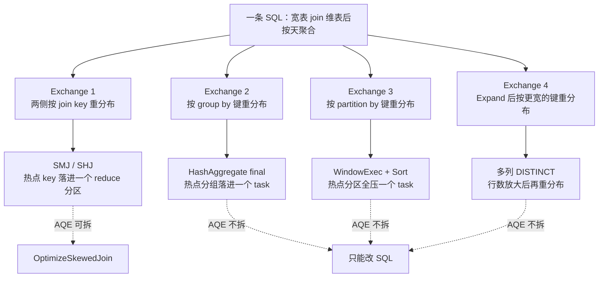
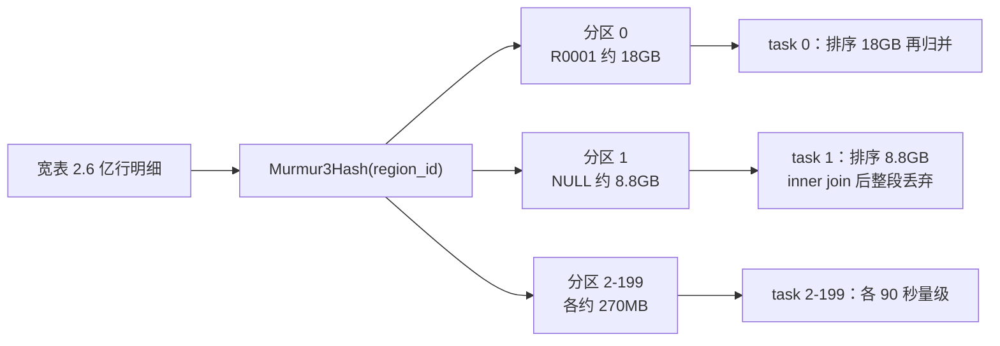
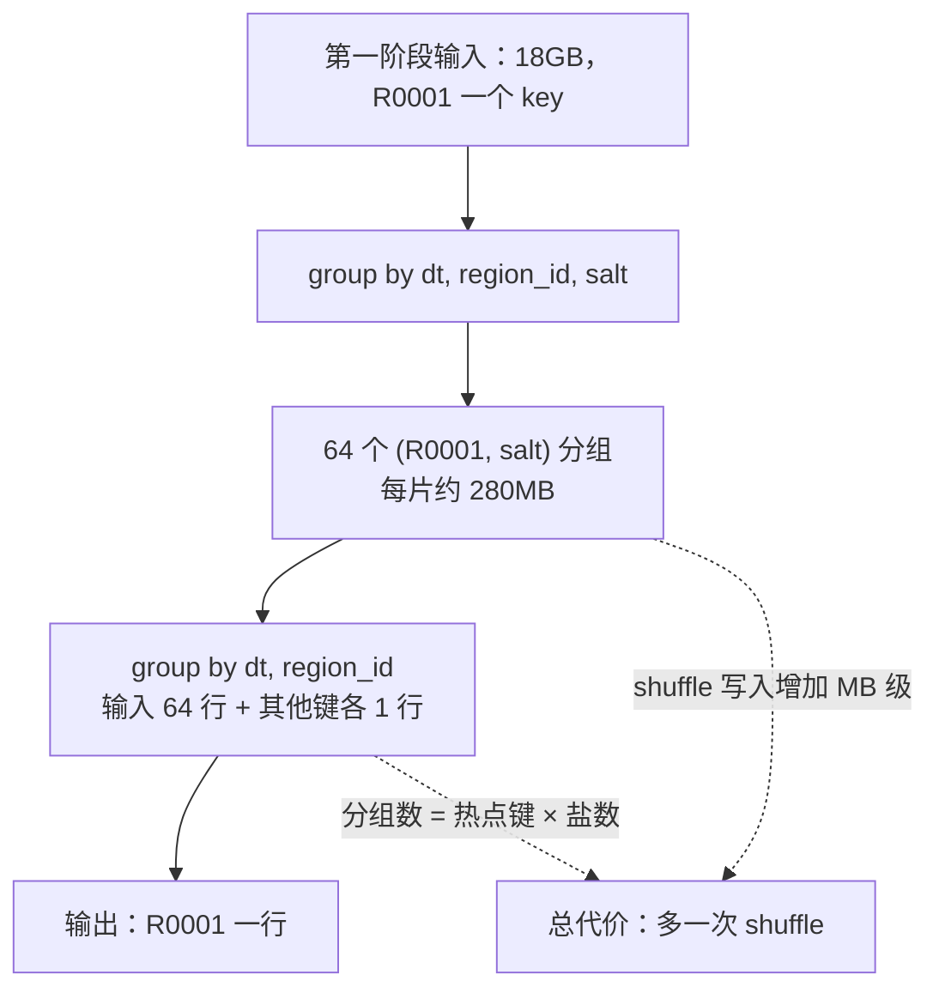
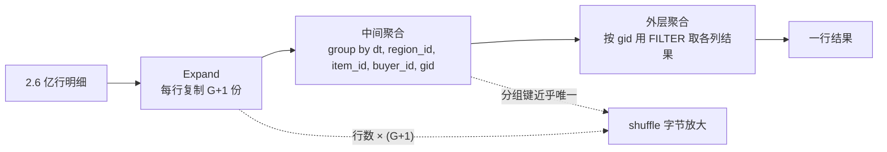
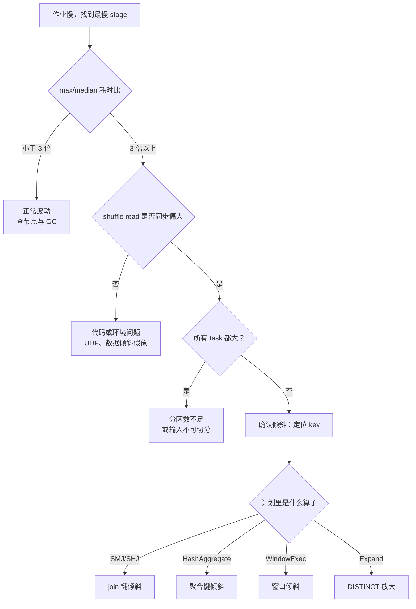
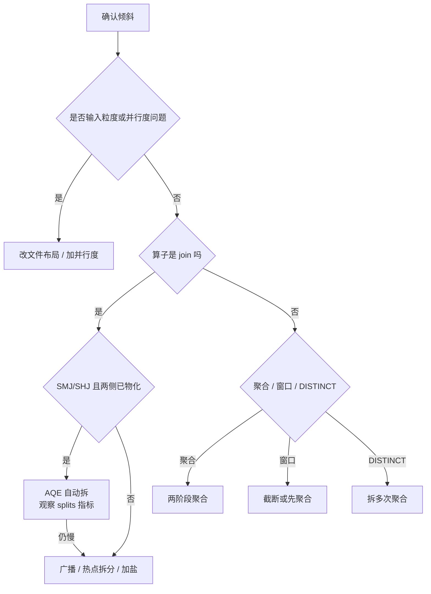

# 10 数据倾斜：诊断、根因与系统性解决方案

**摘要：**

倾斜在 Spark 里是一个老话题，落到 Spark SQL 上却变成了另一件事：RDD 时代你能直接决定分区函数与聚合方式，而在 SQL 里，分区函数由优化器按类决定、聚合被拆成 map 侧与 reduce 侧两段、连"数据被搬了几次"都要看 `Exchange` 插在哪里。于是同一句"数据倾斜"，在 SQL 层至少分裂成四种互不相同的形态——join 键倾斜、聚合键倾斜、窗口函数倾斜、`DISTINCT` 放大，它们的物理落点、可用手段和失效条件都不一样。本文以一条"订单宽表 join 地区维表再按天聚合"的查询贯穿全文：先给四种形态各自的物理位置与判据，再给出可执行的三步诊断（task 耗时分布、shuffle read 分布、热点 key 定位）与阈值；然后把 AQE 的 `OptimizeSkewedJoin` 拆到源码条件一级，说清它只治 join 两侧的 shuffle 分区、要求两侧已物化且为 SMJ/SHJ、join 类型还有左右之分，以及一处分布校验不过就整条查询放弃拆分这件事；最后落到 SQL 层的手段：广播与 hint、热点 key 拆分、两阶段聚合、先聚合再开窗、把多列 `DISTINCT` 改写成 `GROUP BY`，每招给适用形态与代价，并用一章反例说明"加并行度""调大广播阈值""给所有 key 加盐"为什么会把事情做坏。全文配置默认值按 Spark 4.3.0 核对。

---

## 第 1 章 倾斜在 SQL 层是什么：先划范围

### 1.1 两套手段，两个入口

倾斜的定义本身没有争议：shuffle 之后某个 reduce 分区的数据量远大于其他分区，处理它的 task 成为整个 stage 的瓶颈，而 stage 的墙钟时间约等于最慢那个 task 的时间，其余 task 早早做完在空等。争议在于怎么处理它。

RDD 层的处理入口是"我自己控制分区与聚合"：换分区函数、改 `partitionBy`、加盐后两轮 `reduceByKey`、把热点键单独拿出来跑一个作业。这套手段在 [[大数据/Spark/读书笔记-spark内核/06_性能调优实战/9. 数据倾斜解决方案_上|数据倾斜解决方案（上）]] 与 [[大数据/Spark/读书笔记-spark内核/06_性能调优实战/10. 数据倾斜解决方案_下|数据倾斜解决方案（下）]] 里已经讲透，机制层面不再重复。

SQL 层的入口完全不同：你交出去的是一段声明式文本，分区函数由 `EnsureRequirements` 按算子要求插入，聚合被 `Aggregate` 策略切成 partial 与 final 两段，`DISTINCT` 会被一条叫 `RewriteDistinctAggregates` 的规则改写成 `Expand` 加两次聚合，而运行时还有 AQE 在物化点之后重写尚未执行的那一段。这意味着在 SQL 层"处理倾斜"，实际动作只有三类：改变数据被搬运的路径（加 hint、消掉 shuffle、换 join 实现）、改变聚合的形状（两阶段、先聚合后开窗）、改变规则的触发条件（让 AQE 有机会拆、或者干脆绕开它治不了的形态）。搞清楚这三类动作分别对应哪种倾斜形态，比记住一堆参数有用。

### 1.2 一条贯穿全文的查询

数仓里有一张按天分区的订单宽表 `dwd_order_wide`，单日分区约 2.6 亿行、压缩后 80GB 量级（示例推算）；另有一张地区维表 `dim_region`，3200 行、压缩后不到 2MB。下游要按天、按地区出成交额与订单数，查询写成：

```sql
SELECT o.dt,
       o.region_id,
       r.region_name,
       SUM(o.pay_amount) AS gmv,
       COUNT(*)          AS ord_cnt
FROM dwd_order_wide o
JOIN dim_region r ON o.region_id = r.region_id
WHERE o.dt = '2026-11-18' AND o.channel = 'app'
GROUP BY o.dt, o.region_id, r.region_name;
```

这条 SQL 里有两个 shuffle：join 两侧各按 `region_id` 重分布一次，聚合再按 `dt, region_id, region_name` 重分布一次。数据分布是这样的：`region_id` 为空的脏数据占 11%，某大区 `R0001` 占 23%，其余三千多个区合计 66%。默认 `spark.sql.shuffle.partitions` 为 200 时，前两个 key 各自独占一个 reduce 分区，一个约 8.8GB、一个约 18GB，而 198 个正常分区每个只有 270MB 上下。这段分布会在后文反复用到，四种倾斜形态都从它派生：join 阶段的 `R0001` 与空值、聚合阶段的 `R0001`、窗口阶段的头部买家、以及多列去重时的行放大。

### 1.3 四种形态与它们的物理落点

同一条 SQL 上的倾斜之所以要分形态，是因为 AQE 与手写手段对它们的有效性完全不同。下图把四种形态与各自在物理计划里的位置放在一起，注意 `Exchange` 是唯一能把它们区分开的节点。



四者的判据也不一样，下面这张表是后文诊断的索引，其中"可观测指标"一列写在 Spark UI 的 stage 详情与 SQL 详情里能找到的字段上。

| 形态 | 物理位置 | 典型症状 | 可观测指标 | AQE 能否处置 |
|---|---|---|---|---|
| join 键倾斜 | SMJ/SHJ 的 reduce 侧 | 少数 task 的 shuffle read 巨大 | Shuffle Read Size、`number of skewed partition splits` | 能，`OptimizeSkewedJoin` |
| 聚合键倾斜 | final `HashAggregate` | 一个 task 的 peak memory 与 spill 拉满 | Peak Execution Memory、Spill (disk)、输出行数极小 | 不能 |
| 窗口倾斜 | `WindowExec` 前的 Exchange 与 Sort | 一个 task 长时间 GC、排序溢出 | Spill (disk)、GC Time、Input Size | 不能 |
| DISTINCT 放大 | `Expand` 之后的重分布 | 全 stage 都慢，不只是长尾 | shuffle write 量、SQL 计划里出现 `Expand` | 不能 |

> [!info] 一个提前说明
> 表中"AQE 不能"指的是 `OptimizeSkewedJoin` 不匹配这些算子，因为它的模式匹配只认 join 节点。但这不等于 AQE 在聚合链路上毫无作为：`OptimizeSkewInRebalancePartitions` 会拆分 `REBALANCE` 提示产生的 shuffle 分区，`spark.sql.shuffle.spreadNullJoinKeys.enabled` 会把空值 join 键打散。两者的生效前提都很窄，第 8 章逐条说明。

### 1.4 分形态判断的实际意义

把倾斜当成一个整体问题来处理，是线上最常见的起点：见到长尾就去调 `skewJoin` 的几个参数，或者给整条 SQL 的所有键都加盐。这两种动作的共同错误是把手段与形态解耦了。`skewJoin.*` 只作用在 join 的 shuffle 分区上，聚合与窗口的算子根本不在它的匹配范围里，改它等于把一个旋钮拧到底而对应的阀门没有接上；全键加盐则相反，它把一个 key 的集中换成了所有 key 的集中，第一轮的分组数从几千涨到几十万，第二轮随之膨胀。

按形态判断的价值在于它能提前告诉你"这一招在这个形状上不可能有效"，省掉一轮线上试错。后文每一章按同一个结构展开：形态落在哪个算子、判据是什么、AQE 有没有机会、SQL 层能改什么、代价落在哪里。

---

## 第 2 章 形态一：join 键倾斜

### 2.1 症状落在哪个节点

join 键倾斜的物理图像很直白：`HashPartitioning` 用 `Murmur3Hash` 把 join key 映射到分区号，同一个 key 的所有行必然落到同一个 reduce 分区，于是某个 key 的行数直接决定某个 task 的数据量。在 SMJ 里，这个 task 要先把自己分区的数据排序，再与另一侧同号分区做归并；在 SHJ 里，则是把它建成哈希表。两条路径的瓶颈都在同一个 task 上。



图中可以看到两件与处置直接相关的事：空值那一段的工作完全是无用功（inner join 之后必然被丢弃），而热点那一段的耗时决定了整个 stage 的墙钟时间。前者用一行谓词就能消掉，后者只能改变数据分布或者改变 join 的实现。

另有一处形状差异需要说明——广播 join 的形态。BHJ 没有 reduce 侧，构建侧被广播到每个 executor，探侧按文件切分成 map task 在本地探测。此时"某个 join key 数据量大"不会造成分区集中，只表现为探侧某些 task 的行数多。也就是说，**join 键倾斜是 shuffle join 独有的形态**，一旦 join 被规划成 BHJ，这个形态就消失了——这正是广播能"消掉倾斜"的全部原因，与广播本身快不快无关。

### 2.2 三个来源

第一类是业务幂律。头部大区、头部买家、头部商品天然占多数行，`R0001` 占 23% 属于正常业务事实，不是数据质量问题，处理它只能靠打散或改变计算形状。

第二类是空值与哨兵值。`region_id` 为空的行在 `Murmur3Hash` 下落到同一个分区，占 11% 就是 8.8GB；同理，`-1`、`'unknown'`、`'0'` 这类占位值会把本该分散的数据强行折叠成一个 key。空值还有一个特殊性：在 inner join 里它本来就不会匹配任何维表行，join 之后必被丢弃，于是"先过滤再 join"与"先 join 再过滤空值"结果一致，代价却差一整个 8.8GB 分区的搬运。

第三类是谓词与下推失效。宽表上的过滤条件如果没有下推到 scan，或者维表侧的过滤条件写在 join 之后，都会让参与 shuffle 的行数远大于预期，把本来不明显的倾斜放大成事故。这一类倾斜的判据不在 join 节点上，而在 scan 节点的 `Input Size` 与 `rows output` 上。

### 2.3 SQL 层的四招

**第一招：把 join 变成广播。**如果维表确实小，让优化器选 BHJ 就等于消掉 shuffle。静态阶段靠 `spark.sql.autoBroadcastJoinThreshold`（默认 10MB）判断，估不准时可以写 hint 强制：

```sql
-- 构建侧明确到维表；BROADCAST 优先于 CBO 估算，也优先于 AQE 的重规划
SELECT /*+ BROADCAST(r) */ o.dt, o.region_id, r.region_name,
       SUM(o.pay_amount) AS gmv
FROM dwd_order_wide o
JOIN dim_region r ON o.region_id = r.region_id
WHERE o.dt = '2026-11-18'
GROUP BY o.dt, o.region_id, r.region_name;
```

代价是构建侧要完整放进每个 executor 的堆内，并且 driver 要先收集一份；一旦 hint 写错、把大表标成广播，失败形态是 driver 侧 `OutOfMemoryError` 或者广播超时，不是慢。想要"运行时再确认一次大小"，正确的做法是给 AQE 单独设阈值 `spark.sql.adaptive.autoBroadcastJoinThreshold`（默认未设，回落到静态阈值），而不是把全局的静态阈值从 10MB 调到 200MB——后者会让所有查询的广播判断一起变激进。

**第二招：热点 key 单独拆出去。**已知热点是少数几个 key 时，用 `UNION ALL` 把一条查询拆成两条：热点那条用广播或高并行度处理，其余那条照常。这条路的好处是不改语义、不动全局配置，代价是两段计划各自扫描一次源表（分区裁剪能省掉一部分 I/O，但两次 scan 的调度开销与文件打开开销是实打实的），并且热点清单要维护——业务换了大区，SQL 里的常量就过期了。

```sql
WITH hot AS (
  SELECT /*+ BROADCAST(r) */ o.dt, o.region_id, r.region_name, o.pay_amount
  FROM dwd_order_wide o JOIN dim_region r ON o.region_id = r.region_id
  WHERE o.dt = '2026-11-18' AND o.region_id IN ('R0001')
), rest AS (
  SELECT o.dt, o.region_id, r.region_name, o.pay_amount
  FROM dwd_order_wide o JOIN dim_region r ON o.region_id = r.region_id
  WHERE o.dt = '2026-11-18' AND o.region_id IS NOT NULL AND o.region_id <> 'R0001'
)
SELECT dt, region_id, region_name, SUM(pay_amount) AS gmv, COUNT(*) AS ord_cnt
FROM (SELECT * FROM hot UNION ALL SELECT * FROM rest) t
GROUP BY dt, region_id, region_name;
```

**第三招：给热点 key 加随机后缀。**这是加盐在 SQL 里的写法，机制见 [[大数据/Spark/读书笔记-spark内核/06_性能调优实战/9. 数据倾斜解决方案_上|数据倾斜解决方案（上）]]，在 SQL 层要注意的是它必须"两轮"：第一轮 join（或聚合）用带盐的键，第二轮把盐去掉再汇总。对 join 而言，两轮意味着维表侧要按盐数膨胀，膨胀倍数就是盐数，因此只适合维表很小、热点很集中的形状。

**第四招：把空值先处理掉。**inner join 前加 `WHERE region_id IS NOT NULL`，一行谓词换掉 8.8GB 的搬运；left join 不能丢行时，把空值映射成一族随机键再 join，最后按业务语义回填。4.3 起另有另一条路径：`spark.sql.shuffle.spreadNullJoinKeys.enabled`（默认 false）会在 shuffle 阶段把空值 join 键打散到多个分区，但它只对 outer join 与 left anti join 生效，并且打散后的输出不再满足严格聚簇分布，下游的聚合或下一次 join 可能因此多出一次 shuffle。这条开关的取舍放在 8.7 节。

| 手段 | 适用形态 | 代价 | 主要失效条件 |
|---|---|---|---|
| 广播（hint 或阈值） | 一侧可完整放进内存 | 每 executor 一份副本、driver 收集 | 构建侧偏大、两侧都大、hint 与 join 类型冲突 |
| 热点 key 单独 `UNION ALL` | 热点清单稳定且很短 | 源表被扫两次、清单需维护 | 热点随批次漂移、热点很多 |
| 热点 key 加盐 + 两轮 | 维表小、热点极少 | 维表膨胀盐数倍、SQL 复杂度上升 | 两侧都倾斜、聚合不可分解 |
| 空值前置过滤或打散 | 空值占比高 | left join 场景需额外回填 | 语义要求空值成组保留 |

### 2.4 广播消掉倾斜的机制边界

从分区函数看，SMJ 的本质是"对两侧施加同一个 `HashPartitioning`、再按下标对齐计算"，它要求同 key 同行号，于是 key 的行数必然转化为某个行号的负载。BHJ 取消了 reduce 侧：构建侧被收集成一个哈希表广播到每个 executor，探侧保留 map 阶段的分区，每个 task 拿到自己那份文件切片之后逐行查表。整条链路里没有任何一步按 key 重新分区，`R0001` 的约六千万行因此分散在探侧的几百个 task 上，每个 task 只多查几十万次哈希。

这条机制也划出了边界。构建侧的大小要按"内存里的膨胀"算，不是按磁盘字节算：一个 8MB 的 Parquet 文件解压成 `UnsafeRow` 之后可能几十 MB，再叠加每个 executor 一份副本，并发 200 个 task 的 executor 上同时驻留的广播表是实打实的堆占用。默认 10MB 的阈值取的正是这个保守口径。

写 hint 时还要注意优先级。`JoinSelection` 以 hint 为先：`/*+ BROADCAST */` 会让一个本该走 SHJ 的 join 变成广播，AQE 在重规划时也不会推翻它；`/*+ MERGE */` 则反过来，把一个本可以广播的 join 强制成 SMJ，把已经消失的倾斜重新请回来。hint 与阈值是两套机制，改 hint 影响一条 SQL，改阈值影响一个会话或一个集群。

---

## 第 3 章 形态二：聚合键倾斜

### 3.1 它和 join 倾斜不是一回事

聚合倾斜的物理位置在 final `HashAggregate`：`GROUP BY` 的某个值占多数行时，它对哈希到同一个 reduce 分区，这个 task 要在内存里维护一个巨大的分组哈希表，`Peak Execution Memory` 拉满之后开始 spill，`Spill (disk)` 几十 GB，输出却只有一行。症状因此与 join 倾斜明显不同：join 倾斜的慢 task 是"读得多、算得多"，聚合倾斜的慢 task 常常是"读得也不算离谱、但内存一直不够、GC 时间极高"。

这种差别决定了可用的手段。join 倾斜可以靠"把一侧广播掉"消灭 shuffle，聚合倾斜没有另一侧可广播；join 倾斜可以靠"把分区拆小"换并行度，而聚合倾斜拆小分区没有意义——一个 key 只能在一个 task 里完成最终聚合，除非你改变聚合的数学形状。

### 3.2 部分聚合为什么救不了它

SQL 里的聚合默认是两段式的：map 侧先做一次 partial `HashAggregate`，把明细压成"分组键 + 部分聚合值"，shuffle 之后再跑 final 聚合。很多人据此认为"Spark 已经自动做了两阶段聚合，所以聚合倾斜不存在"，这个推断错在把"减少 shuffle 行数"当成了"减少最终 task 的数据量"。

partial 聚合压掉的是行数，不是分组数。`R0001` 在 map 侧被压成 198 个部分结果（每个 map task 一份），这 198 行依然全部哈希到同一个 reduce 分区，final 聚合要处理的输入是小了，但它的输出同样只有一行，而它必须等这 198 份部分结果全部就位。换句话说，**partial 聚合降低了搬运成本，没有改变"热点键只能由一个 task 收口"这个事实**。真正的两阶段聚合要在分组键里插入一个随机维度，让最终收口分散成若干次小的收口，再合并这些小收口的结果。

### 3.3 两阶段聚合在 SQL 里的写法

下例把 `R0001` 的 18GB 明细先按 64 个盐打散，第一轮按 `(dt, region_id, salt)` 聚合，第二轮去掉盐再汇总：

```sql
WITH stage1 AS (
  SELECT dt,
         region_id,
         -- 只对热点键加盐，普通键盐位固定为 0，避免把 3000 多个正常分组也放大 64 倍
         CASE WHEN region_id = 'R0001' THEN CAST(PMOD(HASH(o_row_id), 64) AS INT) ELSE 0 END AS salt,
         SUM(pay_amount) AS part_gmv,
         COUNT(*)        AS part_cnt
  FROM dwd_order_wide
  WHERE dt = '2026-11-18' AND region_id IS NOT NULL
  GROUP BY dt, region_id,
           CASE WHEN region_id = 'R0001' THEN CAST(PMOD(HASH(o_row_id), 64) AS INT) ELSE 0 END
)
SELECT dt, region_id, SUM(part_gmv) AS gmv, SUM(part_cnt) AS ord_cnt
FROM stage1
GROUP BY dt, region_id;
```



三个细节值得写下来。其一，`salt` 必须由行内容决定而不是 `RAND()`，否则同一条 SQL 两次跑出不同结果，对账时无法复现；用行主键哈希取模是最省事的做法。其二，第二轮的分组数是 `热点键数 × 盐数`，量级在几万行以内，代价可以忽略，但它是**多出来的一次 shuffle**，省不掉的。其三，`salt` 写在 `SELECT` 与 `GROUP BY` 两处的表达式必须完全一致，否则 Spark 会认为你按两个不同的键分组，计划里立刻出现两次 shuffle。

如果热点键清单不稳定，可以退化成"全键加盐"，但那样第二轮的分组数是 `distinct 键数 × 盐数`，当基数到百万级时第二轮自己就会倾斜，属于把问题搬家。

### 3.4 代价与不可分解聚合

两阶段聚合的前提是聚合函数可分解：`SUM`、`COUNT`、`MIN`、`MAX`、`AVG`（拆成 `SUM`/`COUNT` 再相除）都满足。`COLLECT_LIST`、`COLLECT_SET`、`PERCENTILE` 这类需要看到全部原始行的聚合不满足，硬拆只会算错。`COUNT(DISTINCT)` 的情况则要分两种，第 5 章单独讲。

代价侧还有一笔容易被忘掉的账：第一轮的 shuffle 写入量会因盐数而上升，因为分组键变宽了（多了 `salt` 列），而且原本能合并的部分结果现在被强行分成 64 份。对 18GB 的明细，这部分开销在 GB 级；相比它换回来的 100 分钟长尾，这笔交易通常划算，但如果热点只占 2%、盐数又设了 256，那就是拿全表的 shuffle 放大去治一个小尾巴。

### 3.5 热点清单从哪里来

两阶段聚合与热点拆分都依赖"知道谁是热点"，来源有三种，滞后程度不同。

第一种是写死在 SQL 里的常量。简单、可解释、没有外部依赖，代价是业务变了就要改作业——大区合并、促销换了主推商品，清单就跟事实脱节，倾斜悄悄回来。

第二种是查出来再做一层处理：先在明细上跑一次 `GROUP BY key ORDER BY count DESC LIMIT 20`，把结果落到一张小表里，第二天的作业用 `LEFT SEMI JOIN` 引用这张表判断"是不是热点"。这样清单自动更新，代价是引入了一个调度依赖与一天滞后，并且那张小表绝不能长得比维表大，否则 join 自己变成新瓶颈。

第三种是在 SQL 里用阈值内联判断：把 key 的计数与总量比写进子查询，`ratio > 0.05` 的走加盐分支。它不需要外部表，但每次执行都要多扫一遍明细做统计，而且这个统计本身与业务查询共享 shuffle，代价不低。

三种方式的共同点是：热点判断必须"近似正确"而不是"精确正确"。把占 3% 的键误判成热点、多付一份盐的开销，危害远小于把占 25% 的键漏掉。

---

## 第 4 章 形态三：窗口函数倾斜

### 4.1 窗口算子的物理形状

窗口函数的执行形状比聚合更容易被低估。`ROW_NUMBER() OVER (PARTITION BY buyer_id ORDER BY amount DESC)` 在物理上是：一次按 `buyer_id` 的 `Exchange`、一次 `SortExec`、一次 `WindowExec`。热点 `buyer_id`（占 9% 行、约 7GB）意味着有一个 task 要独自把这 7GB 排完序再逐行计算窗口值，而排序是必须看到全分区的操作，没有任何"分段并行"的余地。

窗口算子用一个 `ExternalAppendOnlyUnsafeRowArray` 缓冲分区的全部行，缓冲有两道强制溢写阈值：行数阈值为 `spark.sql.windowExec.buffer.spill.threshold`，字节阈值为 `spark.sql.windowExec.buffer.spill.size.threshold`（4.1 起新增，回落到 `spark.shuffle.spill.maxSizeInBytesForSpillThreshold`）。两道阈值在默认配置下都是最大值，也就是说**默认并不按行数或字节主动落盘**，溢写由执行内存压力与页上限触发；把它们显式调小，才是"让热点分区更早落盘、用磁盘换内存"的主动手段。这个细节解释了窗口倾斜为什么常表现为"spill 几十 GB、GC 占八成"，而不是干脆的 OOM。

### 4.2 top-N 场景：让优化器截断

窗口倾斜里有一类可以不改 SQL 就缓解：`ROW_NUMBER()` 或 `RANK()` 后紧跟常量上界过滤，也就是"每个分组取前 N 条"。3.5 起 Spark 有一条 `InsertWindowGroupLimit` 规则，会在窗口之前插入 `WindowGroupLimitExec`，每个分区只保留前 N 行就把后面的行丢掉，热点分区因此不用把 7GB 全排完。

触发条件是上界不超过 `spark.sql.optimizer.windowGroupLimitThreshold`（默认 1000），且窗口函数是 `ROW_NUMBER`、`RANK`、`DENSE_RANK` 之一。判据很简单：看 `EXPLAIN` 里窗口节点下方有没有 `WindowGroupLimit`，没有就说明要么上界写成了非常量、要么超过了 1000、要么函数不匹配。上界真的大于 1000 时，把阈值调到对应的 N 是允许的，代价是这个优化的截断收益随 N 线性衰减——N 到十万量级时它只是把排序从"全量"改成"全量减一点"。

### 4.3 先聚合再开窗

窗口倾斜最稳的解法是缩小窗口的输入，而不是给窗口本身加速。以"每个买家最近一笔订单"这一类需求为例，如果窗口只是为了在明细里标一个序号再过滤，可以先把明细按 `buyer_id` 归约成小表，再在小表上做后续处理（下例直接回连取回整行）：

```sql
-- 先把 7GB 明细压成三千万行级的小表，再排序
WITH last_order AS (
  SELECT buyer_id, MAX(order_id) AS order_id
  FROM dwd_order_wide
  WHERE dt = '2026-11-18'
  GROUP BY buyer_id
)
SELECT l.buyer_id, o.order_id, o.pay_amount
FROM last_order l JOIN dwd_order_wide o ON l.order_id = o.order_id;
```

这条改写把"窗口内排序 7GB"变成了"聚合 7GB 再小表 join"，聚合的内存压力远小于排序，join 侧还能被广播。它的代价是需求必须能被"先归约再回连"表达——需要 `ROW_NUMBER() = 1` 取整行、需要按多个排序键取前 N、需要窗口累计值（`SUM() OVER (ORDER BY ...)`）的场景都不适用。

### 4.4 取一条时不必开窗

只要每组取排序后的第一行，就还有一条比窗口更轻的路：3.0 起 Spark 内置 `max_by` 与 `min_by`，语义是"按第二个参数的最大值或最小值，取对应的第一个参数"。上面那条"每个买家最近一笔订单"可以写成一个聚合：

```sql
SELECT buyer_id, max_by(order_id, order_ts) AS last_order_id
FROM dwd_order_wide
WHERE dt = '2026-11-18'
GROUP BY buyer_id;
```

这样计划里只有一次聚合，没有排序、没有窗口，也就没有 `WindowGroupLimit` 触发与否的悬念。它的限制很清楚：只能取一列，要多列就重复写多次（或者把需要的列编码进一个 struct 再取出来），并且对"取前 N 行"无能为力——N 大于 1 时仍然要回到窗口配合截断。

这条改写对窗口倾斜的意义在于，它把一个"必须全分区有序"的算子换成了"分区内可增量合并"的算子，前者的内存随分区行数增长，后者只维护一个当前最优值。热度再高的买家，聚合也只需要一行状态。

### 4.5 加盐在窗口上的可行边界

`PARTITION BY` 加盐在工程上常被当作万能招，实际上它只在一种形状下成立：窗口内做的是可合并聚合，且你愿意再补一次汇总。譬如 `SUM(amount) OVER (PARTITION BY buyer_id)`，可以按 `(buyer_id, salt)` 分组求和，再按 `buyer_id` 汇总——但这时你已经用 `GROUP BY` 完成了同一件事，窗口本身是多余的。

对 `ROW_NUMBER`、`RANK`、`LAG`、`LEAD`、`NTILE` 这些依赖分区内全局顺序的函数，加盐直接改变语义：加了盐之后每个盐位各自排序，得到的序号不是原分区内的序号，结果就是错的。所以窗口倾斜的可用手段实际只有两条：截断（top-N）与缩小输入（先聚合），加盐不在其中。这一点与大范围流传的"倾斜就加盐"相冲突，需要按形态分别判断。

| 手段 | 适用窗口形状 | 代价 | 失效条件 |
|---|---|---|---|
| `WindowGroupLimit` 截断 | rank 类 + 常量上界 ≤ 阈值 | 基本无额外成本 | 上界非常大、函数不匹配、上界非常量 |
| 先聚合再开窗 | 能表达成"先归约再回连" | 多一次聚合与 join | 需要整行、累计值、多键排名 |
| `PARTITION BY` 加盐 | 仅窗口内可合并聚合 | 多一次汇总 | 一切依赖分区内顺序的函数 |
| 广播/`REBALANCE` 前置 | 窗口前有别的 join | 多一次 shuffle | 窗口自身仍是单点瓶颈 |

---

## 第 5 章 形态四：`DISTINCT` 与行放大

### 5.1 单个 `COUNT(DISTINCT)`：被值域打散

先破除一个流行说法：`COUNT(DISTINCT)` 不一定倾斜。对 `SELECT region_id, COUNT(DISTINCT buyer_id) FROM ... GROUP BY region_id` 这种只有一个 distinct 组、且没有 `FILTER` 的查询，Spark 的聚合策略会直接用两段式聚合实现它，而且第一段的分组键包含去重列本身，也就是 `(region_id, buyer_id)`。热点 `R0001` 的 18GB 明细因此被 `buyer_id` 的值域摊到多个分区上，分区大小由 buyer 基数决定，倾斜反而被稀释了。

代价换了个位置：shuffle 的行数是 `(region_id, buyer_id)` 组合数，不再是 `region_id` 的分组数。买家基数到千万级时，这次 shuffle 的量可能比原表还大。所以"换成 `COUNT(DISTINCT)` 之后不倾斜了、但整体更慢了"是一个可预期的观察，不是玄学。

### 5.2 多个 distinct 组：`Expand` 放大

真正会放大的是多列去重。同一条 SQL 里出现 `COUNT(DISTINCT item_id)` 与 `COUNT(DISTINCT buyer_id)` 时，Catalyst 的 `RewriteDistinctAggregates` 规则会把聚合改写成 `Expand` 加两次聚合：`Expand` 把每一行按"聚合组"复制若干份，中间聚合的分组键变成"分组键 + 全部去重列 + `gid`"，最后再在外层按 `gid` 用 `FILTER` 把各列的结果取出来。

放大倍数很好算：设 distinct 组数为 G、另有普通聚合则再加一组，`Expand` 输出的行数是输入行数的 G+1 倍（没有普通聚合时是 G 倍）。更贵的是中间聚合的分组键宽度——`(dt, region_id, item_id, buyer_id, gid)` 这种键几乎唯一，去重收益趋近于零，等于把整表明文重新 shuffle 了 G+1 遍。下图是这条改写的形状。



### 5.3 没有那个开关

关于这条规则，流传最广的一句是"把 `spark.sql.optimizer.rewriteDistinctAggregates` 打开，`COUNT(DISTINCT)` 就会转成两阶段聚合"。核对 4.3.0 的 `SQLConf` 后可以确认：**这个配置项不存在**。`RewriteDistinctAggregates` 是 `Optimizer` 里一条无条件执行的规则，没有 `spark.sql.*` 开关能关掉它，也没有开关能打开"另一种实现"。

它的触发条件是源码里写死的两条：distinct 聚合组数大于 1，或者虽然只有一个 distinct 组但带 `FILTER`、或者没有分组键且聚合子表达式全是常量（`SELECT COUNT(DISTINCT 1)` 这种边界）。想改变这次改写的开销，唯一的手段是改变 SQL 的形状。

### 5.4 条件计数也会触发改写

报表 SQL 里常见"一列一个口径"的写法：`COUNT(DISTINCT CASE WHEN pay_status = 1 THEN buyer_id END)` 写三遍，就是三个 distinct 组，`RewriteDistinctAggregates` 必然触发。更隐蔽的是显式写成 `COUNT(DISTINCT buyer_id) FILTER (WHERE pay_status = 1)`，语义完全合法，但源码里 `mustRewrite` 的条件之一恰恰是"存在带 filter 的 distinct 聚合"，照样被改写。

如果几个口径只是"对同一列按不同条件计数"，可以换成 `SUM(IF(cond, 1, 0))`，前提是不需要去重。需要去重时，把条件编码进去重列（`COUNT(DISTINCT IF(cond, buyer_id, NULL))`）并不能省掉分组——每个条件仍然是一个 distinct 组，组数不降反升。这一类改写要先算清"去重之后的行数"和"Expand 的份数"哪个更便宜，不能凭直觉：去重收益大（基数低）时保留 `COUNT(DISTINCT)` 更好，去重收益接近零（基数高）时 `Expand` 就是纯粹的行放大。

### 5.5 改写路径

**拆成多次聚合再 join。**每个 distinct 单独算，结果按分组键 join 回来。单 distinct 那一路会被聚合成"键 + 值"的短行，中间聚合的去重收益正常发挥；代价是 N 次 shuffle 与一次按小键的 join，N 个 distinct 就是 N 次扫描。

**改写为 `GROUP BY` 加两阶段。**把 `COUNT(DISTINCT buyer_id)` 写成先 `SELECT DISTINCT region_id, buyer_id` 再 `GROUP BY region_id`，配合热点键加盐，把"一次宽 shuffle"换成"两次窄 shuffle"。这仍是两次 shuffle，只是在第二次上可以做局部聚合。

**近似去重。**统计口径允许误差时，`approx_count_distinct` 用 HyperLogLog 实现，状态是固定大小的寄存器数组，天然并行、天然无倾斜。代价是相对误差在 1% 到 5% 量级（取决于精度参数），且结果不可复现——同一份数据两次跑会有微小差异，对账场景要提前和业务方对齐。

| 改写方式 | 适用形态 | shuffle 次数 | 代价与限制 |
|---|---|---|---|
| 拆成多次聚合再 join | 多个 distinct 组 | N 次 + 1 次 join | 扫描次数上升，join 侧需小 |
| `GROUP BY` + 两阶段 | 单热点键上的去重 | 2 次 | 需要可分解的计数写法 |
| `approx_count_distinct` | 接受 1%-5% 误差 | 1 次 | 结果不可复现 |
| 保留原样 | distinct 组少且值域窄 | 1 次但放大 G+1 倍 | `Expand` 后分组键过宽 |

---

## 第 6 章 诊断三步

### 6.1 第一步：task 耗时分布

不要看单个 stage 的总时长，先看该 stage 的 `Summary Metrics` 表：它给出所有 task 的 `Duration`、`Shuffle Read Size`、`Spill (disk)` 的 Min、25th、75th、Max。判据用 max 与 median 的比值，而不是绝对时长：

- 比值在 3 倍以内：属于正常波动，节点差异与 GC 刚好能解释，不要往倾斜上归因。
- 比值在 3 到 5 倍：可疑，先确认是不是 `Shuffle Read Size` 同时偏大；只有读量也明显偏大才算数据倾斜。
- 比值超过 5 倍且读量同步放大：确认倾斜。5 这个数字不是随手取的，它与 `spark.sql.adaptive.skewJoin.skewedPartitionFactor` 的默认值对齐，AQE 用的也是这个口径。
- 比值超过 20 倍：属于长尾事故，通常伴随 spill 与多次 task 重试，先按事故处理再谈优化。

比值的意义在于它直接对应墙钟时间的损失：一个 stage 有 200 个 task、集群有 200 个并发槽位时，理论墙钟约等于"总数据量 ÷ 200 的吞吐"，实际墙钟约等于最慢 task 的时长。比值 20 倍意味着九成以上的槽位在最后一成时间里空转。

### 6.2 第二步：shuffle read size 分布

耗时分布只能说明"有长尾"，说明不了长尾的成因。第二步看 `Shuffle Read Size / Records` 的分布，把三种情形分开：

其一，读量偏大且耗时同步偏大，两者比值接近，这是数据分布问题，往 key 集中上查。其二，读量接近但耗时差异大，这是代码或环境问题：UDF 里做了重活、某个分区触发了不同的代码路径、或者节点本身有故障。其三，读量与耗时都大，且所有 task 都大，这不是倾斜，是分区数不足或输入不可切分，第 7 章展开。

字节与行数要分开看：字节偏大而行数不多，通常是宽行（大字段、嵌套结构）集中；行数偏大而字节不大，才是典型的 key 热点。两者的处置方向不同，前者可以列裁剪，后者只能打散。

### 6.3 第三步：定位到具体的 key

前两步只能定位到 stage，第三步要落到 key。对 join 键与聚合键，最直接的做法是对候选表做一次分组统计，看键的分布尾部：

```sql
WITH k AS (
  SELECT region_id, COUNT(*) AS c
  FROM dwd_order_wide
  WHERE dt = '2026-11-18'
  GROUP BY region_id
)
SELECT COUNT(*) AS key_cnt,
       MAX(c)   AS max_cnt,
       APPROX_PERCENTILE(c, ARRAY(0.5, 0.9, 0.99)) AS p50_p90_p99,
       SUM(IF(region_id IS NULL, c, 0)) AS null_cnt
FROM k;
```

这段查询给出的三个数字正好对应三个判据：`max_cnt / p50` 是键维度的倾斜倍数，`p99 / p50` 说明尾部有多长，`null_cnt` 判断空值是不是主因。表很大时先 `TABLESAMPLE (1 PERCENT)` 采样，采样误差在判断量级时够用；要精确值就单独跑一次聚合，把结果落到临时表里反复用。

对窗口倾斜，把 `PARTITION BY` 的键做同样的统计，判据换成"最大分区的行数 × 行宽"是否超过单个 task 能承受的量级；对 `DISTINCT` 放大，统计的是 `(分组键, 去重列)` 的组合数，用来估算中间聚合的 shuffle 规模。

### 6.4 证据链：从 SQL 页到日志

诊断的最后一环是把"怀疑"变成"证据"，三个位置各有分工。Spark UI 的 SQL 页给最终计划，`AdaptiveSparkPlan isFinalPlan=true` 之后展开能看到 `AQEShuffleRead` 节点，它的 `number of skewed partition splits` 指标直接告诉你 AQE 拆了几片；为 0 说明规则没匹配上，此时不要怀疑数据，去查 8.1 节的条件。stage 页给分区的字节分布与 spill。日志里把 `spark.sql.adaptive.logLevel` 设成 DEBUG，`OptimizeSkewedJoin` 会打出左右两侧的 median、max、min、avg 与"number of skewed partitions: left X, right Y"，这是唯一能直接看到"规则看到了什么"的地方。



### 6.5 计划片段怎么读

最终计划里与倾斜相关的节点只有几个，读法是看后缀与分区描述。`AQEShuffleRead` 的节点名会带 `coalesced`、`skewed`、`coalesced and skewed` 三种后缀，出现 `skewed` 说明这个读端被拆过；节点下的 `number of skewed partitions` 与 `number of skewed partition splits` 分别记录"被判为倾斜的原分区数"和"拆出来的片数"。示意形态如下（4.3.0 输出，节选）：

```
SortMergeJoin [region_id], [region_id], Inner
:- Sort [region_id ASC], false
:  +- AQEShuffleRead coalesced and skewed
:     +- ShuffleQueryStage 0
+- Sort [region_id ASC], false
   +- AQEShuffleRead skewed
      +- ShuffleQueryStage 1
```

左侧带 `coalesced and skewed`，说明这一侧既被合并过也被拆过；右侧只有 `skewed`，说明它只被拆。若两侧都只有 `coalesced`，这次 join 的倾斜没有被处理，接下来该查的是规则为什么没匹配，而不是继续调参数。这层判读比看 stage 页更早一步：stage 页只能说明"慢"，计划页能说明"框架认不认为这是倾斜"。

---

## 第 7 章 四种"假倾斜"

### 7.1 输入不可切分

scan 阶段的长尾常常与数据分布无关。`spark.sql.files.maxPartitionBytes`（默认 128MB）只对可切分的文件格式生效：一个 8GB 的 gzip 文件整体不可切分，只能由一个 task 读完；一批小文件则会被 `openCostInBytes` 合并成少数几个大分区；单个巨大的 Parquet 文件如果 row group 很少，可切分的粒度也很粗。这三种情况下 `max/median` 比值可以很夸张，但 hotspot key 根本不存在。

判据是看 SQL 页第一个 stage 的 `Input Size` 分布：如果慢 task 的读入字节明显大于其他 task，而该 stage 里没有任何 `Exchange`，那就是输入粒度问题，不是倾斜。处置方向是重写文件布局（合并小文件、换 snappy 或 zstd 这类可切分压缩、按天或按小时重分区），机制见 [[大数据/Spark/Spark-SQL深度解析与性能调优/09 数据源与 IO 优化：让数据少读、快读、不重读|数据源与 IO 优化]]。

### 7.2 分区数不足

`spark.sql.shuffle.partitions` 默认 200，这个数字对 80GB 的 shuffle 意味着每个分区 400MB；集群有 800 个核时，200 个 task 只用掉四分之一的槽位，stage 自然慢，而且所有 task 的耗时都很接近。此时 max/median 比值接近 1，看起来"很均衡"，但时间全花在"并行度用不满"上。判据是 `分区数 ÷ 可用核数`，小于 1 就说明并行度不足，处置见 [[大数据/Spark/读书笔记-spark内核/06_性能调优实战/3. Spark集群资源分配与并行度调优|集群资源分配与并行度调优]]，与倾斜无关。

### 7.3 常量键与单侧输入

谓词把键过滤成一个值时，`GROUP BY` 之后只有一个分组，一个 task 干完全部活，ratio 直接无穷大。这类"倾斜"是查询形状决定的，不是数据分布：`WHERE dt = '2026-11-18' AND region_id = 'R0001'` 再加 `GROUP BY region_id`，输出本来就只有一行。同理，`UNION ALL` 的一侧数据量远大于另一侧时，下游按常量分组的 task 会集中处理大侧。

识别方法很简单：看 `GROUP BY` 键的基数，基数小于分区数时不存在聚合倾斜，只存在并行度浪费。

### 7.4 节点与 GC

同一批 task 里，落在某几台 executor 上的 task 持续偏慢，而 shuffle read 量并无差异，这是节点问题：磁盘慢、网络抖动、或者 executor 堆里驻留了上一批任务的缓存。判据是把 task 的 `Executor ID` 与耗时分列，看慢 task 是否集中在少数 executor 上。此时开 `spark.speculation` 有意义（慢的原因是节点而不是数据多），而在真倾斜场景开推测执行只会让同一个热分区被重算若干遍，白烧资源。

四种假倾斜的判据可以合并成一张速查表，作用是让"先归类、再动手"这件事变得可执行：

| 现象 | 判据 | 归类 | 处置方向 |
|---|---|---|---|
| 慢 task 的读入字节远大于邻居，stage 内无 `Exchange` | `Input Size` 分布 | 输入不可切分 | 改文件布局与压缩格式 |
| 所有 task 都慢、耗时接近，分区数小于核数 | 分区数 ÷ 可用核数 | 并行度不足 | 加并行度或关闭分区合并 |
| `GROUP BY` 键基数小于分区数 | `COUNT(DISTINCT 键)` | 常量键，不是倾斜 | 不加任何倾斜手段 |
| 慢 task 集中在少数 executor | `Executor ID` 与耗时交叉 | 节点或 GC | 推测执行、换节点 |

---

## 第 8 章 AQE 能救到什么程度

### 8.1 匹配条件比文档写的更窄

`OptimizeSkewedJoin` 是一个 `Rule[SparkPlan]`，它用模式匹配找"可以拆的 join"，匹配不上的直接跳过。4.3.0 的源码里，能进入处理的分支只有三种：

```scala
// OptimizeSkewedJoin.optimizeSkewJoin，节选
case smj @ SortMergeJoinExec(_, _, joinType, _,
    s1 @ SortExec(_, _, ShuffleStage(left), _),
    s2 @ SortExec(_, _, ShuffleStage(right), _), false) => ...
case shj @ ShuffledHashJoinExec(_, _, joinType, _, _,
    ShuffleStage(left), ShuffleStage(right), false) => ...
case bhj @ BroadcastHashJoinExec(..., BuildRight, _,
    ShuffleStage(left), _, _, false) if !localShuffleReaderEnabled => ...
```

`ShuffleStage` 这个提取器的条件是三个"与"：stage 已物化、map 统计存在、并且该 shuffle 的来源是 `EnsureRequirements`。最后一条最容易踩空——用户手写的 `repartition(200, region_id)` 来源是 `RepartitionByExpression`，倾斜再严重也不会被拆。`SortMergeJoinExec` 那个分支还额外要求两侧各有一个 `SortExec` 包着 shuffle stage，以及末尾的 `false`（表示这个 join 还没有被标记成倾斜拆分过）。

广播 join 的探侧只在 `spark.sql.adaptive.localShuffleReader.enabled` 为 false 时才尝试拆分，原因与本地读的实现有关（改成按 map 输出读之后，倾斜的形态变成了"某个 map 输出特别大"，由另一条路径处理），机制见 [[大数据/Spark/Spark-SQL深度解析与性能调优/06 AQE：运行时自适应查询优化|AQE]]。

### 8.2 join 类型有左右之分

拆分的可行性取决于 join 类型：被拆的一侧要能"复制对方分区然后各拆片各算一遍"，这个操作只对某些 join 类型成立。源码里两个判据写得很直接，`canSplitLeftSide` 允许 Inner、Cross、LeftSemi、LeftAnti、LeftOuter，`canSplitRightSide` 只允许 Inner、Cross、RightOuter。

于是 `FULL OUTER` 两侧都不能拆，`LEFT OUTER` 只能拆左（保留侧），`RIGHT OUTER` 只能拆右。这条限制在线上很常见：一条 `LEFT JOIN` 的右表侧（维表侧）倾斜，AQE 直接放弃，因为拆右表会让未匹配行重复输出。此时能做的是把 join 方向调换、或者回到 SQL 层用广播。

| join 类型 | 可拆左侧 | 可拆右侧 | 说明 |
|---|---|---|---|
| Inner / Cross | 是 | 是 | 两侧各自独立拆 |
| LeftOuter | 是 | 否 | 拆右会重复未匹配行 |
| RightOuter | 否 | 是 | 与 LeftOuter 对称 |
| LeftSemi / LeftAnti | 是 | 否 | 输出只保留左侧 |
| FullOuter | 否 | 否 | 规则整体不匹配 |

### 8.3 阈值取大、目标取均值

判定用两个条件同时成立：分区字节数大于 `skewedPartitionThresholdInBytes`（默认 256MB），并且大于该侧分区中位数的 `skewedPartitionFactor` 倍（默认 5）。源码把它合成为一个阈值，取两者较大值，所以中位数很大时（比如分区普遍 300MB），绝对阈值那一项根本不起作用，真正生效的是 `300MB × 5 = 1.5GB`。

拆分的目标大小也不是 `advisoryPartitionSizeInBytes`。`targetSize` 取"非倾斜分区的平均值"与 advisory（默认 64MB）中的较大者，含义是让拆出来的片和邻居差不多大，而不是切成一堆 64MB 的碎片。用贯穿案例算一遍（示例推算）：中位数 270MB，阈值取 `max(256MB, 1350MB) = 1350MB`，18GB 的 `R0001` 分区被判为倾斜；目标大小取 `max(64MB, 270MB) = 270MB`，于是切出约 68 片，每片 270MB、耗时与邻居同量级。若按 64MB 估算会得到约 280 片，差四倍。

价格在另一侧：另一侧的同一分区要被读 68 遍，副本放大约 `68 × 240MB ≈ 16GB`。这笔账在对方分区只有几百 MB 时划算，在对方分区本身有几十 GB 时会把网络与磁盘读打满，收益被抵消。

### 8.4 一处不满足，整条查询放弃

拆分之后，规则会把整棵计划交给 `EnsureRequirements` 校验一遍分布要求：拆出来的 `AQEShuffleReadExec` 分区数变了，如果上层还有算子要求"同 key 同分区"，校验就会失败。失败时的默认行为不是"跳过这个 join"，而是**整条计划恢复原样，所有 join 都不拆**，源码里那段 `TODO` 注释写得很明白：理论上可以只跳过导致冲突的那一个 join，但当前实现是整体放弃。

这条行为解释了一类线上怪现象：单独跑一条两表 join，AQE 拆得很欢；把它塞进一条多段 join 的宽查询，`number of skewed partition splits` 变成 0。遇到这种情况，先把 `spark.sql.adaptive.logLevel` 调成 DEBUG 看日志里有没有放弃记录，再决定是拆查询还是接受。

### 8.5 `forceOptimizeSkewedJoin` 的代价

把 `spark.sql.adaptive.forceOptimizeSkewedJoin` 设为 true，等于允许规则"即便引入额外 shuffle 也要拆"：校验失败时不再回退，而是让 `EnsureRequirements` 补上新的 exchange。它的适用场景是"多段 join 里倾斜确实存在、但被上层分布要求挡住"，代价很直接——多一次 shuffle、多一个 stage 边界、多一轮物化等待，AQE 的目标函数（`SimpleCostEvaluator` 数 shuffle 个数）也会因此判这次改写"更贵"，也就是说你是在明确地推翻框架自身的成本判断。

什么时候值得？倾斜把 stage 拖到分钟级以上、而多一次 shuffle 只是几十秒的量级时。什么时候不值得？倾斜只是轻度（比值 5 到 8 倍）、集群槽位本来就紧张时，多出来的 shuffle 会把其他并发作业一起拖慢。

| 配置 | 默认值 | 调大的代价 | 调小的代价 |
|---|---|---|---|
| `skewJoin.skewedPartitionFactor` | 5 | 判定变宽松，更多分区被拆，副本放大的风险上升 | 判定变严格，5 到 10 倍的倾斜被放过，长尾仍在 |
| `skewJoin.skewedPartitionThresholdInBytes` | 256MB | 小分区的相对倾斜不再处理，中等规模倾斜被漏掉 | 大量分区被判为倾斜，拆分的收益低于副本成本 |
| `advisoryPartitionSizeInBytes` | 64MB | 拆分目标变大、片数变少，长尾缓解有限 | 与非倾斜均值取大后基本无效，单独调小通常不起作用 |
| `forceOptimizeSkewedJoin` | false | 强行优化会引入额外 shuffle，整体耗时未必下降 | 保持保守，遇到分布要求冲突时整体放弃 |
| `localShuffleReader.enabled` | true | 开启则省网络却放大 map 侧不均，BHJ 探侧倾斜也不再被拆 | 关闭则回到跨节点拉取，读变慢，但 BHJ 探侧倾斜可拆 |

### 8.6 三类它治不了

聚合键倾斜、窗口倾斜、map 端倾斜，`OptimizeSkewedJoin` 一类都治不了，原因不是规则不够聪明，而是观测点与作用对象不匹配。

聚合：规则的模式匹配只认 `SortMergeJoinExec`、`ShuffledHashJoinExec` 与 `BroadcastHashJoinExec`，`HashAggregateExec` 的输出分区再大也不会进入取值路径。而且从语义上也不能拆——把同一个 `GROUP BY` 键切成多个 task 各出一份结果，需要外层再做一次合并，那是改写计划，不是调整读取。

窗口：`WindowExec` 要求分区内全局有序，拆开就破坏了顺序语义，比聚合更硬。

map 端：倾斜发生在写 shuffle 之前，AQE 的观测点是"某个 stage 已完成、它产出了多少字节"，它没有能力把时间倒回去重新切分输入。宽表读取时某个文件过大、某个 UDF 在某些行上极慢，AQE 只能看到一个慢 stage。

### 8.7 空值打散的边界

4.3.0 新增了 `spark.sql.shuffle.spreadNullJoinKeys.enabled`（默认 false），让 shuffle join 把空值 equi-join 键打散到多个分区，适用的 join 类型是 shuffled `LEFT`、`RIGHT`、`FULL OUTER` 与 `LEFT ANTI`。inner join 不在其中，这符合语义：inner join 里空值本来就不匹配，直接过滤更便宜。

它的代价写在配置文档里，值得读原文而不是只看名字：打散后的输出是"null-aware 分区"，不再满足严格的聚簇分布，下游的分组、窗口、下一次 equi-join 可能需要额外一次 shuffle；另外如果 join 的一侧已经按哈希分好区，只有另一侧会被重新打散，**已分区那一侧的空值倾斜会原样保留**。所以它不是"打开就治空值倾斜"的开关，而是"在没有下游强分布要求、且两侧都还要 shuffle 时"才划算的开关。

### 8.8 切得开与否，取决于 map 有多少块

拆分的实现不是把行重新分桶，而是把"读一个 reduce 分区"这个动作拆成"读若干段 map 输出块"：拿到该分区在每个 map 输出里的字节数之后，按目标大小切成连续区间，每段交给一个 task，另一侧的同一分区整块复制若干份。这个实现决定了一条容易忽略的边界——可拆的上界是 map 输出的块数。

上游 map 数是 200 时，最细也只能切成 200 片；如果热点数据集中在其中三个巨大的 map 块上（上游做过一次聚合、或者宽表读取时少数文件特别大），无论目标大小设到多小，都切不出第四片。反过来说，热点 key 只要分散在成百上千个 map 块上，即使全部是同一个 key 也能被均匀摊开，这比"单一热点 key 一定治不了"的流行说法乐观得多。排查时把 map 数与拆分片数一起看，就能区分"规则没触发"与"触发了但切不动"两种截然不同的境况。

---

## 第 9 章 SQL 层手段对照

### 9.1 形态与手段的矩阵

把前四章的手段按形态归位，就得到一张可以直接查的表。注意"改 SQL"与"不改 SQL"的分界线：能靠 hint 与配置解决的，优先不动 SQL 的语义。

| 形态 | 首选（不改语义） | 次选（改 SQL） | 兜底 | 别做 |
|---|---|---|---|---|
| join 键倾斜 | 广播 hint、AQE 拆分 | 热点 key 拆分、加盐两轮 | 换 join 实现、预聚合维表 | 调大全局广播阈值 |
| 聚合键倾斜 | 无（AQE 不匹配） | 两阶段聚合、热点单独聚合 | 预聚合宽表或物化视图 | 调 `skewJoin.*` |
| 窗口倾斜 | `WindowGroupLimit` | 先聚合再开窗 | 改写为 join | 加盐后继续用 `ROW_NUMBER` |
| `DISTINCT` 放大 | 无 | 拆多次聚合、`GROUP BY` 两阶段 | `approx_count_distinct` | 找那个不存在的开关 |

### 9.2 决策顺序

顺序背后是一条原则：先判断倾斜是否真实存在，再判断 AQE 有没有机会，最后才动 SQL。



### 9.3 参数与代价

| 参数 | 默认值 | 作用形态 | 调大的代价 | 调小的代价 |
|---|---|---|---|---|
| `autoBroadcastJoinThreshold` | 10MB | join 键倾斜 | driver 收集与每 executor 副本内存上升，OOM 风险 | 更多 join 退回 shuffle，倾斜暴露 |
| `adaptive.autoBroadcastJoinThreshold` | 未设 | join 键倾斜 | 只影响 AQE 阶段，风险小于静态阈值 | 实测很小的一侧也走 shuffle |
| `shuffle.partitions` | 200 | 全部形态 | task 数上升，小文件与调度开销上升 | 单 task 变大，并行度不足 |
| `shuffle.spreadNullJoinKeys.enabled` | false | 空值 join 倾斜 | 下游可能多一次 shuffle | 空值集中原样保留 |
| `windowGroupLimitThreshold` | 1000 | 窗口倾斜 | 更大 N 也能截断，收益随 N 衰减 | 超过阈值的 top-N 不截断 |

---

## 第 10 章 量化：倍数、盐数与副本

### 10.1 倾斜倍数怎样放大墙钟

设 stage 有 P 个分区、集群可用槽位 C，总 shuffle 字节为 B，单槽吞吐为 t（字节每秒）。均匀时墙钟约为 `B / (C × t)`；存在一个占 α 比例字节的热点分区时，墙钟约为 `αB / t`，前提是 `αB / t` 大于其他部分收尾的时间。两者相除，放大倍数约为 `α × C`。代进贯穿案例（示例推算）：C 取 200、α 取 0.225（18GB ÷ 80GB），放大倍数约 45 倍；这与"邻居 task 90 秒、热点 task 近 100 分钟"的量级吻合。

这个式子还解释了为什么"加并行度"通常治不了倾斜：把 P 从 200 提到 2000，C 不变（槽位是集群资源决定的），α 不变，放大倍数一点没变，只是让更多 task 陪着排队。真正能降低倍数的是减小 α——广播把它降到 0，拆分把它降成 `α / 拆分数`。

### 10.2 盐数怎么选

盐数的目标是让拆出来的每片接近邻居大小，于是有一个下界：`盐数 ≥ 热点字节 ÷ 目标分片字节`，目标分片取非倾斜分区的均值（示例推算：18GB ÷ 270MB ≈ 68）。上界来自两个约束：一是 map 输出的块数，拆分的粒度是"连续若干 map 输出块"，热点数据如果集中在极少数巨大 map 块上，盐数再大也切不开；二是两阶段聚合第二轮的分组数 `热点键数 × 盐数`，到百万级时第二轮自己会倾斜。

工程上的取法是先按公式算下界，再向下取 2 的幂或 2 的幂的倍数（便于分配），并保证不超过 map 数。设过大（比如 1024）的典型后果是：第一轮产生大量几十 KB 的碎片 task，调度开销盖过收益，第二轮分组数暴涨。

### 10.3 副本放大与两阶段成本

AQE 拆 join 的成本是"对方分区被复制 N 份"，N 是拆出的片数。这笔成本要跟"减少的等待时间"比较：等待时间的量级是热点 task 时长减去目标片时长，副本成本是 `N × 对方分区字节 ÷ 网络带宽`。对方分区小、N 中等时前者远大于后者；对方分区大（例如两张大表 join）时两者同量级，收益可能被吃掉。

两阶段聚合的成本是"多一次 shuffle 的全部开销"：第一轮 shuffle 写 `(分组键 + 盐) × 部分结果数`，第二轮写 `热点键数 × 盐数` 行。前者与盐数正相关，后者与盐数线性相关但基数极小。这就是为什么两阶段聚合几乎总是值得做——它的额外成本是 MB 级，换来的是分钟级长尾的消失。

---

## 第 11 章 五则反例

### 11.1 看到慢就加并行度

把 `spark.sql.shuffle.partitions` 从 200 调到 4000 是最常见的反射动作。后果是把 80GB 的 shuffle 切成 4000 份、每份 20MB，task 数翻了 20 倍，调度与文件打开开销上升，而热点分区依然是热点分区——它只是从"200 个分区里的 1 个"变成"4000 个分区里的 1 个"，α 没变。并行度解决的是"槽位没用满"，不解决"某个分区特别大"。

### 11.2 用 AQE 治聚合倾斜

一条 `GROUP BY region_id` 的聚合慢，把 `skewJoin.enabled`、`skewedPartitionFactor` 反复调整，`number of skewed partition splits` 始终是 0——因为规则压根不认 `HashAggregateExec`。这一条在第 8.6 节已经从源码层面说明，实践中仍然高频出现，原因是"倾斜就归 AQE 管"这个印象太强。

### 11.3 给所有 key 加盐

对所有键统一加 64 个盐，第一轮分组数从 3200 涨到 20 万，第二轮从 20 万行聚回 3200 行，看上去无害；但当键基数是千万级时，第二轮的分组数是 `千万 × 64`，这第二轮自己就成了新的倾斜与内存问题。加盐要区分热点与长尾，全量加盐只是把一次倾斜换成两次。

### 11.4 调大广播阈值去救倾斜

把 `spark.sql.autoBroadcastJoinThreshold` 从 10MB 调到 500MB，让原本走 SMJ 的 join 变广播，倾斜确实消失了，但构建侧 500MB 的数据要在每个 executor 常驻一份，并且 driver 先收集一次。并发高、executor 堆小的集群上，失败形态是 driver `OutOfMemoryError` 或广播阶段的 `TimeoutException`，比原来慢更难排查。正确的分层是只调 `spark.sql.adaptive.autoBroadcastJoinThreshold`，让运行时用实测大小做判断。

### 11.5 把倾斜因子调到极小

把 `skewedPartitionFactor` 从 5 调到 1.2，让几乎所有分区都被判为倾斜，`splits` 指标飙升。后果是每个分区都被拆成若干片、另一侧被复制若干份，shuffle read 总量翻倍甚至更多，stage 反而更慢。阈值的作用是"只对真正的离群分区付副本成本"，把它调小等于对所有分区都付。

---

## 第 12 章 边界与取舍

SQL 层的倾斜治理，本质是在三种东西之间做交换：一次 shuffle 的搬运成本、一个 task 的等待成本、以及一段 SQL 的可维护性。

AQE 的位置需要摆正。它是一层"在物化点上按实测大小重写读法"的机制，观测点是 shuffle 落盘后的分区字节数，作用对象是 join 的两侧。这两个前提决定了它的能力边界：能拆 join 的 shuffle 分区，拆不了聚合的收口、拆不了窗口的顺序、拆不了写 shuffle 之前的 map 侧。它的默认配置（factor 5、阈值 256MB、目标取非倾斜均值）体现的是一个保守立场：只对明显离群的分区付副本成本，宁可放过轻度倾斜也不制造大量碎片。这个立场在多数批处理作业上是对的，把它调到激进一侧之前，先想清楚副本放大与额外 shuffle 由谁买单。

SQL 层的手写手段则各有明确的适用面。广播适合"一侧确实小"，它把倾斜问题变成内存问题；热点拆分适合"热点清单短且稳定"，它把一次长尾变成两次扫描；两阶段聚合适配一切可分解聚合，代价是固定的多一次 shuffle；窗口的可用手段最少，截断与缩小输入是仅有的两条正路；`DISTINCT` 的放大是计划形状问题，只能通过改写形状来消解。

判断顺序比手段本身更重要：先用 max/median 与 shuffle read 的分布确认这是不是真倾斜，再用"慢的是哪个算子"决定形态，最后才选手段。跳过前两步直接调参数，得到的通常是把一个问题换成另一个更难查的问题。

## 参考资料

1. Apache Spark 4.3.0 配置文档：`spark.sql.adaptive.skewJoin.*`、`spark.sql.shuffle.spreadNullJoinKeys.enabled`、`spark.sql.optimizer.windowGroupLimitThreshold` 的默认值与语义。https://spark.apache.org/docs/latest/configuration.html
2. Apache Spark 4.3.0 性能调优文档：Adaptive Query Execution 的倾斜连接优化与分区合并。https://spark.apache.org/docs/latest/sql-performance-tuning.html
3. Apache Spark 源码（v4.3.0）：`sql/core/src/main/scala/org/apache/spark/sql/execution/adaptive/OptimizeSkewedJoin.scala`，拆分条件、`targetSize` 与 `ValidateRequirements` 回退逻辑。https://github.com/apache/spark/blob/v4.3.0/sql/core/src/main/scala/org/apache/spark/sql/execution/adaptive/OptimizeSkewedJoin.scala
4. Apache Spark 源码（v4.3.0）：`sql/catalyst/src/main/scala/org/apache/spark/sql/catalyst/optimizer/RewriteDistinctAggregates.scala`，多 distinct 组的 `Expand` 改写条件。https://github.com/apache/spark/blob/v4.3.0/sql/catalyst/src/main/scala/org/apache/spark/sql/catalyst/optimizer/RewriteDistinctAggregates.scala
5. Apache Spark 源码（v4.3.0）：`sql/core/src/main/scala/org/apache/spark/sql/execution/adaptive/ShufflePartitionsUtil.scala`，`createSkewPartitionSpecs` 按 map 输出块切分的实现。https://github.com/apache/spark/blob/v4.3.0/sql/core/src/main/scala/org/apache/spark/sql/execution/adaptive/ShufflePartitionsUtil.scala
6. Apache Spark 源码（v4.3.0）：`sql/core/src/main/scala/org/apache/spark/sql/execution/adaptive/OptimizeSkewInRebalancePartitions.scala`，`REBALANCE` 分区的倾斜拆分。https://github.com/apache/spark/blob/v4.3.0/sql/core/src/main/scala/org/apache/spark/sql/execution/adaptive/OptimizeSkewInRebalancePartitions.scala
7. Apache Spark 源码（v4.3.0）：`sql/core/src/main/scala/org/apache/spark/sql/execution/aggregate/AggUtils.scala`，`planAggregateWithOneDistinct` 以"分组键 + 去重列"作为局部聚合键的实现。https://github.com/apache/spark/blob/v4.3.0/sql/core/src/main/scala/org/apache/spark/sql/execution/aggregate/AggUtils.scala

---

> [!note] 思考题
> 1. AQE 的倾斜拆分需要两侧都已物化为 `ShuffleQueryStageExec`。三段 join 的中间结果同时是上一段的输出与下一段的输入，这种"既已物化又要再搬一次"的位置，拆分带来的收益与副本放大会怎样相互作用？
> 2. `canSplitLeftSide` 把 `FULL OUTER` 排除在外。如果确实需要对外连接的两侧都做拆分，能否用"左右各拆一半再合并"的方式改写 SQL，改写的语义代价落在哪里？
> 3. 两阶段聚合的盐由行主键哈希决定，保证可复现；如果改用 `RAND()`，除了对账困难，还有哪些工程后果（提示：重试、推测执行、缓存复用）？
> 4. 多列 `COUNT(DISTINCT)` 触发的 `Expand` 放大倍数是 G+1。若其中一列的基数极低（譬如只有三种取值），有没有办法先把它从"去重列"里摘出去，从而减少一个 Expand 分支？
> 5. 把 `spark.sql.shuffle.spreadNullJoinKeys.enabled` 打开后，下游可能多一次 shuffle。这个"可能"取决于下游算子的分布要求，你能列出三类会触发额外 shuffle 的下游算子吗？
