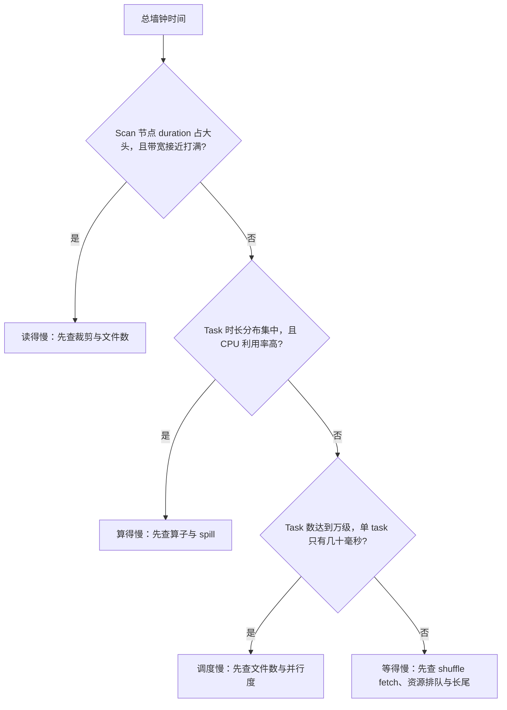
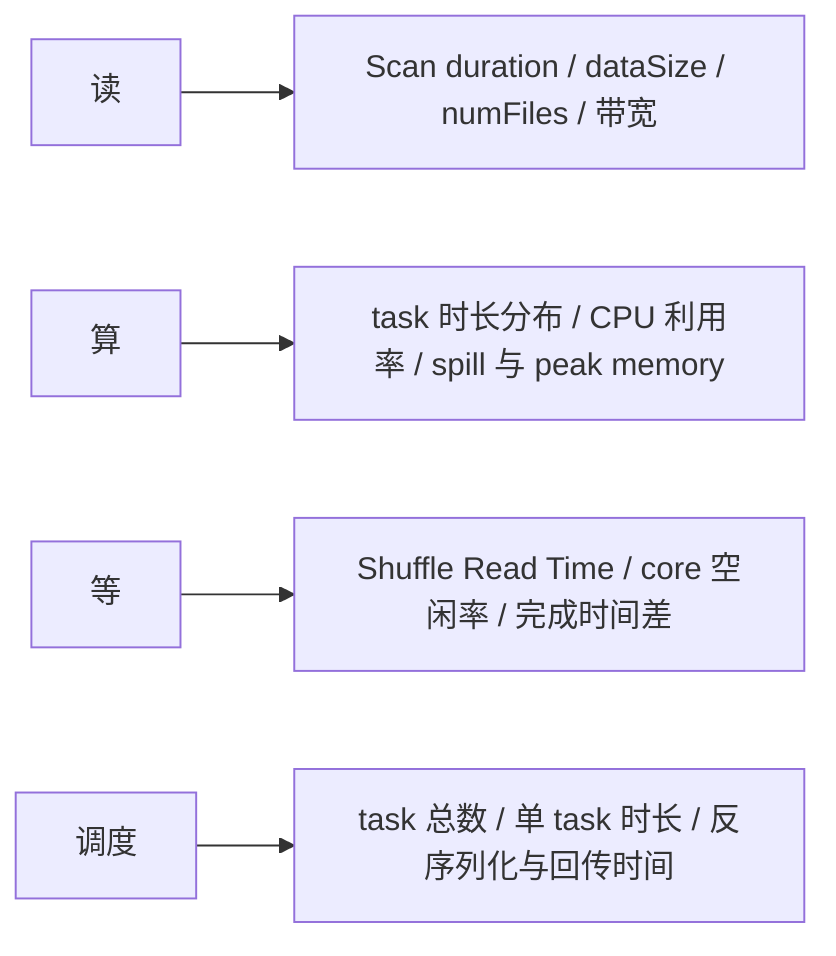
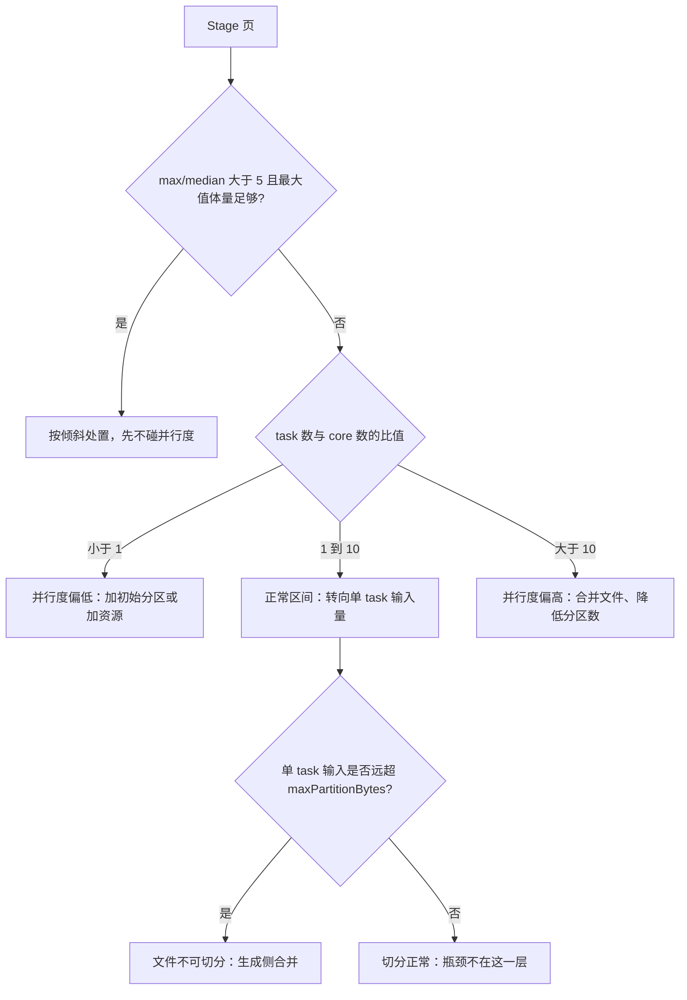
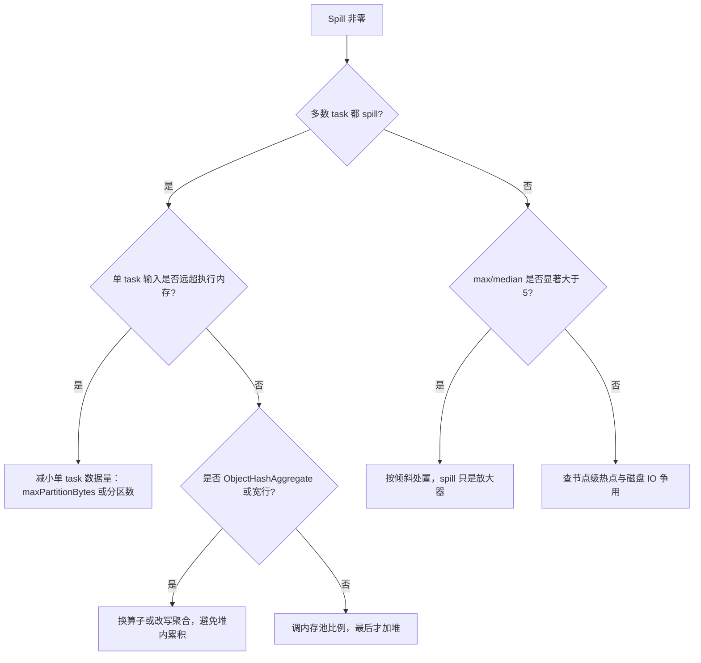
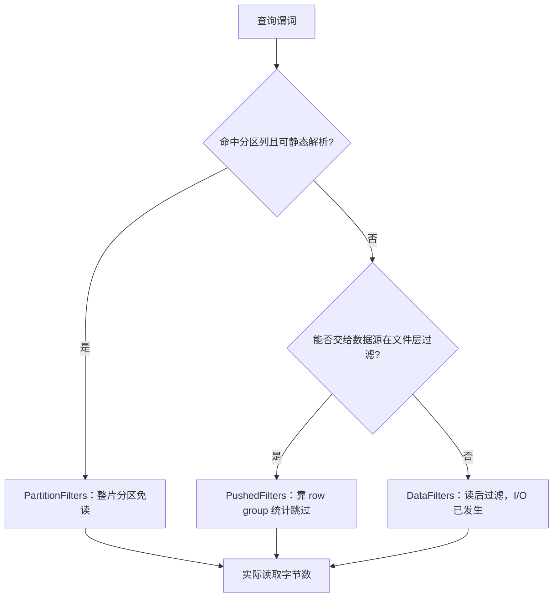
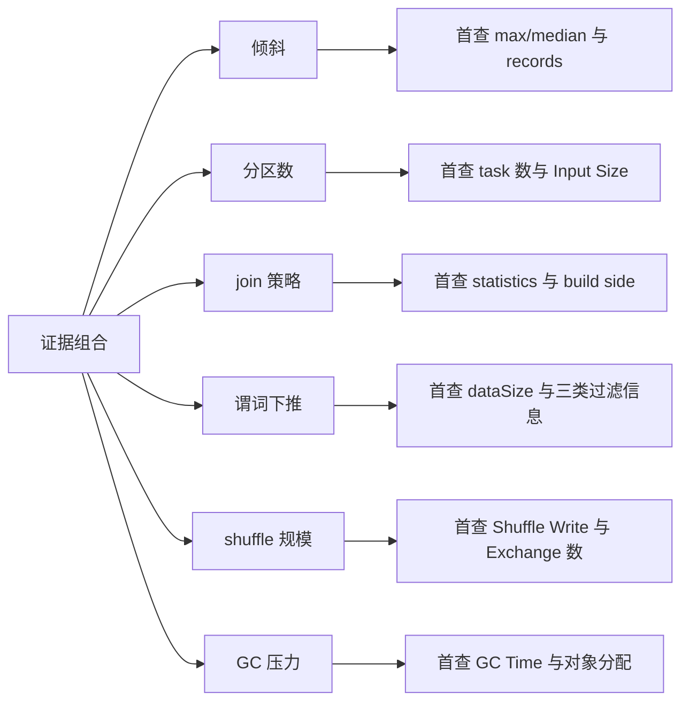

# 11 Spark SQL 调优实战：从慢查询到根因的诊断方法论

**摘要：**

一条 Spark SQL 查询跑了四十七分钟，三个人给出三种处方：加内存、加并行度、调 `spark.sql.shuffle.partitions`，每种都能讲出一套道理，彼此却互相矛盾。矛盾之所以成立，是因为三个人各自看见了一部分症状，却没有人先回答一个更靠前的问题：这四十七分钟到底慢在哪一层。本篇把调优从"猜参数"改造成"排顺序"，给出的是一条可执行、可复盘的判定链路：第 0 步用 Jobs、Stages、Executors 三个页面的指标把耗时归入读、算、等、调度四层之一；第 1 步看 Stage 边界与 task 分布，用 max/median 与"task 数对 core 数"判倾斜与并行度；第 2 步下到算子粒度，读 SQL Tab 的节点指标与 `EXPLAIN ANALYZE` 的运行时数值；第 3 步判 spill 与内存；第 4 步拿 `numFiles`、`dataSize` 与 `PartitionFilters`、`PushedFilters` 对账，确认裁剪是否真省了 I/O；第 5 步检查优化器有没有帮到忙，join 策略、`AQEShuffleRead`、CodeGen 断点各有判据。链路之后是本篇的核心交付：数据倾斜、分区数不当、join 策略错、谓词没下推、shuffle 过大、GC 压力六类根因的"症状组合 → 首查位置 → 处置"判据表，以及处置的优先级——改 SQL 高于改优化器配置，改优化器配置高于改资源，并给出"先别动参数"的三个理由与三种无效处置的反例。全文口径为 Spark 4.3.0，涉及的经验阈值均标注为量级判断。

---

## 第 1 章 慢是四种慢，不是一种慢

### 1.1 三种处方背后的同一个空缺

线上报来一条慢查询，最容易发生的场景不是没人会调，而是每个人都在调自己熟悉的那一块。做存储的人先看到 `dataSize` 是 1.8TB，主张换压缩、换列存；做 JVM 的人看到 GC 占总时长的两成，主张加堆内存；做平台的人看到 task 数与分区数不匹配，主张把 `spark.sql.shuffle.partitions` 从 200 调到 2000。三种主张在各自的证据上都站得住，放在一起却互相打架——加内存不会让 `dataSize` 变小，调分区数也不会让 GC 变少。

这类争论的根源不在于谁的水平低，而在于缺少一个共用的坐标系。没有坐标系，"慢"就是一个形容词，谁都能往里面塞自己的解释；有了坐标系，"慢"是一个位置，是可以指认、可以复核、可以被下一个人拒绝的。本篇要做的事情，就是先把坐标系立起来，再谈每个位置该用什么手段。

坐标系本身并不复杂，它来自 Spark 执行模型里一个朴素事实：一个作业的墙钟时间，由四类互不重叠的活动占满。

### 1.2 四类活动把时间分完

第一类是**读**：Executor 从文件系统把字节搬进内存，解压、解码、按列还原成 `InternalRow` 或 `ColumnarBatch`。这段时间的长短取决于读了多少字节、文件有多少、底层带宽给了多少，与 CPU 利用率关系不大。

第二类是**算**：表达式求值、哈希表插入、排序比较、聚合、序列化。这类活动的特征是 CPU 利用率高，且耗时与行数近似线性，与文件数无关。

第三类是**等**：等 shuffle 数据被 fetch 回来，等上游 stage 全部完成才能开始下一段，等资源队列分配 container，以及等那个跑了四十分钟的长尾 task。等的时间里 CPU 是空闲的，这一点是判读的关键——空闲的 CPU 会把"等"与"算"干净地分开。

第四类是**调度**：task 的序列化、提交、反序列化、结果回传、心跳与 DAGScheduler 的事件处理。单个 task 的调度开销在毫秒量级，可一旦 task 数以万计，这部分开销会累积成分钟量级，而且它既不算读也不算算，只会表现为"作业很忙但每个 task 都很快"。

四类活动在 Spark UI 里各有各的落点，这就是判定链路的物质基础。下面的决策树是全文的骨架，后面每一章都是在给其中一个分支补细节。



这张图有一个隐含前提：判断必须按顺序做，不能跳，跳步的代价是把"等"误当成"算"。一个 stage 的墙钟是四十分钟，其中三十五分钟在等最后一个 task，此时 Executor 的 CPU 利用率统计会显示"平均 12%"，与"CPU 瓶颈"恰恰相反；反过来，一个真正 CPU 密集的 stage，CPU 利用率会稳定在高位，task 时长分布也会相对均匀。两种情形的指标形态完全不同，只是需要按顺序去读。

### 1.3 四层的时间预算

调优的第一步不是找异常，而是**找大头**。下面的占比是笔者从若干生产作业上归纳的量级判断，不是基准测试结果，也不该被当成阈值使用——它的用途是让你在读完三个页面之后，能说出"这四十七分钟里大概有二十五分钟花在读上"这样的话。

| 层 | 主判据 | 典型占比（量级判断） | 首查位置 |
|---|---|---|---|
| 读 | Scan 的 `duration`、`dataSize`、`numFiles`；底层带宽是否接近上限 | 两成到六成，取决于裁剪是否生效与压缩比 | SQL Tab 的 Scan 节点、Stage 的 Input Size |
| 算 | task 时长分布均匀且都慢；CPU 利用率高；无大额 spill | 两成到五成，UDF 与复杂表达式会推高 | Stage 的 Task 表、SQL Tab 的聚合与 join 节点 |
| 等 | GC 之外的空闲时间；Shuffle Read Time；长尾 task 的独占时长 | 长尾场景可到五成以上 | Stage 的 max/median 比、Executors 页的 task 时间 |
| 调度 | Task 数达到万级；单 task 几十毫秒；Scheduler Delay 占比 | 正常低于半成，小文件场景可到两成 | Stage 的 Scheduler Delay、Task Deserialization Time |

四层的占比不是互斥的加总，一条查询常常同时具备两三种形态，诊断的价值在于排出先后。排先后的依据很实际：只有先修掉占大头、且修得动的那一层，后面的观测才不会被它掩盖。这就像修一条拥堵的路，先要分清堵在入口匝道、主路还是出口，不然拓宽主路只是在给匝道的瓶颈做无用功。

### 1.4 贯穿案例

后面各章共用一条查询：数仓里有一张按天分区的订单宽表 `dwd_order_wide`，单日约 1.2 亿行，压缩后约 60GB，一个月三十个分区合计 1.8TB；另有一张地区维表 `dim_region`，压缩后不到 2MB。下游要按天、按地区算出下单用户数与成交额：

```sql
SELECT o.dt, r.region_name,
       COUNT(DISTINCT o.user_id) AS uv,
       SUM(o.amount) AS gmv
FROM dwd_order_wide o
JOIN dim_region r ON o.region_id = r.region_id
WHERE o.dt BETWEEN '2026-10-01' AND '2026-10-30'
  AND o.channel = 'app'
GROUP BY o.dt, r.region_name;
```

这条查询的形状值得说明：一次 join、一次聚合、两次 shuffle（join 一次、聚合一次），维表小到必须被广播，宽表的过滤条件命中分区列，`COUNT(DISTINCT)` 会触发 `Expand` 把行数放大。它同时具备"读得慢"与"算得慢"的潜力，正好用来演示判定顺序如何避免误判。

集群规模按 100 个 Executor、每个 20 核、每核 4GB 堆内存估算，合计 2000 核。这些数字只用于后文的示例推算，不影响方法的适用性。

---

## 第 2 章 第 0 步：确认慢在哪一层

### 2.1 三个页面就是全部入口

Spark UI 有三个页面承担了八成的诊断工作：Jobs 页给作业级的墙钟与 stage 列表，Stages 页给 stage 内的 task 分布与 shuffle 数据量，Executors 页给每个 executor 的 task 时间、GC 时间与内存使用。三者之外还有一个 SQL 页，它按 `SQLExecution` 聚合算子指标，是第 2 步的主战场。

读的顺序是固定的：先在 Jobs 页找到耗时最长的那个 job，再点进它最慢的 stage，最后用 Executors 页确认"慢"是普遍现象还是个别节点。反过来读，也就是先看 Executors 页的平均值，会被平均数抹平——一百个 executor 里有三个被打爆，平均值仍然好看。

### 2.2 读得慢的判据

读得慢的形态很少伪装：Scan 节点的 `duration` 占 job 总时长的比例高，`dataSize` 与表的总大小接近，`numFiles` 与预期分区数对得上而单 task 的 Input Size 稳定在 `maxPartitionBytes` 附近，这时基本可以确认瓶颈在 I/O。此时再去确认带宽：如果集群的网络与磁盘带宽已经接近上限，那就是"数据量就是这么多的合理慢"，唯一的出路是减少要读的字节；如果带宽只用了一半，说明读的并行度不够，或者卡在了文件数、元数据、对象存储的请求速率上。

一个常被忽略的对照量是**列裁剪**后的字节数。Parquet 是列存，`SELECT` 里写了几个列，就只读几个列的数据页；如果 `dataSize` 与"按全列估算的表大小"接近，而查询只用了五列，那说明列裁剪没有生效，常见原因是读的是视图或子查询、`SELECT *` 被下游一路传递、或者表本身是行存格式。

### 2.3 算得慢的判据

算得慢的特征是"均匀"：task 时长分布在 25 分位到 75 分位之间很窄，最大值与中位数的比值在两三倍以内，CPU 利用率稳定在高位，垃圾回收（Garbage Collection，GC）时间占比不高，spill 不大。此时时间是被每一个 task 平摊掉的，没有任何一个 task 拖后腿。

这类慢的处置方向与"等"完全相反：加资源几乎无效，因为 CPU 已经跑满；该做的是减少计算量，包括减少行数（更早过滤）、减少表达式开销（去掉 UDF、避免 `CAST` 链）、减少算子间的物化（让 CodeGen 把更多算子融合起来）。

判读时要小心一种假象：AQE 的 stage 之间有一段等待，如果 stage 数量多、每段都不长，累加起来的等待会被误算进"算"。分辨办法是看 stage 的墙钟之和与 job 墙钟之差，差额就是调度与等待的总量。

### 2.4 等得慢的判据

等有三种来源，各有各的指标：shuffle fetch、资源排队与长尾独占。

第一种是 shuffle fetch：Stage 的 Task 表里 `Shuffle Read Time` 与 `Shuffle Read Size` 同时高，说明 task 把时间花在拉数据上，而不是算数据上。这类情形在集群网络打满、或有节点磁盘慢时尤其明显。

第二种是资源排队：stage 已经提交但 task 迟迟不开始，`Scheduler Delay` 高而 task 的 `Duration` 不长；同时 Executors 页显示 core 全部被占用，YARN 或 K8s 侧有 pending container。

第三种是长尾独占：stage 的进度条停在 99%，完成时间由最后一个 task 决定，其余 task 早已结束。此时 CPU 利用率呈"先高后空"的形状，是最容易识别也最容易被误判为"CPU 瓶颈"的形态。

三种"等"的处置完全不同：fetch 慢要减少 shuffle 字节或改本地读，排队要扩资源或调分配，长尾要治倾斜。把三者混为一谈，就会得到"加内存吧"这种既不解决 fetch 也不解决排队的处方。

### 2.5 调度慢的判据

调度慢的形态最好认：task 数以万计，单 task 时长只有几十毫秒，调度延迟（`Scheduler Delay`）与 task 反序列化时间（`Task Deserialization Time`）在 task 时长里占到一成以上，Driver 端的日志里能看到任务提交的节奏本身成了瓶颈。

它的成因几乎总是文件数或分区数过多。一万八千个 100MB 的文件，按 `maxPartitionBytes` 切分之后就是一万八千个 task，每个 task 打开文件、反序列化、跑一遍极短的逻辑、回传结果，调度开销与有效计算的比例随 task 数线性恶化。此时调 `spark.sql.shuffle.partitions` 是无效的，因为它管的是 shuffle 的 reduce 分区，管不到 scan 的 task 数。

四层的判据可以并列成一张对照表，它不提供结论，只提供"该去看哪里"，结论必须由下一层的数字给出。

| 层 | 必须同时出现的信号 | 与其他层区分的关键 |
|---|---|---|
| 读 | Scan `duration` 高、`dataSize` 高、带宽接近上限 | CPU 利用率不高，但 I/O 队列与带宽指标饱和 |
| 算 | task 时长均匀、CPU 利用率高、无大额 spill | max/median 比值小，说明没有长尾在等 |
| 等 | CPU 空闲与 stage 未完成同时存在 | 有 task 已结束而 stage 未结束，或 fetch 时间占比高 |
| 调度 | task 数万级、单 task 极短、Scheduler Delay 占比高 | 看文件数与 partition 数，而不是看数据量 |

四层各自对应一组指标，把它们画在一起，是因为诊断时真正要做的动作是"拿指标去对层"，而不是"从指标推结论"。同一个 `Scheduler Delay` 在"等"与"调度"两层都会出现，区别在于它是被长尾 task 撑出来的，还是被 task 总数堆出来的。



---

## 第 3 章 第 1 步：Stage 划分与 task 分布

### 3.1 Stage 边界就是 shuffle 次数

一个作业被切成多少个 stage，只由一件事决定：哪里有 shuffle。窄依赖的算子链可以全部挤在一个 stage 里流水执行，遇到 `ShuffleExchangeExec` 就断开，因为下游必须等上游把数据写完才能开始拉。`BroadcastExchangeExec` 是个例外，它的构建侧需要单独物化，但探测侧可以继续流水。

这个事实的实用价值在于：**Stage 数就是 shuffle 次数加一**。一条查询在 UI 里出现了五个 stage，意味着中间做了四轮重分布；如果按查询的语义只该有两轮，那另外两轮就是白做的，常见于重复的 `repartition`、多次 `distinct`、以及自连接两侧被各拆一次。

开启自适应查询执行（Adaptive Query Execution，AQE）之后，stage 的形态会变：QueryStage 的数量与物化轮次对应，UI 里的 job 条目数也跟着变多，一个原本"一个大 job"的查询会表现为若干个小 job 串行。此时不要按 job 数判断复杂度，要按 `Exchange` 节点数判断。

### 3.2 max/median：倾斜的量化判据

Stage 页的 Task 表支持按列排序，也支持 Summary Metrics 视图，判倾斜只需要两列：`Duration` 与 `Shuffle Read Size`。

比值本身要两个条件同时成立才算数。两个倍数都是量级判断，不是从某个基准里算出来的常数。第一个是**相对条件**，最大值超过中位数的若干倍，阈值取 3 倍时属于"有嫌疑"，5 倍以上基本可以确认，10 倍以上属于严重倾斜；第二个是**绝对条件**，那个最大值本身要有足够的体量，分区大小在几十 MB 以下的十倍数差异对总时长没有影响，追它只是浪费。两条一起用，可以挡掉大量"小数据上的虚假倾斜"。

还有一条更细的判据区分"倾斜"与"单点慢"：看 records 而不只看 bytes。若某个 task 的 `Shuffle Read Size` 大，`Records` 也同比大，那是真倾斜；若 bytes 不大而 `Duration` 很长，问题在 GC、UDF 或磁盘，不属于倾斜。两者的处置相差很远，用错了方向会浪费几天。

下面这条四十七分钟查询在 Stage 页留下的痕迹，可以用来演示判据怎么落地。数据是示例推算，比例参考真实作业的形态。

| Stage | 内容 | Task 数 | 墙钟 | 关键观测 |
|---|---|---|---|---|
| 2 | 扫描三十个分区、过滤、局部聚合 | 18240 | 19 min | 单 task 约 100MB；Scheduler Delay 占 8% |
| 4 | 广播 join、按 dt 与 region 聚合 | 200 | 22 min | max/median = 6.8；最大 task 的 Shuffle Read 4.1GB |
| 6 | 写结果表 | 1 | 40 s | 结果只有 900 行，写放大主要来自小文件提交 |

三行数据已经说明了三件事：stage 2 是调度慢与读慢的混合，一万八千个 task 的调度开销不可忽略；stage 4 是典型的倾斜，二百个 task 里有几个吃掉了大部分时间；stage 6 的四十秒里有相当一部分是提交与元数据开销。三条结论指向三个不同的处置，不能合并成"加资源"。

### 3.3 task 数：并行度是否合理

task 数的合理区间有一个粗略的经验法则：每个 CPU 核上跑两到三个 task 的量级，可以让调度开销与资源空转之间取得平衡。低于"核数"意味着有核闲着，高于"核数乘十"意味着调度占比开始失控。

这个法则是粗略的，因为它默认 task 时长在同一量级。同一个 stage 里既有 10 秒的 task 又有 5 分钟的 task 时，task 数再合理也照样长尾，判据要让位给 max/median。所以顺序是先用 max/median 判分布，再用 task 数判总量，两步都过了才轮到调并行度。

对于 shuffle 的 reduce 侧，并行度由初始分区数决定，而初始分区数在 4.x 里应当理解为一个"上限"而不是目标。AQE 的合并只做合并、不做拆分（倾斜拆分是另一条规则），也就是说实际 task 数只会小于等于初始分区数。想让 AQE 有合并的空间，就把 `spark.sql.adaptive.coalescePartitions.initialPartitionNum` 设得足够大，让读侧的合并去决定最终的分区形状；这条机制在 [[大数据/Spark/Spark-SQL深度解析与性能调优/06 AQE：运行时自适应查询优化|AQE 一篇]] 里有完整推演。集群侧的执行器数量、核数与 task 队列的关系属于调度系统本身，可作为背景参考 [[大数据/Spark/读书笔记-spark内核/06_性能调优实战/3. Spark集群资源分配与并行度调优|资源与并行度调优]]，本篇只用来判断"核有没有闲着"。

### 3.4 单 task 输入量：maxPartitionBytes 的读法

scan 侧的 task 数由三样东西共同决定：文件数、文件大小、以及 `spark.sql.files.maxPartitionBytes`（默认 128MB）。可切分的文件（Parquet、ORC）会按这个上限切成 split，一个 60GB 的分区就是四百八十个 split；不可切分的文件（gzip 压缩的文本、某些容器格式）则一个文件一个 split，无论它多大。

`spark.sql.files.openCostInBytes`（默认 4MB）容易被漏掉，它的语义是"打开一个文件的代价相当于读这么多字节"。文件调度的逻辑会把若干小文件打包进同一个 partition，直到累计的"虚拟字节数"超过 `maxPartitionBytes`。这个参数调大，task 数变少、单 task 打开的文件变多，文件句柄与元数据请求的压力上升；调小，task 数迅速膨胀，调度开销重新回来。

判断"该动哪个"的方法很直接：看 Stage 页的 Input Size 分布。单 task 输入稳定在 100MB 到 128MB，说明切分正常，问题在文件总数；单 task 输入远超 128MB，说明文件不可切分，得从生成侧合并文件；单 task 输入只有几 MB，说明文件太碎，先调 `openCostInBytes` 做临时缓解，再去做彻底的小文件合并。

把这一节和上一节的判据连起来，Stage 页的判读可以固定成一条从分布到总量的路径：



### 3.5 反例：分区数调大却没变快

有个常见的操作是把 `spark.sql.shuffle.partitions` 从 200 调到 2000，理由是"task 太少，并行度不够"，但跑完之后墙钟没变，有时还更慢。

原因往往不在参数，而在瓶颈的位置：若 stage 2 是瓶颈，这个参数对它没有任何影响，因为 scan 的 task 数由文件决定；若瓶颈在 stage 4 的倾斜，把分区数调大只是让两百个 task 变成两千个，那个 4.1GB 的热点分区被哈希到某一个新分区里，其余一千九百九十九个陪跑，长尾一点没变。

还有一种更隐蔽的情形：没有 AQE 时，分区数调大会让 map 端为每个 reduce 分区准备一份缓冲，内存压力上升，spill 跟着出现，于是"并行度提高了"实际表现为"每个 task 处理的数据更小但溢出更多"。要判断属于哪一种，只需对照调参前后的 spill 与 max/median，两个数字就能定位。调参之前，先确定瓶颈在哪一层。

---

## 第 4 章 第 2 步：算子级耗时

### 4.1 SQL Tab 的节点指标是什么口径

进到 SQL 页，点开一次执行，看到的是一张带指标的算子 DAG。每个节点上悬浮的数值有几个固定项：`duration`、`number of output rows`、`peak memory`、`spill size`，再加上该算子特有的项（Scan 有 `number of files`、`data size`、`metadata time`，Exchange 有 `shuffle bytes written`，join 有 `build side size`）。

这些数字的口径必须说清楚，否则一定会读错：它们是**跨 task 累加**的，不是墙钟。一个节点有四百个 task 各花 3 秒，UI 上显示的是 1200 秒，而实际墙钟可能只有 3 秒。这个口径有两面性：它不适合用来判断"慢不慢"，因为它把并行度抹掉了；但它非常适合用来判断"谁在消耗计算量"，因为它是总 CPU 占用的近似。

于是 SQL Tab 的正确用法是横向比较各节点的累加耗时占比，找出计算量的大头，再用 Stage 页的墙钟去确认这个大头是不是真在关键路径上。一个累加耗时很高的节点，如果它的 task 并行度足够，未必拖慢查询；一个累加耗时一般但 max/median 悬殊的节点，才是真正的长尾来源。

### 4.2 EXPLAIN ANALYZE 给的是运行时数值

`EXPLAIN ANALYZE` 从 3.0 起提供，它的行为与普通 `EXPLAIN` 有本质区别：它会真正把查询跑一遍，把每个节点在实际执行中产生的 metrics 写进计划文本。输出里的每个节点后面会带上 `metrics` 段，形如：

```text
*(2) HashAggregate(keys=[dt#12, region_name#30], functions=[count(distinct user_id#8), sum(amount#9)])
      duration total (min, med, max (stageId: taskId)): 14 min 22 s (3.2 s, 4.1 s, 9 min 40 s)
      number of output rows: 906
+- AQEShuffleRead coalesced
   +- ShuffleQueryStage 3
      number of output rows: 3,588,402,113
```

上面这段是摘录示意，只保留了与判读相关的两三个 metric，实际输出还包含各阶段的计划，以及 `spill size`、`peak memory` 一类指标，节点的呈现形式随版本略有差异。这段文本的价值在于它把"计划"与"实际"放在同一行。看 `AQEShuffleRead coalesced` 就知道 AQE 合过分区，看 `ShuffleQueryStage 3` 的 `number of output rows` 就知道 join 之后的行数有没有按预期收敛。

它也有三个限制：其一，它真的会执行查询，代价是完整的执行成本，不适合对生产大查询随手使用。其二，它会把结果写进 Driver 内存再丢弃，结果集大的查询要留意 Driver 的压力。其三，它输出的指标与 SQL Tab 是同一套口径，同样是累加值，别拿它当墙钟。

### 4.3 各算子的耗时画像

不同算子的"高耗时"含义不同，配着看的指标也不同。下面这张表是判读时的对照，左侧是节点名，右侧是它耗时高时应该追问的问题。

| 算子 | 高 duration 通常意味着 | 配套看什么 |
|---|---|---|
| `FileScan` | 读的字节多、文件多、解压与解码成本高 | `data size`、`number of files`、`metadata time` |
| `Filter` | 谓词复杂或未下推，行级求值量大 | 输入与输出行数比、`PushedFilters` 是否包含该条件 |
| `HashAggregate` | 分组键基数高、聚合函数重、`Expand` 放大了行数 | `spill size`、`peak memory`、是否有 `Expand` 子节点 |
| `Sort` | 排序数据量大、比较成本高 | `spill size`、与下游 join 的排序要求是否重复 |
| `SortMergeJoin` | 两侧都要排序与 shuffle，合并阶段输出量大 | 两侧 `shuffle bytes written`、join 键的分布 |
| `BroadcastHashJoin` | 构建侧过大，哈希表反复扩容 | `build side size`、是否出现 `OutOfMemory` 或长 GC |
| `Exchange` | 序列化与落盘量大、分区数过多 | `shuffle bytes written`、map 端文件数 |
| `AQEShuffleRead` | 拉取的分区过多、fetch 请求密集 | 合并后的分区数与单 task 扇入数 |

一个具体的判读例子：`HashAggregate` 的 `duration` 排在第二位，`spill size` 有 320GB，`peak memory` 贴着 task 的执行内存上限。这说明聚合的内存缓冲撑不住，原因可能是分组键的基数远高于估算（`region_name` 加上 `dt`，再加上 `Expand` 带来的去重列），也可能是某个分区的行数远超其他分区。分辨两者的方法回到 stage 的 max/median：若比值大，是倾斜；若比值小，是基数与估算的问题。

### 4.4 两个容易读错的细节

第一个细节是 `number of output rows` 衡量的是该节点吐出的行数，不是吃进去的行数。一个 `Filter` 节点输出 3600 万行，可能意味着它读进来 36 亿行丢掉了 99%，也可能意味着上游本来就只给了 3600 万行。要区分，得看上游节点的 output rows，或者看 `EXPLAIN` 里该算子与子节点的连接关系。

第二个细节是 join 的成本不在 join 节点自己身上。`SortMergeJoin` 的 duration 往往不大，因为真正贵的排序与 shuffle 分摊在两侧的子节点上。只盯着 join 节点判断"join 慢不慢"会得出相反结论，正确做法是把 join 子树当成一个整体看总耗时。

---

## 第 5 章 第 3 步：内存与 spill

### 5.1 spill 的两个口径

Stage 页的 Task 表里有 `Spill (memory)` 与 `Spill (disk)` 两列，多数人把它们当成同一个数字的两种单位，其实口径不同：前者是溢出数据在内存中的表示大小（按 `UnsafeRow` 估算），后者是落盘后的序列化大小。两者的比值反映了序列化与压缩的效果，正常情况下 disk 小于 memory，若 disk 显著大于 memory，说明溢出路径上的编码方式与预期不符。

spill 非零是一条强信号，但它只说明"内存不够用"，不说明"为什么不够用"，后者才是根因，也是本章要拆的部分。

### 5.2 peak execution memory 的读法

执行内存峰值（`Peak Execution Memory`）是单 task 在执行期间（shuffle、聚合、join、排序这些会申请执行内存的算子）的内存峰值，由 `TaskMemoryManager` 记账，不含缓存占用的存储内存。这个指标的价值在于判断"离溢出差多远"。

若峰值贴着 task 可用的执行内存上限，说明 spill 是被逼出来的，加内存或者减少单 task 数据量都能缓解；若峰值只有上限的三成却仍然大量 spill，说明问题不在总量而在结构——空间被某个算子独占（譬如哈希表无法逐出），其余算子申请不到，此时加内存仍然有效，但更划算的是换算子。`ObjectHashAggregateExec` 就是这类陷阱：它为了支持 `collect_list`、`percentile` 这类无法增量合并的聚合函数而把整组数据放在堆上，源码注释直书不支持代码生成，一旦缓冲撑不住只能整体退回到 sort-based 路径，回退阈值由 `spark.sql.objectHashAggregate.sortBased.fallbackThreshold` 控制，代价是一次额外的排序与 spill。

### 5.3 spill 归因三分

把 spill 归因到具体原因，只需要三步：先看是普遍还是个别，再看单 task 输入量，最后看算子类型。

> [!info] 判读顺序
> 普遍 spill（多数 task 都有）指向单 task 数据量过大或算子选择不当；个别 spill（只有少数 task）指向倾斜；两者都排除之后，才轮到内存池配置。

普遍 spill 的第一候选是单 task 数据量：四百八十个 split、每个 128MB，对一个 `HashAggregate` 而言可能是 128MB 输入膨胀成 1GB 哈希表，远超单 task 可用的执行内存。这时把 `maxPartitionBytes` 调到 64MB 或者把 shuffle 分区数调大，都比加堆内存直接。

个别 spill 的第一候选是倾斜，回到 stage 的 max/median 就能确认。要注意 spill 在倾斜场景里是**放大器**而不是根因：热点分区溢出到磁盘，读回来再算，时长从十分钟变成四十分钟，看起来是内存问题，修法却在数据分布上。

两个都排除之后，才轮到算子与配置：`spark.memory.fraction`（默认 0.6）决定统一内存池占堆的比例，调大给执行内存更多空间，代价是用户对象与元数据可用的堆变小，JVM 层面的压力反而上升；`spark.memory.storageFraction`（默认 0.5）决定缓存能"守住"多少内存，调小会让缓存更容易被挤出，缓存命中率下降。这两个参数的影响是相互的，单改一个常常看不到效果。把上面的三步顺序画成判定路径，归因时就不容易跳过第二层直接落到内存池：



### 5.4 内存参数放在最后

把内存参数放在链路末端，不是因为加内存没用，而是因为它的收益依赖前两步的结论。同一个 320GB 的 spill，若来自倾斜，加内存只是把 OOM 推迟到数据再涨两成的那一天；若来自单 task 数据量，减小分区更便宜；若来自算子结构，换算子比加内存彻底。

这里还有一层容易被忽略的代价：堆内存调大之后，GC 的停顿时间随之变长，而停顿会同时影响所有 task，吞吐的收益可能被抵消。JVM 一侧的调优细节属于执行层，[[大数据/Spark/读书笔记-spark内核/06_性能调优实战/5. Spark_JVM性能调优|JVM 与 GC 的取舍]] 一篇里有更完整的展开，本篇只需记住一条判据：GC 时间占比是"结果"而不是"参数"，它由对象分配速率与堆大小共同决定。

| 参数 | 默认值 | 调大的代价 | 调小的代价 |
|---|---|---|---|
| `spark.executor.memory` | 由提交脚本决定 | GC 停顿变长，container 粒度变粗，资源碎片增多 | spill 与 GC 频率上升，task 失败重算变多 |
| `spark.executor.memoryOverhead` | max(384MB, 堆的 10%) | 集群可用堆减少，性价比下降 | 堆外与 native 内存不足，表现为容器被杀而非变慢 |
| `spark.memory.fraction` | 0.6 | 用户对象空间被挤压，元数据与反序列化更容易 OOM | 执行内存不足，spill 普遍出现 |
| `spark.memory.storageFraction` | 0.5 | 缓存更难被挤出，执行内存吃紧时被迫 spill | 缓存命中率下降，重复读放大 |
| `spark.sql.files.maxPartitionBytes` | 128MB | 单 task 数据量上升，内存压力与 spill 风险增加 | task 数上升，调度与文件打开开销增加 |
| `spark.sql.files.openCostInBytes` | 4MB | task 数下降，单 task 打开文件过多，元数据压力上升 | task 数膨胀，小文件场景调度开销失控 |

---

## 第 6 章 第 4 步：看 IO

### 6.1 Scan 的三个数

Scan 节点上的 `numFiles`、`dataSize`、`numOutputRows` 是三个不同维度的量：文件数决定 task 数与元数据开销，字节数决定 I/O 量，输出行数决定后续算子的输入规模，三者要一起看。

`dataSize` 与表的实际大小对照，可以判断裁剪有没有生效。三十个分区共 1.8TB，若 `dataSize` 是 1.8TB，说明分区裁剪没起作用或全部命中；若查询只用五列，而 `dataSize` 接近全列大小，说明列裁剪没起作用，这在 Parquet 上意味着读了大量用不到的数据页。

`numOutputRows` 与 `dataSize` 的比值，可以判断"读了很多又丢掉"：若某个查询读了 600GB 只输出 200 万行，比值低得离谱，说明过滤条件没有在文件层生效，Spark 把数据读出来之后才在 `Filter` 节点里筛掉。这种情况在 Stage 页表现为 `Input Size` 很大、`Output Size` 很小，两列一比就能看出浪费。

### 6.2 三类过滤信息的分工

`EXPLAIN FORMATTED` 的 Scan 节点会列出三类过滤信息，它们不是同义词，作用层级完全不同。

| 信息 | 生效层级 | 省掉的是什么 | 失效的典型形态 |
|---|---|---|---|
| `PartitionFilters` | 目录层，列出要读的分区路径 | 整片分区的读取与文件列举 | 分区列被函数包裹、类型不匹配、谓词经视图或 UNION 后丢失 |
| `PushedFilters` | 文件层，交给数据源在 row group 或 page 级过滤 | 反序列化与 Spark 侧的谓词求值 | 谓词包含不支持的表达式、列类型与统计信息不兼容 |
| `DataFilters` | 数据源 V2 的接口层，交给连接器自行决定 | 取决于连接器实现，可能是下推到远端 | 连接器不支持该谓词，或 `supportsPushDownFilters` 返回假 |

三层过滤的关系不是并列，而是一条逐级退让的链路：能在目录层解决的不该拖到文件层，能在文件层跳过的数据不该读进 Spark 再过滤。下图给出这条链路在计划里的落点与每一级的失效条件。



三类里最容易误判的是 `PushedFilters`：它出现在计划文本里，只代表"这个过滤条件被交给了数据源"，不代表"数据源真的跳过了数据"。Parquet 能用来跳过 row group 的依据是每个 row group 的列统计（min/max、null count），如果谓词是 `LIKE '%app%'` 这种无法用统计判断的形式，数据源仍会读完整个 row group 再过滤，只是过滤发生在解码之后，省下的是 Spark 侧的表达式求值，不是 I/O。

`PartitionFilters` 的误判也常见：计划文本里出现分区条件，不等于所有分区都被排除，它只说明"过滤条件被识别为分区谓词"。要确认实际读了几个分区，得看 `numFiles` 与目录结构是否对得上；开了动态分区裁剪（Dynamic Partition Pruning，DPP）时，`PartitionFilters` 里还会出现 `dpp` 相关的子查询表达式，这是另一条链路，机制与失效条件见 [[大数据/Spark/Spark-SQL深度解析与性能调优/09 数据源与 IO 优化：让数据少读、快读、不重读|数据源与 I/O 优化]]。

### 6.3 裁剪失效的四种形态

第一种是分区列被函数包裹：`WHERE date_format(dt, 'yyyy-MM') = '2026-10'` 或 `WHERE substr(dt, 1, 7) = '2026-10'`，优化器无法把它反解成目录范围，分区裁剪直接失效，退化成全表扫描加逐行过滤，改法是把条件写成范围：`WHERE dt BETWEEN '2026-10-01' AND '2026-10-31'`。

第二种是类型不匹配：分区列是字符串 `'2026-10-01'`，谓词写成整数 `20261001`，比较需要一次隐式转换；在 4.x 的 ANSI 模式下这类比较可能直接报错，在非 ANSI 模式下会插入 `Cast`，而 `Cast` 之后的条件通常无法用于分区裁剪。改法是保持字面量与列类型一致，类型强转的规则与失效边界见 [[大数据/Spark/Spark-SQL深度解析与性能调优/02 Catalyst 解析与分析：从 AST 到 Analyzed LogicalPlan|Catalyst 解析与分析]]。

第三种是谓词传递被阻断：视图里套了 `UNION ALL`、子查询里有聚合、CTE 被多次引用，谓词可能无法穿过这些边界到达最底层的 Scan。判断方法是看最终计划里最底层 Scan 的 `PartitionFilters` 是否包含外层写的条件，若为空而外层谓词确实存在，就是传递失败。这一类只能靠改写查询结构，把过滤条件写到最靠近数据的那一层。

第四种是数据源不支持：DataSource V2 的连接器通过 `supportsPushDownFilters` 声明能力，返回假的时候，条件是 Spark 自己算的，计划里不会出现 `PushedFilters`。这类失效与 SQL 写法无关，只能看连接器文档或源码。

### 6.4 元数据时间与小文件

`metadata time` 是 Scan 节点列出文件、读取 footer、解析 schema 的时间，它在 task 之外由 Driver 或 Executor 串行完成，小文件多时能占到 Scan 总耗时的两成以上。这个数字很容易被忽略，因为它在 SQL Tab 上只是一个小小的指标，而它对应的优化（合并小文件）往往是最彻底的。

一万八千个文件，每个 footer 几 KB，累加起来是几十 MB 的元数据读取加上一万八千次文件系统调用；对象存储上每次调用的延迟在毫秒量级，一万八千次就是几十秒到几分钟。这类成本不随数据量变化，只随文件数变化，所以它的判据是"文件数"而不是"数据量"。

---

## 第 7 章 第 5 步：优化器有没有帮到忙

### 7.1 join 策略的判读

物理计划里的 join 有四种主要形态，判读时先认出是哪一种，再问"该不该是它"。

`BroadcastHashJoinExec` 把构建侧收进每个 Executor 的哈希表，探测侧流式通过，没有 shuffle。它成立的前提是构建侧的字节数低于 `spark.sql.autoBroadcastJoinThreshold`（默认 10MB，设为 -1 表示禁用广播），且构建侧能够被收集。判据是双向的：该广播却没广播，多半是统计信息缺失或过期，也可能是 hint 写成了 `MERGE`；不该广播却广播了，多半是统计信息把大表估成了小表，表现为 Driver 或 Executor 的 OOM。

`SortMergeJoinExec` 两侧都要按 join 键重分布并排序，代价是两次 shuffle 加两次排序。它的优点是内存占用可控，能处理任意规模的两侧。判据是：两侧都远大于广播阈值时它是正确选择；一侧明显很小却走了它，就是策略误选。

`ShuffledHashJoinExec` 在 4.x 里由 AQE 的运行时规则 `ConvertSortMergeJoinToShuffledHashJoin` 决定，开关默认是 true，但它的判据要求 `spark.sql.adaptive.advisoryPartitionSizeInBytes`（默认 64MB）不大于 `spark.sql.adaptive.maxShuffledHashJoinLocalMapThreshold`（默认 0），两个默认值一比较，这条转换在默认配置下实际不会发生。看到"开关是开的、行为是关的"，别急着怀疑版本，先核对这两个数；这条"默认值互相卡住"的现象在 [[大数据/Spark/Spark-SQL深度解析与性能调优/05 Physical Planning：从逻辑计划到物理算子的策略选择|物理规划]] 与 [[大数据/Spark/Spark-SQL深度解析与性能调优/06 AQE：运行时自适应查询优化|AQE]] 两处都有展开。

`BroadcastNestedLoopJoinExec` 用于非等值连接，没有哈希可用，只能双层循环加广播。它的代价是探测侧行数乘构建侧行数，几十万乘几十万就是灾难。计划里出现它，先回去看 SQL 的 join 条件是不是漏写或者写成了不等式。

### 7.2 AQE 的痕迹：AQEShuffleRead 与 isFinalPlan

开了 AQE 的查询，最终计划里会出现 `AQEShuffleRead` 节点，它表示读侧的分区合并或倾斜拆分已经发生。看到它就说明 AQE 至少动过读侧；没看到它而计划里又有 `AdaptiveSparkPlan`，说明这一轮没有被采纳任何读侧改动。

`AdaptiveSparkPlan isFinalPlan` 这个参数是判读的关键：普通 `EXPLAIN` 不执行查询，参数永远是 `false`，看到它写 false 不代表 AQE 没生效，只代表你看的是初始计划。要拿最终计划，只有三条路：`EXPLAIN ANALYZE`、SQL Tab 的 Final Plan 视图、以及把 `spark.sql.adaptive.logLevel` 调到 info 之后看 `Final plan:` 的输出。

还有一条容易忽略的判据：AQE 的代价评估器比较的是 shuffle 个数，不是耗时。一个能把长尾从三十分钟压到两分钟但要多引入一次 shuffle 的方案，在默认判据下会被否掉。计划里没看到倾斜拆分，不一定是没识别出倾斜，也可能是识别了但被代价判据挡回。

### 7.3 CodeGen 的断点

计划文本里 `*(N)` 的前缀表示这一段算子被融合进了同一段生成代码，`N` 是**融合段**的编号。融合段越长，算子之间的虚调用、行对象创建、边界检查越少。

断点出现在三类位置：不支持代码生成的算子（`ObjectHashAggregateExec`、Python UDF 的行式求值、部分窗口函数）、列式与行式的接缝（`ColumnarToRow`，向量化算子把 `ColumnarBatch` 交给行式算子时必须转换）、以及计划本身的字段数超过融合上限（超宽 Schema 会被切成多段）。判据是数一下 `*(N)` 的段数与算子总数：一段里只有一个 `FileScan` 加一个 `Filter`，说明融合被切得很碎，值得去看是谁在中间。

CodeGen 失效的后果是"每一行都多几次虚调用与对象分配"，它在 CPU 密集的查询上表现为可观的吞吐损失，在 I/O 密集的查询上几乎看不出来。这也是为什么它应该放在第 5 步而不是第 1 步：只有确认瓶颈在算，它的收益才成立。融合的判定规则与切分条件见 [[大数据/Spark/Spark-SQL深度解析与性能调优/07 Whole-Stage CodeGen：JVM 字节码级别的性能飞跃|Whole-Stage CodeGen]]，列式与行式的另一条接缝见 [[大数据/Spark/Spark-SQL深度解析与性能调优/08 向量化执行引擎：列式处理与 SIMD 的力量|向量化执行引擎]]。

### 7.4 用对照实验拿因果证据

前面四步得到的都是相关性：这个指标异常，所以怀疑那个机制。要拿到因果，最干净的办法是做一次单变量对照：固定数据、固定资源、固定其他配置，只关掉或打开一个开关，比较同一组指标。

优化器相关的对照有三组值得常备：第一组是用 `spark.sql.optimizer.excludedRules` 排除某条规则（譬如 `PushDownPredicates`），看计划与耗时的变化，这能直接回答"谓词下推到底有没有起作用"。第二组是 `spark.sql.adaptive.enabled` 的开关对照，回答"AQE 是帮忙还是添乱"。第三组是 `spark.sql.autoBroadcastJoinThreshold` 设为 -1，强制所有 join 走 shuffle，用来确认广播的收益有多大。

对照实验的代价是跑两遍查询，收益是排除掉一整类猜测。在四十七分钟的查询上这看起来奢侈，但比起"三个人各改一个参数、第二天再看"的循环，两次受控运行反而更便宜。

| 计划信号 | 含义 | 首查位置 | 处置方向 |
|---|---|---|---|
| `SortMergeJoin` 且一侧统计远小于阈值 | 广播判据没满足 | `EXPLAIN FORMATTED` 的 statistics | 补统计信息、加 hint、核阈值 |
| `BroadcastHashJoin` 且构建侧实测很大 | 统计把大表估成小表 | SQL Tab 的 build side size | 重收集统计、加 `NO_BROADCAST` |
| `BroadcastNestedLoopJoin` | 非等值连接或漏写条件 | 计划里的 join 条件 | 改写为等值连接 |
| 无 `AQEShuffleRead` 而计划含 `AdaptiveSparkPlan` | 读侧改动未被采纳 | 最终计划的算子形态 | 看 `advisoryPartitionSizeInBytes` 与代价判据 |
| `*(N)` 段数接近算子数 | CodeGen 被切碎 | 分段边界上的算子 | 去掉不支持生成的算子 |
| `PartitionFilters` 为空而谓词存在 | 分区裁剪失效 | 谓词形态与列类型 | 改写为范围条件、统一类型 |
| `PushedFilters` 含某条件但 `dataSize` 未降 | 下推未真正省 I/O | row group 统计与谓词形式 | 换谓词形式或接受读后过滤 |

---

## 第 8 章 六类根因的判据表

### 8.1 判据表本身

到这里，诊断链路的前五步已经在收集证据，但证据不会自己变成结论。把证据组合成根因，需要一张判据表：每一类根因都有它必须同时满足的症状组合，也有它最容易混淆的邻居。

| 根因 | 症状组合（需同时满足） | 首查位置 | 处置 | 层级 |
|---|---|---|---|---|
| 数据倾斜 | max/median 大于 5；max task 的 records 与 bytes 同比偏大；stage 停在 99% | Stage 的 Task 表按 Shuffle Read Size 排序 | AQE 倾斜拆分、广播、加盐、两阶段聚合 | 配置或 SQL |
| 分区数不当 | 过少：task 数小于核数且单 task 输入超 512MB；过多：task 数超核数十倍且单 task 低于 100ms | Stage 的 task 数与 Input Size 分布 | 初始分区数调大交给 AQE 合并，或反之调小 | 配置 |
| join 策略错 | 计划里 SMJ 而一侧统计远小于广播阈值；或 BHJ 而构建侧实测超阈 | `EXPLAIN FORMATTED` 与 SQL Tab 的 build side | 补统计、加 hint、核阈值 | 配置或 SQL |
| 谓词没下推 | `PartitionFilters` 缺条件或 `PushedFilters` 空；`dataSize` 接近全表；Filter 的输入输出比极大 | Scan 节点的三类过滤信息 | 改写谓词形态、统一类型、避免视图阻断 | SQL |
| shuffle 过大 | Shuffle Write 总量超过输入量；Exchange 数多于语义所需；join 前未过滤 | Stage 的 Shuffle Write 与 Exchange 节点数 | 过滤前移、广播、减少 DISTINCT、分桶 | SQL |
| GC 压力 | GC Time 占 task 时长超过一成；task 输入不大却慢；堆使用率长期高位 | Stage 的 GC Time 与 Executors 的内存曲线 | 减少对象分配、换算子、最后才加堆 | SQL 或资源 |

这张表的使用方式要交代清楚：它是**排除法而不是确认法**。症状组合全部满足时，根因大概率成立；只满足一半时，更可能属于相邻的那一类。表里没有"只改一个参数就能解决"的行，是因为真实慢查询很少只有一个根因。

### 8.2 六类的判据细节与易混项

数据倾斜的判据看似最成熟，误判却最多。前文已经说过必须同时看相对比值与绝对体量，这里再补一条：倾斜的判定要落在"该 stage 的关键路径"上。一个 stage 的 max/median 是 8 倍，但整个 stage 只占 job 时长的 5%，修它带来的收益上限就是 5%。判据里应加一个权重条件，即该 stage 的墙钟占比要先超过两成才值得动手，否则诊断的注意力被吸到无关紧要的地方。判据成立之后的处置手段（AQE 倾斜拆分、广播、加盐、两阶段聚合、分桶）各有适用边界，逐项权衡见 [[大数据/Spark/Spark-SQL深度解析与性能调优/10 数据倾斜：诊断、根因与系统性解决方案|数据倾斜]]。

分区数不当有两副面孔，方向相反：偏少的表现是"资源空转"：一千个核只用上两百个 task，单 task 处理几百 MB，时长以分钟计；偏多的表现是"调度吃紧"：单 task 只有几十毫秒，Scheduler Delay 与反序列化占掉可观比例。两副面孔的处置方向也相反，所以判据必须先定方向再谈数值。4.x 里有一个便利：把初始分区数设大，让 AQE 往小合并，总比设小了再手工调大更省事，因为 AQE 只合并不拆分。

join 策略错的判据需要区分"静态选错"与"运行时没改"。静态阶段依赖统计信息，统计缺失时 Spark 会用默认值估算，一个实际 2MB 的维表可能被估成几百 MB，广播因此被放弃；运行时阶段 AQE 能拿到实测字节数，通常能纠正，但纠正有条件：非空分区占比不足、hint 写死、join 类型不允许对调构建侧，都会让纠正失效。看到 SMJ 而维表确实很小，先确认统计信息状态，再看 AQE 是否被这三个条件挡住。统计信息为什么能把 2MB 估成几百 MB，误差从行数估算到列宽默认值一路乘法放大的过程，见 [[大数据/Spark/Spark-SQL深度解析与性能调优/04 CBO 代价模型：统计信息驱动的执行计划选择|CBO 代价模型]]。

谓词没下推的判据要落到"字节数"而不是"计划文本"。计划里没有 `PartitionFilters` 却只读了一个分区，说明裁剪靠的是别的机制；计划里有 `PushedFilters` 而 `dataSize` 没降，说明下推没有真正省 I/O。用字节数做判据，是因为它是唯一无法被计划文本修饰的事实。至于哪些谓词可移动、规则在什么形状下静默返回原计划，见 [[大数据/Spark/Spark-SQL深度解析与性能调优/03 Catalyst 逻辑优化：Rule-Based Optimizer 的核心规则|逻辑优化]]。

shuffle 过大有两层含义：一层是"总量大"，即 join 或聚合前没有过滤，把不需要的数据搬了一遍；另一层是"次数多"，即中间结果被反复重分布，一条查询本应两次 shuffle 却做了四次。前者看 Shuffle Write 与输入量的比值，后者数 Exchange 节点，两层处置不同：前者改写 SQL 减少参与 shuffle 的行，后者消除重复的重分布。落到具体参数时，各配置的默认值与联动关系可以查 [[大数据/Spark/Spark-SQL深度解析与性能调优/12 全参数速查手册：Spark SQL 核心配置一览|参数速查手册]]，但要先有判据再翻手册，否则容易从"看哪个参数眼熟"开始猜。

GC 压力的判据需要与"内存不足"分开：GC 时间占比高而 spill 很小，说明对象分配速率高但总量不失控，典型来源是 UDF 里创建大量临时对象、字符串拼接、以及把整行当作对象反复装箱；spill 大而 GC 占比正常，说明内存总量不够，不是分配速率问题。两种情形一个要改写法，一个要改资源配置，判据错了方向就全错。把六类根因与各自的首查位置画在一起，判据表就从一张二维表变成一条可走的路径：



### 8.3 判据的边界

判据表有一个内在局限：它是从症状反推根因，而不同的根因可以产生相同的症状。一个 stage 的长尾可能来自倾斜，也可能来自某台机器磁盘坏、某个 executor 被别的容器挤占、某个 task 恰好碰上 full GC。表里给的是先验概率最高的解释，不是唯一解释。

降低误判的办法是把判据叠到"可干预性"上。同一组症状如果有两种解释，一种对应可以改的机制，一种对应不可控的噪声，先按可改的那种做验证；验证失败再换解释。这比一次把所有可能都列出来更有效，因为验证本身有成本。

判据还有一层时间维度：同一张表在数据量翻十倍之后会失效：原本 200MB 的分区不算倾斜，涨到 2GB 就跨过了倾斜阈值的绝对条件；原本 10MB 的维表刚好卡在广播阈值上，涨到 12MB 广播就没了。判据要跟着基线走，这件事在第 11 章展开。

---

## 第 9 章 处置的优先级

### 9.1 三层处置的杠杆差异

同样的四十七分钟，从三个层面动手，收益与代价差得很远。三层的**杠杆**大小可以用一个判据排序：看这一层能不能改变"要搬多少数据"。

改 SQL 的杠杆最大，因为它在源头改变要搬多少数据、要算多少行。四个改法覆盖了多数场景：把过滤条件移到最靠近数据源的那一层，让参与 shuffle 的行数先降下来；减少 shuffle 次数，把能合并的重分布合并，去掉重复的 `repartition` 与 `distinct`；把 `COUNT(DISTINCT)` 换成近似去重或者在更细粒度上预聚合；把可复用的中间结果物化成表，避免每次从明细重算。

改优化器配置的杠杆居中，它不改变数据量，只改变执行方式。hint 是这一层里最直接的（`BROADCAST`、`MERGE`、`SHUFFLE_HASH`），阈值的调整次之，AQE 子开关再次之。这一层的风险在于配置之间有耦合：把 `autoBroadcastJoinThreshold` 调大，遇到统计缺失的表可能把大表广播出去，从慢变成失败；把 `advisoryPartitionSizeInBytes` 调小，在没有关闭 `parallelismFirst` 的情况下几乎不生效。

改资源的杠杆最小，因为它的前提是"其他都对，只是量不够"。这个前提在真实场景里成立的比例不高，而它的代价是持续的：加内存要占集群容量，调并行度要改队列配置，扩容要走流程。

| 层级 | 典型手段 | 收益上限 | 主要风险 | 生效范围 | 是否易复发 |
|---|---|---|---|---|---|
| SQL | 过滤前移、减少 shuffle、换去重方式、物化中间结果 | 高，可改变量级 | 语义需要回归验证，改错会算错数 | 单条查询 | 低，随数据增长仍成立 |
| 优化器配置 | hint、广播阈值、AQE 子开关、CBO 与统计 | 中，通常几十个百分点 | 配置耦合，可能出现"开了不生效"或反向劣化 | 会话或全局 | 中，统计过期后会失效 |
| 资源 | 堆内存、核数、并行度、队列容量 | 低，只在确实不足时有效 | 成本持续，掩盖根因，GC 停顿变长 | 整个应用 | 高，数据增长后再次出现 |

### 9.2 先别动参数的三个理由

第一个理由：参数是全局的，问题往往是局部的。`spark.sql.shuffle.partitions` 对一个应用里所有 shuffle 生效，而应用里通常同时存在"该合并"的小 shuffle 和"该拆分"的大 shuffle；一个值不可能同时满足，强行调只能让一部分查询变好、另一部分变差。局部的问题应当用局部的手段（hint、改写 SQL），而不是用全局开关去覆盖。

第二个理由：参数的收益依赖前置条件，条件不满足时调了也是白调。`autoBroadcastJoinThreshold` 依赖统计信息，没有 `ANALYZE` 的表照样不会被广播；`advisoryPartitionSizeInBytes` 依赖 `parallelismFirst` 的状态；AQE 的倾斜拆分依赖 join 类型与分布要求；`openCostInBytes` 依赖文件是否小到需要合并。这些条件在计划里都能查到，先查条件再调参数，能挡掉大半无效操作。

第三个理由：参数会掩盖根因，让问题复发。给一个倾斜的查询加内存，spill 消失了，长尾还在；给一个没裁剪的查询加并行度，单 task 变小了，读的字节数一点没少。等到数据再涨两成，同样的症状会以更大的规模回来，而此时团队已经相信"这台集群的配置调好了"，排查的起点反而更低。

### 9.3 处置顺序的一个具体版本

把优先级落成可执行的顺序，笔者建议这样排：先做不改语义的结构调整（过滤前移、去掉多余的重分布），再做改语义但可验证的改写（近似去重、预聚合、物化中间表），然后动 hint 与阈值，再动 AQE 子开关，最后才是资源与全局参数。每一步只改一个变量，跑完对照五组指标：墙钟、最慢 task 时长、Shuffle Write 总量、spill 总量、Scan 的 `dataSize`。

这个顺序的依据不是教条，而是可逆性。结构改动用 `git` 能回滚、能评审、能在下一次跑批时验证；全局参数改了之后，影响面是"所有跑在这个应用上的查询"，回滚的代价要高得多。

---

## 第 10 章 反面诊断法

### 10.1 加内存为什么常常无效

慢查询的第一反应是加内存，理由是"内存大了就不 spill"。这条推理只在"spill 的根因是单 task 数据量过大"时成立。

若 spill 来自倾斜，热点分区的数据量是其他分区的几十倍，加内存只是把溢出的阈值推后，长尾的 task 依然要用几十分钟处理那 4.1GB；若 spill 来自算子结构（`ObjectHashAggregateExec` 把整组放在堆上），加内存能缓解但换算子更彻底；若根本不 spill，加内存对时长几乎没有影响，反而因为堆变大、GC 停顿变长而略微变慢。

还有一层间接代价：Executor 的 container 变大之后，集群的调度粒度变粗，同样多的资源能容纳的 executor 变少，并行度下降。这条路径不体现在单条查询的指标上，体现在整个队列的吞吐上。

### 10.2 加并行度为什么常常无效

并行度的作用是把工作切得更碎，前提是"工作可以被切"且"瓶颈不在被切的那一段"。

瓶颈在 I/O 带宽时，切得再碎也超越不了带宽上限。磁盘与网络的总吞吐是集群级共享资源，一万八千个 task 与三万六千个 task 读同样的 1.8TB，墙钟的差别只在调度开销上。

瓶颈在倾斜时，切碎的是非热点分区，热点分区仍然是一个。把分区数从 200 调到 2000，那个 4.1GB 的热点仍然落在某一个分区里，长尾不变，反而多了 1800 个空 task 的调度成本。

瓶颈在调度时，加并行度会恶化问题：task 数从一万八变成三万六，每个 task 的调度开销不变，总开销翻倍。

### 10.3 调 shuffle.partitions 为什么常常无效

这个参数的名字容易让人以为它控制"shuffle 的并行度"，实际它控制的是"reduce 分区的初始数量"，而在 4.x 与 AQE 默认开启的前提下，它更大程度上是"map 端写文件时的分区上限"。

合并发生在读侧：`CoalesceShufflePartitions` 把连续的 reduce 分区打包给同一个 task 读，最终 task 数由合并后的结果决定，不由初始分区数决定。把初始分区数从 200 调到 2000，读侧的合并目标不变，最终 task 数可能一点没变，而 map 端为每个 reduce 分区准备缓冲、写块，开销实打实增加了。

还有一个流传很久的说法需要纠正：认为"分区数过大导致 map 端每个 task 产生几千个小文件"。在 4.x 的排序式 shuffle 里，每个 map task 只写一个数据文件加一个索引文件，分区数影响的是文件内部的块数与 reduce 端的 fetch 次数，不是文件个数——hash shuffle 时代每个分区一个文件的行为早已不存在，`tungsten-sort` 也只是 `sort` 的别名。旧经验要按新实现修正。

### 10.4 有效诊断的做法

与三种无效处置相对，有效的做法是把变量控制住。具体是四件事：固定数据与资源，先跑一次拿到基线；一次只改一个东西；同一组指标前后对比（墙钟、最慢 task、Shuffle Write 总量、spill 总量、Scan 的 dataSize）；跑两次取中位数，因为调度噪声会让单次结果漂移一到两成。

四件事里最容易被省略的是最后一件。一条四十七分钟的查询重跑一次要四十七分钟，看起来"跑两次太贵"，可一次不受控的对比得出的结论，代价是后面几天的错误方向。

---

## 第 11 章 把诊断变成流程

### 11.1 一次诊断留下什么

诊断的价值不只在结论，还在可复盘的记录。下面这张模板是笔者在团队里推行过的格式，填完之后任何人都能复现结论，也能在数据变化后判断哪一条判据先失效。

| 项 | 内容示例 |
|---|---|
| 查询与输入 | 订单宽表三十天分区，1.8TB；维表 2MB |
| Stage 概览 | 三个 stage，墙钟 19 / 22 / 0.7 分钟 |
| 分布判据 | 聚合 stage 的 max/median = 6.8，最大 task 读 4.1GB |
| 内存判据 | 聚合节点 spill 320GB，峰值贴执行内存上限 |
| I/O 判据 | `PartitionFilters` 含三十个分区；`dataSize` 等于分区总大小，裁剪正常 |
| 计划判据 | join 为 `BroadcastHashJoin`；聚合节点带 `Expand` |
| 结论 | 主因倾斜，次因 `COUNT(DISTINCT)` 放大行数，调度开销由文件数贡献 |
| 处置与复测 | 改近似去重 + 倾斜拆分，复测墙钟与 spill 两项 |

这张表有一个刻意的设计：每一行只放一个证据，不放结论，结论单独一行，处置单独一行，这样做的目的是让"证据 → 结论"的推理过程可以被别人挑战，而不只是接受一个"我看过了，是倾斜"的说法。

### 11.2 阈值跟着基线走

第 8 章的判据里有大量数字，5 倍、100ms、512MB、一成，这些数字是量级判断，不是恒定标准，它们的意义只在"相对于当前基线"时才成立。

可操作的用法是给每条查询建一条**基线**：正常情况下 P50 墙钟、P95 墙钟、Shuffle Write 总量、spill 总量、Scan 的 dataSize。日常监控看的是"偏离基线的幅度"，而不是"绝对值有没有超过某个阈值"。偏离超过两成时进入诊断链路，此时判据表的作用是从偏离的指标反推根因。

基线还解决了另一个问题：调优效果的量化。处置前后的两个基线一比，收益是多少个百分点一目了然，不需要靠"感觉快了"。

### 11.3 效果为什么会衰减

调优做完，过一阵子又慢了，这类复发有三种常见机制。

第一种是统计信息过期：广播的判据依赖字节数，维表从 2MB 涨到 12MB，跨过了默认的 10MB 阈值，广播消失，join 退回 shuffle；表的分区数增长，`ANALYZE` 的结果停在旧快照上，CBO 的估算全错。这类复发与调优动作无关，只与"统计信息有没有跟着数据更新"有关。

第二种是数据分布变化：倾斜处置针对的是当时的分布，新增一个大区之后，原本均衡的键变得不均衡，而 AQE 的倾斜判据有绝对阈值（分区超过 256MB），中等规模的新倾斜不会被识别。这类复发要靠定期重跑判据表来发现。

第三种是判据被跨过：`parallelismFirst` 为 true 时合并目标由集群并行度推算，集群扩容之后默认并行度变了，同一个查询的分区形状跟着变；`maxShuffleHashJoinLocalMapThreshold` 与 `advisoryPartitionSizeInBytes` 的相对关系变了，"开关开着但行为是关的"会变成"行为是开的"，计划随之变化。这类复发最难归因，因为没有任何一次变更看起来与查询有关。

三种机制指向同一个结论：调优不是一个动作，而是一个带基线的循环。判据表是循环里的检查项，不是一次性的诊断工具。

### 11.4 收束

回到开头那条四十七分钟的查询：三个人的处方都不算错，只是都跳过了一个步骤：在读、算、等、调度之间，先确定时间落在了哪里。确定之后，处置的选择空间会急剧缩小——读得慢就去看裁剪与文件数，算得慢就去减计算量，等得慢就去治长尾或扩资源，调度慢就去合并文件。每一层能用的手段不过三四种，选错的概率远低于"凭经验猜"。

这套方法也有它的成本：一次完整的诊断要读三个页面、跑一次对照、填一张表，几十分钟到半天。相比"先加个内存试试"，它当下的开销更大；相比把同一类问题在半年里解决三次，它的累计开销小得多。诊断顺序的价值就在这个对比里——它不保证每次都能找到根因，但它保证每一次尝试都在缩小范围，而不是在原地换一个参数再猜一轮。

---

## 参考资料

1. Apache Spark 4.3.0 官方文档：Configuration（`spark.sql.adaptive.*`、`spark.sql.files.*`、`spark.sql.autoBroadcastJoinThreshold` 等配置项的默认值）——<https://spark.apache.org/docs/latest/configuration.html>
2. Apache Spark 4.3.0 官方文档：Performance Tuning（AQE、广播 join、分区与并行度的官方建议）——<https://spark.apache.org/docs/latest/sql-performance-tuning.html>
3. Apache Spark 4.3.0 官方文档：Web UI（Jobs、Stages、SQL 各页面的指标定义，Scheduler Delay 与 GC Time 的口径）——<https://spark.apache.org/docs/latest/web-ui.html>
4. Apache Spark 4.3.0 官方文档：EXPLAIN 语法（`EXPLAIN ANALYZE` 的输出形态）——<https://spark.apache.org/docs/latest/sql-ref-syntax-qry-explain.html>
5. Apache Spark 4.3.0 官方文档：Tuning Guide（内存管理与 GC 的官方说明）——<https://spark.apache.org/docs/latest/tuning.html>
6. Databricks Engineering Blog：Adaptive Query Execution: Speeding Up Spark SQL at Runtime（2020-05）——<https://www.databricks.com/blog/2020/05/29/adaptive-query-execution-speeding-up-spark-sql-at-runtime.html>
7. Apache Spark 源码：`org.apache.spark.sql.execution.metric.SQLMetrics`（SQL Tab 与 `EXPLAIN ANALYZE` 的指标口径）、`org.apache.spark.sql.execution.FileSourceScanExec`（Scan 节点的 `numFiles`、`dataSize`、`metadata time`）、`org.apache.spark.sql.execution.adaptive.AdaptiveSparkPlanExec`（`isFinalPlan` 与代价采纳）、`org.apache.spark.sql.internal.SQLConf`（默认值）——<https://github.com/apache/spark>
8. Holden Karau, Rachel Warren.《High Performance Spark》. O'Reilly, 2017（Spark UI 指标与倾斜诊断的工程经验）

---

> [!note] 思考题
> 1. 第 0 步把耗时分成读、算、等、调度四层，但这个划分假设四类活动互不重叠。当一个 stage 里既有倾斜的长尾 task 在跑、又有其他 task 在等资源排队时，"等"与"算"的边界该如何切分？
> 2. `EXPLAIN ANALYZE` 会真正执行查询并把结果收进 Driver，这让它在大查询上有代价。有没有办法在不执行查询的前提下，拿到接近运行时统计的估算？AQE 的 `LogicalQueryStage` 统计能否从历史运行的日志里复用？
> 3. 判据表里的阈值都是量级判断，而基线会随数据增长漂移。如果让你设计一套自动化的判据评估，你会用哪些指标做特征、多长的窗口做基线，又如何避免把"业务增长导致的正常变慢"误报成根因？
> 4. 本篇主张"改 SQL 优先于改配置，改配置优先于改资源"。但在一些场景里 SQL 无法改（第三方报表工具生成、视图被多个下游依赖），此时的优先级应该怎么重排？
> 5. 三种无效处置的共同点是"用全局手段处理局部问题"。那么反过来，局部手段（hint、单查询配置）的边界在哪里？什么情况下它反而会变成新的技术债？
