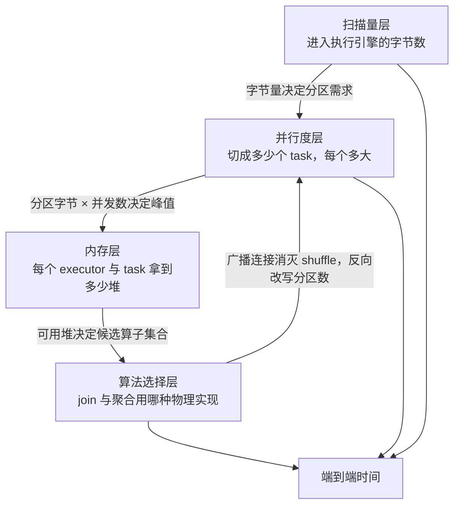
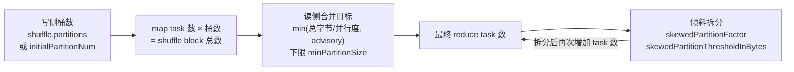
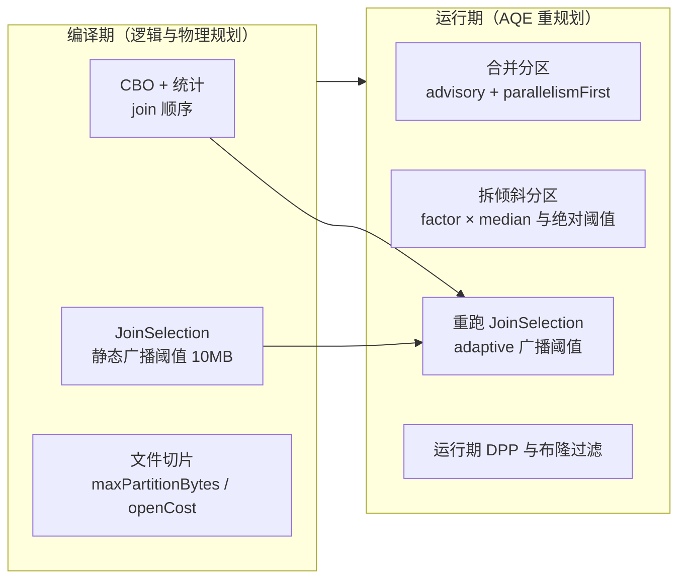
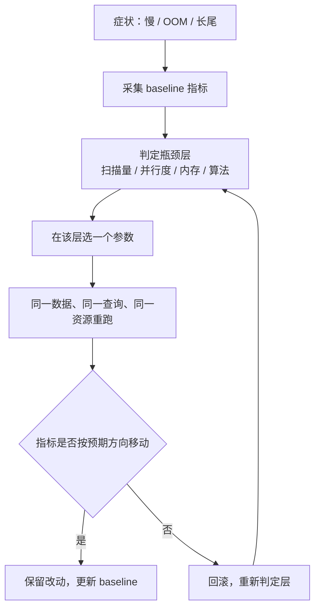

# 12 全参数速查手册：Spark SQL 核心配置一览

**摘要：**

把 Spark SQL 的配置项按字母序排开、逐条标注默认值与一句解释，能拼出一张完整的表，却回答不了真问题：一条已经变慢的查询，第一次该拧哪个旋钮，拧完凭什么判断有效。本篇不写参数清单，写参数之间的支配关系。笔者先把配置分成扫描量、并行度、内存、算法选择四层，说明上层如何把下层的可选空间压扁，跨层讨论"某个参数的最优值"因此失去意义；再逐对拆开六组必须放在一起看的参数——广播阈值与 executor 堆、shuffle 分区数与 AQE、并行度优先与目标分区大小、CBO 与 ANALYZE、文件切分与打开开销、执行内存与存储内存——每一对都给出"谁改写谁"的条件，而不是各自的建议值域。随后核验 4.x 里最容易被旧文档配错的几个默认值，给出三条调参纪律与一份 baseline 指标清单，把六对参数放回一条真实查询里走一遍因果链，最后收束到六类症状的判据表与四类反例。落点是一句老话：参数是杠杆，杠杆要有支点，支点是同一份数据上可复现的基线。

---

## 第 1 章 参数表为什么会失效

假设你手上有一份写得极其详尽的速查表，每个参数都有默认值、作用、建议值域，甚至标了"生产建议开启"。把它贴在显示器边上，然后在一条跑了四十分钟的查询上空等。表并不能告诉你该改哪一行。原因不是表不够长，而是参数在真实系统里不是彼此独立的旋钮，它们串在同一条因果链上，**上游没有动，下游的所有旋钮只是在同一份字节里重新分配时间**。

打个配电箱的比方：总闸没合上，你去反复拨分闸，能观察到的只是哪个回路先跳。参数表按功能域分类（Join、Shuffle、内存、I/O），相当于按房间给分闸贴标签，标签贴得再清楚，也不改变"电流从总闸来"这件事。

参数表的失效有三种具体形态，值得先摊开。

其一是默认值随版本漂移。Spark 4.0 把 ANSI 模式从默认关闭改为默认开启（`spark.sql.ansi.enabled=true`），把 `spark.sql.legacy.timeParserPolicy` 的默认值从 `EXCEPTION` 改成 `CORRECTED`，把 `CREATE TABLE` 不带 `USING` 时默认走 `spark.sql.sources.default` 而不是 Hive。一份写于 3.x 时代的表，照抄下来不会报错，行为却已经换了一套。这类错误最阴的地方在于静默：查询照跑，结果页数变了，除以零不再返回 NULL 而抛异常，时间字符串的解析结果跟旧集群对不上。

其二是语义被上游开关改写。`spark.sql.shuffle.partitions=200` 在 AQE 关闭时表示"最终有 200 个 reduce 分区"，在 AQE 开启时它退化成"map 端按 200 个桶写文件"的初始值，读侧分区数改由运行期合并决定。同一个键，两种含义。`spark.sql.adaptive.advisoryPartitionSizeInBytes` 在 `parallelismFirst=true`（默认）时是"目标尺寸的上限"，在 `false` 时才是"目标尺寸"。参数表只写"默认 64MB"，等于把一半的事实藏起来。

其三是症状与参数多对多。一次"慢"可能来自扫描字节数远超预期、task 数远少于核数、单个分区大到只能 spill、广播表把某一层堆挤爆、join 顺序把小表放在了大表后面、或者 driver 在收集广播数据时卡住。而"OOM"这个词在别人的博客里能对应到七八个不同参数，因为在别人的集群里那七八个参数恰好都是候选嫌疑人。

### 一篇贯穿到底的案例

后文所有推演围绕同一个查询：事实表 `orders` 按天分区，一天约 1.2TB，列数两百多，主要列是 `shop_id`、`sku_id`、`amount`、`pay_time`、`status`；维表 `dim_shop` 约 8MB，两千行。查询把当月订单与维表按 `shop_id` 连接，取若干列，按 `shop_id` 与天聚合，供经营看板使用。这个形状覆盖了三类典型压力：宽表全扫的 I/O、大表 join 小表的策略选择、以及聚合前的 shuffle。

参数怎么在这一条查询上分层起作用，可以先用一张图把因果链立起来。



这张图里有一条容易被忽略的回边：算法选择会反过来改写并行度。一旦 hash join 的构建侧被广播，那条 join 下的 shuffle 就整体消失，原本为它准备的分区数与并行度都不再需要。反过来说，先调分区数、再发现 join 本可以广播，前面那次调优就白做了。排序上先看算法，再看并行度，最后才轮到内存细节，这个顺序不是审美偏好，而是由回边决定的。

---

## 第 2 章 四层支配关系：上层定了，下层才有意义

四层的划分标准不是"参数属于哪个功能模块"，而是"这个参数决定的是哪一种资源约束"。

扫描量层决定有多少字节从存储走进执行引擎。它由分区裁剪、谓词下推、列裁剪、动态分区裁剪（Dynamic Partition Pruning，DPP）、运行期布隆过滤共同决定，参数只负责开启或者关闭这些机制，真正起作用的是数据布局与查询写法。并行度层把字节切成 task：文件扫描侧由 `spark.sql.files.maxPartitionBytes` 与 `spark.sql.files.openCostInBytes` 决定，shuffle 侧由 `spark.sql.shuffle.partitions`、AQE 的合并规则与 `spark.sql.adaptive.advisoryPartitionSizeInBytes` 决定。内存层给出每个 executor 与每个 task 能用的堆，由 `spark.executor.memory`、`spark.memory.fraction`、`spark.memory.storageFraction` 与堆外配置决定。算法选择层在前三层给定的约束下，挑一种物理实现：广播哈希连接（Broadcast Hash Join）、排序合并连接（Sort-Merge Join，SMJ）、洗牌哈希连接（Shuffled Hash Join）、聚合的三种形态，以及是否走分桶。

支配关系可以压成三条硬规则。

**第一条：字节量决定分区需求的量级**。一天 1.2TB 全扫，按 128MB 一个 task 算，需要约 9600 个 task 级的分区才勉强做到"每个 task 处理一份可观的数据"，任何集群都吃不下这个并行度；而分区裁剪到当月某三天、列裁剪到六列之后，实际读取可能只有 90GB，同样的目标分区大小只需要约 700 个 task。参数没有任何一个能替代这次裁剪，它们只能在 1.2TB 和 90GB 两种现实里重新切分。

**第二条：分区字节与并发数共同决定内存峰值**。单个 task 处理 5GB 数据，任何 `spark.memory.fraction` 都救不了它，因为这 5GB 会经过 sort、hash、spill 三条路，其中两条要占堆。反过来，单个 task 只有 8MB 数据时，即使把内存参数调到很激进，收益也接近零，时间花在调度与打开文件上。内存参数的适用范围，是"分区字节已经落在合理区间"之后。

**第三条：可用堆决定候选算子集合**。广播阈值超过单 executor 的有效堆，广播连接就从"加速手段"变成"必然 OOM"；分桶表桶数远大于核数时，桶内扫描的并行度反而不如普通文件扫描。算法层看起来选项最多，实际上被前两层限死。

把四层的职责、代表参数、判断失误的后果与验证手段并排看，比按字母查表有用得多。

| 层 | 决定什么 | 代表参数 | 判错的后果 | 验证手段 |
|---|---|---|---|---|
| 扫描量 | 进入引擎的字节数 | `spark.sql.parquet.filterPushdown`、`spark.sql.hive.metastorePartitionPruning`、`spark.sql.optimizer.dynamicPartitionPruning.enabled`、`spark.sql.optimizer.runtime.bloomFilter.enabled` | 后面三层全部在错误的数据量上做优化，时间线性放大 | Stage 详情里的 input size、`EXPLAIN` 中的 `PartitionFilters` 与 `PushedFilters` |
| 并行度 | task 数与每 task 字节 | `spark.sql.files.maxPartitionBytes`、`spark.sql.files.openCostInBytes`、`spark.sql.shuffle.partitions`、`spark.sql.adaptive.*` | task 数过少则核空转，过多则调度与打开开销吃掉收益 | Stage 的 task 数、task 时长分布、Shuffle Read Size 的分布 |
| 内存 | 每 executor / task 可用堆 | `spark.executor.memory`、`spark.memory.fraction`、`spark.memory.storageFraction`、`spark.sql.autoBroadcastJoinThreshold` | 频繁 GC、spill 到磁盘、广播侧 OOM | GC time 占比、Spill (memory/disk) 字节数 |
| 算法选择 | 物理算子与 join 顺序 | `spark.sql.cbo.enabled`、`spark.sql.cbo.joinReorder.enabled`、`spark.sql.adaptive.enabled`、`spark.sql.join.preferSortMergeJoin` | 用错算子，代价高一个数量级，但不会报错 | 最终计划中的 join 算子类型、AQE 阶段的重规划日志 |

各层的机制推演不在本篇展开：扫描量与布局的关系见 [[大数据/Spark/Spark-SQL深度解析与性能调优/09 数据源与 IO 优化：让数据少读、快读、不重读|09 数据源与 I/O 优化]]，并行度与分区合并见 [[大数据/Spark/Spark-SQL深度解析与性能调优/06 AQE：运行时自适应查询优化|06 AQE]]，内存记账的底层模型见内核系列的 [[大数据/Spark/读书笔记-spark内核/04_存储与容错机制/1. Spark内存管理机制|Spark 内存管理机制]]。本篇只处理层与层之间的接口：哪个参数在什么条件下失去意义，哪个参数的上限由谁决定。

需要提前点明一种普遍的误读：把四层当成流水线，以为从上到下依次优化就能收敛。实际是带反馈的环。广播连接去掉一次 shuffle，会让下游并行度从"按 shuffle 分区"变成"按扫描分区"；倾斜拆分会把一个大分区拆成若干小分区，等于在内存层之上重新定义了并行度。正因为有反馈，调参的顺序必须是"先定字节量，再看算子，再谈分区，最后压内存"，顺序颠倒就会出现"改了三轮，每轮都在补偿上一轮引入的新问题"。

---

## 第 3 章 扫描量层：先让数据少进来

扫描层的参数几乎全是布尔开关，没有连续可调的量。这不是设计偷懒，而是这一层的收益来自存储格式与数据布局，参数的职责只是"允许优化发生"。开关型参数有个讨厌的特性：关掉它不会报错，只会让后面所有数字悄悄变大。

### 3.1 分区裁剪：最便宜的减法

按天分区的表，`WHERE dt BETWEEN '2026-11-01' AND '2026-11-03'` 在理想情况下只列出三个分区目录。`spark.sql.hive.metastorePartitionPruning`（默认 `true`）把过滤条件下推到 Hive Metastore，让元数据服务只返回匹配的分区，而不是先取回全部分区列表再在客户端筛。分区数上万时，这个差别是 driver 端几秒与几十秒的差别，也是元数据服务一次超时与一次正常返回的差别。

这一层最常见的失效不是参数关掉了，而是查询写法把裁剪条件包死了。`WHERE date_format(dt, 'yyyyMMdd') = '20261101'` 里的 `dt` 被函数包裹，优化器无法把常量回代成分区范围，裁剪直接失效，扫描量回到全表。类型转换同理：分区列是字符串而比较值是整数时，隐式 cast 会让裁剪退化为逐个分区求值。

### 3.2 谓词与列裁剪：把过滤推到存储

Parquet 与 ORC 的 row group 元数据里存了每列的最小值、最大值与空值计数，`spark.sql.parquet.filterPushdown`（默认 `true`）与 `spark.sql.orc.filterPushdown`（默认 `true`）允许 Spark 在读取前用这些统计跳过整个 row group。注意粒度的现实：统计单位是 row group（默认 128MB 量级，由写入侧 `parquet.block.size` 决定），不是行。若过滤条件的选择性只有 1%，但几乎每个 row group 里都散落着命中行，跳过率接近零，下推开了也等于没开。

更细的一层是 `spark.sql.parquet.recordLevelFilter.enabled`（默认 `false`），它在页内逐行应用过滤，代价是 CPU 与解码开销，适合"过滤掉 90% 以上行"的高选择性条件。把它当默认开关打开是常见的过度调优：选择性一般时，多出来的判断成本比省下的解码更贵。

列裁剪不需要开关，它是 Catalyst 的基础规则，但 `spark.sql.optimizer.nestedSchemaPruning.enabled`（默认 `true`）决定了 struct 内层字段能否被裁掉。两百多列的宽表只取六列时，读取字节数大致按列的编码后长度成比例下降（量级判断，压缩率不一致时偏差可达数倍），这是 `orders` 场景里最容易拿到的一笔收益，而且不需要改任何参数。

### 3.3 动态分区裁剪与运行期布隆过滤

星型模型上的 DPP 由 `spark.sql.optimizer.dynamicPartitionPruning.enabled`（默认 `true`）控制：先用维表侧过滤后的 `shop_id` 集合生成一个广播结果，再把它作为过滤条件注入事实表扫描，从而在运行期把分区裁掉。它的成立条件比参数表能写下的要苛刻：join 键必须正好是事实表的分区列；维表过滤后必须足够小，能广播；被注入的过滤子查询默认只在可复用广播结果时才生效（内部开关 `reuseBroadcastOnly` 默认 `true`）；统计信息不足时用 `fallbackFilterRatio` 兜底估算收益。

`spark.sql.optimizer.runtime.bloomFilter.enabled` 在 4.x 里默认 `true`（3.3 引入，4.x 沿用默认开启），它处理的是 DPP 覆盖不到的场合：join 键不是分区列，但 shuffle 之前就可以先滤掉一批不可能命中的行。触发条件是创建侧计划的估算大小不超过 `creationSideThreshold`（默认 10MB）、应用侧的聚合扫描字节超过 `applicationSideScanSizeThreshold`（默认 10GB），布隆过滤器本身的默认规模是 `expectedNumItems` 一百万项、`numBits` 约 838 万位（约 1MB，量级判断）。它把"编译期没有准确统计"补成"运行期有一次实测过滤"，但收益完全取决于 join 键在另一侧的选择性：键几乎全覆盖时，布隆过滤只是白算一遍。

扫描层各开关的默认值与调整代价见下表，其中"调大/调小"对开关型参数理解为"打开/关闭"。

| 参数 | 4.x 默认 | 打开或调大的收益 | 打开或调大的代价 |
|---|---|---|---|
| `spark.sql.hive.metastorePartitionPruning` | `true` | 分区数上万时显著缩短 driver 列举时间 | 元数据服务被下推查询压住，需确认 HMS 承压能力 |
| `spark.sql.parquet.filterPushdown` | `true` | 按 row group 跳过，减少解码量 | 几乎无；仅当统计缺失时白读元数据 |
| `spark.sql.parquet.recordLevelFilter.enabled` | `false` | 高选择性（滤掉 90%+ 行）时压缩解码量 | 页内逐行判断，低选择性时纯亏 CPU |
| `spark.sql.optimizer.dynamicPartitionPruning.enabled` | `true` | 星型模型下把事实表分区裁到实际需要的范围 | 需要额外的广播与子查询执行，维表大时收益转负 |
| `spark.sql.optimizer.runtime.bloomFilter.enabled` | `true` | shuffle 前削掉不可能命中的行，减少网络与落盘 | 过滤器构建与探测的 CPU，键覆盖率高时白算 |
| `spark.sql.files.maxPartitionBytes` | 128MB | 调大减少 task 数，适合大文件顺序扫 | 单 task 处理字节变多，spill 与长尾概率上升 |
| `spark.sql.files.openCostInBytes` | 4MB | 调大促进小文件合并到同一 task，减少调度开销 | 抬高切片下限，小表在大集群上分不到足够并行度 |
| `spark.sql.maxSinglePartitionBytes` | 128MB | 调大减少为并行度而引入的额外 shuffle | 单分区过大，下游成为单点瓶颈 |

这张表不能当"全部打开最保险"来用。DPP 与运行期布隆过滤都要额外起 job、额外广播，在维表与事实表键分布接近时，成本是净支出。

---

## 第 4 章 并行度层：三对参数，一条接力链

并行度层的所有参数都在回答同一个问题：一个字节该由哪个 task 处理。难处在于，从扫描到 shuffle 再到聚合，同一个"分区数"在链路上被换了三次手，每一次的决策依据都不同。

### 4.1 `shuffle.partitions` 的身份变化：它与 AQE 是一对

`spark.sql.shuffle.partitions` 默认 200，这个数字来自 Hadoop MapReduce 时代的经验值，与今天的集群规模已经脱节。单独看它，最容易得出的结论是"数据大了就调大"，而实际上它的含义取决于 AQE 是否开启。

AQE 关闭时，它直接决定 reduce 分区数：shuffle 总字节除以 200 就是每个分区的字节。一天 1TB 的 shuffle 摊到 200 个分区，每分区 5GB，这个量级下 spill 是必然的，不是内存参数能救的。把它调到 8000，每分区 128MB，落在合理区间。

AQE 打开时（`spark.sql.adaptive.enabled` 默认 `true`），写侧仍然按这个数准备桶：每个 map task 要为每个 reduce 分区写出一个 shuffle block，块数等于 map task 数乘以分区数。2000 个 map task 配 10000 个分区，就是两千万个 block（示例推算），这些 block 的元数据、文件句柄与合并时的随机读都由写侧承担；而读侧的合并是 AQE 的事，它只能把"已经写出来的桶"重新组合，不能把"没写的桶"变少。所以"把 `shuffle.partitions` 调得很大，让 AQE 自己去合并"是一个方向相反的操作：**读侧的弹性以写侧的固定成本为代价**。

正确的用法是把两侧的意图分开表达：写侧如果用 `spark.sql.adaptive.coalescePartitions.initialPartitionNum`（默认未设置，等于 `shuffle.partitions`）显式给出初始分区数，读侧用 `spark.sql.adaptive.advisoryPartitionSizeInBytes` 表达目标尺寸，两个数字各自落在合理的量级上，而不是让一个数字兼任两职。

### 4.2 `maxPartitionBytes` 与 `openCostInBytes`：切片不是"每个 128MB"

文件扫描侧的切片逻辑比参数表描述的复杂，值得直接看源码里的两步。第一步决定切片上限：

```scala
// FilePartition.maxSplitBytes（Spark 4.0）
val defaultMaxSplitBytes = conf.filesMaxPartitionBytes
val openCostInBytes = conf.filesOpenCostInBytes
val minPartitionNum = conf.filesMinPartitionNum
  .getOrElse(sparkSession.leafNodeDefaultParallelism)
val bytesPerCore = totalBytes / minPartitionNum
Math.min(defaultMaxSplitBytes, Math.max(openCostInBytes, bytesPerCore))
```

第二步按"下次适应递减"（Next Fit Decreasing）打包文件，每个文件计入预算的重量是 `file.length + openCostInBytes`，累积超过切片上限就开新分区。

这两步合起来产生两个与直觉不同的结论。

其一，**扫描切片大小不是常数**。它是 `min(128MB, max(4MB, 总字节 / 默认并行度))`。默认并行度取 `spark.sql.leafNodeDefaultParallelism`（未设置时等于 `SparkContext` 的默认并行度，通常就是总核数）。所以一张 100GB 的表在 400 核集群上扫，bytesPerCore 是 250MB，切片仍是 128MB；而一张 2GB 的表在 400 核集群上扫，bytesPerCore 只有 5MB，切片被压到 5MB，于是产生约 400 个 task。小表自动拿到高并行度是设计意图，不是意外。

其二，**`openCostInBytes` 决定每个 task 能塞多少个小文件**。切片上限 128MB、打开开销 4MB、平均文件 1MB 时，每个文件吃掉 5MB 预算，一个 task 大约装 25 个文件、有效数据只有 25MB（示例推算）。小文件多的表想减少 task 数，调大 `openCostInBytes` 比调大 `maxPartitionBytes` 更对症；但 openCost 同时是切片上限的下限，把它调到 64MB，等于告诉 Spark"任何切片都不许小于 64MB"，在大集群扫小表时会主动放弃并行度。这一对参数没有独立的最优值，只有与"文件数量、平均文件大小、集群核数"三者同时成立的取值。

### 4.3 目标分区大小与并行度优先：默认情况下前者只是上限

`spark.sql.adaptive.advisoryPartitionSizeInBytes` 默认 64MB（回落到 `spark.sql.adaptive.shuffle.targetPostShuffleInputSize`），常被描述成"AQE 合并的目标分区大小"。合并规则里的实际算式是：

```
targetSize = max( min( ceil(shuffle总字节 / minNumPartitions), advisorySize ), minPartitionSize )
```

其中 `minPartitionSize` 是 `spark.sql.adaptive.coalescePartitions.minPartitionSize`（默认 1MB，兜底用），`minNumPartitions` 的取值由 `spark.sql.adaptive.coalescePartitions.parallelismFirst`（默认 `true`）决定：为 `true` 且未显式设置 `coalescePartitions.minPartitionNum` 时，取集群默认并行度；为 `false` 时取 1。

把这两个分支代进去，"`parallelismFirst` 为真则 advisory 失效"这种说法需要修正：advisory 始终是目标尺寸的**上限**，只是当集群默认并行度足够大、`总字节/并行度` 小于 advisory 时，实际目标被压到更小的值。举例：shuffle 总字节 10GB、默认并行度 400，`ceil(10GB/400)=25MB`，小于 64MB，实际目标 25MB，产出约 400 个分区；若把 `parallelismFirst` 设为 `false`，`minNumPartitions=1`，目标回到 64MB，分区数降到约 160。反过来，shuffle 总字节 1TB、默认并行度 400 时，`ceil(1TB/400)=2.5GB` 大于 64MB，目标就是 64MB。换句话说，**默认配置下 advisory 只在"并行度富余"时被绕过，在"数据量大、并行度紧张"时它就是实际目标**。这也解释了为什么有人把它调到 256MB 却看不到分区数变化：他的集群核数不多，目标本来就被 advisory 吃住了。

`coalescePartitions.minPartitionNum` 在 4.x 里已被标记为 deprecated（仍可覆盖），语义改为"给并行度兜底"，正常场景应该用 `minPartitionSize` 与 `parallelismFirst` 表达意图。

分区数在这条链上的接力关系，可以画成下面的样子。注意每一棒的输入都是上一棒的输出，任何一棒的超调都会顺着箭头传下去。



并行度层的参数把默认值、量级边界与两个方向的代价放在一起看，才有判断价值。

| 参数 | 4.x 默认 | 调大的后果 | 调小的后果 |
|---|---|---|---|
| `spark.sql.shuffle.partitions` | 200 | 写侧 block 数线性增长，元数据与合并读成本上升；读侧若无 AQE 则每分区字节变小 | 每分区字节变大，spill 与长尾概率上升，甚至单分区超过单 task 可承受量 |
| `spark.sql.adaptive.coalescePartitions.initialPartitionNum` | 未设置（等于 `shuffle.partitions`） | 写侧桶数增多，读侧可合并空间变大 | 写侧桶数减少，读侧没有合并余地 |
| `spark.sql.adaptive.advisoryPartitionSizeInBytes` | 64MB | 分区变大、task 数变少，单 task 内存压力上升 | 分区变小、task 数变多，调度开销上升 |
| `spark.sql.adaptive.coalescePartitions.minPartitionSize` | 1MB | 合并下限抬高，小 shuffle 也能得到较大分区 | 允许合并出极小分区，task 数变多 |
| `spark.sql.files.maxPartitionBytes` | 128MB | task 数变少，单 task 字节变多 | task 数变多，小文件场景调度开销上升 |
| `spark.sql.files.openCostInBytes` | 4MB | 每 task 装更多小文件，切片下限抬高 | 小文件被切散，task 数暴涨 |
| `spark.sql.leafNodeDefaultParallelism` | 未设置（等于 `SparkContext` 默认并行度） | 小表切得更细，并行度上升 | 小表切片变粗，核空转 |

---

## 第 5 章 内存层：广播阈值与 executor 堆是一对

内存层有两个容易混淆的问题：Spark 的托管内存里怎么分工，以及广播表到底占谁的内存。前者是 `spark.memory.fraction` 与 `spark.memory.storageFraction` 的关系，后者是 `spark.sql.autoBroadcastJoinThreshold` 与 `spark.executor.memory` 的关系。

### 5.1 执行与存储：不是两个池子，是一条可让渡的水位线

`spark.memory.fraction` 默认 0.6，作用对象是"堆减去 300MB 保留区"之后的部分，而不是整个堆。这部分托管内存由执行（execution）与存储（storage）共享，`spark.memory.storageFraction` 默认 0.5，定义的是存储侧的免疫驱逐线：存储用量不超过这条线时，缓存不会被抢；超过之后，执行需要内存时可以强行驱逐缓存。反方向不行——执行侧的活跃内存不会被存储抢走。

这像一间会议室，存储是"已预订但随时可被征用"的工位，执行是"正在开会"的人。预订量（storageFraction）高于实际占用时无所谓；执行要开会而工位被占，物业按规则清场。调低 `storageFraction` 相当于扩大执行的强占权，代价是缓存更容易被清掉，下一轮查询重新读盘；调高则相反，执行侧更早开始 spill。

### 5.2 广播的三份副本

广播连接的 OOM 之所以难判断，是因为阈值比较的对象与真正占内存的对象不是同一个东西。静态规划时，`JoinSelection` 用构建侧的估算字节数（有统计时来自统计，无统计时常常退化为文件总字节）与 `spark.sql.autoBroadcastJoinThreshold`（默认 10MB）比较。而实际运行时的内存有三份：

第一份在 driver 上。广播数据先被收集到 driver，构造成哈希关系（`HashedRelation`），这是完整反序列化的一份；收集量如果超过 `spark.driver.maxResultSize`（默认 1g）会以明确的错误失败，没超过也可能先把 driver 堆占掉，所以大广播在 driver 侧失败有两种形状：结果超限与直接 OOM。第二份是 BlockManager 里的序列化块，按 `spark.broadcast.blockSize`（默认 4MB）分块，占用存储区。第三份在每个 executor 上，是反序列化后被惰性缓存住的那一份，它作为普通堆对象常驻，不参与托管内存的记账。

反序列化的哈希表通常比压缩后的序列化字节大若干倍（量级判断，与数据类型、键宽、是否有空值强相关），而阈值看的是估算字节，估算又常常拿压缩后的文件大小当替身。宽度两百多的宽表，压缩比高的列越多，低估越严重。于是"10MB 阈值很安全"这个直觉在特定表结构上会失效。

### 5.3 安全边界的推算式

把广播的固定成本与执行侧的可变成本分开，可以推出一个粗糙但可用的上限。设 executor 堆为 8GB、`memory.fraction=0.6`，托管内存约 `(8192-300)×0.6 ≈ 4.7GB`（示例推算）。广播反序列化副本是每个 executor 一份，与核数无关，但它与缓存共用托管内存。若缓存已经占满存储区，则有约 2.3GB 处在免疫驱逐线之内，执行侧不驱逐缓存就只能用剩下的 2.3GB；想要更多就得驱逐缓存，缓存命中率随之下降。执行侧还要同时容纳排序缓冲、聚合哈希表与 shuffle 读缓冲，所以留给广播的净空间通常远小于这 2.3GB，再除以反序列化膨胀系数，静态阈值的实际上限常落在几十 MB 的量级。

由此可以给出一句可操作的判断：**广播阈值的上限由最紧的那个 executor 决定，而不是由集群平均值决定**。异构集群里按平均值推算是常见事故来源。

围绕广播还有三个参数容易被漏看。`spark.sql.adaptive.autoBroadcastJoinThreshold`（默认未设置，跟随静态阈值）是 AQE 在重规划阶段使用的版本：stage 完成后拿到真实字节数，物理规划会重跑一遍 `JoinSelection`，此时"是否广播"的判据用的是这个值，因此它可以把静态规划的误判纠正过来，也可以把一个本来安全的计划改成危险的计划。`spark.sql.adaptive.nonEmptyPartitionRatioForBroadcastJoin`（默认 0.2）在运行期发现广播侧空分区比例过高时把连接降级为 shuffle join，避免"广播了一张几乎全空的表却在每个分区上空转"。`spark.sql.broadcastTimeout`（默认 300 秒）控制广播等待的超时，广播表接近阈值上限、网络又慢时，这个值偏小会让任务以超时而不是以 OOM 的形式失败。

内存层的参数关系可以压缩成一张表。

| 参数 | 4.x 默认 | 调大的后果 | 调小的后果 |
|---|---|---|---|
| `spark.executor.memory` | 1g | 单 executor 吞吐上升，但容器申请粒度变粗、资源碎片变多 | GC 压力上升，spill 与 OOM 概率上升 |
| `spark.executor.memoryOverhead` | `memory × 0.1`，最小 384MB | 堆外与 native 空间更宽裕，容器总量变大 | native、NIO、Python worker 容易越界被杀 |
| `spark.memory.fraction` | 0.6 | 托管内存变多，用户代码与元数据空间被挤压 | 托管内存变少，spill 更频繁 |
| `spark.memory.storageFraction` | 0.5 | 缓存更不易被驱逐，执行更早 spill | 执行可强占更多，缓存命中率下降 |
| `spark.sql.autoBroadcastJoinThreshold` | 10MB | 更多 join 走广播，省掉 shuffle，但每 executor 常驻内存上升 | 广播减少，更多 join 走 shuffle，网络与落盘上升 |
| `spark.sql.adaptive.autoBroadcastJoinThreshold` | 未设置（跟随静态值） | 运行期也倾向广播，真实大小已可见，风险略低于静态 | 运行期更保守，可能错过真实的小表 |
| `spark.sql.broadcastTimeout` | 300s | 大广播在网络差时能等到，但失败暴露更晚 | 广播稍慢就失败，重试成本高 |

---

## 第 6 章 算法选择层：CBO 与统计是一对

算法层的参数决定"用哪种算子、按什么顺序连接"。这里的特殊之处在于，参数只是允许选择，真正决定选择的是统计信息与运行期实测数据。开关拨到"开"，而输入是错的，得到的计划可能比不优化更差。

### 6.1 四种组合，只有一种是"代价驱动"

`spark.sql.cbo.enabled` 与 `spark.sql.cbo.joinReorder.enabled` 在 4.x 里默认都是 `false`。这一点必须记住，因为它决定了 `ANALYZE TABLE` 的作用范围。把两个开关与统计信息的有无组合起来，会得到四种截然不同的处境。

| 组合 | join 顺序 | 广播判定 | 实际效果 |
|---|---|---|---|
| CBO 关 + 无统计 | 保持书写顺序（受规则重排影响） | 用文件大小或默认估算 | 最常见的现状，可预测但不一定最优 |
| CBO 关 + 有统计 | 保持书写顺序 | 用真实行数与列统计，广播判定更准 | 统计仍然有用，只是没用在 join 重排上 |
| CBO 开 + 无统计 | DP 用默认或文件大小估算 | 估算误差进入代价比较 | 可能比书写顺序更差，错误被放大 |
| CBO 开 + 新统计 | DP 按代价搜索 | 估算有依据 | 只有这一格才叫代价驱动 |

这张表解释了一个反复出现的现场：有人照着旧文把 CBO 打开，查询反而慢了。他打开的是第三个格子。另一个现场是"统计收集了但 CBO 没开"，统计其实仍在给广播判定与 AQE 估算供数，并没有白收集，只是 join 顺序不受益。

### 6.2 统计的时效与精度

`ANALYZE TABLE ... COMPUTE STATISTICS` 把行数与列级统计写进 Metastore，`FOR COLUMNS` 才收集列统计。`spark.sql.statistics.size.autoUpdate.enabled` 默认 `false`，意味着表大小不会随写入自动刷新，按天追加的事实表跑一周后，统计里的行数可能还停在建表那天。基于陈旧统计做 join 重排，等于用一个过去的数据库优化现在的查询。

直方图由 `spark.sql.statistics.histogram.enabled`（默认 `false`）控制，桶数 `spark.sql.statistics.histogram.numBins` 默认 254。打开它的代价是收集阶段多一次全表扫描，收益是倾斜列的选择性估算从"平均分布假设"变成"分桶采样"。对 `status`、`category` 这类取值少但分布极不均的列，这个收益是实质的；对主键或高基数列，收益接近零。

### 6.3 join 重排的边界

`spark.sql.cbo.joinReorder.dp.threshold` 默认 12，超过 12 张表的连接回退到贪心顺序。这个值对绝大多数查询够用，调大的代价是 driver 端 DP 的状态空间随表数指数增长。`spark.sql.cbo.starSchemaDetection` 与 `spark.sql.cbo.joinReorder.dp.star.filter` 默认都是 `false`，星型模型的启发式顺序不会被自动采用。

CBO 的代价单位是行数乘宽度的估算，误差来源有三处：过滤后行数的估算依赖独立性假设，多个谓词联合时误差相乘；join 后行数依赖键分布假设；宽度的估算对变长字段不敏感。**一行估算差一个数量级，join 顺序就可能整体反转**。

### 6.4 AQE 不能替 CBO 做的事

AQE 打开后能做的事情很多：合并小分区、拆倾斜分区、在有实测数据后重跑物理规划从而改写 join 策略、用 `PlanAdaptiveDynamicPruningFilters` 在运行期重新注入 DPP 过滤、在 `spark.sql.adaptive.maxShuffledHashJoinLocalMapThreshold`（默认 0，即关闭）被设为不小于 advisory 的尺寸后，对"每分区都不超过该阈值"的 shuffle join 优先选洗牌哈希连接。

但 AQE 改不了 join 的书写顺序。多表连接的左右顺序在逻辑计划阶段就定下来了，AQE 的优化发生在 stage 边界之后，它看到的是已经切好的连接树。三张以上大表连接的顺序问题，仍然要回到 CBO 与统计，或者人工调整书写顺序与 hint。

把编译期与运行期的决策点画在同一根时间轴上，可以看清两套机制的分工与接缝。



算法层的参数还有两组值得记下。`spark.sql.join.preferSortMergeJoin` 默认 `true`，两侧都满足条件时优先排序合并连接，因为它可以 spill、内存友好；设为 `false` 会偏向洗牌哈希连接，快但吃内存，且在 `maxShuffledHashJoinLocalMapThreshold` 打开后由运行期数据决定。分桶侧，`spark.sql.sources.bucketing.enabled` 默认 `true`，`spark.sql.bucketing.coalesceBucketsInJoin.enabled` 默认 `false`，打开后允许桶数成整数倍的两表在 join 时做桶合并，省掉一次 shuffle，代价是并行度下降、洗牌哈希连接更容易 OOM，倍数上限由 `maxBucketRatio`（默认 4）约束。

| 参数 | 4.x 默认 | 前提条件 | 失效或变差的场景 |
|---|---|---|---|
| `spark.sql.cbo.enabled` | `false` | 关键表有新鲜统计 | 无统计、统计陈旧时误差被放大 |
| `spark.sql.cbo.joinReorder.enabled` | `false` | CBO 已开且多表连接均有统计 | 表数超过 `dp.threshold` 回退贪心；统计缺失 |
| `spark.sql.statistics.histogram.enabled` | `false` | 列分布倾斜且需要精确选择性 | 高基数列；额外一次全表扫描 |
| `spark.sql.adaptive.enabled` | `true` | 查询含 Exchange 或子查询 | 无 shuffle 的短查询，AQE 包装只有开销 |
| `spark.sql.join.preferSortMergeJoin` | `true` | 两侧都能排序合并 | 一侧极小本可广播时被压制 |
| `spark.sql.bucketing.coalesceBucketsInJoin.enabled` | `false` | 两表桶数成整数倍 | 桶数比值超过 `maxBucketRatio`；并行度下降明显 |
| `spark.sql.optimizer.runtime.bloomFilter.enabled` | `true` | 一侧高选择性、另一侧扫描量大 | 键几乎全覆盖；过滤器超出 `maxNumItems` |

### 6.5 六对参数的关系一览

六组必须成对看的参数散在第 4 到第 6 章，把它们压成一张索引表，作为后面核验默认值与排查症状时的查表入口。

| 参数对 | 谁改写谁 | 默认取值下的真实含义 | 失衡的典型症状 |
|---|---|---|---|
| `autoBroadcastJoinThreshold` ↔ `executor.memory` | 后者与 `memory.fraction` 决定放不放得下，前者只表达值不值得放 | 10MB 在 4g 以上堆里安全，堆越小安全边界越窄 | 阈值随数据量涨、堆没跟着涨，广播侧 OOM |
| `shuffle.partitions` ↔ `adaptive.enabled` | AQE 开时前者只决定写侧桶数，读侧交给 AQE | 200 是写侧初始值，不再是最终分区数 | 调大前者换来写侧膨胀，读侧一分收益也没多拿 |
| `parallelismFirst` ↔ `advisoryPartitionSizeInBytes` | 前者决定后者是"上限"还是"目标" | 默认 true 时 advisory 是上限，并行度富余时被绕过 | 把 advisory 调到 256MB 却看不到分区数变化 |
| `cbo.enabled` ↔ `ANALYZE TABLE` | 后者决定统计是否存在，前者决定统计是否参与 join 重排 | 默认 false，统计只影响广播判定与 AQE 估算 | 开了 CBO 却没有新鲜统计，计划反而更差 |
| `maxPartitionBytes` ↔ `openCostInBytes` | 前者是切片上限，后者是切片下限与小文件的权重 | 128MB 与 4MB 共同决定 task 数和每 task 文件数 | 只调前者，小文件表仍然切不开、task 数不降 |
| `memory.fraction` ↔ `storageFraction` | 前者定托管内存总量，后者定其中存储侧的免疫线 | 0.6 与 0.5 意味着执行侧可以强占超出免疫线的缓存 | 缓存与执行互相驱逐，GC 与 spill 同时上升 |

---

## 第 7 章 4.x 默认值核验：几个最容易配错的项

旧文档的默认值会以两种方式害人：照着配了却没生效，或者生效了但方向相反。下面这张表是笔者在 4.0.0 的官方配置表与 `SQLConf.scala` 上逐项核对的结果，凡是与 3.x 记忆不同的都列出来。

| 参数 | 3.x 常见记忆 | 4.x 实际默认 | 依据 | 配错的典型后果 |
|---|---|---|---|---|
| `spark.sql.ansi.enabled` | `false` | `true` | SPARK-44444，4.0 起默认开启 | 整数溢出、除以零、非法 cast 从返回 NULL 变成抛异常，ETL 直接失败 |
| `spark.sql.legacy.timeParserPolicy` | `EXCEPTION` | `CORRECTED` | SPARK-47719 | 时间字符串解析结果与旧集群不一致，跨版本对账出错 |
| `spark.sql.legacy.ctePrecedencePolicy` | `EXCEPTION` | `CORRECTED` | 4.0 迁移指南 | 同名 CTE 的嵌套定义优先级反转，结果集变化 |
| `spark.sql.cbo.enabled` | 有人以为默认开 | `false` | `SQLConf` 源码 | 以为代价驱动，实际仍是书写顺序，误判"调优无效" |
| `spark.sql.cbo.joinReorder.enabled` | 同上 | `false` | `SQLConf` 源码 | 多表 join 顺序从未被重排，`ANALYZE` 的收益被高估 |
| `spark.sql.adaptive.enabled` | `false`（3.1 及以前） | `true` | 3.2 起默认开启 | 以为在手动控制分区，实际一直有 AQE 参与，实验结论不可复现 |
| `spark.api.mode` | 不存在 | `classic` | 4.0 引入 | 误以为默认走 Connect，排查时看错进程模型 |
| `spark.sql.codegen.hugeMethodLimit` | 常被写成 65536 | `65535` | `SQLConf` 源码 | 边界值判断差一，生成方法刚好卡在阈值上时的回退行为对不上 |
| `spark.sql.codegen.maxFields` | 100 | `100` | `SQLConf` 源码（internal） | 宽表超过字段上限时整段回退解释执行，日志里才有痕迹 |
| `spark.sql.mapKeyDedupPolicy` | 常被写成 `LAST_WIN` | `EXCEPTION` | `SQLConf` 源码 | 以为重复键会被静默覆盖，实际抛异常 |
| `spark.sql.adaptive.coalescePartitions.minPartitionNum` | 常被当作有效开关 | 已 deprecated，可选 | `SQLConf` 源码 | 配了以为控制了下限，实际应与 `minPartitionSize` 配合 |
| `spark.sql.parquet.compression.codec` | `snappy` | `snappy` | 官方配置表 | 写了 `zstd` 只影响新写入文件，读旧文件不变 |
| `spark.sql.files.maxPartitionBytes` | 128MB | 128MB | 官方配置表 | 以为改大就会少 task，忽略了 `openCostInBytes` 与默认并行度的联合作用 |

还有一项不属于参数、但会让人翻遍参数表的情况：4.0 起 `CREATE TABLE` 不带 `USING` 或 `STORED AS` 时，使用 `spark.sql.sources.default` 作为表提供者，而不是默认建 Hive 表。建表语句没变，表类型变了，后续的读路径与统计收集行为也就变了。

核验默认值有四种可靠途径，按成本从低到高：在会话里直接 `SET spark.sql.cbo.enabled` 读回当前值；用 `spark.sessionState.conf.getConfString` 在代码里读到会话实际生效的值，绕过命令行与配置文件的覆盖层；查对应版本的 `generated-runtime-sql-config-table.html`；最后是读 `SQLConf.scala` 里的 `buildConf` 定义，这是唯一能确认"配置是否还存在、是否已被标记 internal 或 deprecated"的地方。第四种之所以必要，是因为 4.x 清理过一批旧开关，配置项写在一个 3.x 时代的脚本里不会报错，它只是被静默忽略。

有一点需要说明版本口径的差异：本篇核对的是 4.0.0 的配置表与源码，4.x 后续小版本可能新增开关或者调整默认值。凡是涉及"某个开关是否还生效"的判断，都应当以手上那个发行版的 `SQLConf` 为准，而不是以任何一篇文章为准，包括这一篇。

---

## 第 8 章 三条纪律：让每次改动可归因

调参最大的成本不是改错，而是改完之后不知道是哪一个改动起了作用。下面三条纪律看起来平淡，却是把调参从玄学拉回实验的唯一办法。

### 8.1 纪律一：一次只改一个

一次改一个参数，不是因为参数之间没有交互，恰恰是因为有交互：同时改三个，就算变快了，你也不知道是哪一个的功劳，更不知道该保留哪一个。有人会反驳说"时间不等人，一次调完更快"，但一次调完的下一步通常是回滚全部再试一轮，两轮的成本往往高于一次一个的串行实验。

一次只改一个还有一个副产品：你能观察到"这个参数在这份数据上原来不起作用"。这个否定结论很值钱，它把参数从候选名单里永久划掉了，比一个偶然的加速更持久。

### 8.2 纪律二：先确认瓶颈层，再选参数

确认瓶颈层靠的是同一时刻的一组指标，而不是感觉。下面这张表是笔者常用的最小集合，每一项都能在 Spark UI 或事件日志里直接读到。

| 指标 | 读取位置 | 它说明什么 | 期望的方向 |
|---|---|---|---|
| Stage 输入字节数 | Stage 详情 input size | 扫描量层的实际结果，与表总大小对比 | 明显小于表大小，说明裁剪生效 |
| `EXPLAIN` 中的 `PartitionFilters` / `PushedFilters` | 计划文本 | 分区裁剪与谓词下推是否真的发生 | 非空，且条件与查询一致 |
| Shuffle Write / Read 字节与 block 数 | Stage 详情 | 并行度层与算法层的共同结果 | 与数据量匹配，block 数不异常膨胀 |
| Task 时长最大值 / 中位数 | Stage 的 task 分布 | 是否倾斜，以及长尾程度 | 比值接近 1，超过 5 基本可判定倾斜 |
| Spill (memory / disk) | Stage 累计指标 | 单分区字节是否超过单 task 可承受量 | 接近 0，出现即说明分区过大或内存不足 |
| GC time 占比 | Executor 标签页 | 内存层是否吃紧 | 低于 10%，持续超过 20% 说明堆结构有问题 |
| 最终计划的 join 算子 | `EXPLAIN` 或 SQL 标签页 | 算法选择层的实际结果 | 与两侧真实大小匹配 |

指标之间还有一层互相印证的关系：Shuffle Read 字节很大而输入字节正常，说明问题在 join 或聚合的形状，不在扫描；spill 很大而 GC 不高，说明分区字节太大而不是堆太小；GC 很高而 spill 不大，说明对象创建与回收压力大，可能是聚合键太多或 UDF 拖着大对象。

### 8.3 纪律三：同一份数据、同一份查询、同一份资源

三个"同一"缺一不可。同一份数据意味着参数化到同一个分区范围、同一个时间窗口，否则两次运行的输入字节数就不同，任何比较都失去意义；同一份查询意味着 SQL 文本不变，连 hint 与 `ORDER BY` 都不动；同一份资源意味着 executor 数量、核数、内存、并发度不变，动态分配的上下限也固定住。动态分配在两次运行之间给出的 executor 数量不同，是最容易被忽略的噪声来源。

还有一个实操细节：第一次运行包含 JVM 预热、文件系统缓存冷启动与元数据首次加载，通常不应作为 baseline。用第二次运行作为基线，或者固定先跑一次预热。

把三条纪律与判据串起来，就是一个闭环。任何一个环节跳过，都会让后面的结论失效。



### 8.4 反例：四种把调参变成赌博的做法

**一次性改十个参数**。收到一份"性能优化清单"，把 AQE、CBO、分区数、广播阈值、内存比例、压缩算法、并行度、序列化、GC、off-heap 全部照单打开。变快了，但没人知道是哪三项起了作用，于是这套配置被复制到下一个作业，在那里失效，再被复制回来。这类清单在跨集群迁移时几乎必然翻车，因为它的成立条件从未被写下来。

**照抄别人的配置**。别人的集群有 800 个核，你的集群有 120 个；别人的 `orders` 表按 `shop_id` 分桶，你的按天分区；别人的存储是本地盘，你的是对象存储。同一行 `spark.sql.shuffle.partitions=2000` 在两种环境里的含义可以完全不同，因为 AQE 的目标尺寸算出来不一样。可以借鉴的是别人"用哪个指标判定、按什么顺序取舍"，不是那串数字。

**把 `spark.sql.shuffle.partitions` 调到很大，"让 AQE 去合并"**。这是本篇最想拦下的一个操作。AQE 合并的是读侧，写侧的 block 数由这个值决定，调大等于把写侧的元数据、文件句柄与后续合并读的成本按比例放大，换来的是"读侧本来也不需要那么多分区"。合理的做法是把写侧的初始分区数控制在"总字节 / 目标分区大小"附近的合理上界，把读侧的期望交给 `advisoryPartitionSizeInBytes`。

**调大 `spark.sql.autoBroadcastJoinThreshold` 却不提内存**。阈值从 10MB 调到 200MB 之后，广播侧的哈希表在每个 executor 上都要常驻一份，driver 上还要构建一份；如果同时开着缓存，存储区被占满，执行侧萎缩，spill 与 GC 一起恶化。配置表里"建议 10-50MB"这句话之所以带范围，是因为上限由 `spark.executor.memory` 与 `spark.memory.fraction` 联合决定，脱离内存谈阈值没有意义。

### 8.5 一份配置基线，以及它的成立条件

下面这段配置可以作为新作业的起点，但它的价值不在于内容，而在于每条后面跟着的成立条件。把它当推荐值直接复制，就是上一节里的第二个反例。

```properties
# 前提：堆 8g、4 核/executor、本地盘或低延迟对象存储、宽表按天分区
spark.sql.adaptive.enabled=true
spark.sql.adaptive.coalescePartitions.enabled=true
spark.sql.adaptive.advisoryPartitionSizeInBytes=64MB
# 并行度不富裕的集群保持 true，靠 advisory 上限控制尺寸
spark.sql.adaptive.coalescePartitions.parallelismFirst=true
spark.sql.adaptive.skewJoin.enabled=true
spark.sql.adaptive.skewJoin.skewedPartitionFactor=5
spark.sql.adaptive.skewJoin.skewedPartitionThresholdInBytes=256MB
# 写侧桶数按"总 shuffle 字节 / 128MB"估，不按"让 AQE 合并"的思路放大
spark.sql.shuffle.partitions=800
# 阈值必须同时满足：反序列化后仍小于单 executor 可让渡内存的 1/3
spark.sql.autoBroadcastJoinThreshold=10MB
# 只有确认关键表统计新鲜时才打开这两项
spark.sql.cbo.enabled=false
spark.sql.cbo.joinReorder.enabled=false
spark.executor.memory=8g
spark.memory.fraction=0.6
spark.memory.storageFraction=0.5
spark.sql.files.maxPartitionBytes=128MB
spark.sql.files.openCostInBytes=4MB
```

如果一定要给一句关于基线的判断，那就是：**能写清成立条件的配置才有迁移价值，写不出条件的配置只是历史记录**。

---

## 第 9 章 六类症状：该看哪几个参数

症状到参数的映射不是一一对应，而是"症状对应层，层对应一组参数"。下表是判断的起点，不是答案。

| 症状 | 先看的指标 | 瓶颈层 | 该看哪几个参数 | 不要先动 |
|---|---|---|---|---|
| 扫描慢，input 字节远超预期 | input size、`PartitionFilters`、`PushedFilters` | 扫描量 | `metastorePartitionPruning`、`filterPushdown`、`dynamicPartitionPruning.enabled`、`runtime.bloomFilter.enabled` | `shuffle.partitions`、`executor.memory` |
| 倾斜，task 时长极不均衡 | task 时长 max/median、Shuffle Read 分布 | 并行度 + 算法 | `skewJoin.enabled`、`skewedPartitionFactor`、`skewedPartitionThresholdInBytes`、`optimizeSkewsInRebalancePartitions.enabled` | `spark.speculation` |
| 内存不足，executor 被杀或广播 OOM | GC time、executor lost 日志、广播大小 | 内存 | `executor.memory`、`memory.fraction`、`autoBroadcastJoinThreshold`、`adaptive.autoBroadcastJoinThreshold` | `memory.storageFraction` 单向调大 |
| spill 多，内存与磁盘都持续写入 | Spill (memory/disk) 字节 | 并行度 | `shuffle.partitions`、`advisoryPartitionSizeInBytes`、`maxPartitionBytes` | 直接加内存 |
| 并行度怪异，task 数远少于或多于核数 | Stage 的 task 数与时长 | 并行度 | `maxPartitionBytes`、`openCostInBytes`、`leafNodeDefaultParallelism`、`shuffle.partitions` | `executor.cores` |
| join 慢，Shuffle Read 巨大 | 最终计划算子、两侧估算大小 | 算法 | `cbo.enabled`、`joinReorder.enabled`、`autoBroadcastJoinThreshold`、`runtime.bloomFilter.enabled` | 反复改分区数 |

### 9.1 扫描慢

先确认 input 字节数与表总大小的比值。比值接近 1，说明一行都没裁掉，此时所有下游参数都在为错误的数据量买单。检查 `EXPLAIN` 里的 `PartitionFilters` 是否为空、`PushedFilters` 是否只包含了一部分条件，然后回到查询写法：分区列是否被函数包裹，join 键是否正好是分区列，维表是否大到无法广播（这会让 DPP 失效）。这一类的处置基本不涉及数值型参数，改的是查询与表设计。

### 9.2 倾斜

倾斜的判定不能只看最大值，要看最大值与中位数的比值，以及这个比值是否由少量 task 贡献。阈值型参数只影响 AQE 是否"认为"发生了倾斜：`skewedPartitionFactor`（默认 5）要求分区大于中位数的五倍，`skewedPartitionThresholdInBytes`（默认 256MB）要求同时超过绝对阈值；两个条件都满足才会拆分。数据整体均匀但偶发倾斜时把 factor 降到 3 是合理的，把绝对阈值降到 64MB 则会引入大量无意义的拆分。倾斜的根因治理见 [[大数据/Spark/Spark-SQL深度解析与性能调优/10 数据倾斜：诊断、根因与系统性解决方案|10 数据倾斜]]，参数只能治表征。

### 9.3 内存不足

先分清是哪种 OOM：executor 侧的任务 OOM、广播侧 OOM、还是 driver 收集结果时 OOM。三者的处置方向完全不同。任务 OOM 看单分区字节与 `memory.fraction`；广播 OOM 看阈值与 executor 堆、driver 堆；driver OOM 看 `spark.driver.maxResultSize` 与是否在 `collect` 上一次性拉回大结果。把一个广播 OOM 当成普通内存不足去加 `executor.memory`，通常只会让失败来得更晚、更贵。

### 9.4 spill 多

spill 是结果，不是原因。它说明单个 task 处理的数据超过了它可用的执行内存。可以往两个方向走：减少单 task 字节（调小目标分区尺寸、调大分区数），或者增加可用执行内存（调大堆、调低 `storageFraction`、减少缓存）。前者的收益通常更直接，因为它不改变资源总量，只改变分配方式；而后者在有并发缓存的环境里经常是零和交易。

### 9.5 并行度怪异

两种极端值都要看。task 数远少于核数，常见于小文件多而 `openCostInBytes` 太小、或者 `maxPartitionBytes` 太大、或者 `leafNodeDefaultParallelism` 被显式设成了一个很小的值；task 数远多于核数，常见于 `shuffle.partitions` 未随数据量调小、AQE 被关闭、或者 `maxPartitionBytes` 被调得很小。这一类的判断要点是"task 数的理论值能不能算出来"，算得出来再谈调参。

### 9.6 join 慢

先看最终计划里的算子。如果是排序合并连接且两侧大小悬殊，问题在广播判定；如果是广播连接但 executor 内存吃紧，问题在阈值与堆；如果是多表连接里顺序明显不合理，问题在 CBO 与统计。`EXPLAIN` 里的估算行数与实际不符时，先修统计，再谈参数。运行时布隆过滤在 4.x 默认开启，它对"大表 join 高选择性维表"有效，对"两侧都很大的等值连接"基本无效。

---

## 第 10 章 把六对参数放回一条查询里

分层拆开讲，容易留下"每层各管一段"的错觉，好像从上到下依次处理就能收敛。真实排障不是这样：一次改动会改变后面所有数字，顺序错了就要重来。把贯穿案例走一遍，能看清顺序为什么就是因果。

### 10.1 现象：四十多分钟，没有报错

月末的经营看板查询跑了四十分钟。executor 没有被杀，GC 时间占比约 12%，task 时长中位数三分钟、最大值五分钟，看起来没有严重倾斜。这类"处处正常但整体很慢"的现场，最容易诱发"多调几个参数试试"的冲动。

### 10.2 第一步：扫描量层，且不需要改参数

Stage 详情里的 input size 是 892GB，而这个查询只要当月三天。打开 `EXPLAIN`，`PartitionFilters` 是空的。原因在查询写法：分区条件被写成 `date_format(dt, 'yyyyMMdd') BETWEEN ...`，`dt` 被函数包裹，优化器无法把常量回代成分区范围，裁剪彻底失效。把条件改回对 `dt` 直接比较之后，input size 降到 96GB。

这一步没有动任何参数，却重写了后面所有判断的依据。如果先怀疑 shuffle 分区数不够、把 `spark.sql.shuffle.partitions` 从 200 调到 2000，那么在 892GB 的输入上可能确实变快了一点；但等扫描量修正到 96GB，那个 2000 就变成了纯粹的写侧开销。**先改字节量，再谈数字**，理由就在这里。

### 10.3 第二步：算法层，先确认再放过

`dim_shop` 估算 8MB，低于 `spark.sql.autoBroadcastJoinThreshold` 的 10MB，join 走广播哈希连接，没有 shuffle。聚合是分区内的 hash aggregate，也没有引入额外的 Exchange。这一步的结论是"不用动"，而"不用动"需要证据：最终计划里的算子类型与两侧估算大小。

### 10.4 第三步：并行度层，切片不是常数

三天分区、列裁剪之后，Stage 的 input size 约 96GB，集群默认并行度 400。按第 4 章的算式，切片上限是 `min(128MB, max(4MB, 96GB/400))`，`96GB/400` 约 240MB，大于上限，所以切片取 128MB，产生约 750 个 task。这里是第一个反直觉点：切片大小既不是常数，也不是把参数照抄过来就固定住的——它是 `max` 与 `min` 夹出来的。若这台集群有 1200 核，`96GB/1200` 只有 80MB，切片立刻降到 80MB，task 数涨到 1200 个；同样的数据、同样的参数，只因为核数变了，切法就变了。

### 10.5 第四步：AQE 与目标分区尺寸

聚合前的 shuffle 写入约 20GB。写侧桶数取默认 200，750 个 map task 就要写十五万个 block（示例推算），量级可以接受；读侧的合并目标是 `max(min(ceil(20GB/400), 64MB), 1MB)`，约 50MB，最终约 400 个分区，每个分区 50MB，Stage 的 spill 指标接近零。到这里，四层都落在合理区间，查询耗时回到几分钟。

### 10.6 第五步：维表变大之后，阈值与内存必须一起看

次月 `dim_shop` 从 8MB 涨到 40MB，静态阈值 10MB 失效，join 退化为排序合并连接，多出一大段 shuffle。此时有两条路：把阈值提到 64MB，或者加 broadcast hint。前者需要先算内存账——40MB 的构建侧反序列化后按三倍膨胀估算约 120MB，8GB 堆的托管内存约 4.7GB，每个 executor 常驻一份 120MB 可以接受（示例推算）；后者绕过阈值保护，把"广播会不会撑爆内存"这个问题从框架手里拿回到人手里，风险自负。

### 10.7 反例：从"shuffle 慢"出发的那次调参

如果跳过前三步，直接从"shuffle 慢"出发，把 `spark.sql.shuffle.partitions` 从 200 调到 5000，会发生什么？写侧 block 数变成 750 乘 5000，三百七十五万（示例推算），元数据、文件句柄、合并读的随机访问一起上升；而读侧仍被 AQE 按 50MB 的目标合并回约 400 个分区。写侧的成本被永久锁定，读侧的收益一点没多拿。这就是"调大分区数让 AQE 合并"在数字上的真实形状。

把六步改动与每步该验证的指标并列，就是一份可以直接照做的排查记录。

| 步骤 | 改什么 | 所属层 | 预期指标变化 | 验证指标 |
|---|---|---|---|---|
| 1 | 分区条件去掉函数包裹 | 扫描量 | input 892GB 降至 96GB | input size、`PartitionFilters` 非空 |
| 2 | 确认 join 与聚合算子 | 算法 | 保持广播、无额外 Exchange | 最终计划算子类型 |
| 3 | 检查切片与 task 数 | 并行度 | task 约 750，切片 128MB | task 数与时长分布 |
| 4 | 确认 AQE 合并目标 | 并行度 | 约 400 分区，spill 接近零 | Shuffle Read 分布、Spill 字节 |
| 5 | 阈值提到 64MB 并核算内存 | 内存 + 算法 | 广播恢复，GC 不上升 | GC time、executor 常驻内存 |
| 6 | 误调分区数到 5000 | 反例 | block 数暴涨、读侧无收益 | Shuffle Write 时间与 block 数 |

---

## 第 11 章 分层速查：按层读，别按字母读

下面三张表按层组织，每张表只放该层真正会动的参数。读法是：先用第 9 章的判据确定层，再在本层里找参数，最后用第 8 章的 baseline 验证。"量级边界"一列给的是笔者的经验区间，标注为量级判断，不是推荐值。

扫描量层：

| 参数 | 4.x 默认 | 量级边界 | 路由 |
|---|---|---|---|
| `spark.sql.hive.metastorePartitionPruning` | `true` | 分区数上万时收益显著 | [[大数据/Spark/Spark-SQL深度解析与性能调优/09 数据源与 IO 优化：让数据少读、快读、不重读\|09]] |
| `spark.sql.parquet.filterPushdown` | `true` | row group 128MB 量级，收益取决于命中分布 | [[大数据/Spark/Spark-SQL深度解析与性能调优/09 数据源与 IO 优化：让数据少读、快读、不重读\|09]] |
| `spark.sql.parquet.recordLevelFilter.enabled` | `false` | 选择性 90% 以上才划算 | [[大数据/Spark/Spark-SQL深度解析与性能调优/08 向量化执行引擎：列式处理与 SIMD 的力量\|08]] |
| `spark.sql.optimizer.dynamicPartitionPruning.enabled` | `true` | 维表过滤后需能广播 | [[大数据/Spark/Spark-SQL深度解析与性能调优/09 数据源与 IO 优化：让数据少读、快读、不重读\|09]] |
| `spark.sql.optimizer.runtime.bloomFilter.enabled` | `true` | 创建侧 10MB、应用侧 10GB 阈值 | [[大数据/Spark/Spark-SQL深度解析与性能调优/05 Physical Planning：从逻辑计划到物理算子的策略选择\|05]] |

并行度层：

| 参数 | 4.x 默认 | 量级边界 | 路由 |
|---|---|---|---|
| `spark.sql.files.maxPartitionBytes` | 128MB | 64-256MB 是常见区间 | 本篇 4.2 |
| `spark.sql.files.openCostInBytes` | 4MB | 小文件密集表可到 16MB | 本篇 4.2 |
| `spark.sql.leafNodeDefaultParallelism` | 未设置 | 等于 `SparkContext` 默认并行度 | 本篇 4.2 |
| `spark.sql.shuffle.partitions` | 200 | 按"总 shuffle 字节 / 128MB"估上界 | [[大数据/Spark/Spark-SQL深度解析与性能调优/06 AQE：运行时自适应查询优化\|06]] |
| `spark.sql.adaptive.advisoryPartitionSizeInBytes` | 64MB | 64-256MB，视存储延迟而定 | [[大数据/Spark/Spark-SQL深度解析与性能调优/06 AQE：运行时自适应查询优化\|06]] |
| `spark.sql.adaptive.coalescePartitions.parallelismFirst` | `true` | 并行度富余时 advisory 被绕过 | 本篇 4.3 |

内存与算法层：

| 参数 | 4.x 默认 | 量级边界 | 路由 |
|---|---|---|---|
| `spark.executor.memory` | 1g | 4-16g，按单分区字节反推 | [[大数据/Spark/读书笔记-spark内核/04_存储与容错机制/1. Spark内存管理机制\|内核·内存]] |
| `spark.memory.fraction` | 0.6 | 0.6 是平衡点，超过 0.7 需专业判断 | [[大数据/Spark/读书笔记-spark内核/04_存储与容错机制/1. Spark内存管理机制\|内核·内存]] |
| `spark.memory.storageFraction` | 0.5 | 缓存为主时 0.6，执行为主时 0.3-0.4 | [[大数据/Spark/读书笔记-spark内核/04_存储与容错机制/3. Spark_数据缓存机制\|内核·缓存]] |
| `spark.sql.autoBroadcastJoinThreshold` | 10MB | 10-50MB，上限受 executor 堆约束 | [[大数据/Spark/Spark-SQL深度解析与性能调优/05 Physical Planning：从逻辑计划到物理算子的策略选择\|05]] |
| `spark.sql.adaptive.autoBroadcastJoinThreshold` | 未设置 | 与静态阈值分开设置时需两侧一致 | [[大数据/Spark/Spark-SQL深度解析与性能调优/06 AQE：运行时自适应查询优化\|06]] |
| `spark.sql.cbo.enabled` / `joinReorder.enabled` | `false` | 打开前必须确认统计新鲜 | [[大数据/Spark/Spark-SQL深度解析与性能调优/04 CBO 代价模型：统计信息驱动的执行计划选择\|04]] |
| `spark.sql.join.preferSortMergeJoin` | `true` | 内存充裕且分区不大时可考虑关闭 | [[大数据/Spark/Spark-SQL深度解析与性能调优/05 Physical Planning：从逻辑计划到物理算子的策略选择\|05]] |

---

## 第 12 章 参数管不到的地方

调参这件事有一个隐形的天花板：它只能在既有数据布局与查询形状里重新分配资源。超过这个天花板的问题，改参数只会把症状从一个位置推到另一个位置。

表布局是第一道天花板。一天 1.2TB 的表按天分区，查三个月就要扫 100GB 以上；按 `shop_id` 再分一层子分区，可以把常用维度裁掉两个数量级，但会让小文件数暴涨。这个取舍发生在建表时，事后调参无法弥补。分桶同理：桶数选得与核数不匹配时，分桶 join 的并行度反而低于普通 shuffle join。

join 键的选择决定 shuffle 的量级。宽表 join 宽表时，无论用哪种算子，shuffle 的数据量都由键的分布决定；键的基数过低会制造倾斜，过高会让布隆过滤与 DPP 都失去意义。这类问题只能从数据建模侧解决。

存储层延迟改变经验值的适用性。对象存储的单次请求延迟比本地盘高一个数量级，`advisoryPartitionSizeInBytes` 调大到 256MB 之所以在对象存储上有效，是因为它减少的是请求次数而不是数据量。换一种存储，这个经验值立刻失效。

driver 是另一个单点。广播构建、元数据列举、`collect` 结果回传都发生在 driver 上。driver 的堆与 `spark.driver.maxResultSize` 不在这四层的任何一层里，但它经常是"查询跑了很久最后失败"的位置。

AQE 也有它改不动的东西。AQE 在 stage 边界之后重规划，它能改写物理算子、合并与拆分分区，但不能改写 join 顺序，也不能把一次全表扫描变成裁剪扫描。把 AQE 当成万能开关，是这一层最常见的误解。

因此，参数调优的正确位置是：在数据布局与查询形状已经合理的前提下，把资源分配调到与数据特征匹配。**参数是杠杆，不是引擎**。杠杆能放大力量，前提是力的作用点选对了；选错作用点，杠杆只会把错误放大。

---

## 小结

Spark SQL 的参数不是一个平面上的旋钮，而是四层约束上的节点：扫描量层决定有多少字节进来，并行度层决定怎么切，内存层决定每个 task 能拿多少，算法选择层在前三层的约束下挑算子。参数的价值只在层内成立，跨层谈"最优值"没有意义。六组必须成对看的参数，本质上都是"一个参数的作用域被另一个参数改写"的实例：上位开关一动，下位参数的含义就换了。核验默认值的意义不在于记住数字，而在于知道哪些行为的默认方向已经跟 3.x 不同；三条纪律的意义不在于流程感，而在于让每次改动可归因、可回滚、可迁移。

---

## 参考资料

1. Apache Spark 4.0.0 Configuration：[spark.apache.org/docs/4.0.0/configuration.html](https://spark.apache.org/docs/4.0.0/configuration.html)
2. Apache Spark 4.0.0 SQL Performance Tuning：[spark.apache.org/docs/4.0.0/sql-performance-tuning.html](https://spark.apache.org/docs/4.0.0/sql-performance-tuning.html)
3. Apache Spark 4.0.0 SQL Migration Guide：[spark.apache.org/docs/4.0.0/sql-migration-guide.html](https://spark.apache.org/docs/4.0.0/sql-migration-guide.html)
4. Spark 自动生成的 SQL 配置表：[generated-runtime-sql-config-table.html](https://spark.apache.org/docs/4.0.0/generated-runtime-sql-config-table.html)
5. `SQLConf.scala`（v4.0.0，全部配置的权威定义）：[github.com/apache/spark/blob/v4.0.0/sql/catalyst/src/main/scala/org/apache/spark/sql/internal/SQLConf.scala](https://github.com/apache/spark/blob/v4.0.0/sql/catalyst/src/main/scala/org/apache/spark/sql/internal/SQLConf.scala)
6. `FilePartition.scala`（切片与 `openCostInBytes` 的实际算法）：[github.com/apache/spark/blob/v4.0.0/sql/core/src/main/scala/org/apache/spark/sql/execution/datasources/FilePartition.scala](https://github.com/apache/spark/blob/v4.0.0/sql/core/src/main/scala/org/apache/spark/sql/execution/datasources/FilePartition.scala)
7. `ShufflePartitionsUtil.scala`（AQE 合并目标尺寸的计算）：[github.com/apache/spark/blob/v4.0.0/sql/core/src/main/scala/org/apache/spark/sql/execution/adaptive/ShufflePartitionsUtil.scala](https://github.com/apache/spark/blob/v4.0.0/sql/core/src/main/scala/org/apache/spark/sql/execution/adaptive/ShufflePartitionsUtil.scala)
8. SPARK-47719：timeParserPolicy 默认值改为 CORRECTED：[issues.apache.org/jira/browse/SPARK-47719](https://issues.apache.org/jira/browse/SPARK-47719)
9. SPARK-44444：4.0 默认启用 ANSI 模式：[issues.apache.org/jira/browse/SPARK-44444](https://issues.apache.org/jira/browse/SPARK-44444)

---

> [!note] 思考题
> 1. 如果 `spark.sql.adaptive.coalescePartitions.parallelismFirst=true` 而集群核数非常多、shuffle 数据量却不大，AQE 会把分区合并到多小？此时把 advisory 调大为什么无效？
> 2. 一个作业把 `spark.sql.autoBroadcastJoinThreshold` 从 10MB 提到 200MB 后变快了，但一周后开始在某个时间段 OOM。从广播的三份副本出发，解释时间相关性来自哪里。
> 3. 文件扫描的切片上限是 `min(maxPartitionBytes, max(openCostInBytes, 总字节/默认并行度))`。这个公式在什么情况下会让"调大 maxPartitionBytes 减少 task 数"完全失效？
> 4. 为什么"打开 CBO 但不收集统计"可能比"保持 CBO 关闭"更慢？请用 join 重排的搜索空间与估算误差解释。
> 5. 假设你只能改一个参数，且必须在看到 baseline 之前决定改哪个。你会先采集哪个指标，为什么这个指标能排除掉至少两层？

> [!info] 版本核对提示
> 本篇默认值以 Spark 4.0.0 的官方配置表与 `SQLConf.scala` 为准，涉及 `adaptive.*`、`cbo.*` 与 `files.*` 的判断在不同 4.x 小版本间可能有差异。落到具体发行版时，用 `SET spark.sql.<name>` 读回当前值，比任何文档都可靠。