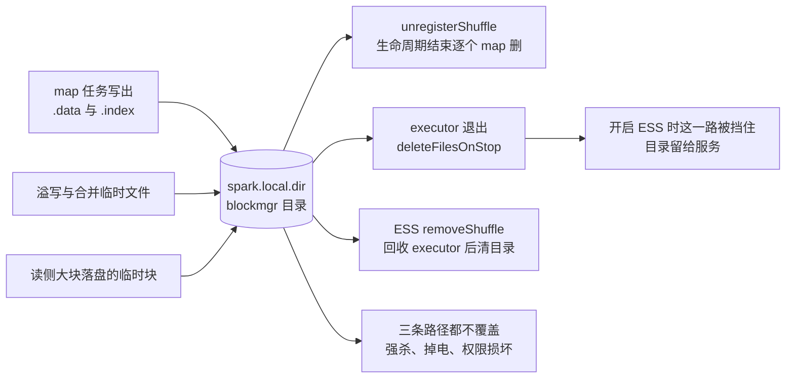
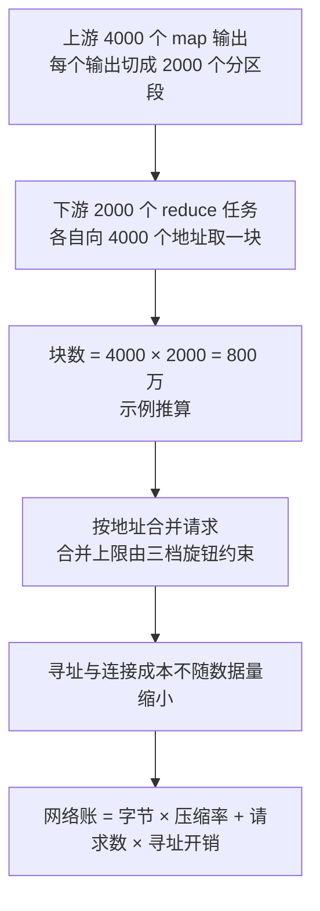
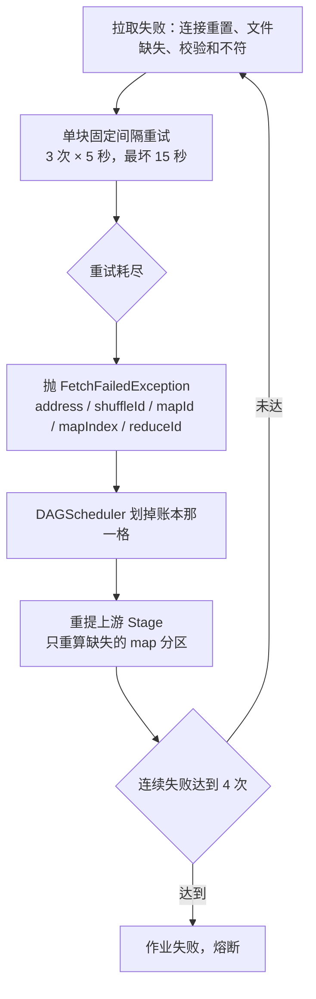
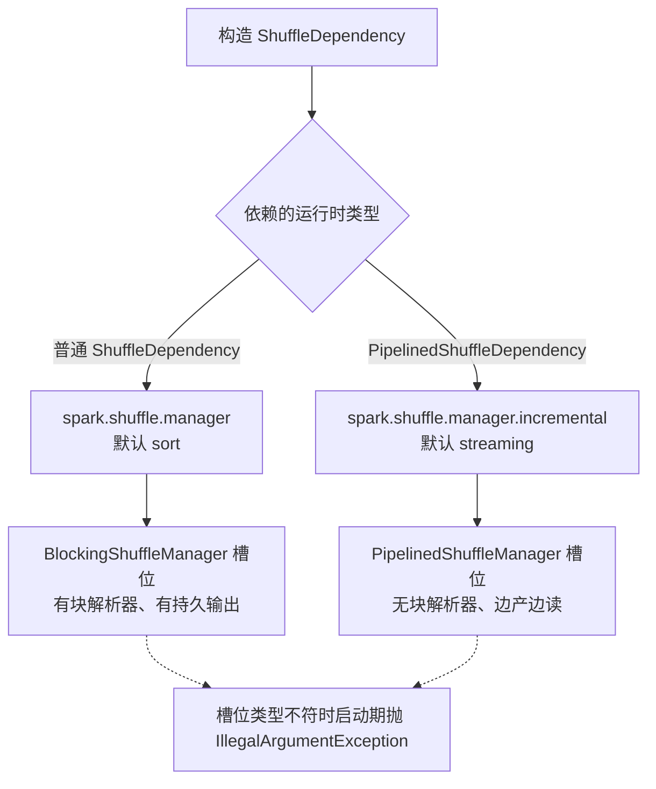
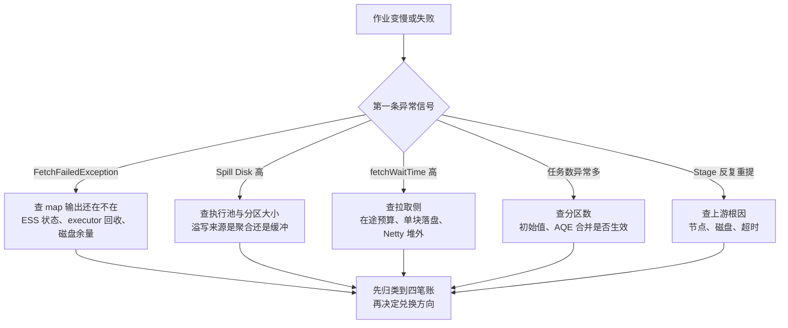

# 01 为什么 Shuffle 是分布式计算的命门

**摘要：**

凌晨两点四十分，一个作业同时在三块监控屏上亮红灯：本地盘使用率、`FetchFailedException`、Stage 重提次数。三条告警看着是三件事，实际是同一个动作在四个账本上同时到期——Shuffle 向本地磁盘、网络、内存与失败重算四个方向同时收费。四笔账各有各的计量方式与失控形态，处置手段互不通用，甚至相互抵消：拉取慢的时候去调写侧缓冲，一个字节都省不下来。本文不谈写出与拉取的实现细节，那部分推导属于机制层，只回答运维要回答的问题：四笔账分别记在哪里、每一笔失控时在哪个页面能看到、哪个参数能把一笔账换成另一笔、换的代价落在谁身上。围绕同一个三百节点、每天两千个作业的集群案例，本文给出五类现场症状的分诊路径、一张带兑换代价的关键配置表、四条最容易踩空的反例，以及 4.x 两个 Shuffle 槽位带来的新判据。全文的落点是：四笔账不能同时最小，能做的只是知道自己此刻在兑换哪两笔。

---

## 第 1 章 命门的准确含义

凌晨两点四十分，值班手机连响三下。三条告警都来自同一个作业 `daily_rollup`：某台 NodeManager 的本地盘使用率达到 92%，下游某个 Stage 报出一串 `FetchFailedException`，调度侧显示同一个 Stage 已经连续重提两次。这个作业每天跑四轮，每轮写出的 Shuffle 数据在数百 GB 量级。

三条告警的处置方向完全不同：磁盘那条要去看目录占用与清理时机，取数失败那条要去看上游输出还在不在，重提那条要去看失败是不是同一个根因的反复发作。当成一件事去修，最常见的结局是压下一个、另外两个继续响。

### 1.1 四笔账

任何一次 Shuffle 都在四个方向同时记账。

**磁盘账**：map 端的输出必须落到本地盘上，等下游来拉；文件放在 `spark.local.dir` 指向的目录里，在 Shuffle 生命周期结束前不会自己消失。同一个目录里还住着溢写文件与读侧落盘的临时块，容量要按最坏并发算，不能按当前 Stage 的数据量算。

**网络账**：下游每个 reduce 任务都要向每一个 map 输出发起取数，块数是上游分区数与下游分区数的乘积；数据总量只搬一次，但这个乘积在寻址、请求与连接三个层面同时放大。

**内存账**：写侧要一块输出缓冲，读侧要一块在途接收缓冲，读进来之后聚合与排序还要借执行内存。这三处占用没有独立配额，统一内存模型下它们与缓存共享同一个池子。

**失败账**：Shuffle 文件是下游必须等待的中间物，一旦它所在的进程退出、目录被清、磁盘写满，下游读不到就只能让上游重算。这一笔账不产生在故障机器上，而是产生在等待它的那些任务上。

四笔账不是四个并列的性能指标，而是同一笔总账的四个分项。**命门**这个词之所以站得住，靠的不是"Shuffle 很慢"这种感受，而是第四笔账：在正常执行路径上，只有 Shuffle 会把上游 Stage 的输出变成下游必须等待、且可丢失的中间物；其余算子的中间结果都在同一个 Task 内产生与消费，丢了顶多重跑这一个 Task，不会把整条上游链路拖回来。

### 1.2 为什么要分开算

因为处置手段互不通用，甚至相互抵消。

一个 reduce 任务慢，`fetchWaitTime` 占六成时间，说明它在等数据；此时把 `spark.shuffle.file.buffer` 从 32k 调到 256k，一个字节都省不下来，那条参数管的是写侧。反过来，磁盘账紧张时有人第一反应是关掉 `spark.shuffle.compress` 省 CPU，结果写出去的字节变大，账从 CPU 挪到了磁盘。

四笔账之间确实是兑换关系：压缩买字节、卖 CPU；分区数买并行度、卖寻址；留更多内存给执行池买溢写次数、卖缓存命中。兑换本身没有对错，错的是不知道自己正在兑换哪两笔。

关系可以用一家小厂的账单类比：电费、水费、房租与违约金各来一张，单看每张都看得懂，摊在一张桌上才知道这个月是产能不足还是漏水。限定在于，工厂的四张单子彼此独立，而这里的四笔账会互相转账。

### 1.3 一张总表

四笔账拆开之后，每一笔都有明确的观测点与失控形态，这张表是后续所有分诊的底稿。

| 账目 | 计费对象 | 主要观测点 | 失控时的第一形态 | 典型处置方向 |
|---|---|---|---|---|
| 磁盘 | `spark.local.dir` 下的 shuffle 文件、溢写与临时块 | 主机 `df`/`du`、Stages 页 Shuffle Write 与 Spill (Disk) | 写文件 IOException、目录创建失败、下游读到截断文件 | 容量规划、清理时机、ESS 承接、减少溢写 |
| 网络 | 块请求数与搬运字节 | `fetchWaitTime`、`remoteBytesRead`、`remoteBytesReadToDisk` | 拉取阶段长时间空转、Netty 堆外内存告急 | 分区数、在途预算、压缩、ESS 位置 |
| 内存 | 写侧输出缓冲、读侧接收缓冲、聚合结构 | Spill (Memory)、GC Time、Executor 页内存曲线 | 频繁溢写、GC 时间飙升、容器被杀 | 执行池比例、单块大小、聚合写法 |
| 失败 | 丢失的 map 输出与被重算的分区 | Driver 日志的 Stage 重提记录、失败任务数 | `FetchFailedException` 成批出现、Stage 反复重提 | ESS、退出策略、重试参数、磁盘余量 |

### 1.4 判据从哪里读

三个地方就够了：Spark UI 的 Stages 页与 Executors 页、Driver 日志里的调度记录、主机侧的磁盘与网络指标。三者要交叉看，因为账往往记在"不是出问题的那台机器"上——一个 executor 被回收，异常出现在所有向它取数的 reduce 任务里，那台机器本身可能一条错误日志都没有。

至于写出过程怎么排序、索引文件怎么记偏移、读侧怎么按地址把块切成请求、ESS 怎么按块名算路径，这些机制层面的推导在内核系列三篇里已经拆到源码级，此处只引用它们的结论：三笔开销的兑换关系见 [[大数据/Spark/读书笔记-spark内核/05_Shuffle核心机制/1. Spark_Shuffle机制深度解析|Shuffle 机制深度解析]]，读写契约与 writer 选择见 [[大数据/Spark/读书笔记-spark内核/05_Shuffle核心机制/2. Spark_Shuffle框架设计与实现|Shuffle 框架设计与实现]]，块归属、背压与外部 Shuffle 服务见 [[大数据/Spark/读书笔记-spark内核/05_Shuffle核心机制/7. Spark_Shuffle与Storage交互|Shuffle 与 Storage 交互]]。本文要补的是那三篇没有展开的那一半：这些机制在真实作业里留下什么痕迹，痕迹对应什么判断动作。

---

## 第 2 章 磁盘账：本地盘上的短期负债

### 2.1 落在哪个目录

Shuffle 文件写在 `spark.local.dir` 指定的目录下，未显式配置时指向 `/tmp`，也可以用环境变量 `SPARK_LOCAL_DIRS` 覆盖，两者都支持逗号分隔的多个目录，Spark 会按剩余空间选一个。目录之下按 `blockmgr-<uuid>` 分开，再按哈希切出两层子目录，shuffle 文件的名字形如 `shuffle_<shuffleId>_<mapId>_0.data` 与同名 `.index`。

需要记住的是，这个目录不是"Shuffle 专用目录"。同一批目录里还躺着溢写产生的临时文件、合并阶段的中间段、读侧因为单块超过 `spark.network.maxRemoteBlockSizeFetchToMem`（默认 200m）而落盘的临时块，以及磁盘持久化 RDD 的块。Spark 并不按用途给它们分目录，所以容量规划的口径只能是"最坏情况下同时存活的全部中间数据"，而不是某一个 Stage 的 Shuffle Write 数字。

这个区别在一台机器跑多个作业时特别明显。单个作业的 Shuffle 写出也许只有 40GB，但同一台机器上 8 个 executor 各带一份溢写与一份临时块，实际占用可能是写出量的两三倍。

### 2.2 谁负责删

三条清理路径，各管一段生命周期，缺一条就会在盘上留垃圾。

第一条是 Shuffle 生命周期结束时，Driver 调 `unregisterShuffle`，逐个 map 把三件文件删掉。这是正常路径，作业跑完、下游消费完，文件跟着消失。

第二条是 executor 退出时删掉整个本地目录，由 `deleteFilesOnStop` 决定。这里有一处最容易忽略的联动：开启外部 Shuffle 服务之后，对被托管的 executor，这个开关会被挡住，目录故意不删，留给服务继续提供读取。换句话说，开了 ESS，盘上的文件寿命就变长了，清理责任从 executor 转移到了服务端。

第三条就是服务端的清理：executor 被回收、Driver 确认该应用的 Shuffle 数据不再需要之后，ESS 按 `spark.shuffle.service.removeShuffle` 清目录。这一项的默认值在 4.0 被翻成 `true`（3.5 及以前是 `false`），理由不难推：留到应用结束的块，在长跑应用里就是一份缓慢增长的磁盘负债。

还有一条隐性的空白：Spark 不主动扫描孤儿文件。进程被 `kill -9`、节点掉电、目录权限被改坏时，三条路径都不会触发，文件留在盘上等人手工清理。shuffle 文件是**短期负债**而不是资产，账期由清理路径决定。三条路径的归属画成一张图：

### 2.3 ESS 与 `spark.shuffle.service.*` 参数

外部 Shuffle 服务（external shuffle service，ESS）是随集群管理器常驻在每台节点上的独立进程，它接管的不是数据本身，而是"这批文件归谁读"：executor 上线时把本地目录登记给服务，进程退出后登记仍在，读请求改打到服务端口，文件一个字节都没搬。

客户端参数不多，每一项都对应一种现场症状。

| 配置 | 默认 | 管什么 | 配错时的症状 |
|---|---|---|---|
| `spark.shuffle.service.enabled` | false | 客户端是否走服务取数 | 集群装了服务但没开这一项，等于白装；开了但服务没装，取数直接连不上 |
| `spark.shuffle.service.name` | `spark_shuffle` | 与集群侧辅助服务名对齐 | 名字对不上，作业不报参数错，而是所有远端取数失败 |
| `spark.shuffle.service.port` | 7337 | 服务监听端口 | 端口被占或防火墙未放行，表现为整节点取数超时 |
| `spark.shuffle.service.removeShuffle` | true（4.0 起） | 回收 executor 后是否清目录 | 关掉后目录只增不减，长跑应用磁盘缓慢上涨 |
| `spark.shuffle.service.index.cache.size` | 100m | 服务端索引缓存上限 | 调太小会反复读索引文件，ESS 进程 IO 升高 |
| `spark.shuffle.service.fetch.rdd.enabled` | false | 是否顺带托管磁盘持久化 RDD 块 | 打开后 ESS 同时承担两类块的失效语义，口径变复杂 |

YARN 上的部署形状是固定的：`yarn-site.xml` 里把 `spark_shuffle` 加进 `yarn.nodemanager.aux-services`，用 `yarn.nodemanager.aux-services.spark_shuffle.class` 指向 `org.apache.spark.network.yarn.YarnShuffleService`，并把 Spark 的 network-yarn jar 放进 NodeManager 的 classpath。这三处任一处没对齐，症状都不是"参数没生效"，而是远端取数整批失败，很容易被误判成网络故障。Kubernetes 没有等价的辅助服务机制，这个缺口由 shuffle tracking 或远程 Shuffle 服务补。

### 2.4 判据

第一层是主机指标：`df -h` 看 `spark.local.dir` 所在分区，`du -sh` 看 `blockmgr-*` 目录的增长速度。判据不是"用了多少"，而是"增长速度与作业排期的关系"——凌晨批量作业开始后两小时内从 40% 涨到 85%，说明峰值已接近上限，扩容之前先看清理路径有没有生效。

第二层是 Spark UI：Stages 页的 Shuffle Write 与 Spill (Disk) 相加，才是这个 Stage 对本地盘的真实压力；Executor 页的 disk used 只含块管理器记账的部分，与前者对不上是正常的。

第三层是日志：`No space left on device`、`Failed to create local dir`、写 Shuffle 文件时的 `IOException`，这三类文本是磁盘写满的直接证据。更麻烦的是间接证据——磁盘写满导致文件被截断，下游读到才报 `FetchFailedException`，日志里从头到尾没有"磁盘"两个字。根因在写侧，症状在几百个 reduce 任务上，这是磁盘账最阴的地方。

### 2.5 量化

用 `daily_rollup` 的一轮做示例推算：4000 个 map 分区、2000 个 reduce 分区，Shuffle Write 合计 800GB，其中约三成以溢写形式先落一次临时文件。若参与写出的 executor 分布在 200 台节点上，平均每台承担 4GB 最终文件与 1.2GB 临时文件，峰值按两个作业同时存活估算约 10GB。`spark.local.dir` 只挂 50GB 系统盘、同机还跑着别的应用时，这点余量很快见底。量级判断是：磁盘需求与"作业大小"不成线性，它与并发作业数、溢写比例、清理时机**三者相乘**。

---

## 第 3 章 网络账：M×N 个 channel

### 3.1 块数是乘积

下游每个 reduce 任务要向每一个 map 输出取一块数据，于是块数等于上游分区数乘以下游分区数。这个乘积与数据量无关：把数据压小一半，块数一个都不少，寻址与请求的开销原地不动。

请求会按目标地址合并，所以真实请求数低于块数，但合并有上限——单个请求装多少块受 `spark.reducer.maxBlocksInFlightPerAddress` 与请求切片的目标大小（`maxSizeInFlight` 的五分之一）约束。这意味着乘积效应只是被折叠，没有被消除：上游 4000 个分区、下游 2000 个分区，块数是 800 万，合并之后仍是十万量级的请求。乘积被折叠的过程如下图。

网络账由两部分组成，很容易只看到前一半。字节部分是数据总量乘压缩率，压缩打开时（`spark.shuffle.compress` 默认 `true`，编解码器默认 lz4）文本型宽表通常能压掉相当比例，二进制或已加密字段几乎压不动；请求部分是块数决定的寻址、握手与超时管理成本，只与分区数有关。网络慢可能是"数据太大"，也可能是"块太碎"，处置方向相反。

还有一个位置因素。不开 ESS 时，取数目标是写它的那个 executor 进程；开了 ESS，目标变成那台机器上的 7337 端口。对网络账来说，按地址合并的粒度从"进程"变成了"机器"，同机多个 executor 的输出可以被合并成更少的连接。这是 ESS 在网络账上的附带收益，与它在失败账上的作用是两回事。

### 3.2 三档在途旋钮

读侧的并发由三个数决定，它们的默认值差异很大，配错的方式也不同。

| 旋钮 | 默认 | 限制的对象 | 调大的代价 |
|---|---|---|---|
| `spark.reducer.maxSizeInFlight` | 48m | 每个 reduce 任务在途字节总量，并派生单请求目标（÷5） | 接收缓冲按任务数倍增，与聚合抢执行内存，溢写上升 |
| `spark.reducer.maxReqsInFlight` | `Int.MaxValue` | 单任务同时在途的请求数 | 保护消失，某些节点被瞬间打满，Netty 堆外内存告急 |
| `spark.reducer.maxBlocksInFlightPerAddress` | `Int.MaxValue` | 单个对端地址的块并发 | 单个热点节点被打穿，长尾与超时同时出现 |
| `spark.network.maxRemoteBlockSizeFetchToMem` | 200m | 超过这个大小的块落临时文件而不进内存 | 大块占堆，直接内存与 GC 压力同时上升 |
| `spark.shuffle.io.numConnectionsPerPeer` | 1 | 对同一对端的连接数 | 连接数上升，但只在"连接复用打不满磁盘"的场景有效 |

### 3.3 判据

判据藏在 `ShuffleReadMetrics` 的三个量里，含义经常被读反。

`fetchWaitTime` 是线程阻塞等块到达的累计时间。它接近任务总耗时，说明瓶颈在拉取；它很小而任务依然慢，说明瓶颈在消费侧——聚合、排序、溢写，与网络无关。`remoteBytesRead` 与 `localBytesRead` 的比值给出流量轮廓，但同机直读会计入后者，所以"本地读得多"不等于"数据是自己写的"。`remoteBytesReadToDisk` 统计因超大块而落临时文件的字节量，这个值持续偏高时，调大在途预算没有意义，该动的是分区大小或 `maxRemoteBlockSizeFetchToMem`。

还有一类判据不在 Spark UI 里：Netty 堆外内存耗尽时，executor 会置上一个所有任务共享的静态标志，随后这台机器上所有 reduce 任务的拉取一起停摆。现场表现是"某几台机器上的 reduce 全卡在 fetch 阶段，同时 CPU 空闲"，与网络拥塞看起来一样，区别在于同机其他任务也一起不动。单块因堆外内存重试的上限是 `spark.shuffle.maxAttemptsOnNettyOOM`（默认 10），重试再多也不会好转，因为问题不在网络。

### 3.4 量化

仍用 `daily_rollup` 的一轮：800GB 写出、压缩后约 300GB 实际搬运，10Gbps 网卡下纯传输下限约 240 秒，实际还要乘并发效率与跨机架收敛比。每个 reduce 任务在途 48MB、单机并发 8 个任务时，一台 executor 的接收缓冲是 384MB，与聚合结构共享执行池——单看不大，但它是在聚合开始之前就先占住的。

---

## 第 4 章 内存账：两处占用，一个池子

### 4.1 旧口径已经不存在

流传最广的一条旧配置是 `spark.shuffle.memoryFraction`，它的语义曾经是"Shuffle 聚合可以使用多少堆内存"。这条配置从 Spark 2.0 引入统一内存模型起就不再存在，4.x 里配它不会报错，也不会有任何效果——SparkConf 对未知键不抛异常，参数静默失效。同理还有 `spark.shuffle.spill`，它曾经可以关掉溢写，现在溢写是必然行为，那条开关也早已移除。

这就造成一类特别难查的现象：调优清单照旧抄，参数一个个配上去，作业行为一点没变，于是得出结论"这些参数没用"。判据很简单：改完之后行为**毫无变化**，第一步该怀疑这个键在当前版本是否还存在，而不是怀疑调参方向。

### 4.2 4.x 里真正管这件事的三个数

统一内存模型下，能分给 Shuffle 的内存由三个数决定，顺序不能颠倒。

先扣掉 300MB 保留内存，留给 JVM 自身结构、字符串常量与对象大小估算误差；剩下的乘以 `spark.memory.fraction`（默认 0.6），得到执行与存储共享的池子；池内再按 `spark.memory.storageFraction`（默认 0.5）划一条线。这条线是**软边界**，不是配额——它描述"存储区里有多大比例免疫执行内存的驱逐"，两侧可以互借，借用的方向与归还义务并不对称。把 0.5 读成"存储一半、执行一半"在算术上对、在机制上错。

Shuffle 的两处占用都从执行池里出：写侧的输出缓冲与溢写、读侧的接收缓冲与聚合结构。它们与缓存争同一个池子，所以"缓存把内存吃满导致 Shuffle 溢写变多"是一条真实链路，而"缓存和 Shuffle 各有各的内存"是一个错误前提。

### 4.3 两处占用的份数不一样

同样是 32KB 的缓冲，在不同路径上的份数差一个数量级，这是内存账里最容易被忽略的一条。

| 占用点 | 份数 | 归属 | 失控形态 |
|---|---|---|---|
| 写侧 `spark.shuffle.file.buffer`（bypass 路径） | 等于 reduce 分区数 r | 堆内 | 分区数高时按 r 倍增，挤压执行内存、抬高 GC |
| 写侧 `spark.shuffle.file.buffer`（排序与溢写路径） | 1 | 堆内 | 影响很小，可放心调大 |
| 写侧 `spark.shuffle.file.merge.buffer`（4.0 起） | 等于溢写段数 k | 堆外 | 按 k 倍增直接内存，超限表现为直接内存耗尽；默认继承 `file.buffer` |
| 读侧 `spark.reducer.maxSizeInFlight` | 1 份预算，按任务数倍增 | 堆内接收缓冲 | 预算是软上限，单块可超；调大后与聚合抢内存 |
| 读侧聚合结构（`ExternalAppendOnlyMap`、`ExternalSorter`） | 每任务一份 | 执行池 | 数据量大或分区不均时溢写 |

`file.merge.buffer` 那一行要单独记：它的默认值继承自 `file.buffer`，把前者调大会连带把合并缓冲一起拉大，而后者是 k 份、堆外，超限时的表现是与堆监控完全脱节的一次直接内存崩溃。

### 4.4 判据

第一条是 Spill (Memory) 与 Spill (Disk)。前者说明多少数据在内存里装不下被赶了出去，后者说明赶出去的量。两者都高且与 Shuffle Read 字节数同阶，说明执行池相对数据量偏小；只有 Spill (Memory) 高而 Spill (Disk) 不高，说明溢写很快被合并消化，问题不大。

第二条是 GC Time。单个任务的 GC 时间超过任务时长十分之一，外加执行池被缓冲占走，通常意味着写侧缓冲的份数在按分区数放大，而不是数据本身太大。

第三条是容器退出原因。`Container killed by YARN for exceeding memory limits` 与堆 OOM 是两回事：堆内 OOM 会留下 `java.lang.OutOfMemoryError`，容器被杀往往是堆外或整体 RSS 超限，常见于直接内存被 merge buffer 吃满。没有堆栈的 executor 消失，先查直接内存。

### 4.5 量化

按 64GB 堆、`spark.memory.fraction` 0.6 算，执行与存储共享池约 38GB；一个 8 并发的 executor 在拉取阶段先占 8×48MB 接收缓冲，约 384MB，占比百分之一；若它同时在写 bypass 路径、分区数 2000，`file.buffer` 保持 32k 时是 2000×32KB≈64MB 每个任务，8 个任务就是 512MB。两个数字都不致命，但都在聚合开始之前就叠加在聚合结构之上。量级判断是：单笔都不大，四笔叠起来才把执行池压到溢写线以下。

---

## 第 5 章 失败账：文件丢了，账要重算

### 5.1 三级放大

一个块拉不到，处理过程分三级，每一级的代价量级不同。

第一级是单块重试：`spark.shuffle.io.maxRetries` 默认 3 次，`spark.shuffle.io.retryWait` 默认 5 秒，固定间隔而非指数退避，最坏 15 秒后放弃。重试只针对失败的块，已经传完的不会重来，这是它还算温和的原因；这段时间任务占着槽位不动，账记在槽位时间上，不记在网络上。

第二级是抛 `FetchFailedException`。异常里带着五个坐标：对端地址、`shuffleId`、`mapId`、`mapIndex`、`reduceId`——前两个说明从哪要、哪次 Shuffle，后三个说明哪一份输出、哪一个分区。任务不会就地重试，因为再试一百次也读不到已经消失的数据，它把失败上报给 DAGScheduler。

第三级是上游重提。DAGScheduler 把账本上对应的那一格划掉，重提上游 Stage，只重算缺失的 map 分区。这一级的代价不是"重算一个分区"，而是"整条上游链路重新调度、重新等待"——重算的字节数也许只是 800GB 里的 4GB，但等待的时间按 Stage 时长计。连续失败次数由 `spark.stage.maxConsecutiveAttempts`（默认 4）兜底，到头就熔断，作业失败而不是无限循环。三级放大的完整链路如下图。

### 5.2 同一句异常，四种根因

`FetchFailedException` 是读侧所有取数异常的统称，文本几乎一样，根因至少四种，判据在于 cause 与同时出现的其他错误。

| 异常特征 | 根因 | 下一步判据 |
|---|---|---|
| 连接类异常（`Failed to connect to`） | 对端进程消失（executor 被回收或崩溃），或 ESS 未运行 | 查该时间点前后是否有 executor 被释放；查 7337 端口是否可连 |
| `java.io.FileNotFoundException` | 文件被删、目录被清理、块不存在 | 查清理路径是否提前触发；查是否开启了 ESS 却未真正接管 |
| 校验和不符（`spark.shuffle.checksum.enabled` 默认 `true`） | 数据损坏，可能来自磁盘或截断写入 | 查该节点磁盘错误日志与剩余空间 |
| 反序列化异常 | 两侧序列化器配置不一致，字节长度可能完全正确 | 对比 Driver 与 Executor 的序列化器配置，尤其 Kryo 注册差异 |

这张表的价值是排除"网络问题"这个默认假设。笔者的排查经验里，真正由网络抖动导致的 `FetchFailed` 并不是多数，更多是"对端没了"与"文件没了"，这两件事恰恰是 ESS 与清理路径要回答的。

### 5.3 ESS 的边界

ESS 让 Shuffle 数据不随 executor 消失，但它没有让数据变得可靠。它不做复制，数据仍在一台机器的本地盘上；那台机器的盘坏了、目录被人清了、服务进程自己崩了（此时 executor 可能还活着，读请求打到 7337 得到连接拒绝），结果都一样。它延长的是可读窗口，不是数据寿命。

### 5.4 流水线 Shuffle 的失败账是另一种形状

4.x 的流水线式 Shuffle（下文第 7 章展开）根本不注册到 `MapOutputTracker`，也没有可寻址的持久输出：消费方在上游还在生产时就开始读"带外"直送的数据。它的失败语义因此完全不同——没有"按分区补算"这条路，任何成员失败都会让整组连同作业一起失败。对运维来说，这类 Shuffle 的失败账没有"重算"一栏，只有"重跑"一栏，判据也不是 Stage 重提记录，而是作业级失败。

### 5.5 量化

仍用 `daily_rollup`：一台节点掉线，上面 8 个 executor 各留 4GB 输出，合计 32GB 丢失，账本上被划掉 32 个 map 分区，2000 个 reduce 任务各有一条失败的块请求。重试 15 秒后抛异常，DAGScheduler 重提上游 Stage，重算这 32 个分区；重算本身也许只要几分钟，但从重提、排队到重新拉取完成，实际等待按十几分钟计。量级判断是清楚的：失败账不按丢失的字节收费，而按**等待它的任务数乘以 Stage 时长**收费。

---

## 第 6 章 Shuffle 数就是 Stage 数

### 6.1 边界的唯一成因

DAGScheduler 划分 Stage 的依据只有一条：在 ShuffleDependency 处切一刀，前一段做写、后一段做读。因此一个作业的 Shuffle 次数直接决定 Stage 数量，无 AQE 时近似为"Shuffle 数加一"。

这里有一处流传很广的混淆需要澄清。`coalesce` 在不加 `shuffle = true` 时是**窄依赖**，它只把父分区的产出合并到更少的子分区上，不产生跨节点重分布，也就不会切出新的 Stage；加上 `shuffle = true` 之后才变成 ShuffleDependency，才会切。把"减少分区数"直接等同于"发生了一次 Shuffle"，是把语义层的"合并"与执行层的"依赖类型"混为一谈。切分关系如下图。

### 6.2 判据

Stage 数量本身就是一个判据。Stages 页每出现一次 Shuffle Write，就意味着存在一条边界；同一个作业的 Stage 从 6 个变成 9 个，说明多了三次重分布，要么计划变了（AQE 重写、连接策略变化），要么代码里加了 `repartition` 或 `distinct`。

SQL 侧还有一个变量：`spark.sql.shuffle.partitions`（默认 200）只是初始值，运行期 AQE 会按统计信息合并或拆分分区，甚至把一次 Shuffle 拆成多个 QueryStage。所以"数 Stage 等于数 Shuffle"在 SQL 作业上会数错，判据要改成"每个 QueryStage 边界处是否都有一次数据重分布"。

### 6.3 减少 Shuffle 的边界

减少一次 Shuffle，就是少一条 Stage 边界、一次同步等待、一份重算范围，收益三重叠加，所以"能不 Shuffle 就不 Shuffle"总体成立。但每减少一刀，剩下的边界承担的重算范围就变大，事故赔付上限随之抬高：切边界与买保险是同一件事，保费是每个边界的固定开销，保额是单次事故的最大赔付。

---

## 第 7 章 4.x 的两个槽位与三个配错率最高的旧口径

### 7.1 双实现

4.x 把 `ShuffleManager` 拆成两支：阻塞式的 `BlockingShuffleManager` 与流水线式的 `PipelinedShuffleManager`。`spark.shuffle.manager` 只接受前者，默认 `sort` 指向 `SortShuffleManager`；流水线一支走另一个键 `spark.shuffle.manager.incremental`，默认 `streaming`，指向内置的 `StreamingShuffleManager`。两支按依赖的运行时类型路由，`PipelinedShuffleDependency` 自动分给流水线一支，普通依赖分给阻塞一支。路由关系如下图。

两个槽位都有类型校验：`spark.shuffle.manager` 只接受 `BlockingShuffleManager` 的实现，`incremental` 只接受 `PipelinedShuffleManager`，放错直接抛 `IllegalArgumentException` 并指明该改哪个键。配错在启动期就暴露，不会拖成运行期难查的行为异常。两个槽位的契约差异与路由细节，在内核系列 [[大数据/Spark/读书笔记-spark内核/05_Shuffle核心机制/2. Spark_Shuffle框架设计与实现|Shuffle 框架设计与实现]] 里已逐层拆过。

### 7.2 三个最容易照旧资料配错的口径

第一个是 hash shuffle。它在 2.0 就被移除，4.x 里没有任何内置实现，`spark.shuffle.manager=hash` 会在启动期失败。旧资料里文件数等于 M×R 的推导，在今天的集群上没有对应物。

第二个是 `tungsten-sort`。它今天只是 `sort` 的别名，解析到同一个实现类。把它当成"更快的另一种 Shuffle"去配，不会报错，也不会换来任何差异——预期与现实的落差会造成"配了没效果"的困惑。

第三个是 `spark.shuffle.consolidateFiles`。它随 hash shuffle 一起消失，作用是让同一 executor 上的串行任务复用文件组。今天配它静默失效，判据只能是"文件数有没有按预期变化"。

| 旧写法 | 4.x 实际行为 | 现场症状 | 处置 |
|---|---|---|---|
| `spark.shuffle.manager=hash` | 无此实现，启动期失败 | Driver 起不来，报类不存在或管理器非法 | 删掉，用默认 `sort` |
| `spark.shuffle.manager=tungsten-sort` | 与 `sort` 解析到同一个类 | 无报错、无性能变化 | 保留无害，但不要指望差异 |
| `spark.shuffle.consolidateFiles=true` | 键已移除，静默无效 | 无报错，文件数与预期不符 | 删掉，容量按 sort 的口径算 |
| `spark.shuffle.memoryFraction=0.3` | 键已移除，静默无效 | 调了没有任何变化 | 改用 `spark.memory.fraction` 与执行池口径 |
| `spark.shuffle.spill=false` | 键已移除，溢写必然发生 | 期望不溢写，实际照旧 | 用 `spark.memory.fraction` 与分区大小控制溢写 |

判据的落点在 Driver 启动日志：两个槽位的实现都是启动期解析并加载的。作业启动后先确认实际加载的 `ShuffleManager` 类名，比任何事后调参都省时间。

---

## 第 8 章 症状到判据的五类现场

### 8.1 五类症状

Shuffle 的现场可以收敛成五类，第一落点各不相同。

| 症状 | 第一落点 | 要排除的下一层 | 常见误判 |
|---|---|---|---|
| `FetchFailedException` 成批出现 | Driver 日志的 Stage 重提记录，Executor 页的退出记录 | 对端是否还活着：ESS 状态、executor 是否被回收、磁盘是否写满 | 直接当成网络故障去查交换机 |
| Shuffle Spill 打满磁盘 | 主机 `df`/`du`，Stages 页 Spill (Disk) | 溢写是否由执行池不足引起；分区是否过大 | 直接扩盘，不看溢写来源 |
| Shuffle Read 慢 | Stages 页 `fetchWaitTime` 与 `remoteBytesRead` | 瓶颈在拉取侧还是消费侧；单块是否落盘 | 一上来就调 `maxSizeInFlight` |
| Task 数爆炸 | Stages 页的任务数，SQL 页的分区数 | 分区数是初始值还是 AQE 运行期值 | 把 AQE 合并当成万能，忽视写侧成本 |
| Stage 反复重算 | Stage 重提记录与失败根因 | 上游是否稳定；失败是否同一格 | 只调 `maxConsecutiveAttempts` 拖时间 |

### 8.2 三个页面怎么读

Stages 页看四个数：Shuffle Write 与 Shuffle Read 的字节数，Spill (Memory) 与 Spill (Disk) 的量；正常时一个 Stage 的 Read 总量等于上游的 Write 总量，差得远说明有分区没被消费。Executor 页看 GC Time 占任务时长的比例，以及磁盘用量与主机实际占用的差——对不上是常态（溢写与临时块不在块管理器记账里），幅度突然变大则说明溢写比例在上升。SQL 页看分区数：`spark.sql.shuffle.partitions` 只是初始值，真正生效的分区数在 QueryStage 详情里。

### 8.3 分诊路径

现场的第一条异常信号对应哪一笔账，分诊顺序如下图。

### 8.4 关键配置的判据表

这张表把五个高频参数放在一起，重点不在默认值，而在每次调整换到了什么、代价落在谁身上。

| 配置 | 默认 | 作用面 | 往大调或打开，换到什么 | 往小调或关闭，代价是什么 |
|---|---|---|---|---|
| `spark.sql.shuffle.partitions` | 200 | SQL 侧初始 reduce 分区数 | 并行度上升，但写侧按分区各写一条流与一个索引项，成本在写的时候已经锁定 | 单分区变大，溢写与 GC 上升，长尾更明显 |
| `spark.shuffle.file.buffer` | 32k | 每条 Shuffle 输出流的写缓冲 | 系统调用变少；bypass 路径按 r 倍增，排序路径只有 1 份 | 小写变多，合并与溢写变慢，排序路径上影响有限 |
| `spark.reducer.maxSizeInFlight` | 48m | 每任务在途字节，并派生单请求目标 | 吞吐上升；接收缓冲按任务倍增，与聚合抢执行内存 | 请求变碎、往返变多，小块场景吞吐下降 |
| `spark.shuffle.io.maxRetries` / `retryWait` | 3 / 5s | 单块失败的固定间隔重试 | 瞬时抖动不容易升级成 Stage 重算，代价是槽位时间按轮数累加 | 一次抖动就触发重算，长尾被放大 |
| `spark.shuffle.compress` | true | 写出的分区块是否压缩（codec 默认 lz4） | 省磁盘与网络字节，代价是写端 CPU 与压缩缓冲 | 写端 CPU 空出来，字节回涨，多数集群上整体更慢 |

---

## 第 9 章 反例

### 9.1 把 `shuffle.partitions` 调到 2000，指望 AQE 合并

这是一条在 SQL 圈子里流传很广的做法：初始分区数设得很大，让 AQE 在运行期按 64MB 的目标合并，既避免倾斜又拿到合适并行度。问题在于合并只改读侧：写侧仍要按 2000 个分区各写一条流、各记一个索引项，bypass 路径下 `file.buffer` 的份数也按 2000 算，成本在写出那一刻就已锁定。

另有一处默认值把这条做法直接堵死：`parallelismFirst` 默认开启，合并时忽略 64MB 的目标大小、只守 1MB 下限，为的是保并行度。所以"设 2000 让 AQE 合并到 64MB"在默认配置下并不成立，64MB 真正生效的地方是拆分倾斜分区。要按 64MB 合并，得显式关掉这个开关，代价是任务数下降、单任务变大。可行的做法是把初始值设在能覆盖已知倾斜的档位，或者直接用 `REBALANCE` 让优化器决定。

### 9.2 ESS 没配就打开动态分配

旧资料的标准答案是"动态分配必须配 ESS，否则丢数据"。4.x 的口径变了：打开动态分配需要满足四条路径之一——ESS、shuffle tracking、优雅下线加块迁移、自定义 `ShuffleDataIO` 插件。而 shuffle tracking 的默认值是 `true`，且只在 ESS 关闭时生效。

所以"没配 ESS 就开动态分配"的真实症状通常不是丢数据，而是缩容不生效：Driver 发现有后续 Stage 要读这些 executor 上的输出，就一直不回收。这个症状没有任何报错，只有"资源空着却不释放"的体感。真正会丢数据的是 tracking 也关掉、同时没有 decommission 的情形，那时才会看到第 5 章那串 `FetchFailed` 与 Stage 重提。

判据是时间线：把 executor 增删日志与 Stage 重提日志按时间对齐，每次 `FetchFailed` 之前都有一次 executor 被回收，结论就成立。另一种更隐蔽的错位是"配置为真、进程为假"——`spark.shuffle.service.enabled` 打开了，节点上没跑 ESS，executor 以为文件被接管、实际没有，取数时报连接 7337 被拒，比完全不配更难查。

### 9.3 忽略 `spark.local.dir` 的磁盘空间

容量按当前 Stage 的 Shuffle Write 估算，是最常见的低估方式。真实占用要乘上三样东西：溢写比例（通常三成上下）、同时并发的作业数、清理路径是否生效。开了 ESS 之后，**清理责任**从 executor 转移到了服务端，如果 `removeShuffle` 仍是旧默认值、或 Driver 的通知路由不到那台机器，目录就只增不减，症状是"缩容成功、磁盘越来越满"，而 Spark 层面的指标全都正常。

### 9.4 把重试次数当成稳定性开关

`maxRetries` 从 3 调到 10，最坏等待从 15 秒变成 50 秒。它买到的是"瞬时抖动不至于升级成 Stage 重算"，付出的是槽位时间里多出来的 35 秒乘以失败任务数。如果失败根因是文件已经不在，这 35 秒一次都救不回来，只是把熔断的时间点往后推。它只对"可能是瞬态"的异常有效，对"数据确实不在了"无效。四则反例的对照如下。

| 做法 | 期望 | 实际 | 依据 |
|---|---|---|---|
| 初始分区数设 2000 让 AQE 合并 | 省掉调参、消除倾斜 | 写侧成本按 2000 锁定，合并还受 `parallelismFirst` 影响 | 写侧成本在写出时结算 |
| ESS 未配就开动态分配 | 弹性扩缩容 | tracking 默认接管，缩容不生效；作业排长队 | tracking 默认 true 且仅在 ESS 关闭时生效 |
| 按当前 Stage 规划本地盘 | 够用 | 溢写、并发、清理失效三重放大 | 目录共用且清理路径依赖通知可达 |
| 重试次数调到 10 | 更稳定 | 只在瞬态失败上有效，长尾与槽位时间上升 | 固定间隔等值重试，不改变数据是否存在 |

---

## 第 10 章 与 Remote Shuffle Service 的边界

Remote Shuffle Service（RSS）解耦的是"Shuffle 存储"与"计算节点"：map 输出写到独立存储集群上，本地盘的容量账与失败账随之搬走，代价是网络上多一跳、多一套要运维的服务。它不改变四笔账的存在，只把其中两笔的开单方换成别人；ESS 止步的那条边界（延长可读窗口而非数据寿命）与 RSS 的定位差别，见 [[大数据/Spark/读书笔记-spark内核/05_Shuffle核心机制/7. Spark_Shuffle与Storage交互|Shuffle 与 Storage 交互]] 的 ESS 一节。

---

## 第 11 章 落点

四笔账不能同时最小，这是 Shuffle 的宿命而不是配置的缺陷。把磁盘账压下去，通常要拿溢写比例或分区数来换；把网络账压下去，往往要拿内存账来换；把失败账压下去，靠的是 ESS 这类让数据寿命脱离进程寿命的机制，代价是每台节点多一个必须活着的守护进程。

能做的只有两件事：知道自己此刻在兑换哪两笔账，给每一笔账留出可观测的落点。判据的顺序是先归类、再看页面、最后动参数——反过来先动参数，最常见的结局是把一笔账挪到另一笔上，再在另一块屏幕上看到新的红灯。

---

## 参考资料

1. Apache Spark 4.3.0 文档：Configuration，`spark.local.dir`、`spark.shuffle.service.*`、`spark.shuffle.io.*`、`spark.reducer.*`、`spark.sql.shuffle.partitions` 等配置的默认值与引入版本。https://spark.apache.org/docs/latest/configuration.html
2. Apache Spark 4.3.0 文档：Tuning Guide，Shuffle Behavior 与内存管理相关段落。https://spark.apache.org/docs/latest/tuning.html
3. Apache Spark 4.3.0 文档：Running Spark on YARN，`spark_shuffle` 辅助服务的部署方式。https://spark.apache.org/docs/latest/running-on-yarn.html
4. Apache Spark 源码（v4.3.0）：`core/src/main/scala/org/apache/spark/shuffle/ShuffleManager.scala`，`BlockingShuffleManager`、`PipelinedShuffleManager` 两个槽位接口与短名解析。https://github.com/apache/spark/blob/v4.3.0/core/src/main/scala/org/apache/spark/shuffle/ShuffleManager.scala
5. Apache Spark 源码（v4.3.0）：`core/src/main/scala/org/apache/spark/internal/config/package.scala`，Shuffle 与内存相关配置的默认值。https://github.com/apache/spark/blob/v4.3.0/core/src/main/scala/org/apache/spark/internal/config/package.scala
6. 本站内核系列：[[大数据/Spark/读书笔记-spark内核/05_Shuffle核心机制/1. Spark_Shuffle机制深度解析|Shuffle 机制深度解析]]、[[大数据/Spark/读书笔记-spark内核/05_Shuffle核心机制/2. Spark_Shuffle框架设计与实现|Shuffle 框架设计与实现]]、[[大数据/Spark/读书笔记-spark内核/05_Shuffle核心机制/7. Spark_Shuffle与Storage交互|Shuffle 与 Storage 交互]]。

---

> [!note] 思考题
> 1. 如果一台节点的本地盘在 Shuffle 写到一半时写满，日志里最先出现的会是哪一条错误？它出现在哪台机器的哪个进程上，与你直觉中的位置是否一致？
> 2. `spark.shuffle.service.removeShuffle` 在 4.0 从默认 `false` 翻成 `true`，这个翻转对"长跑应用 + 动态分配"的组合意味着什么？若集群因为版本混杂而新旧默认值并存，会看到什么样的磁盘曲线？
> 3. 把 `spark.reducer.maxSizeInFlight` 与 `spark.shuffle.file.buffer` 同时调大一倍，四笔账里哪一笔会最先表现出恶化？判断依据是哪个指标？
> 4. 流水线式 Shuffle 没有"按分区补算"这条路，这个失败语义的差异会让你的告警阈值怎么变？为什么 Stage 重提次数的告警在它上面会失效？
> 5. 在存算分离的集群上，把 Shuffle 存储外移到 RSS 之后，四笔账里哪一笔反而可能变差？那一笔的判据该看哪个指标？