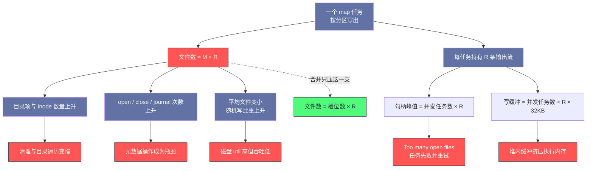
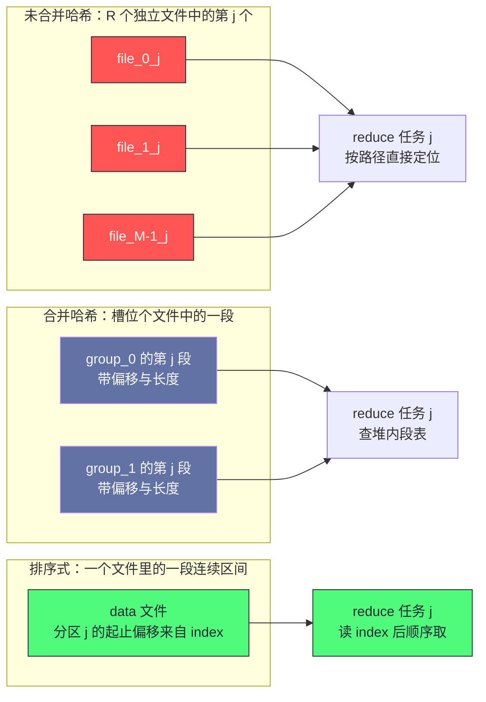
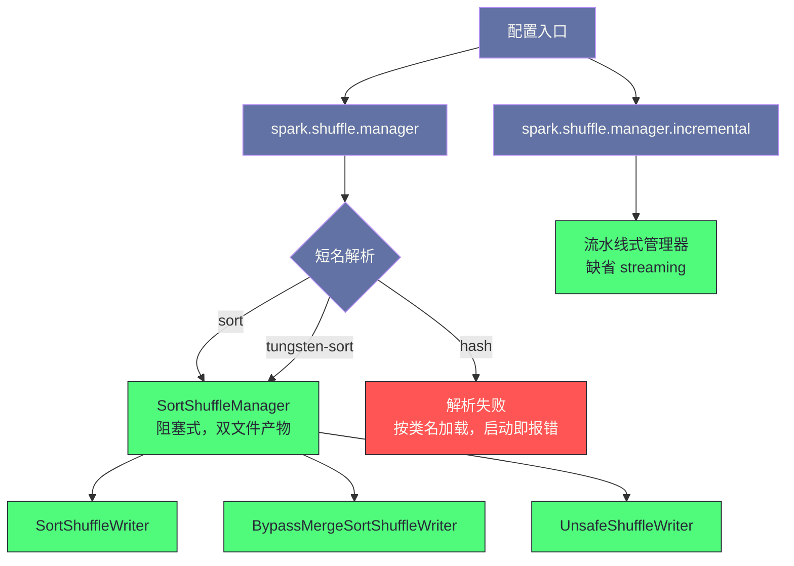
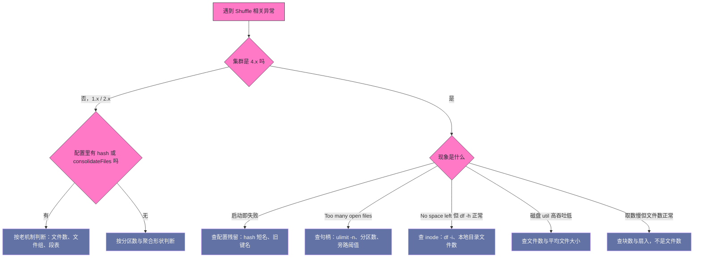

# 02 Hash Shuffle 的设计与致命缺陷

**摘要：** Hash Shuffle 在 Spark 4.3.0 里已经不存在了：没有这个类，没有这个短名，也没有配套的配置项。所以这一篇不写「怎么用它」，只写一件更长命的事——一个被淘汰的实现留下了哪些判据。它留下三笔账：文件数、文件句柄、写缓冲。未合并版把文件数推到 M×R，合并版用 `spark.shuffle.consolidateFiles` 压到槽位数×R，而这两版的失败点是不同的：前者撞的是磁盘与元数据，后者撞的是每个任务仍然持有的 R 条流。Sort Shuffle 用一个数据文件加一个索引文件把文件数降到 2×M，这是数量级的改进，也是它取代哈希路径的直接理由。本文把 M=1000、R=1000 的场景换算成文件数、句柄数与缓冲字节数（均为示例推算），给出「我该关心它吗」的判据，并把 4.x 里最容易按旧资料配错的三处逐条核到符号一级：`hash` 短名已经失效、`tungsten-sort` 只是 `sort` 的别名、今天的两个管理器是 `BlockingShuffleManager` 与 `PipelinedShuffleManager`（`spark.shuffle.manager.incremental`，缺省 `streaming`）。机制推导见内核系列，本篇只做运维判断。末尾是一组反例与一条判断链：照搬旧文档配 `hash` 为什么会让作业在启动阶段就死掉、`tungsten-sort` 为什么改了也不会更快、`ulimit -n` 为什么是集群基线而不是作业参数。

---

## 第 1 章 先说结论：这条路在 4.x 上已经不存在

### 1.1 三条最容易配错的

4.3.0 的 `ShuffleManager.resolveShortName` 只认三个短名：`sort`、`tungsten-sort`、`streaming`。`hash` 不在其中，而且不只是名字不在——`org.apache.spark.shuffle.hash` 这个包在 4.3.0 的源码里已经没有，`FileShuffleBlockResolver`、`ShuffleFileGroup`、`spark.shuffle.consolidateFiles` 一并消失。短名表里查不到的名字，会被原样当作全限定类名去实例化，于是 `spark.shuffle.manager=hash` 的后果不是「退化成别的实现」，而是驱动启动时就抛一个类加载失败（`ClassNotFoundException: hash` 一类，具体文本以对应版本的日志为准），作业连第一个 Stage 都进不去。

这种失败方式值得单独记一笔：它发生在 `SparkEnv` 的构造期，也就是作业开始计算之前；因此在一个「提交即失败」的现场，先查配置里有没有 `hash`，比查代码与数据都快。

第二条是 `tungsten-sort`。这个名字在 1.x 里确实指向一份独立的写侧实现，到了 4.x 只是 `SortShuffleManager` 的第二个拼写——短名表里两个键映射到同一个类，接上以后没有任何行为差异。把 `spark.shuffle.manager` 从 `sort` 改成 `tungsten-sort` 去「启用 Tungsten 优化」，是一个纯粹的无效动作；Tungsten 相关的能力在 4.x 由序列化器与那几条 writer 判据决定，不由这个字符串决定。

第三条是 manager 的分类。4.x 把 Shuffle 管理拆成阻塞式与流水线式两支：`spark.shuffle.manager` 只接受前者（内置即 `sort`），流水线式由 `spark.shuffle.manager.incremental` 指定、缺省 `streaming`。所以「这个集群用哪个 shuffle manager」在今天不是一个二选一的问题，而是两支各有一个答案，且两支的产物形状根本不同——一支交出可寻址的数据文件加索引，一支根本不留完整的可寻址文件。

### 1.2 那为什么还值得读这一段

三个理由，都不在于「学会用它」。

第一，今天读 Sort Shuffle 的索引格式、bypass 阈值、writer 选择判据，其中大半「为什么必须这样」的答案在这个失败案例里。索引为什么必须落在磁盘上而不是堆里，一个分区为什么不能对应一个文件，分区数为什么被当作最贵的变量，这些问题在没有哈希路径的对照时都显得像是任意规定。

第二，迁移。三百台机器、每天两千个作业的集群，总会有几份从 1.x 时代传下来的提交脚本、几个从旧文档抄来的 `--conf`、几台镜像里固化的 `spark-defaults.conf`。这些残留平时不生效，直到某次升级把「不生效」变成「起不来」。

第三，排障。Shuffle 文件数失控这件事今天仍然会发生，只是病因从「哈希路径的乘法」换成了「分区数被调得太大」。判断的依据是同一组算术：文件数、句柄数、缓冲字节数三笔账各自的分母是什么，翻倍的杠杆在哪一层。

### 1.3 本篇的边界

机制层面的推导不再重复：哈希写侧如何构造 R 个写入器、文件组如何复用、段表放在哪里，见内核系列 [[大数据/Spark/读书笔记-spark内核/05_Shuffle核心机制/4. Spark_Hash_Based_Shuffle|Hash Based Shuffle：逐分区落盘与 FileSegment 寻址]]；从哈希到排序的完整演进脉络、三代实现各自的取舍见 [[大数据/Spark/读书笔记-spark内核/05_Shuffle核心机制/5. Spark_Shuffle演进_Hash_to_Sort|Sort-Based Shuffle：双文件布局与三类 Writer]]；manager 接口的分层、句柄的传递与 writer 的选择顺序见 [[大数据/Spark/读书笔记-spark内核/05_Shuffle核心机制/2. Spark_Shuffle框架设计与实现|Shuffle 框架：接口分层与读写契约]]。本篇只做四件事：把两个版本各自的失败点分开算清；把 4.x 的现状核到符号一级；给出「该不该关心它」的判据；把反例列成可执行的检查项。

把退场的符号与留下来的符号并排放，轮廓就清楚了：

| 符号或配置 | 活跃版本 | 4.3.0 是否还在 | 判据 |
| :--- | :--- | :--- | :--- |
| `org.apache.spark.shuffle.hash.HashShuffleManager` | 1.1.0 至 1.6.0 | 否 | `shuffle` 包下无 `hash` 子包 |
| `FileShuffleBlockResolver` | 1.5.x 至 1.6.0 | 否 | 只剩 `IndexShuffleBlockResolver` 等实现 |
| `spark.shuffle.consolidateFiles` | 0.8.1 至 1.5.x | 否 | 从 1.6.0 起源码不再读取 |
| `spark.shuffle.manager=hash` | 1.1.0 至 1.6.0 | 否 | 短名表只剩三个键 |
| `spark.shuffle.manager=tungsten-sort` | 1.1 起 | 是（别名） | 与 `sort` 映射到同一个类 |
| `FileSegment` | 早期至今 | 是 | `commitAndGet` 仍返回它，bypass 路径仍在用 |
| `BypassMergeSortShuffleWriter` | 1.x 至今 | 是 | 保留「每分区一个写入器」的形状 |

表里最后两行是这一篇的落点所在：退场的是管理器与文件布局，活下来的是「段」这个抽象和「分区少时按分区写临时文件」这个形状，只不过后者被压进了 200 个分区以内的旁路路径。

---

## 第 2 章 两个版本，两种失败点

### 2.1 未合并版：一个分区一个文件

最初的设计只有一条规则：一个 map 任务为每个 reduce 分区交一个文件，文件名由三元组（shuffle、map、reduce）定死。这条规则的好处是寻址免费——读侧拿到三元组就能拼出路径，不需要索引，也不需要任何跨任务的协调；代价是文件数等于两侧规模之积，M 个 map 任务乘 R 个 reduce 分区。

在 R 只有几十、M 只有几百的年代，这个乘法是安全的。问题出在两侧同时变大：分区数随并行度增长，map 任务数随输入数据量增长，两个趋势都在往同一个方向推。

### 2.2 合并版：把文件数压到槽位数乘分区数

0.8.1 引入的 File Consolidation 换了一个角度提问：同一个 Executor 上的 map 任务是串行执行的，前一个任务写出去的文件在它退出后仍然躺在磁盘上等着被读，那么后一个任务能不能接着往同一组文件末尾追加？能，于是文件组（file group）出现了——一个 Executor 上并发几个任务就预备几组文件，每组仍是 R 个，串行任务轮流借用、归还。

文件数因此从 M×R 变成槽位数×R。这里的槽位数指集群里能同时跑 map 任务的并发数，三百台机器的集群按两百个 Executor、每个四核算是八百。把它写成增益更好用：**合并的收益倍数约等于波数**，也就是「map 任务数除以槽位数」。单波场景下收益为零，一点二波省两成，十倍波才谈得上数量级。

这一点关系到后面所有的判断：`spark.shuffle.consolidateFiles` 这个开关买到的东西不是「更快」，而是「在波数高时少留一些文件」。把它当性能开关打开，多半会失望。

### 2.3 合并治的是哪一笔，不是哪一笔

合并把物理文件数压下去了，但没有动三样东西。

其一，每个并发任务仍然要持有 R 条输出流。文件组改变的是这 R 条流指向哪些文件，不改变流的数量，于是文件描述符的峰值与写缓冲的内存占用一分未减。其二，块数没有变化：一个 reduce 任务仍然要取 M 个块，扇入由 M 决定，合并只是让这些块分布在更少的文件里。其三，寻址信息被搬进了 Executor 的堆——跨任务共享文件意味着读侧必须知道「谁的数据从第几个字节到第几个字节」，这份段表存在进程内存里，外部 Shuffle 服务那个独立进程读不到，也没有协议传过去。

第三条是结构性的：启用了外部 Shuffle 服务的集群上，合并开关即使打开也取不到数据，因为服务端按整文件规则去拼路径，拼出来的名字与合并后的名字对不上。这也是 1.6.0 移除这个特性的公开理由之一——不能被充分测试，且与外部服务不兼容。

### 2.4 把两条失败链画出来

两个版本的失败点其实是两条不同的链，混着讲会得出错误结论。下面的图把它们分开：左链是文件数引发的系统级代价，右链是「每任务 R 条流」引发的进程级代价，合并只切断了左链的一半。

图里那条虚线是整个故事的关键：**合并让左边那条链变短，右边那条链原地不动**。一个只记得「合并把文件数降下来了」的人，在合并打开后仍然遇到 `Too many open files` 时，第一反应会是「开关没生效」，而实际发生的是右链原来就没被处理。

两版的分工与代价放进一张表：

| 维度 | 未合并版 | 合并版（`consolidateFiles=true`） |
| :--- | :--- | :--- |
| 文件数 | M × R（精确值是「非空对」的个数） | 槽位数 × R |
| 增益来源 | 无 | 波数，即 M ÷ 槽位数 |
| 每任务句柄峰值 | R | R（不变） |
| 每任务写缓冲 | R × `spark.shuffle.file.buffer` | 同上（不变） |
| 寻址方式 | 文件名直接定位，无索引 | 文件内偏移，段表在 Executor 堆内 |
| 外部 Shuffle 服务 | 兼容 | 不兼容，取不到数据 |
| 失败尝试的残留 | 临时文件被覆盖或删除 | 文件里留下永不引用的空洞 |
| 失败主因 | 文件数与元数据操作 | 句柄与堆内段表 |
| 退场时间 | 1.6.0 回到一块一文件，2.0.0 整体移除 | 1.6.0 移除 |

---

## 第 3 章 把缺陷换算成数字

### 3.1 文件数：一个乘法就能算错的量级

取贯穿案例的规模：三百台机器的集群，两百个 Executor、每个四核，合计八百个 map 槽位；一次结算作业的 map 任务是 M=1000，下游按分区数 R=1000 洗一遍。未合并版留下的是 1,000,000 个文件，合并版是 800,000 个——波数只有一点二五，省下来的是两成，文件数仍然是十万量级。

换成更大的输入：M=20,000、R=2000，槽位仍是 800 的话，未合并版是四千万个文件，合并版是一百六十万个。这两个数字都在「清理一次要跑很久」的区间里，差别只是很久与更久。

再换成 Sort Shuffle 的算法：数据文件 M 个、索引文件 M 个，合计 2×M，与 R 无关。同样 M=1000 的作业，两万个文件与一百万个文件之间差了五十倍；M=20,000 的作业，四万个文件与四千万个文件之间差了三个数量级。

把这些写成一张实算表，量级的差别比任何形容词都直接（以下均为示例推算，用于比较量级，不是测量值）：

| 场景 | M | R | 槽位数 | 未合并文件数 | 合并后文件数 | 单任务缓冲 | 单 Executor 八任务的句柄峰值 |
| :--- | :--- | :--- | :--- | :--- | :--- | :--- | :--- |
| 结算作业首洗 | 1,000 | 1,000 | 800 | 1,000,000 | 800,000 | 32 MB | 8,000 |
| 分区调大之后 | 2,000 | 2,000 | 800 | 4,000,000 | 1,600,000 | 64 MB | 16,000 |
| 大输入高并发 | 20,000 | 2,000 | 800 | 40,000,000 | 1,600,000 | 64 MB | 16,000 |

最后一列的分母是「并发任务数」，与 M、R 都无关：八个任务并发、每个持有 R 条流，就是 8R 个句柄。这一列解释了为什么把集群扩一倍并不会让句柄问题缓解——扩的是槽位，**句柄峰值只随并发数与分区数变化**。

### 3.2 写缓冲：被分区数乘出来的堆内存

每个分区的输出流都带一块缓冲，4.x 里是 `spark.shuffle.file.buffer`、缺省 32 KB。一个任务持有 R 条流，就持有 R 块缓冲：R=1000 时是 32 MB，R=2000 时是 64 MB。八个任务并发，一台 Executor 上就是 256 MB 到 512 MB。

这笔内存的性质要说清：它在 JVM 堆里，与执行内存争同一片空间。哈希路径本身不负责溢写，它把「装不下怎么办」交给了 map 端的聚合容器；一旦聚合容器与这堆缓冲一起挤压堆，表现就是 GC 时间上升、任务变慢、Executor 被心跳超时判死。判死的 Executor 带走的还有它已经写出去的全部 Shuffle 输出，下游要重新拉一遍。

### 3.3 文件句柄：`ulimit -n` 是集群基线，不是作业参数

每条落盘的分区输出流都是一个文件描述符，进程能同时打开的文件数由 `ulimit -n` 限定，这个值由镜像、容器运行时和宿主机决定，Spark 自己不设它。换句话说，句柄上限是集群基线，作业侧通常改不了；能在作业侧改的只有 R 与并发数。

按上表最后一个场景，单 Executor 峰值需要一万六千个句柄。容器里这个值常常是 1024 或 65536 两档：1024 一档在 R 破百时就已经很紧，65536 一档能撑到 R 数千但被 Netty、JAR、日志文件一起分食。越过上限的表现是一句看起来与 Shuffle 毫无关系的 `Too many open files`，它落在写入失败上，与「找不到 Shuffle 文件」是两回事——后者的常见诱因是 Executor 被判定失联、输出作废，两者的现场很像，成因完全不同。

### 3.4 元数据与随机写：小文件的两笔账

按 M=1000、R=1000、单个 map 任务产出 200 MB 估算，平均每个文件 200 KB。这个尺寸在文件系统上很尴尬：打开一次、写入几十个缓冲块、再关闭，固定开销占总成本的比例极高；写入本身是分散的，磁盘要在一百万个位置之间跳，机械盘上表现为 util 打满而吞吐上不去。

inode 这一笔要说得克制一些。ext4 缺省的 inode 密度是每 16 KB 空间一个，一块 1 TB 的本地盘大约能放六千万个 inode；一百万文件分布在两百个 Executor 上，单机不过五千个，占配额万分之一量级。**inode 耗尽在这个量级上并不成立**，真正先撞墙的是打开关闭的次数与元数据日志的写入，以及作业结束或失败之后的清理——删一百万个文件本身就是一段可观的耗时。

真正需要提防的是小容量卷。把 `spark.local.dir` 指到一块五十 GB 的本地盘，容量对应的 inode 只有三百万个；同一个挂载点上若还跑着别的应用、留着历史残留目录，几百万个 Shuffle 文件就足以把配额吃掉。报出来的是 `No space left on device`，与磁盘写满一字不差，`df -h` 显示空间充足，`df -i` 才露出真相。判断这类现场要拿单机文件数去比配额，也就是 `M_local × R` 再乘上同一个卷上的应用数，拿集群总数去比会得出「不可能」的错误结论。

### 3.5 配置与阈值：谁决定这三笔账

哈希路径的参数已经全部失效，但决定这三笔账的参数今天还在用，只是名字和归属变了。下表把历史键与现行键并列，右侧两列是可操作的代价：

| 参数 | 缺省 | 它决定什么 | 调大的代价 | 调小的代价 |
| :--- | :--- | :--- | :--- | :--- |
| `spark.shuffle.manager` | `sort` | 阻塞式管理器取哪一个实现 | 没有「调大」这回事：填 `hash` 直接启动失败 | 填 `tungsten-sort` 与 `sort` 完全等价，无行为变化 |
| `spark.shuffle.manager.incremental` | `streaming` | 流水线式管理器 | 换成非内置实现要自己保证读写两端的协议一致 | 关闭流水线式，回到阻塞式的双文件产物 |
| `spark.shuffle.consolidateFiles` | 1.5.x 缺省 false，现已删除 | 1.x 是否复用文件组 | 1.x 上：文件数下降，堆内段表与寻址成本上升 | 1.x 上：每任务 R 个文件 |
| `spark.shuffle.file.buffer` | 32 KB | 每条分区输出流的缓冲 | 内存按「并发任务数 × 分区数」线性放大 | 单文件写入的系统调用次数上升 |
| `spark.shuffle.sort.bypassMergeThreshold` | 200 | 无聚合时是否走旁路 | 句柄与缓冲随分区数线性放大，可能直接撞上限 | 更多 Shuffle 退回排序路径，多付一次排序 |
| `spark.shuffle.io.maxRetries` | 3 | 拉取失败的重试次数 | 掩盖真实故障，失败阶段拖长 | 短暂的网络抖动升级为 Stage 失败 |
| `ulimit -n`（操作系统层） | 由镜像与宿主决定 | 单进程可同时打开的文件数 | 受硬上限与平台策略约束，多数集群里作业改不动 | 大分区或旁路路径先撞 |

表里最该被记住的是第五行：旁路阈值的本质是一个资源配额，而不是一个性能开关。把它调到一千，等于让每个并发任务开一千个句柄、配一千块缓冲；单看 CPU 是快了，代价在句柄耗尽时一次付清。

---

## 第 4 章 它为什么输给 Sort Shuffle

### 4.1 从 M×R 到 2×M

Sort Shuffle 的做法在结果上很简单：一个 map 任务只交出两个文件，一个是数据，一个是索引；数据文件里按分区号顺序放着所有分区的数据，索引里记着每个分区在数据文件里的起止位置。文件数因此是 2×M，与 R 无关——R 从一千涨到两千，文件数一个不增。

这一步把「数量级」这个词用在了正确的地方：不是快了几成，而是**文件数从两侧规模之积变成一侧规模的两倍**。前面算过，同样一千个 map 任务的作业，一百万与两万之间是五十倍；两万个任务的作业，四千万与四万之间是三个数量级。

代价写在同一张账单上：写侧要先把数据按分区号组织起来，装不下就先落盘再归并，于是多了一次排序与若干次溢写；读侧拿到的不再是「一堆现成的小文件」，而是一个大文件加一份索引，必须按索引去切。

### 4.2 一次排序买到的四样东西

把排序看成买入的动作，它换来四样东西，四样都是运维层面可感知的。

第一是文件数与 R 解耦，分区数从此可以自由调大而不牵连文件数。第二是句柄峰值降到常数级：排序路径在同一时刻只写一个分区，不需要为每个分区留一条流。第三是寻址信息落在磁盘上（索引文件），不再私有于某个进程，外部 Shuffle 服务因此可用。第四是清理变便宜：删 M 个文件与删 M×R 个文件不是一个工作量。

第三样值得展开一句：外部 Shuffle 服务是让 Executor 敢于被动态回收的前提之一，而它只认磁盘上的可寻址结构。哈希合并版把寻址放进堆里，等于把自己排除在弹性伸缩之外——这条代价在 2013 年不明显，在按需伸缩成为常态之后就变成了硬伤。

### 4.3 同一个分区，三种落法

把「某个 reduce 分区要读的那批数据」在三种布局里的位置画出来，取代关系就一目了然了：

三种落法的差别不在「数据在不在磁盘上」，而在「定位这份数据需要什么」：第一种需要文件系统目录项，第二种需要一段只存在于某个进程里的表，第三种需要磁盘上的一份索引。定位依据放在哪里，决定了谁能读、读到多快、以及失败之后还有没有办法重来。

### 4.4 逃逸口留在了旁路路径

排序不是无条件的。当一次 Shuffle 不需要 map 端聚合、且分区数不超过 `spark.shuffle.sort.bypassMergeThreshold`（缺省 200）时，4.x 会走旁路：为每个分区建一个临时文件、按分区逐条追加，全部写完之后把这几百个临时文件依次拼进一个数据文件，再写索引。

旁路路径的形状与哈希版几乎一样，区别只在末尾多了一次拼接。这次拼接把「临时文件」与「最终产物」分开，于是文件数的账落在临时文件上，而临时文件的存活期只有一个任务的生命周期；任务一结束，句柄与目录项一起释放，最终产物仍然是 M 组双文件。

这也是为什么「每分区一个写入器」这个思路没有被证伪，只是被压缩到了两百个分区以内。超过这个数，R 份缓冲与 R 个句柄又会回来，而那时排序式用一次排序把文件数压到 2M、把句柄压到常数。同一个形状，换了边界条件，就从主流变成了兜底；**阈值 200 本身是一个资源配额，而不是一个性能分界**（这条判据的推导见 [[大数据/Spark/读书笔记-spark内核/05_Shuffle核心机制/5. Spark_Shuffle演进_Hash_to_Sort|演进与三类 Writer]]）。

---

## 第 5 章 4.x 的现状：三处配置落点

### 5.1 两个管理器，两支产物

4.x 的 Shuffle 管理被拆成两类：阻塞式（`BlockingShuffleManager`）与流水线式（`PipelinedShuffleManager`）。前者是 `spark.shuffle.manager` 的取值域，缺省 `sort`，产物是可寻址的数据文件加索引；后者由 `spark.shuffle.manager.incremental` 指定，缺省 `streaming`，产物不是完整的可寻址双文件——写侧一边写、读侧一边增量读，下游不必等上游全部完成。

把这两支并到一张图上，配置与实现的对应关系就不会再混：

### 5.2 迁移时会看到什么

老作业带着旧配置上来，有三种典型现场，判据各不相同。

其一是启动即失败，报类加载错误，错误信息里带 `hash` 这个词。位置在驱动启动阶段，与数据、集群资源都无关，改配置即可。

其二是启动成功但 Shuffle 行为与预期不符，比如以为某次 Shuffle 走了序列化路径却仍然溢写多次。这类现场通常来自把 `tungsten-sort` 当成独立实现的误解：名字改了，实现没换，判据在日志里那行 writer 选择的调试信息，而不在配置里。

其三是配置被静默忽略。`spark.shuffle.consolidateFiles` 这类已经被删掉的键，在新版本里不会生效；它是否报错取决于版本对未知键的处理策略，多数情形下是「写了等于没写」。这种现场最难查，因为没有任何信号——唯一的办法是对着配置清单逐条核对每个键是否还在。

### 5.3 旧资料写法与 4.x 后果

| 旧资料里的写法 | 4.x 的实际后果 | 正确做法 |
| :--- | :--- | :--- |
| `spark.shuffle.manager=hash` | 启动阶段类加载失败，作业起不来 | 删除这一行，使用缺省 `sort` |
| `spark.shuffle.manager=tungsten-sort`「启用 Tungsten 优化」 | 与 `sort` 完全等价，没有任何行为变化 | 删除；要判断实际路径看 writer 选择日志 |
| `spark.shuffle.consolidateFiles=true`「减少 Shuffle 文件」 | 键已删除，静默无效 | 删除；文件数由分区数决定，从分区数入手 |
| `spark.shuffle.file.buffer.kb` | 旧键名，新版不认 | 改用 `spark.shuffle.file.buffer`，值写 `32k` 这类带单位形式 |
| 「把 `spark.shuffle.spill` 关掉避免溢写」 | 哈希时代的告警行为，排序路径不按这个语义工作 | 不要关溢写；要减少溢写就调内存与分区数 |
| 「分区数调到几千以获得并行度」 | 索引、`MapStatus`、拉取请求数同步放大 | 按数据量定分区，单分区留出百 MB 量级 |

表里第四行与第六行是最容易踩的两处：一处是名字换了，一处是杠杆换了方向。

---

## 第 6 章 我该关心它吗

### 6.1 三种不需要关心

跑在 4.x 上、没有历史包袱的集群，不需要关心这一段。分区数在数百以内、Executor 不频繁判死、本地盘容量正常的作业，不需要关心。把 Shuffle 慢归因到「应该换个 manager」的人，不需要关心——问题不会在那一层。

### 6.2 三种需要关心

第一种是迁移：把 1.x 或 2.x 的作业搬到 4.x。此时要关心的不是哈希路径怎么工作，而是配置里有没有它的残留，以及「文件数为什么突然变了」怎么解释。

第二种是照抄旧资料：手上有一份写于 2015 年前后的调优文档，里面提到 `consolidateFiles`、`hash`、`tungsten-sort` 三件套。此时要做的是逐条核对键是否还在。

第三种是排障口径：看到本地盘被海量小文件撑满、看到 `Too many open files`、看到 `No space left on device` 而 `df -h` 正常，需要知道这三种现场分别属于文件数、句柄、inode 三笔账里的哪一笔。它们的处置方向完全不同，混起来会浪费大量时间在错误的方向上。

### 6.3 判定流程

把上面的条件串成一条判断链，顺序上先问「版本」，再问「现场」，最后才问「参数」：

最后一条分支值得强调：**文件数正常而取数慢，瓶颈在块数与请求数上**，与文件数无关。合并哈希时代最容易犯的错就是把这个当文件数问题，于是去开合并且发现毫无改善——合并压的是文件数，扇入由 M 决定，一动没动。

把上图的五条分支摊平成表，每一行都对应一个可以直接执行的检查：

| 症状 | 先看什么 | 归属哪一笔账 | 处置方向 |
| :--- | :--- | :--- | :--- |
| 提交后作业起不来，报类加载错误 | 配置里的 `spark.shuffle.manager`，错误文本里是否出现 hash | 配置层，与数据无关 | 删掉旧键，回到缺省 `sort` |
| 写侧任务失败，报 `Too many open files` | `/proc/<pid>/limits` 的 open files 一项、当前 fd 计数、分区数 | 进程资源：并发数乘分区数 | 降分区或降并发；先确认基线，再谈提上限 |
| 报 `No space left on device` 但 `df -h` 有余量 | `df -i` 的 inode 使用率、`spark.local.dir` 下的文件数 | 文件系统元数据 | 清残留、换更大容量的本地卷、降分区 |
| Stage 慢，磁盘 util 打满 | 任务表的 Shuffle Write Size 与记录数、本地目录的文件数与平均大小 | 写侧文件数与随机写 | 降分区，让单文件回到百 MB 量级 |
| 取数慢，文件数与磁盘都正常 | 任务表的 Shuffle Read Size 与 Fetch Wait、块数与扇入 | 读侧请求数，不是文件数 | 减少分区、启用连续块取数、评估远端 Shuffle 服务 |
| UI 上找不到「文件数」这一项 | Stage 页只有 Size、Records、Time 三列 | 观测面缺口 | 到本地目录实测，或用 inode 与 fd 计数间接观察 |
| 同一作业在 1.x 与 4.x 表现不同 | 版本号与配置残留 | 版本口径 | 先按版本核对键是否存在，再谈调优 |

表里第四行与第五行的分界，就是「这一层」与「下一层」的分界：一个是写侧留下了多少文件，一个是读侧要发多少请求，两者的处置方向正好相反——前者靠减少分区，后者靠减少请求的粒度。

---

## 第 7 章 这段历史留下的三条判据

### 7.1 文件数比数据量更致命

同样 200 GB 的 Shuffle 输出，装在两万个文件里与装在一百万个文件里，对磁盘的压力完全不同：前者每个文件 10 MB，顺序写接近带宽上限；后者每个文件 200 KB，随机写把带宽换成寻道。数据量是一个可以靠加盘解决的维度，**文件数不是**——它同时影响 inode、目录项、打开关闭次数、清理耗时与读侧请求数。

这条判据今天仍然有效，只是杠杆换了：文件数从 M×R 变成 2×M 之后，能推动它的不再是 map 任务数，而是分区数。`spark.sql.shuffle.partitions` 从 200 调到 2000，数据量没变，文件数、索引长度、`MapStatus` 大小、拉取请求数一起涨十倍——这就是今天版本的「文件数比数据量更致命」。

### 7.2 缓冲与句柄是隐形上限

内存与句柄这两笔账的特点是：它们不出现在 Shuffle 的吞吐指标里，只在越界的那一刻出现一次。写缓冲占用的是堆，表现为 GC 与执行内存不足；句柄占用的是进程资源表，表现为打开失败。两者都随「并发任务数 × 分区数」增长，而这两个乘数都被人当成「并行度」在调。

反过来，这条判据也给了一个排查顺序：先算乘积，再看上限。八个任务并发、R 取一千，句柄要八千；容器上限一千零二十四，问题在乘出来之前就已经注定了，不需要看任何监控。

### 7.3 为大分区数留余地

哈希路径的设计假设是「R 很小」，而 R 是用户手里最想调大的那个数。一个把 R 放进乘法里的设计，等于**把稳定性交给了用户的心情**——这是它最根本的失误，比任何一次具体的实现取舍都更致命。Sort Shuffle 把 R 从文件数里拿掉，bypass 路径又用阈值 200 把 R 重新引进来，但这次是有边界的：超过边界自动退回，不靠用户自觉。

三条判据落到今天的操作面上：

| 判据 | 今天的观察位 | 对应的参数或动作 |
| :--- | :--- | :--- |
| 文件数比数据量更致命 | `spark.local.dir` 下的文件数、`df -i`、清理耗时 | 按数据量定分区数，单分区留百 MB 量级 |
| 缓冲与句柄是隐形上限 | `/proc/<pid>/limits`、`/proc/<pid>/fd` 计数、GC 时间 | 降并发、降旁路阈值、与平台确认 `ulimit -n` |
| 为大分区数留余地 | Stage 页的 Shuffle Read/Write Size、任务表扇入 | 分区数超过 200 时确认没走旁路；超过数千时评估索引与 `MapStatus` 开销 |

---

## 第 8 章 反例与落点

### 8.1 照搬旧文档配 `hash`

最常见的现场：一份 2015 年的调优文档写着「`spark.shuffle.manager=hash` 可以避免排序开销」，于是有人把它加进了提交脚本。在 4.x 上，这个动作的后果是作业直接起不来。判断很快——错误发生在启动阶段，错误信息里带类名，改配置即恢复；但它会消耗掉一次完整的上线窗口，因为「起不来」在现场往往先被归因为资源或权限。

反过来也有一种：在 1.5 及更早的版本上，看到「合并能把文件数降到槽位数×R」就把 `spark.shuffle.consolidateFiles` 打开，却没注意这个集群开着外部 Shuffle 服务，结果是取数失败而不是文件变少。配置的语义与版本、与部署形状都绑定，脱离这两样去谈某个键的效果，在 Shuffle 这一层尤其危险。

### 8.2 以为 `tungsten-sort` 是独立实现

这个误解的代价不是失败，而是无效：改了配置、跑了压测、看到没有变化，于是得出「Tungsten 优化没用」的结论。真正的判断依据是写侧实际走了哪条路径，那由算子形状（有没有 map 端聚合）、分区数、序列化器三者共同决定，与这个字符串无关。要确认，看日志里 writer 选择的调试信息，比看配置可靠。

顺带一个推论：既然两个短名等价，那么「A 集群用 sort、B 集群用 tungsten-sort，所以 B 更快」这类对比结论必然来自其他变量的差异，多半是分区数或数据形状不同。

### 8.3 忽略句柄上限

句柄这一项的特殊之处在于它不由 Spark 管。容器里 `ulimit -n` 是一千零二十四还是六万五千五百三十六，取决于镜像与运行时；作业侧能改的只有分区数与并发数。于是在一个大分区作业上，无论怎么调 Spark 参数，只要「并发数 × 分区数」越过那个基线，失败就会以 `Too many open files` 的形式出现，且出现在写入侧。

处置顺序应当是先确认基线（读 `/proc/<pid>/limits`）、再算乘积、最后才决定是降分区还是提上限。跳过第二步直接提上限，会在分区数继续上涨之后再次撞墙——**上限是固定的，乘积是会变的**。

### 8.4 落点

这段历史的价值不在「曾经有一个叫 Hash Shuffle 的东西」，而在于它把三个问题留给了后来者：文件数由谁决定、定位依据放在哪里、资源上限由谁承担。今天的 Sort Shuffle 用双文件回答了第一个（2×M，与 R 无关），用磁盘索引回答了第二个（谁都能读），用常数级句柄回答了第三个（同一时刻只写一个分区）；而旁路路径与流水线式那一支，分别在「分区少」与「不想等」两个方向上把答案改了回来。

于是一个 4.x 时代的工程师面对 Shuffle 问题时，真正要问的不是「用哪个 manager」，而是三件事：这一次 Shuffle 的文件数由什么决定、它的定位依据在哪里、它的资源上限被谁定住。三个问题问完，哈希路径的那些教训会自动变成判断力——它不在代码里了，但它留下的算术还在用。

---

## 参考资料

1. Apache Spark 4.3.0 Configuration：`spark.shuffle.manager`、`spark.shuffle.manager.incremental`、`spark.shuffle.file.buffer`、`spark.shuffle.sort.bypassMergeThreshold` 的缺省值。https://spark.apache.org/docs/4.3.0/configuration.html
2. Apache Spark 4.3.0 Tuning Guide：Shuffle 相关调优项与序列化器建议。https://spark.apache.org/docs/4.3.0/tuning.html
3. Apache Spark 4.3.0 Job Scheduling：外部 Shuffle 服务与动态分配的前置条件。https://spark.apache.org/docs/4.3.0/job-scheduling.html
4. Apache Spark 源码（4.3.0）：`core/src/main/scala/org/apache/spark/shuffle/ShuffleManager.scala`，`resolveShortName` 只解析 `sort`、`tungsten-sort`、`streaming` 三个短名。https://github.com/apache/spark/blob/v4.3.0/core/src/main/scala/org/apache/spark/shuffle/ShuffleManager.scala
5. Apache Spark 源码（4.3.0）：`core/src/main/scala/org/apache/spark/SparkEnv.scala`，阻塞式与流水线式两类管理器的装配与类型约束。https://github.com/apache/spark/blob/v4.3.0/core/src/main/scala/org/apache/spark/SparkEnv.scala
6. Apache Spark 源码（1.6.0）：`core/src/main/scala/org/apache/spark/shuffle/hash/HashShuffleWriter.scala`，一个任务同时持有 R 个写入器的写法。https://github.com/apache/spark/blob/v1.6.0/core/src/main/scala/org/apache/spark/shuffle/hash/HashShuffleWriter.scala
7. Apache Spark 源码（1.5.1）：`core/src/main/scala/org/apache/spark/shuffle/FileShuffleBlockResolver.scala`，`consolidateFiles` 开关、文件组池与段表寻址。https://github.com/apache/spark/blob/v1.5.1/core/src/main/scala/org/apache/spark/shuffle/FileShuffleBlockResolver.scala
8. Apache Spark 源码（4.3.0）：`core/src/main/java/org/apache/spark/shuffle/sort/BypassMergeSortShuffleWriter.java`，每分区一个写入器、末尾拼接的旁路写法。https://github.com/apache/spark/blob/v4.3.0/core/src/main/java/org/apache/spark/shuffle/sort/BypassMergeSortShuffleWriter.java
9. Apache Spark JIRA：SPARK-751（Consolidate shuffle files，0.8.1）。https://issues.apache.org/jira/browse/SPARK-751
10. Apache Spark JIRA：SPARK-9808（Remove hash shuffle file consolidation，1.6.0）。https://issues.apache.org/jira/browse/SPARK-9808
11. Apache Spark JIRA：SPARK-14667（Remove HashShuffleManager，2.0.0）。https://issues.apache.org/jira/browse/SPARK-14667
12. Apache Spark JIRA：SPARK-3280（Made sort-based shuffle the default，1.2.0）。https://issues.apache.org/jira/browse/SPARK-3280

> [!note] 思考题
> 1. 你所在集群的 `ulimit -n` 是 1024、65536 还是别的值？把它与「并发任务数 × 分区数」相乘，哪个作业会先撞上？
> 2. 一百万个 Shuffle 文件与两万个文件装同样多的数据，前者先坏在哪一笔账上？如果本地盘只有五十 GB，答案会不会变？
> 3. 一次 Shuffle 的取数变慢，但文件数看起来正常，应该去查什么？为什么开合并或调分区都不会有效果？
> 4. `tungsten-sort` 与 `sort` 在 4.x 上完全等价，那么「某集群用 tungsten-sort 更快」的观察还能由什么解释？
> 5. 若让你为一个必须支持万级分区的作业设计 Shuffle 写侧，你会把定位依据放在文件系统、磁盘索引还是进程内存里，各自的代价是什么？