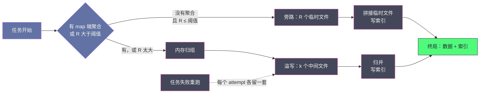
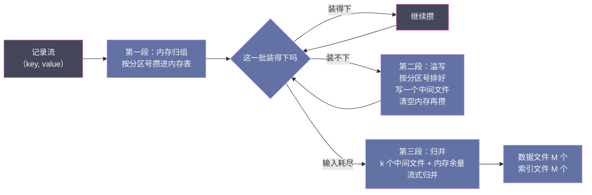
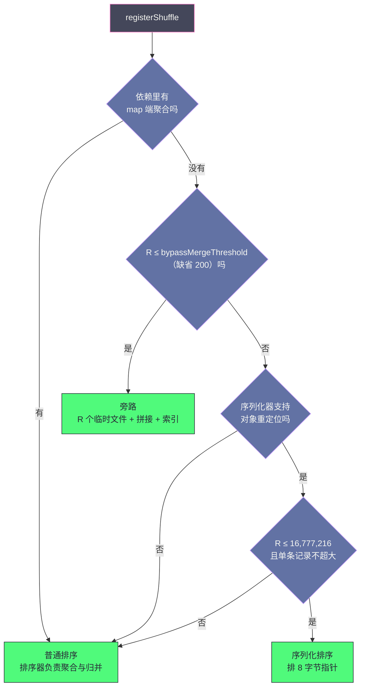
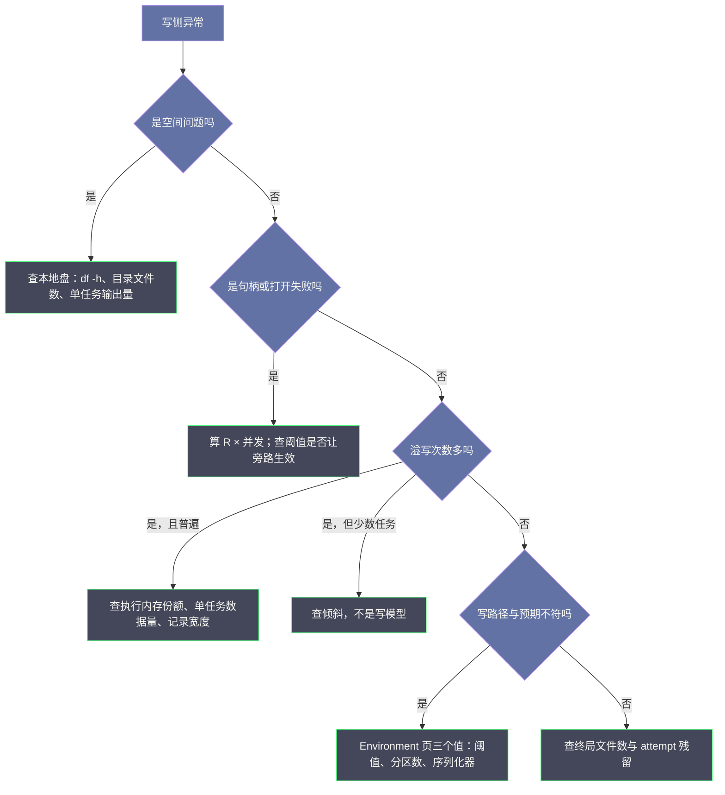

# 03 Sort Shuffle 的崛起：统一写出模型

**摘要：**

写侧的统一是 Spark 1.2 之后最容易被当成「已经解决」的一件事：一个 map 任务只交出一个数据文件和一个索引文件，文件数从 M×R 落到 2M，与分区数脱钩。这一篇把这句话当成一份合同来读，先写清它承诺了什么（数量级的文件数、磁盘上的索引、与进程无关的定位依据），再写清它在什么条件下不成立——旁路路径先把数据写进 R 个临时文件，溢写让运行期多出 k 个中间文件，失败重试留下多份 attempt 的产物，流水线式管理器根本不产出完整的可寻址双文件。合同成立的前提是一次按分区号的归组，归组要一段内存；内存不够就溢写，溢写再归并，代价从 CPU 转移到磁盘与句柄上。全文按运维口径组织：三条写路径的触发条件与产物形状、阈值 200 背后的资源账（R 取 200 到 2000 的缓冲与句柄，示例推算）、溢写次数与磁盘峰值的量级、4.x 的现状口径（`tungsten-sort` 只是别名、hash 路径已移除、管理器的两个槽位），最后落到六类现场的分诊表与四个反例。机制推导不在本篇展开，按各章路由去内核系列。

---

## 第 1 章 一句承诺，四条边界

### 1.1 承诺的原文

4.x 的排序式 Shuffle 对写侧的承诺只有一句：一个 map 任务结束时，本地盘上只多出两个文件，一个装数据，一个装索引。数据文件里 R 个分区的字节首尾相接、按分区号升序排列；索引文件里每个分区占一个定长条目，记着该分区在数据文件里的起点与长度。总文件数是 M 的两倍，R 取多少都不影响这个数字。

这句话的分量不在「少」，在「脱钩」。M 由输入数据量与切分方式决定，通常几百到几万，作业作者改不动；R 是并行度旋钮，被人反复调大调小，是集群里最活跃的那个变量。把 R 从文件数的乘法里拿掉，等于把一个最不稳定的量移出了稳定性方程。至于 M×R 与 2M 之间那几级量级的差距如何算出来、三代实现各自付出了什么，属于演进史的口径，见内核 [[大数据/Spark/读书笔记-spark内核/05_Shuffle核心机制/3. Spark_Shuffle框架演进与架构|Shuffle 框架演进与架构]]。

承诺的第二层是定位依据的位置。要找到「某个 reduce 分区的那批数据」，只需要读磁盘上的那份索引，不需要任何进程内的状态；于是「数据是谁写出来的」不再重要，外部 Shuffle 服务可以代读，Executor 可以在 Shuffle 完成之后被回收。这一层比第一层更长命：文件数是运维能看见的账，定位依据的位置决定了弹性伸缩能不能做。

### 1.2 承诺是一个条件命题

这句话在四种条件下不成立，四种都是模型的组成部分，但现场表现完全不同，混起来会把排查引向错误的方向。

第一种是旁路。当一次 Shuffle 没有 map 端聚合、且分区数不超过 `spark.shuffle.sort.bypassMergeThreshold`（缺省 200）时，写侧会先为每个分区各开一个临时文件、按分区号直接追加，全部写完之后再把 R 个临时文件首尾拼进一个数据文件，补一份索引。承诺的「两个文件」在任务结束那一刻成立，**在任务执行期间不成立**：那段时间里磁盘上真实存在的是 R 个临时文件。

第二种是溢写。排序路径先在内存里攒记录，攒不下就把当前这批按分区号排好、写进一个中间文件，再接着攒。中间文件的个数由溢写次数 k 决定，任务结束时被归并成一个数据文件。于是「两个文件」是终局形态，不是过程中的形态。

第三种是重试。任务失败会被重跑，同一分区号下会先后存在多个 attempt 的输出目录；旧 attempt 的产物要等清理阶段才消失，两个 attempt 之间隔着的可能正是「本地盘写满」的现场。

第四种是流水线式管理器。4.x 把 Shuffle 分成阻塞式与流水线式两支，后者一边写一边被读，产物不是一份完整的、可寻址的双文件；承诺在那里被换成了另一套契约，块的位置信息退化为占位值。「一个数据文件加一个索引文件」**只对阻塞式那一支成立**，这是本篇认为最需要先说清的一条边界。

把这四条并排放：

| 边界 | 触发条件 | 运行期真实文件数 | 何时消失 | 现场判据 |
| :--- | :--- | :--- | :--- | :--- |
| 旁路临时文件 | 无 map 端聚合且 R ≤ 阈值 | 2M 之外再加 R × 并发任务数 | 任务结束、拼接完成即删除 | Shuffle 目录出现 R 个带 UUID 后缀的临时文件，随任务结束消失 |
| 溢写中间文件 | 执行内存不足 | 2M 之外再加 k × 并发任务数 | 归并完成即删除 | Stage 页 Spill (disk) 非零；日志有 `Spilling in-memory map` 行 |
| 失败 attempt 残留 | 任务失败重跑 | 每个旧 attempt 各一套 | 清理阶段，或应用结束时 | 同一 shuffleId 下的 attempt 目录多于当前并发数 |
| 流水线式产物 | `spark.shuffle.manager.incremental` 生效 | 不是完整双文件 | 随流结束 | 块位置信息不全，Red 端按增量流边写边读 |

表里前两行是运维日常会撞上的，后两行是「数字对不上」时的解释项。

四条边界落在同一个任务的生命周期上，画出来就是下面这张图：终局的那份承诺只有一行，过程中却并着三条支路，每一条都在本地盘上留下过文件。

图里虚线那一步是解释「文件数对不上」的关键：失败重跑的 attempt 各自留过一套过程文件，它们不在任何一张总表里，只在本地目录里。

### 1.3 被忽略的那半个承诺：索引

人们记住的总是「一个数据文件」，索引往往被当成附属品。但索引是这份承诺里唯一与 R 挂钩的部分：每个 reduce 分区占一个 8 字节条目，R 取 2000 时一个索引约 16 KB，R 取 10000 时约 80 KB；M 个 map 任务各交一份，总量就是 M 乘这个数。

这笔开销的特别之处在于它的分母是分区数而不是数据量。一次分区数调到两千、数据量却只有几十 MB 的 Shuffle，索引可能比数据文件还大；反过来，一次分区数只有两百、数据量上 TB 的 Shuffle，索引可以忽略不计。空分区不会让索引变小——某个分区在这个 map 输出里一条记录都没有，它照样占一个条目，读侧拿到长度 0 直接跳过。所以「用大分区数换并行度」这个动作，第一笔可预见的代价不是网络也不是磁盘，而是索引、`MapStatus` 与拉取请求数三者一起按 R 放大。

### 1.4 本篇的边界

机制层的推导不再重复，三处路由写给需要补课的人：接口怎么分层、句柄如何随任务发走、writer 的选择在哪个方法里做，见内核 [[大数据/Spark/读书笔记-spark内核/05_Shuffle核心机制/2. Spark_Shuffle框架设计与实现|Shuffle 框架：接口分层与读写契约]]；三条路径的判据、bypass 阈值的由来与 `tungsten-sort` 的身份，见内核 [[大数据/Spark/读书笔记-spark内核/05_Shuffle核心机制/3. Spark_Shuffle框架演进与架构|Shuffle 框架演进与架构]]；归组用的两张内存表、溢写之后的归并细节，见内核 [[大数据/Spark/读书笔记-spark内核/05_Shuffle核心机制/6. Spark_Shuffle聚合与排序结构|Shuffle 聚合与排序结构]]。

本篇只做四件事：说清承诺的边界、对照三条写路径、换算阈值与溢写的代价、给出症状到判据的分诊表。

---

## 第 2 章 承诺的代价是一段内存

### 2.1 归组：把 R 个目的地压进一个文件

同一个分区的字节要在文件里连续，写侧就必须在落盘之前「知道」每条记录属于哪个分区，并且把它们攒到一起。攒的动作发生在内存里，这是整个模型唯一的硬约束：一个数据文件是外部排序的结果，**不是流式追加的结果**。

与之相对的形状是流式追加：来一条记录，直接写进它该去的位置——这正是旁路路径的做法，代价是那个「该去的位置」需要一个独立文件。两种形状的分水岭就在这里：要么在内存里攒，要么在磁盘上开 R 个口子。

攒的记录越多、内存越紧，落盘的次数就越多，归并的规模也越大；攒不下时不能丢数据，只能把这一批排好序交出去。于是「两个文件」这个终局形态背后，是一段「内存—磁盘—归并」的反复。

### 2.2 排序键是分区号，比较本身不贵

这里有一个常被高估的成本项。排序式 Shuffle 归组时用的键是分区号，不是业务键；分区号是一个整数，比较它不需要反序列化 key、不需要触碰记录内容。只有在 `sortByKey` 这类要求分区内有序的算子里，依赖才会带上 `keyOrdering`，归组之后再加一趟按业务键的排序（这条区分见内核 3 的第 4 章与内核 6 的第 4 章）。

这个事实改变了对成本的归因。一条「排序式 Shuffle 的 CPU 花在排序上」的判断，在 `reduceByKey` 型的作业里基本不成立：比较次数与记录数同阶，单次比较是一次整数比较，摊到每条记录上是纳秒级；真正吃掉 CPU 的是序列化、对象化与 GC，以及溢写带来的磁盘往返。把归因搞对，才能解释一个常见现象——某个作业把分区数从 200 调到 2000 之后写侧变慢了，慢的地方并不是「多排了十倍的序」，而是记录被序列化了更多次、溢写更碎。

### 2.3 三段流水线

把写侧摊成三段，每段的输入输出与失败形态都不同，这也是后面所有判据的底图：

三段各自对应一组可观测的量：第一段的瓶颈是执行内存，第二段的瓶颈是磁盘写入带宽，第三段的瓶颈是流的条数与随机读的粒度。三段的失败现场也各不相同：

| 阶段 | 在做什么 | 资源瓶颈 | 失败或劣化的现场 |
| :--- | :--- | :--- | :--- |
| 内存归组 | 把记录攒进一张按分区号索引的表 | 执行内存池的份额 | 溢写次数上升；任务变慢但 CPU 不高；GC 时间不升反降（数据已落盘） |
| 溢写 | 排好序写中间文件 | 本地盘写入带宽与容量 | `spark.local.dir` 空间吃紧；磁盘 util 高而吞吐饱和 |
| 归并 | k 路流式归并成终局文件 | 打开的文件数与读缓冲 | 归并阶段耗时占比高；`Too many open files`；小粒度读把带宽换成寻道 |

注意第一段的失败表现：它不体现在 CPU 上，也不体现在 GC 上，而是体现为「磁盘写得多、任务跑得慢」，这与数据倾斜的现场很像，区别在于倾斜会让少数任务的数据量远大于其他任务，而执行内存不足会让同一 Stage 内几乎所有任务都出现溢写。

### 2.4 代价落到哪三笔

代价归成三笔：排序与比较（单次便宜，总量随记录数）、对象化与序列化（每条记录一到两次）、溢写与归并（字节级磁盘往返加流级元数据开销）。在不做 map 端聚合的作业里，前两笔是净支出，第三笔取决于内存是否够用——这正是旁路存在的理由。

---

## 第 3 章 三条写路径：判据、产物与代价

### 3.1 判据在注册期，一次定死

选择发生在 Driver 端注册 Shuffle 的那一刻，判断依据只有三样静态属性：依赖里有没有 map 端聚合、分区器会产出多少分区、序列化器是否支持把已序列化的字节原样搬走。判断的结果不是换一个管理器，而是换一个句柄，句柄再决定 Executor 上用哪个 writer。运行期看到的所有差异——溢写多少、句柄多少、临时文件多少——**都是这个静态判断的下游结果**。

这一点对运维的意义是：作业跑起来之后，参数已经无法改变写路径；想改变写路径，只能改计划（分区数）、改算子形状（有无 map 端聚合）、改序列化器，然后重跑。看到「同一个作业两次运行写路径不同」，答案通常在两次的分区数或序列化器不同，而不在运行期的自适应。

### 3.2 路径一：序列化排序

条件是三条同时成立：序列化器支持对象重定位，依赖没有 map 端聚合，分区数不超过 2^24（16,777,216）。满足时记录一进来就被序列化成字节，排序排的是「分区号 + 地址」压成的 8 字节指针，落盘时把字节按指针顺序搬出去。

对运维而言，这条路径的判据是「序列化器的种类」，而不是「有没有打开某个开关」。4.x 的缺省 `spark.serializer` 是 `JavaSerializer`，它不支持重定位，于是 RDD 作业在缺省配置下几乎命中不了这条路径；SQL 侧的行本身就是 `UnsafeRow`，序列化不构成障碍，判据就只剩分区数与有无 map 端聚合两条。同一个集群上，DataFrame 与 RDD 写出形状不同、溢写特征不同，源头常常在这里。

还有一条隐性的长度上限：单条记录要能被指针里的位偏移表达，超出范围（量级在百 MB 以上）的记录会让这条路径失效，退回普通排序——宽行、大数组、整块二进制字段是它的典型触发者。

两处容易混淆的上限要分开记：这条路径的上限是 2^24 个分区，来自指针里分区号的位宽；`spark.shuffle.sort.bypassMergeThreshold` 管的是旁路那条路径，与序列化排序没有关系。把两者当成同一个阈值，会得出「把阈值调到 2000 就能让序列化路径生效」这类错误结论。

### 3.3 路径二：普通排序

其余情况都落到这条路径：有 map 端聚合的作业（`reduceByKey`、`aggregateByKey`、SQL 的聚合），序列化器不支持重定位的 RDD 作业，分区数超过 2^24 的极端场景。它把所有工作交给排序器：有聚合时用一张按「分区号 + 键」组织的内存表边收边合并，没有聚合时用一个定长记录数组；内存不够就溢写，最后归并出双文件。

这条路径的能力最全：只有它能做 map 端聚合，也只有它能在需要时让分区内按业务键有序。代价是对象化与溢写两笔支出同时存在，所以在「不需要聚合、分区数又不大」的场景里，它是三条路径中最慢的一条。

### 3.4 路径三：旁路

两个条件：没有 map 端聚合，分区数不超过阈值（缺省 200）。做法在形状上回到了哈希时代——为每个分区开一个写入器，记录直接序列化进对应文件——但结尾多了一步：把这 R 个临时文件按分区号顺序拼进一个数据文件，再写索引。**它用哈希的写法产出了排序的形态**，这是它能在排序框架里存活的原因。

旁路不排序，这件事不违反任何语义。`sortByKey` 这类需要分区内有序的算子，其有序性由读侧补齐：读侧拿到 `keyOrdering` 之后会对合并后的流再排一次，写侧排不排都不影响结果。这一点值得说清，因为「旁路会破坏排序语义」是一个流传很广的误判，它让不少人把阈值压在 200 以下，白白付了排序的钱。

### 3.5 三条路径对照

| 判据维度 | 旁路（BypassMergeSort） | 序列化排序（UnsafeShuffleWriter） | 普通排序（SortShuffleWriter） |
| :--- | :--- | :--- | :--- |
| 必须同时满足 | 无 map 端聚合；R ≤ 阈值（缺省 200） | 序列化器可重定位；无聚合；R ≤ 16,777,216 | 其余所有情况 |
| 内存里的记录形态 | 不攒，直接序列化写临时文件 | 序列化字节 + 8 字节指针 | 对象或定长记录 |
| 分区内按键有序 | 否 | 否 | 仅当依赖带 `keyOrdering` |
| 单任务同时打开的文件 | R 个临时文件 | 1 个（另有溢写文件） | 1 个（另有溢写文件） |
| 是否可能溢写 | 不会 | 会 | 会 |
| 终局产物 | 数据 + 索引 | 数据 + 索引 | 数据 + 索引 |
| 主要成本 | R 份写缓冲、R 个句柄、一遍额外拷贝 | 四条硬约束、序列化器绑定 | 对象化、比较、溢写与归并 |
| 典型算子 | `repartition`、分区数不大的 `groupByKey` | SQL 纯重分区、Kryo 序列化的 RDD 作业 | `reduceByKey`、`sortByKey`、聚合类 SQL |

### 3.6 一张决策树

把判据按实际判断顺序画出来，三条路径的分叉点与两条上限就不会混：

树上唯一一个能靠调参改变的分叉是 Q2，其余三条都要改计划、改序列化器或改记录结构。这解释了运维现场的一个不对称：绝大多数「调这个参数试试」的动作，实际只能动到旁路那一支；而旁路恰好是最容易把资源问题引进来的一支。

---

## 第 4 章 阈值 200 的账

### 4.1 省下来的两段

旁路省掉的第一个动作是归组：记录被序列化一次就直接落到目标分区的临时文件里，没有对象化、没有比较、没有内存表。第二个动作是溢写：旁路没有内存结构，也就没有「装不下」这回事，任务不论读进多少数据都不会触发溢写。

但更值得写清的是它没有省掉的东西——拼接。R 个临时文件要按分区号顺序读出来，再写进最终的数据文件，这是一遍完整的读加一遍完整的写。设单任务输出 S 字节，旁路的磁盘流量约是 3S：写临时文件 S，拼接时读回 S，写最终文件 S。而一次不溢写的排序路径只有 S 的写。旁路用这两遍额外的字节搬运，**换掉的是排序与对象化**，这笔交换在数据量小、CPU 紧张时是赚的，在数据量大、磁盘带宽紧张时未必。

### 4.2 付出的三项

第一项是 R 个写入器同时打开，每个带一块写缓冲，缓冲大小由 `spark.shuffle.file.buffer` 决定（缺省 32 KB）。R 等于 200 时单任务 6.4 MB，R 等于 2000 时 64 MB。这块内存落在堆里，与执行内存争同一片空间。

第二项是 R 个文件句柄。句柄的上限由容器与宿主机决定，Spark 自己不改它；单任务的峰值是 R，一个 Executor 上并发八任务，峰值就是 8R。R 等于 200 时 1600 个，已经越过许多容器缺省的 1024；R 等于 2000 时 16000 个，靠 `ulimit -n` 硬撑。

第三项是拼接期间两份数据并存：临时文件与最终文件在同一时刻都占着本地盘，峰值空间约 2S，与「溢写过一次的排序路径」同量级。

把这三项按 R 排开（缓冲与句柄是示例推算，依据是公式而非测量）：

| R | 单任务写缓冲（32 KB × R） | 八并发单 Executor 缓冲 | 单任务句柄 | 八并发句柄峰值 | 额外拷贝字节 |
| :--- | :--- | :--- | :--- | :--- | :--- |
| 200 | 6.4 MB | 51.2 MB | 200 | 1,600 | 2S |
| 500 | 16 MB | 128 MB | 500 | 4,000 | 2S |
| 1,000 | 32 MB | 256 MB | 1,000 | 8,000 | 2S |
| 2,000 | 64 MB | 512 MB | 2,000 | 16,000 | 2S |

最后两列的分母不同，这是这张表最该被记住的地方：缓冲与句柄只随 R 变化，额外拷贝只随数据量变化。**调阈值不会让拷贝量少一个字节**。一个分区数很大、单分区数据量也很大的作业，把阈值调大之后最可能的结果是句柄先出问题，磁盘流量一分不少。

### 4.3 三条路径的成本对照

| 成本项 | 旁路 | 序列化排序（无溢写） | 普通排序（无溢写） | 普通排序（溢写 k 次） |
| :--- | :--- | :--- | :--- | :--- |
| 排序 CPU | 无 | 排指针（线性级） | 按分区号归组（线性级比较） | 同左，另有归并 |
| 对象化与 GC | 无（一次序列化） | 无 | 有 | 有 |
| 磁盘写入 | 2S（临时 + 最终） | S | S | 2S（中间 + 最终） |
| 磁盘读入 | S（拼接） | 0（无溢写） | 0 | S（归并） |
| 本地盘峰值 | 2S | S | S | 2S |
| 句柄峰值 | R × 并发 | 常数 | 常数 | (k+1) × 并发 |
| 堆内缓冲 | R × 32 KB × 并发 | 极小 | 执行内存份额 | 执行内存份额 |

表里浮现出一个不直观的结论：旁路的磁盘流量与「溢写过一次的排序路径」完全一样，差别只在 CPU 与句柄。所以判断该不该走旁路，不该问「能不能不排序」，而该问两件事——排序的 CPU 在这个作业里是不是瓶颈，R 乘并发是否在句柄与堆缓冲的承受范围内。

### 4.4 阈值该不该动

笔者的判断顺序是：先算 R × 并发任务数，与容器句柄上限比；再算 R × 32 KB × 并发任务数，与单 Executor 的堆比；两项都留有余量，且写侧 CPU 确实是瓶颈，才谈调大。R 大于 500 之后，第二项通常会先撞墙，因为一个作业的并发任务数往往不止八个。

反过来，把阈值调小是「用排序换资源」：句柄与缓冲立刻降下来，代价是写侧多一次归组。这个方向在两类现场有用——容器句柄上限被压得很低的多租户集群，以及 R 介于 200 到 400 之间、写侧又频繁 `Too many open files` 的作业。

### 4.5 旋钮与它们的代价

本篇涉及的旋钮并到一张表里，右两列是调大与调小各自买到什么、付出什么。表里没有一行是「调大就快」的：每个旋钮同时牵动两笔账，一笔在内存或句柄上，一笔在磁盘或 CPU 上。

| 参数 | 缺省 | 决定什么 | 调大的代价 | 调小的代价 |
| :--- | :--- | :--- | :--- | :--- |
| `spark.shuffle.sort.bypassMergeThreshold` | 200 | 分区数不超过它且无聚合时走旁路 | 单任务句柄与写缓冲按 R 线性放大，先撞 `ulimit -n` 与堆上限 | 更多 Shuffle 退回归组排序，多一次对象化与比较 |
| `spark.shuffle.file.buffer` | 32 KB | 每条分区输出流的写缓冲 | 旁路下堆内存按「R × 并发」放大，R=200、八并发即 51 MB | 写入的系统调用次数上升，拼接读的粒度变碎 |
| `spark.shuffle.compress` | true | 终局数据文件是否压缩 | CPU 换磁盘与网络，压缩比低的格式收益有限 | 磁盘占用与拉取流量一起上升 |
| `spark.shuffle.spill.compress` | true | 溢写中间文件是否压缩 | 溢写与归并各多一次压缩与解压开销 | 中间文件变大，本地盘峰值抬高 |
| `spark.memory.fraction` | 0.6 | 执行与存储共享池占堆的比例 | 池子变大、溢写变少，但留给对象与框架的内存变少，OOM 风险上升 | 执行内存更紧，溢写次数上升 |
| `spark.memory.storageFraction` | 0.5 | 池子里存储侧的名义份额 | 缓存保得更久，执行侧可借的空间被压缩 | 缓存更早被驱逐，重算增多 |
| `spark.sql.shuffle.partitions` | 200 | SQL 侧初始分区数，也是旁路判据的输入 | 索引、`MapStatus` 与拉取请求数按 R 放大；越过 200 就离开旁路 | 单分区数据量变大，溢写与落盘峰值一起上升 |
| `spark.serializer` | `JavaSerializer` | 是否满足序列化排序的可重定位条件 | 换 Kryo 解锁序列化路径，但要注册类型、处理与旧数据的兼容 | 留在 Java 序列化上，写路径停在对象路径，CPU 与 GC 更重 |

最后一行不是数值旋钮，只有换与不换，而这一换决定第 3 章树上 Q3 的走向。前七行都有一条不可见的止损线——句柄、堆、本地盘容量——越过之后不是变慢，是直接失败。

---

## 第 5 章 溢写：代价结构、指标与判据

### 5.1 触发条件是执行内存，不是数据量

排序路径在申请内存时被拒绝，就会把当前这批交出去；拒绝的原因永远是执行内存池里没有余量，而这个池子的大小由内存管理模型决定，任务之间还要分摊。于是同一个作业，在数据量不变的情况下，只要并发任务数上升、单条记录变大、或者缓存占走了更多空间，溢写次数就会上升。**溢写是「攒不下」，不是「超过阈值」**。

这条判据解释了两个常见困惑：一是同样的数据换个集群溢写次数差很多（内存配置与并发不同）；二是调大 Executor 内存之后溢写没有明显减少（并发也上去了，分摊到每个任务上的额度未必增加）。

### 5.2 三笔代价，分母各不相同

第一笔是字节级的磁盘往返。溢写把 S 字节写一遍，归并再读一遍、写一遍终局文件，总流量约 3S，与溢写次数无关——不论分成两次还是十次写完，字节总量都是同一批。这一点常被误解成「溢写次数越多磁盘写得越多」，实际发生的是下面两笔。

第二笔是流级的开销。归并要同时打开 k 个中间文件，k 越大，句柄、读缓冲与「从 k 路里取最小」的比较次数一起上升；每个中间文件内部又是一段一段按分区切片写的，k 大意味着读的粒度更碎，机械盘上换成寻道，SSD 上换成随机读的延迟。

第三笔是峰值空间。中间文件在归并完成之前不会删除，与终局文件并存，峰值约 2S。这一笔与溢写次数无关，只与单任务输出量有关，但它是「本地盘写满」这个现场的直接成因。

按单任务输出 S = 1 GB 估算（示例推算，只比较量级）：

| 单任务可用执行内存 | 估算溢写次数 | 溢写写入总量 | 归并读入总量 | 终局写入 | 本地盘峰值 | 归并同时打开的文件数 |
| :--- | :--- | :--- | :--- | :--- | :--- | :--- |
| 512 MB | 2 | 1 GB | 1 GB | 1 GB | 约 2 GB | 2 |
| 256 MB | 4 | 1 GB | 1 GB | 1 GB | 约 2 GB | 4 |
| 128 MB | 8 | 1 GB | 1 GB | 1 GB | 约 2 GB | 8 |
| 64 MB | 16 | 1 GB | 1 GB | 1 GB | 约 2 GB | 16 |

表里真正随内存额度变化的是第二列与最后一列，写盘、读盘与峰值这几列几乎不动。这正是溢写的成本结构：**字节账固定，流账随次数上升**。极端内存压力下若归并阶段再次落盘，账单才按层数叠加，那属于另一种形状的故障。

### 5.3 指标在哪读

Stage 页的任务表有两列：Shuffle Spill (memory) 与 Shuffle Spill (disk)，前者是溢写前在内存里占用的峰值字节，后者是落到磁盘的字节。REST 接口里对应的字段是 `memoryBytesSpilled` 与 `diskBytesSpilled`，按 stage 与 task 两级都能取。日志里则有一行更直接的话：`Spilling in-memory map ... (N times so far)`，其中 N 就是当前任务的溢写次数，用它判断「次数」比用字节列更省事。

这里要纠正一个流传很广的口径：`spark.shuffle.spill` 既不是指标名，也不是今天还能用的开关。它在 1.6.0 之后就不再被读取，4.0.0 起被显式标记为无操作配置，显式设置它会打印一条弃用警告（SPARK-50482）。照旧资料把它设成 false 想「关掉溢写」，得到的只是一条警告和一个照旧溢写的任务。

### 5.4 溢写是症状，不是病因

看到溢写就调内存，是最常见的一步错棋。溢写上升的可能原因至少有四种：执行内存份额太小（调内存或降并发）、单任务数据量太大（提高分区数，或改切分方式）、记录太大（窄化行、去掉无用列、改序列化）、数据倾斜（少数任务数据量远高于其他任务）。四种的处置方向完全不同，而它们的现场差别很明显：前三种在 Stage 内是「所有任务都有溢写」，倾斜是「少数任务溢写特别多、耗时长出一个数量级」。

分诊的第一步因此不是看溢写总量，而是看溢写的分布。

---

## 第 6 章 4.x 的现状

### 6.1 `tungsten-sort` 是别名，不是实现

4.x 的短名解析认三个名字：`sort`、`tungsten-sort`、`streaming`。前两个映射到同一个类，接上之后没有任何行为差异。把 `spark.shuffle.manager` 从 `sort` 改成 `tungsten-sort`，唯一的作用是把缺省值又写了一遍；真正决定走哪条写路径的，是第 3 章那三条判据。判断依据在日志里的 writer 选择记录与 Stage 页的溢写特征上，不在配置里。

`hash` 则完全不在短名表里，而且不只是名字不在——对应的包与类在 4.x 都不存在，写上去的后果是启动阶段按类名加载失败，作业连第一个 Stage 都进不去。这一条与上面那条的区别很重要：一个是无效动作，一个是启动失败。

### 6.2 两支管理器

4.x 把 Shuffle 管理拆成阻塞式（`BlockingShuffleManager`）与流水线式（`PipelinedShuffleManager`）两支：`spark.shuffle.manager` 只接受前者（内置即 `sort`），流水线式由 `spark.shuffle.manager.incremental` 指定、缺省 `streaming`。这一支的产物不是完整的可寻址双文件，写侧一边写、读侧一边增量读，下游不必等上游全部完成。

对本篇的命题来说，这意味着「统一写出模型」的适用范围要加一个限定：它描述的是阻塞式那一支的产物形状。在流水线式那一支上问「这次 Shuffle 产生了几个文件」，问的是一个不适用的问题；那边该问的是「增量流什么时候能开始读、失败之后要重放多少」。

| 符号或配置 | 4.3.0 的状态 | 对写路径的影响 | 判据 |
| :--- | :--- | :--- | :--- |
| `spark.shuffle.manager=sort` | 有效，缺省 | 阻塞式，双文件产物 | 索引存在、可按偏移读 |
| `spark.shuffle.manager=tungsten-sort` | 有效，等价于 `sort` | 无影响 | 改了配置但写路径不变，属正常 |
| `spark.shuffle.manager=hash` | 已移除 | 启动即失败 | 类加载错误，错误信息里带 `hash` |
| `spark.shuffle.manager.incremental` | 缺省 `streaming` | 流水线式，无完整双文件 | 块位置信息不全，读侧按增量流 |
| `spark.shuffle.sort.bypassMergeThreshold` | 有效，缺省 200 | 决定旁路是否生效 | 分区数 ≤ 阈值时看临时文件是否出现 |
| `spark.shuffle.spill` | 无操作（4.0.0 起显式弃用） | 无影响 | 设置后只有一条警告 |
| `spark.shuffle.consolidateFiles` | 已删除 | 无影响 | 写了等于没写，无任何信号 |

### 6.3 一条容易被忽略的联动

SQL 侧初始分区数的缺省值 200，正好压在旁路阈值的缺省值上。这意味着很多 DataFrame 作业在缺省配置下走的是旁路；把分区数调到 201，写路径就在没有任何提示的情况下换了一条，CPU 与内存特征随之改变。调参的人如果只盯着「并行度变高」这一面，会把随之而来的写侧变慢误判成数据量问题。这件事在自适应查询执行（Adaptive Query Execution，AQE）下还多一层：自适应会按实际数据量合并读侧分区，但写路径在注册期就已经定死，调整发生在读取端，不会让写侧改口（决策时点的问题见内核 2 第 8 章）。

---

## 第 7 章 症状到判据

### 7.1 六类现场

| 现场 | 先看哪里 | 判据 | 属于本层还是下一层 |
| :--- | :--- | :--- | :--- |
| `spark.local.dir` 写满，报 `No space left on device`，但整机磁盘还有余量 | 该目录的 `df -h`、Stage 页 Spill (disk)、并发任务数 | 中间文件与终局文件并存，峰值约 2S × 并发 | 本层：写侧空间，先看单任务输出量与并发 |
| 写侧任务耗时翻倍，CPU 利用率不高 | 日志 `Spilling in-memory map ... (N times so far)`、Spill 两列 | N 明显大于 1，且 Stage 内普遍存在 | 本层：执行内存与单任务数据量 |
| 写侧报 `Too many open files` | Environment 页确认阈值、Stage 页分区数、并发任务数 | 分区数 ≤ 阈值且旁路生效；句柄峰值 = R × 并发 | 本层：阈值与句柄上限 |
| 写侧变慢，磁盘 util 高但吞吐上不去 | 终局数据文件大小与 R、分区数 | 每分区数据量小、文件多，随机写比重高 | 本层：分区数与数据量的匹配 |
| 同一作业换了分区数后写侧行为突变 | Environment 页确认 `spark.sql.shuffle.partitions` 与阈值 | 分区数越过阈值，旁路开关翻转 | 本层：判据在计划的分区数 |
| 终局文件数远多于 2M | Shuffle 目录的 attempt 子目录、应用是否重试 | 失败重试留下多份 attempt 产物 | 本层：失败重试与清理，不是写模型变了 |

第三行是最容易被误判的一行：句柄问题的表面症状是「取数失败」或「任务失败」，而根因在写侧同时打开了 R 个文件，排查方向很容易被带到网络层。

### 7.2 两个页面加一行日志

Stage 页看三样：Shuffle Write Size（这次 Shuffle 的总字节）、Shuffle Spill 两列（溢写的字节）、任务表里最长与中位耗时的差（倾斜的分辨）。Environment 页看三样：`spark.shuffle.sort.bypassMergeThreshold`、`spark.sql.shuffle.partitions`、`spark.serializer` 各自的实际生效值——三个值一起决定了这次 Shuffle 走哪条路径。日志则只 grep 一个词：`Spilling`，它能把溢写的时间点与任务对应起来。

这三样的关系是：Stage 页告诉你「哪里慢」，Environment 页告诉你「为什么是这条路径」，日志告诉你「慢在哪个阶段」。缺一个都会把判断推向猜测。

### 7.3 分诊路径

把上面六类现场串成一条判断链，顺序上先问空间、再问句柄、再问溢写的分布，最后才回到路径本身：

---

## 第 8 章 反例与落点

### 8.1 把阈值调到几千

这个动作的动机通常是「少排一次序」。后果有三层：单任务同时打开几千个文件，句柄先撞容器上限；单任务堆缓冲升到几十甚至几百 MB，与执行内存争同一片空间；拼接阶段要读几千个临时文件，读的粒度变碎。而被省下的只是归组，数据量大的时候磁盘流量一分不少——如第 4 章那张表所示，额外拷贝与 R 无关。

更常见的一种误解是「调大阈值能减少文件数」。终局文件数只由 M 决定，阈值不影响它；阈值放大的是运行期的临时文件数与句柄峰值，以及失败残留的规模。

### 8.2 只看耗时，不看溢写

溢写多带来的慢是渐进的，容易被归因到「数据量涨了」。但溢写的分布能回答更具体的问题：全 Stage 普遍溢写，是内存或分区切分的问题；少数任务溢写多，是倾斜。两种处置方向相反，一个要增大内存或减小单任务数据量，一个要先处理键的分布。在倾斜场景下直接调内存通常无效，数据本身没被均分，调大之后照样溢写。

### 8.3 以为 `tungsten-sort` 是独立实现

代价不是失败，而是无效：改了配置、跑了压测、没看到变化，于是得出「这条优化没用」的结论。真正的判据是写侧走了哪条路径，那由算子形状、分区数、序列化器决定。这里还藏着一个更实际的坑：以为只要写了这个短名就解锁了序列化排序，于是完全不去检查 `spark.serializer`；在缺省 `JavaSerializer` 的 RDD 作业上，序列化排序根本没被选中过。

### 8.4 把自适应查询执行当成「换写路径」的开关

自适应在 Shuffle 之后合并小分区、拆分倾斜分区，改变的是读侧读几个分区、从哪几个 map 读，不触碰写侧。写路径在注册期就定了，那时还没有任何运行时统计。于是「开了自适应就会用更合适的 writer」是一个误解，而「自适应把分区数合并了，所以这次不会走旁路」是同一类误解的另一种说法——旁路判定用的是计划里的分区数。

### 8.5 落点

统一写出模型的真正价值，不在于「文件变少了」，而在于把写侧的形态固定成了两个可预期的产物，从而使定位依据与进程解耦、使文件数与分区数解耦。但固定下来的只是终局形态，过程中仍有三种形状会回来：旁路的 R 个临时文件、溢写的 k 个中间文件、重试的多份 attempt。

所以运维面对一次 Shuffle 的写侧，实际要问的是三个问题：这次走的是哪条路径（由计划与序列化器决定）、这一层的资源上限被谁按住（句柄、执行内存、本地盘）、溢写与拷贝的字节落在哪里（临时文件、终局文件、还是两者并存）。三个问题里没有一个能靠改一个参数解决，这也正是这套模型的性质——它把「文件数」这个最刺眼的量消掉之后，把账转移到了内存与句柄上，而这两笔账的分母是分区数与并发数，恰恰是最容易被「调大一点」的那两个数。

---

## 参考资料

1. Apache Spark 4.3.0 Configuration：`spark.shuffle.sort.bypassMergeThreshold`、`spark.shuffle.file.buffer`、`spark.shuffle.spill.*`、`spark.shuffle.manager`、`spark.shuffle.manager.incremental` 的缺省值。https://spark.apache.org/docs/4.3.0/configuration.html
2. Apache Spark 4.3.0 Tuning Guide：Shuffle 写侧的调优项与序列化器建议。https://spark.apache.org/docs/4.3.0/tuning.html
3. Apache Spark 4.3.0 Job Scheduling：外部 Shuffle 服务与动态分配的前置条件。https://spark.apache.org/docs/4.3.0/job-scheduling.html
4. Apache Spark 源码（4.3.0）：`core/src/main/scala/org/apache/spark/shuffle/sort/SortShuffleManager.scala`，注册期的三条判据与句柄选择。https://github.com/apache/spark/blob/v4.3.0/core/src/main/scala/org/apache/spark/shuffle/sort/SortShuffleManager.scala
5. Apache Spark 源码（4.3.0）：`core/src/main/java/org/apache/spark/shuffle/sort/BypassMergeSortShuffleWriter.java`，每分区一个写入器与末尾拼接。https://github.com/apache/spark/blob/v4.3.0/core/src/main/java/org/apache/spark/shuffle/sort/BypassMergeSortShuffleWriter.java
6. Apache Spark 源码（4.3.0）：`core/src/main/java/org/apache/spark/shuffle/sort/UnsafeShuffleWriter.java`，序列化字节与指针排序的落盘路径。https://github.com/apache/spark/blob/v4.3.0/core/src/main/java/org/apache/spark/shuffle/sort/UnsafeShuffleWriter.java
7. Apache Spark 源码（4.3.0）：`core/src/main/scala/org/apache/spark/util/collection/ExternalSorter.scala`，溢写触发、溢写文件命名与归并写出的实现。https://github.com/apache/spark/blob/v4.3.0/core/src/main/scala/org/apache/spark/util/collection/ExternalSorter.scala
8. Apache Spark JIRA：SPARK-50482（4.0.0 将 `spark.shuffle.spill` 显式标记为无操作配置）。https://issues.apache.org/jira/browse/SPARK-50482
9. Apache Spark JIRA：SPARK-4550（引入旁路写法的优化，1.6.0）。https://issues.apache.org/jira/browse/SPARK-4550
10. Apache Spark JIRA：SPARK-10708（把 Tungsten 排序与排序管理器合并，`tungsten-sort` 成为别名，1.6.0）。https://issues.apache.org/jira/browse/SPARK-10708

> [!note] 思考题
> 1. 你的集群容器里 `ulimit -n` 是多少？把它除以并发任务数，得到的就是这个集群能安全承受的分区数上限，它与你当前的分区数相比如何？
> 2. 一个作业把 `spark.sql.shuffle.partitions` 从 200 调到 201，写路径可能整条换掉。若你只能看三个地方来判断它换了没有，会选哪三个？
> 3. 旁路的磁盘流量与「溢写过一次的排序路径」相同，那么在选择旁路时，你认为省下的到底是什么，这部分在什么数据形状下值得省？
> 4. 溢写次数翻倍但溢写字节不变，慢会体现在哪里？如果溢写字节翻倍而次数不变，慢又体现在哪里？
> 5. 若一次 Shuffle 的终局文件数远多于 2M，你会先怀疑写模型变了，还是先怀疑别的什么？列出你的排查顺序。