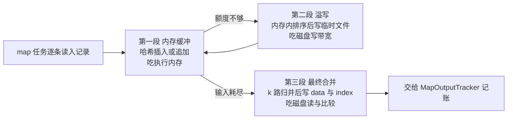
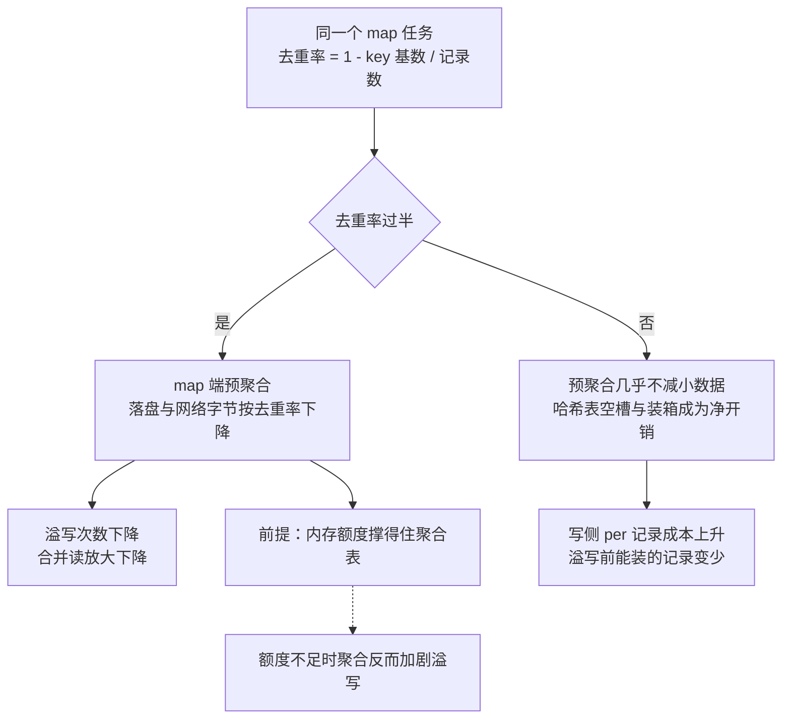
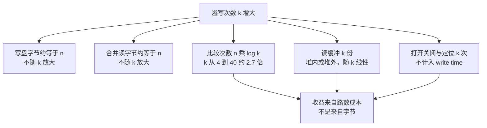
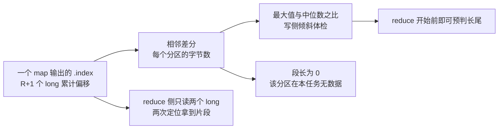
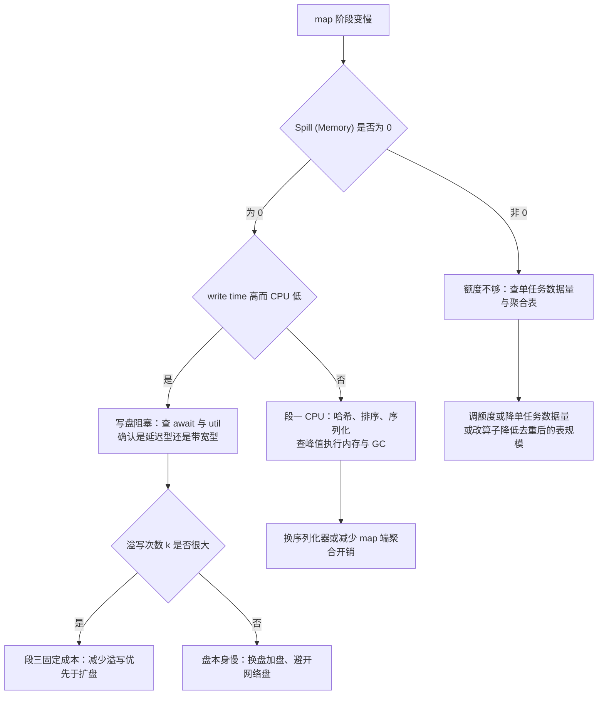
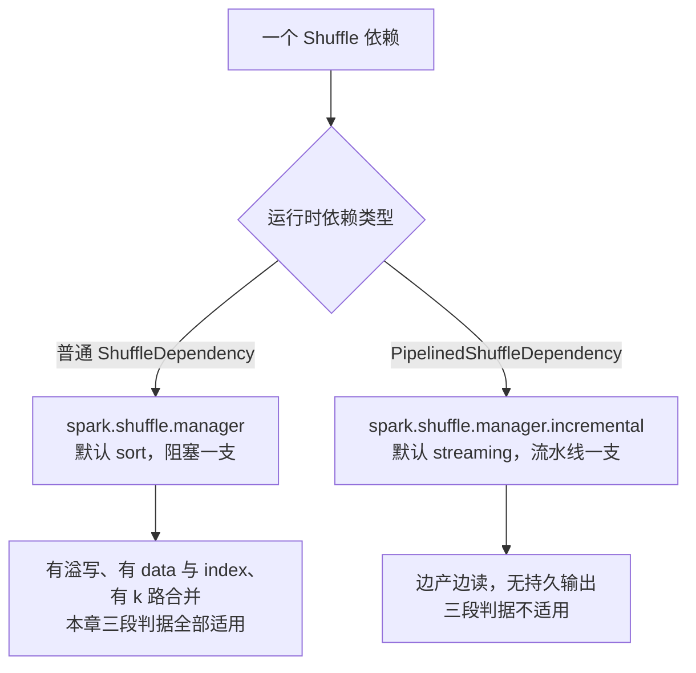

# 04 Shuffle Write 深度解剖：排序、合并与索引文件

**摘要：**

写侧慢是一个被过度归因的结论。同一个 map 阶段变慢，可能卡在内存里那张表的哈希插入与扩容，可能卡在溢写文件的写盘，也可能卡在输入耗尽之后的 k 路归并；三段的瓶颈资源不同，判据不同，能调的参数彼此不通。本文按这三段拆开写侧的账：内存缓冲段看 `Spill (Memory)` 与峰值执行内存，溢写段看 `Spill (Disk)`、磁盘 await 与 `write time`，合并段看溢写次数 k 与它线性放大的固定开销。三段的判据互不替代，内存段的读数不能用来判断盘，盘上的读数也判断不了合并。全文给出三样东西：从 UI 与主机指标读出"哪一段在等"的判据，一张带兑换代价的配置表，以及四条改参数前该排除的反例；同时给出溢写次数与合并成本的换算，以及 map 端聚合的压缩比口径。贯穿案例仍是那个三百节点、每天两千个作业的集群。落点是：写侧三段没有同时最优的解，减少溢写买到的不是 k 倍的 I/O，而是路数上的固定成本与更短的长尾。

---

## 第 1 章 写侧慢，先分成三段

凌晨三点，`daily_rollup` 的 map 阶段从平时的九分钟涨到三十四分钟。值班的第一反应是加内存，第二反应是加机器，两次都只换来半小时的平静。第三天才有人去看任务级指标，发现 `Spill (Memory)` 是零——这个作业从头到尾没有溢写过。它慢在另一处：map 端聚合用的那张哈希表，key 基数在这个月翻了三倍，插入与扩容的 CPU 全压在任务线程上，CPU 跑满，磁盘几乎空闲。

这个场景说明一件容易被忽略的事：写侧不是一段，而是三段，瓶颈资源与判据都不一样；把三段混成一个"写侧慢"，处置只能靠猜。

第一段是内存缓冲。map 任务逐条读记录，算目标分区号，把它塞进一张表：有 map 端聚合时塞进 `PartitionedAppendOnlyMap`，没有聚合时塞进 `PartitionedPairBuffer`。这一段吃的是执行内存，成本是哈希插入、装箱、扩容与 GC，它与磁盘无关。

第二段是溢写（spill）。内存额度不够时，这张表被原地排序、序列化、写成一个临时文件，然后清空重来。这一段吃的是磁盘写带宽，成本是排序比较、序列化与写入，它与网络无关。

第三段是最终合并。输入耗尽之后，内存里剩下的数据与盘上 k 个临时文件一起做 k 路归并，写出最终的 `.data` 与 `.index`，再把账交给 `MapOutputTracker`。这一段吃的是磁盘读与比较，成本随 k 的增大而变重。

三段串在同一条任务线程上，总时长把它们叠成一个数；但失控形态完全不同：第一段把 GC 时间与 CPU 推高，第二段表现为磁盘写阻塞，第三段表现为任务尾部的长尾与读放大。判据要从这里切开，而不是从总时长切。

三段各自的机制细节没有必要在这里重推。数据结构形态、探测序列、内存估算的外推、最小堆归并的实现，内核系列已拆到源码级：`AppendOnlyMap` 的偶数位放键与 `SizeTracker` 的采样外推见 [[大数据/Spark/读书笔记-spark内核/05_Shuffle核心机制/6. Spark_Shuffle聚合与排序结构|Shuffle 聚合与排序结构]]，writer 的选择与读写契约见 [[大数据/Spark/读书笔记-spark内核/05_Shuffle核心机制/2. Spark_Shuffle框架设计与实现|Shuffle 框架设计与实现]]，三个文件的提交、索引的作用与块归属见 [[大数据/Spark/读书笔记-spark内核/05_Shuffle核心机制/7. Spark_Shuffle与Storage交互|Shuffle 与 Storage 交互]]。本篇只回答运维要回答的那一半：每一段在指标上留下什么痕迹，痕迹对应什么动作，动完之后代价落在谁身上。

三段的分工可以先用一张表定住，后文的判据都挂在这张表上。

| 段 | 瓶颈资源 | 主要观测点 | 失控时的第一形态 | 处置方向 |
|---|---|---|---|---|
| 内存缓冲 | 执行内存、CPU | `Spill (Memory)`、峰值执行内存、GC Time | 任务 CPU 满而磁盘空转；频繁溢写 | 调执行池、改算子减少 map 端聚合、降单任务数据量 |
| 溢写 | 本地磁盘写带宽 | `Spill (Disk)`、磁盘 `await`/`util`、`write time` | 写阻塞、页缓存回写跟不上、盘队列堆高 | 换盘加盘、开溢写压缩、减少溢写次数 |
| 最终合并 | 磁盘读、比较次数 | 溢写次数 k、任务尾部长尾、打开文件数 | 输入耗尽后任务还拖着不走，读放大 | 减少溢写次数、避开网络盘、控制分区数 |

---

## 第 2 章 第一段：内存里那张表的账

### 2.1 这一段的成本是什么

第一段的时间花在三个地方：算分区号、维护表、为表申请内存。算分区号是纯哈希调用，代价与分区数无关；维护表分两条路径，有聚合时每条记录都要在表里找一次位置、命中就更新值、不命中就插入，没有聚合时只是往数组尾部追加两个引用。申请内存按采样估算向 `TaskMemoryManager` 要额度，不够就触发溢写。

这一段最容易误判的地方，是把"表能装下"当成"表不花钱"。开放寻址的哈希表为了压住探测长度必须保留相当比例的空槽，表越大空槽越多；每条记录占两个引用，key 若是字符串或元组，对象头与对齐填充又是一笔。同样一亿条记录，塞进追加缓冲区的堆占用与塞进哈希表可以差出一大截，判据不是"数据量多大"，而是数据量乘每条记录的堆占用、再除以路径的利用率。

### 2.2 判据：Spill (Memory) 的口径

`Spill (Memory)` 不是"内存里装了多少字节数据"，而是 `SizeTracker` 对对象图的外推估算值，这个数在两类现场含义完全不同。

一类现场是它为 0：一段溢写都没有发生，写侧的所有时间都花在 CPU 上。此时去调 `spark.memory.fraction`、去加内存、去换更大的机器，全是无效动作。要看的是峰值执行内存是否贴近额度上限、GC Time 占比是否偏高、以及那张表是不是被 key 基数撑大了。

另一类现场是它非零且很大：内存额度相对数据量偏小，溢写成了常态。此时先算一个比值——`Spill (Memory)` 除以 `Spill (Disk)`，它常常是三五倍，很多人读成压缩比，于是得出"压缩没生效"。这是误读：分子是对象图估算，分母是序列化之后的字节，**两把尺子量的不是同一种东西**。判断压缩是否生效，看序列化器与 `spark.shuffle.spill.compress` 的配置，以及关闭压缩前后的 `Spill (Disk)` 变化。

### 2.3 map 端聚合：价值与边界

写侧最深的一处杠杆在算子选择上。`reduceByKey` 会在 map 端预聚合：同一个 map 任务里相同的 key 先在内存表里合并成一条，再写出。`groupByKey` 不聚合，每条原始记录都要落盘、都要跨网络搬运、都要在 reduce 端进内存。在写侧，这个差异直接体现在三处：溢写文件的体积、溢写的次数、以及最终合并要读的字节数。

价值的量级可以用一组示例推算说明。假设某个 stage 处理一亿条 `(word, 1)` 记录，word 的基数约两百万：不聚合时，一亿条记录序列化后约 2GB 量级落盘；聚合之后，两百万条各带一个累加值，约 60MB 量级，比值在三十比一上下（随序列化器与 key 长度浮动，只作量级判断）。写侧少写二十九份数据，溢写次数与合并要读的字节跟着一起降，这是选对算子能拿到的最大一笔收益，任何参数调整都换不来。

但聚合不是免费的，它的边界由**去重率**决定。上例中去重率约 98%，聚合几乎把数据抹平；反过来，若 word 的基数接近记录数，比如九千万条记录里有九千万个不同的 key，去重率不足一成，聚合之后仍要写九千万条，哈希表的空槽、key 的比较、值的装箱全是额外开销，写侧的净效果是变慢。判据就落在这个比值上：估一下 key 的基数与记录数，两个数一比就知道该聚还是不该聚。示例推算的口径下，去重率过半时聚合通常净赚，接近零时它只是在替 CPU 找活干。

还有一处与内存额度耦合的边界：聚合把数据压小、溢写次数降低，却把内存占用抬高，哈希表比追加缓冲区多出的空槽与探测开销要占额度。额度本就不够的作业加上聚合，每次溢写前能装的记录反而更少，溢写可能更频繁——它在"内存够、去重率高"时收益最大，在"内存紧、去重率低"时是双重负担。

### 2.4 这一段的旋钮

能动的只有三处：执行内存的额度、单任务的数据量、算子本身。额度由 `spark.memory.fraction` 与 `spark.memory.storageFraction` 描述，前者决定共享池多大，后者只是池内一条软的"免疫驱逐"界线，**不是配额**。单任务数据量由分区数决定，分区越少单任务越大，越容易撞额度。

Unsafe 路径上还有一处更细的旋钮：`spark.shuffle.sort.initialBufferSize`（默认 4096）决定只存指针的数组初始多大。调大能少几次扩容拷贝，但任务开始就把执行内存占住。

---

## 第 3 章 第二段：溢写与写盘

### 3.1 一次溢写做了什么

溢写被触发时，先对内存中的表做一次原地排序，排序键是"分区号加 key"，保证同一分区的数据连续、分区内按 key 有序；随后把有序迭代器按批次序列化写入一个临时文件，每批是一个独立的序列化流，批与批之间以长度前缀分段，而不是在文件头上挂一张批次目录；写完记录这个文件中每个分区的字节长度，最后清空内存表、把额度还给 `TaskMemoryManager`。

排序放在溢写时做而不是合并时做，是整条流水线里最关键的一步设计：每一路输入在溢写时就已有序，合并才可能是一次线性扫描的 k 路归并。代价落在第二段：每次溢写都要对当时内存里的全部记录排一次序，溢写次数越多，重复排序的总量越大。

### 3.2 判据：写盘在等什么

第二段的判据分三层，先看量，再看盘，最后看调用。

量看 `Spill (Disk)`。它与 `Shuffle Write` 的比值给出溢写比例：一成上下，溢写是偶发行为，写侧主要成本不在这里；接近或超过一，说明落盘的中间数据比最终产物还多，写侧在替内存还债。这个比较要在同一个 stage 内做。

盘看主机指标。`iostat -x` 的两列最关键：`await`（单次请求的平均等待，含排队）与 `%util`。`await` 上升而 `%util` 没满，典型是延迟型存储——网络盘、云盘、或者同机别的进程在抢同一条队列；`%util` 长期贴着百分之百、`await` 与队列深度一起涨，是带宽型打满，换盘加盘才有意义。溢写文件、临时文件与读侧落盘的临时块共用 `spark.local.dir`，容量与带宽都要按最坏并发算。

调用看 `write time`。这个计数器的口径要提前说清楚：它统计的是任务线程在写调用上被阻塞的时间，累计自每一次底层写与（开启 `spark.shuffle.sync` 时的）`fsync`。它的价值在于专一：高就是盘慢。若一个 stage 的 `write time` 占任务时长的比例高，而机器 CPU 使用率低，基本可以断定瓶颈在写盘，而不是在排序或序列化；反过来，任务慢、CPU 高、`write time` 很低，问题在第一段的哈希与排序，或者在序列化器上。这一对读数互为镜像，比任何单看总时长的判断都可靠。

有一处隐性成本不在这个计数器里：创建临时文件、打开输出流、关闭与删除，都不计入 `write time`。溢写次数少时它无关紧要，次数多时几百上千次文件创建与打开本身就是可观的系统调用开销。这也是"溢写次数"要单独作为判据的原因——它不体现在任何计数器上，只体现在任务尾部的时间与目录里的文件数上。

### 3.3 写盘的两个独立旋钮

写盘这一段有两个互不相干的旋钮，经常被当成一个。

一是压缩。`spark.shuffle.spill.compress`（默认 `true`）决定溢写临时文件是否压缩，编解码器跟随 `spark.io.compression.codec`（默认 lz4）。打开它，落盘字节变少，磁盘与页缓存压力一起下降，代价是写侧 CPU 与压缩缓冲；关掉它，CPU 空出来，字节回涨，多数集群上整体更慢。判据是 CPU 与磁盘哪边先到顶：`%util` 先满，压缩净赚；CPU 先满而盘有余量，压缩在抢本就不够的算力。

二是缓冲。溢写写盘有自己的缓冲，由 `spark.shuffle.spill.diskWriteBufferSize`（默认 1MB）控制，影响的是系统调用次数而不是数据量：调大减少小写，每个并发溢写任务各占一份；调小则小写变多，CPU 在拷贝上多花时间。

这两项与最终 `.data` 文件的压缩（`spark.shuffle.compress`，默认 `true`）不是同一件事：**前者管中间产物**，**后者管最终产物**。两者都开时，同一份数据在写侧被压两遍、算两遍，这是写侧 CPU 成本里容易被忽略的一份。判据是：若磁盘带宽充裕、CPU 紧张，可以考虑只保留最终压缩、关掉溢写压缩；若磁盘是瓶颈，两个都开。

### 3.4 盘选在哪里

`spark.local.dir` 未显式配置时指向 `/tmp`，而 `/tmp` 在多数生产镜像里挂在系统盘上，容量小、还常被设成内存盘或定期清理。这一项配错的现场症状很有辨识度：溢写写到一半报 `No space left on device`，或者文件被清理导致下游读到截断数据，日志里从头到尾没有"磁盘"两个字。

---

## 第 4 章 第三段：最终合并

### 4.1 合并做什么

输入耗尽之后，若有 k 次溢写，写侧要面对 k 个临时文件加上内存里最后一批数据。合并按分区逐个处理：对分区 j，从每个临时文件里取出该分区对应的字节段，与内存里属于分区 j 的记录一起，形成 k 路有序输入，做归并后写入最终 `.data` 文件的第 j 段。有 map 端聚合时，归并的同时还要用 combine 函数把同一个 key 的多个局部聚合值合成一个——因为同一个 key 可能横跨多个溢写文件，边界上被切开了。

合并结束才写索引：把每个分区的累计结束偏移写成 R+1 个 long，提交时连索引与校验和一起原子改名到位。

### 4.2 成本结构：被误读的 k 倍

流传最广的一条估算是"溢写 k 次，合并要读 k 倍数据"，于是得出"减少溢写等于省 k 倍 I/O"。它错在把每条记录的写次数当成了 k。实际上每条记录只被写进一个溢写文件一次，k 次溢写写盘的总字节约等于全部数据 n 的一倍；合并时把这 k 个文件各读一遍，读的总字节也约等于 n。字节层面的 I/O 大致是两倍 n，**与 k 无关**。

随 k 放大的是另外三样东西。其一，比较次数：k 路归并要维护一个大小为 k 的堆，每条记录进出堆各一次，总比较量是 n 乘以 log k。k 从 4 涨到 40，字节一点没变，比较量涨到约 2.7 倍。其二，路数内存：合并给每一路输入开一块读缓冲，大小跟随 `spark.shuffle.file.buffer`（默认 32KB），即 k 份；走 Unsafe 路径的合并用的是堆外缓冲，4.0 起单独由 `spark.shuffle.file.merge.buffer` 控制，默认继承前者的值，仍是 k 份，超限的表现是与堆监控完全脱节的一次直接内存崩溃。其三，文件描述符与系统调用：k 个输入流意味着 k 次打开、k 次关闭、以及每段的定位。

这解释了那个反直觉的现场：把内存调大一倍、溢写从 10 次降到 2 次，作业只快了百分之十几，而不是预想的一半。省下的主要是比较量与固定开销，**字节本身没怎么变**；收益真实存在，但量级要按路数算，不能按字节算。

### 4.3 判据：合并在拖时间吗

合并段的成本在 Spark 指标里几乎隐形：读临时文件与排序比较的时间都不计入 `write time`，能看到的只有"输入耗尽之后任务还在跑"。三种痕迹可作判据。

第一是长尾的形状。stage 里大多数任务在某个时刻集体进入"输入读完但还在跑"的状态，且这批任务的 `Spill (Disk)` 都明显高于中位数，说明它们都在做多次溢写的合并。

第二是打开文件数：k 大的任务同时持有 k 个句柄，`ulimit -n` 偏紧时会先在日志里看到打开失败。

第三是磁盘读与 CPU 的双高。合并同时吃读带宽与比较：CPU 不高而读带宽被吃满，说明卡在读上；读不满而 CPU 满，说明比较与反序列化是瓶颈。两者处置方向相反——前者要减少 k 或换更快的盘，后者要减少 k 或换更快的序列化器。

### 4.4 一处常被漏算的写放大

推测执行与任务重试会在写侧制造重复劳动，而这份成本在指标上被抹掉了。同一个 map 分区的两次尝试各自溢写、各自合并、各自写出 data 与 index；先成功的那次把三件产物改名到位，后成功的那次提交时发现索引与数据已匹配，于是删掉自己写的临时数据文件。stage 的汇总指标不计入失败的尝试，这整份重复写盘只留在本地盘的写入量里。

判据只能用间接办法：把 `spark.local.dir` 所在盘的写入字节与 stage 的 `Shuffle Write` 对比，前者显著大于后者，要么溢写比例高，要么在重复尝试。溢写严重的任务一旦进入推测执行，代价**按尝试数线性叠加**，这是把"慢任务"交给推测执行去救之前应该先算的一笔账。

---

## 第 5 章 索引文件：交出去的一张寻址表

### 5.1 它的内容与代价

索引文件的内容简单到极致：R+1 个 long，第 0 个是 0，之后每个是前面所有分区长度之和，最后一个等于数据文件的总长度。读取时不需要整份加载：reduce 侧按 `reduceId × 8` 与 `(reduceId+1) × 8` 各定位一次，读出两个 long，就拿到自己那一段的起止偏移，再按偏移与长度在数据文件上切片交给网络层。这是常数级寻址，与 R 的大小、索引文件的大小无关。

代价小得可以忽略：R 为 2000 时一份索引约 16KB，四千个 map 输出合计约 64MB（示例推算），真正占空间的是数据文件。4.x 默认开启校验和之后，每份 map 输出在 `spark.local.dir` 下是数据、索引、校验和三件，容量与 inode 的成本要按三倍算。

### 5.2 空分区怎么表示

分区没有数据时，数据文件里不为它保留字节，索引里对应两个偏移相等，差分是零。所以"某分区为空"与"数据在偏移 0 处"在索引上完全可分：前者是两个相邻的相同值，后者只可能出现在分区 0。一段长为零说明这个 key 范围在本任务里没有数据，而不是写入失败。

判断写入是否完整，靠索引长度与数据总长：索引必须是 `(R+1) × 8` 字节，数据文件长度必须等于索引最后一项；提交逻辑正是这样校验的，不对就认为输出不可用。现场看到"索引与数据对不上"，第一反应应该是写入被截断或被中途清理，而不是格式不兼容。

### 5.3 索引的另一半用处：写侧的倾斜体检

索引记录的是每个分区的字节长度，等于一份免费的分布报表：把 R+1 个 long 读出来做差分，就得到每个 reduce 分区的确切字节数，不需要碰数据文件。这个用途常被浪费。

判据是这样用的：取一个 map 输出的索引，算出差分的最大值与中位数之比。比值接近一时分布均匀；上到两位数，说明这个任务里有热点 key，reduce 侧某个任务注定要多吃几倍数据。把同一个 stage 里所有 map 输出的差分累加，就得到整个 shuffle 在每个 reduce 分区上的真实分布，比 UI 上 `Shuffle Read Size` 的偏斜更早——reduce 还没开跑就能算出下游谁会长尾。

---

## 第 6 章 三段之间的兑换

### 6.1 兑换表

三段不是三个可以各自优化的模块，而是一组兑换关系。内存额度调大，溢写变少，第二段的写盘与第三段的合并一起下降，代价是缓存可用内存变少、重算与读盘上升。溢写压缩打开，第二段字节变少，代价是 CPU 与压缩缓冲。分区数调大，单任务变小、溢写变少，代价是文件数与索引项按分区增长，读侧块数按乘积增长。

任何一处"省下来"的，都在别处开单。判断一次调参值不值，要问三个问题：省下的是哪一段的什么资源，多花出去的是哪一段的什么资源，这两段当前谁先到顶。

### 6.2 一张成本式

把三段的成本写在一个式子里，能看清各自的归属：

写侧总成本约等于 哈希插入或追加（CPU，随记录数线性）＋ 每次溢写的排序（CPU，随溢写批次的数据量乘以 log）＋ 序列化（CPU，随字节数）＋ 写盘（I/O，约一倍 n）＋ 合并读（I/O，约一倍 n）＋ 合并比较（CPU，n 乘 log k）＋ k 次文件打开与定位（系统调用，随 k 线性）。

这个式子解释了三种现场。CPU 满而磁盘空转，前两项与序列化是主项，要动算子与内存额度；磁盘写满而 CPU 有余，要动压缩与盘；磁盘读满而 CPU 也有余量，主项是合并读与比较，要动 k。三者的处置互不通用——那个"加内存没用"的作业，**账单上根本没有内存那一项**。

### 6.3 一组示例推算

仍以 `daily_rollup` 的一轮为例：四千个 map 分区，shuffle 写出合计 800GB，平均每个 map 任务输出 200MB（示例推算）。若单任务可用执行内存只有 64MB，一个任务要溢写三四次；把额度提到 256MB，溢写降到零到一次。

按上一个式子的口径：k 从 4 降到 1，写盘字节仍是 200MB 上下，合并读字节从 200MB 降到近零，比较量从 2 倍 n 降到 n，k 份读缓冲与 k 次文件打开一并消失。量级判断是：这一次调整省下"读回一份数据＋两次比较＋若干固定开销"，约占写侧总成本两三成；省掉的那部分里字节只占一半，另一半是路数与比较。

反过来，把额度从 64MB 加到 128MB（k 从 4 到 2）只省掉一次读回与一半路数成本。这解释了"加内存"的边际收益为何递减很快：第一笔加在溢写从有到无上，最值钱；后面几笔只是在减少路数。

---

## 第 7 章 症状到判据

### 7.1 一张分诊表

写侧的现场可以收敛成七类，第一落点各不相同。

| 症状 | 第一落点 | 要排除的下一层 | 常见误判 |
|---|---|---|---|
| `Spill (Memory)` 非零且大 | Stages 页该 stage 的溢写列 | 执行池额度、单任务数据量、map 端聚合是否把表撑大 | 直接加内存，不看 key 基数与去重率 |
| 溢写次数多、任务尾部拖长 | 溢写次数与目录里的临时文件数 | 是额度不足，还是单分区过大 | 把长尾当数据倾斜，只做重分区 |
| 写盘慢、`await` 高 | 主机 `iostat -x` 的 `await` 与 `%util` | 延迟型存储（网络盘、云盘）还是带宽打满 | 只看 `%util` 不满就断定盘没问题 |
| 生成的 data 文件大小不均 | 各 map 任务的 `Shuffle Write` 与 Input Size | 跨任务不均是输入倾斜；单文件内分区段不均是 key 倾斜 | 一律归为 key 倾斜，去加盐 |
| `write time` 高而 CPU 低 | Tasks 表的该列与主机 CPU | 是写阻塞，还是页缓存回写被限流 | 拿总时长当写侧耗时，读不出这一段 |
| 任务慢而 `write time` 很低、CPU 高 | 峰值执行内存与 GC Time | 哈希插入、排序比较、序列化器 | 反复调磁盘相关参数 |
| 索引与数据长度对不上 | 该 map 输出的 `.index` 与 `.data` | 写入被截断、文件被清理、盘写满 | 当成格式或版本兼容问题 |

### 7.2 分诊路径

把上面的表压成一条路径，顺序很重要：先看有没有溢写，再看盘，最后看 k。

### 7.3 三个页面怎么读

Stages 页看四列：`Shuffle Write`、`Shuffle Spill (Memory)`、`Shuffle Spill (Disk)`、`Shuffle Write Time`。前三个数的关系给出定性：写大而无溢写，第一段与第三段的 CPU 是主项；写大而溢写也大，第二段与第三段都在账上。第四个数只统计写调用上的阻塞，是纯粹的"盘慢"探测器。

Tasks 表按 `Spill (Disk)` 降序排能找出溢写最重的任务，按 `Duration` 降序排能看出长尾是否集中在同一批任务上；两者重合时，溢写与长尾是因果关系。

Executors 页的 GC Time 只对第一段有意义：占任务时长一成以上，说明那张表在堆里制造了压力，要么 key 基数太大，要么聚合值太占地方。主机侧的 `iostat` 与 `df` 补 Spark UI 看不到的那一半：盘的真实延迟与目录的真实余量。

---

## 第 8 章 关键配置的判据表

这张表把写侧高频参数放在一起，重点不是默认值，而是每次调整换到了什么、代价落在哪一段。

| 配置 | 默认 | 管哪一段 | 调大或打开，换到什么 | 调小或关闭，代价是什么 |
|---|---|---|---|---|
| `spark.shuffle.file.buffer` | 32k | 段二写缓冲，段三每路读缓冲 | 系统调用变少；合并时按 k 份放大（堆内），k 大时是隐形乘法 | 小写变多，合并读更碎，固定开销占比上升 |
| `spark.shuffle.file.merge.buffer` | 继承 `file.buffer`（4.0 起） | 段三 Unsafe 路径的合并读缓冲 | 合并吞吐上升；按 k 份堆外放大，超限是进程级的直接内存崩溃 | 合并变慢，堆外压力下降，安全但更长尾 |
| `spark.shuffle.spill.compress` | true | 段二 | 落盘字节下降，磁盘与页缓存压力下降；代价是 CPU 与压缩缓冲 | CPU 空出来，盘写字节回涨，磁盘紧张时整体更慢 |
| `spark.shuffle.compress` | true | 段三写出的最终文件 | 交给读侧的文件更小，盘与网络都省；代价是写侧再压一遍的 CPU | 写侧 CPU 略降，读侧拉取字节变大，合并后 IO 上升 |
| `spark.memory.fraction` | 0.6 | 段一的额度上限 | 溢写变少、合并变少、长尾变短；缓存被挤，重算与读盘上升 | 缓存宽裕，溢写与合并次数上升，写侧变慢 |
| `spark.shuffle.sort.initialBufferSize` | 4096 | 段一的指针数组（Unsafe 路径） | 扩容拷贝变少；更早占住执行内存，早溢写 | 扩容次数变多，指针数组频繁翻倍 |
| `spark.shuffle.spill.diskWriteBufferSize` | 1m | 段二每路写缓冲 | 写盘系统调用变少，每并发任务各占一份 | 小写变多，CPU 拷贝开销上升 |
| `spark.shuffle.spill.batchSize` | 10000 | 段二的序列化批次 | 批更少、流开销更低；单批缓冲更大，峰值内存上升 | 批次变多，每批一个序列化流的开销上升 |
| `spark.shuffle.sort.bypassMergeThreshold` | 200 | 决定段二是否存在 | 小分区且无聚合时不排序不溢写，直接拼接，段二整段消失 | 更多作业走排序路径，溢写与合并回归 |
| `spark.shuffle.sync` | false | 段二的落盘方式 | 打开后每次提交都 `fsync`，可以量出真实落盘延迟，写延迟上升 | 依赖页缓存，掉电时中间产物可能不完整 |

表里最容易误用的是 `file.buffer`：它是写缓冲，也是合并读缓冲的同一个来源，调大在写侧只有一份收益，在合并侧却按 k 份放大；判断该不该调，先估这个 stage 的 k。

---

## 第 9 章 反例

### 9.1 用 `groupByKey` 做聚合

最常见的写法是先 `groupByKey` 再遍历值求和。它在写侧的代价是双份的：map 端不聚合，落盘的是原始记录，体积按去重率成倍放大；reduce 端还要装下全部原始值，溢写跟着上来。同样语义换成 `reduceByKey`，map 端先合并重复 key，落盘的是聚合值。判据很简单：key 基数远小于记录数时，这次替换能带来数量级的写侧差异；两者接近时，收益主要在 reduce 端内存，不在写侧。

### 9.2 把 `spark.local.dir` 指到网络盘

理由通常是本地盘不可靠、容器里本地盘不可控。代价是三段全压在这一条链路上：溢写是高频小块写，第一次写就在等网络往返；合并要按 k 路读回临时文件，延迟乘一遍；最终文件与索引提交也在上面。判据是 `await` 与 `%util` 的错配：延迟型存储会在 `await` 涨到几十毫秒时 `%util` 仍然不满，从吞吐看像没用满，从延迟看已在排队。可行的折中是只把最终产物放本地盘、可靠性交给外部 Shuffle 服务。

### 9.3 只看总时长，不看溢写指标

总时长把三段叠成一个数，于是调参变成试错：加内存无效就去调分区数，调分区数无效就去换盘，换盘无效就说是数据倾斜。判据的次序是先看 `Spill (Memory)` 是否为零，把"有没有溢写"定下来，再决定往内存还是往盘的方向查；跳过第一步，后面的动作有一半打在空处。

### 9.4 把 `file.buffer` 调到 1MB"加速写"

这一项在排序路径上只有一份，调到 1MB 换来的是系统调用变少，收益不大；它在合并阶段却按 k 份生效，k 为 10 时一个任务多占 10MB 堆内缓冲，并发一多，执行内存被挤，溢写反而变多。Unsafe 路径还有一处更危险的放大：4.0 起合并读缓冲走 `file.merge.buffer`，默认继承这个值，k 份全是堆外，调大之后先在直接内存上爆，堆监控看不出来。

### 9.5 用强制溢写阈值"预防 OOM"

`spark.shuffle.spill.numElementsForceSpillThreshold` 把溢写从"额度不足时发生"改成"记录数到点就发生"。它在测试里用来稳定复现行为，在生产里调小等于人为制造溢写：没有内存压力也把数据赶去磁盘，段二与段三的账凭空多出来。防 OOM 的正路是降单任务数据量或换数据结构。

| 做法 | 期望 | 实际 | 依据 |
|---|---|---|---|
| `groupByKey` 后遍历求和 | 写法直观 | 落盘按去重率放大，reduce 端聚合结构撑大 | map 端不聚合，原始记录全量落盘 |
| `spark.local.dir` 指向网络盘 | 提升可靠性 | 溢写与合并全变慢，`await` 高而 `%util` 不满 | 小块写对延迟敏感，合并按 k 路读回 |
| 只按总时长调参 | 快速定位 | 三段混在一起，一半动作打在空处 | 三段瓶颈资源互不相同 |
| `file.buffer` 调到 1MB | 写更快 | 合并侧按 k 份放大，执行内存被挤 | 同一旋钮同时管写缓冲与每路读缓冲 |
| 调小强制溢写阈值防 OOM | 更安全 | 人为制造溢写，写侧变慢 | 阈值只在记录数上生效，不判断内存 |

---

## 第 10 章 4.x 的口径

### 10.1 两个旧键

`spark.shuffle.file.buffer.kb` 是 1.x 的写法，2.0 起改名为 `spark.shuffle.file.buffer`，并支持带单位的内存字符串。今天在配置里写旧键不会报错，也不会生效——SparkConf 对未知键不抛异常，它只是**静默失效**。判据是"改完毫无变化"：第一步该怀疑这个键在当前版本是否还有效，而不是怀疑调参方向。

`tungsten-sort` 是另一个旧口径。它在 4.x 里只是 `sort` 的别名，解析到同一个实现，写侧产物、溢写行为、合并路径完全一致，把它当成更快的另一种 Shuffle 去配，既不报错也不会有差异。随之消失的还有 hash shuffle：4.x 没有内置的 hash 实现，本章三段判据只对排序路径与旁路路径成立。

### 10.2 两个管理器槽位

4.x 把 `ShuffleManager` 拆成两支：阻塞式的 `BlockingShuffleManager` 与流水线式的 `PipelinedShuffleManager`。`spark.shuffle.manager` 只接受前者，默认 `sort`；流水线一支走另一个键 `spark.shuffle.manager.incremental`，默认 `streaming`。

这个分裂对写侧判据有直接影响：流水线一支边产边读，不落溢写文件、不生成 data 与 index、也没有 k 路合并，本章的 `Spill`、溢写次数、索引与合并成本全部不适用。判据的第一步不是看指标，而是确认作业走的是哪一支——Driver 启动日志会打出实际加载的管理器类名，两个槽位的契约差异见 [[大数据/Spark/读书笔记-spark内核/05_Shuffle核心机制/2. Spark_Shuffle框架设计与实现|Shuffle 框架设计与实现]] 的插拔一节。

### 10.3 三件产物

4.x 默认开启校验和（`spark.shuffle.checksum.enabled` 默认 `true`，算法默认 CRC32），一次提交在 `spark.local.dir` 下落三件产物：数据、索引与校验和。校验和是尽力而为的，写入失败不让任务失败，只记一条错误日志。提交逻辑里还有一处细节——同一 map 分区的后一次尝试若发现索引与数据已经匹配，就直接复用已有的两份、删掉自己写的临时数据文件，这就是第 4 章那笔写放大的来源。

| 旧口径 | 4.x 实际行为 | 现场症状 | 处置 |
|---|---|---|---|
| `spark.shuffle.file.buffer.kb` | 键已改名为 `spark.shuffle.file.buffer` | 配了毫无变化 | 改用新键，带单位写 |
| `spark.shuffle.manager=tungsten-sort` | 与 `sort` 解析到同一个类 | 无报错、无差异 | 保留无害，不要期待收益 |
| 以为一个 map 只留两个文件 | 默认还有一份校验和文件 | 目录容量与 inode 按两件估，空间不够 | 容量按三件算，或按需关校验和 |
| 以为流水线一支也有溢写 | 不落溢写、无 data 与 index | 指标全为零，误判为"写得很好" | 先确认管理器，再选判据 |
| 以为溢写 k 次合并读 k 倍 | 字节约两倍 n，路数成本随 k 涨 | 加内存后收益远低于预期 | 按比较量与固定开销估收益 |

---

## 第 11 章 落点

写侧的三段没有同时最优的解，这是机制决定的，不是参数没配好。给内存多一点，溢写与合并就少一点，代价是缓存与重算；给压缩多一点，盘与网络就省一点，代价是 CPU 与缓冲；把溢写次数压到零，段二与段三的账一起消失，代价是每个任务要装下整个分区。能做的只有两件事：**知道自己此刻在兑换哪两段**，给每一段留一个可观测的落点。

判据的顺序由此确定：先用 `Spill (Memory)` 判断有没有溢写，再用 `write time` 与磁盘 `await` 判断盘在不在等，最后用 k 判断合并的固定成本值不值得买。反过来先动参数，最常见的结局是把一段的成本挪到另一段，再在另一块屏幕上看到新的红灯。

有一个位置是这套判据照不到的：流水线式 Shuffle 没有溢写、没有 data 与 index、没有合并，写侧的整张账单不存在。遇到它，先换判据，而不是先把本章的表套上去。

---

## 参考资料

1. Apache Spark 4.3.0 文档：Configuration，`spark.shuffle.file.buffer`、`spark.shuffle.file.merge.buffer`、`spark.shuffle.spill.*`、`spark.shuffle.sort.initialBufferSize`、`spark.shuffle.sort.bypassMergeThreshold`、`spark.memory.fraction` 的默认值与引入版本。https://spark.apache.org/docs/latest/configuration.html
2. Apache Spark 4.3.0 文档：Tuning Guide，Shuffle Behavior 与 Memory Management 相关段落。https://spark.apache.org/docs/latest/tuning.html
3. Apache Spark 源码（v4.3.0）：`core/src/main/scala/org/apache/spark/util/collection/ExternalSorter.scala`，溢写、分区长度记录与写端流式归并。https://github.com/apache/spark/blob/v4.3.0/core/src/main/scala/org/apache/spark/util/collection/ExternalSorter.scala
4. Apache Spark 源码（v4.3.0）：`core/src/main/scala/org/apache/spark/storage/DiskBlockObjectWriter.scala`，`writeTime` 的累加位置与提交语义。https://github.com/apache/spark/blob/v4.3.0/core/src/main/scala/org/apache/spark/storage/DiskBlockObjectWriter.scala
5. Apache Spark 源码：`core/src/main/java/org/apache/spark/storage/TimeTrackingOutputStream.java`，阻塞写时间的统计口径。https://github.com/apache/spark/blob/master/core/src/main/java/org/apache/spark/storage/TimeTrackingOutputStream.java
6. Apache Spark 源码（v4.3.0）：`core/src/main/scala/org/apache/spark/shuffle/IndexShuffleBlockResolver.scala`，索引与校验和文件的写入、提交时的索引数据一致性校验、重复尝试的复用逻辑。https://github.com/apache/spark/blob/v4.3.0/core/src/main/scala/org/apache/spark/shuffle/IndexShuffleBlockResolver.scala
7. Apache Spark JIRA：SPARK-49217，为 UnsafeShuffleWriter 的合并阶段引入独立的合并缓冲配置。https://issues.apache.org/jira/browse/SPARK-49217
8. Apache Spark JIRA：SPARK-3570，`shuffle write time` 不含打开 shuffle 文件的时间。https://issues.apache.org/jira/browse/SPARK-3570
9. 本站内核系列：[[大数据/Spark/读书笔记-spark内核/05_Shuffle核心机制/6. Spark_Shuffle聚合与排序结构|Shuffle 聚合与排序结构]]、[[大数据/Spark/读书笔记-spark内核/05_Shuffle核心机制/2. Spark_Shuffle框架设计与实现|Shuffle 框架设计与实现]]、[[大数据/Spark/读书笔记-spark内核/05_Shuffle核心机制/7. Spark_Shuffle与Storage交互|Shuffle 与 Storage 交互]]。

---

> [!note] 思考题
> 1. 一个 stage 的 `Spill (Memory)` 是 180GB、`Spill (Disk)` 是 40GB，这个比值能说明压缩生效了吗？如果不能，该拿哪两个数去比？
> 2. 某任务溢写 12 次，另一个同样数据量的任务溢写 2 次，两者的写盘字节几乎相同。那么前者的额外成本落在哪三处，为什么它在 `write time` 上体现不出来？
> 3. 索引文件在 R 很大时会变大，但 reduce 侧的定位仍然是常数级。既然读取不随 R 增长，R 变大对写侧的真实影响是什么？
> 4. 推测执行救回了一个长尾任务，但把写侧成本抬高了一截。这个代价值得付的判断依据是什么，你能从哪几个数上看出它确实被付了？
> 5. 如果集群把 `spark.local.dir` 从本地 NVMe 换成了网络盘，三段里哪一段的判据会先失效，为什么是它？