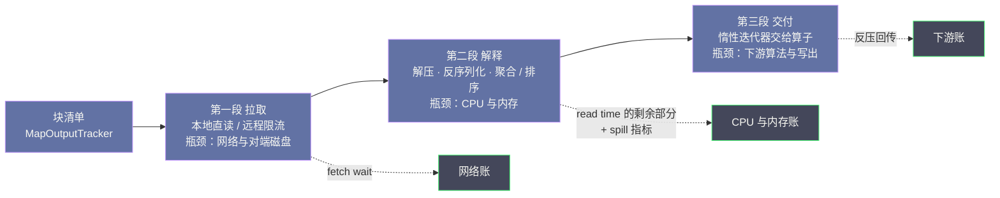
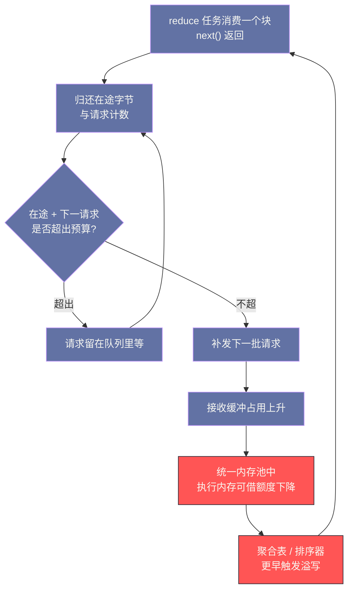
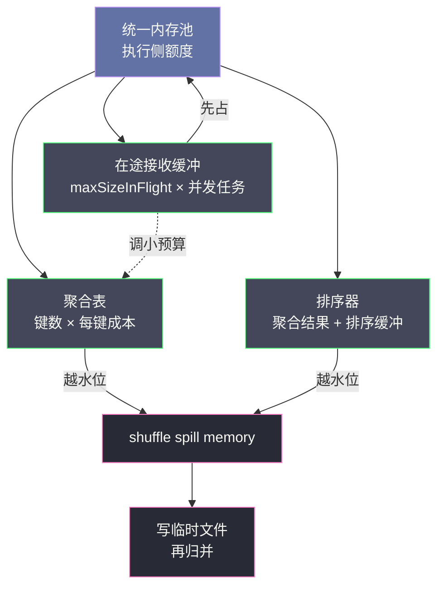
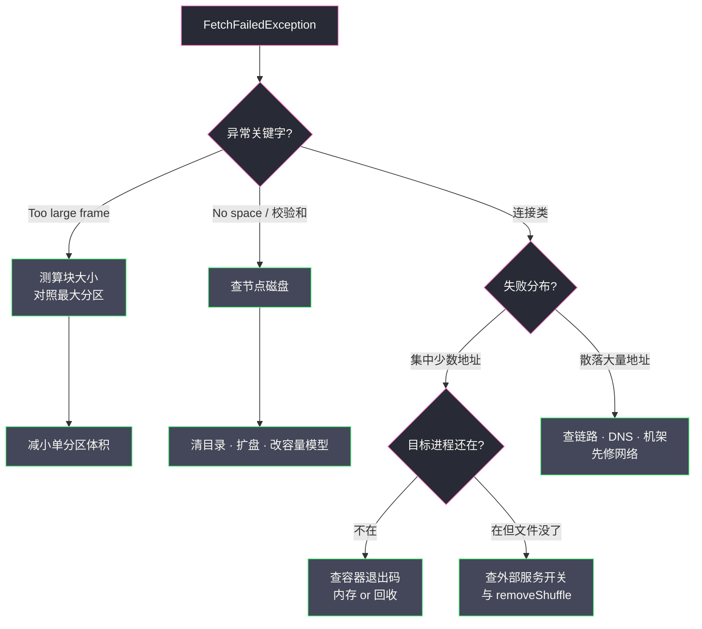
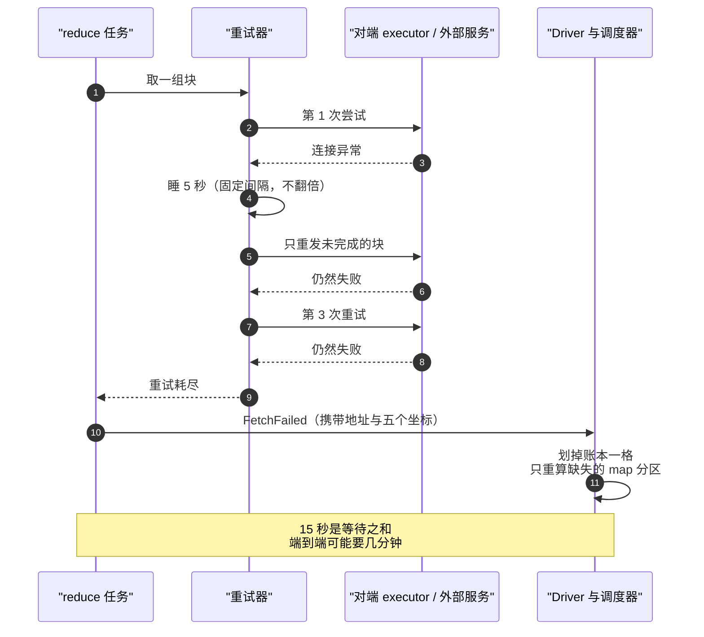

# 05 Shuffle Read 深度解剖：拉取、聚合与排序

**摘要：**

读侧是 Shuffle 的下半场，也最容易被一句话带过：数据在 map 端已经写好，reduce 端只要拉过来、合一下、交给算子。可一旦落到现场，这三个动词会分别落在网络、CPU 与内存上，而 UI 上那个叫 Shuffle Read Time 的数字把三段混成了一条。这一篇按运维口径把读侧拆成三段：拉取段看 fetch wait 与 remote reads，解释段看 read time 扣掉 fetch wait 之后的剩余、records read 与 spill，交付段看下游算子的消费速度，每一段给出可观察的判据与常见误判。中段用一座 300 节点、每天两千个作业的集群承载案例，量一遍 `spark.reducer.maxSizeInFlight` 在内存账上占多少、为什么它是反压旋钮而不是带宽旋钮，再把三个上限与外部服务的承载能力摆在一起谈配比。核心交付是把 `FetchFailedException` 拆成五种根因：上游 executor 消失、shuffle 文件被清理、磁盘写满导致文件截断、网络不可达、单块超出传输帧上限，每种给出日志关键字、首查位置、相邻证据与处置，并说明重试（默认 3 次、每次等 5 秒，固定间隔而非指数退避）能救什么、不能救什么，以及重试耗尽后为什么必然转成上游 Stage 的重新计算。机制推导按章路由到内核系列，本篇只回答哪里慢、怎么判、先查哪。

---

## 第 1 章 读侧的三段：三种代价，三个不同的旋钮

在 Stage 详情页里，一个 reduce 任务写着 Shuffle Read 1.2 TB、耗时 47 分钟。这两个数字经常被直接当成结论用：读得多、读得慢，那就去调网络参数。但同样一对数字至少对应三种现场——链路真的不够宽、CPU 卡在把字节变成记录上、内存不够导致边聚合边往盘上写——三者的处置互相冲突，按错方向调参往往还会让情况变坏。所以读侧的第一个动作不是调参，而是把「读」这个词拆开。

### 1.1 三段流水，三种瓶颈

一次 reduce 任务从启动到把结果交给算子，走的是**拉取、解释、交付**三段流水。

第一段是拉取，对应 `ShuffleBlockFetcherIterator` 与 `BlockStoreShuffleReader` 的取数环节：按 `MapOutputTracker` 给出的清单，把本地的块读出来、把远程的块按预算分批拉回来，落进结果队列。成本几乎全是搬运——网络往返、对端磁盘读取、接收缓冲占用，瓶颈在网络带宽、跨机架跳数，或者对端 shuffle 服务的服务能力上。

第二段是解释，把字节流变成键值对再变成聚合结果：解压、反序列化、按 key 建表合并，需要有序时再进排序器。成本是 CPU 与内存——单条记录的反序列化、哈希表的探测与扩容、排序的比较与归并，瓶颈在核心数与内存带宽上，与网络无关。

第三段是交付，`read()` 返回的是一条惰性迭代器，数据被上游算子（join 的构建侧、聚合后的写出）一条条取走。这一段没有自己的资源，速度由下游算子决定；当下游在反复申请 buffer，反压会一路传回第二段与第一段，最终表现为「Shuffle Read 很慢」，而真正慢的地方在读之外。

同一份数据在三段里的形状不同：字节、对象与哈希桶、算子手里的记录。成本斜率也不同，字节段与数据量成正比且常数很小，对象段与记录数成正比且常数很大。三段的关系画成一条流水：

### 1.2 指标怎么落到三段上

把三段映射到指标上，判据才有落点。最常被读反的一处是：Shuffle Read Time 并不是「网络时间」，它是取数、解压、反序列化与聚合的总和；fetch wait 是它内部的子集，统计线程阻塞在「等一个块到达」上的累计时间。两者相减，剩下的才是解释段的耗时。

这段减法有机制上的依据：拉取由消费反向驱动，消费者取走一个块，才归还字节预算、才允许补发下一批请求。所以聚合变慢时消费变慢，在途字节降下来，网络跟着闲下来，线程反而不容易阻塞在等待上——fetch wait 低而 read time 高，恰恰说明卡在了消费侧；反过来，网络慢时每次取块都要等，fetch wait 会攀到接近任务总时长。闭环细节见内核 [[大数据/Spark/读书笔记-spark内核/05_Shuffle核心机制/7. Spark_Shuffle与Storage交互|Shuffle 与 Storage 交互]] 第 4 章。

| 段 | 任务在做什么 | 瓶颈在哪 | 主判据 | 常见误判 |
|---|---|---|---|---|
| 拉取 | 按预算从各节点取块 | 网络带宽、跨机架、对端服务能力 | fetch wait 占任务时长比例、remote 与 local reads 之比 | 把 fetch wait 高一律当成「网卡小」 |
| 解释 | 解压、反序列化、建表合并、排序 | 核心数、内存带宽、哈希与比较成本 | read time 减 fetch wait 后的剩余、records read 与字节数之比 | 把 read time 当成网络时间 |
| 交付 | 迭代器被上游算子逐条消费 | 下游算子的算法与写出 | 三者都低而任务仍慢、下游算子的耗时占比 | 把下游的问题记在 Shuffle 账上 |

这张表的用法是自上而下排除，而不是取最大值。三段同时高，一般不是三段都坏了，而是资源总量不够——那是容量问题，不是读侧问题。

### 1.3 一个贯穿全文的作业

后面几章用同一座集群与同一个作业，先把参数摆出来，量化才好对账。集群 300 台节点，每台一个 executor，4 核、16 GB 堆，统一内存池按默认的 0.6 取约 9.6 GB；每天跑两千个作业，主力是 `daily_rollup`——一张按天分区的明细表做两段聚合，第一段 `reduceByKey` 预聚合，第二段与维表 join，两次 Shuffle，每段 reduce 侧 800 个分区，单次 Shuffle Read 在 1 TB 量级。

这个规模不极端，但足以让三种瓶颈各自出现：第一段的分区平均不到 1.3 GB，热点分区能到几十 GB；第二段 join 的 reduce 侧既要拉数据又要建哈希表，读侧溢写是常态。

### 1.4 本篇的边界

读侧的位置感知协议、请求切分、背压闭环、块类型与外部服务托管机制，内核系列已经推导得很细：清单形状与四路分流见 [[大数据/Spark/读书笔记-spark内核/05_Shuffle核心机制/7. Spark_Shuffle与Storage交互|Shuffle 与 Storage 交互]] 第 3 章，读侧契约与聚合、排序两个分支的语义见 [[大数据/Spark/读书笔记-spark内核/05_Shuffle核心机制/2. Spark_Shuffle框架设计与实现|Shuffle 框架设计与实现]] 第 5 章，读写两侧失败的放大关系见 [[大数据/Spark/读书笔记-spark内核/05_Shuffle核心机制/1. Spark_Shuffle机制深度解析|Shuffle 机制深度解析]] 第 3 章。本篇只引用它们的结论，不重做推导。

---

## 第 2 章 拉取段：网络慢的判据，与 maxSizeInFlight 真正的账

### 2.1 网络慢长什么样

网络慢的判据不是「fetch wait 有值」，而是三条同时成立：fetch wait 占任务时长的相当比例（笔者通常以一半为界，低于三成基本可排除网络）、remote reads 在总读取量中占主导、executor 的 CPU 使用率明显低于核数。第三条容易被忽略：CPU 打满说明线程在算而不在等，fetch wait 再高也是算得慢的副产物。

只凭 fetch wait 高就断定网络问题，会掉进两个坑。第一个是对端慢：`daily_rollup` 第二次 Shuffle 里，某台节点的 shuffle 服务同时被三十个 reduce 任务拉取，磁盘队列排到几十毫秒，读方看到的 fetch wait 一样高，但问题在服务端 IOPS 而不在链路，处置是限制单地址并发。第二个是块落盘：单块超过 `spark.network.maxRemoteBlockSizeFetchToMem`（默认 `200m`）时数据直接写临时文件，这段时间也计在 fetch wait 里，处置是减小分区而不是加带宽。

再往下拆一层要看 `remoteBytesReadToDisk`：它统计「因超过阈值而写到临时文件」的字节量，持续偏高说明请求普遍是大块，增大在途预算不会让它们更快，只会让临时文件更多。

### 2.2 maxSizeInFlight 是一张内存账单

`spark.reducer.maxSizeInFlight` 默认 `48m`，语义是每个 reduce 任务同时处于在途的远程字节总量。它有三个性质必须同时记住。

第一，它是**软上限**。单个请求的字节数超过预算时，只要当前在途为零，请求仍会被发出去，否则一个 60 MB 的块在 48 MB 预算下永远发不出去，会死锁。这条豁免意味着预算不是硬边界，一张特别大的块可以瞬间吃掉更多接收缓冲。

第二，它同时决定请求的切分粒度。单请求的目标大小是预算的五分之一，让最多五个对端能并行起来，而不是把额度全押在一台机器上。所以把预算调大不只改变总量，还改变请求的形状——请求变大，块级并发变低。

第三，它是**每个任务的固定内存开销**。每一份在途输出都要一块接收缓冲兜着，预算乘并发任务数就是这台 executor 在这条链上的内存上限。按案例推一遍：4 核、每核 1 个任务，48 MB 乘 4 约 192 MB，占 9.6 GB 统一池的 2% 量级；若每核 2 个任务就是 384 MB，接近 4%；一旦把预算调到 512 MB，8 个任务就是 4 GB，占掉统一池的四成，聚合器可用的执行内存只剩一半多一点。这笔账解释了为什么「调大能提速」在某些现场成立，在另一些现场直接变成溢写翻倍。把这条闭环摊开看：

这张图把两个闭环接在了一起：拉取侧的背压闭环决定在途字节的多少，内存侧的争用闭环决定这些字节的代价由谁承担。两者的交点就是 maxSizeInFlight——它不是网络参数，而是把网络吞吐与内存预算拧在同一个数字上的**反压旋钮**。

### 2.3 三个上限的配比

除了字节预算，还有两个上限在管并发，默认值都是不限制。三个参数合起来才是实际并发，只动其中一个通常看不到效果，因为生效的往往是另外两个。

| 参数 | 默认值（4.3.0） | 约束的是什么 | 调大的代价 | 调小的代价 |
|---|---|---|---|---|
| `spark.reducer.maxSizeInFlight` | `48m` | 单任务在途远程字节总量，并派生单请求目标大小 | 每任务接收缓冲上升，挤压执行内存，溢写与 GC 压力增加 | 请求变小变多，往返次数上升，大块场景吞吐下降 |
| `spark.reducer.maxReqsInFlight` | `Int.MaxValue` | 同时在途的请求个数 | 对单机的瞬时连接数失去保护，外部服务可能被打穿 | 取数退化为串行，长尾拉长 |
| `spark.reducer.maxBlocksInFlightPerAddress` | `Int.MaxValue` | 向同一 host:port 同时在途的块数 | 单个对端被大量块请求压垮，服务端磁盘队列堆积 | 请求被切碎，单地址并发下降，整体时间反而变长 |
| `spark.network.maxRemoteBlockSizeFetchToMem` | `200m` | 单块超过此值改落临时文件 | 更大的块进堆，堆峰值上升 | 更多块落盘，磁盘 I/O 上升但内存平稳 |
| `spark.shuffle.readHostLocalDisk` | `true` | 是否允许同机直读 | 不是「调大更好」型参数，开启即用 | 同机块改走网络，流量与耗时可观上升 |

配比的量级可以用案例推一下。800 个 reduce 分区分布在 300 台节点上，若并发任务 1200、每任务同时挂 5 个请求，全集群瞬时就是六千条取数连接，摊到每台约二十条，而外部服务每条连接都要读索引、定位区段、推文件——服务端 netty 线程数与本地盘 IOPS 才是天花板。这解释了一个反复出现的现象：预算从 48 MB 调到 96 MB，fetch wait 一点没降，因为瓶颈既不在字节预算也不在连接数，而在服务端的服务能力上。此时该做的是把 `maxBlocksInFlightPerAddress` 压到几十的量级，代价是整体时间变长但稳定性上升。

`maxReqsInFlight` 默认不限制，是因为设计上更信任字节预算；但在多租户集群里它会变成隐患——同一节点上跑着不同应用的 executor，叠加起来就把服务端打满。

### 2.4 大块的两次分界

拉取段有两个分界点，都与块大小有关，机制与处置不同。

第一个分界是 `maxRemoteBlockSizeFetchToMem`（默认 200 MB）。超过它的块不进堆，而是落到本地临时文件，再由上层按需流式读取，风险从内存转到了磁盘，代价是多一次写盘与读盘；调大它可以减少落盘，但堆峰值随之上升。

第二个分界是传输层的帧上限。块被整体编码进一个响应帧，帧长受解码器约束，超了就抛「帧过大」。这个上限在多数版本里是解码器的常量而非普通配置项，量级在 GB（见 SPARK-20308 与 SPARK-27876，后者提议把超大分区切段传输）。它出现在 `FetchFailedException` 里，是最容易误判成网络问题的一种。

### 2.5 反例：把预算调到几百兆

调参清单里流传最广的一条是「Shuffle 慢就把 `spark.reducer.maxSizeInFlight` 调到 200 MB 以上」。它的问题不在方向，而在假设了瓶颈在网络：512 MB 的预算在 8 个并发任务下就是 4 GB 接收缓冲，占掉案例 executor 内存池的四成；执行内存被压缩后聚合器更早溢写，spill 与磁盘 I/O 上升，总时长反而变长——而 UI 上 fetch wait 确实降了，于是下一次调参继续沿着错路走。

---

## 第 3 章 解释段：反序列化、聚合与读侧溢写

### 3.1 三段里唯一直接烧 CPU 的一段

解释段的判据入口是前面那条减法：read time 高而 fetch wait 低。此时任务的时间花在把字节变成记录上，需要再往下分三档。

第一档是反序列化。每条记录都要过一次序列化器的读路径，成本与记录数成正比，与字节数关系不大。判据是 records read 除以读取字节数，得到单条记录的平均大小：`daily_rollup` 第一段读侧单条记录只有几十字节，记录数却是十亿量级，反序列化本身就是可观的一块 CPU。

第二档是建表聚合。相同 key 的记录在表里合并，成本与记录数成正比，并受哈希表规模影响。判据是 key 数与记录数的比值：比值低（大量重复 key）时表小、合并充分，成本接近线性；比值高时表持续扩容，探测成本上升，内存也按 key 数走。

第三档是排序。需要有序输出时，聚合结果要再过一遍排序器，带来第二次落盘。判据是 spill 在聚合完成之后又涨了一截，且磁盘写入量明显超过聚合阶段。

### 3.2 mapSideCombine 决定了读侧建什么表

读侧建的表分两种，取决于上游做没做预聚合。`reduceByKey` 这类上游已合并，读侧只需把各 map 的聚合值再合并一次，表里放 combiner，规模约等于 key 数；`groupByKey` 这类上游不合并，读侧拿到原始记录，表里放值序列，规模随记录数增长。两条分支的语义与类型参数上的差别见 [[大数据/Spark/读书笔记-spark内核/05_Shuffle核心机制/2. Spark_Shuffle框架设计与实现|Shuffle 框架设计与实现]] 第 5 章，这里只说运维含义。

运维含义是一句反直觉的话：同样的数据量，`groupByKey` 在读侧的内存压力可能是 `reduceByKey` 的几十倍，而两者的 Shuffle Read Size 可能完全一样。所以看到「读取量相同、溢写量差一个数量级」的两个作业，先看算子再怀疑倾斜。判据很直接：records read 远大于 key 数、且读侧 spill 高，基本可定位到「上游没做预聚合」。

> [!info] 判据的优先级
> 读侧溢写的归因顺序建议是：先看算子（有没有 map 端聚合），再看分区（单分区是否过大），然后看并发（在途缓冲是否吃掉了执行内存），最后才看数据倾斜。前三条的判据都是比值，最后一条需要分布，成本高而命中率低。

### 3.3 读侧溢写的处方：减少单批拉取量

读侧也有溢写，指标名与写侧一样，区别在于它的表是聚合表或排序器，溢写发生在拉取与聚合并行的过程里。它未必说明数据超量。

回到 2.2 的那张账。在途字节占用堆内存，聚合表申请执行内存，两者在统一内存管理下是同一个池子里的邻居；在途缓冲先占住一块，聚合表能借到的额度就少一块，越早到达水位越早溢写。所以一个「数据量并不离谱、但溢写很多」的现场，处方恰恰是**减少单批拉取量**——把 `maxSizeInFlight` 调小，把内存让给聚合器。

这个处方与「拉取慢就把预算调大」正好相反，区别在于判据不同：拉取慢的判据是 fetch wait 高、CPU 空闲、spill 低；溢写多的判据是 spill 高、fetch wait 不高（甚至偏低）、堆曲线呈锯齿。同一台 executor 可能在不同阶段需要相反的调整，「一次调参、全局生效」在读侧不成立。

调小预算的代价是拉取变慢，所以要找平衡点。按案例的量级，预算从 48 MB 降到 24 MB，聚合器多拿到约 96 MB 执行内存；若溢写主要来自聚合表而数据总量不大，这 96 MB 往往能压住溢写次数；若数据本身远超内存，降预算只是让溢写来得更规律，次数不会少。三方争用的形状是这样的：

这张图也解释了为什么「溢写多就加内存」有时无效：加内存只是抬高水位，若在途缓冲同步变大，净收益被抵消；真正的解法是改变三者的比例，而不是总量。

### 3.4 排序：读侧的第二次落盘

`sortByKey` 一类算子的排序发生在读侧，位置是解释段最后一步。写侧只按分区号归组，分区内不保证有序，有序性要在 reduce 侧建立，因此排序的代价在每个 reduce 任务里各付一次，且可能触发第二次溢写。

判据有两个层次。表层是 spill 指标的第二波增长：聚合阶段溢写一轮，进排序器后再溢写一轮，两轮的字节量与时间戳能分开。深层是有效载荷比：排序阶段读进来的数据绝大部分只为确定顺序，最终写出的仍是同样多，这一段没有收缩——与聚合阶段「合并后变小」有本质区别。所以 `sortByKey` 的读侧调优能动的是内存与分区，动不到算法。

### 3.5 归因三问

解释段的归因可以收成三个问题：单条记录多大、key 与记录数的比是多少、需不需要有序。三个问题都能从 UI 与作业代码里直接回答，比打开堆 dump 便宜得多。

---

## 第 4 章 FetchFailedException：五种根因与五条首查路径

### 4.1 先把异常读成坐标

`FetchFailedException` 不是一种错误，而是一类错误的统称：读侧所有「取不到块」的路径都汇到它这里，再由任务框架上报给 Driver。异常文本里带着五个坐标——对端地址、shuffleId、mapId、mapIndex、reduceId。前两个定位「哪个 Shuffle、哪台机器」，后两个定位「哪一份 map 输出」，最后一个定位读取范围。

这里有一处细节决定了排查效率：mapId 是块名里解出来的尝试号，mapIndex 是清单里的分区下标，推测执行或任务重试之后两者可能不一致。看重算范围时用 mapIndex（账本按它划格子），看文件用 mapId（文件名按它拼）。把两者混用，会得出「重算了整个 Stage」这类错误结论。

坐标之外还要看失败的分布：集中在少数地址，还是散落在大量地址；集中在某个时间窗，还是与任务重试次数相关。分布形态比异常文本更能指向根因。

### 4.2 根因一：上游 executor 消失

日志关键字是连接类错误——`Failed to connect to <host>:<port>`、`Connection refused`、`Connection reset by peer`，配合 Driver 日志的 `ExecutorLostFailure` 或容器退出记录。

首查位置是资源管理器的容器历史与节点系统日志：退出码 143 是 SIGTERM（多为回收或主动 kill），137 是 OOM kill，其余非零码通常指向进程崩溃；再看 Executors 页，确认该 executor 的移除时间与失败任务开始时间是否吻合。

处置要分两半。executor 被资源管理器因超内存杀掉时，开外部服务也救不了——数据随机器一起消失，能做的只有修内存（降并发、调堆外、查泄漏）。被动态分配回收时，处置在「数据寿命」这一侧：外部服务或 shuffle tracking 二者选一。这里有一个常被忽略的现状：`spark.dynamicAllocation.shuffleTracking.enabled` 默认就开着，所以纯粹的「空闲回收导致数据不可读」在默认配置下并不常见，真正的常见形态是 executor 非正常死亡。

### 4.3 根因二：文件被清理

这一类失败的特征是「曾经可读」：同一个 Shuffle 的前半段正常，某个时刻后同一批地址开始报文件不存在。服务端日志里有找不到文件的记录，读侧看到的是带着对端地址的 `FetchFailedException`。

首查三处。其一，`spark.shuffle.service.enabled` 是否为真；为假时文件服务跟着 executor 进程走，进程一退，文件与目录一起消失。其二，`spark.shuffle.service.removeShuffle` 的取值——它在 3.3.0 引入时默认 `false`，4.x 上默认 `true`，旧集群要按版本核对；打开之后，executor 被回收且该应用的 shuffle 数据被判定不再需要时，服务会清理目录。其三，Shuffle 生命周期本身：`unregisterShuffle` 在 Shuffle 结束时逐个 map 删除产物，如果作业被取消后同一个 application 内又发起了对同一份数据的读取，就会读到已被删掉的输出。

处置是让「谁托管文件」与「谁写文件」解耦，并按最坏情况算本地盘容量：要能同时容纳多个 Stage 的输出，而不是只容纳当前 Stage。

### 4.4 根因三：磁盘写满导致文件截断

磁盘写满是最隐蔽的一类，因为它的第一现场在写侧，表现出来的却是读侧失败。写侧的证据是 `No space left on device` 一类的 IOException；若写侧吞掉了异常，读侧就会读到被截断的文件：长度比 `MapStatus` 记录的小，或者校验和对不上。校验和默认开启（`spark.shuffle.checksum.enabled` 默认 `true`，算法默认 ADLER32），它把「读出来但是坏的」与「读不出来」区分开。

首查位置是节点的磁盘曲线与 `spark.local.dir` 所在盘的容量历史，而不是 Spark UI：判据是失败集中在那几台有磁盘告警的机器上，且这些机器的写侧任务在同一时间窗也失败过。处置三步：清历史目录、扩盘、把「最坏情况下同时存活的 Shuffle 输出总量」纳入容量模型。调参只能限制并发与溢写，治不了容量不足。

> [!warning] 一个容易踩的因果倒置
> 磁盘写满会同时打击写侧与读侧，而两边的报错都不指向「磁盘满」。如果只按读侧的 `FetchFailed` 去查网络，会看到「网络正常、重试无效、换节点后偶发成功」这种互相矛盾的证据组合；此时应该直接去看那几台机器的 `df`。

### 4.5 根因四：网络不可达

这一类最好认：`Failed to connect to`、`ConnectTimeoutException`、`Connection reset by peer`，并且失败地址在时间上成簇出现——同一批任务在同一分钟内对同一批地址接连失败。

首查三处：端口对不对（开外部服务时是 `spark.shuffle.service.port`，默认 7337，没开时是 executor 的传输端口）、链路上有没有运维事件（交换机重启、机架断电、安全组变更）、失败是否与机架相关。判据仍是分布：集中在一台或一个机架是链路问题；散落在大量地址，更可能是读方的网络栈或 DNS 出了问题。

处置顺序是先修网络，再谈参数：`spark.shuffle.io.connectionTimeout` 与重试只能把失败推迟，不能把不可达变成可达；把重试次数从 3 调到 10，在网络恢复之前只让每个任务多等几轮。

### 4.6 根因五：单块超出传输帧上限

这一类是五种里唯一「与网络质量无关、与数据形状有关」的根因。异常文本形如 `FetchFailedException: Too large frame: <字节数>`，抛出位置在传输层的帧解码器里，含义是「这个块的响应帧超过了协议允许的最大长度」。

首查两步。第一步把异常里的字节数换算成 MB 或 GB，与 Stage 页最大分区的 Shuffle Read Size 对照，吻合即锁定。第二步看这个分区为什么这么大：分区数太少（`spark.sql.shuffle.partitions` 默认 200，对几百 GB 的 Shuffle 明显偏小）、热点 key 把数据压到一个分区、或者上游过滤让某个分区的输入量暴涨。

处置是减小单分区体积：提高分区数、打开自适应执行让它在运行期合并小分区并拆分倾斜分区，或对热点 key 加盐打散。**帧上限不是调参项**——多数版本里它是解码器的常量，即使能改也只是把阈值往后推，让下一次失败更晚、代价更大。

### 4.7 五根因分诊表

判据的差异比机制更值得记。

| 根因 | 日志关键字 | 首查位置 | 相邻证据 | 处置 | 调参能救吗 |
|---|---|---|---|---|---|
| 上游 executor 消失 | `Failed to connect`、`Connection refused`、`ExecutorLostFailure` | 容器历史、节点系统日志、Executors 页移除时间 | 容器退出码 137 或 143 | 非正常死亡修内存；空闲回收开外部服务或 shuffle tracking | 部分：修不了 OOM kill |
| 文件被清理 | 服务端「找不到文件」、地址类失败 | `spark.shuffle.service.enabled`、`removeShuffle`、`unregisterShuffle` | 同一 Shuffle 前半段成功、时间边界清晰 | 让文件托管与写文件解耦、按最坏容量规划 | 不能 |
| 磁盘写满致截断 | `No space left on device`、校验和不符、`EOFException` | 节点 `df` 与 `spark.local.dir` 的历史曲线 | 失败集中在磁盘告警机器，写侧同窗失败 | 清目录、扩盘、修正容量模型 | 只能缓解 |
| 网络不可达 | `ConnectTimeoutException`、`Connection reset` | host:port 是否正确、链路事件、机架分布 | 失败成簇、与机架相关 | 先修网络 | 不能，只推迟 |
| 单块超帧上限 | `Too large frame: <字节数>` | 异常字节数与最大分区对照 | 分区数过少或热点 key | 加分区、自适应执行、加盐 | 不能，帧上限非调参项 |

把五种根因画成分诊路径：

### 4.8 重试的语义与它的边界

重试由传输层的重试器负责，**只重试失败的块**，已经传完的块不会重来。参数是 `spark.shuffle.io.maxRetries`（默认 3）与 `spark.shuffle.io.retryWait`（默认 5s），两者相乘给出等待上限，官方文档写的是「最多 15 秒」。这里有一处流传很广的错误说法需要纠正：它**不是指数退避，而是固定间隔**，每次重试前睡同样的时长，没有翻倍。按翻倍估算，三次等待会被算成 35 秒而不是 15 秒，端到端的判断随之偏大。

15 秒只是等待之和，不是端到端的失败时间。真正的最坏耗时还要看每次尝试本身的代价：失败形态是连接被拒时，每次尝试毫秒级返回，总耗时接近 15 秒；失败形态是连接超时时，每次尝试要先等满 `spark.shuffle.io.connectionTimeout`（继承 `spark.network.timeout`，默认 120 秒），于是总耗时是四次超时加三次等待。同一段代码、同一组参数，因为失败形态不同，现场表现可以差一个数量级。

| 失败形态 | 每次尝试耗时 | 等待之和 | 最坏总耗时（示例推算） | 现场表现 |
|---|---|---|---|---|
| 连接被拒 | 毫秒级 | 3 × 5s = 15s | 约 15 秒 | 任务几乎立刻报失败 |
| 链路抖动后恢复 | 抖动时长 + 正常传输 | 15s | 15 秒加抖动，通常自愈 | 偶发失败、重试后成功 |
| 连接超时（主机不可达） | 约 120s | 15s | 4 × 120s + 15s ≈ 8 分钟 | 长时间无输出后突然失败 |
| 堆外内存耗尽 | 不重试 | 由专用计数路径处理 | 不受这两个参数影响 | 整台 executor 的拉取同时停摆 |

重试的能力边界很窄：能救「瞬态」，救不了「已经消失」。对端还在、只是慢或抖，重试有意义，代价是把失败推迟；对端已消失、文件已被删除、块超出帧上限，重试再多次也只是把同一个事实重复验证几遍。判断依据很简单：同一地址在不同任务里反复失败，调重试没用；同一台机器的失败时有时无、伴随长 GC 或磁盘抖动，调重试才有意义。

重试耗尽之后，异常被抛给任务框架，任务不会「重试自己」——同一个任务重试多少次也读不到已经不存在的数据。它上升为 `FetchFailed` 交给 Driver，Driver 在账本上划掉对应那一格，重提上游 Stage、只重算缺失的 map 分区。这一步的代价与 m×r 直接相关：一次 Shuffle 的读取次数是 map 数与 reduce 数的乘积，失败面也按这个乘积放大，推导见 [[大数据/Spark/读书笔记-spark内核/05_Shuffle核心机制/1. Spark_Shuffle机制深度解析|Shuffle 机制深度解析]] 第 3 章。一次取块的失败时间线：

---

## 第 5 章 本地性：读侧最便宜的那部分

### 5.1 三档「本地」与一句话的开关

读侧的块有三种来源：自己 executor 上写的（零网络、零目录询问）、同机另一个 executor 上写的（要问一次目录，再直接读对方磁盘）、以及远程的（走网络）。`spark.shuffle.readHostLocalDisk`（默认 `true`，3.0 起）控制中间那一档：允许读方按同一套哈希规则把块名拼成路径，直接打开同机其他 executor 的目录，省掉一次网络传输。

这一档有一条反直觉的边界：同机直读失败不会回落成远程拉取，而是直接抛 `FetchFailedException`。设计上的理由是：能打开文件却读坏了，通常意味着磁盘或权限出了问题，换通道也读不到同一份数据。这条捷径的代价是**失败即容错**——容器化部署里若每个 executor 的本地卷彼此不可见，同机直读会成批失败，表象是「某几台机器上的 reduce 全挂」，很容易被误判成网络问题。

### 5.2 本地读与远程读的比例怎么读

这个比例是读侧最值得长期盯的指标之一，价值在于与倾斜正交：倾斜看「同一个 Stage 内各任务读取量的差异」，本地性看「同一次读取里流量从哪来」。判据分三层。比例接近零，说明所有读取都走了网络，此时看调度：reduce 任务是否与写数据的 executor 分在了不同波次，或者中间发生了一次扩缩容，把 map 与 reduce 拆到了两批机器上。比例很高（譬如超过一半），通常意味着 executor 复用充分，但也可能是「任务全挤在少数节点上」的另一个侧面，要结合 Stage 的任务分布一起看。第三种是比例正常但 fetch wait 高，那问题不在本地性，回到第 2 章的判据。

按案例估一下期望值：300 台节点、map 输出均匀分布、reduce 随机调度，本地读占比大致是「自己那份除以总数」，即百分之几；同机直读再贡献一档，整体能到百分之十上下（示例推算）。若实测长期接近零，说明这一档没生效，去查开关与目录可见性。

| 读法 | 含义 | 判据与处置 |
|---|---|---|
| 真本地 | 块就在本 executor | 零网络；比例低说明 map 与 reduce 波次错开 |
| 同机直读 | 同 host 另一个 executor | 要目录 RPC，失败不回落；比例异常低先查目录可见性与开关 |
| 远程 | 跨节点走网络 | 占比高且 fetch wait 高时先查调度与容量，再查链路 |

### 5.3 别把本地性当成调度参数

Spark 的 reduce 任务没有「数据本地性」这个调度偏好——位置在写侧已定死，读侧只能接受。所以提高本地读比例的手段不在读侧而在整体：让 map 与 reduce 落在同一批 executor 上、避免中途大幅缩容、避免把数据写到临时节点。把它当成开关的调参问题，方向就错了。

---

## 第 6 章 症状到判据：一张分诊表

把前面几章的判据收成一张表，按现场最容易看到的症状排列。每行只回答「先看哪里」，机制按最后一列去找。

| 症状 | 先看哪个页面或指标 | 判据 | 指向 |
|---|---|---|---|
| 任务失败，异常是 `FetchFailed` | Driver 日志异常文本、失败地址分布 | 关键字与分布形态 | 第 4 章五根因 |
| fetch wait 占任务时长一半以上 | fetch wait、remote reads、节点 CPU | remote 占主导且 CPU 空闲 | 网络或对端服务能力 |
| fetch wait 低而 read time 高 | records read、单条记录大小、key 记录比 | 记录多而小、key 记录比高 | 反序列化或聚合结构 |
| 读侧 spill 高 | Stage 汇总页 shuffle spill memory | spill 高、fetch wait 不高、堆曲线锯齿 | 在途缓冲挤压执行内存 |
| 读取量远大于上游写出量 | 上下游 Stage 的 Shuffle Write 与 Read | 两者应大致相等 | 上游输出过多或分区膨胀 |
| read time 合理但任务仍慢 | 下游算子耗时、输出阶段 | 三者都低 | 交付段或下游算子 |
| 本地读比例接近零 | local 与 remote reads 汇总 | 长期为 0 | 调度波次或目录不可见 |
| 少量任务读取量远超中位数 | Task 页按 Shuffle Read Size 排序 | 最大值超过中位数一个数量级 | 倾斜，不是本地性 |

分诊顺序值得说清楚：**先看失败再看耗时**，因为失败会污染耗时统计；先看 Stage 汇总再看 Task 明细，因为汇总量级决定问题规模；最后才看单机日志，因为多数根因留下的是分布特征，而分布只在汇总层可见。

---

## 第 7 章 反例与落点

### 7.1 不开外部服务就打开动态分配

这是流传最广的一条，但它需要更新：动态分配与 Shuffle 的冲突有三条解法——外部服务、shuffle tracking、优雅下线迁移，而 tracking 默认就开着，所以「一开动态分配就丢数据」在默认配置下并不成立。真正会踩的情形是三条都没生效：外部服务关着、又因为版本或策略关掉了 tracking、同时没开优雅下线，此时 executor 一被回收，文件与目录一起消失，读侧就是成批的地址类失败。判据是这三处开关的实际取值，而不是文档里「必须开外部服务」那句话。

### 7.2 把预算调到几百兆

2.5 已经算过账：预算决定接收缓冲上限，而它与聚合表共享同一个池子。调到几百兆之后，fetch wait 通常会降，但总时长可能变长，读侧 spill 会上升，GC 也会变差。判断调参是否有效要看任务总时长与其分位分布，而不是单个 fetch wait。

### 7.3 只读总时长，不读 fetch wait

这是**判据缺位**的典型形态。总时长是三段之和，任何一段变坏都会推高它，「Shuffle 慢」于是成了无法证伪的结论，只能靠试参数。把总时长拆成 fetch wait、解释段、交付段三块，是读侧排障最低成本的动作。

### 7.4 把失败一律当网络问题

`FetchFailed` 的文本里带有地址，容易让人把注意力落在网络上。但五种根因里只有一种真在网络，其余分别在上游进程、文件生命周期、磁盘容量和数据形状上。判据不难：看失败地址分布、看写侧有没有对应错误、看异常里有没有帧大小或校验和字样。三条里任一条成立，都不该先去调重试。

### 7.5 落点

读侧三段之所以要分开，是因为资源不同、判据不同、处方甚至互相冲突：拉取段希望预算大一点，解释段希望预算小一点；网络问题修链路，内存问题改比例，数据形状问题改分区。混成一句「Shuffle Read 慢」，就只能得到无法证伪的结论，然后在参数表上来回试探。

五种根因的划分同理：`FetchFailedException` 的价值在于携带足够坐标让重算精准，而不在于它可被直接处置。调参只对其中一小部分有效，剩下的必须回到进程、磁盘与数据形状上解决。读侧真正能省下来的那部分——本地直读、预聚合、分区合理性——都不在任何 Shuffle 参数里。

---

## 参考资料

1. Apache Spark 4.3.0 文档：Configuration，`spark.reducer.*`、`spark.shuffle.io.*`、`spark.shuffle.service.*`、`spark.network.maxRemoteBlockSizeFetchToMem` 的默认值。https://spark.apache.org/docs/4.3.0/configuration.html
2. Apache Spark 4.3.0 文档：Tuning Guide，Shuffle Behavior 与内存管理。https://spark.apache.org/docs/4.3.0/tuning.html
3. Apache Spark 4.3.0 文档：Job Scheduling，动态分配、外部 Shuffle 服务与 shuffle tracking 的依赖关系。https://spark.apache.org/docs/4.3.0/job-scheduling.html
4. Apache Spark 源码（4.3.0）：`core/src/main/scala/org/apache/spark/storage/ShuffleBlockFetcherIterator.scala`，请求切分、在途预算与异常坐标。https://github.com/apache/spark/blob/v4.3.0/core/src/main/scala/org/apache/spark/storage/ShuffleBlockFetcherIterator.scala
5. Apache Spark 源码（4.3.0）：`core/src/main/scala/org/apache/spark/shuffle/BlockStoreShuffleReader.scala`，读侧五步与聚合、排序分支。https://github.com/apache/spark/blob/v4.3.0/core/src/main/scala/org/apache/spark/shuffle/BlockStoreShuffleReader.scala
6. Apache Spark 源码（4.3.0）：`common/network-shuffle/src/main/java/org/apache/spark/network/shuffle/RetryingBlockTransferor.java`，固定间隔重试与只重发失败块。https://github.com/apache/spark/blob/v4.3.0/common/network-shuffle/src/main/java/org/apache/spark/network/shuffle/RetryingBlockTransferor.java
7. Apache Spark 源码（4.3.0）：`common/network-common/src/main/java/org/apache/spark/network/util/TransportFrameDecoder.java`，响应帧长度与「帧过大」判定。https://github.com/apache/spark/blob/v4.3.0/common/network-common/src/main/java/org/apache/spark/network/util/TransportFrameDecoder.java
8. Apache Spark JIRA：SPARK-20308（取数时 `Too large frame` 与帧解码器限制的讨论）。https://issues.apache.org/jira/browse/SPARK-20308
9. Apache Spark JIRA：SPARK-27876（把超大 Shuffle 分区切段传输的提案）。https://issues.apache.org/jira/browse/SPARK-27876
10. 本站内核系列：[[大数据/Spark/读书笔记-spark内核/05_Shuffle核心机制/1. Spark_Shuffle机制深度解析|Shuffle 机制深度解析]]、[[大数据/Spark/读书笔记-spark内核/05_Shuffle核心机制/2. Spark_Shuffle框架设计与实现|Shuffle 框架设计与实现]]、[[大数据/Spark/读书笔记-spark内核/05_Shuffle核心机制/7. Spark_Shuffle与Storage交互|Shuffle 与 Storage 交互]]。

---

> [!note] 思考题
> 1. 一个 Stage 的 fetch wait 占任务时长七成，但节点 CPU 使用率也在七成以上。你会先采信哪条判据，为什么？
> 2. 把 `maxSizeInFlight` 从 48 MB 降到 24 MB 之后，读侧 spill 下降但任务变慢。这个交换在你负责的作业上是否值得，判断依据是哪个指标？
> 3. 五种根因里，哪一种的处置完全不落在 Spark 参数面上？如果只能加一条监控来提前发现它，你会加在哪一层？
> 4. 重试的固定间隔意味着最坏耗时可以线性估算。如果某个集群的连接超时被设成 5 秒而不是 120 秒，现场表现会有什么变化？
> 5. 本地读比例长期接近零，但 fetch wait 并不高。这说明问题在哪一段，还是说明没有问题？
> 6. 如果要求把「Shuffle Read 慢」拆成三段的可观测性，除了现有指标，你还会补哪一个比值？