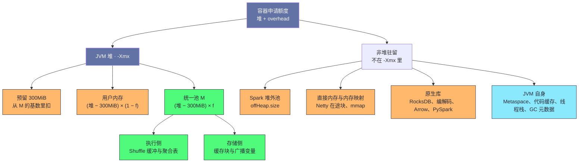
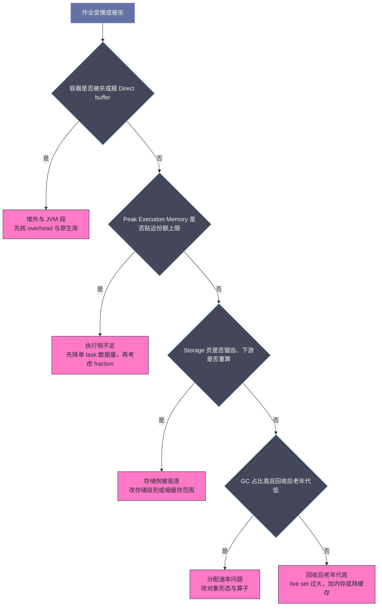
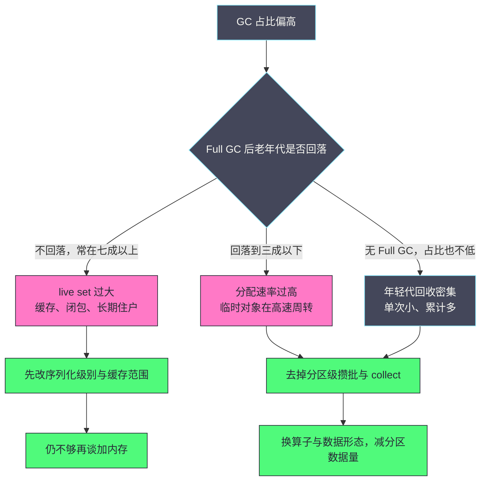
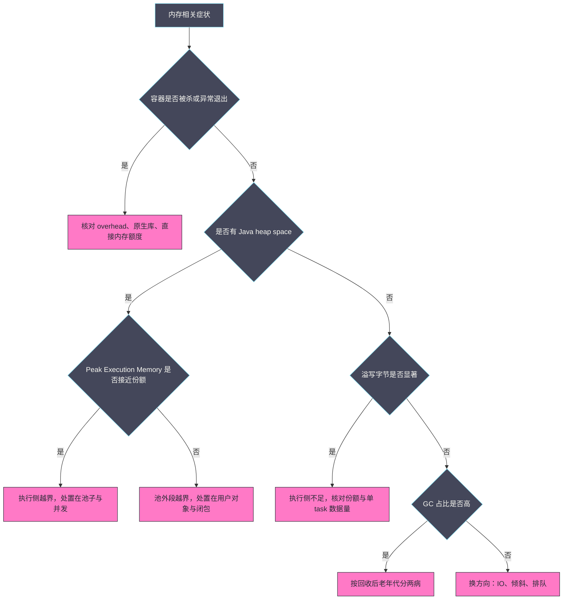

# 06 Spark 统一内存管理模型

**摘要：**

统一内存模型的文章大多停在"执行与存储共享一个池子"，但真到作业变慢的那天，工程师手里需要的不是这张结构图，而是三个能被验证的答案：这台 executor 的额度里到底有几块地，每块地怎么量，动哪个参数会换来什么代价。本篇按这个顺序写。先给三只池子的一句话定义，再把"容器申请额度—堆—统一池"这条链上的算术摊开，说明为什么 8GiB 的堆只能摊出 4.6GiB 的统一池。接着用两条借用方向解释缓存为什么会消失，并把"没写进去"与"写进去又被收走"分开。核心的一节处理看不见的内存：预留的 300MiB、用户区、堆外与原生内存、JVM 自身，四者都不在统一池的账上，却都在容器的账上，各有各的观测手段与报错形态，而这些手段之间的差值，往往比任何单点指标都更能说明问题。之后是四个旋钮的代价表、spill 指标的正确读法、GC 时间长到底该归给"内存不足"还是"分配太快"，最后用五条证据回答"够不够"。全文口径为 Spark 4.3.0，凡推算均标注示例推算。

---

## 第 1 章 换一个问题：够不够，和去了哪

集群规模三百个节点，每天两千个作业，内存问题几乎每周都会以一个新面孔出现。下面三件事发生在同一周，处理动作却完全相反。

第一件是漏斗作业 `session_funnel`，凌晨三点起跑，日志里刷出几十万条 `spilling in-memory map` 与 `spilling collection`，作业能跑完，耗时比上周多了四十分钟。第二件是一条日志清洗链路，Executor 页的 GC Time 从四十秒涨到六分钟，堆占用长期停在八成五，既不 OOM 也没有容器被杀。第三件是一个 Structured Streaming 双流 join，每六小时被 Kubernetes 杀掉一次，退出码 137，事后看堆只用了不到一半。

三件事都能被叫作"内存问题"，但它们的处置对象分别是执行内存的额度、对象分配的速率、以及容器里堆外的那部分驻留内存。要分开它们，得先把 executor 的内存分成能被单独讨论的几块。

统一内存模型给出的划分只有三只池子，定义各一句话，机制上的推导不再重复。

- **预留内存**：算式里先扣掉的 300MiB，源码中是一个常量，不可配置，也不进入任何池子。
- **用户内存**：`(堆 − 300MiB) × (1 − spark.memory.fraction)`，默认占比四成，Spark 不记账、不限额、不隔离。
- **统一内存**：`(堆 − 300MiB) × spark.memory.fraction`，默认 0.6，内部再按 `spark.memory.storageFraction` 分成执行与存储两侧，两侧边界可以移动。

三只池子各自怎么被申请、额度怎么在并发 task 之间摊薄、驱逐的判定顺序是什么，属于机制层，见 [[大数据/Spark/读书笔记-spark内核/04_存储与容错机制/1. Spark内存管理机制|内存管理：四本账与归因]] 与 [[大数据/Spark/读书笔记-spark内核/04_存储与容错机制/2. Spark内存管理模型深度解析|统一内存池：借用与摊薄]]；缓存块怎么写进去、怎么被驱逐、`unpersist` 之后谁负责回收，见 [[大数据/Spark/读书笔记-spark内核/04_存储与容错机制/3. Spark_数据缓存机制|数据缓存：存储级别与驱逐]]。本篇不重走这几条链路，只回答"哪个数字能证伪哪句判断"。

| 池子 | 算式 | 默认 | 里面装什么 | 能否直接量到 |
|---|---|---|---|---|
| 预留内存 | 常量 | 300MiB | 不设专用账户，只把 M 的基数调小 | 不能，只能记住它存在 |
| 用户内存 | (堆 − 300MiB) × (1 − f) | 约堆的 38% | 闭包、UDF 中间对象、反序列化临时物 | 只能间接：堆转储、GC、RSS 差值 |
| 统一内存 | (堆 − 300MiB) × f | 约堆的 58% | 执行侧缓冲与存储侧缓存块 | 能：`/metrics/executors/json` 给到字节 |

这张表里最容易读错的是最后一行：三只池子里只有统一内存是"能被精确观测"的，另外两只只能靠间接手段推断。后面所有的误判，几乎都源于把间接推断当成了精确值。

表里的百分比是按 8GiB 堆算的：7892MiB 的可用基数乘 0.6，约 4.6GiB，占堆的 58%；乘 0.4 得用户区约 3.1GiB，占 38%；再扣 300MiB，才是百分之百。这三个数对不上"0.6 + 0.4 = 1"，原因就是预留那块地不在比例之内，而它的分母也不是容器额度。

## 第 2 章 容器额度里的一次切分

在 YARN 与 Kubernetes 上，调度器分配的不是堆，是"堆加非堆"的一个额度；cgroup 判死的依据也不是 `-Xmx`，是进程的常驻内存。所以一台 executor 有两个不同的"内存大小"，混用这两个数会让后面每一步算术都错位。

先看额度是怎么算出来的。非堆部分由 `spark.executor.memoryOverhead` 决定，未显式指定时按"堆的比例与一个下限取大"推算：比例来自 `spark.executor.memoryOverheadFactor`，默认 0.1；下限来自 4.0 起新增的 `spark.executor.minMemoryOverhead`，默认 384MiB。两者合起来是 `max(minMemoryOverhead, 堆 × memoryOverheadFactor)`。三档常见规格算一遍，结果如下表，全部为示例推算。

| executor 堆 | overhead 推算 | 容器申请额度 | 预留 300MiB 占比 | 统一池 M | 用户区 |
|---|---|---|---|---|---|
| 4GiB | max(384, 410) ≈ 410MiB | 约 4.4GiB | 7.3% | 约 2.2GiB | 约 1.5GiB |
| 8GiB | max(384, 819) ≈ 819MiB | 约 8.8GiB | 3.7% | 约 4.6GiB | 约 3.1GiB |
| 24GiB | max(384, 2458) ≈ 2.4GiB | 约 26.4GiB | 1.2% | 约 13.9GiB | 约 9.3GiB |

三行数据里藏着两个判断依据，都可以直接用于规格选型。

第一个依据是**固定开销在小规格上更贵**。300MiB 在 4GiB 堆上要吃掉 7.3%，在 24GiB 堆上只吃 1.2%；overhead 的下限 384MiB 在 4GiB 堆上占了近一成，在 24GiB 堆上几乎被比例项吞掉。小 executor 的性价比优势经常被这两项固定开销抵消，而它们恰好都不产生任何计算能力。

第二个依据是 `spark.memory.fraction` 的分母不是容器额度。有人按容器额度乘 0.6 去估统一池，在 8GiB 规格上会算出 5.3GiB，比真实值多出 0.7GiB，误差足够让一次容量评估得出相反结论。正确的算式只有一句：先减 300MiB，再乘比例，容器额度与 overhead 都不参与。

把四个数写下来是任何内存调整的第一步，四个数是容器额度、堆、统一池、overhead。缺任何一个，后面的结论都无法复核。这也是为什么同一套参数模板抄到不同规格的集群上经常失效：模板里的比例是对的，基数却不是同一台机器上的基数。

## 第 3 章 借用的两条规则，和缓存消失的根源

池子内部只有两条方向相反的规则，各记一句就够用。

第一条，存储可以向执行借空闲额度，但借不到已经被 task 拿在手里的部分。执行侧的内存正在被一段调用栈持有，没有可以暂停、可以回滚的断点，所以存储能拿到的量取决于"执行当前有多闲"，而不是"缓存有多缺"。

第二条，执行可以向存储借，而且可以越过保护线去驱逐缓存块；借走之后，被驱逐的块不会因为额度后来还回来就重新出现。池子归还的是账面额度，缓存带走的是已经算出来的数据。

这两条规则叠在一起，得到本篇第一个可直接用于现场判断的结论：**缓存是意向，不是承诺**。`persist` 成功只说明那一刻池子里有地方放，不保证下一个 stage 开始时它还在。执行的峰值一旦越过保护线，越过的那部分缓存就会被合法收走，日志里既没有报错也没有警告，只有下一个 stage 的重新计算。

判断"缓存到底怎么了"，要分成三种情况，它们的证据完全不同。

| 现象 | 证据 | 归属 |
|---|---|---|
| 缓存从一开始就没建立 | Storage 页 `Fraction Cached` 长期低于一成；日志出现 `Not enough space to cache ... in memory` 或 `Will not store ... exceeds our memory limit` | 单块大于当时可接受的存储上限，或存储级别为 `MEMORY_ONLY` 直接丢弃 |
| 缓存建立过又被收走 | `Fraction Cached` 呈锯齿，`Cached Partitions` 在同一作业内上下波动，下游 stage 出现重算 | 执行扩张，越界块被驱逐，属于合法回收 |
| 缓存从未被触发 | Storage 页没有对应 RDD 条目 | 只调用了 `persist` 而没有 action，或链路被短路的优化跳过 |

三种情况的处置方向完全不同：第一种要改存储级别或缩小单分区，第二种要接受"执行优先"的规则并重新评估缓存 ROI，第三种只需要补一个 action。把一个锯齿曲线当成"缓存没生效"，会让人去做无用的排查。

反方向的驱逐之所以不实现，理由只有三点：缓存块有落点（写盘或丢弃重算），执行内存没有；缓存块的持有者是一个映射条目，删掉没有中间状态，执行内存的持有者是一串嵌套的消费者；缓存侧只有一个管理器可以仲裁，执行侧有 N 个并发持有者需要协议。三点合起来说明可驱逐性的边界不在"用途"上，而在"有没有落点与断点"上，展开的推导不在此重复。

## 第 4 章 看不见的内存去哪了

四个去向的共同点是"都不在 M 的账上"，但它们在容器账上各自占着位置。按消耗类型切的四本账是另一种切法（缓存、Shuffle 缓冲、用户对象、框架开销），本篇按配置层级切，两条切法只在"用户对象"这一块重叠；按账本归因的方法见 [[大数据/Spark/读书笔记-spark内核/04_存储与容错机制/1. Spark内存管理机制|内存管理：四本账与归因]]。

### 4.1 预留内存的 300MiB

它是一个硬编码常量，作用只有一个：把统一池的基数从"堆"改成"堆减 300MiB"。它不设专用账户，也不是给 `SparkContext` 或 `BlockManager` 的专项预算——这类说法在资料里流传很广，但与它的实现方式不符。源码里没有第二处引用它作为某个对象的额度，它只出现在算式里。

现场判据很简单：任何一次"堆里还剩多少给池子"的计算，都必须先扣掉它。8GiB 堆上它占 3.7%，4GiB 堆上占 7.3%，这个差异在小规格集群上足以解释"同样的参数为什么这台机器总是先溢出"。

### 4.2 用户数据结构

`(堆 − 300MiB) × (1 − fraction)` 这一段没有任何簿记。闭包捕获的维度表、`mapPartitions` 里攒批的 `ArrayBuffer`、反序列化出来又马上丢弃的中间记录、`collect` 之后的本地集合、第三方库（JDBC 驱动、解析器、加解密工具）自己分配的对象，全部落在这里。官方文档对这块的定位是"留给用户数据结构、内部元数据，以及为稀疏且异常大的记录做 OOM 缓冲"，其中"缓冲"二字说明它本意是余量，不是配给。

这一段的三个判据：堆转储里按类统计，用户自己的类排在前面；GC 日志显示年轻代回收后存活对象不多、但老年代持续增长；Peak Execution Memory 显示个位数到几百 MiB 的占用，堆却报了 `Java heap space`。三条同时出现，基本可以把归因从池子移走。

### 4.3 堆外与原生内存

这一段的账最容易漏，因为它的内容不在 `-Xmx` 里，却在容器的 RSS 里。四类东西值得分别记住。

第一类是 Spark 自己管的堆外池，由 `spark.memory.offHeap.enabled` 与 `spark.memory.offHeap.size` 两个参数打开，后者默认 0，未启用前不分配任何字节。它同样有执行与存储两个池子，同样按 `storageFraction` 划保护线，但它与堆内池子是硬隔离：堆外再空，堆内也借不到，反过来也一样。

第二类是网络与文件系统的直接内存。Shuffle 拉取走 Netty，默认偏好直接缓冲（`spark.shuffle.io.preferDirectBufs` 为 true），在途块的数量随并发拉取的 task 数增长；单个远程块超过 `spark.maxRemoteBlockSizeFetchToMem`（默认 200m）时改走落盘，避免一次巨大请求把内存顶穿。文件侧还有一处：`spark.storage.memoryMapThreshold` 默认 2m，超过它的块从磁盘读回时用内存映射，映射区不在堆里，但计入 RSS。

第三类是原生库。Structured Streaming 的状态存储默认用 RocksDB，block cache 与 write buffer 都是 native 内存；压缩编解码器（snappy、lz4、zstd）走 JNI 时也有临时缓冲；PySpark 的 worker 是独立进程，用 `spark.executor.pyspark.memory` 单独申报，申报后会叠加到容器额度上；pandas UDF 走 Arrow，同样有相当一部分在堆外。

第四类是 Spark 4.1 起新增的一笔账。`spark.memory.unmanagedMemoryPollingInterval` 让内存管理器定期向这些"自己管内存"的组件（典型是 RocksDB）查询用量，并在计算 M 时先减掉它。这个轮询默认是关闭的，关闭时这笔账按零处理；一旦打开，执行与存储的上限会同时缩水一块，而缩水的那部分在 M 的算式里看不出来，排查时容易被误判成别的参数生效了。它的存在本身说明一件事：堆外内存不是"Spark 之外"的内存，它只是"不在 M 账上"的内存。

堆外内存最实际的判断依据是差值：进程 RSS 减去堆的已提交量，剩下的大致就是这一段。三个数放在一起对账最有效，堆的已提交量、直接内存的额度、RSS。24GiB 堆的 executor 若不显式设置 `-XX:MaxDirectMemorySize`，直接内存的理论上限与堆同量级，而容器只按堆加 overhead 申请，这个缺口就是容器被杀的结构性原因。

堆外这一段最需要记住的一句话是**不在 M 的账上，却在容器的账上**。

### 4.4 JVM 自身

第四个去向与业务无关，但量不小，且随规格上升。

元空间装类元数据，Spark 自身加上作业依赖的类库，几十到两百 MiB 是常态；代码缓存装 JIT 编译后的机器码，默认上限在两百多 MiB 的量级；线程栈按线程计，Linux x64 上默认 1MiB 左右，一个 16 核 executor 光是 task 线程就是十几 MiB，再加上 Netty、GC、RPC 的线程；G1 的记忆集与卡表按堆规模比例占用，通常落在堆的百分之一到百分之几。

这四块加起来的量级在几百 MiB，恰好和默认 overhead 的固定部分处在同一量级，这就是"overhead 的默认值够不够"这个问题的全部由来。判断手段有 `jcmd <pid> VM.metaspace`、`jcmd <pid> Compiler.codecache`，以及 `jstack` 数线程再乘栈大小。

### 4.5 四个去向的合账

下图把"容器额度"这一层到四个去向的映射画在一起。图里刻意把堆外与 JVM 自身画在堆的下面，是为了说明它们与堆共享同一个容器额度，却不受任何池子的约束。

四个去向的观测手段与失控形态对齐成一张表。查表时按"报错形态"这一列反查最快，因为现场拿到的第一个信号通常是异常而不是指标。

| 去向 | 典型量级 | 受哪个参数影响 | 观测手段 | 失控时的报错形态 |
|---|---|---|---|---|
| 预留 300MiB | 固定 300MiB | 无，不可配置 | 只能算，不能量 | 不单独报错，表现为额度比预期小 |
| 用户内存 | 堆的四成上下 | `spark.memory.fraction` | 堆转储、GC 日志、`jmap -histo` | `Java heap space`，且池子水位不高 |
| 堆外与原生 | 几百 MiB 到数 GiB | `offHeap.*`、`memoryOverhead`、RocksDB 相关、`MaxDirectMemorySize` | RSS 与堆的差值、`smaps_rollup`、cgroup `memory.stat` | `Direct buffer memory`、OOMKilled、`beyond physical memory limits` |
| JVM 自身 | 数百 MiB | 依赖类数量、核数、`MaxMetaspaceSize` | `jcmd VM.metaspace`、`Compiler.codecache`、`jstack` | `Metaspace`、`unable to create native thread` |

## 第 5 章 四个旋钮的判据

参数本身没有对错，只有"换来什么、付出什么"。下表把四个常用旋钮与两个已失效的旋钮放在一起，代价列是这张表的重点。

| 参数 | 默认 | 真正控制什么 | 调大的代价 | 调小的代价 |
|---|---|---|---|---|
| `spark.memory.fraction` | 0.6 | 统一池占"堆减 300MiB"的比例 | 用户区被压缩，UDF 与闭包的临时对象更容易撞上堆 OOM，且不表现为溢出 | 池子变小，溢出与驱逐同时增多 |
| `spark.memory.storageFraction` | 0.5 | 缓存在 M 内的免驱逐边界 R | 缓存活得更久，但执行上限降到 M − R，溢出更早，页大小可能跨档变小 | 缓存几乎活不过一个 stage，重算成本上升 |
| `spark.executor.memoryOverhead` | max(384MiB, 堆×0.1) | 容器额度里留给非堆的部分 | 每个 executor 多占资源，集群可容纳的 executor 数下降 | 堆外与 JVM 自身越界，容器按 RSS 判死 |
| `spark.memory.offHeap.enabled` / `size` | false / 0 | Spark 自管的堆外池容量 | 额外占用容器额度，且与堆内硬隔离，配置不当会出现"两头都不够" | 堆外操作退回堆内，GC 压力上升 |
| `spark.memory.useLegacyMode` | 已移除 | 静态内存管理的开关 | 3.0 起该实现已从源码中删除，设置无效 | 同上 |
| `spark.storage.memoryFraction` 等静态参数 | 已不再读取 | 静态时代的分区比例 | 设置无效，只会误导后来人 | 同上 |

overhead 到底给多少，判据不在比例本身，而在非堆里有几类东西在长。默认的 10% 适用于纯 JVM 批处理；只要出现下列任一项，按堆的 15% 到 20% 给，或者干脆显式指定一个不小于 1GiB 的绝对值，都是常见做法（示例推算，具体值要按第 4 章四个去向的量级逐项估）：Structured Streaming 且状态存储用 RocksDB；大量 PySpark 与 pandas UDF（还要另外申报 `spark.executor.pyspark.memory`）；高并发 Shuffle 拉取；打开了 `spark.memory.offHeap.size`。

表里最后两行值得单独说明：静态内存管理的参数在 2.0 之后就不再被读取，3.0 起连实现都删了，但它们在大量旧文章与旧模板里仍然出现。一个参数如果已经不改变任何行为，"调优"就变成了纯粹的仪式，而仪式会掩盖真正起作用的那个参数。

判据的顺序比参数本身更重要。下图是一条从症状到参数的路径，图中的分叉点都是可以用指标回答的问题，不依赖经验。

这张图里有一处刻意的顺序：容器层的问题先排除。原因很实在，容器被杀与堆内 OOM 的处置对象完全不重叠，而前者的信号（退出码 137、`beyond physical memory limits`）往往被日志淹没，先排掉它，后面每一步才不会被"进程已经不在了"这件事干扰。

还有一个连带关系需要记住：改 `storageFraction` 不只改边界。执行池的初始容量是 M 减 R，Tungsten 的默认页大小按这个容量推算并夹在 1MiB 到 64MiB 之间，所以这个旋钮一动手，单 task 的额度与页的粒度会同时变化，三件事一起动，代价也就叠在一起。

## 第 6 章 spill：执行内存不足的结算方式

溢写不是一种优化，是执行内存申请不到时的唯一去向。执行侧的内存消费者在拿不到额度时把数据序列化到本地磁盘，任务结束时再归并回来；这条链路的组件与缓冲结构不在本篇展开，这里只关心它的指标怎么读。有一个流传很广的开关需要先澄清。

`spark.shuffle.spill` 这个参数从 1.6.0 起就不再被读取。当时的改动（对应 SPARK-10710 与更早的那次提交）移除了"关掉溢写"的能力，此后它只是一个被忽略的配置；4.0.0 起它被显式标记为废弃（SPARK-50482），显式设置会打印一条警告，大意是这个键自 1.6 起已废弃、不再被使用。也就是说，把它设成 false 既不会关闭溢写，也不会让作业失败，只会让配置文件多一行噪音。

溢写指标的正确读法是把次数与字节数放在一起看，四种组合指向四种不同的病因。

| 组合 | 现象 | 病因 | 处置方向 |
|---|---|---|---|
| 次数多、每次字节少 | 每几秒刷一条，单次几 MiB 到几十 MiB | 单 task 额度被并发摊薄，排序缓冲一满就落盘 | 降并行度或减单 task 数据量，别急着加内存 |
| 次数少、每次字节大 | 一个 task 只溢写一两次，单次数百 MiB 到 GiB | 分区过大或数据倾斜 | 先处理倾斜，再考虑分区数 |
| 次数多、每次字节大 | 两项同时上升 | 执行额度真的不够，或分区又多又大 | 先降数据量，确认份额后再动 fraction |
| 几乎没有溢写 | 指标为零或极小 | 瓶颈不在执行内存 | 换方向查 GC、IO、网络 |

这四种组合背后有一条判据：溢出多不等于内存不够。当额度被摊薄到排序缓冲的需求之下时，溢写会变成常规路径，此时加内存确实有效，但先降并行度的收益往往更大，因为摊薄的除法在分母上，不在分子上。反过来，如果溢写次数很少但单次极大，加内存同样有效，但更划算的动作是处理倾斜，因为一个键就占了几个 GiB 时，任何额度都不够。

还有一条边界要划清：溢写只结算执行侧。存储侧不足的表现是驱逐、写盘或丢弃，不产生溢写字节；用户区的不足根本不经过这条链路，它直接以堆 OOM 的形式出现。所以"溢出为零但作业 OOM"这件事一点都不矛盾，它只是说明压力落在另一段上。

溢写与缓存之间还有一层互相挤占的关系，判据在时间顺序上。若溢写集中出现在缓存刚建立之后的那几个 stage，说明执行侧正在收走越界缓存，溢写与重算是同一件事的两面，此时的处置对象是缓存范围；若溢写均匀分布在整个作业里，与缓存建立无关，那它只与单 task 数据量有关。把溢写时间轴和缓存建立时间点对在一起看，比看总量更容易定位，因为总量会被一两个极端 stage 拉偏。

## 第 7 章 GC：是分配太快，还是内存不够

GC 时间高是现场最常见的"内存问题"信号，但它对应两个互相独立的病因，处置动作正好相反，**一个加内存，一个改代码**。

要分开它们，只需要两个数：回收后还活着的对象量，和单位时间内分配掉的字节数。前者回答"够不够"，后者回答"贵不贵"。前者高说明存活集已经逼近堆的上限，加内存、降缓存、去掉闭包捕获都能缓解；后者高说明对象在高速周转，加内存通常没用，因为回收频率跟着分配速率走，堆再大也只是把停顿摊开。

两个数在现有工具里都能拿到。Spark UI 的 Executor 页给出累计 GC Time 与 task 级 GC 时间，先算占比；`jstat -gcutil <pid> 1000` 给出 YGC、FGC、老年代占比 O 与 GC 总耗时占比，连续采几分钟就能看出老年代在回收后是否回落；GC 日志里的三个关键字补足细节，`to-space exhausted` 表示晋升失败，`humongous allocation` 表示出现半个 region 以上的巨块，`allocation stall` 表示并发标记跟不上分配速度。

四种组合的症状与处置如下表，阈值是量级判断，不是精确分界。

| 组合 | 症状 | 病因 | 处置 |
|---|---|---|---|
| 存活大、分配低 | 老年代常年在七成以上，Full GC 后仍不回落，GC 占比中等 | live set 逼近堆上限，缓存或闭包长期占着 | 加内存、缩缓存范围、把闭包换成广播变量 |
| 存活大、分配高 | 老年代高且 Full GC 频繁，年轻代回收也很密 | 两件事同时发生，通常伴随缓存对象形态问题 | 先改序列化级别降低存活体积，再谈加内存 |
| 存活小、分配高 | 回收后老年代回落，GC 占比却很高，停顿集中在年轻代 | 临时对象太多，是对象形态与算子的问题 | 换 DataFrame API、去 `collect`、改流式处理、减小分区数据量 |
| 存活小、分配低 | 两项都不高 | 不是 GC 问题 | 查 IO、网络、数据倾斜与调度排队 |

把两个数分开的动作必须先做，否则后面的手段没有落点。加内存只对前两行有效，第三行加了内存通常只会让停顿更稀但更久，第四行则完全无效。现场常见的顺序是反的：先加内存，未见效之后才去看回收后的老年代，于是把一次本可以靠改算子解决的问题拖成了一轮容量采购。

四种组合的归宿可以用一棵两层判定树收住：第一层问回收后老年代是否回落，第二层问峰值与斜率的相对大小。

第三条是唯一需要"改代码"而不是"改配置"的格子，也是最容易被加内存掩盖的。判据上还有一个细节：`MEMORY_ONLY` 缓存的是反序列化后的对象，它会同时抬高存活集与分配速率，换成序列化级别之后同一份数据占的字节通常降到原来的几分之一，量级判断在两到三倍之间，具体倍数取决于记录宽度与字段类型。

GC 与池子的关系只有一句话：池子决定谁能拿多少内存，不决定拿到之后回收有多贵。停顿分布是收集器与对象布局的事，这一层的调优手段见 [[大数据/Spark/读书笔记-spark内核/06_性能调优实战/5. Spark_JVM性能调优|JVM 性能调优]]。

## 第 8 章 "内存够不够"的五条证据

"堆占用率"不能回答这个问题，因为堆占用率既包含缓存也包含垃圾，既可能是稳态也可能是瞬时。可用的证据有五条，各自只看一个侧面，**五条要交叉验证**才能定性。

| 证据 | 在哪看 | 判据 | 指向 |
|---|---|---|---|
| Peak Execution Memory | Stage 页 task 指标、SQL 页 | 与执行份额比较，份额约等于 (M − min(已用缓存, R)) ÷ 活跃 task 数 | 执行侧是否贴着上限跑 |
| Storage Memory Used | Executor 页的 Storage Memory 行 | 用掉的部分是否长期超过 R | 执行是否已经开始有可驱逐的空间 |
| 溢写字节 | Executor 页的 spill 两项、SQL 页 spill size | 次数与字节的组合，见第 6 章 | 执行侧的缺口有多大 |
| GC 占比与回收后老年代 | Executor 页、`jstat`、GC 日志 | 占比超过一成需要处理；回收后老年代是否回落 | 是内存不足还是分配过快 |
| 容器层记录 | `kubectl describe pod`、YARN 日志、cgroup `memory.events` | 出现 OOMKilled、退出码 137、`oom_kill` 计数上升 | 非堆驻留是否越界 |

五条证据里最容易被误用的是第一条。Peak Execution Memory 只统计从内存管理器申请到的执行内存，不含用户对象、序列化缓冲与网络缓冲，所以一台"Peak Execution Memory 只有三百 MiB"的 executor 完全可能在堆上把自己撑死。第二条与第三条要一起看：Storage 用量长期在 R 以内时，执行侧其实还有空间，此时溢写多指向单 task 数据量而不是池子容量。

排障顺序按"从容器往里"推进，比"从池子往外"推进更省时间，因为外侧的问题会伪装成内侧的问题，反过来则不成立。

一张图之外还有一个口径问题需要交代：上面所有的"份额"都依赖活跃 task 数 N，而 N 在执行内存的除法里出现，也在页大小的推算里出现。同一个 executor 上并发从 4 涨到 16，单 task 的额度会掉到四分之一，此时"内存够不够"的答案会随并发数变化，而这个变量通常不在内存参数里配置，它由分区数、调度与 speculation 共同决定。

## 第 9 章 三个反例

### 9.1 把 fraction 调到 0.9

动机通常很直接：溢写太多，把更多堆交给池子。算术会把代价立刻显现。8GiB 堆上，默认 0.6 时统一池约 4.6GiB、用户区约 3.1GiB；调到 0.9 之后，统一池涨到约 6.9GiB，用户区只剩约 0.77GiB，而 300MiB 的预留不变。示例推算的差别是：池子多了 2.3GiB，用户区少了 2.3GiB。

失效的方式很典型。一个 500MiB 的分区在 `mapPartitions` 里被攒成一个 `ArrayBuffer`，反序列化后的对象体积按两到三倍估算，需要 1GiB 以上；用户区只有 0.77GiB，于是报 `Java heap space`，而此时统一池里可能还空着几个 GiB。现场看到"内存明明很空却 OOM"，第一反应往往是怀疑内存泄漏，实际的机制是记账边界被越过了，而越界那部分没有限额也没有观测。

这是 `spark.memory.fraction` 最重要的判据：**上调不是扩容**，是在把风险从"溢写变多"换成"堆 OOM"。溢写是慢，OOM 是死，两者不在同一个量级上。

### 9.2 忘算 overhead

4GiB 堆的 executor，overhead 按默认推算约 410MiB，容器申请约 4.4GiB。如果这个 executor 上跑的是 Structured Streaming，状态存储用 RocksDB，block cache 设了 512MiB，加上 Netty 在途块与内存映射的几处合计几百 MiB，再算上元空间、代码缓存与线程栈的三四百 MiB，非堆驻留很容易到 1GiB 以上。堆 4GiB 加非堆 1GiB 已经超过 4.4GiB 的容器额度，结果是**容器按 RSS 判死**，退出码 137，堆里干干净净。

三个判据可以确认这条路径：容器被杀但堆转储里没有大对象；`kubectl describe pod` 或 YARN 日志给出内存超限的记录；cgroup 的 `memory.events` 里 `oom_kill` 计数上涨。正确的处置不是加 `-Xmx`，而是三件事之一：显式抬高 `spark.executor.memoryOverhead`；约束原生库的内存（RocksDB 的 block cache 与 write buffer）；显式设置 `-XX:MaxDirectMemorySize`，让直接内存的上限与容器额度对齐，而不是留一个"缺省等于堆大小"的缺口。

顺带一条容易被忽略的边界：在 Kubernetes 上，只有 `limits.memory` 会成为容器被杀的依据，`requests.memory` 不影响判死。申请的 overhead 若没有体现在 limits 里，调度器认为资源够，cgroup 却当场杀进程，两边看到的不是同一个数。

### 9.3 缓存大数据，然后期望它一直在

缓存六个 GiB，`storageFraction` 保持默认 0.5，M 约 4.6GiB 时保护线 R 只有约 2.3GiB。也就是说其中约 3.7GiB 是越过保护线的部分，任何一次执行侧扩张都可以把它收走。作业表现是：前两个 stage 很快，第三个 stage 突然变慢，Storage 页的 `Fraction Cached` 呈锯齿，同一个 RDD 被反复重算。

这类作业的正确预期是"缓存尽量驻留"，不是"缓存一定驻留"。三种处置按代价从低到高：把存储级别换成带序列化的形态，用更小的字节数换取更大的驻留比例；缩短血缘或在合适的位置 checkpoint，让重算的代价可控；把缓存范围收窄到真正被多次读取的那几个中间结果。三种处置都不是调参数，因为参数在这里只能决定"谁先让步"，不能决定"谁一定留下"。

## 第 10 章 落点

内存问题的处置顺序可以压缩成四句话。先把四个数写下来：容器额度、堆、统一池、overhead，缺一个就无从复核。再分清压力落在四个去向中的哪一个：池内、用户区、堆外原生、JVM 自身，四者的报错形态互不重叠。然后用五条证据交叉验证，单看任何一条都会被口径骗，尤其是只统计池内申请的峰值执行内存。最后才动参数，且动之前先说清楚换来什么、付出什么。

四个旋钮的取舍可以归到一句：`fraction` 是把风险从"溢写"换成"OOM"，`storageFraction` 是把风险从"缓存失效"换成"执行不足"，`memoryOverhead` 是把看不见的非堆开销提前付掉，`offHeap` 是把 GC 压力换成一块硬隔离的额度。四者都不是免费扩容，它们只是在不同的失败形态之间移动边界。

统一内存模型真正教会人的，不是那个可以移动的边界，而是记账边界与物理边界不是同一条线。池子只看得见自己发出的额度，看不见堆外的驻留，看不见 JVM 自身的开销，也看不见用户代码随手分配的对象。判断一台 executor 够不够，靠的不是池子的水位，而是把这四段分别量一遍之后得到的差值。

## 参考资料

1. Apache Spark 4.x 文档：Configuration 中的 Memory Management、Shuffle Behavior 与 Deployment 三节。https://spark.apache.org/docs/latest/configuration.html
2. Apache Spark 源码（4.3.0）：`core/src/main/scala/org/apache/spark/memory/UnifiedMemoryManager.scala`，预留常量与 M 的算式。https://github.com/apache/spark/blob/v4.3.0/core/src/main/scala/org/apache/spark/memory/UnifiedMemoryManager.scala
3. Apache Spark 源码（4.3.0）：`core/src/main/scala/org/apache/spark/memory/MemoryManager.scala`，池子初始容量与页大小推算。https://github.com/apache/spark/blob/v4.3.0/core/src/main/scala/org/apache/spark/memory/MemoryManager.scala
4. SPARK-50482：Deprecated no-op `spark.shuffle.spill` config（4.0.0）。https://issues.apache.org/jira/browse/SPARK-50482
5. SPARK-47208：Allow overriding base overhead memory，新增 `spark.executor.minMemoryOverhead` 与 `spark.driver.minMemoryOverhead`。https://issues.apache.org/jira/browse/SPARK-47208
6. SPARK-53001：Integrate RocksDB Memory Usage with the Unified Memory Manager，引入 `spark.memory.unmanagedMemoryPollingInterval`。https://issues.apache.org/jira/browse/SPARK-53001
7. SPARK-10710：Remove ability to set `spark.shuffle.spill=false`。https://issues.apache.org/jira/browse/SPARK-10710
8. Project Tungsten: Bringing Apache Spark Closer to Bare Metal. https://www.databricks.com/blog/2015/04/28/project-tungsten-bringing-spark-closer-to-bare-metal.html
9. 内核系列：[[大数据/Spark/读书笔记-spark内核/04_存储与容错机制/1. Spark内存管理机制|Executor 消耗的四本账]]、[[大数据/Spark/读书笔记-spark内核/04_存储与容错机制/2. Spark内存管理模型深度解析|统一内存池的两个视图]]、[[大数据/Spark/读书笔记-spark内核/04_存储与容错机制/3. Spark_数据缓存机制|数据缓存与驱逐]]。

---

> [!note] 思考题
> 1. 一台 8GiB 堆、4 核的 executor，`fraction` 与 `storageFraction` 都用默认值，缓存在某个 stage 里涨到了 3.5GiB。下一次执行侧申请时，最多能收回多少，收回之后缓存还剩多少，这个"还剩"与 R 是什么关系？
> 2. 容器被 OOMKilled 但堆转储里没有大对象，此时 `memoryOverhead` 已经按默认比例给足了，还有哪三处非堆内存可能是主因，各自怎么量？
> 3. `spark.memory.fraction` 从 0.6 调到 0.8，溢写次数下降而作业总时长上升，可能的解释有哪几种？哪一种解释可以用现有指标直接证伪？
> 4. 一台 executor 上活跃 task 数从 4 涨到 16，Peak Execution Memory 与溢写次数同时下降，这组现象能说明什么，又不能说明什么？
> 5. 如果把"缓存命中率"当作调整 `storageFraction` 的唯一依据，会在什么负载形态下得出相反结论？应该补看哪两个数？