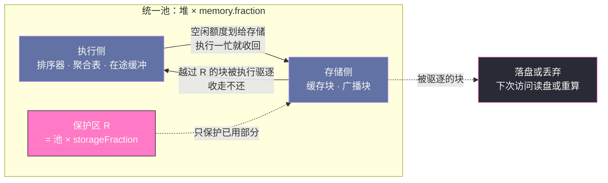
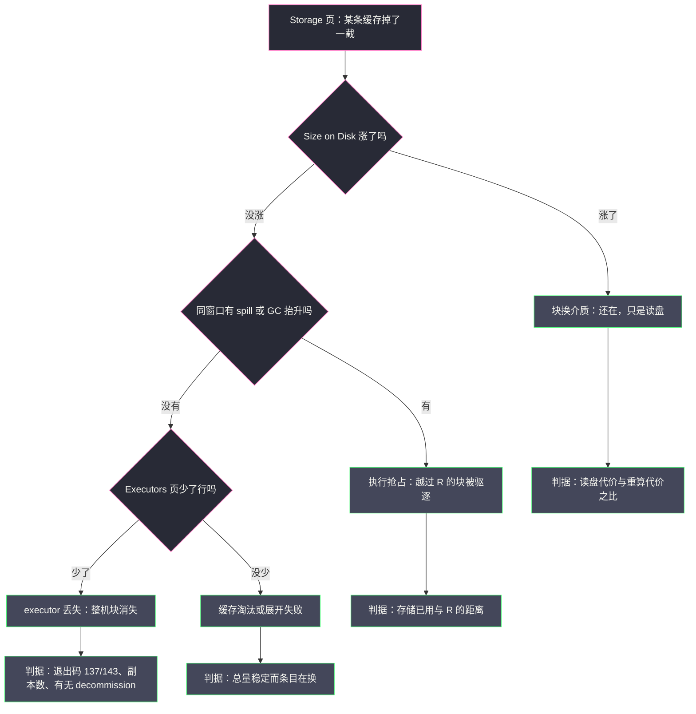
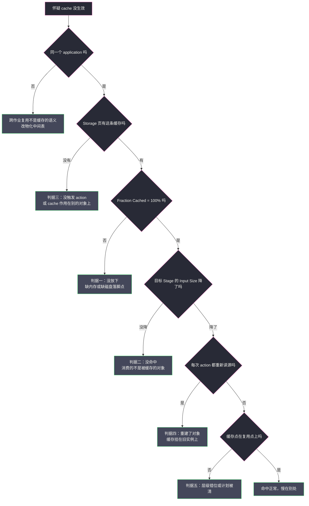
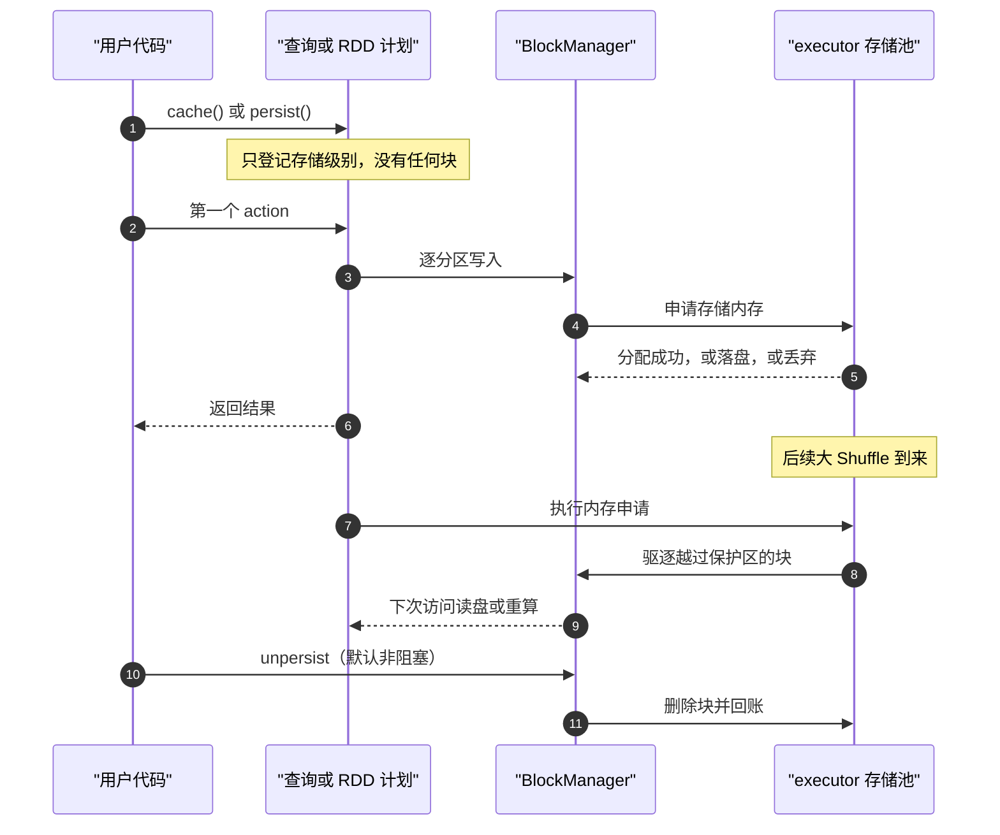

# 07 Execution 与 Storage 的动态边界

**摘要：**

`cache()` 之后作业没有变快，是 Spark 运维里最常见的一句"配置了但没效果"。它底下压着两类成因，处置方向正好相反：缓存的块真的没了，或者块还在、只是没被读。本篇把这两类问题收成一条判据主线。先按借用规则的两个方向给结论——存储借执行只有使用权、没有产权，执行借存储借到手就不还——于是执行压力一上来，越过保护区的缓存必然被驱逐。再把 cached 数据消失的三种形态拆开：执行内存抢占、`BlockManager` 的 LRU 淘汰、executor 丢失，各自给出 `Storage` 页与 `Executors` 页上的可观察特征与首查位置。核心交付是"cache 了却没生效"的五个判据：`Fraction Cached` 是否到 100%、目标 Stage 的 `Input Size` 是否真的变小、`cache` 之后有没有 action、是否每次 action 都重建了对象、`cache` 之后有没有动过血缘或计划。后半篇谈选型：六个存储级别的内存与 CPU 兑换率、带副本的容错代价、4.x 里 `df.cache()` 与 `rdd.cache()` 默认级别不同带来的量级差距，以及 `unpersist` 为什么必须写进代码规范。机制推导按章路由到内核系列，本篇只回答哪里看、怎么判、先改哪个。

---

## 第 1 章 缓存建了，作业却没快

一个作业加上 `cache()` 之后变慢，比不加更让人困惑。参数没改错，算子没写错，日志里也没有异常，唯独耗时上去了。这类现场几乎都能被两个页面解释清楚：`Storage` 页告诉你块到底在不在，`Stages` 页告诉你块到底有没有被读。

### 1.1 现场：Fraction Cached 21%

某个夜间批处理作业 `dim_enrich` 从按天分区的明细表读 1.8 TB，与两张维表 join，产出一份约 200 GB 的宽表，随后在同一个作业里循环跑六个维度聚合，每一次都要把这 200 GB 重读一遍。有人加了一行 `df.rdd.cache()`，理由是"RDD 接口更熟"。

结果与预期相反。`Storage` 页上这份缓存确实有，但 `Fraction Cached` 停在 21%，`Size in Memory` 约 84 GB，没有磁盘那一列——因为 `RDD.cache()` 的默认级别是 `MEMORY_ONLY`，放不下的分区直接丢弃，没有第二落脚点。`Stages` 页上，六个聚合 Stage 的 `Input Size` 从 1.8 TB 只降到 1.4 TB，说明命中的只有那两成；同期的 shuffle spill 与 GC 时间都涨了一截。

这一段现场里同时出现了本篇要分的两类问题。第一类是**缓存消失**：另外 79% 的分区从来没有被缓上，或者缓上之后被赶走了。第二类是**缓存没生效**：`Input Size` 没按比例往下掉，说明即使那 21% 真的躺在那儿，六个聚合里也只有少数分区的源扫描被省掉。

换成 `df.cache()` 之后，同一份结果以列式压缩形态驻留约 60 GB，`Fraction Cached` 到 100%，六个聚合的 `Input Size` 归零，作业时间回到基准值以下（以上体积均为示例推算）。同一份数据、同一个集群、同一个作业，差别只在存储级别与内存形态，这是第 7 章要算的账。

### 1.2 两类问题，一条判据主线

排查顺序不能颠倒。缓存没生效时，先假设它还在，去看命中；缓存消失时，先假设它没被用，去看容量与生命周期。顺序颠倒的代价是把"没触发 action"误判成"内存不够"，于是加内存、调比例，最后什么都没变。

判据主线只有三步。第一步看 `Storage` 页，确认这条缓存条目在不在、`Fraction Cached` 是多少、内存与磁盘各占多少，这一步回答"有没有、在哪"。第二步看 `Stages` 页与 SQL 页，确认目标 Stage 的 `Input Size` 与扫描节点类型有没有变，这一步回答"有没有被读"。第三步才回到代码，确认 `cache` 的调用位置、被缓存的对象、消费的对象是不是同一个，这一步回答"为什么没被读"。

### 1.3 一个贯穿全篇的作业

后面的量化都用这座集群与这个作业。集群 300 台节点，跑一条每天两千个作业的共享队列，每台节点的内存切成若干 4 核 16 GB 的 executor；`dim_enrich` 在夜间高峰只分到 40 个 executor，这是动态分配的实际授予量，不是集群总量。

按默认 `spark.memory.fraction = 0.6`、`spark.memory.storageFraction = 0.5` 算，单台 executor 的统一内存池约为 `(16384 - 300) × 0.6 ≈ 9,650 MB`，即 9.4 GB 上下，存储保护区约 4.7 GB。40 台合计，池子上限 376 GB，保护区合计 188 GB。这两个数字后面会反复用到：376 GB 是存储侧在理想情况下能吃到的天花板，188 GB 是执行侧不能碰的那一段。

宽表 200 GB 指的是行式原始字节。列式缓存压缩后落到 60 GB 量级，反序列化成 Java 对象则是 400 GB 到 1 TB 量级，两端相差接近一个量级，具体倍数取决于字段宽度与对象头占比（示例推算）。这组数字解释了 1.1 里那个 21%：`MEMORY_ONLY` 要把 400 GB 以上的对象塞进 376 GB 的池子，塞不满是必然结果。

### 1.4 本篇的边界

内存池的记账口径、`M` 与 `R` 的两处减法、`1/N` 的并发摊薄，内核系列已经推到源码级，本篇只引用结论，见 [[大数据/Spark/读书笔记-spark内核/04_存储与容错机制/2. Spark内存管理模型深度解析|统一内存池的两个视图与借用不对称]] 第 2 章与第 5 章。缓存块的写入、读取、驱逐与 `unpersist` 的完整路径，见 [[大数据/Spark/读书笔记-spark内核/04_存储与容错机制/3. Spark_数据缓存机制|数据缓存机制]] 第 4 章到第 7 章。四本账的切分与归因，见 [[大数据/Spark/读书笔记-spark内核/04_存储与容错机制/1. Spark内存管理机制|Executor 的四本账]] 第 1 章。本篇只回答三个问题：缓存为什么会消失，缓存为什么没生效，以及先改哪个参数。

---

## 第 2 章 借用规则的两个方向

两个方向的规则各用一句话就能说完，值得记住的是这两句话的不对称：一边是可以随时收回的使用权，一边是借走就不还的所有权。

### 2.1 存储借执行：有使用权，没有产权

存储侧可以占用执行池当前空闲的额度，但这部分额度没有产权，执行侧一旦需要，越过保护区的那部分缓存会被连块带内存一起收回去。

这句话里"当前空闲"是全部关键。存储能吃满整个池子，前提是执行侧此刻闲着；它不是容量承诺，而是一张随时可能被赎回的短期借据。所以"`storageFraction` 留在 0.5，存储就该有一半池子是稳的"这个推论在两种情况下都落空：缓存没到保护区时，没用掉的保护区执行直接拿去用；缓存超过保护区时，超出那一截执行随时收走。保护区护住的是已经放进 R 之内的块，不是 R 这块空地。

### 2.2 执行借存储：借到手就不还

执行侧扩张的办法是驱逐，驱逐之后额度划进执行池，在持有它的 Task 或 `MemoryConsumer` 主动释放之前，存储侧没有任何手段把它拿回来。

这就是不对称的落点。回收方向只有一个：执行要内存时能驱逐存储，存储要内存时只能去借执行的空闲，借不到就只能落盘或者放弃。一次执行高峰过去之后，存储侧也不会自动恢复——要等那些 Task 跑完、释放额度，缓存才有机会在下一轮 action 里重新填回去。中间那段时间里，任何读这份缓存的算子都会走重算或读盘。

| 方向 | 谁发起 | 需要对方同意吗 | 归还方式 | 现场后果 |
|---|---|---|---|---|
| 存储借执行 | 新块要写缓存 | 不需要，只借空闲 | 执行一要就收回，收回时驱逐越界的块 | 执行忙碌期缓存退回保护区水位 |
| 执行借存储 | Task 要排序或聚合 | 不需要，直接驱逐 | Task 释放时才还，不提前归还 | 执行高峰一过，缓存已经不在了 |

这张表能解释一类反复出现的争论：看到缓存被赶，第一反应是"是不是 `storageFraction` 太小"，而真正的触发条件往往是执行侧在同一时刻要了内存。比例只决定可驱逐的范围，决定"会不会驱逐"的是需求峰值。

### 2.3 单向性的三个现场

第一个现场是执行压力大时缓存被驱逐，这是第 3 章的主题，也是最常见的一类。

第二个现场是缓存看似能涨满、实际在执行忙碌期退回保护区，表现为存储用量曲线在作业中段被压回 4.7 GB 附近，而作业开始与结束时能到 8 GB 以上。

第三个现场是缓存与 Shuffle 互相踩成锯齿：执行扩张、缓存让位、重算推高执行需求、再次扩张。这条闭环见 [[大数据/Spark/读书笔记-spark内核/04_存储与容错机制/2. Spark内存管理模型深度解析|统一内存池]] 第 6 章。

这张图里没有反向箭头：从存储指向执行的那条是"驱逐"，不是"借用"。两条边的方向决定了缓存只能被赶、不能被留。

---

## 第 3 章 消失之一：执行内存抢占

### 3.1 storageFraction 是下限，不是上限

`spark.memory.storageFraction`（默认 0.5）定义的是**免于驱逐的下限**，不是存储内存的天花板。存储可以长到接近整个池子，但只有落在保护区之内的那部分块是安全的；越出去的那一截，只要有执行请求到来就会被赶走。

文档里的措辞是免于驱逐（immune to eviction），不是为存储预留（reserved for storage），两个词组的差别就是本章全部结论的来源。推导见 [[大数据/Spark/读书笔记-spark内核/04_存储与容错机制/2. Spark内存管理模型深度解析|统一内存池]] 第 2 章，这里只记结论：调大它，缓存活得更久、执行更容易溢写；调小它，执行拿得到更多额度、缓存更容易被赶；它不改变池子总量。

### 3.2 判据：存储已用量与 R 的距离

执行抢占的判据不是"缓存变少了"，而是三个条件同时成立。

第一，存储已用量曾经超过 R。R 是 4.7 GB，如果这台 executor 的存储用量从来没到过这条线，驱逐就不可能发生，没有越界的块可赶。

第二，`Size in Memory` 单调下滑而 `Size on Disk` 同步上升（`MEMORY_AND_DISK` 系列），或者两者同时下滑（`MEMORY_ONLY` 系列）。前者是块换介质，后者是块真没了。

第三，同一时间窗内，这台 executor 的 shuffle spill 与 GC 时间明显抬高。执行侧要内存才有驱逐，需求峰值一定会留下别的痕迹，三条同时成立才叫执行抢占。

要按 executor 逐台看，不能只看全局。假设全局 `Fraction Cached` 从 100% 掉到 97%（示例推算），UI 上几乎看不出来；但热点 executor 上落了十几块大分区，一赶就掉两成。全局口径会把局部问题稀释到看不见。

还有一个时间维度上的陷阱：`Storage` 页只有当前快照，没有历史曲线。看到"缓存没了"时页面已经被覆盖，看不到它曾经在。要判断"消失"这件事本身，得靠 `Executors` 页的 `Storage Memory` 列定期采样。

### 3.3 参数表

和这条规则相关的参数只有五六个，每个都带代价：

| 参数 | 默认值（4.3.0） | 决定什么 | 调大的代价 | 调小的代价 |
|---|---|---|---|---|
| `spark.memory.fraction` | `0.6` | 统一池占堆的比例，是池子的分子 | 用户对象可用堆被压缩，GC 压力与 OOM 风险上移 | 池子绝对量下降，缓存与执行同时更早落盘 |
| `spark.memory.storageFraction` | `0.5` | 保护区 R 的大小 | 执行可驱逐空间变小，Shuffle 更早 spill | 缓存更早被驱逐，`Fraction Cached` 掉得快 |
| `spark.executor.memory` | `1g` | 堆总量，池子的分母 | 单 executor GC 停顿变长，节点上可放 executor 数变少 | 池子变小，同一份缓存放不下 |
| `spark.memory.offHeap.enabled` / `size` | `false` / `0` | 堆外池，与堆内互不相通 | 需另配 `memoryOverhead`，堆外 OOM 排查更难 | 执行与存储继续在堆内互抢 |
| `spark.storage.unrollMemoryThreshold` | `1m` | 展开分区时的初始申请量 | 大分区预申请更多，存储峰值上移 | 展开过程追加申请更频繁，次数与开销上升 |

表里有两行容易被误用。`spark.executor.memory` 调大并不总是改善缓存命中：池子变大、单 Task 可用的执行内存也变大，`1/N` 摊薄出来的峰值随之抬高，Shuffle 吃得更狠，越过 R 的缓存被赶得更快——"加内存反而更容易丢缓存"这条反直觉的推论在内核系列 5.6 节有推导，现场确实存在。`unrollMemoryThreshold` 几乎从不该动。

### 3.4 一个常见误判

"没有缓存的时候调小 `storageFraction` 能不能多给执行内存"，答案是不能。没有缓存意味着没有越界的块可驱逐，执行本来就能用满整个池子，R 在这里没有约束作用。真正能给执行腾出空间的只有两个动作：把缓存本身缩小，或者把池子做大。

---

## 第 4 章 消失之二：BlockManager 的淘汰

### 4.1 触发方不同，症状也不同

第 3 章的驱逐由执行侧发起，这一章的淘汰由缓存侧发起：一个新的分区要写进存储池，池子里没有空间，`MemoryStore` 按最近最少使用（LRU）的次序挑别的块赶走，给新块腾位置。

两者用的是同一条驱逐路径，触发方不同，现场形态差别很大。执行发起的驱逐一定伴随执行压力，表现为 spill 与 GC 上升；缓存发起的淘汰更安静——没有 spill，没有 OOM，只是某一份之前还在的缓存悄悄消失，新的那份顶了上来。这种情况下看 `Storage` 页，会看到总量稳定、条目在换。所以判据是总量与条目结构，而不是总量本身：总量稳定说明池子满着，怀疑对象不该是内存不足，而是"谁在抢谁的位置"。

### 4.2 两个例外造成的偏心

`MemoryStore` 的 LRU 不是纯粹的最久未用优先，有两条例外决定了现场形态的偏心。

第一条是同一 RDD 的块不互相驱逐。新块要进来时，候选里会排除同属一个 RDD 的块。这条规则的本意是避免"一个 RDD 的块互相踩踏"造成的抖动，副作用是**大 RDD 会清场**：一个分区特别大的 RDD 要写缓存时，它赶不走自己的块，只能把别人的块赶光，然后自己也未必放得下。1.1 里那份宽表就是这个形态——它把同池里的广播变量与其他中间缓存赶掉，自己还只放进了两成。

第二条是正在被读取的块不驱逐。有 Task 持着某个块的迭代器在读，这个块在这段时间里是安全的。这条规则让"边缓存边计算"的作业有了局部稳定性，也意味着驱逐候选集比想象的小：正在被大量任务读的缓存最稳，冷下来的那份最先走。

### 4.3 判据：介质比值与卡住不动

第一个数值形态是**介质比值**。`MEMORY_AND_DISK` 系列在淘汰时先把块写盘再释放内存，所以痕迹是 `Size in Memory` 降、`Size on Disk` 升，两者之和稳定。看到这个形态，问题不是"缓存没了"，而是"缓存变慢了"——数据还在，只是下次读取要走本地磁盘并反序列化。

第二个是**卡住不动**。`Fraction Cached` 爬到某个数值就再也不涨，同时内存与磁盘两列都稳住了，这是展开（unroll）失败的特征：分区在展开过程中申请不到足够内存，按存储级别回退，带磁盘的落盘，不带磁盘的直接放弃。带磁盘的级别会表现为 `Size on Disk` 缓慢上涨、`Fraction Cached` 最终能到 100%；`MEMORY_ONLY` 则永久卡住。所以看到卡住，先看磁盘列有没有在涨，这一眼就能分出"放不下但落盘了"与"放不下且丢了"。

### 4.4 三种"块没了"的分诊

| 现场形态 | 触发者 | `Storage` 页样子 | 相邻证据 | 处置方向 |
|---|---|---|---|---|
| 执行抢占 | Task 排序或聚合要内存 | `Size in Memory` 下滑，磁盘列同步上涨 | 同窗口 spill 与 GC 抬升 | 缩小缓存、加大池子、必要时调大 R |
| 缓存淘汰 | 新分区写入要位置 | 总量稳定，条目在换，老缓存下滑 | 同池有别的缓存在增长 | 减少同时存活的条目，按用途分级 |
| 展开失败 | 单个分区在写缓存 | `Fraction Cached` 卡住不涨 | `Size on Disk` 是否在涨 | 换 `MEMORY_AND_DISK`，或减小分区 |

三行的处置互相冲突：执行抢占要减缓存，缓存淘汰要减条目，展开失败要减分区。混在一起看，就只能得出"内存不够"这个无法动作的结论。

---

## 第 5 章 消失之三：executor 丢失

### 5.1 块是整机资产

前两种消失还能在 `Storage` 页上看到介质变化，第三种什么都不会留下：executor 一没，它上面所有的缓存块同时消失，对应行直接没了。

`Fraction Cached` 会立刻反映这件事——分母是分区总数，分子是当前还能找到的块，一台 executor 消失就等于掉几个百分点。但这个数字出来得比事故晚：心跳超时默认要走 `spark.network.timeout`（默认 120 秒）这一档，任务失败上报、executor 标记移除、块账本更新各自还有延迟。也就是说，块在物理上早就没了，UI 上还要过几分钟才承认。先看 UI 再看日志，时间线会对不上，容易把"缓存消失"误判成"缓存从未建立"。

### 5.2 本地盘不是 HDFS

`MEMORY_AND_DISK` 提供的"不丢"有一个容易忽略的前提：那份备份在同一台机器的本地盘上，而本地盘的生命周期等于 executor 的生命周期。磁盘级别写的是 `spark.local.dir` 下的块文件，不是 HDFS，也没有三副本。

所以"用了 `MEMORY_AND_DISK`，缓存丢不了"只在进程内成立。容器被杀、节点宕机、磁盘卷被回收，内存那份与磁盘那份一起没。更隐蔽的是磁盘写满：块写不下去时退回"只有内存一份"，此后任何一次驱逐都让它彻底消失。判据上有一处区分：`Size on Disk` 归零而 executor 还在，去看磁盘容量；executor 整行消失，去看退出码。

### 5.3 副本的语义

存储级别里的 `_2` 后缀加的是跨 executor 的第二份副本，这是唯一能在单机故障下活下来的形态。它复制的是什么，要看清楚：

| 级别 | 内存里放什么 | 第二份在哪 | 单台 executor 消失后 | 代价 |
|---|---|---|---|---|
| `MEMORY_ONLY` | 反序列化对象 | 无 | 全部消失，逐个分区重算 | 内存占用最大 |
| `MEMORY_ONLY_SER` | 序列化字节 | 无 | 全部消失，重算并再付一次反序列化 | 内存小、CPU 高 |
| `MEMORY_AND_DISK` | 内存加本地盘 | 同机本地盘 | 内存与盘一起消失 | 磁盘 I/O 与容量 |
| `DISK_ONLY` | 不使用存储池 | 同机本地盘 | 消失 | 读取最慢 |
| `MEMORY_AND_DISK_2` | 内存加本地盘 | 另一台 executor 的内存 | 剩一份，可继续读 | 内存占用翻倍 |
| `DISK_ONLY_2` | 不使用存储池 | 另一台 executor 的本地盘 | 剩一份 | 磁盘容量翻倍 |

这张表用排除法：先问"这台机器消失时能不能容忍重算"，能容忍就不必上副本；不能容忍再问"代价是内存翻倍还是磁盘翻倍"，内存贵就选磁盘副本。副本不改变本地盘的性质，它只是把第二份放到了另一台机器上。

### 5.4 两个能搬走的例外

缓存块默认跟着 executor 生灭，只有两条路径例外，边界都很窄。

第一条是优雅下线时的块迁移。decommission 流程里有一档专门搬 RDD 块（`spark.storage.decommission.rddBlocks.enabled`，3.1 起默认开启），前提是集群确实走了 decommission，且目标 executor 还有空位。

第二条是动态分配的 shuffle tracking（`spark.dynamicAllocation.shuffleTracking.enabled`，默认开启）。它保的是 shuffle 输出，让正在被需要的 Shuffle 文件不随 executor 回收而消失；**它不保缓存块**。这一条经常被误解成"开了动态分配也不会丢缓存"，实际两者管的是不同资产，缓存块在动态分配回收面前没有任何保护。

### 5.5 首查位置

executor 丢失的判据全在 Spark 之外和 Spark 的边缘，四条按成本从低到高：`Executors` 页看移除记录与时间点，与任务失败时间对齐；Driver 日志搜 `ExecutorLostFailure` 与移除原因；资源管理器看容器退出码，137 是 SIGKILL（超内存被杀最常见），143 是 SIGTERM（多为回收或主动 kill），其余非零码通常指向进程崩溃；最后看节点系统日志与 OOM killer 记录。

处置分两半。被资源管理器因超内存杀掉时，开副本也救不了同时被打掉的另一台，能做的只有把内存修好：降并发、查堆外、看用户对象。被动态分配回收时，问题在缓存的寿命不该跨过 executor 的寿命：让复用落在单个 executor 之内，或者接受重算。

---

## 第 6 章 五个判据：cache 了却没生效

这一章是全文的交付。`cache` 无效有五种典型形态，每种都能在几秒到几分钟内被证伪或证实，不需要打开堆转储。

先做一次前置确认：缓存方与消费方必须在同一个 application 里。`BlockManager` 是应用内的组件，缓存块不对其他应用可见。所以"作业 A 缓存了宽表，六个下游作业去读"这种设计从根上不成立——缓存的语义是应用内复用，跨作业复用只能靠物化中间表。很多"cache 了没用"的第一现场，问题出在把跨作业复用当成了缓存能解决的事。

### 6.1 判据一：Fraction Cached 是否到 100%

看 `Storage` 页每一行的 `Fraction Cached`。它按分区计数算，不是按字节占比——未缓存的分区把比例拉下来，至于每个分区缓存了多少字节，它不告诉你。

读法有三层。低于 100% 说明有分区一份都没有，进入第 3、4、5 章的分诊；等于 100% 也不等于全在内存，要看 `Size in Memory` 与 `Size on Disk` 的比例；`Size in Memory` 稳定而比例缓慢下跌，说明有 executor 在退场。

典型误判是把 100% 当成"命中快"。`MEMORY_AND_DISK` 在内存不够时会全量落盘，`Fraction Cached` 依然是 100%，而每个分区的读取都变成一次本地磁盘随机读加反序列化，对小的点查型作业，这比重新算一遍还慢。

### 6.2 判据二：Stage 的 Input Size 是否真的变小

看 `Stages` 页目标 Stage 的 `Input Size`，以及 SQL 页执行计划里扫描节点的类型。

命中缓存时，数据来自缓存块而不是数据源扫描，所以原来被标为 1.8 TB 的那个 Stage，`Input Size` 会归零或降到很小，执行计划里出现 `InMemoryTableScan` 之类的内存扫描节点，`InMemoryRelation` 那一行还会给出缓存数据的字节数。没命中时，`Input Size` 与加缓存之前一模一样。

这条判据的价值在于它是**端到端**的：它不问你缓存建没建，只问这一次执行有没有省掉源扫描。1.1 里 `Input Size` 从 1.8 TB 只降到 1.4 TB，一眼就能算出命中率只有两成左右，与 `Fraction Cached` 的 21% 相互印证。

误判有两个方向。一是把 `Input Size` 归零当成"作业变快"，其实那只是换了数据来源；二是拿缓存之后的数字与缓存之前的比，而不是与同一 Stage 的基线比——分区数或过滤条件变过之后，两个数字本来就不可比。

### 6.3 判据三：cache 之后有没有 action

`cache()` 与 `persist()` 只做一件事：把 `StorageLevel` 记在这个对象上。块是在第一个 action 触发计算时才写进去的。没有 action，`Storage` 页上根本不会有这条缓存。

这条判据的验证成本最低，也最容易被跳过：代码里 `cache()` 写完之后，紧接着是一个 `if` 分支、一次提前返回、一个被注释掉的 `count()`，缓存就永远停在"已登记、未物化"的状态。

| 观察点 | 缓存已物化 | 只登记未物化 |
|---|---|---|
| `Storage` 页 | 有条目，`Fraction Cached` 有值 | 什么都没有 |
| SQL 页 | 出现 `InMemoryRelation` 节点 | 不出现 |
| 耗时 | 第一个 action 明显变长 | 与未加缓存时一致 |

处置是在 `cache()` 之后立刻跟一个能触发全量计算的轻量 action，`count()` 是最常用的一个。代价要认清：`count()` 会把整条血缘跑一遍，如果血缘很长，这一步的时间不亚于一次正式计算，它买到的只是"缓存确定存在"。

### 6.4 判据四：是不是每次 action 都重建了对象

缓存挂在具体对象上，不挂在"这段逻辑"上。RDD 侧最直白：`rdd.cache()` 缓的是那个 RDD 实例，另一次 `sc.textFile` 得到的是新实例，血缘相同、缓存无关。

DataFrame 与 SQL 侧多了一层匹配：`cache()` 把逻辑计划登记进缓存管理器，后续执行按规范化后的计划结构去找对应条目。这让"同一个 DataFrame 上的不同派生查询"能共享缓存，`df.filter(A).count()` 与 `df.filter(B).count()` 都吃同一份；但它挡不住"每次 action 之前重新读一次源"这种写法——重新 `spark.read` 出来的数据源关系是新实例，计划结构对不上，缓存管理器匹配不到，只能重新扫描。

| 写法 | 是否命中 | 原因 |
|---|---|---|
| `val df = read(...); df.cache(); df.count(); df.groupBy(...).count()` | 命中 | 同一个对象、同一份计划 |
| `def get() = read(...); get().cache(); get().count()` | 不命中 | 两次 `get()` 是两个实例，缓存登记在前一个上 |
| `catalog.cacheTable("t")` 之后 `sql("select * from t")` | 命中 | 表级缓存按名称登记，与对象无关 |

第三行给了一条稳定的解法：能按名称登记，就不要按对象登记。表级缓存（`spark.catalog.cacheTable`、SQL 的 `CACHE TABLE`）在同一个应用内可见，不依赖调用方手里的那个变量，在多段代码共享一个 `SparkSession` 的长驻服务里尤其重要。

### 6.5 判据五：cache 之后有没有动过血缘或计划

前四条都成立、`Fraction Cached` 100%、`Input Size` 也降了，但作业还是慢，那要看缓存落在哪一层。

最常见的形态是**缓存层级错位**：把源表缓存了，而每次 action 真正昂贵的部分是那两次 join 与聚合。命中确实发生了，源扫描也确实省了，但 join 每次都重跑。判据很直接：`Storage` 页有缓存、`Input Size` 归零，而每一次 action 的 shuffle read 与 shuffle write 都按原量级重来。处置是把缓存点上移，缓存被复用的那一步的结果，而不是它的输入。

第二种形态是**换了实体**：缓存之后又把结果写回表再读回来，后续计算用的是新数据源，与缓存毫无关系。这种写法本身未必错——物化中间表在跨作业复用时是正确做法——但它不叫缓存生效，别把两者的收益记在同一笔账上。

第三种形态是**计划被清掉**：共享 `SparkSession` 的长驻服务里，另一段代码调了 `spark.catalog.clearCache()`，把不属于自己的缓存一起清了。特征是同一次调用在单测里有效、在服务里无效，判据是复现时间点与另一次调用对齐。

### 6.6 五判据分诊

| 判据 | 看哪里 | 命中长什么样 | 不命中长什么样 | 处置 |
|---|---|---|---|---|
| 一：`Fraction Cached` | `Storage` 页每行 | 100%，且内存占比合理 | 低于 100%，或磁盘列远大于内存列 | 换存储级别、加池子、减缓存量 |
| 二：`Input Size` | `Stages` 页、SQL 页计划 | 源扫描归零，出现内存扫描节点 | 与加缓存前一致 | 查消费方是否同一对象 |
| 三：有没有 action | `Storage` 页有无条目 | 有条目 | 一条都没有 | `cache()` 后补 `count()` |
| 四：有没有重建对象 | 代码里 `cache` 与读取的位置 | 同一个变量 | 每次 action 前重新读源 | 提升为单例，或改表级缓存 |
| 五：层级与计划 | `Storage` 页条目数、shuffle 量 | 缓存点在复用点上 | 缓存点在输入侧，或计划被 `clearCache` 清掉 | 上移缓存点、保护缓存不被误清 |

---

## 第 7 章 persist 级别怎么选

### 7.1 级别回答的是"内存之外还有没有落脚点"

六个存储级别由四个布尔位与一个整数组合出来：是否用内存、是否用磁盘、是否序列化、是否堆外、副本数。做选型不需要记位，只需要问三个问题：内存里以什么形态驻留、内存之外有没有第二落脚点、这个第二落脚点值不值那个代价。

| 级别 | 内存里放什么 | 内存之外的落脚点 | 换来什么 | 代价 |
|---|---|---|---|---|
| `MEMORY_ONLY` | 反序列化对象 | 无 | 读取最快，零反序列化 | 占用最大，放不下就丢，下次重算 |
| `MEMORY_ONLY_SER` | 序列化字节 | 无 | 占用约为前者的三分之一到二分之一（示例推算） | 每次访问付一次反序列化 |
| `MEMORY_AND_DISK` | 反序列化对象 | 同机本地盘 | 放不下也不丢，退化为读盘 | 磁盘 I/O、`spark.local.dir` 容量 |
| `MEMORY_AND_DISK_SER` | 序列化字节 | 同机本地盘 | 省内存且不丢 | 读盘与反序列化双重成本 |
| `DISK_ONLY` | 不使用存储池 | 同机本地盘 | 几乎不占内存，适合超大数据集 | 每次访问都读盘，最慢 |
| 带 `_2` 的任意级别 | 同基础级别 | 另一台 executor | 单机故障下不丢 | 内存或磁盘占用翻倍 |

`_SER` 的兑换率值得单独说一句：序列化后体积通常是反序列化的三分之一到二分之一（示例推算），省下来的内存直接变成能多放下的分区数；代价是每次访问都要反序列化，而反序列化是纯 CPU 操作，与记录数成正比。对"读得少、放得大"的缓存（例如被反复扫描的维表），`_SER` 通常划算；对"读得极频繁、每条记录都要遍历"的缓存，反序列化的累加成本会超过省下的内存收益。

### 7.2 带副本是容错，不是性能

`_2` 的收益只在一种情况下兑现：一台 executor 消失时，另一台上还有一份。它买的是可用性，不是速度——副本不参与读分摊，读仍然走本地的块。

代价是双份存储，而对 1.3 那个池子来说，双份往往意味着从放得下变成放不下。所以副本的适用范围很窄：血缘极长或数据不可重算（从消息队列消费、从已删除的源表读）、作业时长跨越节点故障常态、池子还有余量。三个条件缺一个，就该回到"接受重算"这条路上。

### 7.3 4.x 的两个默认级别不同

这是最容易吃亏的一处差异，因为它不写在任何一行业务代码里。

`RDD.cache()` 的默认级别是 `MEMORY_ONLY`；`Dataset.cache()` 的默认级别是 `MEMORY_AND_DISK`，4.x 起这个默认值可以用 `spark.sql.defaultCacheStorageLevel` 改（该配置由 SPARK-45451 引入）。两个默认值背后的理由是列式缓存的重算成本远高于行式：数据以列批（CachedBatch）形式驻留，丢了要重算整条血缘并重建列批，代价比 RDD 丢一个分区高得多。

| 维度 | `df.cache()` | `rdd.cache()` |
|---|---|---|
| 默认级别 | `MEMORY_AND_DISK` | `MEMORY_ONLY` |
| 内存形态 | 序列化列批，默认压缩 | 反序列化 Java 对象 |
| 放不下时 | 落本地盘，不丢 | 分区直接丢弃，下次重算 |
| 单份占用（200 GB 原始行式，示例推算） | 约 40 GB 到 100 GB | 约 400 GB 到 1000 GB |
| 命中读取代价 | 反序列化并做列裁剪 | 直接给对象 |
| 受影响参数 | `spark.sql.inMemoryColumnarStorage.compressed`、`batchSize` | 无同类开关 |

`单份占用` 那一行的量级差是 1.1 现场的根：同一份 200 GB 结果，`rdd.cache()` 要把它变成 400 GB 到 1 TB 的对象，`df.cache()` 只要 40 GB 到 100 GB。两个 API 都叫 `cache`，做的是两件量级不同的事。

### 7.4 选型的三条判据

血缘深度决定值不值得：只有一两步窄依赖时重算几乎免费，`MEMORY_ONLY` 就够；含有 join 与聚合时重算要跑整个 Shuffle，才值得上带磁盘的级别。复用次数决定划不划算：一次不必缓存，五次以上基本都值得，前提是每次复用真的走到同一个对象上（回到 6.4）。数据能不能重算决定敢不敢只留一份：源表被覆盖、消息队列已消费、上游不可重放，就只能靠磁盘或副本兜住。

---

## 第 8 章 unpersist 与缓存预算

### 8.1 不释放就一直占着

缓存块不会因为"这个 DataFrame 用完了"而自己消失。它会一直占着存储池，直到三件事之一发生：被执行内存驱逐、被新块淘汰、随 executor 消失。前两件都是被动的，第三件最贵。

Dataset 侧的情况更硬。缓存管理器用一张强引用列表持有所有已缓存条目，只要 `SparkSession` 还活着、缓存没被显式清掉，这些条目就一直占着内存或磁盘。长驻服务里"忘了 `unpersist`"是真实会积累的问题。

### 8.2 两条兜底路径，边界不同

RDD 侧有兜底。`persist` 时注册的清理任务持的是弱引用，用户代码丢掉最后一个强引用之后，一次 GC 会把弱引用放进队列，清道夫线程接到任务去删块。这条路径还配了周期性 GC（`spark.cleaner.periodicGC.interval`，默认 30 分钟），所以"忘了 `unpersist` 过一阵自己好了"是常见现象，但它的时机由 GC 决定，不由你决定。

Dataset 侧没有这条兜底，强引用挡住了弱引用回收。机制细节见 [[大数据/Spark/读书笔记-spark内核/04_存储与容错机制/3. Spark_数据缓存机制|数据缓存机制]] 第 7 章，运维上只需要记一句：RDD 缓存漏了会自己好，**Dataset 缓存漏了不会**。

### 8.3 判据与时机

判据落在两处。`Storage` 页的条目数只增不减，且每个条目的 `Size in Memory` 都稳定，说明没有驱逐压力，只是没人清；`Executors` 页的 `Storage Memory` 列呈台阶状上升、从不回落，一段代码上线后整体台阶抬高，那就是新增的缓存没有配对应的释放。

`unpersist(blocking = false)` 是默认形态，调用立即返回，删除在后台做完；需要立刻腾出内存给下一步时用 `blocking = true`，它等所有 executor 应答再返回。两者都不保证"以后不再占内存"——只要还有 action 在读同一个对象，它会重新算、重新写。

三个时机值得写进代码规范：跨作业复用的最后一轮结束之后；数据已被下游结果完全替代之后；长驻服务里按预算清理，把缓存总量当成一个有上限的资源来管。反过来，在第一个 action 之前 `unpersist`，或在循环体内反复 `persist` 与 `unpersist`，都等于没缓存。缓存的一生可以画成一条时间线：

---

## 第 9 章 反例与落点

### 9.1 四个反例

**没有 action**：最常见，也最容易自查。`cache()` 只是一个标记，没有触发计算就没有块，判据是 `Storage` 页一片空白，处置是补一个 `count()`。

**对象重建**：缓存登记在前一个实例上，后一个匹配不到。这类代码往往长得很正常——一个 `load()` 函数，每次返回新对象，缓存加在函数返回值上。判据是 `Storage` 页有条目，但 `Input Size` 一次都没降。

**缓存过大**：200 GB 的结果用 `MEMORY_ONLY` 缓存，四分之三的分区没进内存，反而把同池的广播变量与其他缓存挤掉，作业比不缓存更慢。判据是 `Fraction Cached` 长期低位、spill 上升；处置不是加内存，而是换级别或改缓存点。

**不 unpersist**：长驻服务里缓存条目越积越多，`Executors` 页的存储占用台阶式抬升，直到某次执行高峰把缓存全部赶走，再之后又慢慢长回来。整个过程没有任何异常，只有越来越慢。

### 9.2 落点

这条边界值得单独写一篇，是因为它把两个方向相反的诉求放在了同一块内存上：执行侧要随要随有，存储侧要放进去就别动。动态边界没有消除这个矛盾，只是把解决方式定成了单向——执行优先，缓存让步。

由此得到的运维姿态只有一条：缓存的收益要按**命中率乘上单次重算成本**来算，而不是按"我 cache 了"来算。 命中率由 `Fraction Cached` 与 `Input Size` 两个数字共同给出，单次重算成本由血缘深度决定。两个乘数里任何一个接近零，这笔投入都是负收益，因为它同时还占掉了执行侧的空间。

同理，调参在缓存问题上的作用面比想象中窄。`storageFraction` 决定缓存被赶的范围，`memory.fraction` 决定池子大小，存储级别决定放不下时的退路；三者能改变的是"同样一份缓存在同样压力下能活多久"，改变不了"它到底有没有被读到"。后者是代码与计划层面的问题，参数表上没有对应旋钮。

---

## 参考资料

1. Apache Spark 4.3.0 文档：Configuration，`spark.memory.*`、`spark.storage.unrollMemoryThreshold`、`spark.cleaner.*` 的默认值与语义。https://spark.apache.org/docs/4.3.0/configuration.html
2. Apache Spark 4.3.0 文档：RDD Programming Guide，存储级别的选择与 `MEMORY_ONLY` 的丢弃语义。https://spark.apache.org/docs/4.3.0/rdd-programming-guide.html
3. Apache Spark 4.3.0 文档：SQL Performance Tuning，内存列式缓存的压缩与批大小。https://spark.apache.org/docs/4.3.0/sql-performance-tuning.html
4. Apache Spark 4.3.0 文档：CACHE TABLE，`storageLevel` 可选值与默认 `MEMORY_AND_DISK`。https://spark.apache.org/docs/4.3.0/sql-ref-syntax-aux-cache-cache-table.html
5. Apache Spark 4.3.0 文档：Job Scheduling，动态分配的 shuffle tracking 与 decommission。https://spark.apache.org/docs/4.3.0/job-scheduling.html
6. Apache Spark 源码（4.3.0）：`UnifiedMemoryManager.scala`，两条借用路径与驱逐的触发条件。https://github.com/apache/spark/blob/v4.3.0/core/src/main/scala/org/apache/spark/memory/UnifiedMemoryManager.scala
7. Apache Spark 源码（4.3.0）：`MemoryStore.scala`，LRU 顺序、同 RDD 不驱逐与展开失败的回退。https://github.com/apache/spark/blob/v4.3.0/core/src/main/scala/org/apache/spark/storage/memory/MemoryStore.scala
8. Apache Spark 源码（4.3.0）：`CacheManager.scala`，按规范化计划匹配缓存与强引用列表。https://github.com/apache/spark/blob/v4.3.0/sql/core/src/main/scala/org/apache/spark/sql/execution/CacheManager.scala
9. Apache Spark JIRA：SPARK-45451，把 Dataset 的默认缓存级别做成可配置项 `spark.sql.defaultCacheStorageLevel`，4.0.0 起生效。https://issues.apache.org/jira/browse/SPARK-45451
10. Apache Spark JIRA：SPARK-3824，为什么 Spark SQL 的默认缓存级别是 `MEMORY_AND_DISK` 而不是 `MEMORY_ONLY`。https://issues.apache.org/jira/browse/SPARK-3824
11. 本站内核系列：[[大数据/Spark/读书笔记-spark内核/04_存储与容错机制/1. Spark内存管理机制|Executor 的四本账与归因]]、[[大数据/Spark/读书笔记-spark内核/04_存储与容错机制/2. Spark内存管理模型深度解析|统一内存池的两个视图与借用不对称]]、[[大数据/Spark/读书笔记-spark内核/04_存储与容错机制/3. Spark_数据缓存机制|数据缓存机制]]。

---

> [!note] 思考题
> 1. `Fraction Cached` 停在 62%，而 `Size in Memory` 与 `Size on Disk` 之和刚好等于这份缓存应有的总大小。更可能是哪一章描述的现象，为什么？
> 2. 同一个 DataFrame 上，`df.count()` 与 `df.groupBy(k).count()` 都能命中缓存，而把 `df` 的构造逻辑封进一个函数后每次调用都命中不了。这两件事的差别在哪一层？
> 3. 把 `spark.storage.decommission.rddBlocks.enabled` 打开之后，是否就能在动态分配回收 executor 时保住缓存？如果不能，还缺什么条件？
> 4. 一份 200 GB 的结果，用 `rdd.cache()` 只能放进两成，用 `df.cache()` 却放得下。如果业务代码必须走 RDD 接口，还有哪些可行的绕法？
> 5. 在共享 `SparkSession` 的长驻服务里，缓存的生命周期应该由谁负责？如果两段代码都需要缓存，`clearCache()` 该不该出现在业务代码里？