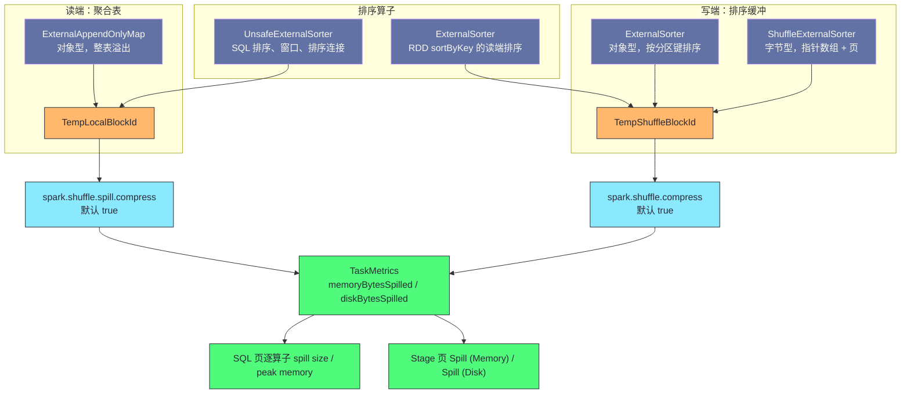
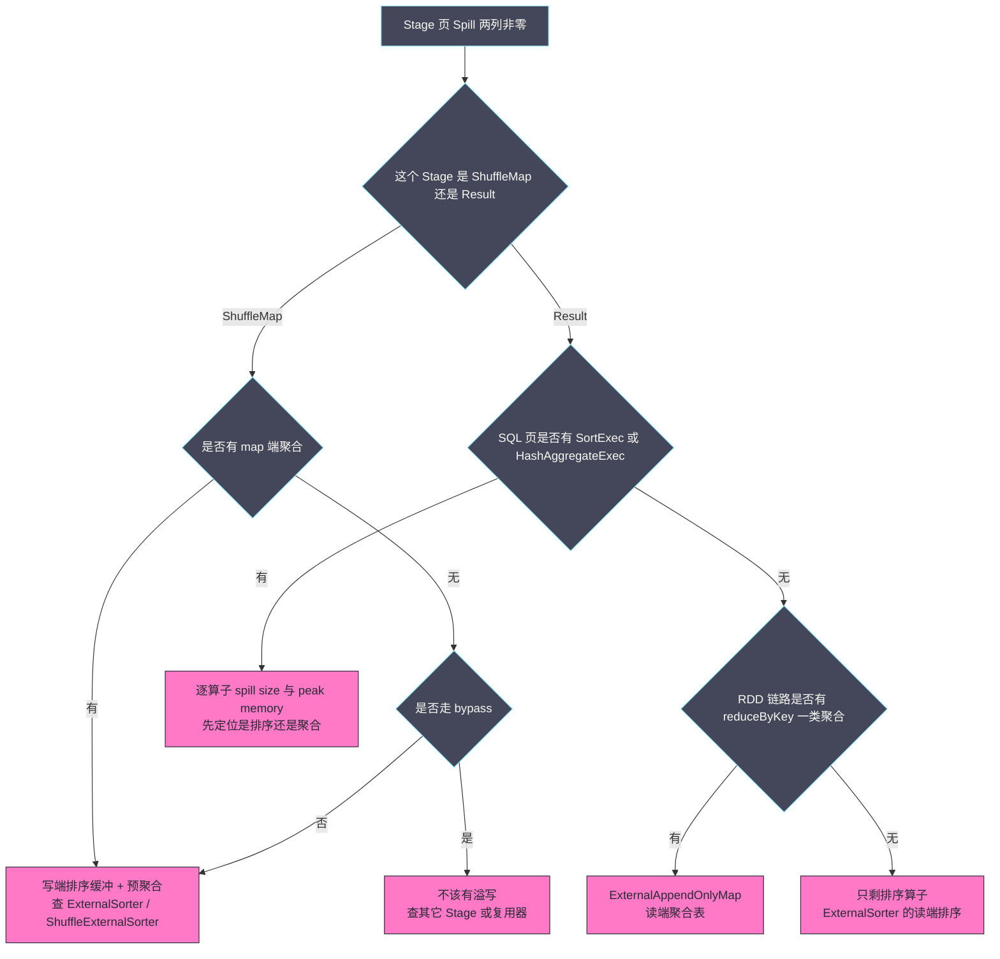
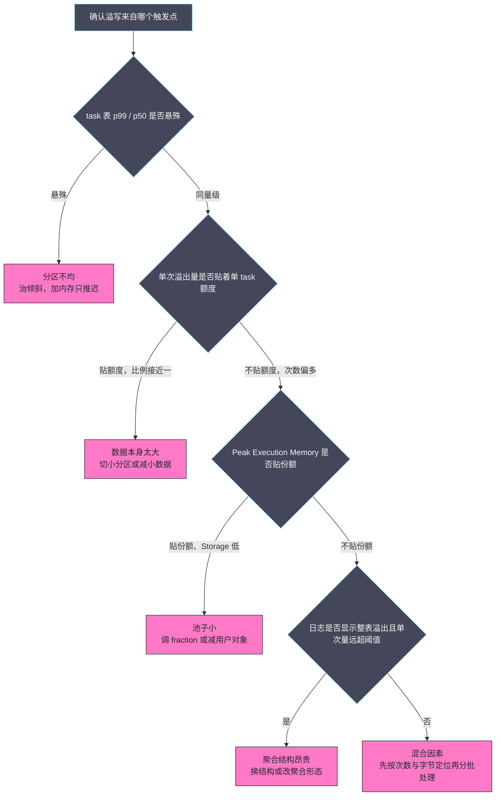
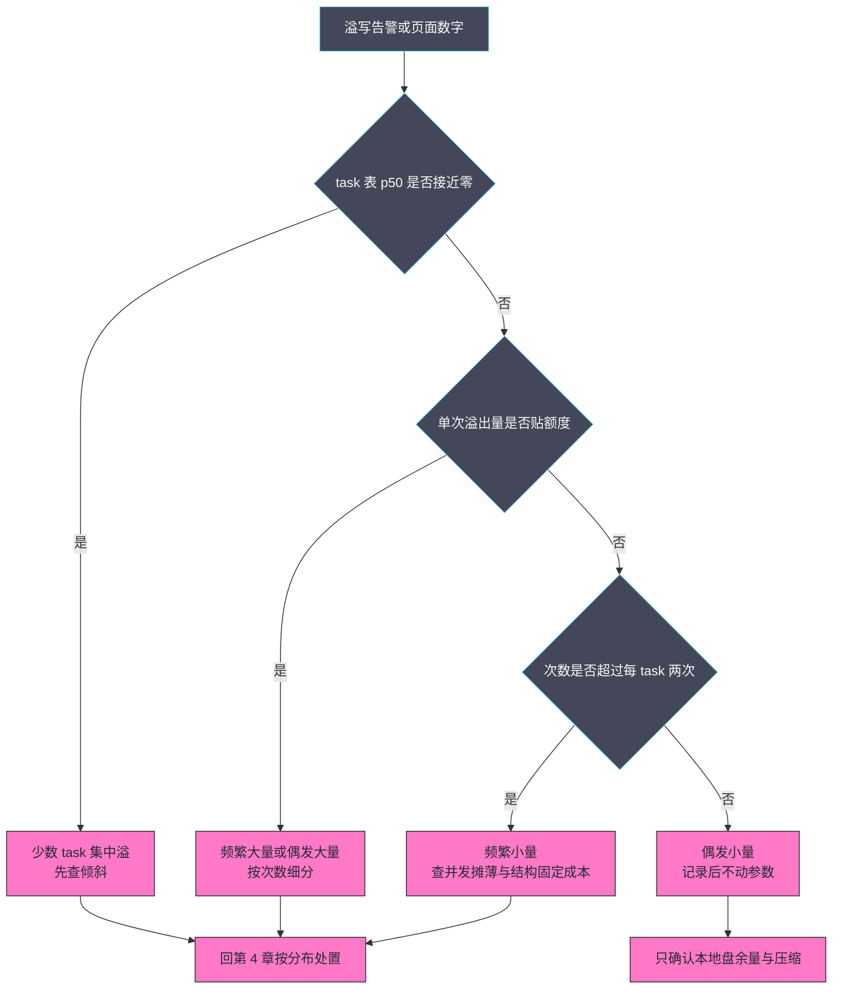
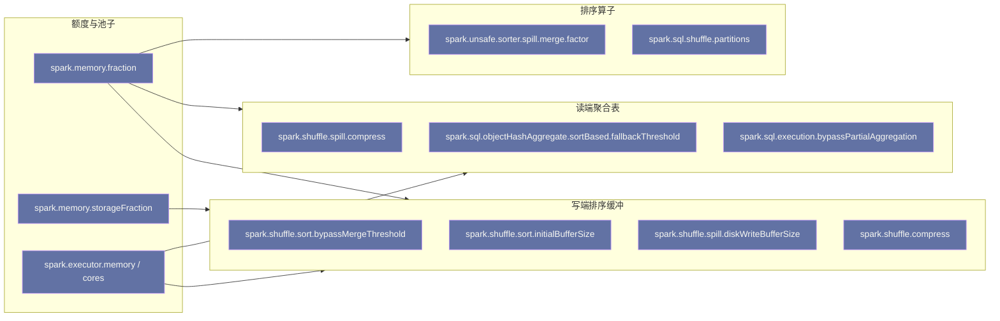

# 08 Spill 机制：从内存到磁盘的安全阀

**摘要：**

溢写（Spill）是执行内存申请不到时的结算方式，也是现场最容易被当成"内存不够"处理的一类症状。本篇不重做机制推导，只回答运维侧的三件事：数字从哪来、属于哪一类病、动它要付什么代价。先把溢写拆成三个触发点——shuffle 写端的排序缓冲、读端的聚合表、排序算子的排序器，说明它们写进的是同一对 task 级累加器，因此 Stage 页只有两个汇总数字，能区分算子的是 SQL 页的逐算子指标与日志里的类名。再拆开"溢写多不等于内存不够"的四种情形：数据本身超量、分区不均、统一池被用户内存挤占、聚合结构昂贵，并给出次数与字节组成的四象限判据。之后算清连锁代价：整表排序、k 路归并、本地 IO 的放大倍数，结论是次数比字节更贵。配置一节澄清三个最容易按旧资料配错的地方：`spark.shuffle.spill` 已是空开关、两个压缩参数管的是不同的溢出文件、两个缓冲参数的单位与作用域都不像名字暗示的那样。全文口径为 Spark 4.3.0，凡数字均为示例推算或量级判断。

---

## 第 1 章 一次加内存加错了方向

三百个节点、每天两千个作业的集群里，内存问题几乎每周换个面孔。上周是一个日更的明细汇总：两百个 reduce 分区，8 GiB 堆、4 核，Stage 页 `Spill (Disk)` 累计 4.2 TB，任务耗时 p99 是 p50 的三倍还多。值班同学的动作很标准——堆加到 16 GiB，overhead 一并抬高，重跑。

结果溢写一点没降，作业还慢了约一成（示例现场，数字只说明方向）。原因不在参数，在数据分布：按业务键重分区之后，三个分区各占四成、三成、两成，剩下一百多个分区合起来才一成。三个大分区在 1.15 GiB 左右的单 task 额度里反复溢出，其余几乎不溢。堆翻倍，额度跟着翻倍，那三个分区也换到更大的 executor 上继续溢——单个分区远超额度时，加内存只是把爆点往后推，还多付了 GC 停顿的账。

这就是本篇要处理的误治：看到溢写，就认为内存不够。

溢写只是记账结果：执行侧消费者申请不到额度时，把攒下的数据序列化到本地盘，腾出内存继续收，任务收尾再归并回来。它记的是"有多少字节离开内存"，不记"为什么离开"，而"为什么"至少有四个原因——数据本身超过单 task 能装下的量、分布让少数 task 承担了大部分量、统一池份额被并发与用户内存挤小、聚合结构比另一条实现费内存。四者的处置互相冲突，加内存只对其中一部分有效。

抓手是三个而不是一个总数：触发点回答"哪张表在溢"，分布回答"哪几个 task 在溢"，结构回答"这张表为什么这么大"。混在一起看，只能得到"溢写很多"这个无法证伪的结论。

机制层面的推导不在这里重复：溢出判据的三条线、每三十二条记录查一次、申请"两倍当前用量"、`SizeTracker` 的采样外推、整表溢出与最小堆归并，内核系列已经讲透，见 [[大数据/Spark/读书笔记-spark内核/05_Shuffle核心机制/6. Spark_Shuffle聚合与排序结构|Shuffle 聚合与排序结构]] 第 5 至第 7 章与 [[大数据/Spark/读书笔记-spark内核/06_性能调优实战/7. Spark_Shuffle内存调优|Shuffle 内存调优]] 第 3 至第 5 章。本篇接手它们留下的运维问题：读哪个数字、判到哪一类、动哪个参数、付什么代价。

---

## 第 2 章 三个触发点

溢写不在一个地方发生。4.3.0 的作业里，能让数据从内存落到本地盘的缓冲有三处，代码路径、日志文本、压缩口径都不一样，而它们在页面上共享同一对累加器，这正是误判的起点。

### 2.1 写端的排序缓冲

shuffle 写端在 4.x 有两条实现：`SortShuffleWriter` 用对象型的 `ExternalSorter`，`UnsafeShuffleWriter` 用字节型的 `ShuffleExternalSorter`。两条路径形状相同——记录先攒在内存结构里，攒满或额度不给，就排一次序写一个文件，收尾再把这些文件按分区切片归并成一份 data 文件加一份索引文件。攒的这一段就是第一个触发点。

两者差别不在判据，在内存里放的东西。`ExternalSorter` 存键值对象，溢出时整份结构按 `(partitionId, key)` 排好序再序列化；`ShuffleExternalSorter` 在插入时就把记录序列化进页，堆上只剩一个 `LongArray` 指针数组，溢出条件是指针数组用满或两条硬线被触发，落盘只按指针顺序搬运字节，没有额外序列化。

写端还有一条不经过排序器的路径。没有 map 端聚合、且 reduce 分区数不超过 `spark.shuffle.sort.bypassMergeThreshold`（默认 200）时，写端走 `BypassMergeSortShuffleWriter`，每个分区一个文件直接写，没有排序缓冲，也不产生溢写；看到"map 端溢写为零"，先确认是不是这条路径。

判据落在两处：Stage 页里 Shuffle Write 有值的那一段 Stage，以及日志里 `ExternalSorter` 或 `ShuffleExternalSorter` 打出的 `spilling ... to disk (n times so far)`。

### 2.2 读端的聚合表

读端会不会有聚合表，取决于上游有没有做 map 端合并。`reduceByKey`、`aggregateByKey`、`combineByKey` 在写端已折叠过一次，读端的 `Aggregator.combineValuesByKey` 会建一张 `ExternalAppendOnlyMap`（对象型，按 key 折叠，溢出单位是整张表）；`groupByKey` 没有 map 端合并，读端不建，但算子要求有序时（`sortByKey`、`repartitionAndSortWithinPartitions`）会另建 `ExternalSorter` 排序，溢出发生在排序器上。

这条判据在页面上不容易直接看到：读端 Stage 的 Shuffle Read 有值只说明拉过数据，说明不了有没有聚合。能确认的是日志类名——`ExternalAppendOnlyMap` 打 `spilling in-memory map`，与写端 `ExternalSorter` 同族，只能靠类名区分；另一条线索是 SQL 计划里 `HashAggregateExec` 的 Final 模式，溢出的是 Tungsten 哈希表，日志类名是 `UnsafeExternalSorter`。

### 2.3 排序算子的排序器

第三处来自排序本身，与 shuffle 无关。SQL 的 `sort`（全局排序）与 `sortWithinPartitions`（分区内排序）都落到 `SortExec`，底层是 `UnsafeExternalSorter`；窗口、排序合并连接与 `SortAggregateExec` 只要求输入有序，排序由计划里插在它们前面的 `SortExec` 完成，溢写指标因此挂在 `SortExec` 节点上。RDD API 的 `sortByKey` 不走 SQL 排序器，读端排序由 `ExternalSorter` 承担，日志类名不同。

这一处最容易被归错。一个只做排序、既没有 Shuffle Read 也没有 Shuffle Write 的 Stage，在 Stage 页上 `Spill (Memory)` 与 `Spill (Disk)` 两列可以有数——它们统计的是 task 级溢出字节，不区分算子。人一看列名里有 Shuffle，就跑去查 shuffle 参数，方向从一开始就偏了。

### 2.4 三个触发点，一对累加器

三个触发点写进的是同一对 task 级累加器 `memoryBytesSpilled` 与 `diskBytesSpilled`，指标名相同而来源不同，**按算子区分**只能靠 SQL 页的逐算子指标与日志类名。

落盘口径也不一样，因为压缩按块类型分派。写端两个排序器都用 `createTempShuffleBlock()`，拿到 `TempShuffleBlockId`，压缩跟着 `spark.shuffle.compress` 走；读端聚合表与 SQL 侧排序器溢出用 `createTempLocalBlock()`，拿到 `TempLocalBlockId`，跟着 `spark.shuffle.spill.compress` 走，第 7 章展开。

下图把三个触发点、两条压缩口径与一个上报终点画在一起。

把三个触发点并排，差异一目了然。

| 触发点 | 代表结构 | 日志关键字 | 溢出文件类型 | 压缩归谁管 | 逐算子指标 |
|---|---|---|---|---|---|
| 写端排序缓冲 | `ExternalSorter`、`ShuffleExternalSorter` | `spilling in-memory map` 或 `spilling sort data` | `TempShuffleBlockId` | `spark.shuffle.compress` | 无，只有 Stage 页汇总 |
| 读端聚合表 | `ExternalAppendOnlyMap` | `spilling in-memory map of ... (elements: n)` | `TempLocalBlockId` | `spark.shuffle.spill.compress` | SQL 侧为 `HashAggregateExec` 的 `spill size` |
| 排序算子 | `UnsafeExternalSorter`、`ExternalSorter` | `spilling sort data of ... to disk` | 视实现分两类 | 按实现分派 | `SortExec` 的 `spill size` 与 `peak memory` |

---

## 第 3 章 指标的口径：一个名字，三种来源

页面上的溢写只有两个数字，但这两个数字的口径被历史改过、被不同算子污染过，在 SQL 页上还换了另一种算法。口径对齐之后，判据才有意义。

### 3.1 表头改过名，字段没换过

Spark 2.4 的 Stage 页上，这两列写作 `Shuffle Spill (Memory)` 与 `Shuffle Spill (Disk)`；3.x 起改成 `Spill (Memory)` 与 `Spill (Disk)`，4.3.0 仍是后者。改名本身就是判据——它统计的从来不是 Shuffle 专属的东西。底层字段是 `TaskMetrics.memoryBytesSpilled` 与 `TaskMetrics.diskBytesSpilled`，两个 `LongAccumulator`，与 shuffle 读写指标并列而独立。

### 3.2 SQL 页的 spill size 不是磁盘字节

SQL 页每个算子后面的 `spill size`，很多人当作"落盘了多少"，4.3.0 的实现不是这样。`SortExec` 在排序器建好时记下 `taskMetrics.memoryBytesSpilled`，排序结束后用差值累加进 `spillSize`；`HashAggregateExec` 走 `TungstenAggregationIterator`，同样构造时取基线、收尾算差值。所以它是"溢出瞬间内存里数据量"的累计，单位是内存字节，磁盘字节只在 Stage 页的 `Spill (Disk)`。两个数并排必须先对齐口径，否则会得出"压缩率 100%"。

`memoryBytesSpilled` 本身也不是"数据量"。Tungsten 排序器释放的是整页，源码注释写明这个数基本是页大小的整数倍，页内空洞与指针数组都算进去。记录越小、空洞越多，它比真实数据量高出的比例越大；拿它当分母算"溢出比例"，结论会偏乐观。

### 3.3 日志是唯一能分算子的一手材料

页面给汇总，日志给现场。对象型结构打 `spilling in-memory map of ... to disk (n times so far)`，字节型结构打 `spilling sort data of ... to disk (n times so far)`；写端 `ShuffleExternalSorter` 还会多带一个 `Task ... on Thread ...` 前缀。中间那段"of ..."是单次溢出量，括号里的 `n times so far` 是累计次数，两个数字合起来就是第 5 章四象限的坐标。

还有一类日志要单独认：`force spilling in-memory map to disk`。它出现在同一个 task 内别的内存消费者申请不到额度、`TaskMemoryManager` 挑中这张表强制它溢出的时候。这种溢出的成因是并发竞争，不是这张表自己涨满了，处置方向是降低并发或提高单 task 额度。

### 3.4 从两个数字倒推来源

Stage 页只看得到两个数，要确定来源，按"这个 Stage 有没有 shuffle、SQL 页有没有逐算子指标、日志里是哪个类名"三步倒推。

三个数据源的能力边界不同，混用会反复在同一个数上绕。

| 指标 | 位置 | 统计口径 | 能回答什么 | 不能回答什么 |
|---|---|---|---|---|
| `Spill (Memory)` | Stage 页概览与 task 表 | task 级内存字节累加，含页取整与指针数组 | 溢出规模、集中在哪些 task | 哪个算子在溢、磁盘写了多少 |
| `Spill (Disk)` | 同上 | task 级落盘字节累加，压缩后 | 磁盘压力、本地 IO 规模 | 原始数据量、压缩前体积 |
| `spill size` | SQL 页逐算子 | `memoryBytesSpilled` 的算子级增量 | 是排序还是聚合在溢 | 磁盘字节 |
| `peak memory` | SQL 页逐算子 | 算子峰值执行内存 | 该算子离额度上限多远 | 是否发生过溢出 |
| `number of sort fallback tasks` | `ObjectHashAggregateExec` | 退化为排序聚合的 task 数 | 聚合结构是否已退化 | 退化后溢出了多少 |
| 日志 `spilling ... (n times)` | 执行器日志 | 单次量与累计次数，按类名分族 | 触发点、四象限坐标 | 集群级总量 |

---

## 第 4 章 溢写多不等于内存不够

同样的"溢写很多"，四个病因对应四套动作。这一章逐个给判据与处置，并说明加内存对哪几类无效、为什么无效。

### 4.1 数据本身太大

这是最直接的一类：单个分区的数据量超过单 task 能拿到的执行额度，池子怎么调都不够装，溢出会均匀落在每个 task 上。判据有三条同时成立：每个 task 都在溢，单次溢出量贴着额度，`Spill (Memory)` 与输入量的比例接近一；此时 p50 与 p99 同量级，分布没有尖峰。

处置方向是缩小"每个 task 要装的东西"，而不是放大池子。两条路：把分区切小（提高 shuffle 分区数、减小合并前的分区），或把数据变小（提前过滤、列裁剪、预聚合）。加内存只在一种条件下立竿见影——额度提升后能一次覆盖整个分区；只要单分区仍大于额度，加内存只是把溢出次数减半，代价已付，收益只有一半。

用示例推算说明门槛。8 GiB 堆、4 核、fraction 0.6，统一池约 4.6 GiB，四并发单 task 约 1.15 GiB；6 GiB 的分区进来，大约溢出五次、归并六路。堆翻到 16 GiB 而核数不动，单 task 约 2.4 GiB，仍要溢出两次；堆到约 40 GiB 才可能覆盖 6 GiB，代价是并发下降与更长的 GC 停顿。

### 4.2 分区不均

第二类恰恰相反：整体内存充足，少数 task 因为分到的数据太多而溢出。判据是分布而不是总量——task 表里 p50 的 `Spill (Disk)` 接近零，p99 很大；`Input Size` 或 `Shuffle Read Size` 的最大值与中位数之比超过三倍。Stage 概览的总数会被这几个 task 拉高，看上去像"整个 Stage 都缺内存"。

处置是治倾斜，不是加内存。加内存对这类作业的典型效果是"大 task 少溢一次、整体时长不动"，瓶颈从来不是池子，而是那三个 task 的数据量。反直觉的是，倾斜作业的 `Spill (Memory)` 可能并不大，因为大 task 的数据大部分以聚合值或序列化流留在内存里，溢出的只是装不下的部分；刺眼的是耗时分布与 shuffle 读的偏斜。

4.x 的 AQE 默认开启，`spark.sql.adaptive.skewJoin.enabled` 能拆分倾斜的排序合并连接分区，但只覆盖这一种形态，对聚合倾斜、自定义分区器、RDD 链路无效。AQE 开着不等于倾斜已被处理。

### 4.3 统一池被用户内存挤占

第三类是池子真的小，但堆并不小。`spark.memory.fraction` 把"堆减 300 MiB"切成统一池与用户区，池子小意味着执行侧**份额**小，溢写自然多，而用户区还宽裕。判据是：`Peak Execution Memory` 长期贴着份额上限，Storage 用量低且不上涨，GC 占比高但回收后老年代能回落，同时能在堆转储或 `jmap -histo` 里看到用户代码的大对象。

这是四种情形里唯一"调 fraction 立竿见影"的一类。算术同样是示例推算：8 GiB 堆，fraction 0.6 时池子约 4.6 GiB、四并发单 task 约 1.15 GiB；调到 0.75，池子约 5.8 GiB、单 task 约 1.44 GiB；代价是用户区从约 3.1 GiB 压到约 1.9 GiB，闭包与 UDF 中间对象更容易撞堆溢出。fraction 是把风险从"溢写变多"换成"堆 OOM"，只有确认用户区宽裕时才值得动，完整账见本列 [[大数据/Spark/Spark-Shuffle与内存管理机制深度解析/06 Spark 统一内存管理模型|统一内存管理模型]]。

### 4.4 聚合结构本身昂贵

第四类最隐蔽：数据量、分布、池子都不成问题，溢写却比同类作业多，原因是承载聚合的那张表本身费内存。同样一条逻辑记录，放在对象型结构里是堆上若干对象（对象头、引用、装箱值），放在字节型结构里是一段序列化字节，堆上只剩指针；记录数与逻辑字节数相同，前者占的堆可能是后者的数倍，`SizeTracker` 又只估算表本身，于是更早撞线。

对象型读端聚合表还有一个放大点：**整表溢出**。判据在越线那一刻成立，此刻表里已有的全部数据都要写出去，单次写盘量常常远超"额度"。`groupByKey` 这类没有 map 端合并的形态再放大一层——值被收进序列容器，容器扩容与对象头都在堆上，规模随记录数而不是 key 数增长。

SQL 侧另有一层结构选择。`ObjectHashAggregateExec` 服务于需要对象状态的聚合（`collect_list`、百分位一类），哈希表超过 `spark.sql.objectHashAggregate.sortBased.fallbackThreshold`（内部，默认 128）后，已有表项连同剩余输入转入排序聚合，`number of sort fallback tasks` 随之非零。`HashAggregateExec` 的哈希表装不下时经 `UnsafeKVExternalSorter` 溢出，实质相同。4.3.0 新增的 `spark.sql.execution.bypassPartialAggregation`（默认 false）走另一个方向：分组基数高时跳过 shuffle 前的 partial aggregate，代价是 shuffle 数据量上升。

四类情形合起来，是一条先看分布、再看额度、再看池子、最后看结构的判定路径。

把四类情形与加内存的有效性并排放，优先级就清楚了。

| 情形 | 核心判据 | 加内存是否有效 | 优先处置 | 常见误判 |
|---|---|---|---|---|
| 数据本身太大 | 每 task 都溢、单次量贴额度、占比接近一 | 只在额度能覆盖单分区时有效 | 切小分区、预聚合、提前过滤 | 把堆翻倍当成万能解 |
| 分区不均 | p99 远大于 p50、max/median 超三倍 | 基本无效，只推迟爆点 | 治倾斜、AQE、两阶段聚合 | 看 Stage 汇总就判"内存不足" |
| 池子被用户内存挤占 | Peak Execution Memory 贴份额、Storage 低 | 有效，但同时抬高额度与停顿 | 调 fraction 或减用户对象 | 把用户区 OOM 当成池子不够 |
| 聚合结构昂贵 | 整表溢出、单次量远超阈值、结构型日志 | 部分有效，治标 | 换聚合形态、map 端合并、bypass | 只调参数不动代码 |

---

## 第 5 章 四象限：次数与字节

溢写的两个原始数字——次数与单次量——能组成二维判据。两个轴可以分开看：次数由"额度与数据量的比"和"并发几路分摊"决定，单次字节由"表多大、溢出单位多粗"决定。同一个次数可能配很小的单次量，也可能配很大的。

| 象限 | 次数 | 单次字节 | 占输入的比例 | 病因 | 处置方向 |
|---|---|---|---|---|---|
| 偶发小量 | 每 task 不超过两次 | 数十 MiB 量级 | 低于 5% | 正常的最小代价溢出，末尾一段装不下 | 不动参数，只确认本地盘余量 |
| 偶发大量 | 每 task 一两次 | 数百 MiB 到数 GiB | 显著，常过半 | 单分区过大或严重倾斜 | 切小分区、治倾斜；加内存只能推迟 |
| 频繁小量 | 每 task 多次，日志密集 | 几 MiB 到几十 MiB | 可能不高，但次数刺眼 | 额度被并发摊薄、结构固定成本高 | 降并发、减 task 数、换结构 |
| 频繁大量 | 每 task 多次且每次大 | 接近额度 | 高 | 执行额度真的不够，或分区又多又大 | 先降数据量，再核对份额，最后动 fraction |

第一格不必处置。一两次、每次几十 MiB 的溢出，成本相对于 task 的整体工作量可以忽略；把额度调大到刚好不溢，通常意味着并发下降或 fraction 上调，风险大于收益。判据是溢写字节占 task 输入低于百分之五，且耗时不在 p99 尾部。

第二格与第一格的差别只在单次量，处置却完全不同。单次量达到数百 MiB 时，即使只有一两次，归并也要把这份数据整个读回来，整表排序的 CPU 成本已经发生。此时要看分区大小与分布，而不是池子——判据是"单次溢出量是否接近某个分区的数据量"。

第三格最容易被误治。次数多、单次小，看上去像"内存紧张"，实际往往是额度被并发切碎：同一 executor 上同时跑 N 个 task，上限是池子除以 N，N 从 4 涨到 16，单 task 额度掉到四分之一，表在很小的尺寸上就开始溢。加内存而核数同涨，额度原地不动；核数不动，额度升但并发降，净效果要测。

第四格才轮到加内存。即便在这一格，也应先确认数据量能否降下来——预聚合、过滤、缩分区数，任一项生效都会同时改善次数与单次量。

第三个轴是分布。Stage 概览的次数是所有 task 的加总，两百个 task 各溢一次就是两百次，而 task 表里可能每个只溢一次；反过来三个 task 各溢五十次，汇总数接近，处置却完全相反。看次数之前先看 p50 与 p99。

下图是四象限的定位路径，先看分布再看次数与字节。

---

## 第 6 章 溢写的连锁代价

落盘不是瞬间动作，而是一串动作：排序、序列化、创建文件、写批段、记录元数据，收尾再把文件归并回来。每一段都有代价，且随次数增长的方式不同。

### 6.1 一次溢出的固定成本

对象型结构的溢出单位是整张表：`ExternalAppendOnlyMap` 按 key 的哈希序排一遍再整体落盘，目的是让同键相邻、归并时一趟扫完；`ExternalSorter` 按 `(partitionId, key)` 排，因为它要服务多个分区的输出。排序复杂度是 n log n，n 是这一刻表里的记录数，可能远大于额度。

### 6.2 k 路归并

收尾时手里是"一张内存表加 k 个有序溢出文件"。比较次数是 N log k 量级（示例推算：k 为 8 时约 3N，k 为 64 时约 6N），每多一路就多一个文件句柄与一个读缓冲。k 从 5 涨到 50，这部分开销从可以忽略变成必须看一眼。

4.2 起多了一个显式旋钮：`spark.unsafe.sorter.spill.merge.factor`（内部，默认 -1，即有界归并关闭）。默认把所有溢出文件一次性打开并行归并；调小因子，归并拆成多轮，每轮输出又落一次盘，代价是额外中间 IO，换来并发流数与读缓冲可控。它不是"优化"，是在句柄与内存之间换一个位置。

### 6.3 字节账：放大取决于遍数，不是文件数

设进入该 task 的数据量为 N，溢写出去的总字节为 S，最终输出为 O。一次归并的本地 IO 约等于写出去加读回来再加最终写，即 2S + O；相对输入 N 的倍数是 2S/N + O/N。

这个式子解释两件事。其一，map 端不合并时 O 接近 N，S 也接近 N，倍数落在三附近；只有一半数据被溢出时，倍数降到二附近——单次溢出的放大倍数有界，通常在**两到三倍**之间。其二，每多一轮归并（多轮归并或归并期再次溢出），再加约 2S/N 的读写，倍数随遍数线性上升。

原稿里有一个流传很广的算法："K 次溢出就是 2K+1 倍"，把 K 次写、K 次读、一次最终写加在一起。它把"文件个数"当成了"数据遍数"：k 个溢出文件的总字节仍是 S，不是 kS；k 只抬高比较次数与句柄数。用 10 GiB 数据、5 次溢出算一遍——按 2K+1 得 11 倍，按正确式子仍是三倍。

### 6.4 磁盘、CPU 与压缩

本地盘需求按"并发溢写量"算，而不是按"executor 内存的倍数"算。判据是同一时刻多少 task 在溢、每个 task 单次溢多少。示例推算：4 并发、单次溢出 2 GiB、压缩率两倍，瞬时占用约 4 GiB；单次溢出 8 GiB 时涨到 16 GiB。原稿"8 GiB × 4 × 2 × 2 = 128 GiB"把内存、并发与压缩比连乘两次，数字没有对应物理量。

`spark.local.dir` 因此要按溢写量预留，而不是按堆大小预留。任务因 JVM 崩溃中断时，收尾清理不保证执行，`temp_shuffle_*` 会残留并累积，定期清理与容量告警比事后排查省事。

CPU 侧的成本主要在三处：整表排序的比较、序列化与反序列化、压缩与解压。压缩是一笔明确的交换——把 S 压小，磁盘 IO 下降，CPU 上升。LZ4 在文本类数据上的压缩率通常是两到四倍量级，对已压缩的二进制列（图片、base64）接近一，CPU 白花。

### 6.5 平衡点

把上面几段合起来，可以得到一个判断"该不该为溢写加内存"的平衡式（示例推算）：若单 task 额度是分区数据量的 1/m，则大致有 S ≈ N(1 − 1/m)，一次归并的字节倍数约为 2(1 − 1/m) + O/N。m 为 4 时约 2.5 倍，m 为 2 时约 2.0 倍，m 趋大时逼近 3 倍。

这个式子说明两件事。其一，字节放大有上界，最多三倍左右，"溢写把 IO 放大十倍"在单轮归并下不成立。其二，额度从 1/4 提到 1/2 只能把倍数从 2.5 降到 2.0，省下的 IO 有限；随次数增长的是整表排序、批段固定成本与归并 CPU。**次数比字节更贵**，处置顺序因此是先压次数，再谈单次量。

| 代价项 | 与什么成正比 | 什么时候成为主导 | 缓解手段 |
|---|---|---|---|
| 整表排序 | 单次溢出量 × log(记录数) | 单次溢出量很大时 | 切小分区、增大额度 |
| 序列化与批段 | 溢出次数 × 批数 | 次数多、每次量小时 | 减少次数、换字节型结构 |
| 归并比较 | N log k | 溢出文件数 k 很大时 | 控制 k、用有界归并 |
| 文件句柄与读缓冲 | k | k 超过数十时 | `spark.unsafe.sorter.spill.merge.factor` |
| 本地磁盘占用 | 并发 task 数 × 单次溢出量 | 多 task 同时溢出时 | 预留容量、压缩 |
| GC 压力 | 分配速率，与次数正相关 | 短命对象密集时 | 减少次数、换结构 |

---

## 第 7 章 配置：哪些还活着

溢写相关的参数里，有已经死掉的，有名字与作用域不符的，也有文档说一套、代码做另一套的。按旧资料配置，最常见的三种错误都出自这一节。

### 7.1 `spark.shuffle.spill` 已经是空开关

这个参数从 1.6.0 起就不再被读取。当时移除了"关掉溢写"的能力，此后它只是个被忽略的配置项；4.x 把它放进 `SparkConf` 的废弃配置表，显式设置时打一条警告，大意是该键自 Spark 1.6 起已废弃、不再使用，然后把键值原样塞进配置表。设成 `false` 既不关溢写也不报错，只让配置多一行噪音。

同族里还有几个看似能管溢写、实际早已失效的项：`spark.shuffle.memoryFraction` 自 2.0 静态内存管理移除后不再生效，`spark.storage.memoryFraction` 一类静态比例同理。判断参数是否还活着，最快的办法是看它在官方 Configuration 页上有没有条目——`spark.shuffle.spill` 不在公开页上，`spark.shuffle.spill.initialMemoryThreshold`、`spark.shuffle.spill.batchSize`、`spark.shuffle.sort.initialBufferSize` 也只存在于内部配置。

### 7.2 两个压缩参数：文档与实际分工不同

官方文档的说法是：`spark.shuffle.compress`（默认 true，0.6 起）压缩 map 输出文件，`spark.shuffle.spill.compress`（默认 true，0.9 起）压缩溢出数据。按字面理解会得出"前者压最终 data 文件、后者压所有溢出文件"，而这个结论在 4.x 上只对了一半。

压缩决策由 `SerializerManager.shouldCompress(blockId)` 按块类型分派：`TempShuffleBlockId` 看 `spark.shuffle.compress`，`TempLocalBlockId` 看 `spark.shuffle.spill.compress`，此外还有 `ShuffleBlockId`、`BroadcastBlockId`、`RDDBlockId` 各自的开关。溢出文件落在哪一类，取决于它由哪个接口创建：map 写端两个排序器都用 `createTempShuffleBlock()`，拿到 `TempShuffleBlockId`，受 `spark.shuffle.compress` 管；读端聚合表与 SQL 侧排序、哈希聚合溢出（`UnsafeSorterSpillWriter`）都用 `createTempLocalBlock()`，拿到 `TempLocalBlockId`，才受 `spark.shuffle.spill.compress` 管。**按块类型分派**这件事，就是两个参数真正的分工。

这样分派有原因，源码注释指向 SPARK-3426：单次溢出的文件在收尾时可能不再合并，而被直接当作最终 shuffle 输出交给下游；若**压缩口径**与最终文件不一致，读端会按错误编码解压。修复方式不是加判断，而是让写端排序器的溢出文件从一开始就按最终文件的规则压缩。

运维含义很具体：想靠关闭溢出压缩省 CPU，先确认是哪条链。对 map 写端排序器，设 `spark.shuffle.spill.compress=false` 完全无效，必须动 `spark.shuffle.compress`，而那会同时改变最终 data 文件的编码；对读端聚合与 SQL 排序，`spark.shuffle.spill.compress` 才是那个开关，关掉它换来更高的本地盘写入量。

### 7.3 两个缓冲：单位与作用域都不像名字

`spark.shuffle.spill.diskWriteBufferSize`（默认 1 MiB，2.3 起，按字节解析）在写端只有 `ShuffleExternalSorter` 读它，用作每次写溢出文件时搬运记录的 `byte[]` 缓冲。它每次溢出分配一块，生命周期很短；调到几 MiB 以上会超过 G1 region 的一半，变成巨型对象分配。对象型 `ExternalSorter` 的溢出写缓冲走另一个参数 `spark.shuffle.file.buffer`（默认 32 KB），两个参数不通用，改错位置就是白改。

`spark.shuffle.sort.initialBufferSize`（内部，默认 4096，2.1 起）的处境更微妙。它声明为字节，但 4.x 写端读它的是 `UnsafeShuffleWriter`，给 `ShuffleInMemorySorter` 的 `LongArray` 一个初始条目数——4096 条指针、每条八字节，实际是 32 KiB 的指针数组，也就是被当"条数"用。调大它，短任务一开始就占更多执行内存，可能在还没有产出时就触发溢出；调小它，扩容与拷贝次数增加。默认值是折中，不值得为"省一点扩容"去动。

### 7.4 两条硬线：什么时候该设

`spark.shuffle.spill.numElementsForceSpillThreshold`（内部，1.6 起，默认 `Integer.MAX_VALUE`）与 `spark.shuffle.spill.maxSizeInBytesForSpillThreshold`（内部，4.1 起，默认 `Long.MAX_VALUE`）是两条与内存池无关的强制溢出线：元素数或估算字节数越线就无条件溢出，不再尝试申请。默认值等于关闭。

它们唯一值得动的情形，是聚合值在膨胀而估算跟不上——`collect_list` 收集成大列表、拼接长字符串、百分位一类状态对象在长——此时软线迟迟不触发，表在实际超限时继续收数据，最后以一次真实的堆溢出收场。设成具体数字等于一条不依赖估算的刹车；代价是刹车点由人猜，猜小了过频，猜大了没有保护。

下图把三条触发链与影响它们的参数放在一起，可以看清哪些参数只作用于一条链。

参数表如下，代价列是判断"该不该动"的主要依据。

| 参数 | 默认 | 真正控制什么 | 调大的代价 | 调小的代价 |
|---|---|---|---|---|
| `spark.memory.fraction` | 0.6 | 统一池占"堆减 300 MiB"的比例 | 用户区被压缩，堆 OOM 风险上升 | 池子变小，溢写与驱逐同时增多 |
| `spark.memory.storageFraction` | 0.5 | 池内缓存免驱逐的软边界 | 缓存驻留更久，执行可回收空间变小 | 缓存易被驱逐，重算成本上升 |
| `spark.sql.shuffle.partitions` | 200 | shuffle 后分区数，间接决定单 task 数据量 | 单 task 变小、溢写减少，但调度与文件数上升 | 单 task 变大，溢写增加、倾斜更敏感 |
| `spark.shuffle.sort.bypassMergeThreshold` | 200 | 无聚合时走 bypass 的分区数上限 | 更多作业绕开排序缓冲（不产生溢写），但输出文件数增加 | 更多作业走排序路径，溢写与归并成本回来 |
| `spark.shuffle.spill.diskWriteBufferSize` | 1 MiB | Unsafe 写端每次溢出搬运记录的缓冲 | 单次溢出多占一块堆，易成巨型对象 | 写调用变多，单次溢出变慢 |
| `spark.shuffle.sort.initialBufferSize` | 4096（内部） | Unsafe 写端指针数组初始条目数 | 短任务初始占用上升，可能提前溢出 | 扩容次数增加，拷贝与判定变多 |
| `spark.shuffle.compress` | true | 最终 data 文件与写端排序器溢出文件的压缩 | 关闭后本地盘与网络字节上升，CPU 下降 | 开启后 CPU 上升，IO 下降 |
| `spark.shuffle.spill.compress` | true | 读端聚合表与 SQL 侧溢出文件的压缩 | 关闭后本地盘写入上升，CPU 下降 | 开启后 CPU 上升，IO 下降 |
| `spark.shuffle.spill` | 不再读取 | 无 | 设任何值都无效，只产出一条废弃警告 | 同上 |

---

## 第 8 章 减少溢写的五个手段

处置手段只有五个，每一个都有明确的见效条件与代价。按"改资源、改数据、改结构"三组排开，可以避免在错误的层次上反复试探。

加内存排在最前面，见效条件却最窄。它提高的是单 task 份额，只有"额度是瓶颈、且提升后能覆盖单分区"时才归零溢写；核数同步上调，份额按除法被抵消，净效果往往是零。代价是 GC 停顿与容器额度上升，见内核 [[大数据/Spark/读书笔记-spark内核/06_性能调优实战/7. Spark_Shuffle内存调优|Shuffle 内存调优]] 第 6 章。

减分区大小与加分区数是两个方向。前者把数据变小——提前过滤、列裁剪、把部分聚合提前到上游；后者把数据切开——提高分区数、换更均匀的分区键。前者的代价是可能多一个作业或阶段，后者是调度开销、输出文件数与 map 端 m×r 的拉取次数。两者都不改变单条记录的开销，对"结构昂贵"那一类无效。

改聚合结构是从根上减少要装进内存的东西。map 端 combine 让读端的表从"值序列"变成"每键一个 combiner"，规模随 key 数而不是记录数增长；`reduceByKey` 替代 `groupByKey` 是最常见的一步；SQL 侧可用 `bypassPartialAggregation` 或调整聚合实现，避免维护一张注定要溢出的表。代价在语义上——聚合顺序、空值处理、输出确定性都可能变化。

治倾斜是唯一针对分布的。加盐对聚合倾斜最通用，代价是 key 基数上升与二次聚合；两阶段聚合多一次 shuffle；AQE 只覆盖排序合并连接且依赖统计信息。三者都解决不了"单键聚合值大到几个 GiB"的极端形态——那个键最终要在一个 task 里累积，处置只能落到业务口径上。

| 手段 | 作用点 | 见效条件 | 代价 | 什么时候别用 |
|---|---|---|---|---|
| 加内存 | 单 task 份额 | 额度能覆盖单分区 | GC 停顿、容器额度、核数同涨则失效 | 分区不均或结构昂贵 |
| 减分区大小 | 单 task 输入量 | 数据可过滤、可预聚合 | 多一个阶段、语义变化 | 数据已是最小必要列 |
| 加分区数 | 单 task 输入量 | 分区键分布均匀 | 调度开销、文件数、拉取次数 | 分区键本身倾斜 |
| 改聚合结构 | 表的规模与形态 | 有可下推的聚合 | 顺序与语义变化、CPU | 聚合本身不可结合 |
| 治倾斜 | 分布 | 少数键或分区占大头 | 多一次 shuffle、key 基数上升 | 单键值本身超量 |

---

## 第 9 章 反例

第一个反例是看到溢写就加 `spark.executor.memory`。这是最高频的一步，失败率也最高。原因有三层：核数同涨时份额被除法抵消；fraction 不变时池子只按比例涨，而溢写可能来自结构或分布；堆变大后 GC 停顿变长。判据是加内存前后的 task 级 p50 与 p99，p50 降了而 p99 没动，说明只剩倾斜。

第二个反例是只看 Stage 汇总，不看 task 分布。一个两百 task 的 Stage，汇总的 `Spill (Disk)` 只告诉你总量，告诉不了"是全体都溢"还是"三个 task 溢了九成"；前者该切分区，后者该治倾斜，动作相反。

第三个反例是配 `spark.shuffle.spill=false`。这条来自 1.6 之前的旧资料，在 4.3.0 上是空操作：不关溢写、不报错、只留一条废弃警告。危害不在生效与否，而在掩盖问题——配置改了、现象没变，排查方向就被带偏一轮。同类还有 `spark.shuffle.memoryFraction`，同样早已不被读取。

第四个反例是把 `spill size` 当磁盘字节。SQL 页那个数字是内存字节的算子级增量，磁盘字节在 Stage 页；把两者相除算"压缩率"，或用它估算本地盘容量，都会偏。更细的一层是 `memoryBytesSpilled` 对 Tungsten 排序器按页取整，记录越小时高估越多。

第五个反例是关压缩省 CPU，关错了参数。map 写端排序器的溢出文件跟的是 `spark.shuffle.compress`，改 `spark.shuffle.spill.compress` 对它无效；而改前者会同时影响最终 data 文件与下游解压，收益与代价都不在原以为的那一侧。

第六个反例留在表里：调 `spark.reducer.maxSizeInFlight` 来减少聚合溢写。这个参数管的是读端在途接收缓冲，与聚合表共用堆但不共用额度，调它只改变拉取节奏，不改变聚合表能拿到多少执行内存。

| 反例动作 | 期望 | 实际 | 正确判据 |
|---|---|---|---|
| 直接加 executor 内存 | 溢写归零 | 份额被并发抵消，或 GC 变慢 | 加之前先看 p99/p50 与核数 |
| 看 Stage 汇总定性 | 判断内存是否够 | 被少数 task 拉偏 | task 表 max/median 与输入分布 |
| 设 `spark.shuffle.spill=false` | 关闭溢写 | 无操作，仅一条警告 | 该键不在读取列表里，改不了行为 |
| 用 `spill size` 算磁盘 | 估算本地盘 | 口径是内存字节且按页取整 | 磁盘字节看 `Spill (Disk)` |
| 关 `spill.compress` 省 CPU | 减少 CPU | 写端溢出文件不受它管 | 按块类型确认归哪个开关 |
| 调小 `maxSizeInFlight` | 减少聚合溢写 | 只改变拉取节奏 | 聚合额度由池子与并发决定 |

---

## 第 10 章 落点

溢写是执行内存不足时的结算方式，这句话只说了"钱从哪出"，没说"为什么欠"。判据要分三层：先定位触发点，是写端排序缓冲、读端聚合表还是排序算子；再看分布，task 级 p50 与 p99 的比值比 Stage 汇总可靠；最后才问结构，同为聚合，对象型整表溢出与字节型页式溢出对额度的消耗不在一个量级。

四种情形里只有一种真正需要动 fraction，一种需要动内存，两种需要动数据形状与聚合结构。"溢写多就加内存"之所以顽固，是因为它在一类上确实有效，而那一类的信号——份额贴顶、Storage 低、GC 高——又最容易被看见。

代价那一侧值得记住一句反直觉的话：字节放大有上界，次数没有。单轮归并的本地 IO 大约是输入的两到三倍，额度翻倍也只能压到两倍；但每次溢出都要付整表排序、批段元数据与归并流的固定成本。所以先压次数，再考虑单次量，最后才是换更快的盘。

配置那一侧可以压成三句：`spark.shuffle.spill` 已经不是参数，是一条警告；两个压缩参数按块类型分工；两个缓冲参数一个是字节、一个是条数，作用域都只覆盖一条链。记对这三件事，旧资料里最容易配错的坑就少了一半。

---

## 参考资料

1. Apache Spark 4.3.0 文档：Configuration，Shuffle Behavior 与 Memory Management 两节，含 `spark.shuffle.compress`、`spark.shuffle.spill.compress`、`spark.shuffle.spill.diskWriteBufferSize`、`spark.shuffle.file.buffer`、`spark.memory.fraction` 的默认值与说明。https://spark.apache.org/docs/4.3.0/configuration.html
2. Apache Spark 源码（4.x）：`core/src/main/scala/org/apache/spark/executor/TaskMetrics.scala`，`memoryBytesSpilled` 与 `diskBytesSpilled` 两个 task 级累加器。https://github.com/apache/spark/blob/master/core/src/main/scala/org/apache/spark/executor/TaskMetrics.scala
3. Apache Spark 源码（4.x）：`core/src/main/scala/org/apache/spark/util/collection/Spillable.scala`，`logSpillage` 的日志格式与三条判据的入口。https://github.com/apache/spark/blob/master/core/src/main/scala/org/apache/spark/util/collection/Spillable.scala
4. Apache Spark 源码（4.x）：`core/src/main/scala/org/apache/spark/util/collection/ExternalSorter.scala`，`spillMemoryIteratorToDisk` 的 SPARK-3426 注释与 `createTempShuffleBlock`。https://github.com/apache/spark/blob/master/core/src/main/scala/org/apache/spark/util/collection/ExternalSorter.scala
5. Apache Spark 源码（4.x）：`core/src/main/scala/org/apache/spark/util/collection/ExternalAppendOnlyMap.scala`，`createTempLocalBlock` 与整表溢出。https://github.com/apache/spark/blob/master/core/src/main/scala/org/apache/spark/util/collection/ExternalAppendOnlyMap.scala
6. Apache Spark 源码（4.x）：`core/src/main/java/org/apache/spark/util/collection/unsafe/sort/UnsafeExternalSorter.java`，页取整与指针数组计入 `memoryBytesSpilled` 的注释。https://github.com/apache/spark/blob/master/core/src/main/java/org/apache/spark/util/collection/unsafe/sort/UnsafeExternalSorter.java
7. Apache Spark 源码（4.x）：`core/src/main/java/org/apache/spark/shuffle/sort/ShuffleExternalSorter.java`，`diskWriteBufferSize` 的 byte[] 缓冲与溢出文件创建。https://github.com/apache/spark/blob/master/core/src/main/java/org/apache/spark/shuffle/sort/ShuffleExternalSorter.java
8. Apache Spark 源码（4.x）：`core/src/main/scala/org/apache/spark/serializer/SerializerManager.scala`，`shouldCompress` 按块类型分派压缩开关。https://github.com/apache/spark/blob/master/core/src/main/scala/org/apache/spark/serializer/SerializerManager.scala
9. Apache Spark JIRA：SPARK-3426（溢出文件压缩口径与最终 shuffle 输出一致性的修复）。https://issues.apache.org/jira/browse/SPARK-3426
10. Apache Spark JIRA：SPARK-50482（4.0.0 将 `spark.shuffle.spill` 标记为废弃的空配置）。https://issues.apache.org/jira/browse/SPARK-50482
11. 本站内核系列：[[大数据/Spark/读书笔记-spark内核/05_Shuffle核心机制/6. Spark_Shuffle聚合与排序结构|Shuffle 聚合与排序结构]]、[[大数据/Spark/读书笔记-spark内核/06_性能调优实战/7. Spark_Shuffle内存调优|Shuffle 内存调优]]；本列：[[大数据/Spark/Spark-Shuffle与内存管理机制深度解析/06 Spark 统一内存管理模型|统一内存管理模型]]、[[大数据/Spark/Spark-Shuffle与内存管理机制深度解析/07 Execution 与 Storage 的动态边界|Execution 与 Storage 的动态边界]]。

---

> [!note] 思考题
> 1. 一个 Stage 的 `Spill (Disk)` 很大而 `Spill (Memory)` 很小，另一个作业正好相反。这两种形态分别指向哪一类病因？
> 2. 把 `spark.shuffle.spill.compress` 设为 false 之后，某个作业的 map 端溢写磁盘量没变、读端聚合的溢写量涨了。这个结果符合预期吗？
> 3. 一个只有排序、没有 shuffle 的 Stage 在页面 `Spill (Memory)` 上有数，你会去看哪些指标确认它不是 shuffle 问题？
> 4. 把 `spark.shuffle.sort.initialBufferSize` 从 4096 调到 65536，短任务与长任务的表现会分别怎么变？
> 5. 如果要把"溢写多"拆成"次数问题"与"字节问题"两句话，你需要哪三个数字，分别从哪取？
