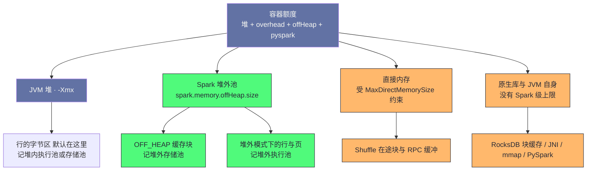
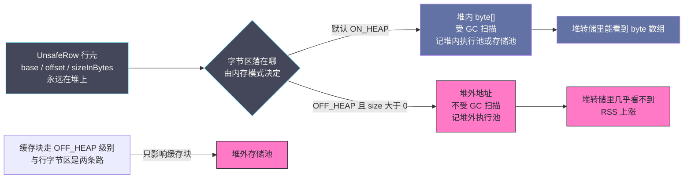
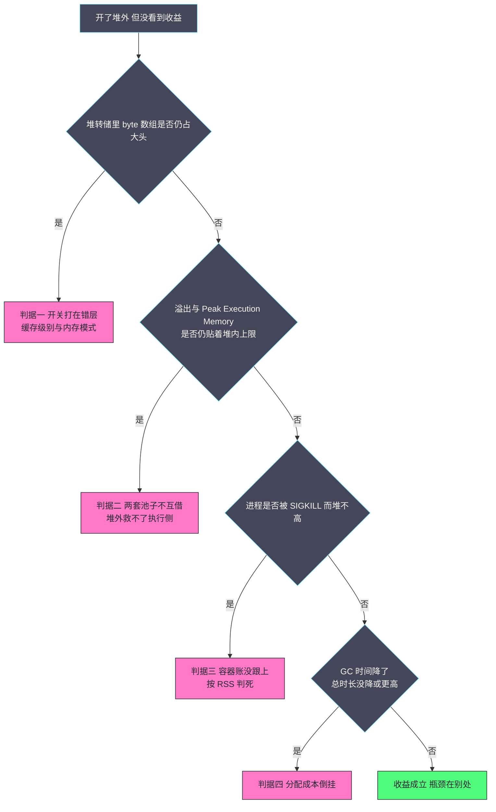
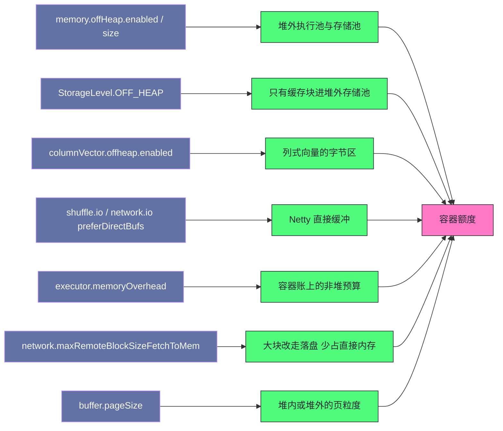
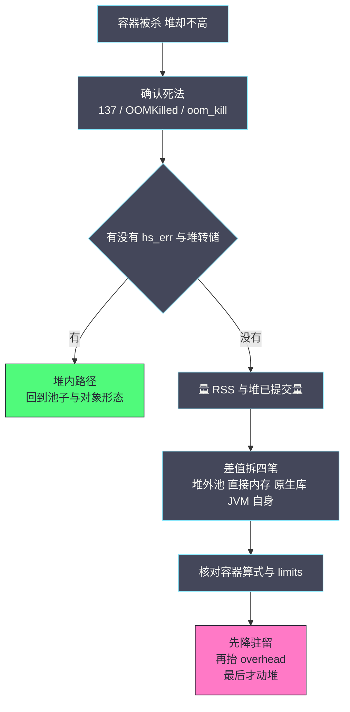

# 09 堆外内存与 Tungsten Unsafe 内存世界

**摘要：**

「开了堆外内存，作业还是被容器杀掉」是 Spark 内存运维里最容易被误判的一类现场，因为它的证据链几乎全在 JVM 之外：堆不高、没有 `Java heap space`、也没有堆转储，只有一条退出码 137。本篇按运维判据来写。先把 Spark 语境里被叫作堆外的四块地分开：`UnsafeRow` 的字节区（默认住在堆里，仅靠 `sun.misc.Unsafe` 做紧凑布局）、`OFF_HEAP` 存储级别的缓存块、Netty 传输用的直接缓冲、以及 RocksDB 与 JNI 这类不受 Spark 管的原生内存。四者分配者不同、额度来源不同、观测点不同、越界的报错形态也不同，混着叫就必然算错账。再给四条能证伪「省到了」的判据：行对象与行字节区不是一回事，堆内与堆外的池子不互相借贷，GC 不扫描的那部分照样计入容器常驻内存，逐次 `malloc` 与 `free` 的代价在小对象场景里会反超 GC。核心交付是一张配置代价表与一条「容器 OOMKilled 而堆很空」的六步排查路径，配一个 24GiB 堆的核算算例。机制推导（`MemoryBlock`、页表与地址编码、二进制记录的排序归并）不再重复，按章路由到内核系列与本列前两篇。

---

## 第 1 章 一个开了堆外仍然被杀的容器

三百节点的集群，每天两千个作业，堆外这一层的问题有个共同点：它几乎不在 JVM 里留下证据。上周的一台 executor 就是这样死的，Structured Streaming 的双流 join，堆 12GiB，打开 `spark.memory.offHeap.enabled=true` 并给了 `spark.memory.offHeap.size=8g`，容器额度 20GiB，跑了六小时零七分被 Kubernetes 杀掉，退出码 137。事后翻记录，堆的已用峰值不到一半，`hs_err_pid` 没有，堆转储没有，任务日志在最后几秒甚至还在正常刷心跳。

值班同学按顺序试了三个动作。先把 `spark.memory.offHeap.size` 从 8g 加到 12g，下一次运行两小时就死；再把 `spark.executor.memory` 从 12GiB 压到 8GiB，以为能把额度匀出来，结果换成了 `Java heap space`；最后把 `spark.executor.memoryOverhead` 抬到 4GiB，稳了两周，状态数据涨上来之后又开始被杀。

三个动作各自都对了一半，错在同一处：把「堆外」当成一块边界清楚的额外内存。实际的情况是，Spark 里被叫作堆外的内存有四块来源、四套额度算法、四个观测点，它们的共同点只有一个：都不受 GC 管。而这一点恰好是误判的起点——不受 GC 管，不等于不占内存。

本篇回答两个问题。第一，这台 executor 的容器额度里，哪几块地属于堆外，各自归谁管、在哪里看。第二，把堆外打开之后，为什么经常一点内存都没省下来——后者会落成四条可以用指标证伪的判据，再从容器被杀反推到具体那笔账。Tungsten 的内存抽象（`MemoryBlock` 的两种形态、页表与 64 位地址编码）、二进制记录的排序与归并，内核系列已经推到源码级，本文只引用结论，见 [[大数据/Spark/读书笔记-spark内核/05_Shuffle核心机制/6. Spark_Shuffle聚合与排序结构|Shuffle 聚合与排序结构]] 第 9 章与 [[大数据/Spark/读书笔记-spark内核/06_性能调优实战/5. Spark_JVM性能调优|JVM 性能调优]] 第 5 章。

---

## 第 2 章 四块地：堆外这个词指向四件事

四块地先列出来，再逐块拆。可以把容器额度想成一栋楼的总电表，四块地则是四个租户：Spark 的堆外池跟 Spark 签合同，直接内存跟 JVM 签合同，原生库既不跟 Spark 签也不跟 JVM 签，只跟容器相关。总电表只有一个，抄表的人却有三个，这就是为什么「明明堆还很空」和「进程已经被杀」可以同时为真。表里的「是否在池账上」决定了加参数能不能解决问题：在池账上的，调额度有效；只在容器账上的，调额度只是把一个洞挪到另一个地方。

| 用途 | 谁申请 | 额度由谁定 | 是否在 Spark 内存池的账上 | 观测点 | 越界形态 |
|---|---|---|---|---|---|
| 行的字节区（默认在堆内） | `TaskMemoryManager` 申请的页，或用户代码里的 `byte[]` | 堆内执行池，或 `spark.memory.offHeap.size` 按内存模式二选一 | 是，按内存模式记在对应池 | 堆转储里的 `[B`、Executor 页的 on/off-heap execution 行 | `Java heap space` 或 `SparkOutOfMemoryError` |
| `OFF_HEAP` 缓存块 | BlockManager 经 MemoryStore 写入堆外存储池 | `spark.memory.offHeap.size`，内部再按 `storageFraction` 划保护线 | 是，记在堆外存储池 | Storage 页的存储级别列、Executor 页堆外 storage 行 | `SparkOutOfMemoryError`、块被驱逐或写盘 |
| Netty 直接缓冲 | Netty 的池化分配器 | JVM 直接内存上限，未显式设置时与堆同量级 | 否 | 堆内的 `DirectByteBuffer` 数量、RSS 与堆的差值 | `OutOfMemoryError: Direct buffer memory` |
| 原生库与子进程 | RocksDB、JNI 编解码、Arrow、PySpark 进程 | 没有统一上限，只受容器额度约束 | 否，4.1 起可被轮询抵扣一部分 | RSS 减去堆与直接内存的余量、`smaps_rollup` | 容器 OOMKilled、退出码 137、`beyond physical memory limits` |

下图把容器额度与四块地的关系画在一起。注意右侧两条分支：一条是 Spark 自己的池子，一条只在容器的账上、Spark 根本看不见。

### 2.1 第一块：行的字节区，默认住在堆里

`UnsafeRow` 这个名字误导了很多人。Unsafe 指的是它用 `sun.misc.Unsafe` 这套 API 按字节读写，而不是它住在堆外；默认配置下，一行数据就是一个 `byte[]`，由 JVM 分配、受 GC 扫描，只是布局被压紧了，省掉了对象头与引用跳转。真正决定字节区落在哪的，是内存管理器启动时定下的内存模式：`spark.memory.offHeap.enabled=true` 且 `spark.memory.offHeap.size>0`（两个条件都要满足，否则 `MemoryManager` 的构造直接失败）时，Tungsten 内存模式切成 `OFF_HEAP`，此后从 `TaskMemoryManager` 申请的页全部来自堆外；否则一切照旧在堆内。

这里有一层常被忽略的结构：`UnsafeRow` 这个对象本身永远在堆上，它只有三个字段，指向字节区的 `base` 引用、偏移 `offset`、长度 `sizeInBytes`。堆外化的只是它指向的那段连续字节，行壳仍然是堆上的小对象。所以「把行搬到堆外」从来不是「堆里不再有这些对象」，而是「堆里只剩下这些壳」；行数极多的作业，壳本身的分配与回收仍要记在堆的账上。

至于 SQL 执行侧，4.3.0 的公开配置里没有独立的「把行放到堆外」开关。旧资料里流传的 `spark.sql.execution.offHeap.enabled` 在 4.3.0 的配置文档与 `SQLConf` 里都找不到，写上去不会改变任何行为；真正起作用的是上文那个内存模式。与之相邻的还有一个内部键 `spark.sql.columnVector.offheap.enabled`（2.3.0 起），它只管列式向量（`ColumnarBatch`）要不要用堆外的 `OffHeapColumnVector`，未设置时回落到 `spark.memory.offHeap.enabled`。这几个名字对应的是不同对象：内存模式、列式向量、缓存级别，串着用就会出现「我以为开了」。

这三层的关系要单独画一次，因为绝大多数混淆都来自把中间的「字节区」与最上面的「行壳」当成一件事。

判断这批行到底在堆里还是堆外，堆转储比任何参数都可靠。堆里如果还能看到大量 `[B` 且总量与数据规模对得上，说明行数据没搬走；如果 `[B` 的总量远小于数据规模、RSS 却一路涨，那才是搬出去了。`jmap -histo:live <pid>` 先看 `[B` 的排名与字节数，代价很低，适合作为第一动作。

### 2.2 第二块：OFF_HEAP 存储级别

把缓存块本身放到堆外，只有 `StorageLevel.OFF_HEAP` 这一个级别。前提是堆外池已经打开，块以序列化字节的形态存放在堆外存储池里；块目录（block id、大小、副本状态）这类元数据仍在堆内，由 BlockManager 记账。一块 200MiB 的缓存在 `OFF_HEAP` 下，堆内占用的只是几十字节的条目，堆外占用的是序列化之后的 200MiB 上下。

这一块与执行侧的关系要划清：它**只解决存得下，不解决算得快**。缓存块换了地方，不会让任何一次 join 或聚合多拿到一个字节的执行内存，因为存储与执行分属两只池子；堆外那两只池子同样按 `spark.memory.storageFraction` 划保护线，两套池子之间的隔离规则与堆内完全一致，见 [[大数据/Spark/读书笔记-spark内核/04_存储与容错机制/2. Spark内存管理模型深度解析|统一内存池的两个视图]] 第 8 章。判据在 Executor 页的堆外存储行与 Storage 页的存储级别列：堆外存储用量能不能涨起来、目标数据集的 `Fraction Cached` 是否到 100%、以及块大小与对象形态的比值是否落在预期区间。

还有一处代价常被算漏：`OFF_HEAP` 的块是序列化形态，每次读回都要反序列化。只读一次的数据集换成 `OFF_HEAP`，付了序列化的钱，省下的只是堆上那一时的对象，账并不划算。缓存块在池子里的存取与驱逐路径，见 [[大数据/Spark/Spark-Shuffle与内存管理机制深度解析/07 Execution 与 Storage 的动态边界|Execution 与 Storage 的动态边界]] 第 2 章与第 6 章。

### 2.3 第三块：Netty 的直接缓冲

Shuffle 拉取、块传输、RPC 都走 Netty，而 Netty 默认优先用直接缓冲：`spark.shuffle.io.preferDirectBufs`（1.2.0 起）与 `spark.network.io.preferDirectBufs`（3.0 起，作用于共享分配器）默认都是 true。官方文档对后者的解释很直白，堆外缓冲用于减少 shuffle 与缓存块传输过程中的 GC，如果环境里堆外内存本来就紧，可以关掉，强制所有分配走堆内。

**这笔内存的额度不归 Spark 管**。它的上限是 JVM 的直接内存上限，未显式设置 `-XX:MaxDirectMemorySize` 时 HotSpot 按堆的上限同等对待；而容器额度是按堆加 overhead 申请的，于是直接内存天然带着一个和堆同量级的缺口。用量的形状由并发决定：每个 reduce task 同时拉取的量受 `spark.reducer.maxSizeInFlight`（默认 48m）约束，在途块总量大致是并发数乘这个常数；单个远程块超过 `spark.network.maxRemoteBlockSizeFetchToMem`（默认 200m，3.0 之前的键名没有 `network.` 前缀，那是现在仍被兼容的旧名）时改走落盘，避免一个巨大请求把直接内存顶穿。文件侧还有一处容易漏的：4.0 起的 `spark.shuffle.file.merge.buffer` 默认 32k，官方文档写明它用堆外缓冲，按同时打开的文件数乘起来并不小。

越界的形态很有辨识度：`OutOfMemoryError: Direct buffer memory`，异常文本里带 `Direct buffer` 字样，与 `Java heap space` 完全不是一回事；它往往出现在拉取最密集的那几分钟，而堆的水位反而很低。看到这条异常就去查 `offHeap.size`，方向从一开始就错了，该查的是并发拉取数与 `preferDirectBufs`。

直接缓冲的回收靠 Netty 的引用计数与 JDK 的清理器，泄漏不会立刻变成异常，而是 RSS 缓慢爬升，直到某次拉取高峰顶穿上限。要确认是泄漏而不是用量峰值，可以短时打开 Netty 的泄漏检测（`-Dio.netty.leakDetection.level=paranoid`），代价是所有缓冲的分配路径都被采样跟踪，只适合在定位阶段开几十分钟。

### 2.4 第四块：不受 Spark 管的原生内存

第四块最杂，也最容易在算 overhead 时被漏掉。Structured Streaming 的默认状态存储用 RocksDB，block cache 与 write buffer 都是 native 内存，通过 `spark.sql.streaming.stateStore.rocksdb.` 前缀的一组选项调整，这些字节既不进堆，也不进 `spark.memory.offHeap.size`；压缩编解码（snappy、lz4、zstd）走 JNI 时有临时缓冲；pandas UDF 走 Arrow，堆外占相当一部分；PySpark 的 worker 是独立进程，用 `spark.executor.pyspark.memory` 单独申报，申报后叠加到容器额度上；文件侧超过 `spark.storage.memoryMapThreshold`（默认 2m）的块读回时用内存映射，映射的文件页计入 cgroup，但属于可回收的文件页，压力上来时内核会先收它。

还有一笔 4.1 起才有的账：`spark.memory.unmanagedMemoryPollingInterval` 默认 0，关闭时这些「自己管内存」的组件按零计；打开后内存管理器会定期向它们查询用量，并在计算统一池上限时先减掉。这笔账的性质要单独记一句：它不是「Spark 之外」的内存，而是「不在 M 账上」的内存，展开见 [[大数据/Spark/Spark-Shuffle与内存管理机制深度解析/06 Spark 统一内存管理模型|统一内存模型]] 第 4 章。

四块地摊在容器额度里，只有前两块在 Spark 的池子里；后两块**不在任何池子的账上，只在容器的账上**，这句话是后面所有排查的出发点。

---

## 第 3 章 UnsafeRow 为什么快，以及为这个快付了什么

一行的字节区被压成「空值位图 + 定长区 + 变长区」之后，比较两个键不再需要解引用对象树，比的就是两段字节，哈希也是对字节算的，对象头、引用指针、装箱全部消失；这就是 `UnsafeRow` 快的原因，一句话说完。布局本身、变长列的偏移编码、二进制比较为什么比对象比较快，见 [[大数据/Spark/读书笔记-spark内核/05_Shuffle核心机制/6. Spark_Shuffle聚合与排序结构|Shuffle 聚合与排序结构]] 第 9 章。

| 维度 | 传统 `Row`（对象树） | `UnsafeRow`（连续字节） |
|---|---|---|
| 访问一个字段 | 对象解引用、可能多次缓存未命中 | 基址加偏移，一次计算 |
| 内存形态 | 对象头与引用占大头，行内分散 | 紧凑字节，行内连续 |
| 跨边界代价 | 直接可用 | 需 `Serializer` 或 `InternalRow` API 转换 |

代价同样清楚：读写必须走 `InternalRow` 的 API，跨到用户代码时要有序列化或转换，调试时看到的是偏移量而不是字段名，堆外模式下越界时抛的是 `SparkOutOfMemoryError`，堆内模式下才是 `Java heap space`。这套格式的收益只对 SQL 引擎内部的算子成立，RDD API 里的用户对象不在其中，堆外开与不开，对 `map` 里那个 `case class` 没有任何影响。

---

## 第 4 章 开了堆外却没省到：四条判据

四条判据各自能证伪一种期待，顺序按现场出现的频率排：先怀疑开关打在了错的层，再怀疑额度不能互通，再怀疑死法不对，最后才考虑成本倒挂。

### 4.1 判据一：省的是字节区，不是行对象

最常见的落差是开关打在了错的层上。有人打开 `spark.memory.offHeap.enabled` 与 `size`，缓存级别却仍是 `MEMORY_AND_DISK`，SQL 侧也没走列式向量的堆外路径，于是堆内该占的还占着。开关只改了 Tungsten 从哪本账申请页，没有义务把已经存在的对象形态搬走；更常见的配置错误是只写了 `spark.memory.offHeap.size` 而忘了 `enabled`，`MemoryManager` 只会打一条 “offHeap.size is > 0 when enabled == false” 的警告，行为一点没变，日志里那行警告很容易被当成正常输出划过去。

这里的比喻很贴切：开关换的是仓库的门锁，货还留在旧仓库里。堆外那份额度一旦开出来，只有从 `TaskMemoryManager` 申请页的路径才会走过去用它；已经在堆上的对象、已经建好的缓存块、用户代码里 `new` 出来的集合，都不会自己搬过去。

**行壳在堆上，字节区才可能在堆外**，这是判据一的核心。三个证据足以定性：堆转储里 `[B` 是否仍占大头、目标数据集的存储级别是否显示为 Off Heap、Executor 页堆外那组行里的 storage 与 execution 是否都贴着零。三条同时成立，说明这批数据压根没进堆外池，调 `size` 只是给一块空仓库加面积。

处置方向按目标分三支：要让缓存搬家，换 `StorageLevel.OFF_HEAP`；要让 SQL 执行搬上二进制路径，用 DataFrame 算子（内部本来就是 `UnsafeRow`）并确认内存模式已切；两者都不适用时，接受「堆内就是它该在的地方」，转去查 GC 与对象形态。

### 4.2 判据二：两套池子不互相借贷

第二种落差更隐蔽：堆外额度再大，也借不到堆内去。官方文档在 `spark.memory.offHeap.size` 这一条上写得很明确——这个设置对堆内存的使用没有任何影响，如果 executor 的总内存消耗必须落在某个硬上限里，就要相应缩小 JVM 堆。这句话同时也是整条判据的出处：堆外不是从堆里挪出来的一块，而是额外加的一块。

机制上还有一层限制。用 Java 对象装的结构，譬如聚合表 `AppendOnlyMap` 这一路，永远记在堆内执行池上（`MemoryMode.ON_HEAP`），开堆外也不会变；只有二进制形态的结构（排序页、哈希表页）跟着内存模式走，见 [[大数据/Spark/读书笔记-spark内核/06_性能调优实战/7. Spark_Shuffle内存调优|Shuffle 内存调优]] 的堆外一节。所以「加了 `offHeap.size` 之后聚合还是溢出」不是配置没生效，而是那本账从头到尾没被碰过。

读数口径上还有一个坑。Stage 页的 task 汇总里，峰值执行内存有时分成堆内与堆外两列（`Peak Execution Memory` 与其堆外版本），只有一个总数时，要按内存模式自己判断这行数字记在哪本账上。把堆外的峰值当成总数，会得出「执行侧已经搬出去了」的错误结论；反过来把总数当成堆内，会把一次正常的堆外使用误判成堆内不足。

证据落在三个数上：Executor 页堆外 execution 的用量是否长期贴着零或只有零头、spill 字节是否一点没减、堆内 `Peak Execution Memory` 是否仍贴着份额上限。三条里的后两条同时成立，结论就是执行侧不够，处置在单 task 数据量与并发上，或者回到统一池的比例，见 [[大数据/Spark/Spark-Shuffle与内存管理机制深度解析/06 Spark 统一内存管理模型|统一内存模型]] 第 6 章。

### 4.3 判据三：GC 不扫描，cgroup 照收

第三种落差是死法不对。堆外不参与 GC，但仍计入容器的常驻内存，于是失败形态不是 `Java heap space`，而是进程被 SIGKILL：退出码 137、没有 `hs_err_pid`、没有堆转储、日志戛然而止。SIGKILL 不给 JVM 任何写现场的机会，所以「没有堆转储」这件事本身就是一条证据，而不是现场丢了。

**GC 看不见它，cgroup 看得见**。三个地方能确认这条路径：`kubectl describe pod` 里的 `Last State: Terminated`、`Reason: OOMKilled`、`Exit Code: 137`；cgroup v2 的 `memory.events` 里 `oom_kill` 计数上涨（v1 是 `memory.oom_control`）；YARN 侧则是 “Container killed by YARN for exceeding memory limits” 与 physical memory 的用量对比。三条里任意两条成立，就可以把「堆内不够」这条线排除掉。

处置不在这一章动，路径见第 6 章。这里先记住一个反直觉的推论：容器被杀得越干净，越说明问题在堆外；如果真的是堆内不够，现场反而会留下堆转储和 OOM 的堆栈。

### 4.4 判据四：分配与释放的逐次成本

第四种落差来自成本。堆内分配短命小对象走 TLAB 的指针碰撞，回收由年轻代整块处理，几乎不产生逐次开销；堆外没有这层摊销，每次申请都要经过 `Platform.allocateMemory`，释放要显式归还，页表与记账还要更新。当记录很窄、生命周期很短、每秒分配次数很高时，省下的 GC 扫描时间会被分配调用的开销吃掉，甚至倒挂。这一段的绝对数字随分配器与内核版本变化，笔者只给量级判断：小对象的分配成本能差出十倍以上，回收路径差得更多。

还有一处连带效应值得记住：开了堆外之后，页大小的基数从堆内执行池换成了堆外执行池，算法是「池容量除以核数再除以 16，向上取到 2 的幂，夹在 1MiB 到 64MiB 之间」。堆外只给 2g 而核数不少时，算出来的页可能只有 1MiB 或 2MiB，页数变多、页表与元数据开销上升，跨页记录也变多，这是「开了堆外反而慢」的一条真实路径（示例推算，取决于核数与池容量）。**页大小的基数是执行池**，这一点在调 `offHeap.size` 与 `storageFraction` 时经常被忘掉。

证据在性能剖析里：GC 时间下降而作业总时长不降、async-profiler 或 JFR 里 `Unsafe_AllocateMemory` 与 `malloc`、`free` 排在热点前列、小 task 的 CPU 使用率上升。处置很直接，小行、窄记录、短生命周期、超高并发的场景留在堆内，别为了「少一点 GC」付更多分配成本。

---

## 第 5 章 旋钮与它各自的账

参数本身没有对错，只有换来什么、付出什么。下表把与堆外相关的旋钮排在一起，两个代价列是重点，缺了它就只能背默认值。

| 参数 | 默认 | 真正控制什么 | 调大（或打开）的代价 | 调小（或关闭）的代价 |
|---|---|---|---|---|
| `spark.memory.offHeap.enabled` | false | Tungsten 从哪本账申请页 | 容器额度要同步加，页大小基数换成堆外池，原生与直接内存的余量被挤压 | Tungsten 全部回堆内，GC 扫描恢复，存活集大的作业停顿变长 |
| `spark.memory.offHeap.size` | 0 | 堆外池总量，必须大于 0 才能开 | 容器总账等额增加，堆内一点不变，配错会出现两头都不够 | 堆外页更快拿不到，抛 `SparkOutOfMemoryError`，页大小被推小 |
| `spark.sql.columnVector.offheap.enabled` | 未设置，回落到上一行 | 列式向量是否用堆外 | 向量读取的字节离堆，直接内存与堆外池同时吃紧 | 列式读取回堆内，GC 压力回来，扫描类作业更明显 |
| `spark.sql.execution.offHeap.enabled` | 4.3.0 的文档与源码里都没有 | 不控制任何行为 | 设置无效，只让配置文件多一行噪音 | 同上 |
| `spark.network.maxRemoteBlockSizeFetchToMem` | 200m | 多大的远程块直接读进内存 | 大块进内存，直接内存与堆的压力同时上升，换更少的落盘 | 落盘变多，本地 IO 上升，直接内存压力下降 |
| `spark.executor.memoryOverhead` | max(384MiB, 堆 × 0.1) | 容器额度里留给非堆的部分 | 单 executor 占更多资源，同集群能容纳的 executor 数下降 | 原生与 JVM 自身越界，按 RSS 判死，退出码 137 |
| `spark.shuffle.io.preferDirectBufs` 与 `spark.network.io.preferDirectBufs` | true | Netty 是否优先用直接缓冲 | 直接内存占用上升，GC 少扫一批 | 全部回堆内，GC 压力回来，大并发拉取时停顿更明显 |
| `spark.buffer.pageSize` | 未设置，按池与核数推算 | Tungsten 页的粒度 | 单页更大，页表项更少，但一次拿不到整页的概率上升 | 页数变多，元数据与页表开销上升，跨页记录变多 |
| `spark.storage.memoryMapThreshold` | 2m | 多大的磁盘块用内存映射读回 | 映射变少，堆内读缓冲变多 | 映射变多，文件页进 cgroup，但属于可回收部分 |

表里有两行的默认值是「未设置」，容易在评审时被当成漏配。`spark.buffer.pageSize` 不设置时由内存管理器按池容量、核数推算，1MiB 到 64MiB 之间；`spark.sql.columnVector.offheap.enabled` 不设置时回落到 `spark.memory.offHeap.enabled`。把它们写成固定值之前，先确认原来的推算结果是多少，否则一次「显式配置」可能把页大小改小一个量级。

`spark.memory.offHeap.size` 给多少没有通用公式，但有一个可以复核的顺序。先估出二进制结构的实际占用，依据是堆转储里属于 Tungsten 页的那部分 `[B`，加上关掉堆外时的峰值执行内存；再按这个量的两成到三成给第一版（示例推算）。跑一轮看 Executor 页堆外执行池的水位：长期贴着上限说明给少了，长期在两成以下说明给多了，把额度还给堆或还给 overhead 更划算。一次只动一个旋钮，堆、堆外、overhead 三者同时改，出了问题是没法归因的。

下图给出这几个旋钮的作用域：左侧每个参数只影响右侧某一本账，跨账的调参不会产生跨账的效果。

什么负载值得开堆外，判据有三条。排序与聚合走二进制路径、单 task 数据量大到几十万行以上、GC 停顿已经是主要瓶颈（回收后存活集不大但停顿占比高），三条同时成立时，把字节区搬到堆外通常能换来实打实的停顿下降。什么负载不值得开，判据有两条：行很窄、生命周期短、每秒分配次数极高；或者容器额度本来就没余量，开堆外等于向 cgroup 多借一笔钱。

还有一条启动期的硬失败要提前知道：平台不支持非对齐访问时，打开堆外会直接在启动时抛 “No support for unaligned Unsafe”，作业起不来。这类失败反而好办，日志明确；难办的是前面那四种静默的落差。

---

## 第 6 章 容器被杀、堆却很空：一条排查路径

这条路径的目标只有一个：把 RSS 里那部分既不在堆、也不在 Spark 池子里的字节，拆成能对上账的几笔。找不到拆分，就只能猜参数；拆出来了，处置方向是唯一的。

| 步骤 | 看什么 | 在哪看 | 判据 |
|---|---|---|---|
| 1 定死法 | 退出码、终止原因、cgroup 事件 | `kubectl describe pod`、`memory.events`、YARN 日志 | 137 加 OOMKilled，且没有 `hs_err_pid` |
| 2 排堆内 | 有没有 `Java heap space` 与堆转储 | 任务日志、`/tmp` 下的 hprof | 有则回堆内路径，这条线上不必再耗 |
| 3 量总量 | RSS 与堆的已提交量 | `/proc/<pid>/status` 的 VmRSS、`jcmd GC.heap_info` | RSS 明显大于堆 |
| 4 拆四笔 | 堆外池、直接缓冲、原生库、JVM 自身 | Executor 页堆外行、`jmap` 里的 `DirectByteBuffer`、NMT、`smaps_rollup`、RocksDB 配置 | 四笔之和能对上 RSS 减堆的差值 |
| 5 核额度 | 容器算式与 limits 是否一致 | 提交参数、pod spec | 堆加 overhead 加 offHeap 加 pyspark 是否等于 limits |
| 6 处置 | 先降驻留，再抬 overhead，最后才动堆 | — | 顺序反了会把「被杀」换成「OOM」或「变慢」 |

下图是这六步的顺序，注意第 2 步的回退分支：只有确认了不是堆内 OOM，才轮到四笔核算。

第 4 步的四笔拆账，用一个 24GiB 堆的例子走一遍，全部为示例推算。堆 24GiB，16 核，`offHeap.size=4g`，未设 PySpark 内存，overhead 未显式设置时按 `max(384MiB, 24GiB × 0.1)` 算约 2.4GiB，容器额度是 24 + 2.4 + 4 = 30.4GiB。

另一套按消耗类型切的账（缓存、Shuffle 缓冲、用户对象、框架开销）见 [[大数据/Spark/读书笔记-spark内核/04_存储与容错机制/1. Spark内存管理机制|Executor 消耗的四本账]]，两套切法只在用户对象这一块重叠，可以用来交叉校验下面的拆分。

| 那一笔 | 量级 | 判定依据 |
|---|---|---|
| 堆外池 | 最多 4GiB | 实际驻留看 Executor 页堆外 execution 与 storage 用量 |
| 直接缓冲 | 并发拉取 32 个 task 乘 48m 约 1.5GiB，加 RPC 零头 | 堆内 `DirectByteBuffer` 数量乘容量，或 NMT 的 Other 段 |
| RocksDB 与 JNI | block cache 512MiB 加 write buffer 256MiB 加索引过滤约 1GiB | 状态存储选项与进程 RSS 的差值 |
| JVM 自身 | 元空间、代码缓存、线程栈合计约 0.8GiB | `jcmd VM.metaspace`、线程数乘栈大小 |

除堆外池之外的三笔合计约 3.3GiB，而 overhead 只给了 2.4GiB，缺口约 0.9GiB；`offHeap.size` 那 4GiB 是单独加在总账上的，不占 overhead 的份额。缺口为负的时候什么事都没有，缺口一旦为正，容器按 RSS 判死只是时间问题——状态数据是慢慢涨的，所以表现为「跑了几小时才死」。

量的时候有三个易错点。第一，cgroup 的 `memory.current` 包含文件页，mmap 的干净页与 spill 产生页缓存都在里面，压力下内核会先回收这部分，把它当成不可回收占用会高估缺口；要看 `memory.stat` 里的 anon 与 file 分解。第二，Kubernetes 只有 `limits.memory` 会成为判死依据，`requests.memory` 只影响调度，两者不一致时调度器认为资源够、cgroup 当场杀进程。第三，`jcmd GC.heap_info` 给的已提交量可能远小于 `-Xmx`，用 `-Xmx` 去减 RSS 会把缺口算大一圈，必须用已提交量。

时间轴上的形状也能说明方向。RSS 与堆同步上涨，压力在堆内，堆外那几笔只是被顺带抬高；堆平着不动而 RSS 呈阶梯状上涨，多半是堆外池或原生库在按批累积；RSS 随批次周期性地起落、锯齿明显，先怀疑 RocksDB 的 memtable 与 compaction，而不是泄漏。三种形状对应三个方向，比任何单点读数都稳。

---

## 第 7 章 三个反例

### 7.1 只加 -Xmx，不看 cgroup

一台 24GiB 堆、容器额度 26.4GiB 的 executor 被杀，第一反应是把堆加到 28GiB，理由是「内存不够就多给点」。改完启动更快死：堆的上限抬到了容器额度之上，JVM 还没热身完，RSS 就撞上了 cgroup 的线。这里错了两处，一是把容器额度当成堆额度，二是改堆会让页大小按新的执行池重算，溢出行为跟着变，副作用比预期多。

**上游加额度，不如先降驻留**。这条现场的处置顺序应该是：先确认 limits 与算式一致，再把 RocksDB 的 block cache 与直接内存的余量收一收，最后才讨论堆要不要动。改堆之前先看 limits，是一分钟能做完的动作，能省掉一整轮试错。

### 7.2 把 OFF_HEAP 当省内存的万能药

第二个反例是缓存全部换成 `OFF_HEAP` 之后，Executor 页的堆外存储用量确实涨了，但执行侧的 spill 一点没少，GC 时间只降了两成，而作业反而慢了半拍。原因在判据一与判据二：`OFF_HEAP` 只搬缓存块，不搬执行侧的结构；序列化与每次读回的反序列化都成了新增成本，读次数少的数据集把这份成本白白付掉。

正确的用法是把它当成一次兑换：用「序列化与反序列化的 CPU」换「堆上的对象与 GC 扫描」。兑换率取决于这份缓存被读多少次，读一次就不划算，读十次以上才值得算。判据上先看 Storage 页的堆外用量与 `Fraction Cached`，再看下游 Stage 的 `Input Size` 是否真的缩小，两条都对上才谈收益。

### 7.3 算 overhead 时漏掉 RocksDB

第三个反例最典型。Structured Streaming 作业的状态涨到 3GiB 之后，每六小时被杀一次；overhead 按默认 10% 给，评审时的结论是「已经留了 1.2GiB，够了」。实际核算时，RocksDB 的 block cache、write buffer、索引与过滤器全被算进了「Spark 会管」的那一侧，而它们只落在容器账上。

这条路径的判据是差值：进程 RSS 减去堆已提交量、再减去堆外池与直接缓冲，剩下的若是数百 MiB 到数 GiB 且随状态增长，基本就是原生库。处置有两条，收 RocksDB 的内存选项（block cache 与 write buffer 是最直接的两个），或者把 overhead 抬到覆盖它的量级；两件事都要做，只做一件会在下一次状态高峰时复发。

---

## 第 8 章 量级与合账

把四类用途的典型量级放在一起，方便在评审时先估个大概，再看实测差多少。下表所有数字都是示例推算，具体值取决于记录宽度、并发与依赖库。

| 用途 | 典型量级 | 主要变量 | 观测点 |
|---|---|---|---|
| 行的字节区（堆内默认） | 堆的 20% 到 50% | 记录宽度、并发 task 数、算子形态 | 堆转储的 `[B`、Executor 页 on-heap execution |
| 行的字节区（堆外模式） | 0 到堆外执行池上限 | 同上，再加页大小 | Executor 页 off-heap execution |
| `OFF_HEAP` 缓存块 | 0 到堆外存储池上限 | 缓存集大小、序列化比、`storageFraction` | Executor 页堆外 storage 行、Storage 页存储级别列 |
| Netty 直接缓冲 | 数百 MiB 到数 GiB | 并发拉取数乘 48m、连接数、块大小分布 | `DirectByteBuffer` 计数、RSS 与堆的差值 |
| 原生库与子进程 | 数百 MiB 到数 GiB | RocksDB 选项、Arrow、编解码 | RSS 差值、`smaps_rollup` 的 anon |
| JVM 自身 | 300MiB 到 800MiB | 核数、依赖类数、线程数 | `jcmd` 的元空间与代码缓存、线程数乘栈大小 |

overhead 给多少，判据不在比例本身，而在非堆里有几类东西在长。下表按负载形态给建议，仍是示例推算，落地时用第 6 章的六步核算校准。

| 负载形态 | overhead 建议 | 依据 |
|---|---|---|
| 纯 JVM 批处理，不开堆外，无状态存储 | 默认比例，且不低于 384MiB | 只有 JVM 自身与少量直接缓冲 |
| 开了 `offHeap.size` | 在默认比例上加 3 到 5 个百分点 | 堆外池单独进总账，要加的是直接内存与原生库那一份 |
| RocksDB 状态存储 | 15% 到 25%，或显式给不小于 1GiB | block cache 加 write buffer 加索引过滤 |
| PySpark 与 pandas UDF | 15% 到 20%，并单独申报 pyspark 内存 | Arrow 与 Python 进程各自有堆外占用 |
| 高并发 shuffle 拉取 | 15%，并把大块阈值调小 | 在途块数量乘每块上限 |

从哪开始量，取决于手上有什么。能进容器就量 RSS 与堆的差值，这是最快的一条；只能看历史指标就先看 Executor 页的堆外两行与 Storage 页，再对 cgroup 的峰值；两者都拿不到时，从预算侧反推——把 overhead 与 `offHeap.size` 的算式写下来，跟实际提交的 limits 对一遍，多数缺口在这一步就露出来了。

这四类用途之间没有兑换关系，只有竞争关系：**它们抢的是同一个容器额度**。把一笔开销从一个类别搬到另一个类别，总量不变，只是换了一个更难观测的位置。判断一次调整是否值得，看的是总账有没有下降，而不是某一栏指标有没有变好看；这一条在评审堆外方案时比任何参数都管用。

---

## 第 9 章 落点

堆外内存这一个词，在 Spark 里至少指向四块地：行的字节区、`OFF_HEAP` 的缓存块、Netty 的直接缓冲、原生库与子进程。前两块在 Spark 的池子里，调参数有效；后两块只在容器的账上，只能靠预算与约束。分清这一点之后，「开了堆外没省到」就不再是一个玄学问题，而是四条判据里总能命中的一条：开关打错层、额度不互通、死法不对、成本倒挂。

四条判据的顺序也有讲究。先看堆转储，因为它是唯一能直接回答「行在哪里」的证据；再看池子用量，确认执行侧有没有被搬走；然后看死法，把容器层的账排除掉；最后才谈成本，因为在这一步之前，任何性能讨论都建立在错误的前提上。

堆外不是免费扩容，它把风险从「GC 停顿与对象膨胀」换成了「容器按 RSS 判死与逐次分配成本」。这笔兑换在排序、聚合这类二进制路径上通常划算，在窄行高并发的场景里往往倒亏。**先量差值，再动参数**，这是本文唯一想留下的操作习惯。

---

## 参考资料

1. Apache Spark 4.x 文档：Configuration 的 Memory Management、Shuffle Behavior 与 Deployment 三节。https://spark.apache.org/docs/latest/configuration.html
2. Apache Spark 源码：`core/src/main/scala/org/apache/spark/memory/MemoryManager.scala`，Tungsten 内存模式的判定、页大小的推算与分配器选择。https://github.com/apache/spark/blob/master/core/src/main/scala/org/apache/spark/memory/MemoryManager.scala
3. Apache Spark 源码：`sql/catalyst/src/main/scala/org/apache/spark/sql/internal/SQLConf.scala`，`spark.sql.columnVector.offheap.enabled` 的定义与回落关系。https://github.com/apache/spark/blob/master/sql/catalyst/src/main/scala/org/apache/spark/sql/internal/SQLConf.scala
4. Apache Spark 源码：`common/network-common/src/main/java/org/apache/spark/network/util/TransportConf.java`，`preferDirectBufs` 与 `memoryMapThreshold` 的默认值。https://github.com/apache/spark/blob/master/common/network-common/src/main/java/org/apache/spark/network/util/TransportConf.java
5. SPARK-26700：新增 `spark.network.maxRemoteBlockSizeFetchToMem`，旧键 `spark.maxRemoteBlockSizeFetchToMem` 作为兼容别名保留。https://issues.apache.org/jira/browse/SPARK-26700
6. SPARK-47208：允许覆盖非堆内存下限，新增 `spark.executor.minMemoryOverhead`，默认 384MiB。https://issues.apache.org/jira/browse/SPARK-47208
7. SPARK-53001：把 RocksDB 的用量接入统一内存管理，引入 `spark.memory.unmanagedMemoryPollingInterval`。https://issues.apache.org/jira/browse/SPARK-53001
8. Project Tungsten: Bringing Apache Spark Closer to Bare Metal（2015）。https://www.databricks.com/blog/2015/04/28/project-tungsten-bringing-spark-closer-to-bare-metal.html
9. 内核系列：[[大数据/Spark/读书笔记-spark内核/04_存储与容错机制/1. Spark内存管理机制|Executor 消耗的四本账]]、[[大数据/Spark/读书笔记-spark内核/04_存储与容错机制/2. Spark内存管理模型深度解析|统一内存池的两个视图]]、[[大数据/Spark/读书笔记-spark内核/05_Shuffle核心机制/6. Spark_Shuffle聚合与排序结构|Shuffle 聚合与排序结构]]、[[大数据/Spark/读书笔记-spark内核/06_性能调优实战/5. Spark_JVM性能调优|JVM 性能调优]]、[[大数据/Spark/读书笔记-spark内核/06_性能调优实战/7. Spark_Shuffle内存调优|Shuffle 内存调优]]。
10. 本列前两篇：[[大数据/Spark/Spark-Shuffle与内存管理机制深度解析/06 Spark 统一内存管理模型|统一内存管理模型]]、[[大数据/Spark/Spark-Shuffle与内存管理机制深度解析/07 Execution 与 Storage 的动态边界|Execution 与 Storage 的动态边界]]。

---

> [!note] 思考题
> 1. 一台 executor 打开了 `spark.memory.offHeap.enabled` 与 `size=8g`，缓存却仍是 `MEMORY_AND_DISK`，堆转储里 `[B` 仍然占大头。此时「堆外已经开了」这句话在哪一层成立、在哪一层不成立？
> 2. `spark.memory.offHeap.size` 从 4g 调到 12g，聚合作业的 spill 字节完全没有变化。除了「配置没生效」之外，还有哪两种解释可以用现有指标区分？
> 3. 容器被 OOMKilled，而 `jcmd GC.heap_info` 显示堆只提交了六成。要在一小时内把缺口拆成四笔，你会先量哪两个数，为什么？
> 4. 页大小由「执行池除以核数再除以 16」推算。把 `offHeap.size` 设为 2g 而堆保持 24GiB，页大小往哪个方向变，这个变化会怎样影响溢出与分配成本？
> 5. 一个只在作业开始时读一次、之后不再访问的数据集，换成 `OFF_HEAP` 之后 Storage 页指标很好看，但作业总时长上升。这笔兑换的判据应该看哪三个数？