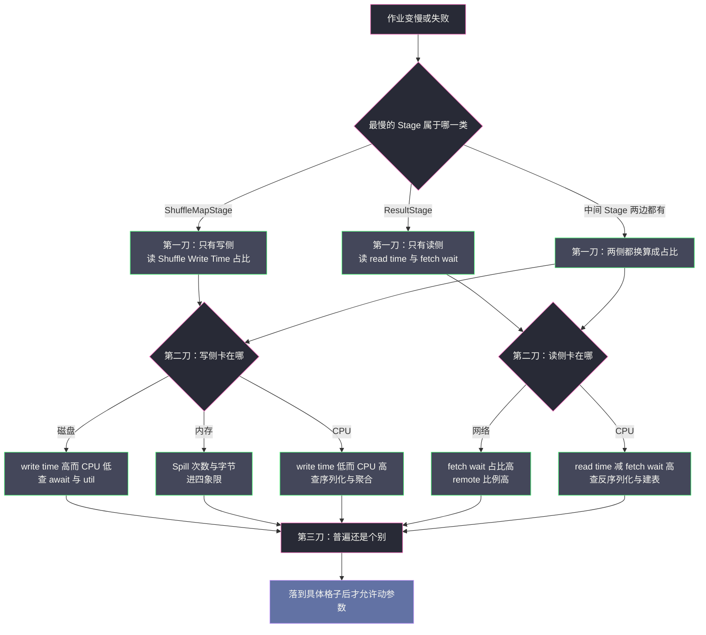
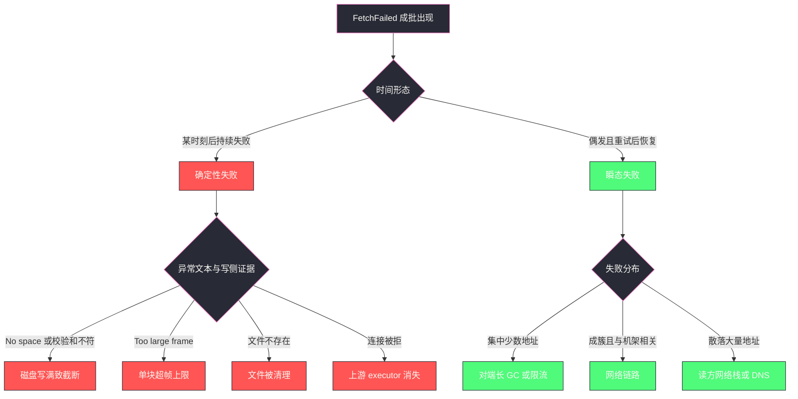
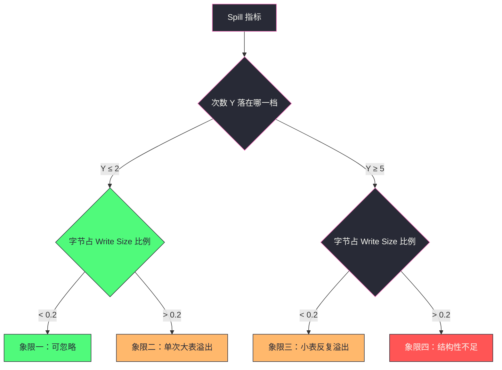
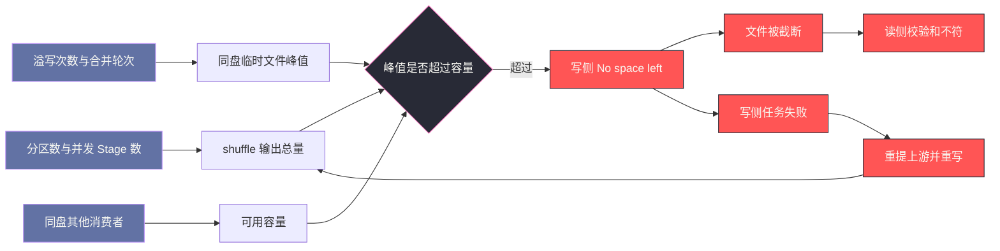
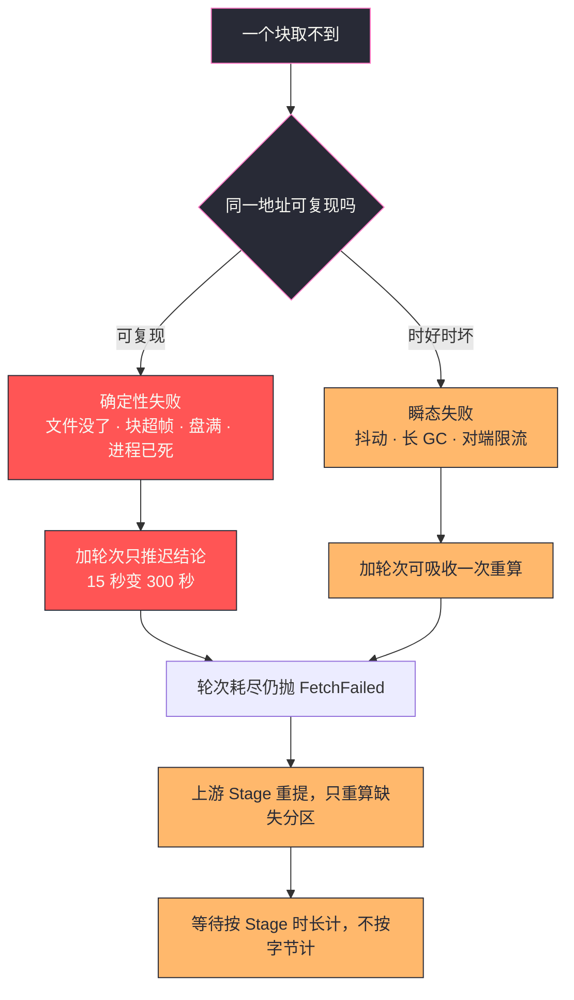

# 10 生产调优手册：从症状到根因的系统性诊断

**摘要：**

这一篇不列参数清单，只回答一个问题：Shuffle 故障摆到面前，先看哪个数、看到什么值才敢下结论。主干是一条不可颠倒的判定顺序——先用 Stage 类型与两个时间的占比分出写侧与读侧，再用 fetch wait、write time 与主机 I/O 分出网络、磁盘与 CPU，最后用分位数与机器维度分出普遍问题与个别问题；三刀走完才允许动参数。判定的对象是六类症状：`FetchFailedException` 的五根因、写侧慢、读侧慢、spill 偏多、本地盘打满、数据倾斜，每类给出指标落点、阈值（标注为量级判断）与下一步动作。后半段把症状接回机制：每条症状对应哪一篇、哪个参数、改大改小的代价落在谁身上，并单独说明为什么加轮次解决不了确定性失败。收口是三个必须长期盯的指标、三套按场景裁剪的最小配置，以及一份逐条拆开的反例清单。全篇的量化只给量级区间，因为阈值随集群规模漂移，顺序不随。机制推导路由到内核系列与本列前九篇，本篇只负责判断。

---

## 第 1 章 三刀的顺序

凌晨两点四十，值班群弹出一条告警：`dwd_adx_rollup_daily` 的 P95 从四十二分钟涨到三小时十分，同批次另外七个作业正常。这类告警几乎每个值班周期都会出现一次，而它给出的信息只有"这个作业慢了"，没有一条指向原因。

接下来发生的事情正是这份手册想避免的：值班的人先把 `spark.shuffle.io.maxRetries` 从 3 调到 10、`retryWait` 从 5s 调到 30s，报错消失了；再把 executor 从 20 个加到 40 个，耗时不降反升；最后把 `spark.sql.shuffle.partitions` 从 800 调到 2000，作业跑完了，代价是那批机器本地盘被打满，次日两个无关作业因 `No space left on device` 失败。三个动作都"有效"，都没治病因，第四个作业替它们付了账。

### 1.1 症状是复合的，参数是单点的

一个参数只作用在一处，一个症状却常常是几处叠加。`dwd_adx_rollup_daily` 的真实链条是：上游维表当天多了一批脏数据，join 键上出现占比 18% 的热点值，reduce 侧某个分区是其余分区的四十倍；这个分区一边聚合一边溢写，把本地盘的临时空间吃光，写侧任务开始失败；产物消失，读侧随即报 `FetchFailedException`，作业重提上游，重算又把磁盘占用推高。

三个动作各自撞在一条链路上，而三条链路同源：它们都是那个热点分区的下游效应。调参表在这个现场无效——它按参数组织知识，而现场按因果组织证据。

### 1.2 顺序不可颠倒的理由

三刀各自排除的假设互不重叠，每一刀之后能看的页面、能改的对象都不一样，这是顺序不能颠倒的根子。

第一刀分写侧与读侧。写侧证据在 `Shuffle Write Time`，读侧证据在 `Shuffle Read Time` 与 `fetch wait`；两边的处置几乎没有交集，写侧调 `file.buffer`、`local.dir`、map 端聚合，读侧调在途预算、块大小、反序列化。先分错侧，后面的调参全部落空。

第二刀分网络、磁盘与 CPU。这一刀决定你相信哪类底层资源：网络看 fetch wait 与 remote 比例，磁盘看 write time 与主机 `await`，CPU 看 `read time` 减去 `fetch wait` 的剩余与 GC。三类资源的兑换是负相关的，**把内存预算调大常常换来更多读侧溢写**，方向错了会越调越慢。

第三刀分普遍与个别。九成任务都慢是容量与参数问题，一成任务慢且集中在少数机器上是倾斜与坏节点问题。参数是全局的，为个别问题把全局参数调一遍，等于让另外两千个作业替一台机器付账。

反过来走，会出现三种可预测的误判：把读侧 CPU 慢当网络慢去调预算，越调内存越紧；把个别倾斜当普遍问题去加资源，扩容后长尾依旧；把容量不足当参数问题去调重试，报错消失而磁盘继续变满。

### 1.3 一条主干

三刀的完整路径如下图。图中每个判断节点都是二选一或多选一，出口只有一个：动参数之前必须先落到某个具体格子里。

### 1.4 先对齐读数位置

| 要判的事 | 位置 | 读哪一列 | 读错的后果 |
|---|---|---|---|
| 哪个 Stage 最慢 | Stage 列表按 Duration 排序 | Duration 与任务数 | 拿作业总时长当分段证据 |
| 写侧耗时 | Tasks 表勾选写侧附加指标 | `Shuffle Write Time`、Spill 两列 | 漏掉写侧第一段的 CPU |
| 读侧耗时 | 同表勾选读侧附加指标 | `read time`、`fetch wait`、remote 与 local | 把 `read time` 当网络时间 |
| 资源真身 | 主机 `iostat -x`、`df` | `await`、`util`、目录使用率 | 只信 UI，看不到页缓存与盘延迟 |

一次 Stage 可能同时读写，中间 Stage 就是，所以第一刀在有些现场不是二选一。省事的入口是先按 Duration 找最慢的 Stage：ShuffleMapStage 只有写侧、ResultStage 只有读侧。

---

## 第 2 章 第一刀：写侧还是读侧

### 2.1 两个时间的口径不一样

想用两个时间比大小，先得承认它们量的不是同一件事。写侧那个数只统计线程阻塞在写调用上的时间：溢写文件的一次次追加、最终合并的写出都在里面，但排序比较、哈希探测、序列化不在。读侧那个数是一整段：从按清单取块、等块到达、解压、反序列化到建表聚合，全部计入。一个算停车，一个算全程。

直接比会系统性地偏向读侧。笔者见过最典型的误判：`read time` 是 `write time` 的三倍，于是断定读侧有问题去调在途预算，结果读侧溢写上升、作业更慢；真实情况是写侧的盘已经慢，而 `write time` 之所以小，是因为一半时间花在排序与序列化上，只有一小部分真正阻塞在 I/O。

### 2.2 换算成占比再比

正确的比法是各自除以所属 Stage 的任务时长。写侧判据是 `write time` 占任务时长超过三成，说明存在等待型成本；低于一成而任务仍慢，瓶颈在第一段 CPU 或根本不在写侧。读侧有两条：`fetch wait` 占 `read time` 超过五成指向拉取段；`read time` 占任务时长超过六成而 `fetch wait` 不高，指向解释段。三个阈值都是量级判断，当精确值用会在边界现场反复摇摆。

| 组合 | 写侧证据 | 读侧证据 | 结论 | 下一步 |
|---|---|---|---|---|
| 写侧高 | `write time` 占比 > 0.3 | fetch wait 占比低 | 写侧等待型成本 | 查盘与溢写 |
| 读侧高、fetch wait 高 | 写侧占比低 | fetch wait/read time > 0.5 | 拉取段瓶颈 | 查网络与在途预算 |
| 读侧高、fetch wait 低 | 同上 | `read time - fetch wait` 是大头 | 解释段瓶颈 | 查反序列化与建表 |
| 两侧都高 | 两项都高 | 两项都高 | 资源总量不足 | 进第三刀看是否普遍 |

### 2.3 只算总时长的反例

总时长是六类成本的混合。同一个 Stage 从 12 分钟涨到 40 分钟，可能是盘换了、上游数据多了一倍、读回记录数翻倍、下游算子变慢，四者处置互相冲突。分段读只要一次点击：Tasks 表按两列耗时各排一次序。

---

## 第 3 章 第二刀：网络、磁盘还是 CPU

### 3.1 网络侧

认对网络慢的关键是同时看三个数：`fetch wait` 占 `read time` 的比例、remote 与 local reads 的比例、每任务的拉取速率。第一个数过五成说明线程大部分在等块；第二个数里 remote 占绝对多数，说明等待在跨机器链路上；第三个数把它们钉死——remote bytes read 除以 fetch wait 得到实际吞吐，与"单块大小除以往返时间"的上限对照，同阶就是链路或对端承载到顶。

三个数都指向网络，处置才落在网络上；`fetch wait` 很高而 remote 比例很低，等待发生在同机直读或本机磁盘上，查网络一无所获。

### 3.2 磁盘侧

磁盘慢的第一现场在写侧，因为写侧没有重试、没有回退，慢就是慢。判据是 `write time` 占比偏高、CPU 不高、`await` 抬升。

`%util` 要小心读，它对延迟型存储几乎失真：云盘与网络盘的 `%util` 常年不满而 `await` 随往返时间抬升；本地 NVMe 在 `%util` 接近满时 `await` 仍可很低。判饱和用 `await` 对照业务期望延迟，比用 `%util` 可靠。

还有一处容易漏：读侧也会写盘。读侧溢写与排序都落在 `spark.local.dir` 上，所以"读侧慢"的原因可能是一块慢盘，判据是读侧任务同时有非零 Spill (Disk) 且主机写延迟同步抬升。

### 3.3 CPU 侧

CPU 侧的判据是一条减法：`read time` 减去 `fetch wait`，剩下的是解压、反序列化、建表与排序。这个剩余占 `read time` 比例高，说明字节已到、处理不动。

辅证有两处。GC Time 占任务时长超过一成，说明堆上对象在制造压力，常见于 key 基数大、聚合值膨胀。records 与 bytes 的比值同样关键：同样一兆字节，反序列化成两万条与两千条记录，成本差一个数量级，比值突然抬高往往意味着上游换了数据形状。

| 候选瓶颈 | 主判据 | 辅证 | 典型误判 |
|---|---|---|---|
| 网络 | fetch wait 占 read time > 0.5 | 每任务吞吐与单块/往返上限同阶 | 只看到长尾就调在途预算 |
| 磁盘 | write time 占比偏高、CPU 低 | `await` 抬升，`%util` 可能不满 | 用 `%util` 判饱和 |
| CPU | `read time - fetch wait` 是大头 | GC 占比、records/bytes | 把解释段算进网络账 |
| 交付段 | 三者都不高而任务仍慢 | 下游算子耗时 | 把下游问题记在 Shuffle 账上 |

### 3.4 一次容量校核

以三百节点、每天两千个作业的集群做一次只用于校核量级的推算（示例推算）：单日 Shuffle 写入取 400 TB 量级，集中在十八小时窗口，平均写吞吐约 6 GB/s，峰值按三倍估约 18 GB/s；这些字节除同机直读外都要在读侧再走一遍网络，读侧需要的聚合带宽与 18 GB/s 同阶。单机 25 GbE、机架侧一比三收敛时，四个机架上行合计在 300 GB/s 量级，账面宽松；机架上行只有 10 GbE 时合计约 5 GB/s，`fetch wait` 抬高就是先天的容量结果，读侧参数只是在重新分配拥堵。这一笔的用处是排除：`fetch wait` 在全集群同时抬高又找不到单机异常时，先算它比逐个调参快。

---

## 第 4 章 第三刀：普遍还是个别

### 4.1 分位数与任务数

证据全在分位数里。九成任务都在 P95 附近，说明慢是均匀的，属于容量与配置问题；P50 正常而 P95 高出一截、Max 又远高于 P95，说明长尾只落在少数任务上。分界不必精确，以"慢任务占比是否超过一成"作判据够用。

### 4.2 单机还是全局

分位数只回答"是否普遍"，不回答"落在谁身上"。第二个维度按 executor 主机聚合慢任务，两个维度交叉出四格，处置完全不同。

| 范围 | 分散在多数机器 | 集中在少数机器 |
|---|---|---|
| **多数任务慢** | 容量与参数：执行内存、分区大小、压缩 | 机型与盘型不一致：旧机器、网络盘混用 |
| **少数任务慢** | 数据倾斜：热点 key 或分区函数不均 | 坏节点：坏盘、坏网卡、超分严重 |

第三刀之后才允许动参数。四格里每一格的处置都能落到前九篇的具体判据上：容量问题看执行池与单任务数据量，倾斜看 max 对 median，坏节点看主机侧指标，与 Spark 参数无关。

---

## 第 5 章 症状一：FetchFailedException 的五根因

### 5.1 把异常读成分布

`FetchFailedException` 是一类错误的统称，异常文本里的地址、`shuffleId`、`mapId`、`mapIndex`、`reduceId` 只是坐标。坐标能定位，不能定性；定性靠分布：按对端地址、按时间窗、按 executor 各聚合一次，看失败是集中在少数地址还是散落大量地址，是某时刻之后持续失败还是时有时无。

这三个维度把五种根因分成两组：**可自愈与不可自愈**。前者加轮次有意义，后者只是把同一个事实验证更多遍。异常文本怎么读、五种根因的源码级证据见本列 [[大数据/Spark/Spark-Shuffle与内存管理机制深度解析/05 Shuffle Read 深度解剖：拉取、聚合与排序|读侧三段与五种根因]] 第 4 章。

### 5.2 五根因的作业级判据

| 根因 | 分布形态 | 时间形态 | 确定性 | 首查 | 动作 |
|---|---|---|---|---|---|
| 上游 executor 消失 | 少数地址，与移除时间吻合 | 一批任务同时失败 | 是 | 退出码 137 或 143 | OOM 死亡修内存；回收死亡开 ESS |
| 文件被清理 | 同一 Shuffle 前半成功后续失败 | 有清晰分界时刻 | 是 | ESS 开关、`removeShuffle`、`unregisterShuffle` | 让托管与写入解耦 |
| 磁盘写满致截断 | 有磁盘告警的机器 | 与写侧报错同窗 | 是 | 节点 `df` 与目录曲线 | 清目录、扩盘、改容量模型 |
| 网络不可达 | 成簇，常与机架相关 | 短窗口、自愈 | 否 | 端口、链路事件、机架分布 | 先修网络，再谈超时 |
| 单块超帧上限 | 极少，反复落在最大分区 | 与时间无关 | 是 | 异常字节数对照最大分区 | 加分区、拆倾斜、AQE |

"确定性"那一列决定后面所有动作：五种根因里四种是确定性的，同一个地址在同一份数据上再试一百次结果不会变，只有网络是瞬态的。

### 5.3 分诊路径

顺序按"先判确定性、再看分布"排：确定性失败无论重试多少次都不会好，先排除它们省下一整轮等待。

### 5.4 三条边界

ESS 的能力边界：它把文件托管从 executor 进程里拿出来，延长的是"进程死了文件还活着"这个窗口，不改变文件寿命，也不加副本。它救得了空闲回收与进程崩溃，救不了磁盘写满、目录被清、单块超帧。

动态分配的默认值：`shuffleTracking` 在 3.0 之后默认开启，所以"不开 ESS 就没法用动态分配"已经过时，默认配置下能跑，代价是被 Shuffle 依赖钉住的 executor 回收变慢，细节见内核 [[大数据/Spark/读书笔记-spark内核/06_性能调优实战/6. Spark_Shuffle性能调优|重试、外部服务与反例]] 第 7 章。

因果倒置：磁盘写满会同时打击写侧与读侧，而两边报错都不指向"磁盘满"。只按读侧异常查网络，会看到"网络正常、重试无效、换节点偶发成功"这种自相矛盾的组合，此时应直接看那几台机器的 `df`。

---

## 第 6 章 症状二：shuffle write 慢

### 6.1 写侧三段与判据

写侧成本分三段：内存里那张表的构建与聚合、溢写时的写盘、收尾时的 k 路合并。三段的指标落点、旋钮与代价在 [[大数据/Spark/Spark-Shuffle与内存管理机制深度解析/04 Shuffle Write 深度解剖：排序、合并与索引文件|写侧三段解剖]] 逐段拆过。

判别第一步：三段里只有中间那段吃磁盘，而 `Shuffle Write Time` 把三段都算进来。所以它高不必然是盘慢，也可能是合并阶段的读写次数太多。区分靠辅证——合并成本与溢写次数成正比。

### 6.2 盘慢

判据是 `write time` 占比偏高、CPU 空闲、`await` 抬升，三者同时成立。缺一条就要怀疑别的方向：`write time` 高而 `await` 正常，可能是页缓存回写被限流；两者都高，可能是合并在读盘与 CPU 抢。

处置三条，代价各异：把 `spark.local.dir` 换到多块 NVMe，用容量与成本换写延迟；打开溢写压缩，用 CPU 换落盘字节；减少溢写次数，用内存换合并次数。只有第三条同时改善 CPU 与磁盘，代价是必须改内存或改算子。

### 6.3 序列化与聚合

判据是 `write time` 低而 CPU 高、GC 占比抬升。这一段的成本由 key 基数、聚合值体积、序列化效率共同决定，与数据总量只有间接关系：两百万条输入可能只有五万个 key，但某个 key 的聚合值持续膨胀，一张"本该很小"的表也能长到几个 GB。

处置顺序是先改算子、再换序列化器、最后动内存。`groupByKey` 改 `reduceByKey` 是唯一同时降低写侧字节与内存压力的动作；换 Kryo 只对 RDD 作业有效，SQL 侧行格式是 UnsafeRow、Shuffle 走它自己的序列化，`spark.serializer` 管不到那一段。

### 6.4 写侧成本在写的时候锁定

分区数决定写侧开多少条输出流、生成多少索引项，这个成本在写的时候就付出，事后合并分区不退。从 800 调到 2000，写侧文件句柄、写缓冲、索引项同步变成 2.5 倍。

这就是"调到 2000 让 AQE 合并"的问题所在：AQE 合并的是 Shuffle 之后的分区，减少的是读侧任务数，写侧一分未退。写侧该做的是反过来——初始值保守，让 AQE 在运行期按目标大小合并。

---

## 第 7 章 症状三：shuffle read 慢

### 7.1 三个数与一条反向关系

读侧判据只有三个数，其余都是辅证：`fetch wait` 占 `read time` 的比例、`read time` 减 `fetch wait` 的剩余占任务时长的比例、remote 与 local reads 的比例。

还有一条读侧特有的反向关系：拉取由消费驱动，消费者取走一个块才归还预算、才允许补发下一批。所以解释段变慢时在途字节降下来、网络反而闲下来——**fetch wait 低而 read time 高，恰恰说明卡在消费侧**。机制闭环见 [[大数据/Spark/Spark-Shuffle与内存管理机制深度解析/05 Shuffle Read 深度解剖：拉取、聚合与排序|读侧三段]] 第 1 章。

### 7.2 三类瓶颈

| 类别 | 判据 | 辅证 | 处置 |
|---|---|---|---|
| 网络带宽或对端能力 | fetch wait 占比 > 0.5，remote 占绝对多数 | 每任务吞吐到顶、对端限流记录 | 先修链路与容量，再调预算 |
| 解释段 CPU | `read time - fetch wait` 是大头 | GC 占比、records/bytes | 减记录数、换序列化、降单批 |
| 反序列化与建表 | 同上且 records 远高于预期 | 上游是否预聚合 | 让上游做 map 端合并 |

第三类的根源常在上游：没做 map 端聚合，读侧就要建随记录数增长的表，同样数据量下 `groupByKey` 与 `reduceByKey` 的读侧字节可能差一个数量级。这不是读侧参数能解决的。

### 7.3 一慢就调在途预算的代价

`spark.reducer.maxSizeInFlight`（默认 48 MB）最常被当带宽旋钮用，它的真实身份是内存预算：每任务在途字节上限，按任务数倍增，与聚合结构抢同一块执行内存。调大它的收益上限是更少的往返次数，代价是更多的接收缓冲。

所以要先分清瓶颈是往返还是带宽。往返受限的现场（块小、RTT 大、每任务吞吐远低于链路能力）调它有收益；带宽受限的现场调它只会把内存挤掉，读侧溢写上升、任务更慢。

---

## 第 8 章 症状四：spill 偏多的四象限

### 8.1 两个维度

spill 的判据不能只有一个数。字节说明"溢出去多少"，次数说明"溢出了多少次"，组合指向四种病因。字节看 `Shuffle Spill (Disk)` 与 `Shuffle Write Size` 的比值，次数看日志里 `spilling in-memory map ... (Y times so far)` 的 Y，或看目录里溢写文件的数量。

界线按量级取（量级判断）：次数以 2 与 5 为界，字节占比以 0.2 与 1 为界。三条线不是物理分界，作用只是把现场分成四格；判定的机制出处见 [[大数据/Spark/Spark-Shuffle与内存管理机制深度解析/08 Spill 机制：从内存到磁盘的安全阀|Spill 机制]]。

### 8.2 四个格子

| 象限 | 次数 | 字节占比 | 病因 | 处置 | 单改内存的后果 |
|---|---|---|---|---|---|
| 一 | ≤ 2 | < 0.2 | 安全阀正常动作 | 不动 | 白加内存、摊薄并发 |
| 二 | ≤ 2 | > 0.2 | 单分区或单表过大 | 加分区、拆倾斜、改算子 | 有效但掩盖倾斜 |
| 三 | ≥ 5 | < 0.2 | 并发摊薄或估算失真 | 降并发、查 key 分布 | 无效，额度被并发除薄 |
| 四 | ≥ 5 | > 0.2 | 额度、分区、算子三重不足 | 三处一起改，先改算子 | 短期有效，长期回原样 |

象限三最容易误判：字节占比低看着不严重，但次数多意味着 k 路合并的固定成本被反复支付，而每次溢出的表都很小，通常说明每任务额度被并发数除得太薄。**加内存在这里经常无效**，因为分母跟着涨。

### 8.3 估算失真的两个方向

两条硬线都依赖内存估算，而估算是采样式外推。低估让溢写比实际更早到来，白白多出几次落盘；高估让表长得比额度更大，最终以堆溢出失败。前者表现为"内存看起来很空却在溢写"，后者表现为"溢写很少但 executor 崩了"。

两个方向的处置相反：低估要查采样与数据结构，譬如 key 极稀疏的哈希表；高估要留足保留内存，**把 `spark.memory.fraction` 保持在默认附近**。

---

## 第 9 章 症状五：本地盘打满

### 9.1 容量模型

判据不是当前使用率，而是峰值是否超过容量，峰值要算三笔之和：同时存活的各 Shuffle 输出、溢写与合并期间的临时文件、同盘其他消费者。

第一笔最容易被低估。它不是单个 Stage 的输出，而是"在 Shuffle 依赖被清理之前，这段时间内所有未清理输出之和"：一个作业五个 Stage 串行、每个输出 8 TB、都等作业结束才清理，峰值就是 40 TB 量级。第二笔是放大器，溢写文件在合并完成前与最终产物并存，同一份数据最多以 k+1 份同时落盘（量级判断）。

### 9.2 三条成因

| 成因 | 判据 | 首查 | 处置 |
|---|---|---|---|
| 容量规划不足 | 打满发生在 Shuffle 峰值时刻 | `df` 曲线对照 Stage 时间线 | 扩盘或重算容量 |
| 文件不清理 | 使用率单调抬升、作业结束才回落 | 目录残留、ESS 开关 | 开 ESS 并确认 `removeShuffle` |
| 溢写放大 | 打满与某次溢写高峰同步 | 该时段 Spill (Disk) 与次数 | 先减溢写次数 |

区分靠时间对齐：与 Stage 峰值对齐是容量，与溢写峰值对齐是放大，单调抬升不回落是清理。

### 9.3 谁负责删文件

清理有四条路径：Shuffle 结束由 `unregisterShuffle` 逐个 map 删产物；executor 退出由它自己的块管理器清理；开 ESS 后由服务代持并在收到通知时删；`removeShuffle` 在 4.x 默认已翻转为 true，管的是已释放 executor 上的块。四条合起来解释一个常见现象：不开 ESS 时 executor 一直活着，Shuffle 输出就一直在盘上，直到应用结束。

图里往回指的箭头是这类故障最难缠处：写侧失败触发重提，重提把输出再写一遍，磁盘更紧、失败更频繁。这条正反馈只能靠容量或清理打断，任何重试参数都在它的加速方向上。处置顺序是先 `df`、再目录分解、最后看谁没删，三步都只读，比调任何参数都快。

---

## 第 10 章 症状六：数据倾斜

### 10.1 max 对 median

判据是 max 与 median 的比值，取哪个指标决定判据是否可信。用 `Duration` 比会掺进 GC 与溢写；用 `Shuffle Read Size` 或 `Shuffle Read Records` 比，量的才是数据分布本身。先比字节与记录数、再用 Duration 佐证，反过来会把"额度不足的长尾"误判成倾斜。

| 档位 | max/median | 判定 | 处置 |
|---|---|---|---|
| 无 | < 3 | 分布正常 | 转查普遍性问题 |
| 轻度 | 3 到 10 | 热点 key 或分区函数略偏 | AQE 倾斜 join、加分区 |
| 重度 | > 10 | 热点 key 占比高 | 加盐、热点单独处理、广播小侧 |

### 10.2 判据失真的三个来源

第一种失真来自溢写：某个任务数据多、溢写也重，它的 Duration 里混着盘的时间。判据是把该任务的 Spill 两列与 Shuffle Read 一起看，若溢写量也远高于中位数，"慢"里有一部分是额度不足，处置该是加分区而非只加盐。

第二种来自块大小与聚合语义：倾斜看的是分区之间的数据量，不是块大小；而表的大小由 key 基数决定还是由记录数决定，取决于上游有没有做 map 端聚合。

### 10.3 处置的路由

SQL 侧的诊断、AQE 倾斜 join 的判定条件与加盐写法见 [[大数据/Spark/Spark-SQL深度解析与性能调优/10 数据倾斜：诊断、根因与系统性解决方案|数据倾斜：诊断、根因与系统性解决方案]]；RDD 侧解法见内核 [[大数据/Spark/读书笔记-spark内核/06_性能调优实战/9. 数据倾斜解决方案_上|数据倾斜解决方案（上）]] 与 [[大数据/Spark/读书笔记-spark内核/06_性能调优实战/10. 数据倾斜解决方案_下|数据倾斜解决方案（下）]]；写侧的倾斜体检可以从索引文件偏移分布上看，见 [[大数据/Spark/Spark-Shuffle与内存管理机制深度解析/04 Shuffle Write 深度解剖：排序、合并与索引文件|写侧解剖]] 第 5 章。

只留一句判据：倾斜的处置必须回到数据分布，任何读侧参数都改不了"一个 key 对应一个分区"。

---

## 第 11 章 因果链：症状该调什么

### 11.1 一张链表

下表把六类症状接到机制落点与参数上，并写明代价。

| 症状 | 机制落点 | 要动的参数 | 代价 |
|---|---|---|---|
| Fetch 失败：上游消失 | 失败账与三级放大，见 [[大数据/Spark/Spark-Shuffle与内存管理机制深度解析/01 为什么 Shuffle 是分布式计算的命门|Shuffle 的四笔账]] | 无参数可治；改配额或开 ESS | ESS 多一个常驻服务与集群配置 |
| Fetch 失败：网络瞬态 | 重试语义与天花板，见内核 [[大数据/Spark/读书笔记-spark内核/06_性能调优实战/6. Spark_Shuffle性能调优|Shuffle 性能调优]] | `maxRetries`、`retryWait` | 卡住的任务按轮数占槽位 |
| 写慢：盘 | 溢写与合并，见 [[大数据/Spark/Spark-Shuffle与内存管理机制深度解析/04 Shuffle Write 深度解剖：排序、合并与索引文件|写侧三段]] | `local.dir`、`spill.compress`、`file.buffer` | 换盘花钱、压缩耗 CPU、缓冲按份数放大 |
| 写慢：CPU | map 端聚合与序列化，见 [[大数据/Spark/Spark-Shuffle与内存管理机制深度解析/03 Sort Shuffle 的崛起：统一写出模型|统一写出模型]] | 改算子、换序列化器 | 改代码；对 SQL 侧序列化无效 |
| 读慢：网络 | 拉取段与在途预算，见 [[大数据/Spark/Spark-Shuffle与内存管理机制深度解析/05 Shuffle Read 深度解剖：拉取、聚合与排序|读侧三段]] | `maxSizeInFlight` | 与聚合抢内存，读侧溢写上升 |
| 读慢：CPU | 解释段 | 改算子、降单批拉取量 | 换内存，可能增加往返 |
| spill 多 | 三本账与三次除法，见 [[大数据/Spark/Spark-Shuffle与内存管理机制深度解析/06 Spark 统一内存管理模型|统一内存管理]] 与内核 [[大数据/Spark/读书笔记-spark内核/06_性能调优实战/7. Spark_Shuffle内存调优|Shuffle 内存调优]] | `memory.fraction`、并发数、分区数 | 抬高 fraction 换来堆溢出形态 |
| 磁盘打满 | 磁盘账与清理路径，见 [[大数据/Spark/Spark-Shuffle与内存管理机制深度解析/01 为什么 Shuffle 是分布式计算的命门|Shuffle 的四笔账]] | `local.dir`、ESS、`removeShuffle` | 扩盘花钱；ESS 多运维面 |
| 数据倾斜 | 分区函数与热点 key，见 [[大数据/Spark/Spark-SQL深度解析与性能调优/10 数据倾斜：诊断、根因与系统性解决方案|Spark SQL 侧解法]] | AQE 倾斜 join、加盐、广播 | 加盐引入二次 Shuffle；广播挤堆 |

### 11.2 重试的天花板

重试买的是"避免一次整段重算"，边界写在语义里：只能等，不能修。

默认 3 次与 5 秒是固定间隔而非指数退避，等待之和 15 秒。把两者调到 10 与 30s，等待之和变成 300 秒；若失败是连接超时，每次尝试还要先等满 120 秒连接超时，端到端可能接近十分钟——而这段时间里每个卡住的任务都占着槽位。

更麻烦的是服务端也会制造重试。`maxChunksBeingTransferred` 默认不限制，一旦设成有限值，达到上限时新连接被直接关闭，客户端看到 IOException 就重试，重试又推高并发，更接近上限——这条反馈让"加客户端重试"变成给限流加燃料，细节见内核 [[大数据/Spark/读书笔记-spark内核/06_性能调优实战/6. Spark_Shuffle性能调优|Shuffle 性能调优]] 第 6 章。

判断该不该加轮次只看一条：失败能否在同一地址复现。能复现的，加轮次是用槽位时间买一份必然到来的失败；不能复现的，才是用等待换一次重算。这条判据与失败有几种根因、与日志写了什么关键字都无关。

### 11.3 三个越调越慢的方向

第一个是把 `spark.memory.fraction` 往上抬以"解决溢写"。执行池确实变大，但留给用户对象与估算误差的空间变薄，失败形态从有序溢写变成堆溢出，而**堆溢出没有安全阀**；堆外也不是解药，见 [[大数据/Spark/Spark-Shuffle与内存管理机制深度解析/09 堆外内存与 Tungsten Unsafe 内存世界|Tungsten 与堆外内存]]。

第二个是把 `spark.shuffle.file.buffer` 调到 1 MB 以上"加速写盘"。排序路径上只有一份，影响有限；旁路路径上按分区数倍增，2000 个分区就是 2000 份缓冲。

第三个是把重试等待设成亚秒级。`retryWait` 按秒取整，写 `500ms` 得到 0 秒，行为变成没有间隔的重试风暴。

---

## 第 12 章 三个必须盯的指标

参数可以按场景裁剪，监控不能。长期监控只需要三个数，分别对应磁盘、内存与网络三笔账；缺任何一个，另外两个就会被误读。

### 12.1 shuffle 文件总量

每节点 `spark.local.dir` 所在盘的使用率与增速。单看使用率不够，因为打满是个过程：增速乘以输出的最长存活时间，才是这一批作业要预留的容量。告警建议：使用率超 70% 预警、超 85% 严重，另配增速告警——十分钟涨二十点就值得看一眼。

### 12.2 spill 字节与次数

`Spill (Disk)` 与 `Shuffle Write Size` 的比值看量，单任务溢写次数看次数。告警建议：比值超 1 预警、超 2 严重；次数超 5 预警。

### 12.3 fetch 失败率

看失败率而不是失败次数，后者在两千个作业的集群上没有意义。分母有两个口径：失败任务数除以 Stage 总任务数、失败块数除以总块数，建议都采。告警建议：超 0.1% 预警、超 1% 严重；并按对端地址聚合，出现"单地址失败率超 10%"单独告警。

### 12.4 三个数的分工

| 指标 | 采集口径 | 预警 | 严重 | 第一响应 |
|---|---|---|---|---|
| 本地盘使用率 | 每节点 `local.dir` 所在盘 | > 70% 或十分钟涨 20 点 | > 85% | 查目录残留与并发输出 |
| Spill 字节比 | Spill (Disk) ÷ Write Size | > 1 | > 2 | 进四象限，先判次数 |
| fetch 失败率 | 失败任务 ÷ 总任务 | > 0.1% | > 1% | 按地址聚合，判确定性与分布 |

三个数互相校验：盘告警而 spill 比值低，问题在清理或容量；spill 高而盘不紧，可先治内存；失败率高而前两项正常，问题在链路或上游。

---

## 第 13 章 按场景的三套最小可用配置

参数的价值在够用，不在全配。下面三套都只在默认值上改四到六项；表中"保持默认"也是结论。

| 参数 | 批 ETL | 迭代算法 | 流式微批 |
|---|---|---|---|
| `spark.sql.shuffle.partitions` | 初始 2 到 3 倍总核数 | 每迭代 2 到 4 倍总核数 | 与总核数同阶 |
| `spark.sql.adaptive.enabled` | true | 不适用（RDD 作业） | true，收益有限 |
| `spark.sql.adaptive.advisoryPartitionSizeInBytes` | 128 MB | 不适用 | 保持 64 MB |
| `spark.memory.storageFraction` | 保持 0.5 | 0.6 到 0.7 | 保持 0.5 |
| `spark.shuffle.service.enabled` | true | true | 默认，另配清理 |
| `spark.shuffle.io.maxRetries` / `retryWait` | 保持默认 | 保持默认 | 保持默认 |
| `spark.local.dir` | 多块 NVMe | 多块 NVMe | 单块 NVMe，独占目录 |

### 13.1 批 ETL

特征是输出存活时间长、失败重算代价高。第一件事开 ESS，让文件寿命与进程寿命解耦；第二件事让分区数从保守初始值起步，交给 AQE 合并到 128 MB 目标；第三件事保持重试默认，批作业 Stage 长，等待拉到 300 秒只会延长长尾。

分区数取"两到三倍核数"而不按数据量估，理由在 AQE 开启后更成立：初始值只需保证合并前不至于太小，数据量由运行期决定；按数据量直接估精确值，是把运行期自由度提前锁死。

### 13.2 迭代算法

特征是多轮 Shuffle、中间结果反复用。第一个结论是 AQE 帮不上忙：它只作用在 SQL 与 DataFrame 计划上，RDD 迭代循环里没有它能改的东西。

第二件事是把存储比例往上抬一点，让缓存保底线更宽。代价要说清：`storageFraction` 抬高的部分执行侧拿不到，溢写更容易发生，所以它只适合"缓存命中能省下大量重算"的迭代；若每轮都要重 shuffle 一大份数据，抬它反而更慢，借用方向与归还义务见 [[大数据/Spark/Spark-Shuffle与内存管理机制深度解析/07 Execution 与 Storage 的动态边界|执行与存储的动态边界]]。第三件事是用检查点切断血缘。

### 13.3 流式微批

特征是批次短、输出很快被消费，问题通常不在"读得慢"而在"文件攒着"。配置重点从性能转向清理：确认 ESS 与 `removeShuffle` 取值，让已释放 executor 上的块及时删除；`local.dir` 放在独占目录，避免与其他角色争盘。

分区数要收小。微批数据量小，按批大小乘系数算会得到几十个分区、每分区几兆字节的局面，调度开销超过计算本身；与总核数同阶是比较稳的起点，分区过小交给 AQE 合并。

---

## 第 14 章 反例清单

### 14.1 把分区数调到 2000 "让 AQE 合并"

这是本列出现频率最高的动作：AQE 会合并小分区，所以初始值给大一点。问题在成本不对称——写侧按分区数开输出流、生成索引项，写的时候锁定，合并发生在 Shuffle 之后，一分不退。

800 变 2000，写侧的句柄、写缓冲、索引项同步变为 2.5 倍；读侧任务数在合并后可能确实回到几十个，但那部分收益本来就能通过"初始值保守、合并到目标大小"拿到。**写侧成本在写的时候锁定，事后合并不退**，用确定成本换读侧自由度是亏的。

### 14.2 不开 ESS 就开动态分配

3.0 之前这是错误：没有 ESS，executor 一被回收，它写的文件就跟着消失。之后 `shuffleTracking` 默认开启，动态分配可以在没有 ESS 时工作。但"能跑"不等于"划算"：没有 ESS 时动态分配要靠"持有 Shuffle 数据"把 executor 钉住，回收变慢；而一旦决定开 ESS，集群侧辅助服务配置必须同步，否则所有远端取数直接失败，作业不会给出"参数没生效"的提示。

### 14.3 看到慢就加 executor

加 executor 改的是并行度，不是单任务成本结构。单任务可用执行内存按并发摊薄，内存翻倍同时核数翻倍，每任务额度基本不变，溢写也不变。

更隐蔽的代价在后面：新增执行器把磁盘与网络压力打散到更多节点，写侧文件总量与读侧并发请求同步上升。加资源在"普遍慢"有效，在"个别慢"几乎无效。

### 14.4 只看总时长不看分段

总时长排除不了假设，分段一次点击能排除一半。任何一次"作业变慢"，第一个动作都该看 Tasks 表的两列耗时。

### 14.5 照旧资料配置

| 动作 | 旧资料说法 | 4.3.0 上的实际后果 |
|---|---|---|
| 配 `spark.shuffle.manager=hash` | 一种可选实现 | 键已移除，启动期失败 |
| 配 `spark.shuffle.memoryFraction` | 控制 Shuffle 内存比例 | 键已消失，静默无效 |
| 配 `spark.shuffle.spill=false` | 关闭溢写 | 键已移除，溢写照旧 |
| `tungsten-sort` 当独立实现 | 第三种写路径 | 只是 `sort` 的别名 |
| 抄 `maxRetries=10`、`retryWait=30s` | 提高容错 | 等待之和 300 秒，吞吐下降 |

最后一项与判定树同源：只有瞬态失败值得加轮次，确定性失败加轮次只是推迟结论。

---

## 第 15 章 落点

走完这条判定树会发现，它真正固定的不是阈值，而是顺序：先分侧、再分资源、最后分范围。阈值的数字可以按集群规模调，顺序不能变，因为它对应的是证据的可得性——越靠前的判断，需要的页面越少、排除的假设越多。

参数永远排在最后，不是因为审慎，而是因为参数是全局的、共享的、会互相抵消的：一个为个别倾斜准备的配置，会让另外两千个作业一起承担代价。判定树的价值就在于把"该动参数了"推迟到证据足够的那一刻。

---

## 参考资料

1. Apache Spark 4.3.0 文档：Configuration，`spark.shuffle.*`、`spark.memory.*`、`spark.dynamicAllocation.*`。https://spark.apache.org/docs/4.3.0/configuration.html
2. Apache Spark 4.3.0 文档：Tuning Guide 与 Job Scheduling，Shuffle 行为、动态分配与外部服务的依赖。https://spark.apache.org/docs/4.3.0/tuning.html
3. Apache Spark 4.3.0 文档：SQL Performance Tuning，AQE 的合并、倾斜 join 与广播阈值。https://spark.apache.org/docs/4.3.0/sql-performance-tuning.html
4. Apache Spark 源码（4.3.0）：`RetryingBlockTransferor.java`，固定间隔重试与只重发未完成块。https://github.com/apache/spark/blob/v4.3.0/common/network-shuffle/src/main/java/org/apache/spark/network/shuffle/RetryingBlockTransferor.java
5. Apache Spark 源码（4.3.0）：`UnifiedMemoryManager.scala`，三次除法与执行池回收上限。https://github.com/apache/spark/blob/v4.3.0/core/src/main/scala/org/apache/spark/memory/UnifiedMemoryManager.scala
6. Apache Spark 源码（4.3.0）：`ExternalSorter.scala`，溢写判定与 k 路合并。https://github.com/apache/spark/blob/v4.3.0/core/src/main/scala/org/apache/spark/util/collection/ExternalSorter.scala
7. Apache Spark JIRA：SPARK-20308（取数时 `Too large frame` 与帧解码器限制）。https://issues.apache.org/jira/browse/SPARK-20308
8. 本站内核系列：[[大数据/Spark/读书笔记-spark内核/06_性能调优实战/6. Spark_Shuffle性能调优|Shuffle 性能调优]]、[[大数据/Spark/读书笔记-spark内核/06_性能调优实战/7. Spark_Shuffle内存调优|Shuffle 内存调优]]、[[大数据/Spark/读书笔记-spark内核/06_性能调优实战/5. Spark_JVM性能调优|JVM 性能调优]]。

---

> [!note] 思考题
> 1. 一个 Stage 的 `Shuffle Write Time` 占任务时长四成，而主机 `await` 正常、CPU 也不高。按三刀，你会把怀疑落在哪一段，下一步读哪个数？
> 2. 某作业 fetch 失败率 0.4%、失败集中在一台机器，下线这台机器后归零。按"确定性还是瞬态"的判据，这次失败该记在参数上还是硬件上？
> 3. 四象限第三格加内存经常无效。若必须在不加内存的前提下改善它，先动并发数还是先动分区数，代价各是什么？
> 4. 三套配置里流式微批的分区数取"与总核数同阶"。若某个流式作业的批数据量突然涨十倍，这个取值还成立吗，判据是什么？
> 5. 若只能加一条告警，你在本地盘使用率、Spill 字节比、fetch 失败率之间选哪个？选它意味着放弃哪类故障的提前发现？