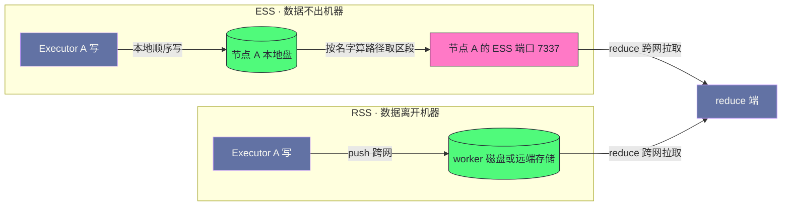
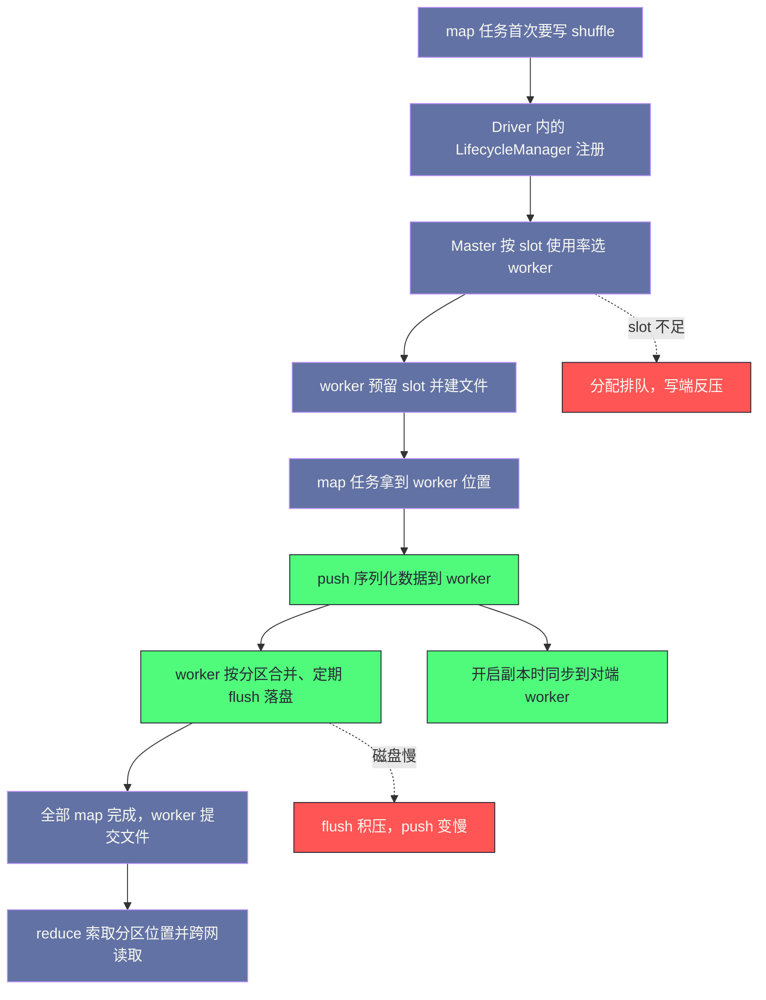
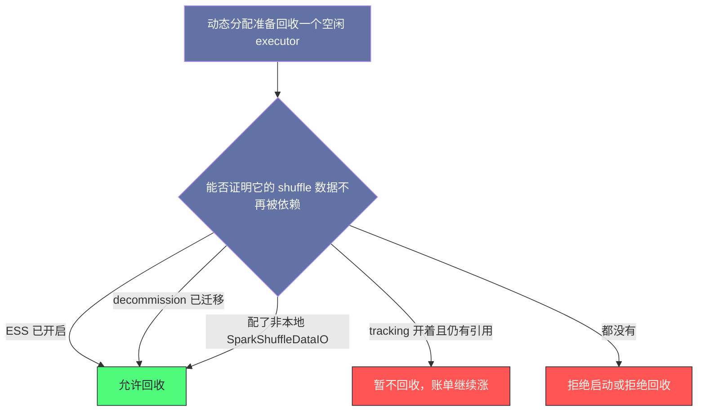
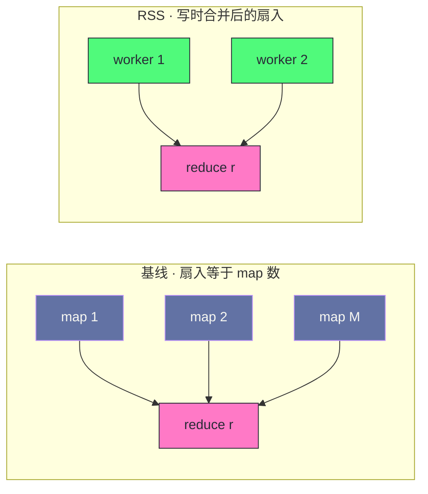
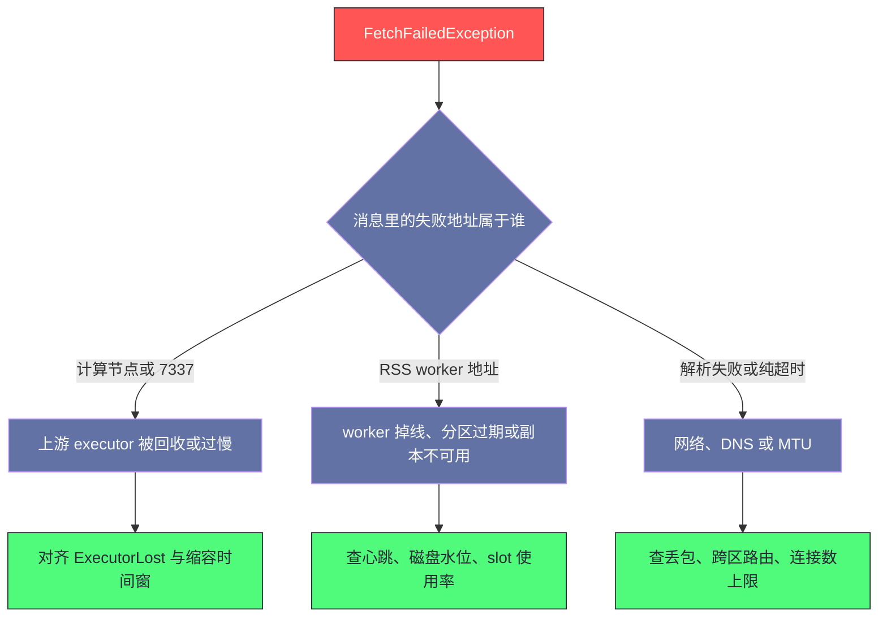

# 11 Remote Shuffle Service：解耦计算与 Shuffle 存储

**摘要：**

「缩容窗口里丢了 shuffle 文件」是这一层最典型的现场，而它的解法常常被讲成一个词汇问题：开 ESS 还是上 RSS。本篇按运维判据来写。先把 RSS 要解决的四个痛点分开——动态缩容丢文件、存算分离下本地盘不可用、弹性伸缩丢扇入、多租户共享容量——每个痛点给一条能证伪的判据，并指出 ESS 与 Shuffle Tracking 各自的坑。再给出本篇的关键区分：ESS 解耦的是 executor 与文件，RSS 解耦的是机器与文件；ESS 允许回收进程，只有 RSS 允许回收机器，两者不是同一件事的新旧版本。随后核实主流实现的版本与现状，把接入的三个开关与 Spark 4.x 的 IO 插件解释清楚，说明 fallback 策略为何必须与 ESS、shuffle tracking、decommission 三条安全线自洽。选型这一层最容易犯的错，不在一开始的架构比较，而在接入之后几个开关的组合互相矛盾——那类问题不会让作业立刻失败，只会让它悄悄变慢。核心交付是一张场景判据表、一次网络字节与容量的核算（示例推算）、以及 RSS 自身成为新单点之后的六种故障形态与首查位置。

---

## 第 1 章 一个缩容窗口里的八分钟

三百节点的集群，每天两千个作业，其中有一批跑在 Kubernetes 的 spot 节点池上。`daily_join` 是这批作业里最重的一个：日增表与维表关联，两个 shuffle，第二个 shuffle 写出约 1.2TB，reduce 侧两千个分区，正常四十分钟跑完。某个周二的凌晨两点十四分，它在第二个 shuffle 的边界上卡住了。

当时的动作顺序很平常。集群按 CPU 水位缩容，四十分钟里缩掉了三十多个 Pod；缩容本身是成功的，Pod 收到了优雅退出的信号，`ExecutorLost` 一条条出现在 Driver 日志里，全是预期内的。但下游 stage 起来之后，reduce 任务开始报 `FetchFailedException`，重试三次、十五秒之后，stage 被重提；重算出来的 map 输出落到新起的 Pod 上，十几分钟后下一轮缩容又把这些 Pod 收走，于是再来一轮。四次之后撞上 `spark.stage.maxConsecutiveAttempts` 的熔断，作业失败。从第一次 `FetchFailed` 到失败，八分钟。

值班同学先查了三处，都没有结论：网络没丢包，交换机侧无异常；磁盘没满，节点磁盘使用率不到六成；executor 日志干净，退出是被通知的，不是被杀。这三处恰好构成了一个提示——故障**不在计算层**，也不在存储介质的健康度上，而在「谁来**托管**这批 shuffle 文件」这一层。文件本身是好的，写它的进程也是好的，只是进程走了，文件的地址簿却没有跟着改。

这一层的问题有它自己的形状：它不出现在 CPU、内存、磁盘的曲线上，只在 stage 边界上以 `FetchFailed` 的形式出现，而且总与资源回收的时间窗重合。本篇要回答的是，当 shuffle 数据的落点必须与计算节点解耦时，业界的几种做法各自把哪一段解耦了、代价落在哪里、什么场景下不该做。至于机制细节——ESS 的注册表与路径规则、`MapStatus.location` 那一次地址偷换、push-based shuffle 的四道闸门——内核系列已经推到源码级，本篇只引用结论并逐处标注路由，不重复推导。

> [!info] 与机制篇的分工
> 块归属怎么记、ESS 怎么按同一套路径规则算出文件位置、`shuffleServerId` 怎么被换掉：见 [[大数据/Spark/读书笔记-spark内核/05_Shuffle核心机制/7. Spark_Shuffle与Storage交互|Shuffle 与 Storage 交互]] 第 5 章。可插拔的三层边界（manager、writer、DataIO）见 [[大数据/Spark/读书笔记-spark内核/05_Shuffle核心机制/2. Spark_Shuffle框架设计与实现|Shuffle 框架设计与实现]] 第 7 章。`FetchFailed` 之后 Spark 怎么重提、怎么熔断，本篇只讲怎么分诊，处置路径见 [[大数据/Spark/Spark-Shuffle与内存管理机制深度解析/10 生产调优手册：从症状到根因的系统性诊断|生产调优手册：从症状到根因的系统性诊断]] 第 5 章。

---

## 第 2 章 四个痛点，四条判据

「RSS 解决什么问题」这句话在文档里通常被写成三类瓶颈，落到运维现场却是四类，因为第一类里藏着两个不同的失效机制：主动回收与被动驱逐。笔者按这条线把四个痛点拆开，四类分开，解法才不会混。

### 2.1 缩容丢文件：ESS 与 Shuffle Tracking 各有各的坑

内核系列把这条矛盾的解法归结为三条：外部 shuffle 服务（ESS）、shuffle tracking、优雅下线迁移。三条都不完美，坑的位置还不一样。

ESS 的坑在「机器」这个粒度上。它把「文件归谁读」从写它的进程里剥离出来，读请求打到那台机器上常驻的 7337 端口，服务按与写端同构的路径规则去本地盘取区段。这套设计的前提是一句很朴素的话：机器还活着。云上节点池的 scale-in 往往直接 terminate 实例，机器没了，本地盘上的文件跟着消失，ESS 做得再好也无从接管。所以 ESS 能救「executor 被 DRA 回收」，救不了「节点被回收」。

ESS 的第二个坑在部署形态上：它依赖部署层提供「常驻进程 + 辅助服务注册」，YARN 有 aux-service，Standalone 有 Worker 拉起，Kubernetes 没有等价物，容器化集群因此绕不开 RSS。

ESS 的第三个坑很琐碎，却最容易在事故复盘里被翻出来：`spark.shuffle.service.enabled` 必须让 Driver 与 Executor 同时看到同一个值。客户端提交参数与集群默认配置不一致时，地址簿会一半指 7337、一半指 executor 自己的传输端口，症状是随机的、只在某些提交方式下复现的 `FetchFailed`。这类故障没有任何指标特征，只能靠比对两处配置。

Shuffle Tracking 的坑在另一个方向。它不延长数据的寿命，而是延长持有数据的 executor 的寿命：`MapOutputTracker` 本来就知道每个 shuffle 的输出落在哪些 executor 上，动态分配在回收前问一句「后面还有 Stage 要用吗」，就能避免还错。`spark.dynamicAllocation.shuffleTracking.timeout` 的默认值是 `Long.MaxValue`，也就是只要还有引用就一直等——这正是它最常见的抱怨来源，负载明明已经下来，executor 却迟迟不释放，账单按小时涨。

更要紧的是它挡不住被动驱逐。tracking 的记账发生在 Driver 的回收决策里，而 spot 抢占、节点故障、kubelet 因 `ephemeral-storage` 超限驱逐 Pod，这些动作都发生在 Driver 的决策之外，不给你「先别还」的机会。所以这两条路的分工可以用一句话概括：ESS 是**数据侧保命**，tracking 是**进程侧拖延**，而抢占不给你拖延的时间。

判据在这里是「回收是主动的还是被动的」：

- 主动回收（DRA 缩容、下线维护、队列抢占自己发起的缩容）：tracking 与 decommission 都有效，成本最低，不需要新组件。
- 被动驱逐（spot 抢占、节点故障、kubelet 驱逐）：只有把数据搬出那台机器才有用，也就是 ESS 不够、必须 RSS。
- 确认方法看时间线而不是看指标：把 Stage 重提记录里失败的 mapId 拉出来，与 `ExecutorLost`、`TaskKilled`、`Evicted` 的时间戳对齐；如果失败的 map 分区集中在一批刚退出的 executor 上，且这个时间窗与缩容重合，基本可以定性为托管层问题。反过来，如果 `FetchFailed` 分散在多个 shuffle、多个节点上，与缩容窗口无关，就该往网络与磁盘层查。

### 2.2 存算分离：本地盘不再是可依赖的落点

Kubernetes 上 executor 的 `spark.local.dir` 通常落在 `emptyDir` 或节点临时盘上，两者看起来都绑在节点上，真正决定数据存活时长的却都不是「节点」这个对象。

`emptyDir` 与 Pod 同生共死。这里有一处极常见的误判：以为在节点上跑一个 ESS 的 DaemonSet 就能托管 `emptyDir` 里的 shuffle 文件。不行。ESS 的路径规则要求解析出来的绝对路径仍落在注册的那些本地目录之内（内核系列讲过这道校验的动机），而 `emptyDir` 的目录在 Pod 删除时就跟着删了，守护进程拿到的路径存在、内容为空——它读到的不是数据，是一个刚被重建的空目录。这个误判在测试环境往往不暴露，因为测试环境很少真正驱逐 Pod。

`hostPath` 能把数据留在节点上，代价是把「Pod 无状态」换成了「节点有状态」：后续 stage 的 Pod 必须被调度回同一批节点，否则读不到。这恰恰是 RSS 要消除的约束，用一个调度约束换一个存储约束，账并没有算平。

临时盘还有第三层风险，比 `FetchFailed` 更早也更隐蔽：`ephemeral-storage` 是驱逐信号。shuffle 写到把 nodefs 打满，kubelet 先驱逐 Pod，作业看到的是 `Evicted`，退出码 137，日志里没有 `FetchFailed`，只有一段「容器被驱逐」的记录。这时候去查 shuffle，方向就错了。

判据：查 Pod spec 里 `spark.local.dir` 对应的卷类型——`emptyDir` 意味着这条路只有 RSS 能走通；查节点的 `Evicted` 事件与 nodefs 使用率曲线；查 executor 退出码与 `ExecutorLost` 的因果链里有没有 kubelet 参与。三条里只要有一条指向「文件随 Pod 消失」，本地 shuffle 这条路就已经被堵死了，与磁盘性能无关。

### 2.3 弹性伸缩：丢的不是本地性，是扇入

弹性伸缩与 shuffle 的关系，常见的叙述是「数据本地性丧失」。按这个说法去优化会走偏，因为基线的 reduce 读本来就是远端读：map 写在本机磁盘，reduce 从 map 节点跨网络拉，所谓本地性只是「文件与读它的 reduce 恰好同机」这个概率。容器调度下这个概率近似为零，也就没什么可丧失的。

弹性伸缩真正丢掉的是三样更具体的东西。

其一是扇入。基线里每个 reduce 要向 M 个 map 节点各发一次请求，M 是 map 任务数；RSS 在 worker 侧做写时合并，同一个分区的数据从多个 map 汇聚到少数几个 worker，reduce 的扇入从 M 降到 k。这一步降的是连接数与随机读次数，不是数据量。

其二是写路径的确定性。基线写本地盘，延迟只受本机磁盘与 spill 竞争影响；RSS 写远端，延迟里多进了网卡、worker 的 flush 与流控。写路径从「只受自己影响」变成「受别人影响」，这是可用性与延迟之间的一次交换。

其三是失败的可归因性。基线的 `FetchFailed` 能追到具体 executor，进而追到那次缩容；RSS 下同样的异常要追到 RSS worker，而 worker 是一个与作业无关的共享组件，追起来需要另一套监控。这一条会在第 8 章展开。

判据：看 Stage 页面上 `Shuffle Read` 的 `fetch wait time` 与 `remote bytes read` 之比，以及块请求的数量级。如果 fetch 慢、但网络与 RSS 侧都正常，问题在扇入与分区数这一层，先调分区与合并，而不是加带宽。

### 2.4 多租户：容量是共享的，隔离不是

ESS 是各机器自治的形态，没有共享容量池。三百台机器上本地盘使用率分布很宽，示例推算 p50 四成、p95 八成五，因为 map 任务落在哪台机器由数据与调度决定，不由磁盘余量决定。个别节点被打满，该节点上新起的 executor 就写不进去，而集群整体看还有大量空闲磁盘。

RSS 给出的是一个共享池，这一点确实解决了不均衡。Celeborn 的做法是用 slot 做逻辑容量：一个 worker 的 slot 数由「该盘可用空间 / 平均 shuffle 文件大小」估出来，Master 按 slot 使用率决定把新分区分配到哪个 worker，而不是按机架或轮询。

共享池带来两个新问题。

第一个是配额。共享池天然没有应用级的硬边界，一个写出二十 TB 的作业可以把池子占满，其他作业的 push 会失败或排队。隔离得靠外部手段：YARN 队列、Kubernetes 命名空间配额、或者干脆按业务线部署多套 RSS 集群。指望 RSS 自己把多租户隔开，是把容量池当成了调度器。

第二个是隔离的粒度。隔离的单位是 slot，不是 IOPS。同一个 worker 上的两个作业共享同一块盘、同一张网卡，磁盘 I/O 竞争被集中而不是被消除——RSS 把「三百台机器上分散的争抢」换成了「二十台 worker 上集中的争抢」，只有当 worker 的磁盘与网络按并发峰值配置时，这个交换才成立。

判据：看计算节点磁盘使用率的 p95 与打满节点数（区分「不均衡」与「全都不够」）；看 RSS 侧 slot 使用率曲线与 push 失败率；看是否有单个作业的 shuffle 量与池容量处在同一量级——一旦出现，容量规划就已经失效了，与实现选型无关。

下面这张表把四个痛点的判据收在一起。表的最后一列是用来反向排除的：如果某一行判据不成立，就不该往那一行的解法上投入。

| 痛点 | 典型现象 | 首查位置 | 常见误判方向 | 该层解法 |
|---|---|---|---|---|
| 缩容丢文件 | stage 边界 `FetchFailed`，与缩容时间窗重合 | Stage 重提记录里失败的 mapId 与 `ExecutorLost` / `Evicted` 时间线 | 当成网络丢包或磁盘故障 | 主动回收用 tracking 或 decommission；被动驱逐用 RSS |
| 本地盘不可用 | `Evicted`、退出码 137、`emptyDir` 随 Pod 消失 | Pod spec 的卷类型、节点 nodefs 使用率 | 以为 ESS DaemonSet 能接管 `emptyDir` | `hostPath` 加重调度约束，或 RSS |
| 弹性伸缩 | fetch 慢但网络正常，块请求数极大 | Stage 页 `fetch wait time` 与 `remote bytes read` | 当成带宽不足而加网卡 | 降扇入：合并、调分区、RSS |
| 多租户争抢 | 少数节点磁盘打满、作业排队 | 磁盘使用率 p95、RSS slot 使用率、push 失败率 | 当成单作业倾斜 | 专用池加应用级配额，或分集群部署 |

---

## 第 3 章 ESS 与 RSS：解耦的不是同一个东西

这两者常被并列成「上一代」与「下一代」，这个并列是错的。它们解耦的对象不同，能容忍的资源回收动作也不同，理解这一点之后，选型问题会从「哪个更先进」变成「我要回收的是什么」。

ESS 的做法前面提过一句：守护进程常驻每台计算节点，executor 上线时登记本地目录、离开后登记仍在，读请求打到 7337，服务算出文件位置、取出区段、把这段文件推进 socket。数据不出机器，块也不进服务内存，换来的是可读窗口从进程寿命延长到机器寿命。

RSS 的做法把数据搬出了计算节点。以 Celeborn 为例，Driver 进程里跑一个 `LifecycleManager`，map 任务第一次要写 shuffle 时由它向 Master 注册，Master 按 slot 使用率把分区分配到 worker，worker 预留 slot 并建文件，map 任务拿到位置之后用 Netty 把序列化数据 push 过去，worker 侧按分区合并、定期 flush 到盘，全部 map 完成后 worker 提交文件，reduce 再向 worker 要分区位置去读。这条链路上，计算节点从头到尾没有落过 shuffle 数据。

两相对照，ESS 解耦的是 **executor 与文件**，RSS 解耦的是**机器与文件**。用一句更直白的话讲：ESS 允许你回收进程，RSS 才允许你**回收机器**。缩容窗口里出的问题如果发生在「进程被回收」这一层，ESS 够用；发生在「机器被回收」这一层，ESS 无论怎么配都不够。

下图把两种形态的落点与读取路径并排放。左边数据留在机器里，右边数据离开机器；两条链的末端都是 reduce 的跨网拉取，差别只在写路径有没有出机器。

这里有一处流传很广的口径需要更正：说 RSS「额外增加了两次网络传输」，不准确。基线里数据本来就跨一次网——reduce 从 map 节点读，这一次网络传输是 Shuffle 的固有成本；RSS 里数据跨两次网，push 一次、读一次。所以准确的表述是**网络字节翻倍**、连接数与随机读下降，而不是凭空多出两跳。这个差别在核算容量时很关键：多出来的是「一份数据在网络上走了两遍」，不是一个固定延迟。

第二处需要更正的，是 push-based shuffle 的定位。Spark 3.2 引入的这条路（`spark.shuffle.push.enabled` 默认关闭，且需要外置服务侧配置合并实现，见内核系列 Shuffle 框架演进那一篇的第 8.4 节）常被当成 RSS 的一种，其实不是。它的合并器就是本机的 ESS，合并后的块仍在 executor 所在的节点上，它减少的是 reduce 侧的扇入（读的块少了、大了），并没有让数据离开机器。因此它解决不了节点回收，甚至解决不了 executor 回收——这两件事仍然依赖 ESS 本身。判断一条路径是不是 RSS，标准只有一条：数据有没有离开计算节点。

| 维度 | 本地 Sort Shuffle | ESS | push-based 合并块 | RSS |
|---|---|---|---|---|
| 数据落在哪 | executor 本地盘 | 同一台机器的本地盘 | 同一台机器上 ESS 的合并目录 | 独立集群的 worker |
| 读的跳数 | 一次跨网 | 一次跨网 | 一次跨网，块更少更大 | 一次跨网，块更少更大 |
| 一次 shuffle 的网络字节 | 约 1 份 | 约 1 份 | 约 1 份（合并不额外传输） | 约 2 份，开副本约 3 份 |
| 读的扇入 | M（map 数） | M | 降到 k（合并块数） | 降到 k |
| 能容忍回收什么 | 什么都不行 | executor 进程 | executor 进程 | 节点与进程 |
| 单个故障的影响面 | 单作业 | 单节点的若干作业 | 单节点的若干作业 | 全池所有作业 |
| 额外常驻进程 | 无 | 每台计算节点一个 | 每台计算节点一个 | 独立集群的 Master 与 Worker |
| Kubernetes 可用性 | 有状态、受限 | 无等价物 | 无等价物 | 原生适配 |
| Spark 侧入口 | 无 | `spark.shuffle.service.enabled` | `spark.shuffle.push.enabled` | `spark.shuffle.manager` |

这张表里最右两列常被混淆，差别就在「数据落在哪」那一行：合并块没有离开节点，所以它买到的是读性能，不是可回收性。

---

## 第 4 章 主流实现与它们的现状

选型的第一件事不是比架构，而是核实两件很朴素的事：它还在维护吗，它支持我的引擎版本吗。RSS 这个领域在 2024 到 2025 年完成了一轮洗牌，结论与两年前的资料差别不小。

Apache Celeborn 出身于阿里云 EMR 内部的远程 shuffle 服务，2020 年在内部立项，2021 年 12 月对外开源，2022 年 10 月捐给 Apache 基金会进入孵化，2024 年 4 月毕业成为顶级项目。截至本文写作，最新版本是 0.6.2（2025 年 12 月 8 日发布），0.6 线从 2025 年 7 月开始，此前是 0.5 线（2025 年 3 月的 0.5.4）。它的客户端覆盖 Spark 3.0 到 4.2、Flink 1.18 到 2.3、Hadoop MapReduce 3，另有一个实验性的 Tez 客户端。组件是 Master、Worker、Client 三件，Master 之间用 Raft 同步状态，生产建议至少 3 个 Master、4 个 Worker。

Apache Uniffle 出身于腾讯，2021 年开源，2025 年 3 月毕业成为顶级项目。最新版本是 0.10.0（2025 年 9 月 25 日），0.9.2 在 2025 年 1 月。组件是 Coordinator 与 ShuffleServer，远端存储可选；存储形态有三档，纯内存加本地盘、内存加远端存储、以及内存加本地盘加远端存储，官方推荐生产用第三档。它的客户端覆盖 Spark 2.3 到 3.5、MapReduce、Tez，另外提供了一个 Kubernetes operator 用于部署。

Uber 的 Remote Shuffle Service 是这个方向的先行者，SPARK-25299 那份关于 shuffle 可靠性的讨论基本由它推动。但它现在只能作为历史参考：master 分支对应 Spark 2.4，`spark30` 分支对应 Spark 3.0，仓库最后一次实质提交在 2023 年初，此后没有跟进 Spark 的新 API。把它当候选方案，等于把作业绑在一个停更的客户端上。

| 实现 | 出身与时间线 | 最新版本 | 支持的引擎 | 部署要点 |
|---|---|---|---|---|
| Apache Celeborn | 阿里云 EMR 内部 2020 年立项，2021-12 开源，2022-10 进孵化，2024-04 成为顶级项目 | 0.6.2（2025-12-08） | Spark 3.0 至 4.2、Flink 1.18 至 2.3、MR 3、Tez（实验） | Master 用 Raft 选主，生产建议至少 3 Master、4 Worker；Spark 4.x 仅 Java 17 加 Scala 2.13 组合 |
| Apache Uniffle | 腾讯，2021 年开源，2025-03 成为顶级项目 | 0.10.0（2025-09-25） | Spark 2.3 至 3.5、MR、Tez | Coordinator 心跳式管理，客户端配置可由 Coordinator 动态下发；提供 Kubernetes operator |
| Uber RSS | Uber，SPARK-25299 的产物 | 无新版本 | Spark 2.4（master）、Spark 3.0（`spark30` 分支） | 2023 年初之后停更，仅作历史参考 |

这张表里有两条对 4.x 用户最要紧的推论。

第一条，客户端与引擎版本必须对齐，而且不是「支持 4.x」这么粗。Celeborn 的兼容性矩阵里，Spark 4.0、4.1、4.2 三行只有 Java 17 配 Scala 2.13 一个勾，其余组合全不支持；这意味着在一套混合了 Java 8 的遗留集群上，Spark 4 的作业只能单独走一套构建。更要紧的是，4.3.0 未必在任何已发布客户端的 profile 里——选型时要去发布页核对客户端模块覆盖到哪个小版本，别把「支持 4.x」直接当成「支持你的 4.3.0」。

第二条，Uniffle 的 README 列出的 Spark 版本止于 3.5。这不代表它不支持 4.x，只能说明在写这份文档的时点上，官方口径还没有把 4.x 写进去。凡是这类「版本缺口」，都要以发布页与 release notes 为准，并且在自己的版本组合上跑一遍最小验证，而不是看博客里的二手结论。

部署形态上两者也有取舍：Celeborn 的 Master 用 Raft 选主、元数据一致性复制，Uniffle 的 Coordinator 走心跳、客户端配置可由 Coordinator 动态下发（`rss.coordinator.dynamicClientConf.enabled`）。前者对强一致要求更高，后者更便于集中治理配置，按团队已有的运维习惯定。

下图把 Celeborn 的一次 shuffle 生命周期画出来。这张图要说明的是，RSS 不是「把数据写到另一个地方」这么一句，它有注册、分配、提交三段控制面动作，这三段各有自己的超时与失败形态。

图里两条虚线是后面第 8 章要用的失败入口：slot 不足与 flush 积压。它们在 Spark 侧的表现都不是异常，而是「变慢」，这让它们很难被发现。

---

## 第 5 章 接入：三个开关与一个插件

把作业接到 RSS 上，改的配置不多，但每一处都牵着另一处，改错一个就会出现「能跑但不对」的状态。

第一处是 `spark.shuffle.manager`。Celeborn 的实现在 0.3.0 之后叫 `org.apache.spark.shuffle.celeborn.SparkShuffleManager`，之前叫 `RssShuffleManager`；Uniffle 是 `org.apache.spark.shuffle.RssShuffleManager`。类名换代这件事在旧资料里留下了大量过时写法，按旧类名配下去的结果是启动时报类找不到，或者更糟——被别的 jar 里同名的类接住。

第二处是 `spark.shuffle.service.enabled`。Celeborn 的官方配置建议里把它写成 `false`，注释里补了一句「若你的外部 shuffle 服务是 Spark 3.1 或更新版本，则不必」。这句话容易被读成「必须关掉」。不过实际情况是：RSS 的 manager 自己就是取数方，ESS 那条「把地址簿里的端口换成 7337」对它没有意义，所以开着只是多一个没人读的守护进程；关掉它，省下的是每台计算节点上一个进程和一套路径实现。真正必须处理的是第三处。

第三处是 `spark.shuffle.sort.io.plugin.class`，也就是 Spark 4.x 语境下说的 IO 插件。它 3.0 就引入了，默认值 `LocalDiskShuffleDataIO`，本意是给本地磁盘的读写实现留一个替换入口（三层插拔的划分见内核系列第 7 章）。但在 RSS 场景里，它的用途并不是数据通道——读写仍由 manager 接管——而是给动态分配的安全检查提供一份「外部 shuffle 存储存在」的声明。

Spark 的动态分配在回收 executor 之前要能证明「它上面的 shuffle 数据后面不再需要」，本地 shuffle 时代这件事由 ESS 担保，方式是地址簿指向常驻服务。RSS 把数据搬走之后，Spark 的本地记账里看不到任何担保物，于是 3.5 起 DRA 的检查里多了一条：是否配置了非本地的 `SparkShuffleDataIO`。配了就当作外部 shuffle 存储存在，允许回收；没配，又没开 ESS 与 decommission，动态分配直接拒绝启动。Celeborn 的 `CelebornShuffleDataIO`、Uniffle 的 `RssShuffleDataIo` 都服务于此。

与它配套的是 fallback 策略。Celeborn 有 `spark.celeborn.client.spark.shuffle.fallback.policy`，取值 AUTO（默认）、ALWAYS、NEVER：AUTO 与 ALWAYS 在 Celeborn 不可用时回退到本地 shuffle，NEVER 则让应用直接失败，以保住「数据只在 Celeborn」的语义。官方文档明确写了，AUTO 与 ALWAYS 的代价是必须保留 shuffle tracking，否则回退出来的本地数据无人托管。

于是「上 RSS 但不开 ESS 兼容模式」这条反例的正确形态就清楚了：不是必须开 ESS，而是 fallback 与三条安全线（ESS、tracking、decommission）的组合必须自洽。两种坏组合最常见：AUTO 加关 ESS 加关 tracking，回退时本地盘数据没有任何托管者，DRA 也可能拒绝启动；NEVER 加开着 tracking，数据根本不落本地，tracking 白等，空闲 executor 永远不释放。

下图把这套检查画成分支。四条分支里，只有配插件这一条不依赖任何常驻组件，这也是容器化集群上它显得重要的原因。

余下的配置里，有两处是真正会影响内存与容量的，值得单列。

一处是写者类型。Celeborn 有 hash 与 sort 两种 shuffle writer，官方对 hash 写者的内存账写得毫不含糊：内存占用约等于分区数乘 push buffer 上限再乘 executor 核数。按两千个分区、256KB 的 buffer 上限、8 核计算，就是 **4GiB**——这还没算进 Spark 自己的执行内存。分区数上到几千，hash 写者的内存账会先撞上容器上限，这时该换 sort 写者，代价是 CPU 与排序开销。这条数字是本篇最值得记住的一处「配置不是免费的」。

另一处是副本。`spark.celeborn.client.push.replicate.enabled` 默认关闭，官方建议生产打开，但有两条例外：只有一个 worker 时必须关，用 HDFS 作后端时建议关。打开之后，容量翻倍、网络从两份变三份。副本解决的是 worker 级故障，不解决 Master 级故障，两者不要混为一谈。

| 配置 | 默认与取值 | 作用 | 调大或调小的代价 |
|---|---|---|---|
| `spark.shuffle.manager` | 默认 `sort`；RSS 填全类名 | 决定整套 shuffle 由谁实现 | 切到 RSS 后所有 shuffle 走远端，回退需改配置重启，无法在作业内切换 |
| `spark.serializer` | 默认 Java 序列化 | RSS 要求可重定位的序列化器，通常填 Kryo | 换序列化器后 CPU 与兼容性都要重测，历史数据格式也要考虑 |
| `spark.shuffle.service.enabled` | 默认 false | RSS 下不再需要 ESS 提供读服务 | 保持 true 每台机器多一个守护进程；关掉则本地回退失去兜底 |
| `spark.shuffle.sort.io.plugin.class` | 默认 `LocalDiskShuffleDataIO` | 给动态分配提供外部 shuffle 存储的声明 | 不配则 DRA 找不到担保物，直接拒绝启动 |
| `spark.dynamicAllocation.shuffleTracking.enabled` | 默认 true | AUTO 与 ALWAYS 回退策略的兜底 | 关掉能及时释放空闲 executor，但回退数据无人托管；开着则缩容不生效 |
| `spark.celeborn.client.spark.shuffle.fallback.policy` | 默认 AUTO，可选 ALWAYS / NEVER | 决定 Celeborn 不可用时回退还是失败 | NEVER 语义干净但抖动直接变作业失败；AUTO 需要安全线配套 |
| `spark.celeborn.client.spark.shuffle.writer` | hash 或 sort | 选择写端实现 | hash 内存约等于分区数乘 buffer 上限乘核数；sort 省内存但多付排序成本 |
| `spark.celeborn.client.push.replicate.enabled` | 默认 false，生产建议 true | 服务端复制副本 | 打开后容量翻倍、网络约三份；单 worker 或 HDFS 后端必须关 |
| `spark.celeborn.client.push.buffer.max.size` | 示例 256k | 单次 push 的批大小上限 | 调大批次减少往返但抬高内存与尾延迟；调小则控制面开销占比上升 |
| `celeborn.worker.flusher.buffer.size` | 示例 256k；HDFS 后端至少 4m | worker 落盘的批大小 | 调大提升顺序性、加大内存占用；调小则小文件多、commit 慢 |
| `spark.sql.adaptive.localShuffleReader.enabled` | 默认 true，RSS 下建议 false | AQE 的本地读优化 | 保持 true 会让部分 reduce 走本地，远端合并的收益被削弱，但不影响正确性 |
| `celeborn.master.slot.assign.policy` | 示例 roundrobin，以官方文档为准 | 分区到 worker 的分配策略 | 只影响均衡性与局部性，不改变池子的总容量 |

表里前六行是策略性的、定下来就少动，后六行会随作业形态反复调。把它们混在一起调，是上线初期最常见的时间浪费。

---

## 第 6 章 代价：多出来的那一跳

所有「要不要上 RSS」的讨论最后都要落到一笔账上：多出来的那一跳值不值。这笔账由三部分组成，网络、延迟、容量，三者的量级差得很远。

先说网络。基线的一次 shuffle，数据在网络上走一遍（reduce 读），网络字节约等于 shuffle 量。RSS 下数据走两遍（push 一遍、读一遍），字节翻倍；打开服务端副本后，worker 之间还要复制一遍，逼近三倍。这是硬成本，没有优化空间，只能在容量规划里算进去。作为交换，读的扇入从 M 降到 k：一个两千 map、两千 reduce 的 stage，基线要发生约四百万次块请求，RSS 在写时合并之后，每个 reduce 只向少数几个 worker 取块。示例推算：同样的数据量下，网络字节从 1 份变 2 份，连接数与请求数下降两到三个数量级。

下图把扇入的变化画出来。左半边是基线的 M 对 1，右半边是合并后的 k 对 1；箭头数量就是连接数，这一点在 reduce 数很大时最明显。

再说延迟，这里有一个很常见的误算，笔者在复盘里见过不止一次。人们习惯把 push 的额外延迟算成「RTT 乘以批数」，于是得出结论说批越小越糟。按示例推算：256KB 的批在 25GbE 上传输约 80 微秒，在 10GbE 上约 205 微秒，而同机房 RTT 在 0.1 到 0.3 毫秒之间——固定成本由 RTT 主导，与批大小关系不大。但单条流的吞吐上界是批大小乘并发数除以 RTT，按上限三十二个并发请求算，256KB 的批在 0.2 毫秒 RTT 下的理论上界约 40GB/s，远高于网卡；也就是说在 25GbE 及以上的机器上，push 的瓶颈从来不是 RTT，是**网卡带宽**。

所以正确的判断口径不是「RTT 有多小」，而是「网络余量有多大」。仍以单个 executor 的 3.4GB 输出为例：25GbE 上网卡占用约 1.1 秒，10GbE 上约 2.7 秒，1GbE 上约 27 秒；若一个 map stage 的执行时间在一分钟量级，前两者占比不到百分之五，后者接近一半，RSS 多出来的那一跳在 1GbE 上就不再是噪声。这也是云上比自建机房更适合 RSS 的原因之一：云上实例的网络配额通常比本地盘宽裕。

第三部分是容量，也是最容易算错的一部分。

| 维度 | ESS 形态 | RSS 形态 |
|---|---|---|
| 容量从哪来 | 每台计算节点的本地盘，按比例划给 shuffle | 独立集群的 worker 磁盘，或 worker 挂的远端存储 |
| 单点上限 | 单节点可用空间，节点之间不互借 | 全池总量，worker 之间由 slot 调度互借 |
| 失败粒度 | 局部：少数节点打满，影响该节点上的作业 | 全局：池子打满，所有用它的作业一起受影响 |
| 扩容动作 | 加计算节点，被动扩容 | 单独扩 worker，与计算规模解耦 |
| 规划依据 | 单作业峰值乘并发作业数，再按节点分布打折 | 并发 shuffle 峰值乘单作业量乘安全系数，按 slot 折算 |
| 副本的代价 | 无副本，靠重算 | 副本打开时容量翻倍、网络约三份 |

**示例推算**：三百节点、每节点两块 1.9TB 的 NVMe，本地盘总量约 1.14PB，按两成划给 shuffle，约 228TB；同一集群配二十台 RSS worker、每台四块 3.84TB，池子约 307TB。数字上两者接近，差别在形状：ESS 的 228TB 是三百份分散的空闲空间，任何一份不够就失败，且与 spill 抢同一块盘；RSS 的 307TB 是一个能互借的池子，但要按并发峰值预留，留少了就是全局故障。

还有一处容易漏的容量项：slot 数不是无限的，它由「可用空间除以平均 shuffle 文件大小」估出来。文件大小估得偏大，slot 就偏少，磁盘还有空但分配不出来；估得偏小，slot 偏多，元数据与 commit 开销上去了。这个估计值在作业形态变化（分区数变化）时会失准，所以容量规划要看 slot 使用率与磁盘使用率两条线，而不是只看磁盘。

---

## 第 7 章 判据表与五问

到了这一步，选型可以写成一张表。表的用法是先定位自己的场景，再看「反向信号」那一列——反向信号出现，说明这一行的推荐不成立，要换行。

| 场景 | 更合适的选择 | 理由 | 反向信号 |
|---|---|---|---|
| Kubernetes 加 `emptyDir`，缩容频繁 | RSS | 本地盘随 Pod 消失，ESS 无等价物 | 作业全是短任务，shuffle 量小 |
| Kubernetes 加 `hostPath` NVMe，节点稳定 | ESS 自建或 shuffle tracking | 省一跳网络，方案更简单 | 需要 Pod 任意漂移 |
| YARN 加裸金属，本地盘充足 | ESS | aux-service 现成，成本最低 | spot 抢占比例高 |
| spot 或抢占式实例为主 | RSS | tracking 挡不住被动驱逐 | 抢占窗口远大于作业时长 |
| 多租户共用集群、磁盘争抢明显 | RSS 加应用级配额 | 专用池能隔离争抢 | 单作业量已接近池容量 |
| 单个 shuffle 数百 GB、reduce 数极大 | RSS | 合并读把扇入降下来 | 网络余量不足两倍 |
| 小作业为主，单 shuffle 数十 GB 以下 | 不上 RSS | 控制面与网络成本摊不平 | 稳定性问题集中在缩容窗口 |
| 计算与 RSS 跨可用区或跨地域 | 不上 RSS | RTT 与带宽把收益吃掉 | 同城双活且专线充裕 |
| 已有 HDFS、能接受读延迟 | worker 无盘的 RSS | 免去 worker 本地盘运维 | 读路径要求低延迟 |

表只是结论，支撑结论的是五个问题。它们按顺序问，前一个答完才轮到后一个，因为后面的答案依赖前面的。

第一问，我的计算资源是被主动回收还是被动驱逐。这是分水岭。主动回收（DRA 缩容、维护下线）用 tracking 加 decommission 就能解决，不需要新组件；被动驱逐（抢占、故障、驱逐）只有把数据搬出机器才有用。判据是过去一个月的 `ExecutorLost` 里，有多少比例的退出原因不是「空闲回收」——这个比例超过三成，tracking 这条路基本走不通。

第二问，我的 shuffle 数据有没有一个不随 Pod 和节点消失的落点。`emptyDir` 是明确的「没有」，`hostPath` 是「有，但要付调度约束的代价」。没有落点，就只能在 RSS 与「接受重算」之间选。

第三问，网络余量够不够。算法很直接：单个 executor 的峰值输出量除以网卡带宽，得到的线速时间要显著小于任务执行时间。判据是余量至少两倍。跨可用区的 RSS 还要再乘一个 RTT 系数，这一条经常被忽略，直到上线后发现 fetch 变慢。

第四问，谁来扛全局故障。RSS 的故障域比 ESS 大一个数量级：ESS 挂一台，损失一个节点的作业；RSS 池打满或 Master 不可用，影响所有接入的作业。所以问题不是「RSS 会不会出问题」，而是「出问题时有没有降级路径」——fallback、ESS 并行保留，或者至少一个能快速切回本地 shuffle 的开关。

第五问，fallback 策略与三条安全线自洽吗。这是最容易在配置阶段埋雷的一问，两个坏组合在第 5 章已经列过。判据是画一张两列的表：左边写 fallback 取值，右边写 ESS、tracking、decommission 的开闭，逐行检查有没有「数据无人托管」或「担保物不存在」的组合。

五问全过，才轮到比实现。有一个场景往往在前三问就被排除：本地盘充足、节点稳定的裸金属集群。在这个场景里 RSS 买不到任何东西，只能买到一跳网络和一个新故障域。

---

## 第 8 章 失败模式：RSS 自己成了新的单点

RSS 把故障域从「每台机器」搬到了「一个集群」，这个动作减轻了单点故障的影响，同时制造了一个影响面更大的组件。它的失败形态与本地 shuffle 不同，分诊的第一步也不同。

最有用的一条判据，藏在异常信息里。`FetchFailedException` 的消息里带着失败块所在的主机与端口：基线里这个主机是 executor 所在机器（开了 ESS 时是 7337 端口），RSS 下这个主机是 worker。所以第一眼分诊就是看那个 host 属于哪个集群——属于计算集群，往上游 executor 与缩容窗口查；属于 RSS 集群，往 worker 心跳、磁盘水位、slot 查；消息里没有具体主机、只剩超时，就往网络与 DNS 查。这一步能把排查范围砍掉一多半。

下图把这条分诊路径画出来。它替代不了完整的排障流程，但能把「先看哪里」这一步固定下来。

逐类看六种形态。

Master 不可用。新 shuffle 注册不上，作业在 stage 边界报错；已经在跑的 shuffle 数据仍在 worker 上，读取不受影响。这一条与常见的直觉相反：Master 挂掉不是「所有数据都没了」，而是「新活干不了、老活能干完」。判据是 Driver 日志里注册相关的超时，以及 Master 的选主事件。三节点 Raft 能容忍一个节点掉线，两节点部署等于没有容错。

Worker 掉线。该 worker 上承载的分区不可读，reduce 端报 `FetchFailed`，消息里的 host 是 worker 地址。开了副本、且副本在另一台 worker 上时，客户端会切到副本读，作业可能无感；这正是生产建议打开副本的原因。没开副本时，影响面等于「这个 worker 上所有应用的所有分区」，重算量按 map 侧输出计。

Worker 磁盘满或 flush 积压。这一类的表现不是异常，而是变慢：push 被流控拦下，map 任务的 shuffle write 时间飙升，UI 上看到的是 Stage 的写时间变长，但任务不失败。这种**隐性劣化**最难发现，因为它没有任何异常栈。判据是 RSS 侧的磁盘使用率与 flush 延迟，以及 Spark 侧的 Shuffle Write Time 分位数——后者在没有任何 Spark 配置变更的情况下整体抬升，就要去看 RSS。

slot 耗尽。分区的分配排不上队，新 shuffle 的注册被延迟，表现为 stage 启动慢而不是任务慢。本质是容量问题，但现象出现在控制面，容易被当成 Master 性能问题。判据是 slot 使用率曲线与 worker 数，以及「扩容 worker 之后是否立刻恢复」。

网络打满。push 与 fetch 争抢带宽，fetch wait time 上升、push 反压，两种流量互相压制。这一类往往在作业叠加时突然出现，单作业压测发现不了。判据是网卡出向与入向的合并占用率，以及同一时刻 RSS 侧的 push 延迟与 fetch 延迟是否同步抬升。

fallback 被触发。AUTO 策略下 Celeborn 不可用时，写路径悄悄回退到本地 shuffle，作业大概率还是成功的，只是变慢。这是最危险的一类：它把「RSS 故障」伪装成「作业变慢」，如果没有人统计 fallback 次数，等于丢掉了整个告警面。判据是 fallback 的计数与日志关键字，并且必须有告警——这条建议与「打开副本」并列，属于上线必做项。

---

## 第 9 章 反例与落点

四个反例，按出现频率排。

第一个，本地盘充足却上 RSS。判断标准是「瓶颈在哪一层」：如果 Stage 页面上 Shuffle Write Time 里磁盘占比很低、而计算时间占主导，那么把 shuffle 搬到远端只会增加一跳网络与一套新组件，端到端时间不会改善，故障面还变大。这类集群的正确动作是把 ESS 与 tracking 配好，把探索成本花在分区数与倾斜上。

第二个，上 RSS 但 fallback 与安全线互相矛盾。具体两种形态在第 5 章列过：AUTO 加关 ESS 加关 tracking，以及 NEVER 加开 tracking。前者的问题在回退时无人托管，后者的问题在 tracking 白等。配置表里这几行挨着，改的时候要一起改，不能只动一行。

第三个，只算 CPU 和内存，不算容量与副本。RSS worker 的内存账很清楚（流控与读缓冲），磁盘账却经常被漏掉：副本打开容量翻倍，平均文件大小估错会让 slot 先于磁盘耗尽，跨作业共享池又没有应用级硬边界。这三件事叠加，结果是「监控显示磁盘还有三成、新的 shuffle 却分配不出来」。

第四个，把 push-based 合并当 RSS 用。合并块留在原节点，节点被回收时数据一起消失，于是「缩容窗口里丢文件」这个原始问题一点都没解决，只是读得快了一点。这条反例的危险在于它跑在 Spark 原生配置里，看起来比第三方组件「更安全」，实际上解决的是另一个问题。

落点只有一句话：RSS 买的不是吞吐，是**可回收性**。

它把 shuffle 数据的寿命从「机器的寿命」里拿出来，放进一个独立集群，代价是网络字节翻倍、多一个**全局故障域**、多一套需要容量规划的常驻组件。这笔账在存算分离与弹性伸缩的场景里能算平，因为在那些场景里，计算资源的可回收性本身就是收益；在本地盘充足、节点稳定的裸金属集群里算不平，因为那里没有需要被回收的东西，只有多出来的一跳。

所以判据不是「RSS 快不快」，而是「我的计算资源需不需要被回收，以及回收时数据能不能等」。需要，且等不了，就上 RSS，并把 fallback 与安全线一次配齐；不需要，就把 ESS 与 tracking 的组合做到位。两者都不是免费的，区别只在于你把钱付给了网卡，还是付给了闲置的 executor。

> [!note] 思考题
> 1. 若集群里主动缩容与被动驱逐各占一半，只上一套 RSS 是否够用，还是需要给两类作业配两套策略？
> 2. Celeborn 的 slot 由「可用空间除以平均文件大小」估算。当作业的分区数在一天内从两千涨到两万，这个估计会往哪个方向失准，运维上如何提前发现？
> 3. fallback 策略选 AUTO 时，RSS 故障会被伪装成作业变慢。除了计数器告警，还能从哪条指标上看出「写路径已经回退到本地」？
> 4. 如果计算集群与 RSS 集群必须跨可用区部署，你会用什么判据决定「跨区可以接受」还是「必须在同区扩容」？
> 5. ESS 与 RSS 能否共存于同一集群，让不同队列的作业各走一条路？共存的代价落在谁的账上？

## 参考资料

- [Apache Celeborn 官方文档](https://celeborn.apache.org/)
- [Apache Celeborn README（Spark 客户端配置与兼容性矩阵）](https://github.com/apache/celeborn/blob/main/README.md)
- [Apache Celeborn 版本发布页](https://celeborn.incubator.apache.org/download/)
- [Apache Celeborn 社区动态](https://celeborn.apache.org/community/news/)
- [Apache Uniffle 官方文档](https://uniffle.apache.org/)
- [Apache Uniffle README（架构、存储形态与 Spark 客户端）](https://github.com/apache/incubator-uniffle/blob/master/README.md)
- [Apache Uniffle 下载页](https://uniffle.incubator.apache.org/zh-CN/download/)
- [ASF 公告：Apache Uniffle 毕业成为顶级项目](https://news.apache.org/foundation/entry/asf-plus-one-newsletter-march-2025)
- [Uber Remote Shuffle Service（已停更，仅作历史参考）](https://github.com/uber/RemoteShuffleService)
- [SPARK-30602：push-based shuffle 的引入](https://issues.apache.org/jira/browse/SPARK-30602)
- [SPARK-42689：动态分配与远程 shuffle 的集成](https://issues.apache.org/jira/browse/SPARK-42689)
- [CELEBORN-911：Celeborn 与动态分配的配合](https://issues.apache.org/jira/browse/CELEBORN-911)
- [Spark 配置文档：shuffle 相关开关](https://spark.apache.org/docs/latest/configuration.html)