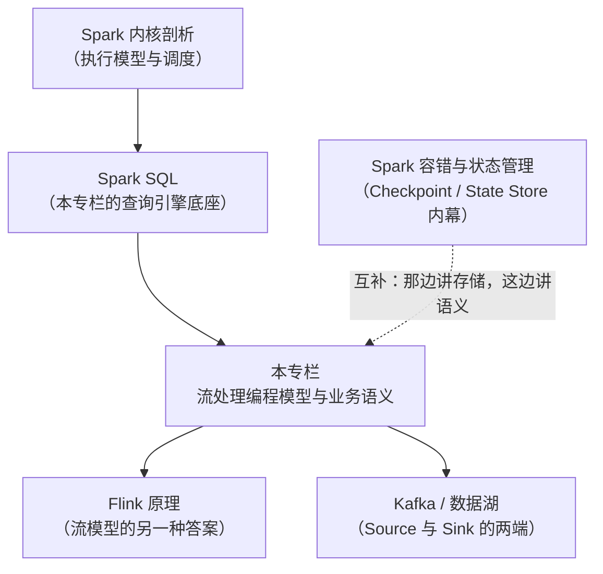

# Spark Structured Streaming 流处理深度解析：专栏导览

## 专栏定位

本专栏是「Spark-容错与状态管理深度解析」专栏的**上层应用篇**。容错专栏深入讲解了 Structured Streaming 的底层机制：Checkpoint 文件结构、WAL 写出、State Store 的读写路径。本专栏聚焦流处理编程模型：如何正确使用 Watermark 处理乱序数据、如何用 `flatMapGroupsWithState` 实现任意有状态逻辑、流-流 Join 的时间对齐语义，以及如何在生产中调优吞吐量与延迟。

**目标读者**：已有 Spark 批处理基础，希望系统掌握实时流处理开发与调优的工程师。

技术版本：Spark 4.3.0（2026-10-30 发布，预编译 Scala 2.13）。

4.x 在流处理上有两处方向性变化，读本专栏时要知道：Continuous Processing 仍是 experimental 并已由 Real-time Mode 承接毫秒级场景（后者自 4.1 起支持无状态算子、4.3 起支持聚合与 `transformWithState`）；`flatMapGroupsWithState` 在 4.x 被官方称为 legacy，新代码推荐 `transformWithState`，但它本身并未废弃。两处都在对应篇目里交代了口径。

---

## 专栏目录

| # | 文章标题 | 核心问题 |
|---|---------|---------|
| 01 | 微批执行模型：MicroBatch 与 Continuous Processing 的本质差异 | 为什么 Structured Streaming 默认是微批而不是真正的流？连续处理的代价是什么？ |
| 02 | Source 与 Sink：DataSource V2 的流式读写接口 | Kafka Source 如何保证 Offset 精确管理？不同 Sink 的 Exactly-once 保证有何差异？ |
| 03 | 输出模式深度解析：Append / Update / Complete 的适用边界 | 为什么聚合查询不能用 Append 模式？三种模式背后的语义差异是什么？ |
| 04 | Watermark 全解：事件时间语义与延迟数据处理 | Watermark 是什么？推进逻辑是怎样的？多 Source 时 Watermark 如何对齐？ |
| 05 | 触发器 Trigger：ProcessingTime、Once、AvailableNow 与 Continuous | 四种 Trigger 的使用场景与执行语义，AvailableNow 为何是批量 ETL 的最佳选择？ |
| 06 | 窗口聚合：滚动窗口、滑动窗口与会话窗口的实现机制 | 三种窗口的定义与区别，窗口数据如何在 State Store 中存储？窗口何时被清理？ |
| 07 | flatMapGroupsWithState：任意有状态逻辑的终极武器 | 如何用 GroupState 实现自定义状态机？超时机制（ProcessingTime vs EventTime）的底层原理 |
| 08 | 流-流 Join：两条流如何在时间维度上对齐 | 流-流 Join 为什么需要 Watermark？Join 的状态如何存储与清理？支持哪些 Join 类型？ |
| 09 | dropDuplicates 与精确去重：Exactly-once 的应用层保障 | dropDuplicates 的状态语义，与 Watermark 结合后如何实现有界去重 |
| 10 | 流批一体查询：Static DataFrame 与 Streaming DataFrame 的混合使用 | 流和批如何在同一个查询中结合？Streaming Join Static 的语义限制是什么？ |
| 11 | 监控与可观测性：StreamingQueryListener 与生产指标体系 | 如何通过 Listener 接口获取流查询指标？关键监控指标（输入速率、处理速率、Watermark 延迟）的含义与告警设置 |
| 12 | 生产调优手册：吞吐量、延迟、背压与资源配置全攻略 | 如何在吞吐量和延迟之间做权衡？背压机制（maxOffsetsPerTrigger）的配置原则？State Store 调优 |

---

## 与其他专栏的关系

本专栏与容错专栏是互补而非重复：那一侧拆 Checkpoint 文件结构与 State Store 的读写路径，这一侧回答"什么时候该用哪种语义、用错了会出什么现象"。两者都读过之后，才能根据一次故障的指标表现反推到具体机制。

## 推荐阅读路径

**快速上手路径**（实际开发场景）：01 → 02 → 03 → 04 → 05 → 12

**深度进阶路径**（理解底层语义）：01 → 04 → 06 → 07 → 08 → 09

**调优诊断路径**（生产问题排查）：11 → 12 → 07（状态 TTL）→ 04（Watermark 停滞）

三条路径的共同前提是先读 01：不清"微批不等于实时"这件事，后面所有关于延迟的判断都会错位。

---

## 关联专栏

- [[大数据/Spark/Spark-容错与状态管理深度解析/00 专栏导览|Spark 容错与状态管理]]：Checkpoint 与 State Store 的底层原理
- [[大数据/Spark/Spark-SQL深度解析与性能调优/00 专栏导览|Spark SQL]]：Structured Streaming 基于 Spark SQL 引擎
- [[中间件/Kafka/00 专栏导览|Kafka]]：最常用的流数据源
- [[大数据/Flink/Flink原理深度解析与性能优化/00 专栏导览|Flink]]：流处理引擎的对比选型
- [[大数据/数据湖/Delta-Lake-Lakehouse架构深度解析/00 专栏导览|Delta Lake]]：Delta Lake 作为流批一体的 Sink
