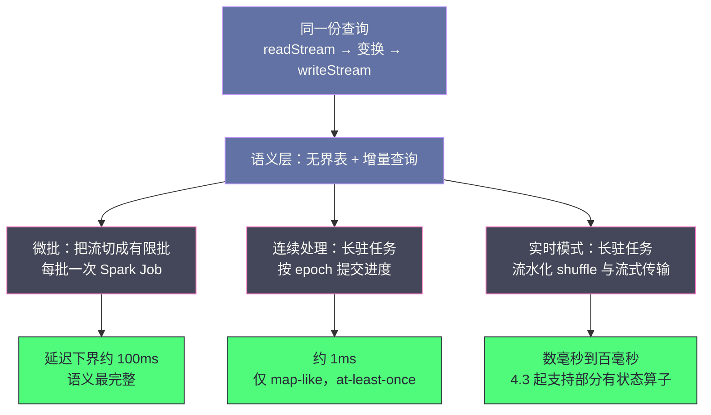
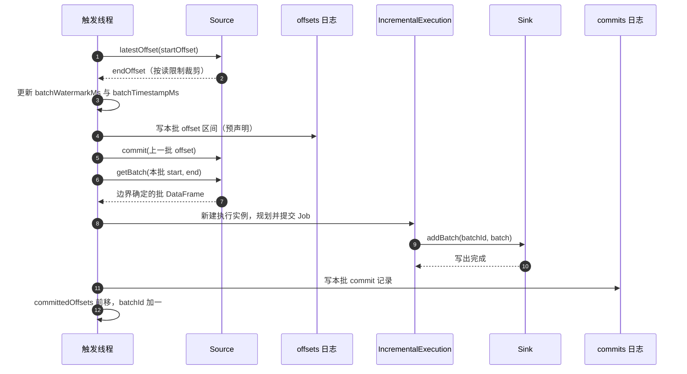
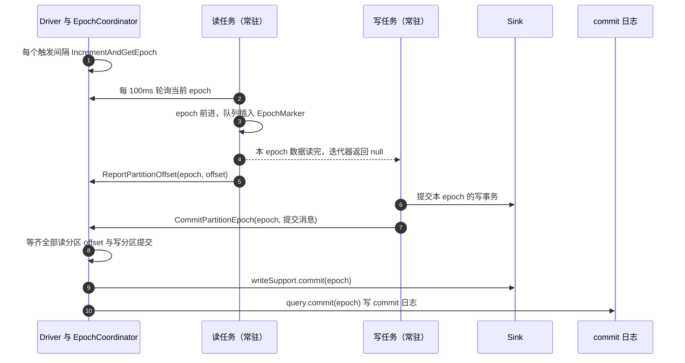
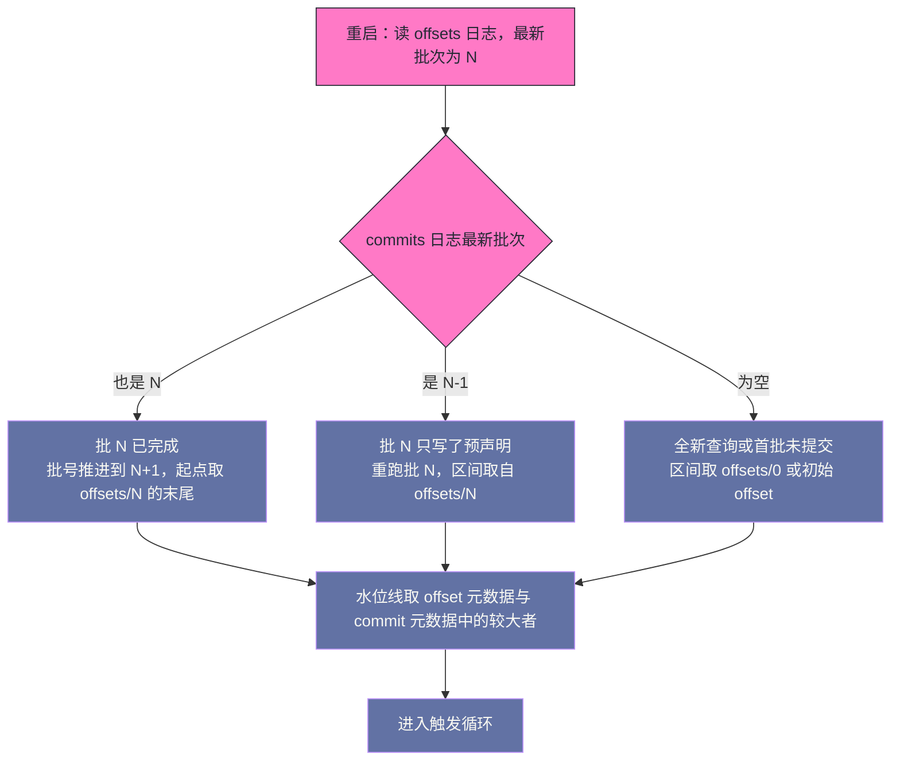

# 01 微批执行模型：MicroBatch 与 Continuous Processing 的本质差异

**摘要：**

把无限流切成有限批，是 Structured Streaming 在 2016 年给出的答案：语义上它是无界表的增量查询，执行上它退回到 Spark 最擅长的批处理作业。这一退让换来了成熟的调度、容错与 Exactly-once，也把一条硬边界刻进了系统——端到端延迟不可能低于一个批次的完整成本。围绕这条边界，工程上最常见的三类误判是把触发间隔当延迟指标、把每批的固定开销当成可优化的常数、把至少一次当成恰好一次。这篇文章沿两条线索展开：先拆开 MicroBatch 的一次触发循环，看清 offsets 与 commits 两个日志如何构成批的原子提交、每批重新规划的代价从哪来、以及「批次间隔不等于端到端延迟」的四段分解；再拆开 Continuous Processing 的 epoch 协调，解释它为什么必须禁止聚合与多算子链、为什么只能给 at-least-once，以及 Spark 4.3.0 里实时模式（Real-time Mode）如何取代它成为毫秒级的选择。读完应当能回答两个问题：延迟的每一毫秒花在哪里，以及给定算子与语义约束之后该选哪条执行路径。文章口径为 Spark 4.3.0（2026-10-30，Scala 2.13），连续处理的现状与实时模式的能力边界均以对应版本的文档或源码为准。

---

## 第 1 章 执行模型的分岔：同一份查询，三种跑法

### 1.1 流处理必须回答的三个问题

批处理（Batch Processing）的舒适之处在于有界：作业启动时数据已经躺在磁盘上，扫描一遍、算完、退出，任务的完成等价于数据的完成。流处理面对的是无界数据（Unbounded Data），事件持续产生，永无止境，于是三个在批处理里根本不存在的问题浮了出来。

第一个问题是「何时算完」。没有「全部数据到齐」这个时刻，引擎只能自己定义一种推进方式：要么每隔一段时间把「此刻之前到达的数据」当成一个有限集合处理，要么让算子常驻、对每条记录即时响应。前者把无界问题切成了有界问题，后者把「完成」从数据维度挪到了时间维度。

第二个问题是乱序。网络重试、多分区并行、上游批量投递，都会让事件到达的顺序偏离发生的顺序，一条 10:00:00 产生的记录可能在 10:00:30 才被读到。批处理不必操心这件事，因为数据静止、扫描顺序可控；流处理必须在某个层次上显式表达「我可以等多久」，这就是事件时间（Event Time）与水位线（Watermark）的由来。

第三个问题是失败之后怎么办。批作业失败重跑，覆盖同一份输出即可；流作业跑到一半失败，从头再来会重复写下游，接着跑又可能丢掉上一批已读未写的数据。要同时避免重复与丢失，引擎必须把「读到哪里」与「写到哪里」这两件事变成可持久化、可原子切换的状态。

三个问题共同的指向是同一个东西：**执行模型**。它决定了数据以什么粒度被消费、状态以什么粒度被提交、失败以什么粒度被重放。Spark 在 Structured Streaming 里给出的默认答案，是把这三个粒度对齐到「批」上。

设想反事实：如果没有这样一个内置的执行循环，用户自己写 `while (true) { 取一批、提交 Job、记 Offset、写 Commit }`，会得到什么。答案是——他其实手写了一个微批引擎，而且大概率漏掉了日志顺序、并发提交的保护、以及失败点的区分。Spark Streaming（2013 年的 DStream）当年正是用「RDD 队列 + 定时器」把这件事做进了框架；2016 年 Structured Streaming 把队列换成了 Offset 增量，把定时器换成了触发器（Trigger），但那个循环的形状从未改变。

### 1.2 无界表抽象：语义层与执行层的分离

Structured Streaming 的核心抽象是把输入流看成一张持续追加的无界表（Unbounded Table）。用户在表上写查询，写法和批处理几乎没有差别，引擎负责把这个查询翻译成持续的增量执行。

这个抽象的巧妙之处在于它只规定了「结果应该是什么」，没有规定「结果什么时候算出来」。前者是**语义层**的承诺：给定截至某一时刻的全部输入，查询的输出是确定的；后者是**执行层**的自由：可以每秒算一次，也可以每分钟算一次，可以在长驻任务里逐条算，也可以在批里成批算。正因为这层分离，同一份 DataFrame 代码只要换一个触发器，就能从微批切到实时模式，应用逻辑一行不改。

下图把这个分层关系摊开：语义层是一份不变的查询，执行层是三条互不相同的路径，每条路径有自己的任务形态、进度提交单位和延迟量级。

三条路径的分歧点不在 API，而在「批」这个概念是否还存在。微批保留批，连续处理取消批、用 epoch 充当进度提交的边界，实时模式也取消批，但用流水线把 shuffle 和状态重新接回查询里。

### 1.3 三条路径的版本脉络

笔者把三种模式放回时间线上，能看清它们各自在回应什么问题。

2016 年 7 月，Databricks 公开 Structured Streaming 的设计，同年 Spark 2.0 引入；2018 年的 SIGMOD 论文把它形式化为「对无界表的增量查询」，微批作为默认执行模型一并定型。此后很长一段时间里，Spark 的低延迟选项只有 2018 年 Spark 2.3 引入的连续处理（Continuous Processing），它用长驻任务换取约 1ms 的延迟，代价是只支持 map-like 算子、只给 at-least-once，并且一直挂着 experimental 的标签。

2022 年的 Spark 3.3 补上了另一个方向的缺口：AvailableNow 触发器让「处理完当前积压就退出」成为一种受支持的运行方式，它不解决低延迟，但把流引擎用成了可控的增量批处理。真正的低延迟升级发生在 Spark 4.x，4.1 引入**实时模式**（Real-time Mode），4.2 补上 PySpark 触发器，4.3 把聚合、`dropDuplicates` 与 JVM 侧 `transformWithState` 纳入实时模式；官方文档里连续处理那一栏的定位也随之变成「legacy，新负载请用实时模式」。

三种模式的对照如下。表中口径取自 Spark 4.3.0 文档与源码，具体行为以对应版本文档或源码为准。

| 维度 | 微批（MicroBatch） | 连续处理（Continuous Processing） | 实时模式（Real-time Mode） |
|---|---|---|---|
| 引入版本 | Spark 2.0 | Spark 2.3 | Spark 4.1（4.3 起支持部分有状态算子） |
| 任务形态 | 每批一批短任务，批结束即退出 | 常驻任务，生命周期等于查询 | 常驻任务，按批次区间重新调度 |
| 进度提交单位 | batchId | epoch | batch（批次区间） |
| 延迟量级 | 乐观情况约 100ms，常见数百毫秒到数秒 | 约 1ms | 数毫秒级，官方给出的有状态基准 P99 低于 150ms |
| 处理语义 | 恰好一次（Exactly-once） | 至少一次（At-least-once） | 恰好一次 |
| 有状态算子 | 全支持 | 全不支持 | 4.3 起支持聚合、去重、JVM transformWithState |
| 源与汇 | 任意 DataSource V1/V2 | 仅声明 CONTINUOUS_READ 能力的源，Kafka/rate；汇限 Kafka/memory/console | Kafka 源；Kafka/foreach/console/memory 汇 |
| 输出模式 | append/update/complete | 仅追加型 map 输出 | 仅 update |
| 成熟度 | 默认，生产可用 | 实验性，文档标注 legacy | 4.x 新路径，能力仍在补齐 |

## 第 2 章 MicroBatch：每批都是一个普通 Spark Job

### 2.1 一句话本质及其全部后果

MicroBatch 的全部设计可以压缩成一句话：把无限流按 offset 区间切成有限批，每一批当成一个普通的 Spark Job 跑完。这句话听起来只是一个实现选择，但它决定了后续几乎所有的行为，值得把它的后果逐条摊开。

第一，调度开销按批计。每个批次都要走一遍「向源要末位 offset、规划执行计划、提交 TaskSet、等任务结束、写两份日志」的完整流程，这笔开销与批内数据量基本无关。批越小，这笔固定成本在总时间里占比越高。

第二，Checkpoint 的边界就是批的边界。batchId 成为整个系统的版本号：offset 日志、commit 日志、状态存储的版本文件、watermark 的取值，全部以批为单位推进。系统的「一致性快照」粒度等于批粒度，这让恢复逻辑简单，也让提交粒度粗糙。

第三，恰好一次的实现位置落在**批的原子提交**加汇的幂等上，而不在任务层。单条记录失败、单个任务重试，都只影响本批；批级失败则整批重放。引擎能保证「同一批的 offset 不会被提交两次、也不会跳过」，但无法保证外部系统不被写两次——后者取决于汇（Sink）是否幂等或支持事务。

第四，状态与 watermark 按批推进。一批之内水位线不会动，批结束时才根据本批见到的最大事件时间抬高一次；有状态算子的状态写入也在批内完成、随批提交。这意味着事件时间的推进精度受制于批次间隔，与「每条记录即时推进」是两种不同的语义。

第五，失败恢复的粒度是整批。批 N 失败，重跑的是批 N 的全部 offset 区间，不会只重跑其中某个分区对应的那一段。相比「分区级重算」，这个粒度粗，但换来了恢复逻辑的简单与汇侧事务的完整。

### 2.2 一次触发循环的真实形状

`MicroBatchExecution` 的执行入口在 `runActivatedStream`，外面套着一层触发器执行器（`TriggerExecutor`）。默认触发器是 `Trigger.ProcessingTime(0)`，意思是上一批结束立即开始下一批；给定间隔时，`ProcessingTimeExecutor` 会把下一批的启动时刻对齐到「墙钟时间按间隔取整后的下一个格点」，而不是「上一批完成时刻加间隔」。这一处细节在讲延迟时会再用到，触发器各类型的行为差异可参见 [[大数据/Spark/Spark-Structured-Streaming流处理深度解析/05 触发器 Trigger：ProcessingTime、Once、AvailableNow 与 Continuous|05 触发器]]。

一个批次的生命周期可以分成五步，每一步在源码里都有明确位置。

第一步是确定区间。`constructNextBatch` 向每个源询问末位 offset：DataSource V1 走 `getOffset()`，V2 走带读限制的 `latestOffset(start, readLimit)`。拿到之后更新 `availableOffsets`，同时把本批的元数据定下来——`batchWatermarkMs` 取上一批结束时的水位线，`batchTimestampMs` 取当前触发时钟。这里有个容易忽略的判断：即使没有新数据，只要上一批的执行计划里有有状态算子认为「还需要再跑一批」（例如水位线推进后要做状态清理、有超时定时器到期），本批依然会被构造出来。

第二步是预声明。`markMicroBatchStart` 把本批的 offset 区间写进 `offsets/` 日志。这是一次 **WAL 式**的写入：区间先落盘，任务后执行。同一时刻，`cleanUpLastExecutedMicroBatch` 会把上一批的 offset 提交给源（`Source.commit`），也就是说源侧的确认总是比引擎侧晚一个批次；随后按 `minLogEntriesToMaintain` 清理过旧的日志文件。

第三步是执行。`runBatch` 先调 `getBatch(start, end)` 让源生成一个边界确定的批 DataFrame，再把基础逻辑计划里的源节点替换成这份批计划，然后新建一个 `IncrementalExecution` 并强制生成物理计划，最后交给 `sink.addBatch(batchId, nextBatch)` 触发真正的作业。对 DataSource V2 汇，这一步还会记录写出进度（commit progress）。

第四步是提交。`markMicroBatchEnd` 先更新水位线，再把 `batchId` 写进 `commits/` 日志，最后把 `committedOffsets` 推进到本批的 `availableOffsets`。

第五步是收尾。批次号加一，回到触发器循环；若本轮没有构造出批次，则按 `spark.sql.streaming.pollingDelay`（默认 10ms）睡一小段再轮询。

下面的时序图把五步串起来，并标出两个日志的写入位置。注意 offset 日志在作业之前、commit 日志在作业之后，这个顺序是整套恢复逻辑的地基。

### 2.3 两个日志与四个崩溃点

恢复逻辑只在两个日志之间做比对。`offsets/` 记录「这一批打算读哪个区间」，`commits/` 记录「这一批确实处理完了」。两个文件都以 batchId 命名，落在 checkpoint 目录下，由 `HDFSMetadataLog` 以「一批一文件」的方式写入。

把崩溃时刻按两个日志的写入顺序切成四段，每种情况的恢复动作与数据后果都不一样。

| 崩溃时刻 | 磁盘上的状态 | 重启后的动作 | 数据后果 |
|---|---|---|---|
| offset 日志写完、作业未开始 | `offsets/N` 有、`commits/N` 无 | 重跑批 N，区间取自 `offsets/N` | 无重复、无丢失 |
| 作业执行中、汇部分写出 | 同上 | 重跑批 N，汇可能收到第二份相同数据 | 汇侧可能重复 |
| 汇写完、commit 日志未写 | 同上 | 重跑批 N，重复写入已成功的那部分 | 汇侧可能重复 |
| commit 日志写完、下一批未开始 | `commits/N` 有 | 从批 N+1 开始，区间起点取 `offsets/N` 的 endOffset | 无重复、无丢失 |

这张表解释了一个常被混淆的问题：引擎侧的「恰好一次」到底保证了什么。它保证的是 offset 的提交不会遗漏、也不会重复提交同一个区间，因此不会出现「区间 N 被跳过」这种丢数据的情况；但只要崩溃点落在作业执行中或汇写完之后，重启就会重放同一区间，外部系统看到的就是至少一次。要把它升级成端到端恰好一次，需要汇侧配合：文件汇在 HDFS 上靠「写临时文件再原子重命名」实现幂等，数据库汇靠主键 upsert 或事务，Kafka 汇按官方口径只提供至少一次。

源码里还有一处细节值得记下：恢复时如果发现 commit 日志与 offset 日志的最新批次一致，引擎会先对 V1 源补一次 `getBatch(上一批 start, end)`，注释写明原因是某些源（典型的如 Kafka 源）假设「重启后上一批会被重放一次」，不补这次调用会让源的内部状态错位。V2 源没有这条历史包袱，所以这段逻辑只对 V1 生效。类的边界、历史的包袱，常常就藏在这种一行注释里。

### 2.4 每批都重新规划：一个流行说法需要纠正

关于微批性能，流传最广的一个说法是「第一批完整规划，之后复用物理计划，只替换源节点的 offset」。这句话在很长一段时间里被当作微批开销低的论据，但与实现不符。

真实做法是：查询启动时，基础逻辑计划只构建一次，每个流式关系被替换成 `StreamingExecutionRelation` 或 `StreamingDataSourceV2Relation` 占位，源实例也在此时创建并绑定 checkpoint 下的 `sources/<id>` 目录；此后每一批，`runBatch` 用 `logicalPlan transform` 把占位节点替换成该批的具体计划，再新建一个 `IncrementalExecution`，并显式调用 `executedPlan` 强制生成物理计划。`IncrementalExecution` 是 `QueryExecution` 的子类，分析、优化、物理规划这套 Catalyst 流程与批处理没有区别，只是额外挂了有状态算子的规则与状态版本。换句话说，**规划是每批都做的**，被复用的是计划骨架、源实例、算子 id 与状态分区的映射关系，不是物理计划本身。

这个纠正不是抠字眼，它直接影响对固定成本的估算。一份几十个算子的计划，Catalyst 走一遍分析加优化通常在几毫秒到几十毫秒；窗口聚合、多路 join 这类计划更重。间隔 100ms 的批次里，这部分开销可能占到两位数的百分比。Spark 在流查询的隔离会话里还主动关掉自适应查询执行（AQE）与基于代价的优化（CBO），并放开 `REQUIRE_ALL_CLUSTER_KEYS_FOR_DISTRIBUTION`。这是 3.5 源码里的做法，4.3.0 的实时模式文档同样明确不支持 AQE，原因是自适应重排与 join 重排序会改变有状态算子的分区与顺序假设。也就是说，微批复用的是批引擎的执行能力，而不是批引擎的全部优化能力，AQE 合并小分区、处理倾斜这些手段在流查询里是缺席的。

在这个骨架之上还有几个补丁性质的设计：`spark.sql.streaming.noDataMicroBatches.enabled` 允许没有新数据的批次也跑起来，专门服务状态清理与定时器；异步进度跟踪（`asyncProgressTrackingEnabled`）把 offset 日志与 commit 日志的写入挪出关键路径，但只支持无状态查询加 Kafka 汇，并且明确放弃了端到端恰好一次。这些是优化，不是结构改变——只要批还是那个提交单位，每批的规划与两次日志写入就省不掉。

### 2.5 落伍：当批次耗时超过间隔

一个自然的问题是：批次间隔设成 100ms，而一批要跑 300ms，会发生什么。

答案不是「两批并行」。微批的触发循环是严格串行的，源码注释写得很清楚：`runStream` 一次只处理一个批次，若将来引入多批在飞的流水线，日志清理逻辑都得跟着改。所以当批次耗时超过间隔时，实际发生的只有两件事：触发器执行器算出的下一个格点早已过去，`waitTillTime` 立即返回，下一批紧接着开始；同时打出一条警告日志，内容是当前批次正在落伍、触发间隔是多少、实际花了多少毫秒。

因此「间隔小于批次耗时会导致背压」这个说法并不准确，微批在这里只有**落伍**一种表现。Spark 在微批路径上没有自动降速的背压机制，批次照样一批接一批地跑，消费速率被单批处理能力钉死；如果生产速率高于这个上限，表现就是 Kafka 的 lag 单调上升，而不是批与批之间出现缓冲区膨胀。真正能起到限流作用的是 `maxOffsetsPerTrigger`：它按条数限制每批读取量，把「一批处理多少」从时间维度换成数量维度，代价是低流量时批次变多、固定开销上升。落伍、lag 上升、批次耗时贴近间隔，是同一个问题的三种外部表现，排查时看哪一个都能定位，相关指标口径可参见 [[大数据/Spark/Spark-Structured-Streaming流处理深度解析/12 生产调优手册：吞吐量、延迟、背压与资源配置全攻略|12 生产调优手册]]。

### 2.6 「每批一个 Job」是一句简化

把一批说成「一个普通 Spark Job」是为了突出本质，真实情况是一批里往往不止一个 Job。写出动作本身触发一个作业，文件源在批开始时列举目录可能触发一个作业，有状态算子在批内做状态维护也可能触发作业，若用了 `foreachBatch`，里面有几个 action 就是几个作业。它们同属一批，共享同一个 offset 区间与同一个 batchId，但各自有独立的 DAG、独立的 TaskSet 与独立的失败重试。

这个区别影响两件事。其一是延迟测量：`addBatch` 这个时长度量的是整批所有作业的总时间，若只看 Spark UI 上某一个作业的耗时，会低估写出段。批内这些作业走的是同一条「逻辑计划到 Stage 再到 TaskSet」的路径，Stage 如何划分、任务如何重提，可参见 [[大数据/Spark/读书笔记-spark内核/03_调度与执行机制/5. Spark_DAGScheduler_Stage划分|DAGScheduler 的 Stage 划分]]。其二是排查：Driver 会给每个批次打上局部属性 `streaming.sql.batchId`，并把查询的 id 与 runId 设成作业组（job group），所以在 UI 上按作业组过滤，就能把一个批次的全部作业捞出来；定位「这一批为什么慢」时，先看这批里有几个作业、各自多长，比笼统地看批次总时长有效。

反过来说，这个简化在估算固定成本时是安全的：无论一批里几个作业，每批至少要走一次完整的作业提交路径，固定开销的量级由「批」决定，而不由「作业数」决定。真正会随作业数膨胀的是写出段与源端列举，这两块在有状态、多源、`foreachBatch` 的场景里要单独计量。

## 第 3 章 延迟解剖：批次间隔只是四段之一

### 3.1 四段模型

把「事件产生」到「下游可见」这段路拆开，MicroBatch 的端到端延迟由四段串联而成。

1. 等待段：事件写入源之后，等到它被包含进某一批的 endOffset 为止。
2. 取数段：批开始后，源把这段 offset 区间的数据真正读出来，交给执行计划。
3. 处理段：规划、调度、计算，包括状态读写与 shuffle。
4. 写出段：汇写出数据，并完成 commit 日志与进度上报。

四段串联意味着总延迟是它们之和，而「批次间隔」只直接决定第一段的量级。下图把四段与各自的成本属性画在一起，粉色那段是唯一受触发间隔直接控制的，其余三段由源、计划与汇决定。

下面这张表把每段的来源、可压缩手段与不可压缩的部分并排放，后面几节逐段展开。

| 延迟段 | 区间定义 | 主要来源 | 可压缩手段 | 难以压缩的下界 |
|---|---|---|---|---|
| 等待 | 事件可见到进入某批 endOffset | 触发器格点对齐、无数据时的轮询延迟 | 调小间隔、间隔设 0 | 平均约为间隔的一半；受固定成本约束不能无限小 |
| 取数 | 批开始到数据可被处理 | 源端元数据查询、消费者建立与拉取、文件列举 | 预热消费者、控制分区数、`maxOffsetsPerTrigger` | 一次网络往返加源端元数据开销，几十毫秒量级 |
| 处理 | 计划生成到任务结束 | Catalyst 规划、TaskSet 调度、shuffle、状态读写 | 简化计划、控制单批数据量、状态后端调优 | 单批计算时间，随数据量线性增长 |
| 写出 | 汇开始写到下游可见 | 汇自身提交协议、commit 日志写入、指标上报 | 批量写、异步进度跟踪（有代价）、本地缓冲 | 汇的事务提交与一次日志落盘 |

### 3.2 等待段：格点对齐带来的均匀分布

`ProcessingTimeExecutor` 的下一批时刻不是「上一批结束加间隔」，而是「当前时间按间隔取整后的下一个格点」。间隔 5 秒时，格点是整分钟的 0、5、10、15 秒；间隔 1 秒时，格点就是每个整秒。这个**格点对齐**的实现决定了等待时间的分布：一条事件在两次格点之间均匀到达，等待时间在 0 到一个间隔之间均匀分布，平均是间隔的一半，最坏接近一整个间隔。

不过，「端到端延迟最坏是间隔的两倍」这个常见估算同样不对。准确的说法是：等待段的平均值约等于间隔的一半，最坏值约等于间隔；再加上取数、处理、写出三段，才是端到端延迟的均值与上界。间隔设成 0 时没有等待段，批次一批接一批，但每批的固定成本会原封不动地叠加到下一批的开始之前。

### 3.3 取数段：源端并不瞬时

以最常见的 Kafka 源为例，一批数据的取数分两截。第一截在 Driver：`latestOffset` 通过 AdminClient 向 broker 查询各分区末位 offset，每批一次远程调用。第二截在 Executor：每个分区对应的读取任务从消费者缓存里取一个消费者（首次要建连、拉元数据、定位 offset），然后按本批的区间循环 `poll` 直到读到区间末尾。

这里有两个与延迟直接相关的参数。一个是分区数：Kafka 源的并行度默认等于订阅的 topic 分区数，分区太少则取数与计算都挤在少数任务上，分区太多则每批要管理的任务与连接变多。另一个是 `maxOffsetsPerTrigger`：它把每批条数钉住，条数多时单批取数时间变长，条数少时批次变密、固定开销占比升高。文件源则是另一种形态：每批要列举目录、过滤已处理的文件、读取新增文件，列举操作在对象存储上可能耗时几十毫秒到数百毫秒，且随文件数量增长。

**消费者缓存**在这里起到的作用值得单独说明：同一个 Executor 上同一个 topic 分区的消费者会被复用，所以「冷启动」只发生在第一批或 Executor 变动之后。估算延迟时若忽略这一点，容易把首批的建连开销当成常态。

### 3.4 处理段：规划、调度与计算

处理段是四段里随数据量增长最直接的一段，也是能通过「少读一点」压缩的环节之一——控制单批条数会让取数与计算同时变短，代价是批次变密。它内部还可以再分三层。

最外层是规划：前面说过，每批新建 `IncrementalExecution` 并强制生成物理计划，Catalyst 的分析与优化都在这层发生。中间层是调度：TaskSet 提交给 TaskScheduler，按本地性分配资源，第一批任务还要等 Executor 就绪。最内层是执行：shuffle 读写、状态存储的读写与提交、用户函数的计算。

对无状态查询，处理段大致与「单批数据量 × 单条处理成本」成正比；对有状态查询，还要加上状态读写的开销，而状态大小往往与历史累积相关，不是单批数据量能决定的。一个窗口聚合查询在稳定运行几小时后，单批处理时间可能显著高于启动初期，原因不在数据变多，而在**状态膨胀**与 checkpoint 变重。这类退化在微批里表现为「批次耗时缓慢爬升」，最终触发落伍警告。

### 3.5 写出段：汇的提交与日志落盘

写出段包含两件事：数据写到外部系统，以及引擎把「这批做完了」记下来。

汇这一侧的成本取决于它的提交协议：譬如 Kafka 汇把记录交给生产者，按批 flush，延迟取决于批量大小与 linger 配置；文件汇在 HDFS 上写临时文件再**原子重命名**，到对象存储上这一步退化为服务端复制，往往比写文件本身更贵；`foreachBatch` 把提交语义完全交给用户，用户若在里面开事务，事务提交的往返也要计入。引擎这一侧的成本是 `commits/` 日志的一次写入与进度上报，日志落在 HDFS 或对象存储上，一次 PUT 的延迟在几十毫秒量级，跨可用区或跨区域时更差。有状态查询还要加上状态存储的提交，这一步在批内完成、随批提交，状态越大越慢。

### 3.6 示例推算：缩间隔的收益在哪里衰减

下面这组数字是示例推算，笔者按常见量级设定假设，用来展示量级关系，不是实测结果。假设一条 10 分区的 Kafka 流，峰值 5 万条每秒，单批计算成本与批内数据量成正比（1 秒批约 300ms），取数段固定在 80ms，规划 40ms，写出加日志 120ms。

| 批次间隔 | 平均等待 | 固定开销（取数+规划+写出） | 单批计算 | 平均端到端 | 观察 |
|---|---|---|---|---|---|
| 5000ms | 2500ms | 240ms | 1500ms | 约 4.2s | 等待主导，适合准实时数仓 |
| 1000ms | 500ms | 240ms | 300ms | 约 1.0s | 延迟与开销较均衡 |
| 200ms | 100ms | 240ms | 60ms | 约 400ms | 固定开销占六成 |
| 100ms | 50ms | 240ms | 30ms | 约 320ms | 开销约为计算的 8 倍 |
| 50ms | 25ms | 240ms | 15ms | 约 280ms | 收益趋近于零，Driver 端压力陡增 |

表里最能说明问题的是最后两行：间隔从 200ms 缩到 50ms，平均等待从 100ms 降到 25ms，但端到端只从 400ms 降到 280ms，因为 240ms 的**固定开销**一动不动；同时每秒要跑的批次数从 5 次涨到 20 次，Driver 端的规划、日志写入与任务提交全部翻四倍。这正是官方文档说微批「最好约 100ms」的来源——那是在无状态、计划简单、汇为本地的理想条件下测得的量级，真实业务里固定开销通常更大。

结论不是「间隔越小越好」，而是：先测出这套查询的固定开销，再决定间隔；如果目标延迟低于固定开销，微批这条路径已经没有了调整空间，只能换执行模型。

### 3.7 监控口径：batchDuration 不是端到端延迟

Spark 的进度上报里有一个 `batchDuration` 字段，很容易被当成延迟指标。它的定义是「本次触发开始到本次触发结束」的墙钟时间，触发器在开始处理时才打时间戳，等待下一批的那段时间不在其中。换句话说，`batchDuration` 度量的是四段里的后三段，天然漏掉了等待段；用它当端到端延迟，会系统性地低估，间隔越大低估越多。

同一份进度里还有一组 `durationMs`，按阶段拆开：`latestOffset`、`getBatch` 对应取数与批构造，`queryPlanning` 对应规划，`addBatch` 对应作业执行与汇写出，`walCommit` 与 `commitOffsets` 分别对应 offset 日志与 commit 日志的写入，`triggerExecution` 是整次触发的总时长。这组数字比 `batchDuration` 有用得多，但它仍然**不含等待段**。

进度里还有一组速率指标容易被误用。`inputRowsPerSecond` 用两次触发开始时间之差做分母，因此包含了等待段；`processedRowsPerSecond` 用批次耗时做分母，把等待段排除在外。两者的比值说明一个批次还剩多少处理余量，却说明不了单条记录在系统里停了多久。速率描述的是吞吐侧的供需，延迟描述的是单条记录的穿行时间，只有在稳态且数据均匀到达时二者才近似相关。拿速率当延迟的代理，是监控口径上的第二个常见错误，前一个错误是把 `batchDuration` 当延迟。

要观测真正的端到端延迟，只有两种办法：一是在汇侧记录写出时刻，与记录里携带的事件时间相减，得到「事件时间到写出时间」的分布；二是在链路两端埋时间戳，用同一批数据的进入时刻与可见时刻做差。前者依赖事件时间字段的质量，后者需要上下游配合。无论哪种，都应该看分位数而不是均值，因为等待段的均匀分布会让 p99 明显高于均值。

## 第 4 章 Continuous Processing：把批次换成 epoch

### 4.1 更小的批为什么会撞墙

从上一章的推算能看出，微批的延迟下界由固定开销决定，而固定开销里最硬的两块是「每批重新规划」与「每批两次日志提交」。把批切得更小，这两块不变；把批切到极限，等于每秒做几十次规划与几十次日志写入，收益全被开销吃掉。

要真正跨过这条线，只能取消「批」这个概念：让任务常驻，数据一到就处理，只在必要时把「处理到哪里」持久化一次。这正是连续处理（Continuous Processing）的思路，它在 2018 年的 Spark 2.3 引入，把批边界换成了**纪元（epoch）**边界。epoch 不是数据切分单位，而是进度提交单位——数据连续流过，每过一个 epoch 提交一次进度。

### 4.2 算子白名单：连续处理只认一条流水线

连续处理最刺眼的限制是**算子白名单**。官方文档从 Spark 2.4 起就写着「只支持 map-like 操作」，源码里的判定比文档更具体：`UnsupportedOperationChecker.checkForContinuous` 对逻辑计划自底向上遍历，只放行 `Project`、`Filter`、`MapElements`、`MapPartitions`、`DeserializeToObject`、`SerializeFromObject`、`SubqueryAlias`、`TypedFilter` 这几类节点，加上流式关系节点本身；遇到任何其他节点，直接抛出 `Continuous processing does not support X operations.`。表达式层面还会额外拦掉 `current_timestamp`、`current_date`、`local_timestamp` 这类依赖「当前时间」的函数，理由是连续模式下没有「批时间戳」这个可重放的锚点。

把这条规则翻译成用户语言：`select`、`filter`、`map`、`flatMap`、`mapPartitions`、`withColumn`、`drop` 可以用；`groupBy`、窗口、去重、流-流 join、`flatMapGroupsWithState`、`union`、排序、limit 全部不可以。源必须是声明了 `CONTINUOUS_READ` 能力的 DataSource V2，官方实现里只有 Kafka 与 rate；汇不能要求分布或排序（源码在建计划时就检查 `RequiresDistributionAndOrdering`），可用的有 Kafka、内存与控制台。

为什么限制这么死？因为连续模式下没有「物化点」。聚合、join、去重都需要把数据按 key 重分布，重分布意味着 shuffle，而 shuffle 的经典实现是「上游写完文件、下游再读」，这条路径要求上游有一个明确的结束时刻；常驻任务没有结束时刻，下游会永远等下去。同理，状态管理与水位线也依赖批边界来定义「什么时候清理、清理到哪个版本」。实时模式后来能支持有状态算子，靠的正是把 shuffle 改成流水线式（pipelined shuffle）与流式传输（streaming shuffle），这是另一条技术路线，稍后再说。

### 4.3 epoch 协调：一套运行在 Driver 上的小型协议

连续处理的进度提交由 Driver 上的一个 RPC 端点 `EpochCoordinator` 协调，参与者是两类常驻任务：读任务（每个源分区一个）与写任务。整个协议可以拆成六步。

第一步，Driver 按触发器间隔推进 epoch。`ContinuousExecution` 内部把 `ContinuousTrigger` 包装成 `ProcessingTimeExecutor`，每个间隔向协调器发一次 `IncrementAndGetEpoch`，返回当前的 epoch 号。这个间隔就是用户写的 `trigger(continuous="1 second")` 里的 1 秒，它是进度提交频率，不是数据延迟。

第二步，读任务感知 epoch 边界。每个读任务的读取器内部有两部分：一个数据线程持续从源拉记录、放进容量为 `executorQueueSize`（默认 1024 行）的队列；一个标记线程按 `executorPollIntervalMs`（默认 100ms）向 Driver 查询当前 epoch，一旦发现 epoch 前进，就往同一个队列里塞一个 `EpochMarker`。

第三步，任务在标记处结束本 epoch。读取迭代器取到 `EpochMarker` 时返回 null，本轮 `compute` 结束，`ContinuousWriteRDD` 据此认为该分区在本 epoch 的数据已经处理完，向协调器上报 `ReportPartitionOffset(分区号, epoch, 当前 offset)`，并提交写侧的 `CommitPartitionEpoch`。

第四步，协调器等齐所有分区。一个 epoch 要成为**全局提交**，需要同时满足两个条件：所有写分区都提交了写事务消息，所有读分区都上报了 offset。数量对不上就继续等。此外提交必须严格按 epoch 顺序进行，若 epoch N 已齐但 N-1 未提交，N 会被放进等待集合。

第五步，先提交汇、再提交日志。`commitEpoch` 里先调 `writeSupport.commit(epoch, messages)` 让汇完成本 epoch 的原子提交，再调 `query.commit(epoch)` 写 commit 日志。顺序不能反：先记日志后提交汇，一旦中间崩溃，重启会以为这一批已完成而跳过，数据就丢了。

第六步，保护与回收。协调器维护分区提交与 offset 两张表，超出 `epochBacklogQueueSize`（默认 10000）就判定异常并停掉查询；每提交一个 epoch，清掉更早的表项。

下面的时序图把一次 epoch 的提交路径画出来。读任务与写任务是同一批常驻任务的两端，中间的数据流不经过 Driver，只有进度消息经过。

这套协议解释了一个常被误解的点：epoch 标记不是插进数据流的一条特殊记录，而是读任务在本地队列里插入的边界标记，数据行与标记走的是同一个队列、同一个消费循环。汇看到的自始至终只有真实数据，没有标记。

### 4.4 连续处理的真实代价

把机制摊开之后，代价清单就清楚了。

语义降级为**至少一次**。因为只有 commit 日志记录「哪个 epoch 完成了」，而汇的提交与日志的写入之间仍有窗口，重启后同一 epoch 会被重放；源码注释里对这一点毫不掩饰，说对至少一次语义可以忽略那些已上报未提交的 offset，代价是可能重复。

没有任务重试。`ContinuousDataSourceRDD.compute` 一进来就检查任务尝试号，只要不是 0 就抛 `ContinuousTaskRetryException`；文档也写明连续处理没有自动重试，任何失败都会让查询停止，需要人工从 checkpoint 重启。这与微批「单任务重试、批级重放」的容错能力差了一个量级。

并行度被源分区钉死。读任务与源分区一一对应，一个 10 分区的 Kafka topic 需要至少 10 个常驻核，否则查询无法推进；任务常驻意味着这些核在整个查询生命周期内都被占用，不能像微批那样批间释放。

没有状态、没有水位线、没有输出模式选择。状态与水位线的缺失不是配置问题，是模型问题：它们都需要一个「何时清理、清理到哪个版本」的边界，而连续处理只有 epoch 这个进度边界，没有数据切分边界。

提交延迟等于触发间隔。epoch 间隔 1 秒，意味着最坏情况下一个 epoch 的数据要在汇侧等到下一个 epoch 提交才可见（对支持逐条写的汇则不受此限），故障时被重放的窗口也是一个 epoch。

运维细节。停止连续查询时会出现虚假的任务终止告警，文档明说可以忽略；checkpoint 格式与微批兼容，因此可以在两种模式之间切换重启，但这也意味着切回微批时状态语义要重新对齐。

### 4.5 4.3.0 的现状：连续处理让位于实时模式

Spark 4.x 给低延迟需求提供了第二条路：实时模式。它同样用常驻任务，但保留了批这一层作为「进度提交的节奏」，并用两套机制把 shuffle 接回查询：流水线式 shuffle 改调度，让生产阶段与消费阶段作为同一个流水线组同时启动；流式传输改数据通道，让 shuffle 数据逐条经网络推给消费端，不落文件。这样有状态算子也能在常驻任务里跑，而不必等一个「上游完成」的时刻。

按 4.3.0 的文档口径，实时模式支持无状态的 map-like 操作、`union`、流-静态 join，以及自 4.3 起支持聚合、`dropDuplicates` 与 JVM 侧 `transformWithState`；不支持流-流 join、`flatMapGroupsWithState`、会话窗口、`repartitionByRange` 与 PySpark 侧 `transformWithState`，也不支持 AQE。它要求输出模式为 `update`、批次区间不小于 5 秒（默认 5 分钟）、源为 Kafka、汇为 Kafka/foreach/console/memory；批次区间只决定提交与检查点的节奏，不决定逐条输出的延迟。状态存储默认切到 RocksDB 加 checkpoint 格式 v2，并开启 changelog 检查点，以缩短提交路径。这些约束仍在随版本调整，具体以对应版本文档或源码为准。

于是连续处理的定位变得很窄：它是 2.3 时代的低延迟实验，文档在 4.x 里已标注为 legacy，并明确建议新负载改用实时模式。它今天仍有价值的场景只剩「纯 map-like、可接受至少一次、已有存量系统」这一小块，理由通常是迁移成本而不是技术优势。

三种模式的完整对照如下，前两列在前文已有依据，第三列取自 4.3.0 文档。

| 维度 | 微批 | 连续处理 | 实时模式 |
|---|---|---|---|
| 延迟决定因素 | 批次间隔 + 四段成本 | 逐条处理，epoch 只影响提交 | 逐条处理，批次区间只影响提交 |
| 已提交进度单位 | batchId | epoch | batch |
| 处理语义 | 恰好一次 | 至少一次 | 恰好一次 |
| 状态算子 | 全支持 | 不支持 | 4.3 起部分支持 |
| 输出模式 | 三种皆可 | 仅 map 输出 | 仅 update |
| 任务失败 | 任务重试、批级重放 | 查询停止，人工重启 | 批级重放 |
| 资源占用 | 批间释放 | 常驻，等于源分区数 | 常驻，源分区数加 shuffle 分区数 |
| 适用判断 | 默认选择 | 存量、纯无状态 | 毫秒级且有状态需求 |

## 第 5 章 Checkpoint 与恢复：两种模型各自的账本

### 5.1 目录结构与两个日志的地位

微批的 checkpoint 目录是一棵按编号组织的树：`metadata` 记录查询的唯一 id，用于校验重启时挂的是同一个查询；`offsets/` 与 `commits/` 是两个进度日志，一批一个文件；`sources/<id>/` 放源自己的元数据，例如 Kafka 的分区发现历史；`state/<operatorId>/<partitionId>/` 下有状态算子的状态版本文件，版本号与 batchId 对齐。

用「一批一个文件」而不是数据库，是对象存储时代的一个务实选择：编号天然有序，写入是新建文件而不是改文件，读取只需列目录取最大值，不需要额外的事务型存储；代价是每批至少两次远程写，以及过期文件的清理工作。清理阈值由 `minLogEntriesToMaintain` 控制，保留最近若干批，供恢复与调试。

连续处理的目录结构相同，只是 `commits/` 里记录的单位从 batchId 变成 epoch，`state/` 目录不会被使用——它没有状态算子。

### 5.2 恢复决策：两个日志的比对

微批重启时的入口是 `populateStartOffsets`，逻辑可以概括成「先假设要重跑，再看能不能前进」。

它先读 `offsets/` 的最新批次 N，把当前批号设为 N、可用 offset 设为该批的区间，并把「已提交 offset」设为 N-1 的区间（从倒数第二个 offset 文件里取）。然后比对 `commits/`：若 commit 日志的最新批次也是 N，说明批 N 已完成，批号推进到 N+1，并把已提交 offset 前移；若 commit 日志最新是 N-1，说明批 N 只写了预声明没写完，直接重跑 N；若 commit 日志为空，则要么是全新查询、要么是首批预声明后立刻崩溃，两种情况都从头开始，区别只在区间取自 `offsets/0` 还是源的初始 offset。水位线从两个地方恢复：offset 文件里记录的 `batchWatermarkMs` 与 commit 文件里记录的下一批水位线，取较大者。

下面的流程图把这条判定路径画出来。注意它与连续处理的恢复起点不同：连续处理以 commit 日志为唯一权威，找不到 offset 记录就直接报错，因为它不允许「已提交但 offset 未记录」这种状态存在。

连续处理的恢复走 `getStartOffsets`，账本**以 commit 日志为唯一权威**：取最新 epoch，用 `offsetLog.get(epoch)` 取该 epoch 的末尾 offset 作为已提交进度，下一个 epoch 号加一。源码注释里写着，如果某些 epoch 上报了末尾 offset 但没提交，恰好一次语义需要精确重放到那个位置，而至少一次语义可以忽略这些上报、承担重复的风险——一句话交代了两种语义的取舍。

### 5.3 状态与水位线为什么绑在批上

状态存储的版本与 batchId 对齐，这不是实现上的巧合，而是一致性要求的直接结果；状态存储的读写路径与 WAL 细节可参见 [[大数据/Spark/Spark-容错与状态管理深度解析/00 专栏导览|容错与状态管理专栏]]。一批之内，任务可能读状态、改状态、写状态；批提交时，状态的版本文件与 offset 日志、commit 日志一起构成一个可恢复的**一致性切面**。若状态版本与批号脱钩，恢复时就无法回答「这个状态对应哪一段输入」这个问题。

水位线同理。它不是一个独立的运行时变量，而是被写进 `offsets/` 与 `commits/` 的元数据：offset 文件里记本批开始时的水位线，commit 文件里记下一批应使用的水位线。这样做的好处是水位线可以随批回滚——恢复到批 N，水位线就回到批 N 记录的值，不会因为内存里多推进了一点而丢掉晚到数据。代价是水位线的推进精度等于批间隔，一批之内无论见到多晚的事件，水位线都不动；水位线本身的传播与迟到数据处理可参见 [[大数据/Spark/Spark-Structured-Streaming流处理深度解析/04 Watermark 全解：事件时间语义与延迟数据处理|04 Watermark]]。

这也解释了为什么「无数据批次」仍然要跑：水位线推进后，窗口状态的清理、事件时间定时器的触发都发生在批的边界上，若没有新数据就完全不跑批，状态会一直膨胀、超时逻辑也不会触发。`noDataMicroBatches` 这个配置就是为这件事存在的，它让「没有数据」与「没有工作」不再是同一件事。

### 5.4 两种账本的可靠性差异

把两个模型的恢复机制并排看，可靠性差异不在实现质量，而在账本形态。

微批的账本有两个文件，允许「预声明了但没完成」这个中间态，恢复时靠比对判断该重跑还是该前进；连续处理的账本以 commit 日志为权威，epoch 的提交是「全部读分区上报加全部写分区提交」之后的全局动作，中间态被限制在协调器的内存里，进程一挂就重来。前者容忍模糊，后者要求精确，各自与自己的提交粒度匹配。

对使用者的实际含义是：微批可以放心让任务失败、让 Executor 掉线，最坏重跑一批；连续处理的一次失败就要人工介入，因为它连任务重试都不支持。把这一点与第 4 章的算子限制放在一起看，就能理解为什么连续处理从诞生起就没有进入主流生产——它的低延迟是用可靠性与功能面换来的，而大多数实时业务既需要状态，也需要无人值守。

### 5.5 checkpoint 目录的三种误用

两个日志的不变式很脆弱，几种常见操作会直接破坏它。

第一种是把某个查询的 checkpoint 目录指给另一个查询。目录里的 `metadata` 保存了查询的唯一标识，引擎用它确认「挂上来的是同一个查询」；源的具体 offset 记录、状态 schema 也都是按原查询的结构写的。换一个查询共用这个目录，通常在启动阶段就因元数据或状态 schema 不匹配而失败，而不是悄悄接上继续跑，这一点反而降低了事故概率。

第二种是手动删 offset 文件试图「跳过坏批」。恢复逻辑依赖「最新批与上一批」两个文件同时存在：`validateOffsetLogAndGetPrevOffset` 在发现 `offsets/N-1` 缺失时会直接抛异常，报错文案要求每批至少保留两个后续 offset 文件。删文件不能让引擎跳过某一批，只会让它失去可用的恢复点，剩下的选择是整体回退到更早的 checkpoint 或重建。

第三种是删 commit 文件来「重放」一批。引擎确实会因此重跑该批，但下游已经写入的数据不会自动撤销，结果是人为制造重复；如果汇不幂等，这次「修复」就把一次未完成变成了两次写入。要重放，正确做法是在汇侧先清理，再让引擎从 checkpoint 重跑，顺序反了就会留下不一致。

从连续处理切回微批还有一层额外风险：两种模式共用同一种 checkpoint 格式，文档也明确说可以切换触发器重启，但连续处理从不写状态目录，切回后若查询带状态算子，状态是空的，窗口与去重结果会从头累积。切换执行模型属于语义变更，不只是配置变更。

## 第 6 章 选型：先算子，后语义，最后才是延迟

### 6.1 判据的顺序为什么与直觉相反

面对「要低延迟」的需求，直觉是先定延迟目标，再挑执行模型。但在 Spark 的三种模型里，这个顺序会让人反复返工：延迟目标先筛掉微批，剩下连续处理与实时模式；接着发现要做聚合，连续处理出局；再看实时模式，又发现它只支持 update 模式、源汇受限、部分算子不支持，最后可能还得回到微批并重新谈 SLA。

更稳的顺序是反过来：**先算子，后语义，最后延迟**。因为算子与语义决定了哪些模型在原理上可用，而延迟只是在可用模型之间做取舍的最后一维。这个顺序也与三种模型的限制来源吻合——限制来自模型本身的结构，不来自参数调优。

下表给出一个可操作的判据矩阵。行是延迟目标，列是算子与语义约束，单元格是推荐路径。

| 延迟目标 | 仅 map-like、无状态 | 需要聚合或去重 | 需要 join、会话窗口或任意状态 |
|---|---|---|---|
| 10ms 级 | 实时模式；存量系统可用连续处理（至少一次） | 实时模式 4.3（JVM API），或接受更高延迟 | 微批，并重新协商延迟目标 |
| 100ms 到 2s | 实时模式或微批（200ms 到 1s） | 微批（200ms 起），实时模式次选 | 微批，间隔视状态规模而定 |
| 秒级到分钟级 | 微批 | 微批 | 微批 |
| 定时批量、可接受分钟级 | AvailableNow | AvailableNow | AvailableNow |

### 6.2 判据一：算子支持度

这一维的硬约束最多，先查它最省时间。微批支持全部流式算子，这是它作为默认模型的底气；实时模式在 4.3 支持聚合、`dropDuplicates`、JVM `transformWithState`，但不支持流-流 join、`flatMapGroupsWithState`、会话窗口，PySpark 侧的 `transformWithState` 也还没进实时模式；连续处理只支持一条 map 流水线。

有一个容易忽略的细节，譬如实时模式要求 `union` 的两侧是彼此不同的流式源，同一个 DataFrame 被引用两次会直接报错；有状态算子也不能出现在 `union` 的输入分支上。这些限制在写查询时就会暴露，属于「启动即失败」，而不是运行期才出问题，反而比隐性退化好排查。

### 6.3 判据二：消费端语义

引擎侧的恰好一次与端到端恰好一是两件事。三种模型里，微批与实时模式提供恰好一次的处理语义，连续处理只提供至少一次；而端到端是否恰好一次，取决于汇。

内置汇的语义差异很明显：Kafka 汇按官方口径是至少一次，重启后可能重复；文件汇在 HDFS 上靠原子重命名实现幂等；`foreachBatch` 完全交给用户，用户开事务才是恰好一次。因此即便选了微批，若汇是 Kafka 且下游不去重，端到端仍然是至少一次。反过来，若汇本身幂等，连续处理的至少一次也能在应用层被去重抹平，这时语义就不构成否决理由。

### 6.4 判据三：延迟档

延迟档的划分不该按「感觉」，而该按前面算出的固定开销。做法是：用目标间隔跑一轮，读 `durationMs` 里的 `latestOffset`、`queryPlanning`、`addBatch`、`commitOffsets` 四项之和，这就是**固定开销**的量级；若目标延迟大于固定开销的两倍，微批是合适的选择，间隔取「目标延迟减去固定开销」再留余量；若目标延迟小于固定开销，微批不可能达标，必须换模型或改需求。

这条判据还有一个副作用：它把「延迟承诺」变成了可验证的数字，而不是一句「我们用的是 Spark 流处理，应该挺快」。

### 6.5 反例一：为了低延迟上连续处理，结果要做聚合

一个典型的失败路径是这样的。业务要求「风险事件 50ms 内告警」，团队看到连续处理文档里写着约 1ms，于是把查询切到 `trigger(continuous="1 second")`，本地用 `select` 加 `filter` 跑通，延迟确实很低。上线前补需求：要按用户维度统计最近一分钟的事件次数，超过阈值才告警。加上 `groupBy` 与窗口之后，查询启动即失败，报错是连续处理不支持该算子。

此时的退路有三条，代价各不相同。退回微批，50ms 的目标无论如何达不到，必须重谈 SLA；改用实时模式，4.3 支持聚合，但要满足 update 输出模式、Kafka 源汇、5 秒最小批次区间等条件，且窗口聚合的迟到数据处理要重新设计；改用 Flink 这类原生流引擎，能力上没有问题，代价是引入第二套运行时与运维体系。三条路的共同点是：最初那个「1ms」的承诺一条都用不上，因为限制从来不在延迟参数上，而在模型的结构里。

这个反例的教训不是「别用连续处理」，而是「先确认算子形态再谈延迟」。算子形态是需求的固有属性，延迟目标却常常是可以商量的——把顺序搞反，就会用最贵的代价去满足一个本来可以放宽的指标。

### 6.6 反例二：用微批承诺毫秒级

另一个方向的错误同样常见：团队为了「架构简单」，所有流作业统一用微批，然后在 SLA 里写下「端到端 200ms」。这个承诺在演示环境可能偶尔成立，因为演示数据量小、汇是控制台、计划只有两三个算子；一旦接入真实流量，四段里的取数、写出、规划都会放大，p99 很快突破承诺。

外部症状很有辨识度：均值看起来还行，p99 长期超标；批次耗时贴近触发间隔，日志里周期性出现落伍警告；Kafka lag 在高峰时段抬升，低谷时段回落。这些症状指向同一个结论——固定开销已经接近甚至超过目标延迟，再怎么调间隔都是在挪等待段的时间，挪不出新空间。

补救的路径同样只有三条：放宽 SLA、把查询拆成「低延迟无状态路径 + 高延迟有状态路径」两条、或者换到实时模式。第一条最省事但需要业务方认可，第二条在工程上常见——告警链路只要过滤和打标，统计链路可以慢一点；第三条要评估汇与输出模式的约束。

### 6.7 反例三：把批次间隔当延迟指标

第三个反例发生在监控上。团队用 `batchDuration` 作为延迟指标设了告警阈值，发现它一直很稳定，于是认为延迟健康；实际上真实端到端延迟比它高出半个到一个批次间隔，因为等待段根本不在这个指标里。

正确的做法在第 3 章已经给过：要么在汇侧用事件时间与写出时间做差，要么在链路两端埋时间戳。若两条都做不到，退而求其次，用 `durationMs` 的分项之和作为「处理侧延迟」的下界，再显式加上「平均间隔的一半」作为等待段的估计，并在文档里注明这是估算而非测量。指标口径写错比没有指标更危险，因为它会给出一个稳定的假象。

## 第 7 章 与 Flink 的对照：模式层面的差别

把 Spark 的三条路径与 Flink 放在一起，差别可以压缩成一句话：Flink 从一开始就把**连续算子加周期性快照**作为唯一模型，checkpoint 的 barrier 在算子链里流动，水位线随记录推进；Spark 则把「批」作为一等公民，微批直接复用批引擎，连续处理与实时模式都是在批的框架外另开一条路。前者在低延迟与状态语义上更自然，后者在吞吐、批流统一与既有批生态的复用上更顺。

这个差别决定了选型的口径：如果业务的核心诉求是毫秒级延迟加上复杂状态（窗口、join、自定义状态机），原生流引擎的结构更贴合；如果诉求是「绝大多数作业秒级即可，少数作业要低延迟，且团队已经有一整套 Spark 批处理与调度的运维经验」，那么微批加实时模式的组合通常更经济，代价是要接受实时模式在源汇与输出模式上的约束。两边的细节分别参见 [[大数据/Flink/Flink原理深度解析与性能优化/00 专栏导览|Flink 专栏]]与 [[中间件/Kafka/00 专栏导览|Kafka 专栏]]，这里不再比较参数。

---

## 参考资料

1. Armbrust M, Das T, Torres J, 等. Structured Streaming: A Declarative API for Real-Time Applications in Apache Spark. SIGMOD 2018.
2. Apache Spark 官方文档：[Structured Streaming Programming Guide − Continuous Processing](https://spark.apache.org/docs/latest/streaming/performance-tips.html#continuous-processing)（连续处理的算子范围、源汇与容错口径）。
3. Apache Spark 官方文档：[Real-time Mode](https://spark.apache.org/docs/latest/streaming/real-time-mode.html)（4.1 引入、4.3 有状态支持、输出模式与批次区间语义）。
4. [Spark 4.3.0 Release Notes](https://spark.apache.org/releases/spark-release-4-3-0.html)（2026-10-30）。
5. Apache Spark 源码：`org.apache.spark.sql.execution.streaming.MicroBatchExecution`、`StreamExecution`、`TriggerExecutor`（本文的批循环、两个日志与恢复逻辑）。
6. Apache Spark 源码：`org.apache.spark.sql.execution.streaming.continuous.ContinuousExecution`、`EpochCoordinator`、`ContinuousQueuedDataReader`（epoch 协议与读任务实现）。
7. Apache Spark 源码：`org.apache.spark.sql.catalyst.analysis.UnsupportedOperationChecker.checkForContinuous`（连续处理允许的算子白名单）。
8. [Structured Streaming in Apache Spark（Databricks Blog，2016-07-28）](https://www.databricks.com/blog/2016/07/28/structured-streaming-in-apache-spark.html)。

---

> [!note] 思考题
> 1. 微批的「等待段」平均值约为间隔的一半，而处理段的成本与单批数据量成正比。如果一个查询的固定开销是 200ms、单批计算是 200ms，你会把间隔设成多少，理由是什么？
> 2. 连续处理用 epoch 充当进度提交单位，微批用 batchId 充当。两者都在解决「何时把进度持久化」，为什么一个能支持状态算子而另一个不能？
> 3. 实时模式的批次区间默认 5 分钟，却仍能给出数毫秒级的逐条延迟。这个设计与微批「间隔决定等待」的直觉冲突，冲突的根源在哪里？
> 4. 若一个 Kafka 汇的写入是至少一次的，那么选用恰好一次的微批还有意义吗？端到端恰好一次需要在哪一层补齐？
> 5. 有人用 `batchDuration` 作为延迟指标并据此判断系统健康。请设计一个替代方案，说明需要采集哪些时间戳、如何计算分位数，以及方案的局限。