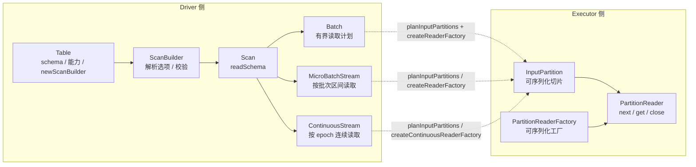
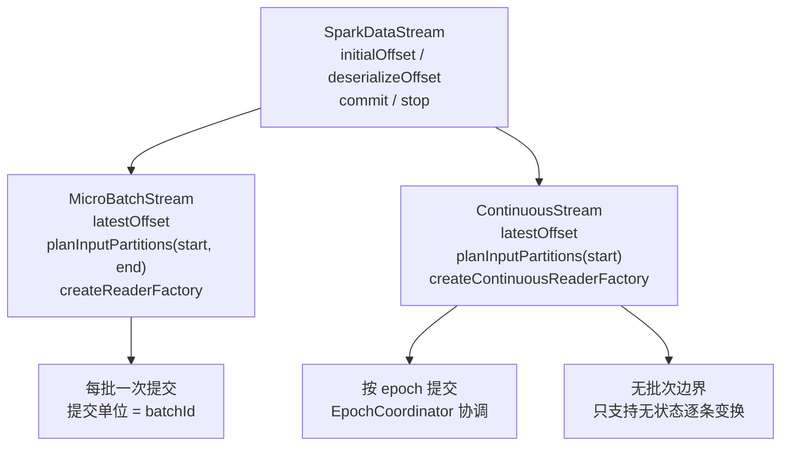
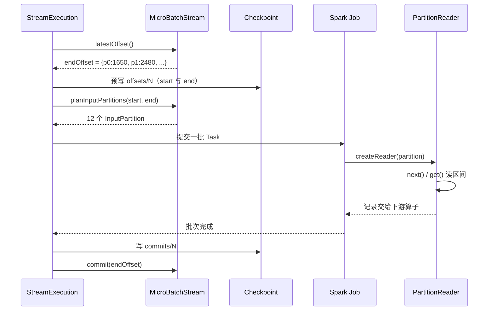
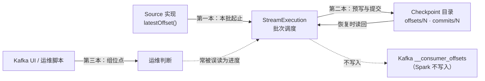
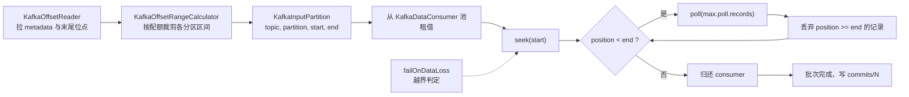
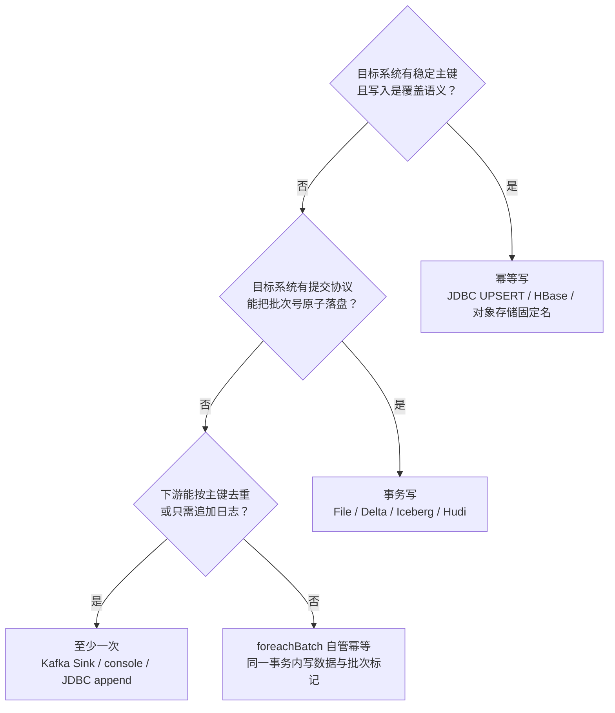

# 02 Source 与 Sink：DataSource V2 的流式读写接口

**摘要：**

流的语义由两端决定：Source 决定一条流能不能重放、从哪儿重放，Sink 决定重放一次会不会被下游看见。Spark 在 2.0 引入 Structured Streaming 时用的是 DataSource V1 的 `Source`/`Sink` 接口，3.0 之后把读写路径收敛到 DataSource V2：流式读被拆成 `Table`、`ScanBuilder`、`Scan`、`Batch`、`PartitionReader` 五层，并分出 `MicroBatchStream` 与 `ContinuousStream` 两条继承线。接口形状之外，更关键的是三个时刻：`latestOffset` 在每批开头给出一个上界，`planInputPartitions` 把这个上界切成可并发的切片，`commit` 要等批次落定之后才回调。接口分层只是骨架，生产事故大多落在 offset 上——Source 每批报告的一对起止位置、checkpoint 里持久化的那一份、Kafka 侧 `__consumer_offsets` 里的那一份，三者由不同组件在不同时机写入，“重复消费”与“漏消费”几乎都能追到它们的错位；把三者混为一谈，代价通常不是一条日志，而是一整批数据的重复写入。文章以一条实时数仓链路 `rt_dw` 贯穿：先拆五层接口与两条继承线，再把三本 offset 账摊开对照，然后看 Kafka Source 如何按分区并发、被 `maxOffsetsPerTrigger` 限流、动态发现新分区，以及它为什么从不向 Kafka 提交位点；接着把 Sink 的保证分成幂等写、事务写与至少一次三级，交代 Kafka Sink 只能落在第三级的原因——Sink 的保证由目标系统能力决定，有主键就能幂等，有提交协议就能事务，两者都没有就只能至少一次；最后给出自定义 Source/Sink 的调用契约与五类反例。全文口径为 Spark 4.3.0（4.x 预编译 Scala 2.13），涉及内部定时的细节以对应版本文档或源码为准。

---

## 第 1 章 流的入口：可重放契约与接口分层

### 1.1 可重放：流 Source 的第一性要求

批处理的读取是一次性的：作业开始，扫描全量，结束。流处理的读取是反复的——同一段区间可能被读第二遍、第三遍，因为 Task 失败要重试，因为进程崩溃要从 checkpoint 恢复，因为运维为了补历史手动把位点往回拨。于是 Source 的第一性要求不是“能读”，而是“能按位置重读”，也就是**可重放（Replayable）**。

Spark 把这件事抽象成一个**半开区间** `[startOffset, endOffset)`：`endOffset` 是这一批能看到的世界边界，`startOffset` 是上一批留下的位置。两者都是 Source 自己定义的 `Offset` 子类，引擎不解释它们的内容，只负责持久化与回传。这个契约里藏着两条容易被忽略的约定：同一对 `[start, end)` 读两次，返回的元素集合必须相同（顺序可以不同）；相邻批次的边界必须首尾相接，既不能重叠也不能留缝。前者决定了“重放不会丢”，后者决定了“重放不会跳”。

不是所有数据源都满足。Kafka 的消息有持久化位点，任意区间都能回放；文件系统里的文件一旦写完不再变化，按“已处理文件集合”回放也成立；数据库的 CDC 流有 binlog 位点或 LSN，同样成立。Socket 是反例：TCP 流读走就没了，不存在“第 1024 字节到 2048 字节”这种可以重新取一次的概念，所以 Socket Source 只能用于本地验证，它遇到失败时的语义是“这一段丢了”。

把 Source 想象成图书馆的借书处：光能借书不够，还得有索书号，今天借走的书明天还回来，还能照着同一个号再找到同一本书；如果这个馆没有索书号，管理员只能承认“借出去就再也找不回来”，它就不是一个可以支撑流处理的入口。

### 1.2 V1 的做法与它的天花板

DataSource V1 的流式 Source 只有五个成员：

```scala
trait Source {
  def schema: StructType
  def getOffset: Option[Offset]
  def getBatch(start: Option[Offset], end: Offset): DataFrame
  def commit(end: Offset): Unit
  def stop(): Unit
}
```

`getBatch` 返回一个 DataFrame，这是 V1 的关键设计，也是它的天花板。DataFrame 是已经成形的逻辑计划，意味着分区怎么切、数据怎么分布，全部由 Source 在构造 DataFrame 时自己决定，引擎只拿到一个黑盒。由此产生三个后果。

分区信息不可见。V1 的 Kafka 实现确实按主题分区切了 RDD 分区，也确实做到了并行读，但那是实现内部的选择，不是接口承诺的能力。引擎没法据此做本地性调度，也没法把“这个分区在几号 broker 上”这类信息用起来；换一个 Source 实现，并行度是 1 还是 100，引擎事先无从得知。

下推无从谈起。批处理路径上的列裁剪、谓词下推、列式读取，在 V1 的流式路径上没有地方挂，因为 `getBatch` 的唯一出口就是一个装好数据的 DataFrame，Source 没有机会声明“我能在存储层过滤掉这段区间里的无效行”。

批与流是两套代码。同一个数据源要分别写一个批处理的 `DataSourceV2` 和一个流式的 `Source`，选项解析、schema 推导、offset 计算各写一遍，行为很容易分叉，Kafka 在 V1 时代就同时维护着两套读取逻辑。

V2 的改造思路是把“读”从“返回一个 DataFrame”拆成“描述能读什么、描述怎么切片、描述每个切片怎么读”。描述可以被引擎理解和裁剪，DataFrame 不行。

### 1.3 五层分工：目录、借书单与取书人

V2 把一次读取拆成五层，前四层在 Driver 上活着，最后一层被发到 Executor：

| 层 | 接口 | 负责什么 | 运行位置 | 生命周期 |
|---|---|---|---|---|
| 表 | `Table` | 描述 schema 与能力，提供 `newScanBuilder` 入口 | Driver | 每个查询一次 |
| 扫描构建器 | `ScanBuilder` | 解析选项、校验参数、`build()` 出 Scan | Driver | 每个查询一次 |
| 扫描 | `Scan` | 描述怎么读，产出批、微批、连续三种读法之一 | Driver | 每个查询一次 |
| 读取计划 | `Batch` / `MicroBatchStream` | 规划切片、给出 Reader 工厂 | Driver | 每批一次 |
| 读取器 | `PartitionReader` | 真正把字节读出来 | Executor | 每个切片一次 |

`Table` 是门面，它回答“这个数据源长什么样”：schema 是什么、支持哪些下推能力、能不能写。Kafka 的 `Table` 在这里不做任何 IO，只把选项交给 `ScanBuilder`。

`ScanBuilder` 是翻译层，它拿到一个大小写不敏感的选项 Map，把 `subscribe`、`startingOffsets`、`maxOffsetsPerTrigger` 这些用户意图翻译成内部结构，该报错的在这里报错（譬如同时给了 `subscribe` 和 `assign`）。它的 `build()` 出一个 `Scan`，此后的读取不再看用户选项。

`Scan` 是一次读取的静态描述，也是批流统一真正落地的地方：同一个 `Scan` 可以 `toBatch` 出有界读取、`toMicroBatchStream(checkpointLocation)` 出微批读取、`toContinuousStream(checkpointLocation)` 出连续读取。三条路共享 schema 与选项解析，差异只在于时间怎么切。`checkpointLocation` 这个参数出现在流式方法上而不是构造器里，原因是有的 Source 要读 checkpoint 目录判断“这是首次启动还是恢复”，文件源尤其依赖这一点。

`Batch` 与 `MicroBatchStream` 是读取计划。批处理的 `planInputPartitions()` 没有参数，因为它一次要吃完全部数据；微批的 `planInputPartitions(start, end)` 带区间，因为每一批只覆盖一段。切片数量直接等于这一批的 Task 数量，这个等式后面会反复出现，它是“Kafka 分区数决定 Spark 并行度”的根源。

`PartitionReader` 是执行期的最小单位，只有三个方法：`next()` 判断还有没有下一条，`get()` 取出当前这条，`close()` 释放资源。它由 `PartitionReaderFactory` 在 Executor 上创建，工厂对象本身是从 Driver 序列化过去的。

**序列化边界**落在第四层与第五层之间。`Table`、`ScanBuilder`、`Scan`、`Batch` 这些对象留在 Driver；`InputPartition` 与 `ReaderFactory` 必须可序列化，因为要发给 Executor；`PartitionReader` 在 Executor 上创建、在 Executor 上关闭。这条边界后面还会提到，它是自定义 Source 最常见的崩溃点：把数据库连接、Kafka 客户端、文件句柄塞进 Driver 侧对象，序列化时要么直接抛 `NotSerializableException`，要么序列化成功但 Executor 上拿到一个不可用的空壳。

下图把这五层与两条流式继承线放在一起，虚线右侧是必须跨进程序列化的部分。



图中 `Batch` 与 `MicroBatchStream` 长得几乎一样，差别只在后者多了一个区间参数，以及多了一条“每批提交一次”的时间线。`ContinuousStream` 的 `planInputPartitions` 只有一个起点，没有终点，因为连续模式下的流永不结束。

### 1.4 两条继承线：MicroBatchStream 与 ContinuousStream

两条流式读法共享一个父类 `SparkDataStream`，它规定了四件事：

```scala
trait SparkDataStream {
  def initialOffset(): Offset                  // 没有 checkpoint 时的起点
  def deserializeOffset(json: String): Offset  // 从 checkpoint 的 JSON 恢复
  def commit(end: Offset): Unit                // 批次提交后向外同步进度
  def stop(): Unit                             // 查询停止时释放资源
}
```

这四个方法对应四个时刻：首启时从哪开始、恢复时怎么把一段字符串还原成对象、提交后怎么告诉外部系统、停止时怎么收尾。它们都不参与“读数据”，读数据是子类的事。

`MicroBatchStream` 在父类之上加三个方法：`latestOffset()` 在每批规划时被调用一次，回答“现在能读到哪儿”；`planInputPartitions(start, end)` 把区间切成切片；`createReaderFactory()` 给出读取器工厂。它的时间观是一批一批：规划、预写、执行、提交，四步循环。Spark 3.3 起 `latestOffset` 多了一个带配额的重载 `latestOffset(start, readLimit)`，本批的读取上限由引擎通过 `ReadLimit` 传入；Kafka 的实现只认这个重载，无参版本直接抛 `UnsupportedOperationException`。

`ContinuousStream` 加的是 `latestOffset()`、`planInputPartitions(start)` 和 `createContinuousReaderFactory()`。注意第二个方法只有一个起点：连续模式下读取器是长驻线程，`next()` 阻塞到有数据为止，没有“这一批结束了”的概念，提交也不是按批次而是按 epoch，由 `EpochCoordinator` 收集各分区的 epoch 完成标记后统一提交。

这个差异解释了连续模式为什么只支持投影、过滤、`select` 这类一一映射的算子。一旦要在无界区间上做聚合，就必须回答“什么时候的数据算齐了”，而连续模式没有批次边界，这个“齐”无从定义；微批恰好用批次边界把“齐”固定下来，代价是延迟至少一个批次间隔。两条线的取舍就是延迟与表达力的交换，没有第三条路。



### 1.5 一次批次在接口层的完整走位

把上面的接口串起来，一条微批查询的一个批次是这样走完的。设想 `rt_dw` 这条链路：Kafka 主题 `app_events` 有 12 个分区，微批间隔 10 秒，`maxOffsetsPerTrigger` 设为 120000，第一层写入的是清洗后的明细表。



时序里有三个位置值得盯住。`latestOffset()` 在 `planInputPartitions` 之前，意味着本批读到的上界在规划时就定死了，执行期间新到的数据属于下一批；预写 `offsets/N` 在 Task 提交之前，意味着“我打算读这一段”先于“我读了这一段”落盘；`commits/N` 在 Task 完成之后，意味着“我读完了”晚于“我写完了”。第三点正是流式作业重复消费的结构性原因，第 2 章会把它摊开算清楚。

`endOffset` 的取值也决定了这一批的“世界边界”。Kafka 的实现是向 broker 拉一次 metadata 与各分区末尾位点，这是一次 RPC；如果 broker 在抖动，这一批的规划会被卡住，监控上表现为批次间隔的抖动，而不是处理耗时变长。区分这两者要看 `durationMs` 里的 `latestOffset` 段与 `triggerExecution` 段，前者涨说明规划慢，后者涨说明处理慢。

---

## 第 2 章 offset 的三本账

### 2.1 三处 offset 不是一件事

“offset”这个词在 Structured Streaming 里至少指三样东西，它们由不同组件写入、存在不同地方、在不同时机生效：

| 项 | 谁写 | 存在哪 | 生命周期 | 被谁读 | 能否人工改 |
|---|---|---|---|---|---|
| `startOffset` / `endOffset` | Source 每批报告 | 内存，另存一份到进度日志 | 一个批次 | 引擎、监控 | 否 |
| checkpoint 里的 offset | 引擎 | `offsets/<batchId>`、`commits/<batchId>` | 跨重启，默认保留 100 批 | 恢复流程 | 可以改，但等于伪造进度 |
| Kafka 的 committed offset | Kafka 消费者（Spark 不写） | `__consumer_offsets` | 永久 | Kafka 工具、别的消费程序 | 可以改，但 Spark 不读 |

三本账的用途完全不同：第一本是“这一批读哪一段”，第二本是“上一批读到了哪”，第三本是“这个消费组对外声称读到了哪”。把**三本账**当成同一个数字，是运维判断失误的起点。下面的流程图画出三本账各自的写入者与读取者，注意 Kafka 那一本与 Spark 之间没有任何箭头。



### 2.2 第一本账：Source 报告的一对

`startOffset` 有三条来源，按优先级排：有 checkpoint 时，只能是上一批的 `endOffset`；首次启动且没有 checkpoint 时，取 `initialOffset()` 的返回值；Kafka 的 `startingOffsets` 最终就是被 `initialOffset()` 内部翻译成具体位点的。

第三条值得强调，因为它是最常见的误解来源：`startingOffsets` 只在没有 checkpoint 时生效。一旦 checkpoint 目录存在，改这个参数不会产生任何效果，作业照旧从 `offsets/` 里记录的位点继续。它不是“重置开关”，而是“首启开关”；想靠它补历史，必须先处理 checkpoint，而处理 checkpoint 的代价在 2.7 节会算。

`endOffset` 由 `latestOffset()` 在每批规划时给出，一批一次，在 Driver 上调用。它的语义是“现在能读到哪儿”，不是“现在有多少数据”，两者在有空分区、有事务未提交消息、有压缩中的 topic 时并不相等。

Kafka 的位点还有一个容易读错的地方：它记录的是 **position**，也就是“下一条要读的记录”，比“最后一条已读记录的 offset”大 1。Kafka 的 offset JSON 里写着 `"0":1500`，意思是 partition 0 的下一条是 1500、已经读完的是 1499；把这个数字当成“已读条数”，对账时会系统性差一条，而且每一批都差。

第一本账的寿命只有一个批次。它被写进 checkpoint 之后，Source 自己并不保存它；重启后的第一次调用拿到的是从 JSON 反序列化出来的 `Offset` 对象，`commit` 的入参也只有 `endOffset`。所以自定义 Source 不能假设“引擎会告诉我上次读到哪儿”，它必须能从自己定义的 JSON 里还原出全部状态——这也是 `deserializeOffset` 必须向后兼容的原因：老 checkpoint 配新代码启动，序列化格式一变就直接起不来。

### 2.3 第二本账：checkpoint 的两份日志

checkpoint 目录下有两个与进度有关的子目录，`offsets/` 与 `commits/`，文件名都是批次号。两者写入时机不同，这个不同是整个容错模型的核心。

`offsets/<batchId>` 在批次开始执行之前写入，内容是本批的 `startOffset` 与 `endOffset`。这是**预写（write-ahead）**的位置：先把“我打算读这一段”落盘，再去读。`commits/<batchId>` 在批次成功之后写入，内容是本批的元数据（水位线、状态版本等），它标记“这一段确实处理完了”。

恢复算法**以提交日志为准**：找到最大的、连续的已提交批次号 N，读 `offsets/N` 的 `endOffset` 作为重放起点。`offsets/` 里比 N 更新的条目会被丢弃并重算，因为那些批次要么没跑完，要么跑完了但没来得及确认。

由此得到流式作业的 at-least-once 边界：副作用发生在 `offsets/N+1` 预写之后、`commits/N+1` 写入之前。落在这个窗口里的崩溃，会让批 N+1 在重启后重跑一遍，而它上一次写出去的东西已经在外面的系统里了。窗口的宽度是一个批次的执行时间加上提交耗时，`rt_dw` 这种 10 秒批次、处理 3 到 5 秒的作业，窗口就是几秒；重放的数据量就是一批的数据量。这是“最多重复一批”这个说法的来源，它有前提——Sink 侧没有更长的未提交事务，第 5 章会讲这个前提怎么破。

`spark.sql.streaming.minBatchesToRetain`（默认 100）控制这两份日志保留多少个批次，更老的会被清理。它不影响正确性，恢复只需要最近一个已提交批次，但它影响可观测性：想拿 `offsets/` 做审计、想回看三天前某一批的区间，超过 100 批就查不到了。

### 2.4 第三本账：Kafka 从不被告知

Kafka Source 在消费者上设置 `enable.auto.commit=false`，并且从不对 `__consumer_offsets` 做任何写入；它给每个 Task 的 consumer 用 `assign` 指定分区，而不是 `subscribe`，因此连 rebalance 都不参与。`kafka.group.id` 这个选项只影响消费组身份，用于 ACL、配额和监控归属，不影响进度。

于是出现三种现象，运维几乎都遇到过。Kafka UI 上这个组的 Lag 显示为空或 `-`，因为没有任何 committed offset 可比；如果这个 group id 被别的消费程序用过，UI 上的数字是那个程序的进度，与 Spark 无关；用 `kafka-consumer-groups.sh --reset-offsets` 重置这个组，Spark 作业完全不受影响，重启后照样从 checkpoint 位点开始。

Spark 的消费位置是每次 `assign` 时显式 `seek` 出来的：每个 Task 拿到 `[start, end)`，从 start 开始拉，拉到 end 停。这条链路里不需要任何持久化消费位点，因为位点就在第二本账里。把第三本账当成 Spark 的进度去看，等于拿别人的体温计量自己的体温。

### 2.5 三本账错位的五种组合

把三本账的错位排成表，比记住机制更容易在事故现场对上号：

| 错位 | 外部症状 | 根因 | 认出来的办法 |
|---|---|---|---|
| `offsets/N` 已预写、`commits/N` 缺失、Sink 已写 | 下游出现整批重复 | 批次重放，Sink 非幂等 | 对比 `commits/` 的最大连续批次与 Sink 侧的批次标记 |
| `commits/N` 已写、Sink 侧部分写入失败被吞 | 下游少数据，Spark 显示成功 | Sink 内部 catch 了异常 | Sink 行数与进度日志里的 `numOutputRows` 对不上 |
| Kafka 组位点被当作 Spark 进度 | 误判积压，或误判“消费正常” | 第三本账与第一、二本无关 | Kafka UI 无 committed offset，或数字来自别的程序 |
| `startingOffsets` 被当作重置开关 | 改了配置却不生效 | 有 checkpoint 时该参数被忽略 | 最近一批的 `endOffset` 没有回到预期起点 |
| 数据超出 retention | `failOnDataLoss` 抛错，或静默跳段 | 起始位点已不在 broker 的日志段里 | 报错文本里出现 “may have been lost” |

前两种是“真的错了”，后三种多为“看错了”。生产上更常见的是后三种，因为它们不报错，只是让判断偏了一个数量级；而前两种一旦发生，往往是一整批的重复，能在对账里看出来。

### 2.6 从进度日志反推

进度日志每批写一条 JSON，里面有 `sources[0].startOffset`、`sources[0].endOffset`、`numInputRows`、`sink.numOutputRows` 和 `durationMs`。前两个就是第一本账的字符串形式，Kafka 的进度里是一段 JSON：

```json
{"topic-events":{"0":1500,"1":2300,"2":1800}}
```

排障顺序可以固定成三步。先看 `endOffset` 是否单调前进：不前进说明 `latestOffset()` 卡住或没有新数据，此时看 `durationMs.latestOffset` 是否异常。再看 `numInputRows` 与 `sink.numOutputRows` 是否匹配：不匹配说明中间有过滤、有聚合、或有算子悄悄丢了行。最后才去看 checkpoint 的 `commits/` 目录：它落后于进度日志，说明有批次反复失败重试；它超前于进度日志，说明日志本身被截断过。

Kafka 侧的信息只能放在最后看，而且只能用来判断“数据还在不在”，不能用来判断“Spark 读到哪”。这两件事在 Spark 的设计里是解耦的，用第三本账去推断第二本账，方向就错了。

### 2.7 一次账没对齐的事故

`rt_dw` 上线两周后要做历史回补。运维的方案是改 `startingOffsets` 为 `earliest` 后重启，认为这样能从头重放三天数据。重启后作业照旧从当前位点继续，因为 checkpoint 还在，配置被忽略。运维以为是 checkpoint 有毒，于是把 checkpoint 目录删掉再启动，作业这次确实从头读了三天；但第一层 Sink 是 JDBC 的 `append`，没有主键去重，结果三天数据被重复写了一遍。

按每天 2 亿条、12 个分区估算（示例推算，非实测），重复写入约 6 亿行，清理这 6 亿行花了比重跑更长的时间。事故的两个动作各自都“有道理”，但都建立在把第一本账与配置项混为一谈的前提上：删 checkpoint 改变的不是“起点参数”，而是第二本账本身；而 Sink 的能力决定了第二本账被清空之后会发生什么。

正确的做法分成两条独立的决策：要补历史，就不要动线上作业的 checkpoint，另起一个一次性作业，用 `Trigger.AvailableNow` 从指定区间读到指定区间，写到一个新表或者带主键的 Sink；要让线上作业换起点，就必须接受“第二本账重建”这个事实，并且 Sink 必须是幂等或事务的，否则重建就是重复。

---

## 第 3 章 Kafka Source 的实现解剖

Kafka 是生产上最常见的流式 Source，它把第 1 章的五层填得很满，也把第 2 章的三本账暴露得最彻底。读懂它的关键是把控制面与数据面分开看：前者只关心“哪里到哪里”，后者才搬数据。

### 3.1 控制面与数据面

Driver 上有一个独立的 `KafkaOffsetReader`，它自己起一个 consumer，但从不读取记录，只做两件事：拉 topic 的 metadata 与各分区的末尾位点；把 `startingOffsets` 解析成具体的分区位点。Executor 上则是 `KafkaDataConsumer` 池，按 `(groupId, topicPartition)` 缓存 consumer，Task 从池里租借一个、用完归还。

这种拆分是 V2 分区感知的直接结果。Driver 只需要数字，不需要记录；如果让它承担数据读取，`latestOffset()` 就会变成一次真正的拉取，规划耗时与数据量挂钩，批次边界也就不可控了。反过来，Executor 上的 consumer 从不做位点提交，只做 `assign` 与 `seek`，所以集群的 rebalance 风暴对它没有影响，代价是 Kafka 那边看不到它的消费进度。

### 3.2 每个分区一个读取器

`planInputPartitions(start, end)` 为每个主题分区产出一个 `KafkaInputPartition`，里面带着 `(topic, partition, start, end)`。**Task 数等于分区数**，除非较新版本提供的 `minPartitions` 把一个分区的区间再切细。

为什么不按数据量切。分区是 Kafka 的并行单位，分区内位点单调递增，把一个连续区间切成两个 Task，要么引入跨 Task 的顺序问题，要么在两个 Task 之间留出重复窗口；而且 Kafka 的消费顺序只在分区内保证，跨分区本来就是乱序的，按数据量切并不能换来“更有序”，只会换来“更难定位重复”。

一个 reader 的生命周期是固定的四步：从池里租借 consumer，`seek(start)`，循环 `poll` 直到当前位置越过 `end`，归还 consumer。第三步里有个容易忽略的细节：`max.poll.records`（消费端默认 500）控制一次 `poll` 返回多少条，reader 会反复 poll 直到凑够区间，所以最后一次 poll 很可能拿到超过 `end` 的记录，多出来的部分被丢弃，下一个 Task 再从头拉这一段。

这不构成错误，但会让实际网络读取略多于实际消费。按每批每分区 10000 条、`max.poll.records=500` 估算（示例推算），每个 Task 最多多拉 499 条，占该分区批量的 5% 以内；分区多、批量小时比例会上升，但绝对值不大。真正要关注的是另一头：如果 `max.poll.records` 设得过小，reader 的 poll 次数变多，单条记录的处理时间被网络往返吃掉。

consumer 之所以能被复用，是因为切片带了 preferred location：`KafkaOffsetRangeCalculator` 按 `topicPartition.hashCode` 对可用 Executor 列表取模，把同一个分区的切片固定派给同一台机器；同一台机器上的 consumer 池按分区缓存，下一批再租借时命中缓存，跳过了建连与 metadata 拉取。这套设计的代价在弹性上：Executor 数目一变，模运算的映射整体平移，缓存命中率会掉一轮，批次的头几个 Task 要重新建连。

### 3.3 配额：maxOffsetsPerTrigger 分摊

不设这个参数时，Kafka Source 每批会一直读到最新位点为止，积压多少读多少。停机一小时后重启，第一个批次可能一次性尝试几百万条，这就是“重启即 OOM”的经典现场。

设置之后，配额**按可读量比例分摊**，而不是按分区数均分。Kafka 的实现里这个函数叫 `rateLimit`：先算出每个分区从 start 到 latest 之间有多少条（`size`），再按 `limit × size / total` 分给每个分区；分到的份额小于 1 时向上取整到 1，避免小分区彻底饿死；最后用 `min(end, off)` 兜住，保证不越过本批的上界。

这套算法有一个与直觉相反的结果：总量可能小于配额。如果某个分区的可读量比它按比例该得的那份还少，它只取自己的全部，剩下的额度不会转给别的分区，而是就此作废；整数取整也会丢掉一些零头。举例来说（示例推算），`maxOffsetsPerTrigger=120000`、12 个分区、总积压 400 万条，若积压均匀，每个分区按比例分到 10000；若 3 号分区只积压 2 万条、占总量的 0.5%，它只会分到约 600 条，而不是去补足某个固定份额。

与配额配套的是 `minPartitions`：当分区数少于期望的并行度时，它把一个分区的区间按数据量切成多份，交给多个 Task 读；切分是“提示”而不是承诺，实际 Task 数会近似等于 `minPartitions`，但受各分区实际可读量与取整影响。它解决的是“分区少、读得慢”，与 `maxOffsetsPerTrigger` 解决的“单批太大”是两件不同的事。

还有一对与触发节奏有关的选项：`minOffsetsPerTrigger` 与 `maxTriggerDelay`。前者要求“可读条数达到下限才触发”，后者给等待封顶——数据稀疏时，批次会被主动跳过、攒够再跑，避免每个批次只处理几十条、把调度开销放大成主要成本；代价是最坏情况下一条记录要等到 `maxTriggerDelay` 才被处理。

不设配额的危害不只是单批过大，还有正反馈。积压越大，单批越大；单批越大，处理越慢；处理越慢，积压涨得越快。批次间隔 10 秒、单批处理 30 秒时，触发器开始排队（默认只保留一个待处理的触发），实际间隔被拉长到 30 秒以上，而监控上看到的“批次间隔”仍然是 10 秒的名义值，真正的端到端延迟要靠“记录的事件时间与当前时间之差”才能看出来。

| 选项 | 作用域 | 默认与量级 | 误用后果 |
|---|---|---|---|
| `startingOffsets` | 首启起点 | `latest` | 有 checkpoint 时被忽略，被当成重置开关 |
| `maxOffsetsPerTrigger` | 单批总条数 | 无上限 | 不设则积压时单批爆炸，重启即 OOM |
| `failOnDataLoss` | 越界行为 | `true` | 设 false 静默跳段，对账时才暴露 |
| `kafka.group.id` | 消费组身份 | 自动生成 | 被误当作“进度归属”，实际不提交位点 |
| `kafkaConsumer.pollTimeoutMs` | 单次 poll 等待 | 120000，未设置时回退 `spark.network.timeout` | 设小导致空转，设大导致 Task 迟迟不返回 |
| `kafka.isolation.level` | 事务消息可见性 | `read_uncommitted` | 读未提交事务消息，下游看到会被回滚的数据 |
| `minPartitions` | 单分区再切分 | 不启用（较新版本） | 分区数过少时用于提升并行度 |

### 3.4 动态发现新分区

`subscribe` 与 `subscribePattern` 模式下，**每批重新拉一次 metadata**（受消费端 `metadata.max.age.ms` 控制），因此上游扩分区之后，新分区会在下一批进入 `planInputPartitions`。`assign` 模式则完全不同：分区列表在启动时固定，扩分区之后新分区永远不会被消费，这是“Kafka 明明扩了分区，Spark 却不读”的根因。

4.x 还引入了分区元数据的缓存开关 `partition.metadata.cache.ttl.ms`（默认 -1，表示不缓存、每批刷新）；打开缓存能省掉反复拉 metadata 的开销，代价是新分区要等缓存过期才被发现。

新分区的起点由 `startingOffsets` 的策略决定，这里有一个静默丢数的组合：`startingOffsets=latest` 加上游扩分区。新分区第一次被发现时，起点取的是它当时的末尾位点，发现之前写入该分区的数据不会被消费；丢的数据量等于“扩分区到被发现之间写入新分区的量”，而旧分区一条不少，所以对账时表现为“总量少了一点、某个分区缺了一段”，很难第一时间联想到扩分区。

扩分区还有第二个影响：Task 数变化。12 个分区变 18 个，同样一批数据每个 Task 的量少了三分之一，但批次时长不一定下降——瓶颈可能从单 Task 处理挪到了 broker 连接数与拉取往返上。Task 数变化也会让批次时长出现阶跃，监控上表现为“某天开始批次抖动变大”，时间点正好对上扩分区操作。

### 3.5 提交时机：WAL 而不是直接提交

第 2 章已经说过 Kafka Source 不向 Kafka 提交位点，它的 `commit` 因此接近空实现。这里补上它带来的两个运维后果。

第一，没有“至少提交到”的外部信号可看。位置只在 checkpoint 里，任何外部系统想知道进度，只能读 checkpoint 目录或者进度日志，而这两者都在 Spark 的管控之下；把这套东西暴露给别的团队，通常需要自己写一个旁路同步。

第二，retention 与进度之间没有任何协调。Spark 读到哪儿由第二本账决定，broker 保留到哪儿由 `retention.ms` 与 `retention.bytes` 决定，两者独立演进。当保留窗口短于“作业停机时间 + 恢复时间”，恢复时就会出现起始位点已经不在日志段里的情况；此时 `failOnDataLoss=true` 会直接抛异常，异常文本里指出哪个分区的哪个位点越界。

把这件事想成快递分拣：Spark 手里的取件单号是自己的台账，快递柜的存放期限是另一套规则，台账记得再准，柜子里的包裹过期被清走，也只能承认这一段取不到了。台账与柜子的期限必须一起设计，这是 retention 与 checkpoint 的耦合关系。

### 3.6 批次时长与并行度

Task 数等于分区数这个等式，把 Kafka 的分区规划直接变成了 Spark 的并行度设计。分区少时有两个选择：让上游扩分区，或者在 Spark 侧做一次 `repartition(N)`。前者改的是数据布局，代价是 Kafka 的运维动作与生产端的分区策略；后者改的是执行计划，代价是一次 Shuffle，而且 Shuffle 之后的下游 Task 数与 Kafka 分区数脱钩，可以独立调优。

两种选择的分界在于“下游是谁”。如果下游是状态算子（聚合、Join），把并行度调高会放大状态分片数与 checkpoint 大小，收益可能被抵消；如果下游是纯写出，`repartition` 通常是划算的，因为它把“读取并行度”与“写出并行度”解耦了。这个取舍的本质是把复杂度放在读取侧还是执行侧，没有普适答案。

下图把 Kafka Source 读一个分区的过程完整画出来，注意 `poll` 与 `end` 的越界关系，以及配额裁剪发生在规划阶段而不是读取阶段。



---

## 第 4 章 内置 Source 的语义差异：File、Rate 与 Socket

Kafka 之外，Spark 还自带几类 Source。它们的价值不在于“能用”，而在于每一种都把某条接口约定演示得特别清楚：File 演示了 `commit` 的正当用法，Rate 演示了“可重放但没有外部含义”的位点，Socket 演示了不可重放的后果。

### 4.1 File Source：目录即流，日志即位点

File Source 把一个目录当成流，每批列出目录、找出新出现的文件。常见的说法是“File Source 的 offset 是已处理文件的列表”，这个说法不准确：checkpoint 里 `offsets/` 存的是一个**日志游标**，真正的文件清单在 checkpoint 的 `sources/0/` 子目录下，由 `FileStreamSourceLog` 维护，日志里逐条记录“哪个文件在哪一批被处理”。`offsets/` 指向这个日志的位置，两者配合才能定位“下一批该读哪些文件”。

这也解释了 File Source 为什么需要 `commit`：它的 `commit(end)` 用来执行 `cleanSource` 的清理动作，把这一批已经确认处理完的源文件删掉或归档。这个动作只能发生在“批次确实提交了”之后：早了会丢数据，晚了会占着存储，Spark 把回调安排在这个位置，正好对上它的语义。这是 `commit` 的正当用法——不是保证正确性，而是在正确性已经确立之后，做那些不可逆但可以延后的收尾。

| Source | 可重放 | offset 形态 | `commit` 的用途 | 适用场景 |
|---|---|---|---|---|
| Kafka | 是 | 分区位点 JSON | 空实现 | 生产流处理主入口 |
| File | 是 | 文件日志游标 | 按批次清理源文件 | 落地区、跨系统交接 |
| Rate | 是 | 分区与序号 | 空实现 | 压测与功能验证 |
| Rate Per Micro-Batch | 是 | 批次与序号 | 空实现 | 固定批量压测 |
| Socket | 否 | 无持久含义 | 空实现 | 本地调试 |

这套实现属于 V1 的文件源路径，3.x 到 4.x 的多个版本都在沿用；如果后续版本把文件源整体迁到 V2 的 `MicroBatchStream`，`commit` 与源文件清理的挂点可能变化，以对应版本的源码为准。

流式读文件不做 schema 推断，必须显式给 schema。原因不是“推断不准”，而是“推断只有一次机会”：如果依赖第一眼看到的文件，后续文件多一列、少一列都会让作业在某个批次突然失败，而且失败点与第一个坏文件之间还隔着若干好批次，定位成本很高。显式 schema 把这类问题提前到启动时暴露。

### 4.2 原子写入的前提

File Source 只处理“完整”的文件，这个保证不是 Spark 给的，而是文件系统的写入语义给的。上游把数据写到临时目录，写完再 rename 到监视目录，HDFS 的 rename 是**原子操作**，Spark 不会看到半截文件；如果上游直接往监视目录里的文件追加写，Spark 很可能在文件写完之前就把它读走，读到半截数据，schema 也可能对不上——半截的 Parquet 文件连页脚都没有。

`cleanSource` 是另一个容易踩的点。它支持 `delete`、`move`、`archive` 三种清理方式，在批次提交后处理掉已读的源文件。这个动作把“源文件”从“可重放的原始数据”降级成了“一次性输入”：一旦 checkpoint 丢失，源文件已经被清掉，作业无论如何都回不到那个区间。所以 `cleanSource` 与“checkpoint 必须可靠”是绑定的，源文件不能是唯一副本，清理之前要确认下游已经有独立留存。

### 4.3 Rate 与 Rate Per Micro-Batch

Rate Source 按固定速率生成数据，`rowsPerSecond` 乘上批次间隔得到每批行数，所以它并不保证“每批固定”，批次间隔一变，批量就跟着变；`numPartitions` 控制生成并行度，也决定了下游的 Task 数。它适合压测 Sink 的写入速度与状态算子的吞吐，因为这些场景关心的是“单位时间喂进去多少”，速率不变就够。

Rate Per Micro-Batch Source（3.3 起）按 `rowsPerBatch` 每批生成固定行数，与批次间隔无关。它适合需要重复实验的场景：每批数据量恒定、数据分布恒定，改动只落在一个变量上，比如换一个 Sink 或调大状态存储。两者都不用于生产，它们的位点是内部的（分区号加序号），可重放，但没有任何外部含义——不能拿它跟任何外部系统对账。

### 4.4 Socket：唯一不可重放的 Source

Socket Source 从 TCP 连接上读文本，读走即丢。它没有分区概念，并行度只能是 1；更关键的是它无法重放，因此无法提供任何端到端保证，重启必然丢数据。它存在的意义只有一个：本地验证 `console` Sink 与 DataFrame 算子的行为，不接外部依赖。把它写进生产配置，等于在数据入口处主动放弃容错。

---

## 第 5 章 Sink：Exactly-once 的三个等级

Sink 的保证能力与 Source 完全不同。Source 那一侧，“可重放”是一个开关，要么可重放要么不可重放；Sink 这一侧，“重放一次会不会被看见”是一条连续的谱，谱上有三个落脚点：幂等写、事务写、至少一次。选错等级不会立刻报错，只会在某次重启之后以重复数据或缺失数据的形式结账。

### 5.1 端到端 Exactly-once 的两个条件

端到端 Exactly-once 需要同时满足两个条件：Source 可重放，Sink 幂等或事务。第一个条件由 checkpoint 机制兜底，所有可重放的 Source 都满足；第二个条件取决于 Sink 的实现，这也是同一个 Spark 版本里 `foreachBatch`、`FileSink`、`KafkaSink` 表现完全不同的原因。

把两个条件组合起来，端到端效果可以列成一张小表：

| Source 可重放 | Sink 幂等或事务 | 端到端效果 | 典型实现 |
|---|---|---|---|
| 是 | 是 | Exactly-once | File、Delta Lake、带主键的 JDBC upsert |
| 是 | 否 | At-least-once | Kafka Sink、JDBC append、`console` |
| 否 | 是 | 仍会丢，最多 At-most-once | Socket 配事务 Sink |
| 否 | 否 | At-most-once | Socket 配 `console` |

表里第三行是一个容易被忽略的组合：Sink 再强，Source 不可重放也没用。反过来说，Source 可重放而 Sink 不幂等，重放窗口有多宽，重复就有多少；这个窗口是“一个批次的执行时间”，不是整个作业的历史。

### 5.2 幂等写：主键决定一切

**幂等写（Idempotent Write）**的思路是让“写两次”与“写一次”在结果上等价。它不需要事务，只需要一个能定位到同一行（或同一份对象）的键：数据库的主键、HBase 的 rowkey、Redis 的 key、对象存储的固定文件名。

以 JDBC 为例，写法上有三种落法，保证强度递增。`append` 不幂等，重放就多一份；`overwrite` 对整表是幂等的，但批处理里等于每批清一次表，通常不符合业务；真正可用的是 UPSERT（MySQL 的 `INSERT ... ON DUPLICATE KEY UPDATE`、PostgreSQL 的 `ON CONFLICT`、或先 `MERGE`），让每一行按主键覆盖。

```python
def write_upsert(df, batch_id):
    # 幂等的前提是表上有业务主键，且写入方式为按主键覆盖
    df.write \
        .format("jdbc") \
        .option("url", "jdbc:mysql://host:3306/db") \
        .option("dbtable", "results") \
        .option("isolationLevel", "READ_COMMITTED") \
        .mode("append") \
        .save()
```

上面这段只是把数据送到表里，真正的 UPSERT 语义要靠 `dbtable` 指向一个视图、或者用 JDBC 的事务在 `foreachBatch` 里手写 `MERGE`。如果用 `append` 却自称幂等，主键如果是自增的，重放就是新增行，幂等性在第一次重放时立刻失效。

幂等写有三个容易漏的前提。键必须覆盖业务语义：只按 `event_id` 去重，同一个事件更新两次的最后一版会被覆盖，看似去重实则丢了更新；键必须稳定：如果键里带时间戳、批次号、随机数，重放就产生新行；写入必须是覆盖语义：`INSERT IGNORE` 只是跳过冲突，不会更新旧值，业务上未必等价。这三条只要有一条不成立，所谓“幂等”就只在正常路径上成立。

### 5.3 事务写：把批次号写进目标系统

**事务写（Transactional Write）**的思路是让目标系统记住“哪一批已经提交过”，重放时直接跳过。它依赖的不是分布式事务，而是一个**提交协议（Commit Protocol）**：目标系统提供一个原子操作，能把“数据”与“批次标识”一起落定。

FileSink 是最经典的例子。它写 Parquet 时有两件事：数据文件先写到输出目录，批次成功之后再把“这批文件属于 batch N”写进 `_spark_metadata` 下的日志。读取端如果认这份日志，就只会看到已提交批次的文件；失败批次的文件留在目录里但没有登记，成为孤儿文件。

```python
query = df.writeStream \
    .format("parquet") \
    .option("path", "s3://bucket/output/") \
    .option("checkpointLocation", "s3://bucket/checkpoint/") \
    .partitionBy("dt", "region") \
    .start()
```

这段配置的 exactly-once 只在“下游按批次消费”的前提下成立。如果下游直接用批读扫这个目录，`_spark_metadata` 以 `_` 开头会被文件枚举忽略，孤儿文件就会被读到；也就是说，“Sink 端 exactly-once”与“目录里没有脏文件”是两件事，后者需要定期对账清理，或者让下游读元数据日志。

同一个目录，两种读法会看到不同的数据。把这个目录再当成流式 File Source 读时，Spark 会先探测它是不是 FileSink 的输出（`FileStreamSink.hasMetadata`），是的话改用 `MetadataLogFileIndex`，只枚举日志里登记过的文件；用普通批读直接扫，则走 `InMemoryFileIndex`，`_spark_metadata` 因为以下划线开头被忽略，孤儿文件一并进入结果集。这个差异正是 FileSink 的 exactly-once 只在“配对读写”时成立的原因。

Delta Lake 走的也是同一条路，只是把日志换成了 `_delta_log`，把“批次标识”换成了事务标识：每次微批提交时，它把 `(应用标识, batchId)` 作为事务版本写进 Delta 的提交日志，重放同一个 batchId 时检测到该版本已存在，直接跳过。Iceberg 用快照、Hudi 用时间线，结构相同——批次 id 进入目标系统的元数据，重放变成 no-op。这是用“目标系统的原子提交”替代“跨系统的两阶段提交”，代价是只能在支持提交协议的系统上成立。

两阶段提交在这里的含义与分布式事务里不同。Spark 并没有一个协调者在“准备”阶段锁住 Sink，它只是把“数据落地”与“位置确认”拆成两步，并保证第二步是原子的、可检测的。重放时不需要回滚，只需要识别“这一步已经做过”。这种设计的好处是恢复逻辑简单，坏处是它会留下中间状态：数据在、日志没写，就是孤儿；日志写了、数据没到，说明目标系统本身坏了。

### 5.4 至少一次：没有提交协议时的默认答案

没有主键、也没有提交协议的 Sink，只能给出**至少一次（At-least-once）**。Kafka Sink、`console`、直接 `append` 的 JDBC 都属于这一类。它们的共同点是：数据一旦写出，Spark 无法向目标系统询问“这一批你收到过没有”，也无法让目标系统“拒收重复”。

至少一次并不等于“不可用”。它把去重责任推给了下游，下游只要有稳定的业务主键、或者有按批次号去重的机制，端到端仍然可以是精确一次的。很多团队的做法是：Sink 保持至少一次，在数仓明细层用主键覆盖或 `MERGE`，把幂等性放在最后一层保证。这比在流任务里追求事务简单得多，也更容易在多种 Sink 之间迁移。

代价是下游必须知道“重复是常态”。如果下游拿这批数据做 `count(*)`、做累加、做漏斗转化，重复会直接变成错误的指标；这类下游要么先按主键去重，要么改用带提交协议的 Sink。

### 5.5 Kafka Sink 为什么只能落在第三级

Kafka Sink 是最容易被高估的一个。它的写法看起来和普通 Sink 没有区别：

```python
query = df.selectExpr("CAST(key AS STRING)", "CAST(value AS STRING)") \
    .writeStream \
    .format("kafka") \
    .option("kafka.bootstrap.servers", "broker:9092") \
    .option("topic", "output-events") \
    .option("checkpointLocation", "/checkpoint/") \
    .start()
```

它的保证是至少一次，原因有三层，一层比一层难绕。

第一层，写路径是“Task 内直接发”。每个 Task 有自己的 producer，读到一条记录就 `send` 一次，批次结束时 flush。如果 Task 3 成功、Task 4 失败，批次重试后 Task 3 会再发一遍；Kafka 收到的是两条一模一样的消息，因为消息内容里没有批次号，Kafka 也没有“拒收重复”的接口。

第二层，`enable.idempotence` 只能解决 producer 内部的重试。Kafka 的幂等生产者用 PID 与序列号在 broker 侧去重，能消除“网络超时后 producer 重发”造成的重复；但 Task 重试会创建新的 producer，PID 变了，在 broker 眼里就是另一个客户端，序列号从零开始，去重窗口不覆盖。也就是说，`kafka.enable.idempotence=true` 消除的是传输层重试，不是 Spark 的批次重放。

第三层，要跨过批次重放，需要“批次级事务”：所有 Task 的写入属于同一个事务，事务的提交与 checkpoint 的提交对齐。Kafka 的事务 API 支持单事务内的原子写，但协调这件事需要两样东西——一个跨 Task 的事务 id，以及一个“checkpoint 写完之后提交事务”的回调。Spark 的 Kafka Sink 不提供前者，用户层也拿不到后者。有的资料建议配置 `kafka.transactional.id`，这个选项会被作为生产者参数传下去，但 Spark 的写路径从不调用 `initTransactions()` 与 `beginTransaction()`，只设这个参数并不能形成事务，不同版本下的表现也不一致，以对应版本文档或源码为准。

于是 Kafka Sink 的可行组合只剩两个：接受至少一次，在下游按业务主键去重；或者不用 Kafka Sink，改用 `foreachBatch` 自己控制写入与提交（第 6 章会说明为什么这条路也只能做到“窗口更小”，做不到真正闭合）。

### 5.6 foreachBatch 与 ForeachWriter

`foreachBatch` 把每个微批变成一个普通批处理 DataFrame，交给用户函数。它的调用语义是至少一次：批次重试时函数会被再次调用，`batch_id` 单调但不连续，同一个 `batch_id` 可能被调用两次。这个语义写在文档里，也写在函数签名里——签名里没有“是否已处理”的参数，用户要自己去查。

```python
def write_idempotent(df, batch_id):
    # 在同一事务里写数据与批次标记，靠数据库的原子性拿到幂等
    with mysql_conn.begin() as conn:
        done = conn.execute(
            "SELECT 1 FROM batch_status WHERE job = %s AND batch_id = %s",
            (JOB_ID, batch_id)).fetchone()
        if done:
            return
        df.write.format("jdbc").option("dbtable", "results").mode("append").save()
        conn.execute("INSERT INTO batch_status VALUES (%s, %s, NOW())",
                     (JOB_ID, batch_id))
```

这段代码之所以成立，是因为“查标记、写数据、写标记”在同一个数据库事务里，数据库的原子性把“未处理”与“已处理”划分清楚了。如果数据写到数据库 A、标记写到数据库 B，中间崩溃就会出现“数据写了、标记没写”的状态，下次重放照旧重复；跨库的幂等只能靠业务主键，不能靠状态表。

`foreachBatch` 还有三个使用上的坑。函数里不要起新的流查询，它只能做批处理；同一个批次 DataFrame 被多次 action（先 `count()` 再 `write`）会触发上游重算，对 Kafka 意味着同一区间被读两遍，应该先 `persist()` 并在函数结束前 `unpersist()`；不要在函数里 catch 住异常然后正常返回，那会让 Spark 认为批次成功，第 2 章表里的“commits 已写、Sink 部分失败”就是这么做出来的。

`foreach` 与 `ForeachWriter` 是另一条路，粒度更细：`open(partitionId, epochId)` 每个分区的每个批次调用一次，返回 `false` 表示跳过这个分区；`process(row)` 逐条处理；`close(errorOrNull)` 在结束或出错时调用。它的 exactly-once 完全押在 `open` 的返回值上——如果 `open` 里能判断“这个 `(partitionId, epochId)` 处理过”并返回 `false`，就实现了幂等。注意 `epochId` 在重放时会重复，而这正是判定的依据；`partitionId` 是 Task 的分区序号，不是 Kafka 分区号，映射关系要自己维护。

下图把 Sink 的选择过程画成一棵判定树，三个问题依次是：目标系统能否按主键覆盖、能否把批次号原子写进元数据、下游能否容忍重复。



这棵树不是能力排序，而是约束排序：幂等写对目标系统的要求最低、对业务主键的要求最高；事务写对目标系统的要求最高；至少一次什么都不要求，只要求下游愿意接住重复。

---

## 第 6 章 自定义 Source 与 Sink 的契约

内置的 Source 与 Sink 够用时，没有人愿意写自定义 connector；一旦不得不写，问题几乎从不出现在“能不能读出来”，而是集中在三件事上：谁在什么时机调用我、我能不能抛异常、我的对象跨不跨进程。把这三件事列成一张契约表，比通读接口文档快得多。

### 6.1 一张契约表

下表的“位置”一列决定了很多事：Driver 上的方法可以访问查询级状态，Executor 上的方法只能看到切片；Driver 上的抛异常会让整批失败，Executor 上的抛异常会让 Task 失败并触发整批重试。

| 方法 | 调用者与位置 | 时机 | 失败后果 |
|---|---|---|---|
| `initialOffset()` | 引擎，Driver | 无 checkpoint 的首启 | 抛异常则查询启动失败 |
| `deserializeOffset(json)` | 引擎，Driver | 恢复时、每批构造区间时 | 解析失败则老 checkpoint 无法恢复 |
| `latestOffset()` | 引擎，Driver | 每批一次，预写之前 | 抛异常则批次重试；卡住则批次挂起 |
| `planInputPartitions()` | 引擎，Driver | 每批一次 | 返回空数组等于“本批无数据”，会被当作成功提交 |
| `createReaderFactory()` | 引擎，Driver | 每批一次 | 工厂不可序列化则任务提交失败 |
| `next()` / `get()` | 引擎，Executor | 每切片逐条 | 抛异常则 Task 失败，批次重放 |
| `close()` | 引擎，Executor | 每切片 finally | 抛异常会污染 Task 结果 |
| `commit(end)` | 引擎，Driver | 下一批开始时，提交上一批 | 不能作为正确性依赖，最后一批可能不被调用 |
| `stop()` | 引擎，Driver | 查询停止 | 用于释放 Driver 侧资源 |
| `StreamingWrite.commit/abort` | 引擎，Driver | 每个 epoch | commit 可能被重复调用，abort 的 messages 可能有空槽 |

表里有一行需要单独强调：`planInputPartitions` 返回空数组。它不是一个错误，引擎会把这一批当作“没有数据”正常提交，`commits/N` 照写，`endOffset` 照前进。如果自定义 Source 在“暂时读不到”时返回空数组，而 `latestOffset` 已经给了一个更靠后的上界，这段区间就被标记成处理过而永远不再读；症状是漏数，且 Spark 侧一切正常，对账时才能发现。

### 6.2 commit 与 abort 的时机

写入侧的提交协议在 V2 里是显式的。`StreamingWrite` 有两个方法：`commit(epochId, messages)` 在一个 epoch 的所有 writer 都成功后由 Driver 调用，同一 epoch 可能被重复调用（重试路径），因此实现必须幂等；`abort(epochId, messages)` 在任一 writer 失败后被调用。epochId 在微批路径上就是 batchId。

`abort` 的语义比多数人以为的弱。它拿到的 `messages` 只包含“已经成功返回提交信息”的 writer，数组里还可能留有空槽，被 Executor 崩溃带走的那些 writer 根本不会出现；也就是说，`abort` 必须在“清单不完整”的前提下工作，不能假设自己能看到这个 epoch 的全部写入。更弱的一点是它不保证被调用：Driver 在触发 `abort` 之前崩溃，目标系统里就会留下半批数据，此时唯一的收敛手段是目标系统自己的超时回滚或孤儿清理。

V1 的 `Sink.addBatch(batchId, data)` 连 `abort` 都没有。批次失败时 Spark 不会通知 Sink“这一批作废了”，它只会重跑整批，所以 `addBatch` 必须天生幂等或可覆盖。这也是为什么用 V1 接口写自定义 Sink 时，“先写数据、再写状态、中间不设防”的实现几乎必然在某次重启后重复。

Source 侧的 `commit(end)` 是另一回事，而且它的时机比多数人以为的更靠后：Spark 把“提交上一批”挂在下一批的开头——新批次先把 offsets 预写进日志，再回过头调用上一批的 `commit`，源码里这段逻辑在 `cleanUpLastExecutedMicroBatch`。由此有三个后果：`commit` 永远滞后一批，外部系统看到的进度最多落后 checkpoint 一个批次；如果查询在最后一批之后停止，最后一批的 `commit` 根本不会执行；进程在回调前后崩溃，重启后补调的仍是同一批，所以 `commit` 必须幂等。

所以它只能是一个 **best-effort** 的通知，不是承诺：它既不能保证一定被调用，也不能保证只调用一次，更无法与 checkpoint 的提交原子对齐。把它用来做外部系统的位点同步是可以的（File Source 用它在确认后清理已处理的源文件），把它当作“外部系统已经收到这一批”的可靠信号则不行；需要可靠信号的场景，只能让目标系统自己成为 Sink 的提交协议，而不是让 Source 的 `commit` 去兼任。

### 6.3 PartitionReader 的关闭语义

`PartitionReader.close()` 的调用次数与时机有三个约定，写自定义读取器时值得逐条对照。它在 `finally` 里被调用，所以异常路径也会走到；`next()` 返回 false 之后仍会再调一次，所以 `close` 必须幂等；它可能在 `get()` 抛异常之后被调用，此时 reader 内部状态可能已经不一致，`close` 不能假设自己处于正常路径。

不要在 `close` 里做业务提交。reader 只看得到一个切片，看不到整批；多个 reader 各自提交没有原子性，提交失败也没有重试入口。提交属于 `StreamingWrite.commit` 或 `Sink.addBatch` 的职责，reader 的职责仅限于释放自己持有的资源。

阻塞的位置也有讲究。`next()` 是允许阻塞的，它本来就承担“等数据”的语义；`get()` 不应该阻塞，它应当只返回已经取到内存里的那条记录。把 IO 放进 `get()` 会让“取出一条记录”的耗时不可预期，下游算子的背压与调度都会受影响。reader 是单线程顺序调用的，不要在内部起后台线程去预取，因为 Spark 无法保证 `close` 与后台线程的先后关系，进程退出时容易留下泄漏的连接或线程。

连接的生命周期与上面这条绑定。`PartitionReaderFactory` 在 Driver 上被创建、被序列化、再随 Task 下发，如果它持有连接，轻则序列化失败，重则多个 Task 共用同一个连接导致协议错乱；正确的位置是在 `createReader` 里按 Task 建连接，在 `close` 里关掉。

### 6.4 序列化与 checkpoint 兼容

跨进程的只有三类对象：`InputPartition`、`PartitionReaderFactory` 以及它们引用的所有字段。这三类必须可序列化，并且字段里不能有 SparkSession、连接、线程池、文件句柄。`Offset` 子类也要可序列化，因为它会在 Driver 与进度日志之间往返。

比序列化更容易出问题的是 offset 的 JSON 格式。它是跨版本的契约：老 checkpoint 配新代码启动是常态，升级时把字段名改掉、把结构从对象改成数组、把数值改成字符串，都会让 `deserializeOffset` 在启动时抛异常，而这时作业还没开始处理任何数据，现场只剩下一个启动失败。可行的做法是**只增不改**——新字段给默认值，老字段保留解析能力，版本号写进 JSON 本身。

还有一条与 schema 有关：流式读的 schema 只解析一次。自定义 Source 如果在 `readSchema` 里依赖“看一眼样例数据再推断”，后续数据形态变化时不会重新推断，作业会在某个批次突然失败；显式 schema、或者让 schema 由配置决定，是唯一稳妥的做法。

### 6.5 五类反例

把前面几章的机制收拢成反例，比正面描述更容易在评审时用上。

| 反例 | 错在哪 | 症状 | 修法 |
|---|---|---|---|
| 无事务 Sink 承诺 Exactly-once | 把“最多重复一批”当成“不会重复” | 每次重启或重试出现整批重复 | 改主键 UPSERT，或把承诺降为至少一次并让下游去重 |
| Source 不实现 `commit` 却指望外部进度 | 把 best-effort 回调当成可靠提交 | 外部系统位点不前进，上游按位点清理数据 | 进度以 checkpoint 为准，外部同步另做旁路 |
| offset 语义混用 | 三本账当成一本 | Lag 判断失真、补数据补了个空、删 checkpoint 造成重放 | 三本账分开看，补历史另起作业 |
| Sink 吞异常 | `foreachBatch` 里 catch 后正常返回 | `commits/N` 前进但下游缺数据 | 失败必须抛出，让批次重试 |
| `planInputPartitions` 用空数组表达“暂无数据” | 空数组是“成功但无数据” | 区间被标记完成，静默漏数 | 让 `latestOffset` 不要越过可读上界 |

第一行值得展开。所谓“无事务 Sink 承诺 Exactly-once”，技术上并不总是谎话，它依赖一个隐含前提：重复窗口内的数据不会被下游看到，或者下游有去重。文档里写“Exactly-once”、代码里用 `append`，这个组合在正常路径上能跑几个月不出问题，直到某次 Executor 崩溃触发批次重放。事故的爆炸半径是一个批次的数据量：10 秒批次、每批 20 万条，一次重放就是 20 万条重复；如果重放发生在凌晨的低峰期，可能连对账都不会当天发现。

第三行是运维侧最常见的。三本账各自的用途已经在第 2 章拆过，这里补一条操作建议：凡是“改配置就能换起点”的念头，先确认 checkpoint 是否存在；凡是“删 checkpoint 就能重来”的念头，先确认 Sink 是否幂等。两个确认都过了，动作才安全。

### 6.6 判定三问

评审一条流处理链路时，可以用三个问题把风险问出来。第一问，重放窗口有多大：批次的执行时间乘上数据速率，就是最坏情况下会重复的数据量，这个量能不能被下游吸收。第二问，重放会不会被看见：Sink 是幂等、事务，还是至少一次，答案决定了要不要在下游加去重。第三问，外部进度谁负责：如果监控、对账、上游清理策略都依赖“消费位点”，那这个位点从哪来、由谁维护，必须与 checkpoint 的关系写清楚。

三个问题问完，取舍通常就清楚了：要低延迟，批次就小，重放窗口就窄，代价是更多批次与更多小文件；要吞吐，批次就大，重放窗口就宽，代价是 Sink 的压力与恢复时间。这里没有普适答案，只有与下游容忍度匹配的选择。

---

## 小结

Source 的第一性要求是可重放，接口分层只是把“能重放”拆成可被引擎理解的计划；五层里真正跨进程的只有 `InputPartition` 与 Reader 工厂，其余都在 Driver 上。

offset 不是一件事。Source 报告的区间、checkpoint 里的预写与提交、Kafka 侧的组位点，三本账由不同组件维护，混用它们是绝大多数“重复消费”与“漏消费”判断失误的来源。

Kafka Source 把控制面放在 Driver、数据面放在 Executor，按分区并发、按配额限流、动态发现新分区，且从不向 Kafka 提交位点；所以它的进度只能从 checkpoint 与进度日志读，Kafka UI 上的数字与它无关。

Sink 的保证分三级，由目标系统能力决定：有主键就能幂等，有提交协议就能事务，两者都没有就只能至少一次。Kafka Sink 落在第三级，`enable.idempotence` 只覆盖 producer 重试，不覆盖批次重放。

自定义 connector 的契约里，`commit` 是 best-effort 的通知，不是正确性来源；reader 的 `close` 必须幂等；offset 的 JSON 是跨版本契约，只增不改。

---

## 参考资料

1. Apache Spark 官方文档：Structured Streaming Programming Guide，https://spark.apache.org/docs/latest/structured-streaming-programming-guide.html
2. Apache Spark 官方文档：Structured Streaming + Kafka Integration Guide，https://spark.apache.org/docs/latest/structured-streaming-kafka-integration.html
3. Spark Javadoc：`MicroBatchStream`，https://spark.apache.org/docs/latest/api/java/org/apache/spark/sql/connector/read/streaming/MicroBatchStream.html
4. Spark Javadoc：`StreamingWrite`，https://spark.apache.org/docs/latest/api/java/org/apache/spark/sql/connector/write/streaming/StreamingWrite.html
5. Delta Lake 官方文档：Streaming，https://docs.delta.io/latest/delta-streaming.html
6. Confluent Blog：Exactly-Once Semantics Are Possible: Here's How Kafka Does It，https://www.confluent.io/blog/exactly-once-semantics-are-possible-heres-how-apache-kafka-does-it/

---

> [!note] 思考题
> 1. `offsets/N` 已经预写、`commits/N` 尚未写入时崩溃，重启后批 N 会重放。如果 Sink 是幂等的，这次重放是否“完全无害”？它对下游的写入压力、对上游 Kafka 的读取量分别意味着什么？
> 2. Kafka Source 的 `commit` 是空实现，File Source 的 `commit` 用来清理已处理的源文件。同一个接口方法在两者身上承担完全不同的职责，这种“可选实现”的接口设计，给自定义 Source 的作者留下了哪些判断空间，又埋了哪些误用可能？
> 3. `maxOffsetsPerTrigger` 按各分区的可读量比例分摊配额。如果 12 个分区里有 2 个分区的数据量是其余分区的十倍，比例分摊会让批次时长由谁决定？除了调大配额，还有哪些手段能把这种倾斜抹平？
> 4. 假设要把一条 Kafka 到 Kafka 的链路做成端到端 Exactly-once，且不允许改下游消费代码。是在 Sink 侧自建事务更可行，还是把去重下沉到下游更可行？两种方案各自的失败窗口有多大？
> 5. 自定义 Source 的 `planInputPartitions` 返回空数组会被当作“本批无数据”成功提交。如果要表达“暂时没有数据但后面会有”，实现上应该让 `latestOffset` 返回什么？这个选择与 `Trigger.AvailableNow` 的行为如何相互影响？
