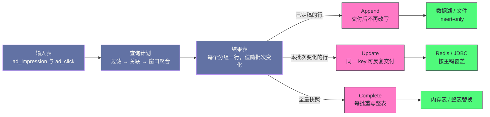
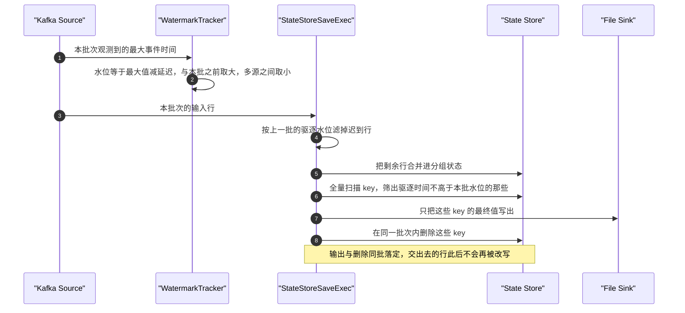
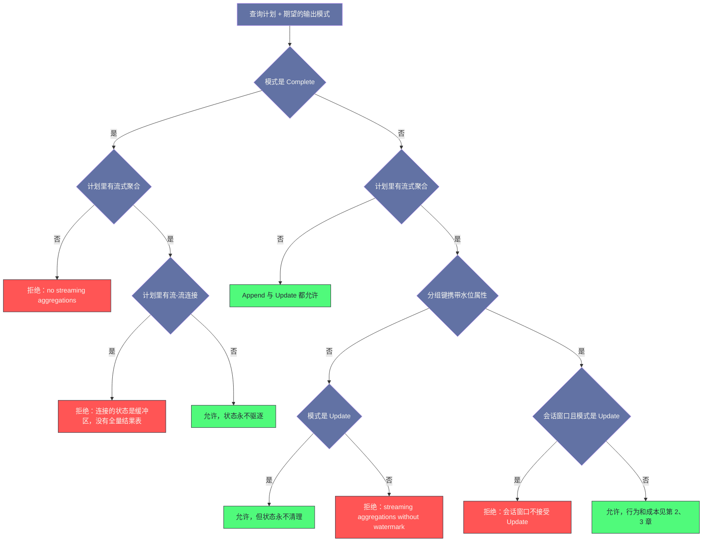
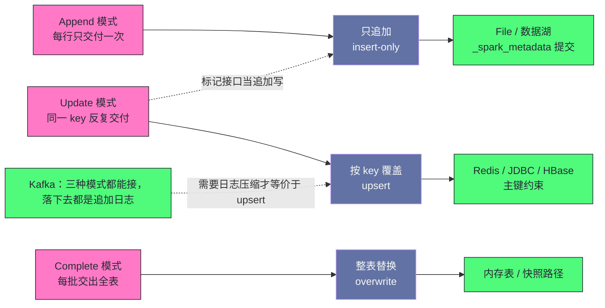
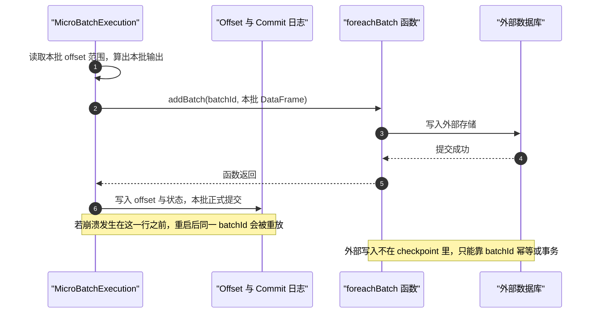

# 03 输出模式深度解析：Append、Update 与 Complete 的适用边界

**摘要：**

Structured Streaming 把流处理重写为"一张不断被改写的无界结果表"，而三种输出模式（Output Mode）给出的，是同一个问题的三种答案：每个微批（Micro-Batch）结束之后，往外部世界交付这张表的哪一部分。Append 只交付"此后再也不会被改写"的行，Update 交付本批次值发生变化的行，Complete 交付整张表的当前全貌。这个差别初看是"写多少"的量级问题，实质决定了 Sink 必须提供哪一种写入语义——只追加、按主键覆盖，还是整表重写。更要紧的是，模式并不由使用者自由勾选，它被查询形态反向约束：聚合产生的行天然会反复变化，与 Append 的承诺直接冲突，于是没有水位（Watermark）的聚合在分析期就会被拒绝；流-流外连接只允许 Append，会话窗口不接受 Update，Complete 则要求查询里必须存在聚合。本文以一条广告实时数仓链路贯穿，逐层拆开三种模式的语义边界、它们在 `StateStoreSaveExec` 里的实现差异、与水位及触发器的耦合、Sink 能力矩阵，以及 `foreachBatch` 这扇绕过了 Sink 约束、却把幂等责任转移给使用者的侧门；最后用一组反例交代失效条件与外部症状。

**关键词（Keywords）**: 输出模式, Append, Update, Complete, 结果表, Watermark, StateStore, foreachBatch

---

## 第 1 章 输出模式：给"结果表的哪一部分"下定义

### 1.1 一个只有流处理才会遇到的问题

批处理里不存在这个问题。一条 `SELECT slot_id, SUM(bid_price) FROM ad_impression GROUP BY slot_id` 的结果只有一份，作业跑完，把它整体交给下一个环节，此后这份结果就是历史。流处理的同一句 SQL 却有两种时间维度：查询计划是固定的，结果却随着每个触发批次向前爬。t=0 时 `slot_A` 的累计曝光是 1 200 次，t=1 时变成 1 800，t=2 时到 2 400，那么每个批次结束之后，究竟应该向外写什么？

2016 年 7 月发布的 Spark 2.0 给出了这套问题的形式化答案。它把 DStream 时代"每个批次交出一个 RDD、由用户自己在 RDD 上做去重与合并"的做法，换成了"先声明一张结果表，再让引擎自己计算增量"，SIGMOD 2018 的那篇论文把这套模型描述为对无界输入表的持续查询：引擎维护一个内部的结果表，每个触发批次做一次增量求值，然后按使用者声明的策略把增量交付出去。三种输出模式，就是三种交付策略。

它们的分野不在"交付多少行"，而在**对"这一行还会不会变"这个问题的三种回答方式**：

- 等到确定不会再变，才交付，交付之后不再回头——Append；
- 变了就交付，允许同一行在后续批次里再出现一次、两次、很多次——Update；
- 不区分变化，每次都把当前全貌交出去，让下游整表替换——Complete。

### 1.2 三种模式的契约

把三种模式并排写成契约，能看出它们的承诺强度完全不同：

| 维度 | Append | Update | Complete |
|---|---|---|---|
| 每个批次写出什么 | 本批次新产生、且此后不再被改写的行 | 本批次值发生变化的行（新增与更新都算） | 当前结果表的全部行 |
| 同一逻辑行会不会再次出现 | 不会 | 可能会，直到它被状态驱逐 | 每个批次都出现 |
| 下游需要的写入语义 | insert-only（只追加） | upsert（按主键覆盖） | overwrite（整表替换） |
| 无聚合查询 | 允许 | 允许，与 Append 等价 | 拒绝 |
| 有聚合查询 | 需要水位 | 允许 | 允许，而且必须有聚合 |
| 状态能否被驱逐 | 能，驱逐的那一刻就是输出 | 能，驱逐时静默进行、不输出 | 不能 |
| 典型内置 Sink | File | Kafka、Console、Foreach | Console、Memory |

表里最容易被越过的一行是"下游需要的写入语义"。使用者盯着"我只要最新的聚合值"，以为选 Update 是因为它快，实际上选 Update 的理由只能是：下游有能力按主键把旧值覆盖掉。如果下游是一套只能追加的对象存储，Update 交出去的多版本行会在下游变成互相冲突的历史，而 Spark 不会替你发现这一点。

### 1.3 为什么模式不是自由选择

刚接触这套 API 的人常有一种印象，三种模式是三个并列的选项，性能不同、语义相近，选一个合适的就行。事实恰恰相反：**模式首先是对查询形态的描述，其次才是一个可写参数**。一条无状态查询天然满足 Append 的承诺，一条无水位聚合天然违反它；一条流-流外连接的结果行在匹配出现的那一刻就是终态，所以它只允许 Append；一条去重查询的输出在 Complete 语义下无法枚举"全表"，因为去重的状态是"见过哪些 key"的集合，而不是一张可重放的结果表。

这个约束不是运行期才生效的守卫，而是分析阶段就写死的判断。Spark 在 `UnsupportedOperationChecker` 里逐条比对查询计划与输出模式，不匹配就直接抛 `AnalysisException`，连作业都起不来。换句话说，想换模式，往往要改查询本身：加水位、把事件时间列放进分组键、把外连接改成内连接，或者退一步改用 `foreachBatch` 自己接管写出。后文第 5 章会把这张判定表完整列出来，这里先建立直觉：模式是查询形态的函数，而不是使用者的偏好。

### 1.4 一条贯穿全文的链路

为了让后面的机制有具体的着力点，笔者设想一条广告实时数仓的链路 `ad_rt`。上游是两个 Kafka topic：曝光流 `ad_impression` 与点击流 `ad_click`，字段大致是 `event_time`、`request_id`、`slot_id`、`campaign_id`、`region`、`bid_price`，点击流还多一个 `is_valid`。下游有四个去向：明细清洗落数据湖、按广告位与分钟窗口的曝光点击指标、给实时大屏的"当前累计消耗"、以及一个把曝光与点击按 `request_id` 关联起来的归因宽表。

这条链路会在后文反复出现：第 2 章用它解释水位如何让窗口定稿，第 3 章用它对比 Update 与 Complete 的写出量，第 5 章用它走一遍判定表，第 6 章用它匹配 Sink，第 7 章用它演示 `foreachBatch` 的幂等缺口。批次间隔按 30 秒设定，水位延迟按 10 分钟设定，这两个数字只用于示例推算，不代表任何实测口径。

下图是结果表模型与三条交付路径的关系。注意三个输出模式并不是三张不同的结果表，而是同一张表的三种交付视图。



---

## 第 2 章 Append：只交出确定不再改写的行

### 2.1 承诺包含三个前提

Append 的语义可以拆成三条，缺一条都不成立：其一，本批次写出的行来自本批次新产生的数据；其二，此后任何批次都不会再为同一个逻辑行产出新版本；其三，因此下游可以把它当成一次纯粹的插入，永远不需要回头修改。

第二条是全部重量所在。流里没有"主键"这个天然概念，什么算"同一个逻辑行"由产生它的算子定义：无状态算子一个输入行对应一个输出行，行的同一性就是输入行的同一性；窗口聚合一个窗口加一个分组键对应一行，同一性由窗口边界与键值共同锚定。**行的同一性由算子定义，行的终态时刻也由算子决定**——这句话是整篇文章的骨架，后文所有关于"某个查询能不能用 Append"的结论都从它推出来。

第三条不是礼貌用语，而是与 Sink 实现直接挂钩的硬约束。`Sink` 接口的注释把话讲得很直白：为了保住精确一次（exactly-once），Sink 必须能承受"同一个 `batchId` 被重复调用一次以上"，因为失败重试时引擎会重放整批；但当 Append 语义成立时，重放的目标只是"把这一批补上"，而无需撤销已经写出去的东西。

### 2.2 无状态链是它的天然疆域

无状态算子链上，Append 不需要任何额外条件。`select`、`where`、`map`、`flatMap`、`filter`、`union`、流与静态表的关联，都属于这一类：一行数据进来，产出一行或多行出去，行在产生的那一刻就与这条流的未来无关了。`ad_rt` 里的明细清洗就是这种形态：

```python
# 明细链路：解析、过滤、补齐字段，行进来就出去，不存在"以后还要改"
detail = (spark.readStream.format("kafka")                             # 上游 topic
    .option("kafka.bootstrap.servers", brokers)
    .option("subscribe", "ad_impression")
    .load()
    .select(from_json(col("value").cast("string"), impression_schema).alias("r"))
    .select("r.*")
    .filter(col("slot_id").isNotNull() & (col("bid_price") > 0))
    .withColumn("dt", to_date(col("event_time"))))

query = (detail.writeStream
    .outputMode("append")                       # 无状态链上，Append 无条件可用
    .format("parquet")
    .option("path", "hdfs:///warehouse/ad/detail")
    .option("checkpointLocation", "hdfs:///ckpt/ad_detail")
    .partitionBy("dt")
    .start())
```

反过来，无状态查询在 Complete 模式下会被直接拒绝。`UnsupportedOperationChecker` 的规则很短：`Complete` 模式下若计划里没有任何流式聚合，就抛 `STREAMING_OUTPUT_MODE.UNSUPPORTED_OPERATION`，操作名写作 `no streaming aggregations`。这条规则的用意与性能无关：Complete 的契约是"每批交出这张表的全貌"，而一张无界、无分组、无聚合的流式表根本没有"全貌"可交——它只会越长越长，把全部未聚合数据永久保存在结果表里，这在任何意义上都不可行。官方文档把这层意思写得更直接：Complete 模式要求保存全部聚合数据，因此无法借助水位丢弃中间状态。

至于 Update 在无状态查询上与 Append 等价这一事实，值得单独提醒一句：等价只发生在"写什么"这一层。Update 的语义授权 Sink 做覆盖，而 Sink 一旦按覆盖语义实现，重复的 `batchId` 重放就从"重复插入"变成"幂等重写"，代价与收益都随之移动。第 3 章会展开这条线索。

### 2.3 聚合与 Append 的正面冲突

把聚合放进 Append，冲突立刻显形。以按广告位累计曝光为例：

```
batchId=0：本批 {slot_A: 1200, slot_B: 800}
  结果表：slot_A=1200, slot_B=800
  能交付吗？若此刻交付 slot_A=1200，下一批再来 600 次曝光，
  结果表就会变成 1800，而 Sink 里已经躺着一行 1200

batchId=1：本批 {slot_A: 600, slot_C: 300}
  结果表：slot_A=1800, slot_B=800, slot_C=300
  真正的矛盾：Append 承诺"交付后不再改写"，
  聚合却要求"同一行反复改写"
```

如果引擎在这个前提下仍然允许 Append，下游拿到的不是错误报错，而是更难发现的东西：一份看起来正常、实际包含了同一实体多个历史版本的表。任何对它做 `SUM` 或 `COUNT` 的分析都会把同一笔曝光算两遍。这类错误的可怕之处在于它不违反任何显式契约——每一行都是某个时刻的真实结果，错的是"把它们放在一起看"这件事。

因此 Spark 选择在分析期就拒绝，而且拒绝得很直接：Append 模式下若计划里存在流式聚合，引擎会去分组表达式里找带 `EventTimeWatermark.delayKey` 元数据的属性，一个都找不到就报错。源码里就写在这段判断上方的一行注释，把理由交代得很清楚：只有分组落在水位以下之后才能往 Sink 追加，没有水位则分组永远不会"完成"，也就永远没有可交付的行。这句话反过来解释了为什么报错总在聚合这条路径上出现——在没有终点的语义里，Append 只能无限期等待。

### 2.4 水位把"确定"变成可判定事件

水位的定义不复杂：引擎持续跟踪见过的最大事件时间，减去使用者声明的延迟阈值，得到一个单调不减的数值；多条输入流时取各源水位的最小值。当水位推进到 `W` 时，引擎对外宣告"事件时间不晚于 `W` 的数据不会再来了"。对一个按事件时间分组的聚合，这句话等价于一个可判定条件：**分组的驱逐时间不晚于 `W`，这个分组此后不会再收到有效数据**。

这就是 Append 与聚合之间那道缝隙的填法。一旦"某行的终态时刻"可以被判定，引擎就能在那一刻把行交出去，并且同时对它背后的状态撒手。官方文档描述 Append 与 Update 的差别时用的正是这个口径：Update 每批把更新过的计数写出去，Append 则只把最终计数写出去，引擎会等满迟到阈值、把窗口状态丢掉，然后把最终值追加到结果表与 Sink。

实现落在 `StateStoreSaveExec` 这个物理算子的一个 `match` 分支上。Append 分支做的事情可以概括成四步：

```scala
// 节选 StateStoreSaveExec.doExecute 的 Append 分支，省略与本节无关的度量与异常处理
case Some(Append) =>
  // 1) 前置守卫：没有水位就不允许走 Append，等于分析期检查之外的第二道保险
  if (watermarkPredicateForDataForLateEvents.isEmpty ||
      watermarkPredicateForKeysForEviction.isEmpty) {
    throw QueryExecutionErrors.unsupportedStreamingOperatorWithoutWatermark("Append", "aggregations")
  }
  // 2) 用"上一批"的驱逐水位把迟到行滤掉，再合并进状态
  val filteredIter = applyRemovingRowsOlderThanWatermark(iter, watermarkPredicateForDataForLateEvents.get)
  while (filteredIter.hasNext) { stateManager.put(store, row) }
  // 3) 全量扫描 key，凡是驱逐时间不晚于本批水位的，取出它的值作为本批输出
  // 4) 同一个迭代过程里把该 key 从状态中删除，输出与删除在同一批次内完成
```

第 2 步与第 3 步用了两个不同的水位，这个细节值得多看一眼。`WatermarkSupport` 里把水位的用途拆成了两份：迟到过滤用上一批的驱逐水位，关闭聚合与驱逐状态用本批水位。源码注释给出的理由是链式聚合：上游算子驱逐出来的行天然带着较旧的时间戳，如果下游用本批水位去过滤迟到数据，这些刚刚被上游"定稿"的行会被下游当成迟到数据丢掉，最后一层聚合就漏数据。把两个水位错开，等于给链式算子留出一批的传递余量。

### 2.5 为什么输出与驱逐必须在同一批完成

设想另一种实现：窗口一到水位就输出，状态先留着，反正下一批再删。这看起来更宽容，实际上把 Append 的核心承诺打穿了。状态一旦还在，下一次有数据落进这个窗口时引擎就有两个选择：要么把新值再输出一遍，于是同一个逻辑行出现两次，Append 退化成 Update；要么悄悄更新状态、不输出，于是 Sink 里的值与状态里的值永久分叉。两个选择都是错的，所以正确的做法只有一个：**交付与撒手是同一个动作**。

这条约束也解释了 Append 模式一个容易被忽略的成本：为了找出本批需要驱逐的 key，算子必须遍历状态存储中的全部 key。过期判定没有索引可依赖，因为它比较的是每个 key 内部的事件时间字段，而不是 key 的字典序。状态里活跃的 key 越多，这一遍扫描越贵；这与 Update 分支的模式不同，后者只在写入时输出、在收尾时静默清理，扫描虽在，但没有逐条构造输出的开销。三种模式的成本账，在 3.5 节那张对照表里摊开。

下图把一次窗口定稿的过程按参与者画出来。注意第 7 步与第 8 步的先后：先交出值，再删除状态，中间不能插入新的批次边界。



### 2.6 迟到数据的代价，以及它为什么不可补偿

Append 模式与水位结合，代价是把"迟到"从"晚到一会儿"变成"永久丢弃"。`StateStoreSaveExec` 在 Append 分支里用 `applyRemovingRowsOlderThanWatermark` 过滤输入，被滤掉的行会计入 `numRowsDroppedByWatermark` 这个度量。这个数字在生产上比批处理时长有用得多：它非零且持续增长，说明上游的乱序程度已经超过水位延迟，此时结果表里的历史区间正在被持续低估。

必须区分两种"迟到"。第一种是水位尚未越过、但数据本身晚到的行，这类行会被正常合并进状态，因为它的分组还活着，Append 也就还没到交出终态的时刻。第二种是水位已经越过、分组已被驱逐的行，这类行没有任何补救途径：状态没了，即使数据到了也无处可并；Append 的语义又不允许"再补一行"来修正，因为那等于篡改已经交付的历史。官方文档对水位的语义保证说得很谨慎，声明的是"延迟小于阈值的行一定不会被丢弃"，而不是"延迟大于阈值的行一定会被丢弃"——超过阈值的行丢不丢，取决于它到达时对应的分组是否恰好还没被驱逐。

想补偿只能在应用层做：把原始明细按 Append 落进数据湖，报表层在发现 `numRowsDroppedByWatermark` 异常抬升时，用批处理重算受影响的时间区间，再把重算结果以覆盖的方式写回下游。这条补偿链路正是"流批一体"在广告、风控这类场景里的真实用法，也是 Append 与 Update 在架构上的分水岭：Append 允许下游把"已交付"当成不可变事实，因此可以放心地离线重算并覆盖；Update 把"最新值"的责任交给了 Sink，离线重算要小心与新值打架。

### 2.7 水位必须长在分组键上

有一个约束比"要有水位"更细，也更容易踩：**水位属性必须出现在分组键里**。分析期的判断不是"查询里调用过 `withWatermark` 就行"，而是去 `groupingExpressions` 里找带水位元数据的属性。这与官方文档给出的三条例互为印证：聚合用的时间列必须与 `withWatermark` 的列是同一列；`withWatermark` 必须在聚合之前调用；聚合必须包含事件时间列或基于它构造的窗口。

三条例合起来指向同一个结论：Append 想成立，分组本身必须被时间切分，每个分组都有明确的"最后一次可能被更新的时刻"。`groupBy(window(col("event_time"), "1 minute"))` 满足，因为窗口有结束时间；`groupBy("slot_id")` 不满足，因为广告位是永久的，只要业务还在跑，`slot_A` 就永远可能被更新，引擎没有任何依据判定它定稿。所以下面这段代码看起来加了水位，实际上仍然会被拒绝：

```python
# 会被拒绝：水位长在 event_time 上，但分组键是永久的 slot_id
# 报错形如 Append output mode not supported when there are streaming aggregations
# ... without watermark；4.x 的错误类是 STREAMING_OUTPUT_MODE.UNSUPPORTED_OPERATION
bad = (impression
    .withWatermark("event_time", "10 minutes")
    .groupBy("slot_id")
    .agg(sum("bid_price").alias("cost")))
```

想让它跑起来，可以把事件时间放进分组键（例如按小时分桶后与 `slot_id` 组合），让每个分组在时间上自然封口；或者干脆承认这条查询没有终态，改用 Update 模式。这是一个典型的"模式倒逼查询形态"的例子：不是换一个参数就完事，而是要重新定义"一行"的边界。

### 2.8 空批次：Append 与触发器的耦合

还有一处耦合藏在触发器里。推演一下 `Trigger.AvailableNow` 的场景：数据一次性读到某个 offset 就停，不再有新数据。此时水位可能恰好停在某个窗口的结束时间之前一点点，下一批没有新数据可读，但"再推进一点水位就能把窗口吐出去"。如果引擎就此收工，那些已经满足条件的窗口会永远留在状态里，Append 模式下的输出也就永远缺一段。

`StateStoreSaveExec` 为此提供了 `shouldRunAnotherBatch` 钩子：在 Append 或 Update 模式、且存在驱逐水位时，如果新输入水位超过了本批使用的驱逐水位，就返回真，表示"值得再跑一批"。`MicroBatchExecution` 在决定是否构造下一批时把这个返回值与"是否有新数据"并列判断，任一为真就继续。于是没有新数据的批次照样会跑，只为把到期的窗口驱逐出去。这个机制解释了两种在生产上看着奇怪的现象：使用 `Trigger.Once` 或 `AvailableNow` 的 Append 作业会多跑一两个空批次；以及查询停止后发现 Sink 里的最后一个窗口，恰好是在停止前那次空批次里写出的。

Append 模式随查询形态的可用性可以收成一张表。这张表的每一行都在后文第 5 章会被复用。

| 查询形态 | Append | 依据 |
|---|---|---|
| 无状态：filter、map、select、union、explode、流与静态表关联 | 允许 | 行在产生批次即为终态 |
| 流-流内连接、左半连接 | 允许 | 每一对匹配在匹配成立时产出一次；无水位时状态无界 |
| 流-流外连接（左、右、全外） | 允许，但必须带水位 | 只有 Append 被接受，且水位在连接键或区间条件上 |
| 窗口聚合（滚动、滑动），带水位 | 允许 | 窗口结束时间被水位越过后定稿 |
| 非窗口分组聚合，分组键含事件时间列，带水位 | 允许 | 每个分组在时间上封口 |
| 非窗口分组聚合，分组键不含事件时间 | 拒绝 | 分组永不完成，报 without watermark |
| 全局聚合（无分组键） | 拒绝 | 无分组即无封口条件 |
| `dropDuplicates`（有或无水位的普通去重） | 允许 | 行只在首次出现时产出；无水位时状态无界 |
| `dropDuplicatesWithinWatermark` | 允许，必须有水位 | 分析期强制要求水位属性 |
| `flatMapGroupsWithState` 的 append 版 | 允许 | 查询模式必须同为 Append |
| `flatMapGroupsWithState` 的 update 版 | 拒绝 | 查询模式必须为 Update |

---

## 第 3 章 Update：把最终一致外包给 Sink

### 3.1 定义与实现

Update 模式的语义最短：每个批次只交出本批次值发生变化的行，既包括新出现的行，也包括被更新的行。`ad_rt` 里按分钟窗口的曝光点击指标天然适合它：每一批都可能刷新若干个窗口的计数，下游是一张按"窗口起点加广告位"为主键的表，来一行写一行。

实现上它比 Append 朴素得多。同一个 `StateStoreSaveExec` 算子的 Update 分支把"合并进状态"与"产出这一行"放在同一个动作里，不缓存、不等待，也不做任何"这一行是否终态"的判断：

```scala
// 节选 Update 分支：更新即输出，收尾时再静默清理过期 key
private[this] val baseIterator = watermarkPredicateForDataForLateEvents match {
  case Some(predicate) => applyRemovingRowsOlderThanWatermark(iter, predicate)  // 迟到行照样滤掉
  case None => iter
}
// getNext 里每 put 一条就返回一条：本批次变化过的行全部交出去
stateManager.put(store, row)
// close 里 removeKeysOlderThanWatermark：过期 key 被删掉，但**不产出任何行**
```

与 Append 的分支相比，两处差别决定了它们的气质。Append 在迭代过程中寻找"要交出去的行"，交出去的行来自状态；Update 在写入过程中顺带交出行，交出去的行来自输入。Append 的收尾动作是删除并输出，Update 的收尾动作只有删除。前者必须等，后者不必等；前者每一行只出现一次，后者可能出现很多次。

### 3.2 与 Append 在无状态查询上等价，但不完全等价

无状态查询上，Update 与 Append 写出的内容一模一样，因为一行只产生一次，没有"变化"可言。但两者对 Sink 的授权不同：Update 允许 Sink 做覆盖，Append 不允许。这在 Sink 端会引出完全不同的实现选择——同一份查询切到 Update 之后，一个按 `request_id` 覆盖写的 JDBC Sink 才不会报错；而 File Sink 直接声明它不接受 Update，因为它背后是对象存储或 HDFS，行级覆盖在那里不是一项可用的能力。

严格说，"等价"这句话只在输出内容上成立。把一个无状态查询从 Append 切到 Update，写完的数据相同，但查询的语义从"我保证每行只交付一次"滑到了"我允许同一行反复出现"这一侧。实践中这个差别很小，但它标注了使用者对下游的承诺强度：前者可以拿去做增量血缘，后者不能。

### 3.3 一致性只维持在水位之内

关于 Update 模式最常见的误解，是把它当成"最终一致的 upsert 流"——下游只要按主键覆盖，迟早会收敛到正确值。这个说法只在状态还活着的时候成立。Update 分支在每批收尾时同样会调用 `removeKeysOlderThanWatermark`，把驱逐时间早于水位的 key 从状态里删掉；一旦 key 被删，后续落在它身上的数据就变成迟到行，会在 `applyRemovingRowsOlderThanWatermark` 那一层被过滤，且计入 `numRowsDroppedByWatermark`。

于是 Update 的一致性是**有窗口的**：从第一次写入到该分组被驱逐为止，这段时间内的所有变化都能正确合并；越界之后，数据永久丢失，Sink 里的值停留在驱逐前最后一次更新上。这与 Append 的差别在于"出错的表现形式"：Append 少一段是少一段，历史自洽；Update 少一段可能是"某个 key 的累计值偏低"，下游如果只做展示也许永远发现不了，一旦用于结算就会产生对不上的差额。

真正想做到无界累计，只有一条路：不设水位、让状态无限增长，或者把累计的部分挪到下游（把增量交给下游做累加）。前者在低基数下勉强可用，后者等于把"聚合"这项职责从 Spark 挪给了存储层。

### 3.4 幂等责任被转移

`Sink` 接口的注释写明了契约：`batchId` 相同的数据是确定的，同一个 `batchId` 可能被调用多次（失败重试），实现方必须保证只加一次。Append 模式下这条契约相对好履行，因为重复加的就是同一批新行，文件系统上一个原子改名就能解决；Update 模式下，重复加的是"同一批更新行"，如果 Sink 不是幂等的覆盖写，重复加就会在下游留下两行同主键记录。

这就把一部分"精确一次"的责任从引擎转移到了下游：引擎保证的是"每批至少交付一次，且交付内容对 `batchId` 确定"，而"同一主键只应存在一行"这件事，得由 Sink 的主键约束、幂等写、或者下游的去重逻辑来兜。三种典型实现对应三种责任划分：

| Sink 实现方式 | 幂等机制 | 谁保证精确一次 |
|---|---|---|
| JDBC 单条 upsert | 主键冲突则更新 | 数据库的主键约束 |
| 批次级事务加去重表 | 用 `batchId` 做幂等键，事务内先查后写 | 使用者自己的代码 |
| 追加写加下游去重 | 全部落原始日志，查询层按主键取最新 | 下游查询逻辑 |

这三行的差别不是风格问题，而是故障恢复时的行为差别。第一行在批次失败重放时可能产生主键冲突错误（取决于数据库实现），需要上层吞掉或改为 `MERGE`；第二行能扛住重放但要求一批的所有写入在同一事务里；第三行最省事，但把"取最新"的成本永久留给了查询侧，且日志体积随更新频率线性增长。

### 3.5 成本结构

Update 与 Complete 的成本差不是常数倍，而是一个随基数变化的量级差。前者每批写出的行数与本批变化的分组数成正比，后者每批写出的行数与状态中全部分组数成正比。用前面设定的广告链路做一个示例推算：假设按分钟窗口与广告位聚合，活跃分组约 1 万个，批次间隔 30 秒，每批约有 1% 的分组发生变化。一天的批次数是 2 880 批，Update 每天写出约 28.8 万行，Complete 则是 2 880 万行，相差一百倍；而如果分组数涨到 100 万、每分钟都有一半分组变化，Complete 会直接变成每秒上百万行的重写，任何下游都接不住。

| 维度 | Update | Complete |
|---|---|---|
| 每批写出量 | 本批变化的分组数 | 状态中全部分组数 |
| 状态增长 | 有水位时按事件时间推进清理，无水位时无界增长 | 单调增长，永不清理 |
| 每批扫描成本 | 变化分组加一次收尾清理 | 全量迭代状态存储以生成快照 |
| Checkpoint 规模 | 与活跃分组数相关 | 与历史累计分组数相关，只增不减 |
| 下游压力 | 与变化率成正比 | 与基数成正比 |
| 一天写出行数（示例推算，1 万分组建、30 秒一批、每批 1% 变化） | 约 28.8 万行 | 约 2 880 万行 |

表里的"Checkpoint 规模"这一行在生产上比写出量更致命。Checkpoint 变大不只意味着磁盘占用，还意味着恢复时间的延长：作业重启时要把状态从分布式存储读回每个 Executor，快照越大，重启窗口越长。一个用 Complete 模式跑高基数聚合的作业，往往在跑了两三周之后才表现出"重启要半小时"的症状，而那时改模式已经涉及到下游兼容性了。

### 3.6 Sink 侧的 Update 表达

Update 模式能不能落地，取决于 Sink 怎么声明。Spark 的 DSv2 数据源通过 `StreamingWrite` 声明自己接受哪些输出模式（默认只声明 Append），引擎在启动查询前核对，不接受就报错。内置的调试 Sink 里，内存表（memory）只声明 Append 与 Complete，用 Update 写它会直接失败；控制台（console）三种都声明，但它显然没有"覆盖行"的能力，于是它在 `WriteBuilder` 上实现了一个标记接口 `SupportsStreamingUpdateAsAppend`，告诉引擎"把 Update 当 Append 写就行"。

这个标记接口值得记住，它代表一类现实：**很多 Sink 能接受 Update 的行流，但只能以追加的方式落盘，语义正确性要靠下游自己维持**。控制台把每一批的变化行按追加打印，人看着是对的；如果换成 Kafka，变化行就是追加在 topic 里的多版本消息，只有当 topic 配置了日志压缩（log compaction）、且消息键恰当地设为主键，消费者按 key 取最新时才等价于一张 upsert 表。少了压缩这一步，Kafka 里的"Update 模式输出"只是"变更日志"，不是"结果表"。

---

## 第 4 章 Complete：唯一能交出"结果表全貌"的模式

### 4.1 定义与准入

Complete 的语义是三种里最奢侈的：每个批次把当前结果表的全部行交出去，下游整表替换。它只对聚合查询开放，理由在 1.2 节已经交代过——没有聚合就没有"有限的结果表"。这条准入规则在分析期由 `UnsupportedOperationChecker` 执行，操作名写作 `no streaming aggregations`。

它也是三种模式里唯一支持排序的。`UnsupportedOperationChecker` 对 `Sort` 的判据是"子计划是否产出完整数据"，而所谓完整数据只有两种来源：子计划不含流式源，或者子计划含流式聚合且输出模式为 Complete。于是 `orderBy` 只能出现在 Complete 查询里，这也顺带解释了为什么流式 SQL 里写 `ORDER BY` 而不改输出模式会直接报错。同理，全流式计划上的 `limit` 在 Update 模式下被拒绝，因为随批次变化的结果集上取前 N 行，每批的"前 N"可能是完全不同的行，语义上无处安放。

### 4.2 实现：全量写入，然后全量读出

Complete 分支在 `StateStoreSaveExec` 里最短，也最能说明它的性质：

```scala
// 节选 Complete 分支：把所有输入写进状态，然后把整张状态表当结果输出
case Some(Complete) =>
  while (iter.hasNext) { stateManager.put(store, row) }   // 只写，不判断是否"变化过"
  val rangeIter = stateManager.values(store)              // 输出状态存储的全量视图
  // 迭代器收尾时只做 commit 与度量上报，没有驱逐、没有删除
```

三个动作对应三个后果。第一，输入行不做迟到过滤，因为 Complete 的结果表要求"包含所有见过的数据的影响"，一旦过滤就会让某些分组的累计值悄悄偏小，而此时又没有"补写"的机会。第二，输出来自状态存储的全量迭代，因此它的成本由状态规模决定，与输入规模无关。第三，也是最关键的一点：这个分支从头到尾没有读取任何水位参数，也没有任何删除动作。

### 4.3 Complete 与水位：不是冲突，是架空

一个流传很广的说法是 Complete 与水位不能同时使用、否则报错。按 4.3.0 的源码看，这个说法站不住：分析期的规则里，水位只在 Append 与 Update 两个分支被讨论，Complete 分支只检查"有没有聚合"；而 `StateStoreSaveExec` 的 Complete 分支既不读迟到过滤水位，也不读驱逐水位，更没有驱逐动作。也就是说，`withWatermark` 与 Complete 同写不会抛异常，只会得到一份**水位被完全架空**的查询：迟到数据不被丢弃，状态不被清理，水位对结果没有任何影响。

官方文档的表述其实很准确，只是容易被误读成"禁止"：Complete 模式按定义要保留结果表中的全部数据，因此不丢弃旧的聚合状态。这里说的是行为，不是准入限制。理解这一点有实际意义：一个按 Complete 模式跑的低基数全局指标，即使写了 `withWatermark` 也不会变小、不会变快，反而会让读者误以为它有时效边界。真正受水位支配的只有 Append 与 Update。

| 模式 | 是否读迟到过滤水位 | 是否驱逐状态 | 驱逐时是否输出 | 与水位的关系 |
|---|---|---|---|---|
| Append | 读，用上一批的驱逐水位 | 是 | 是，驱逐即输出 | 必须配合，缺水位直接拒绝 |
| Update | 读，同上 | 是，收尾时静默清理 | 否 | 可以配合，不强制 |
| Complete | 不读 | 否 | 不适用 | 水位被架空，写与不写结果相同 |

### 4.4 适用边界：低基数、可整表替换

Complete 的适用面窄，但窄得有理由。它要求三件事同时成立：分组基数是可控的小数（区域、渠道、广告位这类维度，几百到几万个量级）；下游能接受整表替换（内存表、能 `truncate` 后重灌的维表、或者每次覆盖写一版快照的对象存储路径）；状态规模不会随时间单调爆炸（分组键不包含用户、订单、请求这类高基数标识）。

一旦这三条有一条不成立，症状通常不是报错，而是逐渐变慢：批次时长随运行时间单调上升，Checkpoint 目录体积只增不减，重启恢复时间越来越长。第 8 章会把这条反例展开。这里给一个判断口径：如果一条 Complete 查询的分组键里出现了"每个业务实体一行"的字段，它大概选错了模式；该用的是 Update 加一个能 upsert 的 Sink，或者把明细交给 Append 落湖、把聚合交给离线重算。

```python
# 合适的 Complete：低基数、值随时变化、下游是内存表
region_stats = (impression
    .groupBy("region")                       # 区域是有限且稳定的小集合
    .agg(sum("bid_price").alias("cost"), count("*").alias("imp")))

query = (region_stats.writeStream
    .outputMode("complete")                  # 每批整表替换，内存表天然支持
    .format("memory")
    .queryName("region_stats")
    .start())
# 调试期可以直接查：SELECT * FROM region_stats ORDER BY cost DESC
```

---

## 第 5 章 模式由查询形态决定：一张判定表

### 5.1 两道闸门，两个时机

模式与查询的匹配由两道闸门把关，位置和作用都不同。

第一道在分析期，`UnsupportedOperationChecker.checkForStreaming` 遍历整个逻辑计划，把查询形态与输出模式逐条比对，不匹配抛 `AnalysisException`。4.x 的错误类是 `STREAMING_OUTPUT_MODE.UNSUPPORTED_OPERATION`，参数里带着模式名与操作描述；早期版本直接给出英文长句，例如 "Append output mode not supported when there are streaming aggregations on streaming DataFrames/DataSets without watermark"。这道闸门管的是**语义可不可能**，与 Sink 无关。

第二道在启动前，引擎核对目标 Sink 声明的能力。DSv2 的 `StreamingWrite` 用 `supportedOutputModes` 声明接受的模式，内置数据源里文件只声明 Append，内存表声明 Append 与 Complete。这道闸门管的是**Sink 接不接得住**。两道闸门都过了，查询才会真正开始跑批次。

分工带来一个有用的排错直觉：报"output mode not supported"字样且提到 aggregation、join、watermark 的，是第一道闸门，要改查询；报错里出现数据源类名或格式名的，是第二道闸门，要换 Sink 或换模式。两者混起来查，往往在错误的方向上浪费时间。

### 5.2 判定表

把 4.3.0 的分析期规则逐条落到查询形态上，得到下面这张表。它是本文最该被记住的一张表。

| 查询形态 | Append | Update | Complete | 约束原因 |
|---|---|---|---|---|
| 纯无状态（filter、map、select、union） | 允许 | 允许，与 Append 等价 | 拒绝 | Complete 要求存在流式聚合 |
| 流与静态表关联 | 允许 | 允许 | 拒绝 | 同上 |
| 全局聚合（无分组键） | 拒绝 | 允许 | 允许 | 无分组键即无封口条件 |
| 非窗口分组聚合，无水位 | 拒绝 | 允许 | 允许 | Append 报 without watermark |
| 非窗口分组聚合，分组键含事件时间且有水位 | 允许 | 允许 | 允许 | 驱逐后该分组永久关闭 |
| 窗口聚合（滚动、滑动），有水位 | 允许 | 允许 | 允许，但水位被架空 | 见 4.3 节 |
| 窗口聚合，无水位 | 拒绝 | 允许 | 允许 | 状态无界增长 |
| 会话窗口聚合 | 允许 | 拒绝 | 允许 | 会话会不断延长，与每批交出变化行的形态冲突 |
| 普通去重 `dropDuplicates` | 允许 | 允许 | 拒绝 | Complete 要求存在流式聚合 |
| 流-流内连接、左半连接 | 允许 | 允许 | 拒绝 | 外连接之外的连接只接受 Append 与 Update |
| 流-流外连接（左、右、全外） | 允许，必须带水位 | 拒绝 | 拒绝 | 外连接只在 Append 下有定义 |
| `flatMapGroupsWithState` 的 append 版 | 允许 | 拒绝 | 拒绝 | 模式必须与算子声明一致 |
| `flatMapGroupsWithState` 的 update 版 | 拒绝 | 允许 | 拒绝 | 同上 |
| `mapGroupsWithState` | 拒绝 | 允许 | 拒绝 | 只支持 Update |
| 带排序的查询 | 拒绝 | 拒绝 | 允许 | 排序需要完整数据视图 |
| 全流式计划上的 `limit` | 允许 | 拒绝 | 允许 | 变化结果集上的前 N 行无稳定语义 |

这张表有两处与直觉相悖，值得标出来。其一，流-流内连接在 Update 下是被允许的，而官方编程指南的兼容矩阵仍写作"连接只支持 Append"，与该版本源码不一致，本文表格按 4.3.0 源码整理。其二，会话窗口反过来：它允许 Append 与 Complete，唯独拒绝 Update。原因在会话窗口的语义：会话的结束时间由"给定间隔内没有新数据"决定，它天然是等结果定稿后一次性输出的形态，而 Update 要求每批交出变化行，与"会话可能不断延长"这件事没法对齐，引擎干脆在分析期拒绝。

下图把这张表压缩成一棵判定树。它省略了连接与去重的分支，只保留主干，用于快速判断。



### 5.3 一条规则解释整张表

判定表有十六行，但背后的规则只有一条：**一个输出行在本批次之后是否可能被再次改写，取决于产生它的算子有没有把"行生命周期的终点"暴露给引擎**。

无状态算子的终点就是出生点，所以 Append 无条件成立。窗口聚合把终点暴露成"窗口结束时间"这个可比较的字段，加上水位就能判定。非窗口分组聚合要暴露终点，必须让分组键本身携带时间——这也是"水位属性必须出现在分组键里"这条约束的来源。外连接把行的终点绑在"两条流的水位都越过连接键"上，内连接则可以每对匹配各自独立成立，因此前者只允许 Append、后者还允许 Update。`flatMapGroupsWithState` 的终点由使用者代码里的超时逻辑决定，引擎看不见，只能要求使用者自己在算子参数里声明 append 还是 update，再让查询模式与之对齐。

Complete 在这条规则下自然出局：它的契约不是"交出终点确定的行"，而是"交出全表"，这对算子的要求变成"结果集可枚举"。聚合的状态恰好就是结果集本身，可以枚举；连接的状态是等待匹配的缓冲区，出缓冲区的行不构成一张表，外连接因此在 Complete 下即便外层还有聚合，也会先被连接自身的规则拦下。去重的处境略有不同：作为最终输出时它根本没有聚合，被"必须有聚合"那条挡住；一旦下游再接一层聚合，它就退化成聚合流水线里的一环，不再直接面对 Sink。

### 5.4 模式与下游算子的耦合

输出模式不只决定"写出去什么"，还决定了"流出去的行对下游算子意味着什么"。这条耦合藏在一个不显眼的分析期检查里：`checkStreamingQueryGlobalWatermarkLimit` 会遍历计划里每一个有状态算子，检查它上游是否出现了"会吐出早于当前水位的行"的算子——具体包括事件时间超时的 `flatMapGroupsWithState`、以及**非 Append 输出模式下的聚合与去重**。命中就抛分析异常，文案里用的是"可能影响正确性的模式"，并给出关闭开关 `spark.sql.streaming.statefulOperator.checkCorrectness.enabled`（关闭后降级为警告）。

为什么非 Append 的聚合会触发这个检查？设想 `agg1 → agg2` 的链式聚合：`agg1` 在 Update 模式下每批输出变化行，这些行带着旧的事件时间；`agg2` 拿到它们时，如果按自己的本批水位判断迟到，就会把刚刚被 `agg1` 更新过的行当成迟到数据丢掉，`agg2` 的累计值于是永久偏小。这就是 2.4 节提到的两个水位的由来，也是这条检查存在的理由。检查把"使用者是否理解这个风险"变成了一次显式确认：要么改成 Append，要么明确关掉检查并接受后果。

生产上这类链条很常见，例如先按 `request_id` 去重、再按窗口聚合，或者先按分钟窗口聚合、再按小时窗口二次汇总。这类查询在版本升级、调整水位、改动批次间隔时都可能悄悄改变行为，而报错或警告往往在作业重启时才被看见。

### 5.5 增量与边角

4.x 里还有几条与模式强相关的边角规则，一并记在这里。实时模式（Real-Time Mode）只允许 Update 输出，分析期对其它模式直接报 `OUTPUT_MODE_NOT_SUPPORTED`；CDC 读入后的行级重写只对 Append 有定义，用 Update 或 Complete 会在分析期被拒，理由是这两种模式下引擎会逐批重放状态变化或整表，与批处理 CDC 语义对不上；`dropDuplicatesWithinWatermark` 强制要求水位属性，否则分析期报错。这些规则的共同点是把"模式选择"从运行期错误提前到分析期，代价是使用者在写代码时就得想清楚下游要什么。

---

## 第 6 章 与 Sink 的匹配：三档写入能力

### 6.1 三档能力

把 Sink 按写入能力分档，只有三档：只能追加（insert-only）、能按主键覆盖（upsert）、能整表替换（overwrite）。三种输出模式与这三档能力是一一对应的，任何错配要么被引擎挡下，要么在语义上悄悄出错。

下图是这个对应关系，以及几条常见的"跨档"实现在语义上的走样路径。



### 6.2 文件类 Sink：只有 Append

文件 Sink 是加法性的极端代表。它每批在目标目录下写一批新文件，并在 `_spark_metadata` 里追加一条提交记录，读取方只认提交过的批次，因此天然幂等、天然精确一次。想让它在原地修改某一行，先不说文件格式支不支持，光是"改哪一行"就无法回答：对象存储与 HDFS 都不提供行级定位。所以它只声明 Append，Update 与 Complete 一律不被接受。

这解释了 `ad_rt` 里一个常见的架构选择：明细落湖用 Append，指标表不能用文件写——除非下游能接受"同一广告位有多个版本的指标文件，由查询时取最新"。后者看似可行，实际是把 upsert 的成本从写入侧挪到了读取侧，并且要求读取方知道按什么排序取哪个版本，往往比接一个能 upsert 的数据库更麻烦。

### 6.3 Kafka：三种都能接，语义各不相同

Kafka Sink 声明接受三种模式，因为它本质上只知道一件事：把本批 DataFrame 的每一行序列化后追加到 topic。三种模式在它这里都"能写"，但语义完全不同：

- Append：topic 里是增量事实，每个键对应的消息就是一条历史记录，消费端按需累加；
- Update：topic 里是变更日志（changelog），同一个键会有多条消息，消费端必须按 key 取最新，或者依赖日志压缩把旧版本清掉；
- Complete：每批把全量快照追加进 topic，topic 变成了"快照序列"，消费端要按时间戳取整批，逻辑最复杂但对下游最不挑剔。

第三行的写法在实践中确实存在，用于把 Spark 的结果"广播"给一批消费端，让它们各自决定如何合并。它的代价是 topic 体积随批次线性膨胀，必须配保留策略；而且消费端如果只按 key 取最新一条，就会把不同批次的快照混在一起，得到一份互相矛盾的拼图。Kafka 的日志压缩只对同一 key 的旧消息生效，恰好对应 Update 语义；Complete 语义没有对应的清理机制，只能靠时间保留。

### 6.4 没有内置流式 Sink 的系统

关系库、Redis、HBase、ClickHouse 这类系统，Spark 没有为它们提供流式 Sink（JDBC 格式支持批写，不支持 `writeStream`）。想让 Update 模式落到这些系统上，只能用 `foreachBatch` 或 `foreach` 自己写。这件事的现实后果是：**Update 模式的语义优势，往往要自己写代码才能兑现**，而代码里最容易漏的正是幂等。

| Sink | Append | Update | Complete | 一致性 | 备注 |
|---|---|---|---|---|---|
| File（parquet、orc、json、csv） | 接受 | 拒绝 | 拒绝 | 精确一次 | 每批一个目录，加 `_spark_metadata` 提交日志 |
| Kafka | 接受 | 接受 | 接受 | 至少一次 | 三种都是追加；Update 需下游按 key 合并或日志压缩 |
| Console | 接受 | 接受 | 接受 | 无 | 调试用；Update 通过标记接口当追加打印 |
| Memory | 接受 | 拒绝 | 接受 | 无 | 调试用；Complete 模式重启后整表重建 |
| Foreach | 接受 | 接受 | 接受 | 至少一次 | 逐行自定义写，幂等靠自己的 `ForeachWriter` |
| ForeachBatch | 接受 | 接受 | 接受 | 取决于实现 | 批次级自定义写，`batchId` 是做幂等的抓手 |
| 关系库、Redis 等 | 无内置流式 Sink | 无 | 无 | 取决于实现 | 走 `foreachBatch`，自己实现 upsert |

### 6.5 一个反例：把 Update 写到只能追加的地方

把 Update 模式的查询写到文件 Sink 上，会被第二道闸门拒绝，这是幸运的情况。真正危险的是换成别的只能追加的落点，例如自己用 `foreachBatch` 写一份 Hive 表（不带主键）、或者写一份按日期分区的 Parquet：引擎不会拦你，因为它只看到"用户代码在写东西"。结果就是同一个广告位在结果目录里出现多行，每行是某个批次的累计值。下游如果按分区覆盖就能得到正确结果，如果按追加读取再做 `SUM`，就会把同一批曝光累加几十遍。

这类错误的识别特征是：结果表的行数随运行时间线性增长，而业务实体的数量是固定的。做数据质量校验时，一条"主键重复率"的告警就能提前发现它。

---

## 第 7 章 `foreachBatch`：绕过 Sink 约束的侧门

### 7.1 它到底是什么

`foreachBatch` 的接口形态是一个函数 `(DataFrame, Long) => Unit`，第二个参数是批次号。它挂在 `DataStreamWriter` 上，最终实现成一个 Sink：`addBatch(batchId, data)` 被调用时，引擎把本批的输出 DataFrame 与批次号交给用户函数，用户函数在里面可以任意调用普通的 `DataFrame.write`。

理解它的关键在于看清边界：**它绕开的是"模式与 Sink 能力"的匹配，绕不开"模式与查询形态"的匹配**。一个无水位聚合加 Append 的查询，即使挂上 `foreachBatch` 依然在分析期被拒，因为 `UnsupportedOperationChecker` 检查的是逻辑计划与输出模式，跟 Sink 无关。它真正提供的能力有三样：在同一次批次里写多个目的地；使用只支持批写的既有数据源；在批次级别做流式计划里不支持的转换。官方文档把这三点列得很清楚，同时也附了一句提醒：这些额外操作端到端的语义要使用者自己推敲。

### 7.2 拿到的是"按模式裁剪过的"批次

传给用户函数的 DataFrame 不是原始输入，而是查询在当前输出模式下的输出。Append 模式下它是本批定稿的行，Update 模式下它是本批变化的行，Complete 模式下它是全表快照。这一点决定了 `foreachBatch` 内部写入策略的正确形态：

```python
def upsert_slot_metrics(batch_df, batch_id):
    # Update 模式的批次只含本批变化的行，所以按主键合并即可
    if already_committed(batch_id):          # 幂等门：同一批次被重放时直接返回
        return
    batch_df.createOrReplaceTempView("batch_slot_metrics")
    with db.transaction():                   # 合并与批次标记必须落在同一个事务里
        db.execute("""
            MERGE INTO slot_metrics t USING batch_slot_metrics s
            ON t.window_start = s.window_start AND t.slot_id = s.slot_id
            WHEN MATCHED THEN UPDATE SET t.cost = s.cost, t.imp = s.imp
            WHEN NOT MATCHED THEN INSERT *
        """)
        db.execute("INSERT INTO etl_batch_log VALUES (%s, now())", batch_id)

(slot_metrics.writeStream
    .outputMode("update")
    .foreachBatch(upsert_slot_metrics)
    .option("checkpointLocation", "hdfs:///ckpt/slot_metrics")
    .start())
```

如果查询是 Append 模式、目的地却是需要覆盖的表，这段代码就错了：Append 的批次里不含"未变化的行"，覆盖写会把之前批次写入的其它分组一起抹掉。用 Complete 模式做覆盖写反倒是对的，因为批次里是全表，覆盖之后表的内容就是最新全貌——这也是 `foreachBatch` 最常见的两种正确组合：Append 配追加语义、Complete 配整表覆盖，中间那种"Update 配覆盖"要求目的地有主键约束。

### 7.3 默认只有至少一次

文档里那句话很短，但每个字都值钱：`foreachBatch` 默认只提供至少一次（at-least-once）写保证，不过可以用传入的 `batchId` 对输出做去重，从而拿到精确一次。这里要分清两件事——引擎侧与用户侧。

引擎侧保证的是：批次要么整体成功、要么重放，重放时同一个 `batchId` 加上相同的输入范围，因此交给函数的 DataFrame 内容是确定的；再往前一步，引擎会把 offset 与状态提交到 checkpoint，只有提交成功的批次才算数。用户侧需要保证的是：同一个 `batchId` 的函数被调用两次时，外部存储里的效果只发生一次。这两种保证之间有缝，缝的位置就是崩溃时序。

下图把这条缝画成了一个时序：只要崩溃发生在"外部写入成功"与"checkpoint 提交成功"之间，重启后必然重放同一批。



### 7.4 它与 checkpoint 到底是什么关系

checkpoint 记录三样东西：输入源的 offset 范围、有状态算子的状态快照、以及批次提交标记。它不记录、也无从记录用户在 `foreachBatch` 里对 MySQL 做了什么——Spark 不知道那张表的存在。所谓"`foreachBatch` 不参与 checkpoint 的精确恢复"，准确含义是：恢复的粒度是批次，而不是你的外部事务；重启后被打断的批次会以相同 `batchId` 重放，至于重放是否产生重复写入，取决于你的代码。

这也解释了为什么文件 Sink 不必操心这件事：它的"外部写入"就是引擎自己管的那批文件加 `_spark_metadata`，提交日志与 checkpoint 是同一套机制的两个视图，天然对齐。一旦把写入搬到 `foreachBatch` 里，对齐关系就断了，只能靠幂等键重新建立。实现幂等有三条常见路子，代价依次上升：用 `batchId` 写一张去重表，同一事务里先查后写；让目标表的主键吸收重复（upsert 天然幂等）；每次写入前按批次覆盖对应分区（幂等但要求分区可枚举）。三条路都要求业务上存在一个稳定的幂等键，而 `batchId` 恰好是引擎免费提供的那一个。

### 7.5 四个坑

第一个坑是把批次数据 `collect` 回 Driver 再写。这在调试时很顺手，在生产上是内存与网络的放大器：一批一百万行，collect 一次就把 Driver 堆打满。

第二个坑是多次 action 触发重算。批次 DataFrame 是普通 DataFrame，`count()` 之后再 `write` 会算两遍；如果查询有状态，重算意味着状态存储被重复读取，官方文档专门提醒这种情况要 `persist` 与 `unpersist`。

第三个坑是在函数里再启动一个流查询。`foreachBatch` 的运行上下文里不允许嵌套流式查询，这类代码能编译、会在运行期报错。

第四个坑是把 Update 的批次当成全量。前面已经说过，这里补充它的表现形式：下游表里大部分分组的值长期停在旧值上，只有最近活跃的分组在更新。排查时容易误判为"水位把数据丢了"，实际是写入逻辑的假设错了。

---

## 第 8 章 反例与边界

### 8.1 Complete 配无界状态

最典型的反例是把 Complete 用在按业务实体分组的聚合上：`groupBy("user_id")` 或 `groupBy("request_id")` 配 `outputMode("complete")`。分析期不会报错，因为确实有聚合；运行期也不会报错，因为每批的写出都成功。症状是三条曲线一起缓慢上扬：批次时长、状态存储体积、checkpoint 目录大小，且都没有回落。跑上几周之后，作业重启需要读回几十 GB 的状态，恢复时间从秒级变成分钟级，运维开始怀疑是资源不足，加内存加核数，短暂缓解后又回到原样。

识别口径很简单：看分组基数的增长趋势。如果分组键里含有随业务持续增长的标识，这就是一条注定膨胀的查询。处理方向是把聚合挪到下游（Append 落明细，下游做累计）或者换成 Update 加 upsert Sink。

### 8.2 Append 配无水位的聚合

这类组合在分析期就被拒，报错信息明确指向聚合与水位，不存在"跑起来才发现"的可能。但它有一个变形的写法值得警惕：先用 Update 把聚合结果写进 Kafka，再另起一个 Append 的作业从 Kafka 读出来写文件。第二个作业在分析期看起来完全合法——它只是无状态的读与写——可"确定"这件事已经被悄悄绕过了：第一个作业的 Update 输出里，同一个键会反复出现，第二个作业按 Append 落盘，文件里就有多版本。想要正确，第二个作业必须自己按 key 去重或做窗口聚合，而一旦做聚合它又回到了原来的问题。绕路不解决问题，只是把问题挪到了下游。

### 8.3 Update 配只能追加的 Sink

模式与 Sink 不匹配，如果 Sink 是内置的，第二道闸门会拦住；如果 Sink 是自建的（`foreachBatch` 里写文件、写只追加的日志系统），就没有人拦。这时错误是静默的：下游按追加读到的是同一实体的多版本历史，做聚合就双计。识别口径是"行数与业务实体数的比值随时间增长"，以及在结果里能查到同一主键的多行。处理方向只有两个：换成能 upsert 的 Sink，或者在写入前先按主键去重并只保留本批最新。

### 8.4 水位停滞导致"永远没有输出"

这是 Append 模式最难查的一类问题：不报错、不告警，只是 Sink 里没有新数据。成因是水位由所有输入源的最小值决定，如果某条流长时间没有数据（例如点击流在深夜归零），全局水位就停在原地，窗口无法定稿，Append 也就无法输出。`ad_rt` 的归因宽表正是这种形态：曝光与点击只要有一路断了，两路连接的结果就卡住。

诊断的入口是 `StreamingQueryProgress` 里的水位字段与输入速率：如果 `eventTime` 水位长时间不变而另一条流的 `inputRowsPerSecond` 正常，基本可以确认。缓解手段有三条：给低速流单独降低延迟阈值（让它更快推进），把两路合并成一路处理，或者在深夜时段用空闲批次推进水位——最后这条依赖前文提到的 `shouldRunAnotherBatch` 机制。

### 8.5 触发器与模式的耦合被忽略

同一份查询换一个触发器，输出行为可能完全不同。处理时间触发器下，即使没有新数据也会按间隔触发空批次，这类空批次会把到期的窗口驱逐出去，Append 的输出因此连续；`Trigger.Once` 或 `AvailableNow` 下，没有新数据就没有下一批，只有 `shouldRunAnotherBatch` 判定需要补一批时才会继续，于是输出可能出现"少数窗口延迟若干个批次才出现"的现象。把批处理作业改成 `AvailableNow` 做一次性回填时，这个差别会直接表现为"回填结果比预期少了最后几个窗口"。

### 8.6 反例速查

| 现象 | 常见误判 | 实际机制 | 处理方向 |
|---|---|---|---|
| 批次时长与 checkpoint 体积同步单调上升 | 资源不足、数据倾斜 | Complete 模式保留全部聚合状态，永不驱逐 | 换 Update 加 upsert，或降低分组基数 |
| 分析期报 output mode not supported | 版本 bug、Sink 不支持 | 查询形态与模式不匹配，第一道闸门拦下 | 加水位、把事件时间放进分组键、换模式 |
| 启动报错提示格式名或数据源类名 | 查询写错了 | 第二道闸门：Sink 的 `supportedOutputModes` 不含该模式 | 换 Sink，或用 `foreachBatch` 自建写入 |
| Append 作业长时间无输出但不报错 | 任务卡住、offset 不前进 | 全局水位被某条低速流拖住，窗口无法定稿 | 分别设阈值、合并流、或用空闲批次推进水位 |
| 结果表行数随时间线性增长 | 上游重复数据 | Update 被写进只能追加的落点，多版本共存 | 换 upsert Sink，或写入前按主键去重 |
| 重启后同一批数据被写了两次 | 引擎重复消费 | 崩溃在外部写入与 checkpoint 提交之间，`foreachBatch` 无幂等 | 用 `batchId` 做幂等键或去重表 |
| 回填结果少了最后几个窗口 | 数据源不完整 | 一次性触发器下没有空批次，过期窗口未被驱逐 | 保留至少一个处理时间触发周期，或手工补跑 |
| 二次聚合的累计值偏低 | 上游数据缺失 | 链式有状态算子把上游定稿行当成迟到数据丢弃 | 上游改 Append，或关闭正确性检查并接受风险 |

---

## 第 9 章 落点

回到本文开头的那三个候选答案。Append 要求"确定"，Update 允许"变化"，Complete 交出"全貌"；这三种态度之所以不能互换，是因为它们对下游提出了三种不同的世界模型：一个只会追加的世界、一个能按主键覆盖的世界、一个每次都能整表替换的世界。模式选错的本质，是让下游活在一个它并不具备的世界里。

判定顺序可以收成三问。第一问，下游能承受哪一种写入语义——如果只能追加，模式就锁定在 Append，问题变成"这条查询能否提供确定的行"，能则加水位与时间分组，不能则改架构（先落明细、离线重算）。第二问，查询能否在时间上封口——分组键里有没有事件时间，水位有没有真的长在分组键上，外连接的两侧水位是否会互相拖累。第三问，状态的规模会不会随时间失控——如果分组键含有持续增长的业务标识，任何保留状态的模式都只是把账单推到将来。

`foreachBatch` 的位置也要放准。它不是第四种输出模式，而是把"模式与 Sink 的匹配"这道闸门挪到了用户代码里的一个适配层。挪走之后，Spark 仍然检查查询形态，但不再替你检查写出语义；恰好这部分责任最重、最容易在半年后才暴露。用它的时候，最好把它当成"我正在写一个数据库连接器"，而不是"我正在绕过一个限制"。

至于三种模式的边界会不会随版本推移而模糊，目前仍然言之尚早。4.x 已经开始引入实时模式（只允许 Update）与新的状态算子（`transformWithState` 系列），它们在扩大"有状态"的表达能力的同时，也让"什么算一行、这行何时定稿"这个问题变得更依赖使用者自己的声明。模式这套抽象的价值恰在这里：它把"下游需要什么"与"上游能保证什么"的谈判摆到台面上，谈不拢就在分析期失败，而不是在三个月后的对账里失败。

---

## 参考资料

1. Apache Spark 4.3.0 文档：Structured Streaming Programming Guide，Output Modes 与 Sink 兼容矩阵。https://spark.apache.org/docs/latest/streaming/apis-on-dataframes-and-datasets.html
2. Apache Spark 源码（4.3.0）：`sql/catalyst/src/main/scala/org/apache/spark/sql/catalyst/analysis/UnsupportedOperationChecker.scala`，输出模式与查询形态的分析期校验。https://github.com/apache/spark/blob/v4.3.0/sql/catalyst/src/main/scala/org/apache/spark/sql/catalyst/analysis/UnsupportedOperationChecker.scala
3. Apache Spark 源码（4.3.0）：`sql/core/src/main/scala/org/apache/spark/sql/execution/streaming/operators/stateful/statefulOperators.scala`，`StateStoreSaveExec` 三种模式分支、`WatermarkSupport` 的两个水位、`shouldRunAnotherBatch`。https://github.com/apache/spark/blob/v4.3.0/sql/core/src/main/scala/org/apache/spark/sql/execution/streaming/operators/stateful/statefulOperators.scala
4. Apache Spark 源码（4.3.0）：`sql/core/src/main/scala/org/apache/spark/sql/execution/streaming/runtime/IncrementalExecution.scala`，输出模式注入与水位传播规则。https://github.com/apache/spark/blob/v4.3.0/sql/core/src/main/scala/org/apache/spark/sql/execution/streaming/runtime/IncrementalExecution.scala
5. Apache Spark 源码（4.3.0）：`sql/core/src/main/scala/org/apache/spark/sql/execution/streaming/runtime/WatermarkPropagator.scala`，驱逐水位与迟到过滤水位的分别传播。https://github.com/apache/spark/blob/v4.3.0/sql/core/src/main/scala/org/apache/spark/sql/execution/streaming/runtime/WatermarkPropagator.scala
6. Apache Spark 源码（4.3.0）：`sql/core/src/main/scala/org/apache/spark/sql/execution/streaming/runtime/MicroBatchExecution.scala`，批次构造与 `shouldRunAnotherBatch` 的判定位置。https://github.com/apache/spark/blob/v4.3.0/sql/core/src/main/scala/org/apache/spark/sql/execution/streaming/runtime/MicroBatchExecution.scala
7. Apache Spark 源码（4.3.0）：`sql/core/src/main/scala/org/apache/spark/sql/execution/streaming/Sink.scala`，Sink 契约与同 `batchId` 幂等要求。https://github.com/apache/spark/blob/v4.3.0/sql/core/src/main/scala/org/apache/spark/sql/execution/streaming/Sink.scala
8. Apache Spark 源码（4.3.0）：`sql/core/src/main/scala/org/apache/spark/sql/execution/streaming/sinks/FileStreamSink.scala`，文件 Sink 的批次提交与 `_spark_metadata` 关系。https://github.com/apache/spark/blob/v4.3.0/sql/core/src/main/scala/org/apache/spark/sql/execution/streaming/sinks/FileStreamSink.scala
9. Apache Spark 源码（4.3.0）：`sql/core/src/main/scala/org/apache/spark/sql/execution/streaming/console.scala`，`SupportsStreamingUpdateAsAppend` 标记接口的用法。https://github.com/apache/spark/blob/v4.3.0/sql/core/src/main/scala/org/apache/spark/sql/execution/streaming/console.scala
10. Apache Spark 源码（4.3.0）：`sql/catalyst/src/main/scala/org/apache/spark/sql/errors/QueryCompilationErrors.scala`，`STREAMING_OUTPUT_MODE.UNSUPPORTED_OPERATION` 错误类定义。https://github.com/apache/spark/blob/v4.3.0/sql/catalyst/src/main/scala/org/apache/spark/sql/errors/QueryCompilationErrors.scala
11. Armbrust M., Das T., Torres J., et al. Structured Streaming: A Declarative API for Real-Time Applications in Apache Spark. SIGMOD 2018. https://doi.org/10.1145/3183713.3190664
12. Apache Spark JIRA：SPARK-28650（`foreach` 的 partition 与 epoch 组合不保证输出一致，去重应改用 `foreachBatch`）。https://issues.apache.org/jira/browse/SPARK-28650

---

> [!note] 思考题
> 1. Append 模式要求"交出后不再改写"，而 `StateStoreSaveExec` 把输出与驱逐放在同一批完成。如果允许"先输出、下一批再清理状态"，会出现哪两种错误结果，各自在什么条件下暴露？
> 2. Complete 模式在 4.3.0 的源码里不读任何水位，因此 `withWatermark` 被架空。假设要求让 Complete 也能按水位丢弃状态，结果表的语义需要怎么改，下游又需要付出什么？
> 3. 流-流内连接允许 Update，外连接只允许 Append。用"行生命周期的终点是否被暴露"这条规则解释这个差别，并说明外连接若强行支持 Update 会在未匹配行上遇到什么问题。
> 4. `foreachBatch` 绕开了 Sink 能力检查，却绕不开查询形态检查。为什么 Spark 不把这两道闸门一起放开，放开之后哪些语义会立刻失去保证？
> 5. 链式聚合 `agg1 → agg2` 里，上游在 Update 模式下的输出可能被下游当成迟到数据丢弃。除了改用 Append，还有哪些手段能让这条链路在 Update 下保持正确，各自的代价是什么？