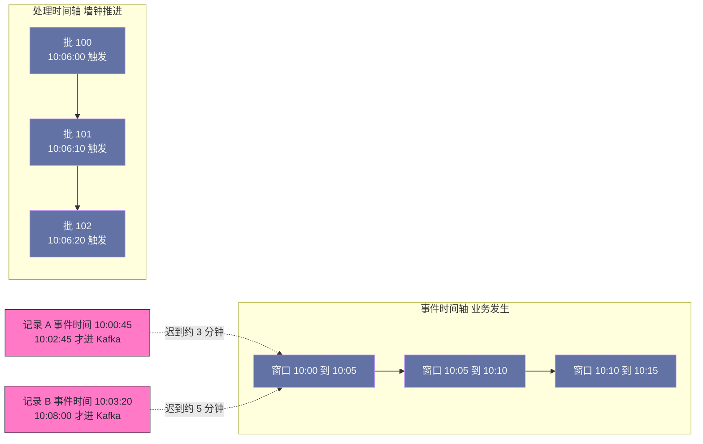
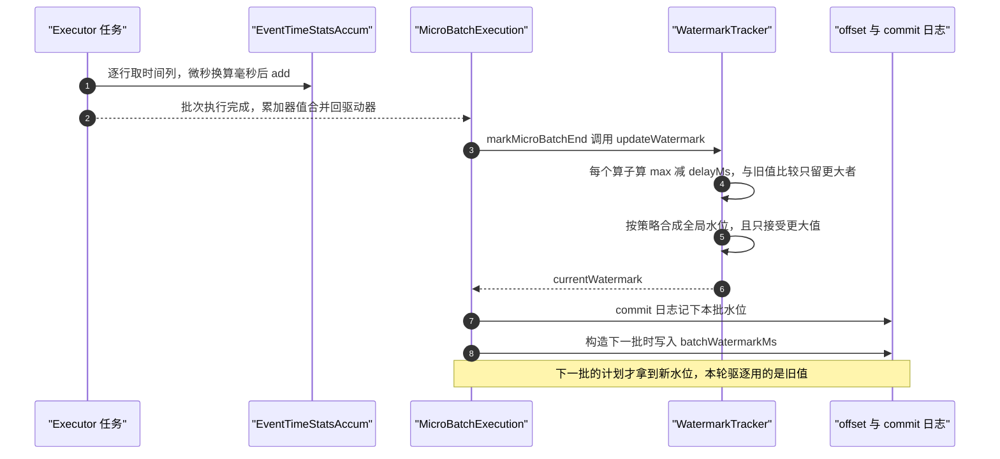
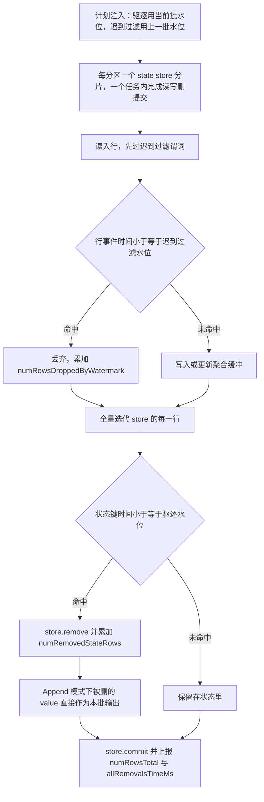
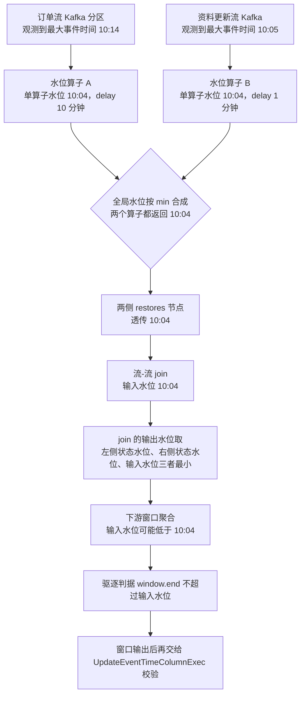
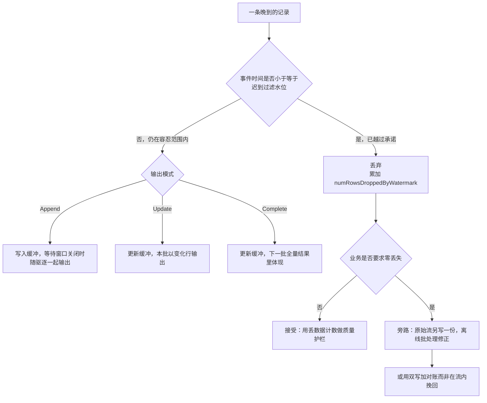

# 04 Watermark 全解：事件时间语义与延迟数据处理

**摘要：**

「事件时间的水位线」这句话被引用的次数，远多于它被真正读懂的次数。多数材料把它讲成一个单调递增的时间戳记号，仿佛 Watermark 的主要工作是告诉用户「事件时间的时钟走到哪了」。但如果顺着执行路径读下去会发现，那个数字本身几乎没有人消费：物理计划里的水位算子对数据一个字节都不改，它做的全部事情是把每行的事件时间塞进一个累加器；真正读这个数字的，是状态存储的驱逐谓词与迟到过滤谓词。也就是说，**推进只是副产品，授权删除才是本职**。

本文沿一条实时数仓订单流走完水位的一生。第 2 章拆推进算法：累加器里的 `max/min/avg/count` 如何被合成单算子水位、多算子水位如何按 `min` 策略合成全局水位、为什么这个值在批末才更新且一定要滞后一批、重启后它凭什么不清零。第 3 章进入状态存储内部，区分「驱逐水位」与「迟到过滤水位」这两个经常被混为一谈的值，并指认清理真正发生的位置——不是驱动器集中清扫，而是每个状态分片在自己的任务里、提交之前全量迭代一遍。第 4 章讲传播：全局水位之外，Spark 还维护一套算子级输入水位，流-流 join 的输出水位为何常常低于输入水位。第 5 章把水位与输出模式扣在一起，说明 Append 模式的端到端延迟为何至少是一个 delay，以及迟到数据被丢弃、被重算、被旁路三种命运各自成立的条件。第 6 章给出停滞的成因与诊断口径，并纠正一个流传很广的误判：在 Spark 里，数据倾斜与慢分区**不会**拖住水位。

文章口径为 Spark 4.3.0（2026-10-30 发布，Scala 2.13）。文中引用的源码取自上游 4.x 分支的同名文件，个别私有实现与类名会随版本调整，判断具体行为时以对应版本文档或源码为准。

---

## 第 1 章 两条时间轴与一个承诺

### 1.1 水位线不是 Spark 发明的

2013 年，Google 的 MillWheel 在 VLDB 上发表时提出了 low watermark 这个概念，用来给「某个时间点之前的记录已经全部到齐」这件事一个可计算的轮廓；2015 年同一批作者在《The Dataflow Model》里把它正式命名为 watermark，并给出了「允许迟到（allowed lateness）」这套配套语义。Spark Structured Streaming 的水位机制是这套谱系的工程实现，不是独创，因此它继承了一个根本性质：**水位是一份基于观测的承诺**，而不是一个基于事实的结论。

区别值得说清楚。事实是「截至此刻，我处理了哪些记录」，这是偏移量（Offset）能精确回答的；承诺是「此后不会再有事件时间早于 W 的记录」，这永远无法被证实，只能说「根据过去 N 批的观测，我押注它成立」。押注就要有赔率，延迟阈值（delay threshold）就是这个赔率：押得保守，等得久；押得激进，丢得多。整套机制的全部张力都在这一句话里。

### 1.2 两条时间轴以及它们为什么必然错位

流处理里每条记录都带着两个时间：处理时间（Processing Time）是引擎碰到这条记录时的墙钟，单调、确定、天然有序；事件时间（Event Time）是业务上这件事真正发生的时刻，藏在数据字段里，由数据源头决定。两者的对照可以列成一张表：

| 维度 | 处理时间 | 事件时间 |
|---|---|---|
| 取值来源 | 执行节点的系统时钟 | 数据行内的时间字段 |
| 是否单调 | 必然单调，天然有序 | 可能乱序，可能重复，可能为空 |
| 能否被伪造 | 由集群决定，业务无法干预 | 由客户端时钟与上报逻辑决定，可被污染 |
| 语义归属 | 「引擎何时看到」 | 「业务何时发生」 |
| 对窗口统计的意义 | 统计的是被处理的时刻，会随补数据而抖动 | 统计的是真实发生时刻，重算可收敛 |
| 乱序风险 | 无 | 有，且是水位机制存在的唯一理由 |
| 可重复性 | 重跑结果不同 | 重跑结果相同（幂等的前提） |

做「过去 5 分钟成交额」这种看板，业务要的是事件时间口径：一笔订单发生在 10:03，无论 Spark 是 10:03 还是 10:09 读到它，它都该落进 `[10:00, 10:05)` 这个窗口。但引擎是按处理时间推进的，它在处理时间 10:06 触发的一个批次里，完全可能读到事件时间为 10:00:45 的记录。两条轴的位置差，就是乱序的全部来源。

乱序的现实成因不外四类：网络路径不同带来的传输延迟差，移动端断网缓存后批量补报，客户端时钟未与 NTP 对齐，以及数据穿过多个 ETL 节点时各段延迟不同。这四类原因的分布决定了延迟阈值该设多大——它们是业务侧的统计事实，不是引擎能替你猜出来的参数。

下面这张图画的是一个批次里两类记录的位置关系。批 100 在墙钟 10:06 触发，它读到的记录事件时间散布在 10:00 到 10:05 之间，而那两条注定迟到的记录，此刻还躺在 Kafka 的分区里。



图中两条轴之间没有固定比例关系：处理时间以批次间隔为步长跳，事件时间以数据里的时间戳为步长跳，二者的差值就是端到端延迟里无法被调度优化掉的那一部分。

### 1.3 不引入水位会怎样

设想的反事实很具体。假如没有水位机制，窗口聚合在 Append 模式下就无法回答「这个窗口能不能关」——引擎不知道后面还会不会有属于这个窗口的记录。三种退路各有硬伤。

第一种是永不关闭。状态存储里每个窗口的缓冲永久保留，一个 5 分钟窗口、跑一个月，状态行数按窗口数线性增长，最终撑爆 Executor 内存或者把 checkpoint 时间拖到超过批次间隔。而且 Append 模式下永远不会有输出，因为「结果确定」这件事永远不被承认。

第二种是立即关闭。批次一到就输出、就删状态。那么 1.2 节里那两条迟到记录会被直接丢掉，统计结果系统性偏小；更糟的是偏小的方向不确定，因为丢多少取决于网络当天的状况，报表数字会变成噪声。

第三种是用户自己维护标记。让业务方在数据里写「本批是我的最后一批」，或者定期跑一个批任务去补。这就是把水位的职责外置成了运维流程，复杂度和出错概率都更高。

水位机制选的第四条路是：承认不确定性，用一个带阈值的承诺把它量化。承诺一旦发出，引擎就有了三个可执行动作——丢弃越过阈值的迟到数据、驱逐不再可能被更新的状态、输出已经确定的窗口结果。这三个动作是同一份承诺的三种用法，而前两个动作才是脚手架，第三个动作是用户能看见的效果。

### 1.4 一个贯穿全文的案例

为了让后面的机制有具体的着力点，笔者设想一个实时数仓的成交看板 `order_stream`：上游是订单服务的 Kafka topic `order_events`，消息体含 `order_id`、`user_id`、`amount`、`event_time` 四个字段，按 `order_id` 哈希分 16 个分区；下游要做两件事，一是每 5 分钟滚动窗口的成交额与订单数，二是按 `user_id` 去重后的累计下单用户数。这两件事分别在窗口聚合与 `dropDuplicates` 上，正好覆盖水位要清理的两类状态。

事件时间的分布被设定成带长尾：99% 的记录在 30 秒内到达，0.9% 在 2 分钟内到达，剩下 0.1% 因为客户端补报可能晚到十几分钟。这个分布后面反复用到，delay 取值的选择本质上是对这条尾巴的定价。

### 1.5 一个比喻：最后揽收时间

快递行业有一个所有电商都熟悉的约定：某条线路公示「18:00 前交寄的件当日发出」。这个时间点不是「所有当日件都已到齐」的事实——18:05 送到站点的件也可能挤上当日车——而是承运方根据历史货量押的一个注，用来让分拣线知道什么时候可以封车。

水位就是流处理里的「最后揽收时间」：封车之后到的件不会被销毁，只是要按异常件流程单独处理（在 Spark 里，就是被丢弃、被计数、或者由用户自己在旁路里补）。比喻的技术限定在于，快递的封车时刻是人定的且一天一次，而水位是引擎按每批观测到的最大事件时间滚动重算的，且只进不退；此外快递有一个物理的「车已发出」事实，水位没有，它永远只是估计。

---

## 第 2 章 推进：一个累加器算出的三个值

### 2.1 水位算子对数据是透明的

`withWatermark("event_time", "10 minutes")` 在逻辑计划里生成一个 `EventTimeWatermark` 节点，物理计划阶段变成 `EventTimeWatermarkExec`。它的执行体短到会让人怀疑自己看错了：

```scala
override protected def doExecute(): RDD[InternalRow] = {
  child.execute().mapPartitions { iter =>
    val getEventTime = UnsafeProjection.create(eventTime :: Nil, child.output)
    iter.map { row =>
      eventTimeStats.add(microsToMillis(getEventTime(row).getLong(0)))
      row
    }
  }
}
```

一行数据进来，取时间列、换算单位、塞进累加器、原样返回。没有任何过滤，没有任何缓冲，没有任何改写。它唯一留在计划上的痕迹是输出 schema：`withWatermark` 会给事件时间列的元数据打上 `EventTimeWatermark.delayKey` 标记，后续的状态算子靠这个标记认出「哪一列是事件时间、延迟阈值是多久」（`WatermarkSupport.findEventTimeColumn` 就是按这个标记找列）。

这解释了一个常被误解的现象：`withWatermark` 本身**不会**丢弃任何数据。你在 `withWatermark` 之后接一个 `map` 再写到 Sink，迟到数据一条都不会少。丢弃只发生在状态算子内部，因为只有状态算子才有「这个时间点的结果已经定稿」这个概念。

### 2.2 累加器里装的是什么

`EventTimeStats` 只有四个字段：`max`、`min`、`avg`、`count`。它的零值是 `max = Long.MinValue`、`min = Long.MaxValue`、`avg = 0.0`、`count = 0`，`add` 用增量方式维护平均值，`merge` 处理两个统计量的合并。这里有一处必须小心的地方：合并时空分区被明确跳过。

```scala
def merge(that: EventTimeStats): Unit = {
  if (that.count == 0) {
    // no-op
  } else if (this.count == 0) { /* 整体采用 that */ }
  else { /* max 取大、min 取小、avg 按权重合并、count 相加 */ }
}
```

如果没有这个判断，任何一个没有数据的 Task 都会把 `Long.MinValue` 混进 `max` 的合并链，全局最大事件时间立刻塌到最小值，水位随之退到无穷早——而空分区在 Kafka 多分区消费里是常态，不是异常。所以这个分支不是优化，是正确性的地基。

`EventTimeStatsAccum` 继承 `AccumulatorV2`，在构造时通过 `sparkContext.register` 注册。这一点决定了它的可见性：累加器的合并结果在驱动器侧读取，因此水位计算天然发生在驱动器，而不在任何 Executor 上。批次结束时驱动器读到的就是「本批所有分区所有行的事件时间」这一个四元组，此外没有别的信息。

时间单位上还有一层换算：内部行的 timestamp 是微秒，`microsToMillis` 把它转成毫秒，水位全程按毫秒算，而后续谓词比较时再乘回 1000（`Literal(watermarkMs * 1000)`）。写插件或者读源码时若把单位弄混，水位会偏三个数量级。

### 2.3 单算子水位：最大值减阈值，且只进不退

每个水位算子维护自己的水位，计算式只有一行：

```scala
val newWatermarkMs = e.eventTimeStats.value.max - e.delayMs
val prevWatermarkMs = operatorToWatermarkMap(e.nodeId)
if (prevWatermarkMs.isEmpty || newWatermarkMs > prevWatermarkMs.get) {
  operatorToWatermarkMap.put(e.nodeId, Some(newWatermarkMs))
}
```

三层含义藏在三行里。第一，水位用的是**所有分区所有行的最大事件时间**，减去延迟阈值；不是平均值，不是分位数，不是某个分区的时间。第二，阈值是 `delayMs`，由 `CalendarInterval` 换算而来，支持天、小时、分钟、秒的组合。第三，也是最重要的一点，更新方向被钳死为单调递增：新值只有大于旧值才会写入，回退的提议被静默丢弃。

单调性为什么必须强制，而不是依赖「事件时间本来就在增长」这个假设？因为 `max` 的输入不是只增的。当上游 topic 的分区被重新分配、当历史数据被回灌、当消费者切到另一份快照，本批的 `max` 完全可能比上一批小。如果水位跟着回退，那么已经驱逐的状态无法复活、已经输出的窗口结果无法撤回，系统会退化成「输出过两次同样窗口」的错误状态。所以源码选择在更新处截断，把「水位只能前进」这条不变式落在唯一一个写点上。

### 2.4 全局水位：min 是默认，也是唯一安全的选择

一个查询可以有多个水位算子——两条流各自 `withWatermark`、或者 join 的两侧分别定义。此时全局水位由一条显式策略决定：

```scala
sealed trait MultipleWatermarkPolicy {
  def chooseGlobalWatermark(operatorWatermarks: Seq[Long]): Long
}
case object MinWatermark extends MultipleWatermarkPolicy { /* .min，默认 */ }
case object MaxWatermark extends MultipleWatermarkPolicy { /* .max，激进 */ }
```

策略由 `spark.sql.streaming.multipleWatermarkPolicy` 选择，默认 `min`。取最小的语义是：只有当所有水位算子都推进过之后，全局水位才推进；等价于全局水位跟着最慢的那条流走。

| 对比项 | `min` 策略（默认） | `max` 策略 |
|---|---|---|
| 全局水位推进速度 | 跟随最慢的水位算子 | 跟随最快的水位算子 |
| 迟到数据被误判的概率 | 低，最慢的流也到齐才推进 | 高，快流会替慢流做决定 |
| 状态驱逐的积极性 | 保守，状态可能长时间滞留 | 激进，状态尽快回收 |
| 适用的查询形状 | 流-流 join、多源 UNION 等对两侧都有状态依赖的查询 | 只在两侧状态确实互不依赖、且明确接受丢迟到数据时成立 |
| 误用后果 | 状态膨胀、Append 无输出 | 慢流的数据成批被判过期，结果偏小且不可恢复 |

源码注释把这条取舍写得毫不含糊：`min` 是安全策略（safe policy），`max` 是激进策略（most aggressive），而且后者「可能导致非预期行为」。读到这里应当明白，`max` 的存在不是为了性能调优，而是为了让「单流场景下多个水位算子」这种边缘情形不被 `min` 拖住；把它当成常规选项是误用。

这里还有一处容易被漏掉的细节：还没见过数据的水位算子，在合成时以 `0` 参与。

```scala
val chosenGlobalWatermark = policy.chooseGlobalWatermark(
  operatorToWatermarkMap.values.map(_.getOrElse(0L)).toSeq)
```

`getOrElse(0L)` 意味着「从未产出过统计」被当作「水位在纪元零点」。在 `min` 策略下，只要有一个水位算子自启动起没读到过一行数据，全局水位就被钉死在 0，任何窗口都不会关闭。这条路径是第 6 章「水位停滞」最隐蔽的一类成因，也是最容易归结到「Spark 有 bug」的一类。

### 2.5 更新时点：批末、提交前，滞后一批生效

水位的更新位置是 `markMicroBatchEnd`，也就是本批的物理计划彻底跑完之后：

```scala
protected def markMicroBatchEnd(execCtx: MicroBatchExecutionContext): Unit = {
  val latestExecPlan = execCtx.executionPlan.executedPlan
  watermarkTracker.updateWatermark(latestExecPlan)
  ...
  commitLog.add(execCtx.batchId, CommitMetadata(watermarkTracker.currentWatermark, ...))
}
```

而下一批的元数据是在构造批次时写入的：

```scala
execCtx.offsetSeqMetadata = execCtx.offsetSeqMetadata.copy(
  batchWatermarkMs = watermarkTracker.currentWatermark,
  batchTimestampMs = triggerClock.getTimeMillis())
```

把两段接起来就能得到「滞后一批」的确切含义：批 N 执行期间，计划里注入的水位值是**批 N-1 结束时算出的全局水位**；批 N 跑完后才更新水位，供批 N+1 使用。把它说成「隔一批才关窗」不算错，只是容易让人以为关窗动作本身被推迟，更贴近实现的说法是：水位的观测发生在批 N，而水位的生效发生在批 N 加 1。

这个错位在外部表现为一个反直觉的时序。假设某批里出现了一条事件时间很新的记录，把 `max` 推得很远。这一批不会因此关闭任何窗口，因为驱逐谓词用的还是旧水位；这批的新数据先照常更新状态，等批次结束水位跳变，下一批才按新水位扫一遍把该驱逐的驱逐、该输出的输出。若下一批没有新数据，驱逐依然会发生——这要归功于状态算子的 `shouldRunAnotherBatch`（见 3.6 节）。

下图把一批之内与两批之间的时序摊开。注意累加器每批重置一次，因此「本批统计」这个概念只在一批内成立。



图中第 7 步与第 8 步是理解「水位滞后一批」的关键：被记进日志的值是新的，被放进计划的值要等下一轮构造批次时才被读取。

### 2.6 重启之后水位不清零

流查询要能从 checkpoint 恢复，水位也必须一起恢复，否则重启后水位从 0 重新爬，所有窗口都会重新打开一遍，状态清理的收益与迟到判定的语义同时失效。

Spark 的做法是把水位写进两处元数据。offset 日志里每条 `OffsetSeqMetadata` 带 `batchWatermarkMs`，恢复时直接灌进 `WatermarkTracker`：

```scala
watermarkTracker = WatermarkTracker(sparkSessionToRunBatches.conf, logicalPlan)
watermarkTracker.setWatermark(metadata.batchWatermarkMs)
```

commit 日志里另有一份 `CommitMetadata(watermarkTracker.currentWatermark, stateStoreCkptId)`，供重叠批次与状态存储版本对齐时使用；恢复路径上还会做一次 `math.max(currentWatermark, commitMetadata.nextBatchWatermarkMs)`，保证两次日志之间不会让水位倒退。

这带来一个实务上的推论：从 checkpoint 冷启不能当作**重置水位**的手段。如果开发阶段把 delay 改大了，希望水位从头来过，删 checkpoint 是唯一途径；只改代码重启，水位会接着旧值继续走，历史窗口依旧关闭着。

### 2.7 一次量化：水位落后墙钟多少

把上面几节的量摆在一起，可以给出一份端到端延迟的分解（以下为**示例推算**，不是实测值）。设批次间隔 10 秒、delay 10 分钟、Kafka 消费延迟在稳态下约 2 秒、单批处理耗时 3 秒。那么水位对应的「事件时间现在」相对墙钟落后：

```text
delay                 10 分 00 秒
批末才更新导致        0 到 10 秒，取决于记录落在批次周期的哪个位置
水位到输出的额外一批  约 10 秒
批处理耗时            约 3 秒
源端消费延迟          约 2 秒
合计                 约 10 分 15 秒 到 10 分 25 秒
```

这个分解给出两个判断：批次间隔在 10 分钟量级的 delay 面前几乎可以忽略，把批次从 10 秒调到 1 秒对端到端延迟的改善不到 2%；真正要压缩的是 delay，而 delay 的下限由业务对迟到数据的容忍度决定，不由引擎决定。工程上常见的错误是拿调度参数去救延迟预算，而延迟预算的 99% 压在 delay 这一项上。

---

## 第 3 章 清理：水位真正被消费的地方

### 3.1 从「告知进度」到「授权删除」

水位有三个消费方，按重要性排序：状态驱逐、迟到过滤、进度展示。前两个是机制性的，第三个只是可观测性。这也解释了另一件常被问起的事：只写一行 `withWatermark`、后面不接任何状态算子时，迟到数据仍然一条不少——没有状态算子来消费，承诺就没有被兑换的地方。

更有意思的是，Spark 把「授权删除」拆成了两个不同的水位值，而不是一个。这个拆分发生在 SPARK-40925 之后，是理解状态清理时序的关键。

### 3.2 两个水位：驱逐水位与迟到过滤水位

`WatermarkSupport` 里两个字段并列：

```scala
/** 用于过滤迟到事件的水位，应当是上一批的状态驱逐水位 */
def eventTimeWatermarkForLateEvents: Option[Long]

/** 用于关闭聚合、驱逐状态的水位 */
def eventTimeWatermarkForEviction: Option[Long]
```

源码注释给出了拆分的理由，用的是一个两段聚合的例子：`agg1 -> agg2` 串联时，`agg1` 依据驱逐水位淘汰掉的状态，对 `agg2` 的输入来说其实是「刚到」而不是「迟到」；如果两个算子共用一个数，`agg2` 会把 `agg1` 正常吐出的结果当成迟到数据丢掉。所以口径定为——**驱逐用当前批水位，迟到过滤用上一批水位**。

传播器里的实现是一行减法：

```scala
override def getInputWatermarkForLateEvents(batchId: Long, stateOpId: Long): Long = {
  getInputWatermark(batchId - 1, stateOpId)
}
override def getInputWatermarkForEviction(batchId: Long, stateOpId: Long): Long =
  getInputWatermark(batchId, stateOpId)
```

| 对比项 | 驱逐水位（Eviction） | 迟到过滤水位（Late Events） |
|---|---|---|
| 取值批次 | 当前批 | 上一批（`batchId - 1`） |
| 比较对象 | 状态键里的时间（窗口结束时间或事件时间） | 输入行的事件时间 |
| 命中后的动作 | 从状态存储删除，并在 Append 模式输出被删的值 | 从输入中丢弃，累加 `numRowsDroppedByWatermark` |
| 保守程度 | 相对激进 | 相对保守一批 |
| 设计动机 | 尽快回收状态 | 不让上游算子正常产出的行被下游误判过期 |
| 出错后的症状 | 状态膨胀、输出延迟 | 结果偏小、丢数据计数飙升 |

两个水位都在批边界被写入计划（`WatermarkPropagationRule` 在 `IncrementalExecution` 里按算子注入），差别只在取的是哪个批次的快照。这也回答了「清理发生在批边界还是算子内部」这个问题的两半：水位值本身是**批边界的产物**，而删除动作发生在**算子内部**。

### 3.3 谓词的形状：小于等于，窗口取结束时间

谓词由 `WatermarkSupport.watermarkExpression` 构造，形态取决于事件时间列的类型：

```scala
val evictionExpression =
  if (watermarkAttribute.dataType.isInstanceOf[StructType]) {
    LessThanOrEqual(GetStructField(watermarkAttribute, 1), Literal(optionalWatermarkMs.get * 1000))
  } else {
    LessThanOrEqual(watermarkAttribute, Literal(optionalWatermarkMs.get * 1000))
  }
```

两处细节值得记。其一，比较符是 `LessThanOrEqual`，不是 `LessThan`：事件时间**恰好等于**水位的行为过期，这与「水位 W 意味着 `<= W` 的数据不再到来」的宣告严格一致。其二，当事件时间列是窗口结构体时，取的是第 1 个字段，也就是 `window.end`。所以「窗口关闭」的精确判据是 `window.end <= 驱逐水位`，而不是 `window.start`，也不是窗口内的任意时间点。

把这两条合起来，可以给出一条可手算的关窗公式：

```text
窗口 [10:00, 10:05) 关闭  <=>  驱逐水位 >= 10:05:00
驱逐水位 = 全局水位 = min over 各算子水位
单算子水位 = 该算子观测到的最大事件时间 - delay
```

按 `order_stream` 的例子，delay 取 10 分钟时，`[10:00, 10:05)` 这个窗口要被关闭，需要有一条事件时间不早于 10:15 的记录被某个水位算子观测到。这也是第 5 章要展开的「输出延迟至少一个 delay」的算术来源。

### 3.4 清理发生在算子内部，每个分片自己动手

以窗口聚合对应的 `StateStoreSaveExec` 为例，执行体是 `mapPartitionsWithStateStore`，也就是每个分区一个状态存储分片、一个任务、一次完整的「读、改、删、提交」：

```scala
case Some(Append) =>
  if (watermarkPredicateForDataForLateEvents.isEmpty ||
      watermarkPredicateForKeysForEviction.isEmpty) {
    throw QueryExecutionErrors.unsupportedStreamingOperatorWithoutWatermark("Append", "aggregations")
  }
  // 1. 先过滤迟到行，命中则丢弃并计数
  val filteredIter = applyRemovingRowsOlderThanWatermark(iter,
    watermarkPredicateForDataForLateEvents.get)
  while (filteredIter.hasNext) {
    val row = filteredIter.next().asInstanceOf[UnsafeRow]
    stateManager.put(store, row)
  }
  // 2. 再全量迭代状态，命中驱逐谓词的删掉，并把删掉的值作为输出行
  val rangeIter = stateManager.iterator(store)
  ...
```

三个动作的顺序是固定的：迟到过滤、更新状态、遍历驱逐。顺序决定了两件事。第一，同一批里既迟到又属于待关闭窗口的记录，先被迟到过滤截住，根本没机会进入状态，所以不会污染窗口结果。第二，驱逐时被删掉的值直接成为输出行，这就是 Append 模式输出的唯一来源——Append 模式的聚合结果不是「新算出来的」，而是「被驱逐出来的」。

`Update` 分支的形状不同：迟到过滤照做，但驱逐在 `close()` 里通过 `removeKeysOlderThanWatermark` 完成，删掉的值不输出。`Complete` 分支最特别——它连迟到过滤都没有做，每批把整个状态存储按当前结果整体吐出。这一点常被误解为「Complete 模式不用水位」，更准确的表述是 Complete 模式不消费水位做过滤，因为它每批重算全量，迟到数据被自然吸收进结果。

驱逐代价是这一节最该被记住的部分。`stateManager.iterator(store)` 是一次**全量迭代**：它不问「哪些行该删」，而是问「每一行该不该删」。因此单个分片的清理成本与状态行数成正比，与水位跳了多远无关，且每批都要付一遍。水位推进得再猛，也不会让清理变便宜；让清理变便宜的只有让状态变小。

下图是算子内部一批之内的完整时序。它对应上面那段代码，也对应 `StateStoreSaveExec` 上报的一组指标。



图中的全量迭代是唯一一个「成本与状态规模而非与数据规模挂钩」的步骤，也是长跑作业里最容易在监控上看出退化的一步。

### 3.5 哪些算子的状态靠水位清理

不是所有有状态算子都听水位的话，把这件事分清楚能省掉很多排查时间：

| 算子 | 状态里存什么 | 清理依据 | 水位缺席时的后果 |
|---|---|---|---|
| 窗口聚合 `StateStoreSaveExec` | 窗口键 + 聚合缓冲 | 键谓词：`window.end <= 驱逐水位` | Append 模式直接报错；Update 模式状态无界 |
| 会话窗口 `SessionWindowStateStoreSaveExec` | 会话 + 缓冲 | 值条件：会话结束时间（含 gap 外推）不超过驱逐水位 | Append 模式报错；会话永不关闭 |
| 流-流 join `StreamingSymmetricHashJoinExec` | 两侧待匹配行 | 状态键水位或状态值水位，取决于 join 条件里有没有时间窗或区间条件 | 内连接可用但状态无界；外连接直接报错，因为引擎无法判断何时该放弃匹配 |
| `dropDuplicates` | 键 + 占位行 | 键里带事件时间列时，按 `eventTime <= 驱逐水位` 删；`dropDuplicatesWithinWatermark` 则在值里存 `expiresAt = eventTime + delay`，按 `水位 >= expiresAt` 删 | 去重集合永久增长，这是无 watermark 去重最典型的内存事故 |
| 无窗口 `groupBy` 聚合 | 分组键 + 缓冲 | 键里没有事件时间列时，`watermarkPredicateForKeys` 返回空，`removeKeysOlderThanWatermark` 无事可做 | 状态只能靠窗口化或 TTL 约束，不要指望水位兜住 |
| `flatMapGroupsWithState` / `transformWithState` | 用户自定义 | 用户显式设置的 `GroupStateTimeout`（处理时间或事件时间 TTL） | 水位不参与清理，用户不设超时就是永久状态 |

最后两行是最容易踩的两处。无窗口聚合的键谓词为空这件事可以从 `watermarkPredicateForKeys` 的实现反推：它要求 `keyExpressions` 中存在带 `delayKey` 元数据的列，普通 `groupBy("user_id")` 的键里只有 `user_id`，谓词自然为空。而规划器在带 watermark 的聚合上是否会把事件时间并入状态键，涉及规划期的具体策略，以对应版本文档或源码为准；工程结论是同一句：需要状态有界，就把时间放进键里（窗口）或者放进 TTL 里，不要假设水位会替你处理。

### 3.6 水位推进本身可以触发一个空批次

`StateStoreWriter` 上有一个方法专为这件事存在：

```scala
override def shouldRunAnotherBatch(newInputWatermark: Long): Boolean = {
  (outputMode.contains(Append) || outputMode.contains(Update)) &&
    eventTimeWatermarkForEviction.isDefined &&
    newInputWatermark > eventTimeWatermarkForEviction.get
}
```

驱动器在决定「要不要构造下一批」时会问一遍这个判断（配合 `noDataBatchesEnabled` 的分支）。只要新水位比本批用的驱逐水位大，即使没有任何新数据，也会再跑一批。这一批的唯一产出就是驱逐与输出。

这解释了一个常见的困惑：监控上明明看到 `numInputRows = 0`，Append 模式却吐出了几行数据。那不是 Bug，是水位跳变后补的一次清扫。它也解释了为什么 Append 模式的输出延迟不必等到「下一条数据到来」——只要水位动了，清扫就会发生。

### 3.7 传播与校验：水位在计划里怎么走

`WatermarkPropagator` 有两种实现，由 `spark.sql.streaming.statefulOperator.allowMultiple` 决定用哪一种：不允许多个有状态算子时用 `UseSingleWatermarkPropagator`，全局共用一个值；允许时用 `PropagateWatermarkSimulator`，按计划树做一次后序遍历的「模拟传播」。

模拟规则可以概括成三句：无状态节点把子节点的输出水位原样透传；有多个子节点时取 `min`（union 的两条分支因此取更慢的那侧）；有状态节点的输出水位由 `produceOutputWatermark` 决定，默认实现直接返回输入水位。

默认实现为什么敢这么激进，源码注释里给了推理：算子的输出水位是一份「不会发出更早的记录」的保证，而窗口 `[0, 5)` 在输入水位为 3 时虽然没有输出，却可以承诺输出水位也是 3，因为该窗口只会在水位到达 5 之后才输出，那时下游看到的行并不早于下游自己的水位。这个推理成立的前提是下游在消费完输入之后才推进水位——顺序性由执行计划保证。

真正会让输出水位低于输入水位的是流-流 join：

```scala
override def produceOutputWatermark(inputWatermarkMs: Long): Option[Long] = {
  val (leftStateWatermark, rightStateWatermark) = ...
  Some((leftStateWatermark ++ rightStateWatermark ++ Some(inputWatermarkMs)).min)
}
```

join 的输出水位要兼顾两侧的状态水位，因为 join 的输出行可能来自任意一侧的缓冲，而缓冲里保留的行可能比输入水位更早。这个「输出水位低于输入水位」的性质会沿着计划往下传，最终让下游聚合的驱逐比上游更保守——链式有状态算子越深，水位推进越慢，这是 SPARK-40925 之前用单值水位时被掩盖的代价。

4.x 还多了一道校验：`UpdateEventTimeColumnExec` 检查子节点是否发出了早于水位的数据，一旦发生就直接让查询失败（`emittedRowsAreOlderThanWatermark`）。模拟传播那侧则禁止在已经带水位的分支上再定义一次水位，抛的是分析期异常。前者把「输出水位是保证」从注释变成了运行时断言，后者把「水位不能重定义」从约定变成了报错。

---

## 第 4 章 传播：从算子水位到全局水位

### 4.1 min 的必要性，用 join 说清楚

流-流 join 是最能说明 `min` 为什么是默认策略的场景。设事件流 `order_events` 的水位已经到 10:26，而用户资料更新流 `user_updates` 的水位停在 10:04。若全局水位取 `max`（10:26），那么 `[10:00, 10:05)` 这个窗口会被判过期，而 `user_updates` 里 10:10 的更新还没到，join 出来的行就永久缺一条。取 `min` 之后，全局水位停在 10:04，窗口等 `user_updates` 追上来再关。

代价是显性的：慢的那条流决定了整个查询的水位推进速度。`min` 不是「更正确所以更好」，它是「在两侧都有状态依赖时，唯一不会静默丢数据的选项」。若两侧确实互不依赖（比如 UNION 之后各算各的），`max` 在语义上才谈得上成立——但那已经是另一个查询形状了。

### 4.2 传播在计划树上的数值走向

把一条 `order_stream` 与 `user_updates` 的 join 计划摊开，逐节点的水位大致是这样（数值为**示例推算**，用于说明传播规则，不代表某次真实运行）：



图里有两处值得停一下。第一，两个水位算子输出的都是**全局水位**而不是各自算出的水位——模拟传播在 `EventTimeWatermarkExec` 节点上刻意简化，填的是 `originWatermark`。第二，真正会产生「低于全局」的节点是 join 这种有状态的汇合点，越往下游越保守。

### 4.3 慢流的三种处置

慢流拖住水位是生产里最常见的结构性矛盾，可选的路只有三条，每条都有明确代价。

第一条是把慢流的 delay 调小。`user_updates` 每小时几条更新、乱序程度低，给它 1 分钟足够；把 10 分钟留给事件流。这条路的代价是慢流自身的迟到容忍度下降，一旦某条更新真的晚到 5 分钟，它就会被丢掉。所以它只适用于「慢流的数据质量高、迟到概率低」的场景，且必须配合丢数据计数监控。

第二条是把慢流变成批处理。若业务能接受维度延迟刷新（比如每 10 分钟刷一次用户资料表），把 `user_updates` 读成静态 `DataFrame` 与流做流-批 join，第二个水位算子就消失了，`min` 的约束不复存在。这条路的代价是维度新鲜度从秒级退到分钟级，并且流-批 join 会周期性地重读全表，需要在缓存与刷新之间做取舍。

第三条是把两条流合并成一条。在上游把维度更新以变更日志的形式写进同一个 topic，用同一个水位算子处理，join 退化成同源的分支处理。这条路的代价压在上游改造上，通常是三条路里最贵但最彻底的一条。

| 处置方式 | 改动位置 | 水位约束 | 维度新鲜度 | 主要代价 |
|---|---|---|---|---|
| 独立调小慢流 delay | 应用代码 | 仍存在 `min`，但慢流追得更快 | 秒级 | 慢流迟到数据被丢的概率上升 |
| 慢流改批处理做流-批 join | 应用代码 | 消失 | 分钟级 | 周期重读大表，缓存策略复杂 |
| 上游合并为单流 | 数据管道 | 消失 | 秒级 | 改造范围最大，回滚成本高 |

### 4.4 为什么不能在同一分支上定义两次水位

在已经 `withWatermark` 的流上再调一次 `withWatermark` 会失败。这一点在 4.x 里从「行为未定义」变成了显式异常：模拟传播遇到 `EventTimeWatermarkExec` 且子节点已经提供了有效输入水位时，直接抛分析异常。

失败是有道理的。水位一旦被定义，下游所有状态算子的键上都挂着那份 `delayKey` 元数据；再叠一层水位，同一个状态键上就有两个互相矛盾的阈值，谓词该听谁的没有定义。工程上的替代做法是先 `withWatermark` 再做需要的转换，或者在分支点之前把两份不同延迟需求拆成两条流分别处理。

---

## 第 5 章 迟到：三种命运与输出模式的耦合

### 5.1 Append 模式：延迟至少是一个 delay

Append 模式对聚合的语义承诺是「输出的行不会再变」。要让这句话成立，唯一办法是等到窗口不可能再被更新——也就是 `window.end <= 驱逐水位`。由 2.3 节的公式反推，驱逐水位要越过 `window.end`，就必须存在一条事件时间不早于 `window.end + delay` 的记录。

于是 Append 的输出延迟有了一个下界：

```text
输出延迟 >= delay + 水位生效的批间隔 + 写入耗时
```

按 `order_stream` 的例子，5 分钟窗口、delay 10 分钟、批间隔 10 秒（**示例推算**）：

| 窗口 | 理论最早可关时刻 | 逻辑上窗口关闭所需水位 | 相对窗口结束的滞后 |
|---|---|---|---|
| [10:00, 10:05) | 10:15:00 出现足够新的记录 | 10:05:00 | 10 分钟 |
| [10:05, 10:10) | 10:20:00 出现足够新的记录 | 10:10:00 | 10 分钟 |
| [10:10, 10:15) | 10:25:00 出现足够新的记录 | 10:15:00 | 10 分钟 |

这张表说明 delay 在 Append 模式下不是「最坏情况下的容忍度」，而是**常态延迟**。用户看到的看板滞后总是接近一个 delay，因为水位必须领先窗口结束一个 delay 才能动手。把 delay 从 10 分钟调到 1 小时，看板整体后移 1 小时，这不是调优，这是换了一个产品语义。

另一面也要说清楚：如果某个窗口之后再没有新数据（流量低谷、topic 断流），水位不会推进，该窗口就不会关闭，输出会无限期卡住。这时 3.6 节的 `shouldRunAnotherBatch` 也帮不上忙——它的前提是水位变了。流量长期停滞的流，Append 模式的输出本来就没有「流量」来推动，这是机制本身的性质。

### 5.2 Update 模式：迟到数据被重新计算，而不是定稿

Update 模式只输出本批发生变化的结果行，因此它不需要「结果不会再变」这个前提。落在容忍范围内的迟到记录会被真正吸收：它更新该键的缓冲，本批随之再输出一行，同一个窗口因此可能出现第二行、第三行。这就是「重新计算」在机制上的含义——不是把旧行改掉，而是让新的聚合值以新行的形式再走一次 Sink。

实现上它与 Append 共用同一套谓词：迟到过滤照做，驱逐规则照做，唯一的差别是被驱逐的值不出现在输出里。驱逐在 Update 模式下只承担回收空间的职责，不承担交付最终结果的职责。

容易被忽略的一点是，Update 模式的容忍度并非无限。越过 `eventTimeWatermarkForLateEvents` 的记录，两种模式一视同仁地丢弃，所以「换成 Update 就不会丢数据」是误读——Update 的容忍度只覆盖「状态还在」的那段时间。两种水位相差一批的设计恰好保证了这条路不会漏出重复输出：批 N 里被驱逐的窗口，其结束时间已不晚于批 N 的驱逐水位，而批 N+1 的迟到过滤水位正是批 N 的同一水位，于是属于该窗口的任何记录在批 N+1 都会被过滤掉，不可能把已经定稿的窗口重新建起来。

### 5.3 Complete 模式：不做迟到过滤

前面提过 Complete 分支没有对输入做迟到过滤，它每批把状态存储按当前结果全量吐出。迟到的记录只要还能进入聚合（状态没被驱逐），就会体现在下一次全量结果里。

代价是输出规模。全量结果每批重写一遍，行数等于键的数量级；键多的时候 Sink 承受不住。所以 Complete 模式的适用范围是「键数量稳定且不大」的报表类场景，与延迟容忍度无关。

### 5.4 三种命运与旁路的实现

把上面三节收敛成一张判断图。第一级判据是「是否越过承诺」，第二级是输出模式，两级走完就是这条记录的命运。



「旁路」这一支要展开说，因为它是唯一需要用户自己动手的地方。Structured Streaming 没有内置的「迟到数据侧输出」通道，能凑出等价效果的工程手段有三类。

其一，在 `withWatermark` 之前就把原始流复制一份落到便宜的表（对象存储或原始 topic），主链路照常做水位聚合，离线链路每天用全量数据重算并覆盖结果表。这就是经典的 Lambda 结构，代价是维护两套逻辑与两份存储。

其二，用 `foreachBatch` 自己管水位标记：把每条记录的事件时间与处理时的批次号一起写进外部表，事后用批次号与事件时间做差找出「迟到过阈值」的记录，再单独补偿。这条路的复杂度在状态对账，不在计算本身。

其三，把延迟要求降级成「近似实时」：主链路走 Append 出稳态结果，对账链路跑小时级批任务修正。这在报表场景最常见，本质上是把「零丢失」的责任从流引擎转移到了批修正窗口。

三条路的共同点是把「不可能的精确」换成「可运营的近似」。这一点值得单独强调：当业务说「必须零丢失」时，它真正的意思通常是「丢失必须被发现并修正」，而不是「引擎必须保证不丢」。前者可以工程化，后者在事件时间语义下不成立。

| 迟到程度 | Append 模式 | Update 模式 | Complete 模式 | 需要旁路时的做法 |
|---|---|---|---|---|
| 阈值内且窗口未关 | 进入缓冲，随窗口关闭输出 | 本批输出变化行 | 下批全量体现 | 不需要 |
| 阈值内但窗口已驱逐 | 丢弃 | 丢弃 | 状态已删，无法吸收 | 需要，走批修正 |
| 越过阈值 | 丢弃并计数 | 丢弃并计数 | 丢弃并计数 | 需要，走批修正 |
| 时钟异常导致的未来时间戳 | 水位被推得过远，正常数据成批丢弃 | 同左 | 同左 | 上线前先过滤，见 6.5 节 |

---

## 第 6 章 停滞与反例：诊断手册

### 6.1 停滞的三种成因

水位停滞的症状高度一致：`eventTime.watermark` 长时间不动，状态行数只涨不落，Append 模式下没有输出。成因可以归成三类，每一类的证据链不同。

成因一，这个水位算子所在的分支没有数据。水位统计只从实际读到的行里来，一批零行意味着累加器的 `count` 为 0，`updateWatermark` 在这一路上直接跳过该算子（源码里的 `case e if e.eventTimeStats.value.count > 0`），算子水位保持原值。Spark 依然会按触发器节奏跑空批，所以监控上看起来「查询在跑、水位不动」。

成因二，多算子或多源，`min` 被慢的一侧钉住。这一类有两种强度。温和的版本是慢流落后但仍在推进，全局水位跟着它慢慢爬；极端的版本是某个水位算子自启动以来**从未**读到过数据，由于合成时用 `getOrElse(0L)`，`min` 直接得到 0，全局水位永远停在纪元零点。后者的诊断特征很明确：`eventTime.watermark` 显示 `1970-01-01` 附近的时间，而查询本身一直在正常跑批。

成因三，事件时间本身落后于墙钟。常见于回灌历史数据、或者客户端时钟普遍偏慢的场景。这类停滞不是「水位卡住」，而是「水位在走但一直追不上处理时间」：`max` 每批都在涨，只是它的绝对值比此刻的墙钟早很久。判断方法是对比 `eventTime.max` 与当前墙钟的差值是否在 delay 之外还有一个大偏移。

### 6.2 一个必须纠正的误判：倾斜不会拖住水位

流传最广的一条说法是「某个分区没有数据或很慢，会把水位拖住」，理由是「水位取所有分区的最小值」。按 2.2 节与 2.3 节的源码，这个推理链在 Spark 里不成立：`EventTimeStats.merge` 对 `max` 取大，单算子水位取的是**所有分区所有行的最大值**，空分区被 `count == 0` 跳过。因此任意一个分区跑得慢、甚至完全没有数据，都不会把水位拉低。

真正的方向恰好相反：一个跑得快的分区（或者一条带着未来时间戳的异常记录）会把 `max` 推得很高，水位随之跳变，于是慢分区里那些事件时间较旧的记录会在到达时**被判为迟到而丢弃**。倾斜在 Spark 里的水位风险是「快的那部分替慢的那部分做了过期决定」，不是「慢的拖住快的」。

那么倾斜对水位有没有间接影响？有，但机制不同：水位每批只更新一次，一个被倾斜拖长到 5 分钟的批次，会让水位的**墙钟推进频率**从每 10 秒一次掉到每 5 分钟一次。水位数值没有被拖住，但它的时间分辨率变粗了，表现为水位呈台阶状跳变、每次跳一大段，同批内大量窗口同时关闭、同一批输出激增。

| 现象 | 常见归因 | 按源码的真实机制 | 可行的处置 |
|---|---|---|---|
| 某分区无数据后水位不动 | 空分区拖住了最小值 | 空分区被跳过；不动是因为整批无数据 | 检查源端是否断流、批次是否为空 |
| 某分区慢，水位不动 | 慢分区取最小值拖累 | 用的是全批最大值；不动应从别的分支找原因 | 看 `eventTime.max` 与空批标记，看多算子 `min` |
| 水位台阶式跳变、批量关窗 | 水位算法不稳定 | 批次被拖长后水位分辨率变粗 | 处理倾斜、缩短批次耗时 |
| 水位显示 1970 年附近 | 数据时间戳错误 | 多算子合成时未初始化的算子以 0 参与 | 检查每个水位分支是否都读到过数据 |

### 6.3 诊断口径：progress 里哪个字段能信

`StreamingQueryProgress` 的 `eventTime` 字段是一张字符串表，键固定为 `max`、`min`、`avg`、`watermark`。前三个来自**最近一次执行计划的第一个水位算子**，`watermark` 来自 `offsetSeqMetadata.batchWatermarkMs`，也就是全局水位。这个不对称是有代价的：多水位算子场景下，`max` 只代表其中一个算子的观测，用它判断全局水位是否正常会得出错误结论；能代表全局的只有 `watermark` 一个键。

还有一处诊断信号藏在字段的缺省里：当本批没有新数据时，进度只报 `watermark`，不报 `max/min/avg`。所以如果监控上某个批次的三元组突然消失，那不是采集异常，而是这一批确实空了。

| 指标位置 | 字段 | 含义 | 异常判读 |
|---|---|---|---|
| `progress.eventTime` | `watermark` | 全局水位，来自批次元数据 | 长时间不变即停滞；显示 1970 年附近说明有算子从未初始化 |
| `progress.eventTime` | `max` / `min` / `avg` | 第一个水位算子本批的事件时间统计 | 多算子时不可当作全局；三者缺失代表空批 |
| `progress.stateOperators[].numRowsTotal` | 状态总行数 | 当前状态规模 | 只涨不落说明驱逐没跟上 |
| `progress.stateOperators[].numRowsRemoved` | 本批删除行数 | 驱逐产出 | 长期为 0 且水位在动，说明键谓词为空或状态键里没有时间 |
| `progress.stateOperators[].numRowsDroppedByWatermark` | 迟到丢弃行数 | 迟到过滤产出 | 与输入行数的比值就是迟到率，突然升高先查水位是否跳过 |
| `progress.stateOperators[].allRemovalsTimeMs` | 驱逐耗时 | 全量迭代成本 | 与批次耗时比值上升说明清理成了瓶颈 |
| `progress.stateOperators[].commitTimeMs` | 状态提交耗时 | checkpoint 与落盘成本 | 与状态规模同向增长，是扩容量级的第一信号 |

把这几列合起来能形成一条很短的诊断链：水位不动，先看是不是空批；空批则查源端与多算子初始化；水位在动而状态不降，看 `numRowsRemoved` 是否长期为 0，若是则查状态键里有没有事件时间；两者都在动而批次变慢，看 `allRemovalsTimeMs` 与 `commitTimeMs` 的占比。

用 `StreamingQueryListener` 把这些值打出来是最省事的落地方式：

```python
class WatermarkProbe(StreamingQueryListener):
    def onQueryProgress(self, event):
        p = event.progress
        et = p.eventTime or {}
        print(f"batch={p.batchId} wm={et.get('watermark')} "
              f"max={et.get('max')} input={p.numInputRows}")
        for s in p.stateOperators:
            print(f"  {s.operatorName} total={s.numRowsTotal} "
                  f"removed={s.numRowsRemoved} dropped={s.numRowsDroppedByWatermark} "
                  f"removal_ms={s.allRemovalsTimeMs} commit_ms={s.commitTimeMs}")
```

这段监听器只做记录不做判断，判断留给面板上的比值曲线——单批的绝对值几乎读不出信息，只有趋势能读出门道。

### 6.4 delay 的三种反例

delay 是本篇唯一一个必须由用户决定的参数，它的三个错误方向各有清晰症状。

反例一，delay 太小。设成 30 秒，而业务的长尾有 0.1% 在 10 分钟后到达。后果不是「偶尔丢几条」，而是丢的恰好是最有价值的那部分：补报的数据往往是网络最差的客户端、最长的事务链路产生的，系统性丢弃会把这些场景整体漏掉。症状是 `numRowsDroppedByWatermark` 与本批输入行数的比值稳定在千分之一量级且不下降。修法是按迟到分布的 P99.9 取 delay，而不是按均值或 P99。

反例二，delay 太大。设成 6 小时。状态要保留 6 小时窗口的所有缓冲，状态规模按 6 小时的数据量估算，checkpoint 时长随之膨胀；Append 模式的输出延迟也整体后移 6 小时。症状是状态行数与 `commitTimeMs` 一起线性增长、看板陈旧度等于 delay。修法是按业务能接受的新鲜度倒推 delay 上限，两者冲突时只能改输出模式或者改产品语义。

反例三，倾斜导致的批量过期。数据倾斜本身不改水位数值，但会把它变成台阶。一次持续 5 分钟的倾斜批次结束后水位跳 5 分钟，落在这一跳里的窗口会在同一批全部到期，驱逐量与输出量按窗口数成倍放大，Sink 可能被打爆。症状是输出行数呈尖峰、`allRemovalsTimeMs` 同步尖峰。修法两步：先治倾斜（加盐、调整分区键），再考虑把 batch 内的工作量摊平。

| 反例 | 参数表现 | 外部症状 | 关键指标 | 修法 |
|---|---|---|---|---|
| delay 太小 | 远小于迟到分布 P99.9 | 结果系统性偏小，补报场景整段缺失 | `numRowsDroppedByWatermark` 占比稳定偏高 | 按 P99.9 重设，并加丢数据告警 |
| delay 太大 | 远大于业务新鲜度要求 | 看板陈旧度约等于 delay，状态膨胀 | `numRowsTotal` 与 `commitTimeMs` 线性增长 | 按新鲜度倒推上限，或改输出模式 |
| 倾斜导致批量过期 | 水位呈台阶跳变 | 输出与驱逐呈尖峰，Sink 承压 | 输出行数方差、`allRemovalsTimeMs` 尖峰 | 先治倾斜，再摊平批次工作量 |

### 6.5 未来时间戳：唯一会让水位跳错方向的异常

剩下的异常里，未来时间戳最危险，因为它不是让水位推不动，而是让水位推得过头。一条 `2099-01-01` 的记录会让单算子水位瞬间越过大半个世纪，此后所有正常事件时间都 `<= 水位`，成批被丢。症状极端鲜明：丢数据计数在一个批次内暴涨到接近全量，`eventTime.watermark` 显示一个明显属于未来的年份。

防线只能建在源头，在 `withWatermark` 之前把不合理的时间戳过滤掉：

```python
from pyspark.sql.functions import col, current_timestamp, expr

clean = (events
    .filter(col("event_time").isNotNull())
    .filter(col("event_time") >= "2020-01-01")
    .filter(col("event_time") <= current_timestamp() + expr("INTERVAL 1 HOUR")))
stream = clean.withWatermark("event_time", "10 minutes")
```

三个过滤条件各有分工：`isNotNull` 拦下时间列为空的行，这类行不参与统计却仍要参与窗口归属，留着会让水位推进与窗口分布之间出现不一致；下界拦住明显偏早的时间戳，避免回灌数据把 `max` 拉低从而拖慢推进；上界拦住未来时间戳。

值得补充的是过滤位置。放在 `withWatermark` 之前，异常值进不了累加器；放在之后，异常值已经污染了水位，再过滤也晚了。这一点在排查时经常被搞反。

---

## 小结

水位是一份用延迟阈值定价的承诺，它的价值不在那个数字，而在数字授权执行的三件事：丢弃越过承诺的迟到数据、驱逐不再可能被更新的状态、输出已经定稿的窗口结果。推进逻辑本身很简单——每批取最大事件时间减 delay、算子级只进不退、多算子按 `min` 合成、滞后一批生效、随 checkpoint 一起恢复——复杂的是它的消费端：驱逐与迟到过滤用的是两个相差一批的水位，清理发生在每个状态分片内部而非驱动器，成本与状态规模成正比且每批都付。

把这些机制摆在一起，delay 的定位就很清楚了：它不是调优旋钮，而是产品语义的一部分，调大调小都是对「结果何时算定稿」这件事重新签约。真正需要调优的地方在别处——状态键的设计、批次耗时的稳定、以及旁路通道的建设。

---

## 参考资料

1. Apache Spark 官方文档：Structured Streaming Programming Guide — Handling Late Data and Watermarking，<https://spark.apache.org/docs/latest/structured-streaming-programming-guide.html>
2. Apache Spark 源码 `WatermarkTracker.scala`（含 `MultipleWatermarkPolicy` 的 min/max 策略），<https://github.com/apache/spark/blob/branch-4.0/sql/core/src/main/scala/org/apache/spark/sql/execution/streaming/WatermarkTracker.scala>
3. Apache Spark 源码 `EventTimeWatermarkExec.scala`（`EventTimeStats` 累加器与 `UpdateEventTimeColumnExec` 校验），<https://github.com/apache/spark/blob/branch-4.0/sql/core/src/main/scala/org/apache/spark/sql/execution/streaming/EventTimeWatermarkExec.scala>
4. Apache Spark 源码 `WatermarkPropagator.scala`（算子级输入水位的模拟传播），<https://github.com/apache/spark/blob/branch-4.0/sql/core/src/main/scala/org/apache/spark/sql/execution/streaming/WatermarkPropagator.scala>
5. Apache Spark 源码 `statefulOperators.scala`（`WatermarkSupport`、`StateStoreSaveExec` 的驱逐与迟到过滤），<https://github.com/apache/spark/blob/branch-4.0/sql/core/src/main/scala/org/apache/spark/sql/execution/streaming/statefulOperators.scala>
6. Apache Spark 源码 `StreamingSymmetricHashJoinExec.scala`（状态键水位与状态值水位），<https://github.com/apache/spark/blob/branch-4.0/sql/core/src/main/scala/org/apache/spark/sql/execution/streaming/StreamingSymmetricHashJoinExec.scala>
7. Apache Spark JIRA SPARK-40925：支持多个有状态算子与水位在算子间的传播，<https://issues.apache.org/jira/browse/SPARK-40925>
8. Tyler Akidau et al.《The Dataflow Model: A Practical Approach to Balancing Correctness, Latency, and Cost in Massive-Scale, Unbounded, Out-of-Order Data Processing》，VLDB 2015
9. Tyler Akidau.《The world beyond batch: Streaming 101》，O'Reilly Radar 2015，<https://www.oreilly.com/ideas/the-world-beyond-batch-streaming-101>

---

> [!note] 思考题
> 1. 若某个水位算子自启动起从未读到数据，合成时它以 0 参与 `min`，全局水位被钉死在纪元零点。你能否设计一个不改变默认策略的监控项，在应用层面把这种「静默分支」在十分钟内识别出来？
> 2. 驱逐与迟到过滤用的是相差一批的两个水位，于是同一条记录可能处在「状态已可能被驱逐」与「仍不算迟到」并存的一批窗口期里。这个窗口期能否被利用来搭一条不依赖 delay 的补救通道？如果能，怎么保证不产生重复输出？
> 3. 状态清理是全量迭代，成本与状态行数成正比。若一个作业的状态里有 500 万个键、每批都要扫一遍，你会优先压缩键的数量、换成 RocksDB 前缀扫描，还是改用 TTL 让清理摊到写入路径上？各自的代价是什么？
> 4. Append 模式的输出依赖水位推进，而水位推进依赖新数据。当某个 topic 在凌晨断流三小时，看板会停在三小时前的窗口上。这种「无数据即无输出」的性质，能否通过业务侧的哨兵记录（heartbeat）来缓解？哨兵记录需要注意什么才不污染真实聚合？
> 5. 6.2 节指出倾斜不会拖住水位，反而会让慢分区的旧数据被判迟到。请设想一个 Kafka 分区消费不均的场景，说明哪些数据会被丢、丢的比例怎么估算，以及你是否会因此调整 delay。