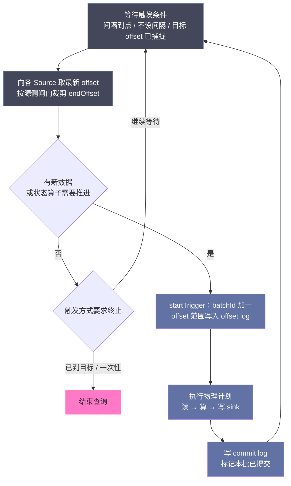
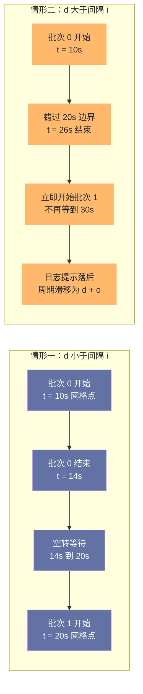
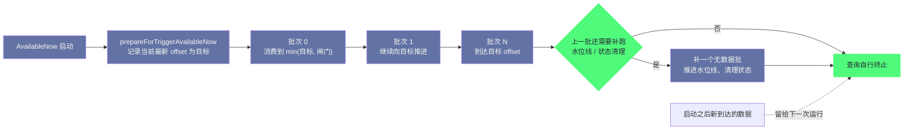
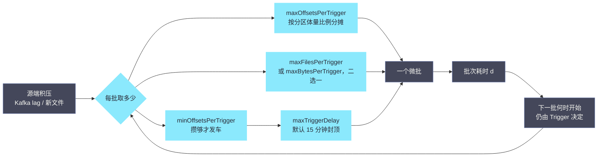
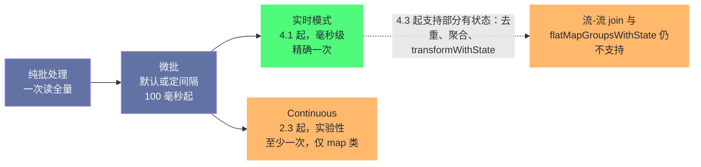

# 05 触发器 Trigger：ProcessingTime、Once、AvailableNow 与实时模式

**摘要：**

Trigger 在 Structured Streaming 里最容易被误读的一处，是把它当成"处理周期"的设定。它真正决定的是下一批什么时候被允许开始；一批要跑多久，取决于数据量、并行度与状态大小，Trigger 管不着。这层区别拆开之后，许多现象有了统一解释：为什么 10 秒间隔的作业端到端延迟会到十四五秒，为什么把间隔压小反而让 Kafka 积压涨得更快，为什么定时 ETL 用 Once 会 OOM、换成 AvailableNow 就稳。同类误读还有两个变体：把 AvailableNow 当成长驻流来用，以及指望靠缩间隔把一次批处理的延迟压到毫秒级。

本文沿两条链路展开：一条是常驻的实时数仓宽表，一条是每十分钟由调度器拉起的增量对账。先拆一次触发回合里究竟发生了什么、Trigger 只占其中哪一步；再逐一交代默认触发器、ProcessingTime、Once、AvailableNow 与 4.x 实时模式（Real-time Mode）的语义、实现与代价；随后把 maxOffsetsPerTrigger、maxFilesPerTrigger 这类每批处理量的闸门与触发间隔放在一起算吞吐；最后落到四类反例。文章不按 API 罗列，而是把每种触发方式的起始条件、批量控制与终止语义放在同一条时间轴上比较。版本口径为 Spark 4.3.0（2026-10-30，Scala 2.13），行为细节以对应版本文档与源码为准。

---

## 第 1 章 触发器决定的是下一批何时开始

### 1.1 一个回合里的六件事

Spark 2.0（2016）把流处理表述成"对一张不断追加的表做增量查询"，执行层没有为流单独造一套引擎，而是让每个微批（micro-batch）完整走一遍批处理的路径：规划、调度、执行、提交。这个决定留下一个必须显式回答的问题——上一批做完之后，下一批什么时候开始。Trigger（触发器）是这个问题的答案载体：它不参与数据怎么算，只参与"什么时候再算一次"。

把一次回合拆开，动作顺序大体固定。引擎先向所有 Source 询问当前可用的最新 offset，按源侧闸门裁剪出本批的 endOffset；接着判断这一回合是否值得执行——有新数据，或者有状态算子需要推进水位线、触发超时清理；判断通过才真正开工：batchId 加一，本批 offset 范围写进 offset log（预写日志），物理计划执行，结果写 sink，最后写 commit log 标记本批已提交。之后回到等待。



Trigger 的接口形态很能说明它的职责边界。所有 Trigger 最终都归结成一个 TriggerExecutor，它持有一个返回布尔值的处理器（triggerHandler）：处理器执行完一批返回 true，无事可做返回 false，执行器据此决定继续下一轮还是结束查询。定间隔执行器每隔一段时间调用一次处理器，一次性执行器只调用一次。Trigger 能影响的只有**调用时机**与"是否继续调用"；这次调用里读多少数据、跑多久，都在它的视野之外。

### 1.2 发令枪，不是节拍器

关于 Trigger 最常见的误读，是把 `processingTime="10 seconds"` 理解成"每 10 秒处理一次数据"，进而预期"一条数据最多等 10 秒"。真实的等待分两段：先等发令枪响，再等自己这一批跑完。Trigger 只管第一段，第二段由数据量与集群决定。

这个区别可以用**发令枪**与节拍器来对照。节拍器规定的是每拍的时长，所有动作都必须压进这一拍里；发令枪只规定起跑时刻，选手跑多快与枪响间隔无关。把枪响间隔从 10 秒缩到 1 秒，不会让选手跑得更快，只会让他多做几次起跑动作。Structured Streaming 的定间隔触发更接近后者，而且比体育场更糟的一点在于：这里的"起跑动作"本身有成本——规划逻辑计划、调度 Task、写预写日志、提交 sink，每一批都要重新支付一遍。

把这件事写成算式，后面所有关于间隔的讨论都可以挂在这三个量上。设触发间隔为 i，单批执行耗时为 d，批间固定开销为 o（含提交与下一批的准备），则批次起始到下一批起始的有效周期是 max(i, d + o)：

- 当 d + o 小于 i 时，周期由间隔决定，引擎在批与批之间空转；
- 当 d + o 大于 i 时，周期由执行时间决定，间隔名存实亡，引擎进入"跑完即下一批"的追赶态；
- 端到端延迟约等于"等到发令枪的时间"加上 d 再加"结果对下游可见的时间"，其中第一项在均匀到达的前提下期望约为 i/2，上界约为 i。

由此可见，批次间隔只是延迟的一个加数，而不是延迟本身。把间隔从 60 秒改成 10 秒，延迟的上界从 60 秒降到 10 秒，但若 d 因为数据量变大而涨到 25 秒，实际延迟反而由 65 秒变成 35 秒，收益远小于预期；若 d 涨到 70 秒，周期被 d 主导，10 秒与 60 秒两种配置在延迟上几乎没有差别。

### 1.3 账本：进度写在 checkpoint 里

Trigger 每成功走完一个回合，都会在 checkpoint 目录里留下痕迹，这套账本比 Trigger 的配置更能定义"一次"的含义。典型的目录结构里，`offsets/` 记录每个 batchId 对应的各源 offset 范围，`commits/` 记录哪些 batchId 已经提交，`metadata` 保存查询标识，有状态算子时还有 `state/`，源相关的元数据放在 `sources/` 下；文件源已经处理过的文件清单并不单独存放，它跟着每批 offset 一起写进账本。

账本的作用在重启时才显出来：引擎读最后一条 commit，把之后写进 offset log 但没有提交的批次重新执行一遍，再从那里继续。于是"Once 只跑一次"与"AvailableNow 跑完就退"都不是内存里的一次性标记，而是"本轮进程不再开启新回合"加上"账本已经记到哪个 offset"。理解了这一点，就能解释为什么这两类触发器可以断点续跑，也能解释为什么删掉 checkpoint 之后同一条 SQL 会从 `startingOffsets` 重新来过。

账本还会反过来限制运维动作。`spark.sql.streaming.minBatchesToRetain` 默认 100，它决定 state、offset 与 commit 文件保留多少批之后可以被清理；把批量调大到几万条一批、频率又高，checkpoint 目录的元数据开销会跟着批次数量一起涨。查询标识、逻辑计划的 schema 变化、状态 schema 的兼容性检查，也都记在这本账上，换 Trigger 类型不会动账，改逻辑却可能因为状态 schema 校验而启动失败。

### 1.4 两条贯穿全文的链路

后文的讨论落在两条链路上，二者的 Trigger 需求几乎相反。

第一条叫 `ad_events`，常驻的实时数仓宽表：Kafka 两个 topic（曝光与点击）各 10 个分区，峰值合计约 8 万条每秒，作业做 5 分钟滚动窗口的曝光点击率聚合，附带一次按请求标识的去重，输出为 append 模式，水位线延迟设 10 分钟，触发设为 `processingTime="30 seconds"`。这条链路要的是"不断更"，能容忍分钟级延迟，但不能容忍批次无限膨胀。

第二条叫 `ods_reconcile`，定时增量对账：上游每小时往对象存储落一批 Parquet，Airflow 每 10 分钟拉起一次 Spark 作业，读新增文件、与维表 join、写进对账表，跑完即退出，触发设为 `availableNow=True`，并配 `maxFilesPerTrigger=200`。这条链路要的是"跑完即走、下次接着跑"，对单次运行的时长不敏感，但对"不要重复处理、不要漏"极度敏感。

两条链路的差异不在数据量，而在"谁来承担等待"。常驻链路把等待摊到每一条记录上，用资源换延迟；定时链路把等待摊到调度周期上，用延迟换成本。Trigger 的选择，本质上是在回答这个分配问题。

### 1.5 把观察落到 progress 上

Trigger 的配置只描述意图，真实节奏要从 progress 里读。每次触发结束，查询都会发布一条进度，包含 batchId、触发时间戳、本批输入行数、`inputRowsPerSecond` 与 `processedRowsPerSecond`、`durationMs` 的分项（`getBatch`、`addBatch`、`walCommit`、`triggerExecution`）、当前水位线，以及各状态算子的记录数。这几项合起来足以反推 1.2 节的三个量：batchId 随时间的增长速率给出实际周期，`durationMs` 的总和给出 d 与 o，输入与处理的速率差给出消化能力的余量。

只看 Trigger 配置判断节奏是盲的。同一份 `processingTime="30 seconds"` 的代码，数据量小的时候周期是 30 秒、延迟由等待主导，数据量翻倍之后周期可能滑到 45 秒、延迟由处理主导，而配置一个字都没变。笔者的习惯是先把最近一百批的 `durationMs` 与 batchId 时间戳拉出来，画一条批次耗时与周期的时间序列，再谈调参——这张图能直接回答"到底是谁在决定节奏"。

---

## 第 2 章 默认触发器：不写配置也是一套节奏

### 2.1 默认等价于零间隔

不调用 `.trigger()` 时，Structured Streaming 走默认触发器。Spark 4.3.0 文档的说法是：微批会在上一批处理完成之后尽快生成。实现上它等价于 `processingTime="0 seconds"`，`ProcessingTimeExecutor` 对零间隔有一个特例——下一次触发时间直接取当前时刻，不做网格对齐，于是批次一个接一个，中间没有等待。

```python
# 开发期最常见的写法：不设 trigger
query = (
    df.writeStream
      .format("console")
      .option("checkpointLocation", "s3://bucket/ckpt/ad-events-dev/")
      .start()
)
```

### 2.2 "尽快"的真实价格

默认触发器把时间轴填满，代价是把批间固定开销也按最高频率支付。设单批固定开销 o 为 200 毫秒（规划、调度、WAL 写、提交的合计，随集群与 sink 不同而变），数据处理耗时 d 为 100 毫秒，则有效周期约 300 毫秒，集群有三分之二的时间在做"起跑动作"而不是处理数据。这是一个示例推算，具体数值要用自己集群的 progress 数据校准，但它说明了方向：批越小，固定开销占比越高。

这个模式的另一个副作用在 sink 侧。批次数一多，输出文件数、事务提交次数、下游表的快照数量都按批次线性增长，文件 sink 与 Delta 类格式的小文件压力会明显上升；若下游还有每批触发的监听器或告警回调，Driver 端的回调压力也会跟着涨。

### 2.3 什么时候该用默认触发器

默认触发器并非坏配置，它适合两类场景。一类是开发验证：延迟最低、反馈最快，不用为了看结果去等一个 30 秒的间隔。另一类是数据稀疏但要求单条尽快处理的链路，例如低频告警事件——没有数据时循环不会无谓地开启批次，数据到达后立即成批，延迟由源端轮询节奏决定，而不是由固定间隔决定。

真正的风险在于把默认触发器当作"性能最好"的默认选项带进生产。它不设时间门，也通常不配数据门（源侧闸门），单批取多少完全取决于两次提交之间到达了多少数据；一旦上游出现尖峰，单批会膨胀到与尖峰同量级，批时长抖动的幅度远超定间隔触发。

### 2.4 五种触发方式速览

把 4.3.0 支持的触发方式并排放，差别集中在"起始条件"和"是否自终止"两列上：

| 触发设置 | 每个回合的起始条件 | 是否自终止 | 主要用途 |
|---|---|---|---|
| 不设置（默认） | 上一批完成即开始 | 否 | 开发验证、稀疏事件 |
| `processingTime="10 seconds"` | 间隔网格到点，且上一批已完成 | 否 | 常驻实时链路 |
| `once=True`（3.4 起废弃） | 立即开始，全部积压装进一批 | 是（跑完一批退出） | 旧的定时 ETL |
| `availableNow=True` | 立即开始，按闸门切成多批 | 是（到达目标 offset 退出） | 定时增量 ETL |
| `continuous="1 second"` | 长驻 Task，参数为 checkpoint 间隔 | 否 | 实验性低延迟 |
| `realTime="5 minutes"` | 长驻 Task，参数为 checkpoint 间隔 | 否 | 4.x 毫秒级低延迟 |

表格里有两组差异需要展开说：`once` 与 `availableNow` 都会自行终止，但终止条件不同，一个靠"一批做完"，一个靠"到达启动时记下的目标 offset"；`continuous` 与 `realTime` 的参数虽然写成时间，含义却不是"多久触发一次"，而是"多久提交一次进度"。这两组差异是后文的主线。

---

## 第 3 章 ProcessingTime：三条规则与一本时间账

### 3.1 规则一：触发点对齐到间隔网格

定间隔触发最容易被忽略的细节，是触发点如何对齐到**间隔网格**。4.3.0 文档写得很清楚：如果上一批在间隔内完成，引擎会等到间隔结束再开始下一批；如果上一批耗时长到错过了间隔边界，下一批在它完成时立即开始，不再等下一个边界。源码里的 `ProcessingTimeExecutor` 用一个取整函数算出下一次触发时刻，形态是"把当前墙钟时间向上取整到间隔的整数倍"，零间隔时退化为当前时刻。

取整意味着触发点是按墙钟网格对齐的，而不是"上一批完成时刻加间隔"。间隔 10 秒时，触发点落在 10 秒整数倍的网格上；批次 0 在网格点开始，跑 4 秒结束，引擎会空转到下一个网格点才发下一枪。这个行为在实际观察中表现为"批次开始时间总落在整十秒附近"，一旦看到批次开始时间随机漂移，多半是间隔没有配成预期的值，或者已经在追赶态。

"落后时不补跑"这一条也来自同一个实现。错过边界之后，引擎不会为了补足欠下的次数而接连启动多个空批次，它只是不再等待，让批次一个接一个地跑，直到某一批结束得足够早、重新落回网格里，等待才恢复。这条行为在 2017 年由 SPARK-20209 正式确立为语义，解决的正是"批处理时间超过间隔时是否要追平"的争议。

### 3.2 规则二：落后表现为周期滑移，而不是批次堆积

处理时间超过触发间隔时会发生什么，是个容易想象错的问题。微批引擎严格串行，同一时刻只有一个批次在跑，内存里不存在"待执行的批次队列"，所以不会出现"批次排起长队"的场面。真实发生的是**周期滑移**：有效周期从 i 变成 d + o，每一轮都晚于上一轮，源端的积压（Kafka lag、未处理文件数）开始单调增长。



识别这种状态有几个直接信号。日志里会出现与"落后"相关的告警，4.3.0 的措辞是 `Current batch is falling behind.` 后面跟着触发间隔与本批实际耗时两个毫秒数，位置在触发执行器里，一旦出现就说明这一批已经超过间隔；progress 里 `durationMs` 的 `triggerExecution` 一项持续接近或超过间隔；`inputRowsPerSecond` 与 `processedRowsPerSecond` 拉开差距，前者反映源端到达速率，后者反映引擎消化速率；源端 lag 单调上升且看不到回落。这四条同时出现，基本可以判定作业已经不在定间隔节奏上，而是被处理时间牵着走。

### 3.3 规则三：没有新数据就不开批次

4.3.0 文档还写明一条：没有新数据时不会启动微批。这条规则省掉了大量空转开销，但它有一个重要例外——有状态算子可能需要推进水位线、触发注册的超时，这些工作只能借由批次完成。`spark.sql.streaming.noDataMicroBatches.enabled` 默认为 true，允许引擎在没有新数据时仍然执行批次，正是为了服务这类"按时推进"的需求。

把这个配置关掉，空批确实少了，代价是水位线推进变懒：窗口的关闭、状态的清理、会话超时的触发都会等到下一批真实数据到来才发生。对于依赖事件时间语义的作业，这笔交换通常不划算；只有在确认查询完全无状态、且批间开销确实成为瓶颈时，才值得考虑。

### 3.4 批次耗时与间隔的三种关系

把 i 与 d 的关系分成三种，每种对应一套观测特征与处置方式：

| 关系 | 有效周期 | 触发时刻 | 延迟构成 | 源端积压 | 处置顺序 |
|---|---|---|---|---|---|
| d + o 明显小于 i | i | 落在网格点，等待可见 | 等待为主，约 i/2 加 d | 平稳 | 若延迟不达标，缩间隔或评估实时模式 |
| d + o 接近 i | i 与 d 交替 | 时而在网格点，时而略早 | 等待与处理各半 | 偶有波动 | 留出 2 倍余量，或先降单批数据量 |
| d + o 大于 i | d + o | 连续开始，无等待 | 处理为主 | 单调增长 | 先看 d 的构成，再决定扩资源或调闸门 |

表格右列的顺序很重要。落后时先缩间隔是最常见也最无效的处置——间隔已经不参与周期计算，改小它只会让配置与事实更不一致；先缩单批数据量（源侧闸门）能直接压低 d；扩资源提高并行度也能压低 d；只有确认 d 已经压到远小于目标间隔之后，间隔才重新成为有效的调节量。

### 3.5 间隔怎么选：从 progress 反推，而不是拍脑袋

选间隔有一个可以落地的流程。先取一段稳定运行期的 progress，看 `durationMs` 里 `addBatch`、`getBatch`、`walCommit` 与 `triggerExecution` 的分布，取批次耗时的 p95 作为 d 的代表值；再确认延迟预算，即业务能接受的数据从产生到可见的时间；最后取间隔 i，使它满足两个条件：i 不小于 2 倍的 p95 批次耗时（留出追赶余量），i 不大于延迟预算减去 d 与 sink 可见性开销（保证延迟可达成）。两个条件打架时，说明资源不足或延迟目标不现实，需要先动资源，而不是在间隔上凑数。

对常驻链路，间隔的粗分如下，具体取值仍要用上面的流程校准：

| 场景 | 建议间隔 | 判断依据 | 备注 |
|---|---|---|---|
| 实时告警、监控面板 | 1 到 5 秒 | 延迟预算以秒计 | 需配小单批，固定开销占比高 |
| 准实时宽表 | 30 秒到 2 分钟 | 延迟预算以分钟计 | 最常见的生产形态 |
| 分钟级 ETL | 5 到 15 分钟 | 延迟不敏感，吞吐优先 | 需关注单批内存与状态快照 |
| 对账、离线汇总 | 30 到 60 分钟 | 以调度周期为准 | 通常应改用 AvailableNow |

### 3.6 没有自动调节这回事

一个常见的期待是：系统检测到落后之后会自动拉长间隔或降低每批数据量，让作业自己稳住。Structured Streaming 的微批引擎没有这种自适应机制，触发间隔在查询运行期间是常量，批间不会因为上一批慢了就自动调整。能做到"随负载变化"的只有源侧闸门的一部分行为，譬如 Kafka 源的 `minOffsetsPerTrigger` 加 `maxTriggerDelay`，它会让触发等到攒够一定 offset 才发生，但这是"数据量门"与"时间门"取并集，不是根据处理能力反推间隔。

这带来一个运维上的现实：要想让节奏随负载变化，只能把调节放到查询外面——用外部监控读 lag 与批次耗时，按规则重启查询并改间隔，或者改闸门参数；也可以在调度层控制并发与错峰。这也解释了为什么很多团队最终选择 AvailableNow 加调度器：把"自适应"这件麻烦事交给调度器的重试与错峰策略，而不是指望流引擎自己会调。

### 3.7 把等待算进延迟预算

把 1.2 节的式子代入一组具体数值，可以看清"缩间隔"的收益边界。设间隔 30 秒、批次耗时 p95 为 20 秒、固定开销 1 秒、结果对下游可见还需 5 秒，则等待期望约 15 秒，平均端到端延迟约 40 秒，p99 约 55 秒。若把间隔压到 10 秒，批次耗时不变，周期变成 21 秒，等待被压到接近零，平均延迟降到约 26 秒，p99 约 27 秒；再压到 2 秒，周期仍是 21 秒，延迟不再下降，只是把批间的空转彻底取消。

这说明缩间隔的收益到"间隔约等于批次耗时"就停止了，此后再缩不会更快。收益停止的位置，恰好是"批次完全不给等待留余量"的位置，此时任何一次抖动都会让批次超时并累积积压，作业失去吸收峰值的能力。延迟预算与抗抖动能力在这一点上直接冲突，选哪一边取决于链路能容忍多久的积压，而不是取决于哪个间隔数值更好看。以上数值是示例推算，实际取值需用集群的 progress 数据替换。

---

## 第 4 章 Once：一个批次装下全部积压

### 4.1 语义：一次性把账算完

`once=True` 的语义是：查询启动后立即执行一个微批，处理从 checkpoint 记录的上次 offset 到当前所有源的最新 offset 之间的全部数据，然后退出。实现上它对应"一次性执行器"，处理器只被调用一次，调用返回后查询终止。这个语义在 Spark 2.0 就有了，设计初衷是"定时拉起集群、处理自上次以来的增量、然后关掉集群"，文档也明确提到这在某些情况下能显著省成本。

```python
# 一次性执行：从上次 checkpoint 的 offset 消费到当前最新，然后退出
query = (
    df.writeStream
      .trigger(once=True)
      .format("parquet")
      .option("checkpointLocation", "s3://bucket/ckpt/ods-reconcile/")
      .option("path", "s3://bucket/ods/reconcile/")
      .start()
)
query.awaitTermination()
```

### 4.2 代价：四个不对称

Once 的问题不在于"只跑一次"，而在于"一次要装下多少"。当两次调度之间的积压从几万条涨到几千万条，同一份代码的批次规模会跟着涨两个数量级，而 Cluster 的规格是按常规批次配的，于是出现四个不对称。

其一是内存与批次规模的不对称。单批的数据量由积压量决定，而不是由资源配置决定；积压翻十倍，Task 的输入分片、聚合的哈希表、join 的构建侧都可能跟着翻，OOM 从偶发变成必然。更彻底的一层在源侧：4.3.0 的微批执行器为一次性执行器挑选源时，会把支持准入控制的源统一替换成"读取全部可用数据"的限制，只在该源默认读限不是"全量"时额外打印一条告警，说明读限被忽略；换句话说，想靠 `maxOffsetsPerTrigger` 给 Once 限流是限不住的，这一批注定要装下全部积压。

其二是水位线与批次粒度不对称。单批之内水位线只推进一次，这一推可能跨过几个小时的事件时间，所有落在这段时间里的窗口、状态记录、超时定时器会在同一批里集中过期与输出；append 模式下会一次性吐出大量窗口结果，update 模式下状态清理的压力集中爆发，下游看到的是一个尖峰而不是平稳的流。这种阶跃也是 Once 与 AvailableNow 的关键分野，后者的水位线跟着批次**逐批推进**。

其三是失败恢复粒度不对称。批次是**最小提交单位**，单批失败就要整批重来，已经算完的分区不会因为提交失败而被记住；积压越大，单次失败的重跑成本越高，重跑时间还可能超过调度间隔，形成"跑不完—重跑—更跑不完"的循环。

其四是终止语义的不对称。3.3 节讨论的"没有新数据就不开批次"，在 Once 这里没有意义，因为它必然开一批；反过来，优雅终止与非优雅终止的差别被放大：如果上一次运行在写出新批次 offset 之后、提交之前被杀掉，下一次 Once 启动时看到的"最新 offset"可能只比账本多出很少一点，于是它只处理那个未完成批次的数据，新到的数据要等到再下一次调度，用户视角是"这一次没处理到"。

### 4.3 为什么废弃：SPARK-39805 的理由

Spark 3.4 起 `Trigger.Once` 被标记废弃，JIRA（SPARK-39805）给出的理由与上面的第四条吻合：Once 的预期行为是"处理上次触发以来的所有可用数据"，这在优雅终止时成立，但非优雅终止时，上一次运行可能已经写出了新批次的 offset 却没有完成提交，新的运行于是只处理那个未完成批次的数据，行为对用户不确定。同一份 JIRA 还把 `AvailableNow` 同时提为推荐替代，理由是更好的处理保证、更细的批次粒度、以及更平缓的水位线推进。

迁移动作不复杂：把 `trigger(once=True)` 换成 `trigger(availableNow=True)`，再给源配上每批量的闸门（Kafka 的 `maxOffsetsPerTrigger`、文件源的 `maxFilesPerTrigger` 或 `maxBytesPerTrigger`）。checkpoint 可以沿用，因为触发配置并不写进 offset 账本；不过若同时改了源选项或逻辑计划，要留意状态 schema 的兼容性校验。

### 4.4 Once 还剩的合理空间

Once 并非一无是处。当积压量长期稳定在"单批能装下且跑得完"的规模，例如每天几万条的小增量、历史数据补录的一段有限区间，Once 的语义反而最简单：一次跑完、一次提交、退出。它的问题只在规模失控时暴露，所以判断标准是"积压上界是否有保证"，而不是"Once 是否被废弃"。

迁移前可以做一次对照：复制一份 checkpoint，分别以 Once 与 AvailableNow 各跑一轮，比较 `numInputRows` 与 `durationMs` 的分布，确认闸门切分后的单批规模符合预期，再切换正式调度。若两者在积压较小时表现几乎一致，说明瓶颈不在触发器，不必把这次迁移当成性能优化来立项。

---

## 第 5 章 AvailableNow：把流退化成可续跑的增量批

### 5.1 机制：先记目标，再分批走完

AvailableNow 自 Spark 3.3.0 引入（SPARK-36533）。它的关键动作发生在查询启动的那一刻：对于实现了 `SupportsTriggerAvailableNow` 接口的源，引擎调用 `prepareForTriggerAvailableNow()`，让源把"当前最新 offset"记成这一轮的**目标 offset**；此后源的行为等价于"目标 offset 之后不再有新数据进来"，引擎按每批量的闸门一批一批地消费到目标，所有源都到达目标后查询自行终止。



这套机制解释了两件容易被误解的事。第一，AvailableNow 不会"边跑边追"新数据：目标在启动时固定，运行期间新到的数据不在这一轮的处理范围内，留给下一次调度，这让单次运行的时长与批次数量可以预估。第二，它的终止条件不是"没有新数据"而是"到达目标"，因此即使上游持续写入，查询也一定会退出，只是每次只覆盖到启动瞬间为止。

终止的具体判定在批次构造这一步：某一轮里若既没有新数据、上一批的物理计划也不再要求补跑，查询就把状态置为终止，并打印一条"已处理完所有可用数据、终止 AvailableNow 查询"的日志；若上一批还需要补跑，例如水位线要继续推进、状态要清理，就先执行一个无数据批，再在下一轮判定终止。这也解释了为什么图里把"补无数据批"画在终止之前，而不是每次终止都补。

### 5.2 与 Once 的差异清单

把两者放在一起，差异集中在批次数量、目标语义与状态推进三处：

| 维度 | `once=True`（3.4 起废弃） | `availableNow=True` |
|---|---|---|
| 引入版本 | Spark 2.0 | Spark 3.3.0（SPARK-36533） |
| 批次数 | 固定 1 批，积压多少装多少 | 多批，受源侧闸门切分 |
| 目标 offset | 每批开始时取最新，可能边跑边追 | 启动时一次固定，运行期不变 |
| 未提交批次 | 由整批重跑覆盖 | 文档明确先处理遗留的未提交批次 |
| 水位线推进 | 单批一次，可能阶跃 | 逐批推进，节奏与批次一致 |
| 终止前收尾 | 无专门动作 | 需要补跑时先补无数据批 |
| 失败恢复 | 整批重来 | 从最近提交的批次续跑 |
| 适用场景 | 积压量小且可预期 | 所有定时增量 ETL |

其中"**无数据批**"这一条容易被忽略，但它在有状态的作业里很关键。没有这一批，最后一次运行留下水位线不推进，窗口不关闭、状态不清理，下一次运行要处理的积压状态会比预期大；补上之后，每一轮运行结束时的状态规模大致稳定，checkpoint 大小也稳定。

### 5.3 与水位线、状态的交叉

触发器与状态的关系，在 AvailableNow 这里体现得最明显。水位线的推进速度由"这一批处理到的最大事件时间"决定，而批次边界由闸门与触发方式共同决定。定间隔触发下，水位线按墙钟节奏推进，批次之间的事件时间跨度大致等于间隔乘以到达速率；AvailableNow 下，水位线按批次推进，批次数量由积压量与闸门决定，整轮运行把水位线从上次位置一路推到"启动时刻可见的最大事件时间"。

这两种推进方式给下游的信号不同。定间隔触发是平稳的小步推进，窗口按固定的节奏关闭；AvailableNow 是一轮之内连续推进、轮与轮之间停顿，窗口的关闭与输出集中在一轮运行的末尾。若下游对"输出节奏"有要求，例如每小时必须有一次完整的对账结果，那就要把调度周期与水位线延迟对齐，而不是只盯着触发参数。

状态规模也会被这个节奏影响。`ad_events` 这类常驻链路的状态大小由"水位线延迟乘以到达速率"决定，调小间隔不会直接缩小状态，但会让状态清理更频繁、单次清理量更小；`ods_reconcile` 这类定时链路的状态由"两轮之间的积压"决定，闸门越小、批次越多，单批状态更新的量越小，checkpoint 的写入峰值也越低。

### 5.4 定时 ETL 的工程形态

把 AvailableNow 用在调度器里，需要把几个工程细节配齐，否则"能跑"与"能稳"之间还差一段。

```python
# Airflow / DolphinScheduler 里的一个任务：每次运行消费到启动时刻的积压，然后退出
query = (
    spark.readStream
      .format("kafka")
      .option("kafka.bootstrap.servers", "broker:9092")
      .option("subscribe", "events")
      .option("startingOffsets", "earliest")
      .option("maxOffsetsPerTrigger", 2000000)     # 每批上限，决定单批内存与时长
      .load()
      .selectExpr("CAST(value AS STRING) AS payload")
      .writeStream
      .trigger(availableNow=True)
      .outputMode("append")
      .format("delta")
      .option("checkpointLocation", "s3://bucket/ckpt/events-etl/")
      .option("path", "s3://bucket/output/events/")
      .start()
)
query.awaitTermination()   # 到达目标后返回，任务随之结束
```

第一处是并发控制。同一个 checkpoint 同时被两个进程打开会报错或产生不确定结果，调度器要保证同一任务的 `max_active_runs` 为 1；补数场景若需要并行，只能用不同的 checkpoint 与不同的输出前缀，事后再合并。

第二处是幂等。AvailableNow 能保证"不丢"，但"不重"要看 sink：文件 sink 依靠提交日志与文件可见性做到精确一次，Kafka sink 在文档的容错表里是至少一次，Delta 类格式可以用事务提交或 MERGE 达到幂等。查询失败重试时，从最近提交的批次续跑，已经提交的部分不会重写，这一点由账本保证。

第三处是 checkpoint 的归属。每个查询一个目录，目录里记录了源与 sink 的身份、序列化 schema 与状态 schema；换 Trigger 类型可以复用，改逻辑计划、改源选项、改输出路径都可能触发校验失败，此时要么兼容迁移，要么换新目录并接受一次全量重放。目录的生命周期由 `minBatchesToRetain` 控制，长期运行且批次很多时，清理策略要跟着考虑。

第四处是失败语义与调度器的配合。`awaitTermination()` 在查询终止后返回，异常会以异常形式抛出，调度器据此判定任务失败并重试；如果进程被强杀，账本里可能留下未提交的批次，下一轮启动会先把它处理掉，这正是 AvailableNow 比 Once 稳的地方。

### 5.5 形态选型：常驻流、定时增量、纯批

三种运行形态经常被混着比较，其实它们回答的是不同问题。常驻流回答"数据到了多快能看到"，定时增量回答"每小时/每天的对账在预算内完成且可续跑"，纯批回答"这一批数据整体重算一遍"。用同一套指标横比会得出错误结论，按维度拆开才有意义：

| 形态 | 延迟量级 | 资源占用 | 断点续跑 | 状态维护 | 适用 |
|---|---|---|---|---|---|
| 常驻流（定间隔） | 秒到分钟 | 持续占用 | 靠 checkpoint | 跨批维护，需控规模 | 实时宽表、告警 |
| AvailableNow 定时 | 调度周期 | 按需拉起 | 靠 checkpoint，可续跑 | 跨运行维护，轮末收尾 | 小时级/分钟级 ETL |
| 纯批处理 | 调度周期 | 按需拉起 | 无，每次全量或按分区重算 | 无跨批状态 | 全量重算、维度加工 |

AvailableNow 的位置在中间：它保留了流的增量语义、checkpoint 与水位线，又把"是否常驻"这个成本项去掉了。这也是它被推荐给定时 ETL 的根本原因——不需要为了增量语义而养一个 7×24 的集群。

### 5.6 回退陷阱：静默退化

AvailableNow 有一个不显眼的前提：链路上的每个源都要支持它。4.3.0 文档明确写着，只要有一个源不支持 `Trigger.AvailableNow`，这个触发器就会被停用，Spark 退回到一次性微批。这意味着一条 Kafka 加自定义 V2 源的链路，可能在升级后**静默退化**成 Once 的语义，而代码、日志、接口都没有变化。

4.x 的实现比文档多留了一个口子。源码里有一个默认关闭的内部配置 `spark.sql.streaming.triggerAvailableNowWrapper.enabled`，打开之后，引擎会用包装器把不支持该接口的源适配成"按批走完"的形态，让 AvailableNow 仍然生效；代价是该配置的说明里写得很直白——某些源可能出现重复甚至丢数据，使用时要极其谨慎，正确的方向仍是推动源实现 `SupportsTriggerAvailableNow`。这也解释了为什么默认路径选择回退而不是包装：宁可退化成一批读完，也不要在语义不明的情况下悄悄改变源的行为。

识别这种退化有两个办法。一是看批次数量：同样一份积压，正常时按闸门切成多批，退化后只有一批，progress 里的 batchId 不会随数据量增长而增长，`numInputRows` 会明显超过闸门设定。二是看单批时长：退化后单批要装下全部积压，批次耗时与积压量近似成正比，而正常时分批之后单批时长应稳定在闸门对应的水平附近。发现退化后，处置只有两条路：给自定义源实现 `SupportsTriggerAvailableNow`，或者把这条链路拆开、把不支持的源换成批处理读取。

### 5.7 与纯批处理的边界

AvailableNow 常被拿来与"直接批处理读一遍"比较。纯批的做法是每次读全量或按分区覆盖，进度记在外部的调度表或分区标记里；AvailableNow 把进度放进 checkpoint，于是增量范围、schema、状态都由引擎维护，跨运行的窗口状态与去重状态得以保留，失败后能从最近提交的批次续跑。代价是多一套 checkpoint 存储与调度约束，且对源有额外要求——源要能按 offset 回放，并实现 AvailableNow 所需的接口。

反过来，如果数据本身按日期或分区组织、重算成本可以接受、输出可以被幂等覆盖，纯批处理往往更简单：不必担心 checkpoint 损坏、状态 schema 演进、以及长期保留的状态目录。判断的分水岭在于"增量"是不是刚需：需要跨批状态（窗口、去重、会话）或需要精确到 offset 的续跑时选 AvailableNow，否则纯批的复杂度更低。

---

## 第 6 章 每批处理量：源侧闸门

### 6.1 两个旋钮的分工

Trigger 负责"何时开始"，源侧选项负责"这一批取多少"，二者相乘决定了吞吐上限与单批时长。把二者混为一谈，就会出现"调了间隔但单批没变"或者"调了每批量但节奏没变"的无效操作。

Kafka 源的 `maxOffsetsPerTrigger` 是典型的**每批量闸门**，文档的表述是"每个触发间隔处理的最大 offset 数"，并且这个总量会按各 topic 分区的数据体量比例分摊。文件源则是 `maxFilesPerTrigger` 与 `maxBytesPerTrigger` 二选一，二者不能同时设置；文档还特别说明，流式读取至少会读一个文件，以免在单个超大文件上卡死。

### 6.2 Kafka：攒够再发车的第二道门

Kafka 源还有一对与节奏相关的选项，`minOffsetsPerTrigger` 与 `maxTriggerDelay`（默认 15 分钟）。前者设定每个触发至少处理多少 offset，后者设定"为了攒够这个下限最多能等多久"。二者合起来的效果是：触发不再只由时间决定，而是"时间到了且数据够了"或者"等得太久了"两者取一。对上游写入稀疏的 topic，这能把多个触发周期里的零散数据合并成有意义的批次；对上游持续高速写入的 topic，`maxTriggerDelay` 保证不会为了攒数据把延迟拖到不可接受。

它与 AvailableNow 的组合另有一处要留意。AvailableNow 的目标在启动时固定，`minOffsetsPerTrigger` 会让每个批次的切分不再纯粹按 `maxOffsetsPerTrigger` 走，实际批次数可能比"总量除以批量"更少；如果调度的运行时长有上限，这个组合会改变"一轮跑完需要几个批次"的估算，联调时应以实际 progress 为准。

### 6.3 文件源：按文件切，不按行切

文件源的闸门天然是离散的。`maxFilesPerTrigger` 数文件个数，`maxBytesPerTrigger` 数文件总大小，后者是不严格的软上限：若单个文件就超过上限，它仍会被整份读入，文件不会被切开。`latestFirst` 让积压时优先处理最新文件，`maxFileAge` 默认一周、且首批不受此限制，按最新文件的时间戳而不是系统时间计算年龄。



文件源的默认值有一个版本差异需要留意：4.3.0 文档把 `maxFilesPerTrigger` 写作默认不设上限；不同版本的文档与实现在这项默认值上曾有过出入，升级前后如果依赖过默认值，应显式设置，避免"升级后单批变大"这种没有告警的行为变化。

### 6.4 吞吐与积压清理的估算

把触发间隔与每批量放进同一个式子，就能回答"这套配置能不能扛住"这类问题。设每批处理 R 行，批间固定开销 o，单批执行耗时 d，触发间隔 i，则有效周期 period = max(i, d + o)，**吞吐上限**约为 R / period；源端到达速率为 λ 时，只有当 R / period 大于 λ，积压才不会持续增长；积压为 N 时，清空所需时间约为 N 除以（R / period 减去 λ）。

举一个示例推算。R 取 200 万行，i 取 30 秒，d 取 20 秒，o 取 1 秒，则 period 为 30 秒，吞吐上限约每秒 6.7 万行；若到达速率为每秒 5 万行，积压会慢慢被消化；若把 R 提到 500 万行，d 涨到 45 秒，period 变成 46 秒，吞吐上限约每秒 10.9 万行，看似提升了，但单批内存与状态快照的压力同步上升，一旦 d 的增长超过线性（例如开始 spill），收益会被吃掉。这是示例推算，真实取值必须用自己集群的 progress 数据校准，不能当作结论直接套用。

反方向也有陷阱。把 R 压得很小，批次数量成倍增加，每批都要支付 o，吞吐反而下降；同时状态快照与 checkpoint 写入的频率也成倍增加，对小文件与远端存储的压力变大。闸门的调节与间隔的调节必须一起做，单独动其中一个，往往只是把瓶颈从一个环节挪到另一个环节。

### 6.5 参数组合速查

| 参数 | 作用域 | 语义 | 默认或注意事项 |
|---|---|---|---|
| `maxOffsetsPerTrigger` | Kafka 源 | 每批最多消费的 offset 总数，按分区体量比例分摊 | 无默认上限；越小单批越稳，越大吞吐越高 |
| `minOffsetsPerTrigger` | Kafka 源 | 每批至少消费的 offset 数，不足时推迟触发 | 需与 `maxTriggerDelay` 一起看 |
| `maxTriggerDelay` | Kafka 源 | 为攒够下限最多等待的时长 | 默认 15 分钟，超时后不足也触发 |
| `maxFilesPerTrigger` | 文件源 | 每批最多处理的新文件数 | 与 `maxBytesPerTrigger` 互斥；4.3 文档口径默认不设上限 |
| `maxBytesPerTrigger` | 文件源 | 每批处理的新文件总字节数的软上限 | 单文件不会被切开，至少读一个文件 |
| `noDataMicroBatches.enabled` | 查询级 | 无新数据时是否仍执行批次以推进状态 | 默认 true，关掉会让水位线推进变懒 |

### 6.6 闸门同时是并行度旋钮

每批量不只影响单批大小，也影响单批的并行度。Kafka 源默认是分区到 Task 一对一，`maxOffsetsPerTrigger` 的分摊按分区体量比例进行，体量大的分区先吃满配额，体量小的分区可能长期只分到零头；`minPartitions` 可以把大分区再切成多个 Task，让单批的并行度跟上配额。文件源按文件切分，单个文件不会被切开，并行度因此受文件个数限制：小文件多时 Task 数多而单 Task 数据少，调度开销上升；文件少而大时 Task 数不足，单 Task 时间被拉长。

所以调闸门时要同时看两个后果：单批的数据量与单批的 Task 数。只把 `maxOffsetsPerTrigger` 调大而不动 `minPartitions`，可能只是让少数 Task 变长，批次耗时并不会等比例缩短；反过来，把文件闸门调小、文件又都很小，批次会退化成"多而碎"，固定开销占比上升。

---

## 第 7 章 谱系的另一端：Continuous 与实时模式

### 7.1 Continuous：2.3 以来的实验性路径

Continuous Processing（连续处理）自 Spark 2.3 引入，走的是与微批完全不同的执行模型：Task 长驻，按 epoch 提交进度，触发参数的含义变成**checkpoint 间隔**而不是"批次间隔"。它能做到毫秒级延迟，但代价很硬：处理保证是至少一次，算子范围只覆盖 map 一类的投影与选择，聚合、join、状态都不在支持范围内。4.3.0 文档在模式对比里把它标为历史路径，并建议新的低延迟负载改用实时模式。

### 7.2 实时模式：4.1 引入，4.3 扩到部分有状态

实时模式（Real-time Mode）是 4.x 的新执行模式，4.3.0 文档写明它自 Spark 4.1.0 引入，目标是毫秒级端到端延迟。启用方式只是换一个触发：

```python
# 实时模式：trigger 参数是长驻批的 checkpoint 间隔，不是"多久启动一次"
query = (
    df.writeStream
      .format("kafka")
      .option("kafka.bootstrap.servers", "broker:9092")
      .option("topic", "output-topic")
      .option("checkpointLocation", "s3://bucket/ckpt/rtm/")
      .outputMode("update")
      .trigger(realTime="5 minutes")
      .start()
)
```

这里的参数语义与微批正好相反。微批的间隔决定"下一批何时开始"，实时模式的间隔决定"长驻批次多久提交一次进度"：记录在批次边界之内持续流动，不必等到边界才被处理，而 checkpoint、状态更新、指标发布仍然发生在边界上。4.3.0 的源码把这个分工写得更清楚——实时模式的触发执行器按零间隔不断推进批次，长驻批的时长与 checkpoint 节奏另由触发参数控制，因此"5 分钟"既不表示每次要等 5 分钟，也不表示延迟是 5 分钟。间隔越长，失败后需要重放的数据越多、监控刷新越慢；间隔越短，checkpoint 越频繁、开销越大。4.3.0 文档的默认值是 5 分钟，最小值由 `spark.sql.streaming.realTimeMode.minBatchDuration` 约束，默认 5000 毫秒。

实时模式对查询有硬性要求：输出模式必须是 update；`checkpointLocation` 必填；有状态查询不能开启异步进度跟踪；自适应查询执行（AQE）不支持。算子范围在 4.3.0 里包含无状态算子与流-静态表 join，并新增了流式去重（`dropDuplicates`）、流式聚合（`groupBy().agg()`）与 JVM 侧的 `transformWithState`；流-流 join 与 `flatMapGroupsWithState` 尚不支持。文档还提供了一个 allowlist 检查配置，用于在启动时校验算子是否在支持范围内。

### 7.3 三模式对比

| 模式 | 延迟量级 | 处理保证 | 算子范围 | trigger 参数含义 | 适用 |
|---|---|---|---|---|---|
| 微批（默认/定间隔） | 约 100 毫秒起 | 精确一次 | 全部流式算子 | 下一批何时开始 | 绝大多数生产链路 |
| 实时模式 | 毫秒级 | 精确一次 | 无状态加部分有状态（4.3 口径） | 长驻批多久提交一次 | 既有低延迟又不愿放弃状态 |
| Continuous（实验性） | 约 1 毫秒 | 至少一次 | 仅 map 类 | checkpoint 间隔 | 历史路径，新负载不建议 |

### 7.4 选型的实际算法

从微批跳到实时模式，收益是延迟量级，代价是算子受限、语义边界变化与仍在演进的运维经验。判断是否值得跳，先算端到端预算：源端投递耗时（生产端批量与确认策略）、处理耗时、sink 可见性（文件提交、下游表扫描周期）三段相加，若其中任何一段就超过 100 毫秒，把执行模式换成毫秒级并不会让整体延迟变成毫秒级。微批的 100 毫秒是引擎侧的地板，不是端到端的地板。



还有一个经常被忽略的成本：实时模式的"进度提交"节奏会影响恢复时间。间隔设为 5 分钟，意味着失败后最多要重放 5 分钟的数据，而这个重放窗口与状态规模共同决定恢复时长；把间隔压到几十秒能缩短重放，但 checkpoint 的频率上升，状态后端的写入压力也同步上升。这个取舍与微批里"间隔与批次数"的取舍形状相同，只是换了计量对象。

### 7.5 上线前要核对的三项

实时模式的约束是硬性的，上线前至少核对三项：输出模式是否为 update，这是启动时的校验项，其他模式会被直接拒绝；查询里的状态算子是否落在 4.3.0 的支持列表内，流-流 join 与 `flatMapGroupsWithState` 仍在列表之外；是否误开了与实时模式不兼容的选项，例如 AQE 与有状态查询的异步进度跟踪。三项都通过，再看批次间隔是否不小于 `realTimeMode.minBatchDuration` 给出的下限。

版本演进是这条链路最大的不确定项。4.1 引入时只支持无状态算子，4.3 才把去重、聚合与 JVM 侧的 `transformWithState` 纳入，后续版本的支持面还会变；把版本号与支持列表写进上线检查单，比记住某一篇文档的结论更可靠。

---

## 第 8 章 四类反例

### 8.1 用 ProcessingTime(0) 冒充实时

把 `processingTime="0 seconds"` 当作"实时"，是最常见的误解。零间隔的真实含义是"不留等待"，批与批之间仍然要支付规划、调度、WAL 与提交的固定开销，单批实际能覆盖的数据量取决于这批跑多久，延迟由 d 与 o 决定，而不是由配置承诺。更要紧的是资源侧：零间隔意味着集群持续满负荷，任何一次外部抖动都会直接体现为批次变长、积压增长，而不是被间隔吸收。

正确的做法是先明确延迟预算，再选一个能把等待压进预算的间隔（常见是 1 到 2 秒），同时把每批数据量压小，让单批时长稳定；若预算确实在毫秒级，再评估实时模式，而不是用零间隔去逼近。

### 8.2 用 Once 做增量 ETL 的两个误解

第一个误解是"Once 每次都重跑全量"。只要 checkpoint 存在且源 offset 连续，Once 确实只处理增量，这与 AvailableNow 没有区别；会重跑全量的情况只有 checkpoint 丢失、被人为删除、或者源选项被改成从头开始。真正的问题不在"重跑全量"，而在 4.2 节列的**四个不对称**：积压大时单批 OOM、水位线阶跃、失败整批重来、非优雅终止时语义不确定。

第二个误解是"Once 很省资源，因为它跑一次就退"。省的是常驻成本，不是处理成本；积压越大，单批的峰值资源需求越高，而按常规批次配置的集群恰恰在峰值上最容易崩。这两个误解合起来，就是"看起来跑通了，某天积压变大就崩"的典型剧本。处置方向很明确：换成 AvailableNow，并把每批量闸门配上，让单批规模与积压量解耦。

### 8.3 把间隔设得比处理时间还短

间隔 10 秒、批次耗时 30 秒，是一种"配置上很勤快、实际上没作用"的组合。触发点早已被处理时间覆盖，周期由 d 决定，间隔只影响日志里的"落后"提示是否出现。这里要区分两种情形：间隔仍大于 d 时，缩间隔确实能压缩等待，3.7 节算过这笔账；一旦间隔小于 d，继续缩就没有任何收益，只会让配置与实际节奏脱节。正确的顺序是先看 `durationMs` 里哪一段占大头，`getBatch` 慢说明源端读取或分区切分有问题，`addBatch` 慢说明计算或状态有问题，`walCommit` 慢说明远端存储或提交路径有问题；定位到段落之后再决定扩资源、调并行度、还是缩每批量。

### 8.4 用 AvailableNow 冒充长驻流

AvailableNow 的语义是**跑完即退**：跑完当前积压就退出，把它当长驻流用，症状是数据"每隔一阵动一下"，而这个"一阵"由调度器周期决定，不是由触发配置决定。若没有配调度器，查询跑完一次就结束了，监控上看到的是"查询完成、无报错、数据不动"，很容易被误判为上游没数据。判断方法很简单：看查询的终止状态与调度器的任务记录，AvailableNow 的查询必然有明确的结束时刻。

同样的逻辑也适用于"用 AvailableNow 满足秒级延迟"的期待。它每次只覆盖启动瞬间的积压，一轮运行结束后到下一轮启动之间的数据无人处理，端到端延迟的下界就是调度周期。

### 8.5 症状到处置的对照

| 反例 | 外部症状 | 根因 | 处置 |
|---|---|---|---|
| 零间隔冒充实时 | 延迟高于预期、CPU 持续打满 | 批间固定开销按最高频率支付 | 改为 1 到 2 秒间隔并配小每批量 |
| Once 做增量 ETL | 积压大时 OOM、单批输出尖峰 | 单批装下全部积压 | 换 AvailableNow 并设闸门 |
| 间隔短于处理时间 | 日志提示落后、lag 单调增长 | 周期已由 d 决定 | 先定位 d 的构成，再改间隔 |
| AvailableNow 当长驻流 | 数据按调度周期跳动、查询自行终止 | 语义是跑完即退 | 改常驻流，或接受调度周期延迟 |
| 只调间隔不调闸门 | 批次变多但单批不变、吞吐不升 | 每批量未变，固定开销占比上升 | 间隔与闸门一起调 |
| 只调闸门不调间隔 | 单批变长、周期滑移 | d 上升吃掉间隔余量 | 同步评估资源与间隔 |

---

## 结语

Trigger 是一个很小的配置面：五种取值，一个时间参数。但它的分量在于，它决定了等待落在谁身上。常驻流把等待摊给每一条记录，用持续占用的资源换取秒级可见；AvailableNow 把等待摊给调度周期，用分钟级延迟换取按需拉起与可续跑；Once 把等待攒成一次赌注，赌积压量与集群规格匹配；实时模式把等待从批边界上拿掉，代价是算子范围与运维经验的收缩。四种选择没有高下，只有配不配得上当下的延迟预算与成本约束。

如果把这篇的结论压成一句可操作的判断：先量出批次耗时 d，再看延迟预算，最后才决定间隔与每批量；看到"落后"，先查 d，再查闸门，最后才怀疑 Trigger。Trigger 从来不产生吞吐，它只决定引擎有多少时间在等待、多少时间在运行。

---

## 参考资料

1. Apache Spark 4.3.0 文档：Structured Streaming Programming Guide，Triggers 一节，默认、定间隔、一次性、AvailableNow 与 Continuous 五类触发的语义与代码示例。https://spark.apache.org/docs/4.3.0/streaming/apis-on-dataframes-and-datasets.html#triggers
2. Apache Spark 4.3.0 文档：Real-time Mode，4.1 引入、4.3 扩展有状态支持、trigger 参数即 checkpoint 间隔、模式对比与限制。https://spark.apache.org/docs/4.3.0/streaming/real-time-mode.html
3. Apache Spark 4.3.0 文档：Configuration，`spark.sql.streaming.noDataMicroBatches.enabled`、`minBatchesToRetain`、`realTimeMode.minBatchDuration`、`realTimeMode.allowlistCheck` 等配置的默认值与引入版本。https://spark.apache.org/docs/4.3.0/configuration.html
4. Apache Spark 4.3.0 文档：Structured Streaming + Kafka Integration Guide，`maxOffsetsPerTrigger`、`minOffsetsPerTrigger`、`maxTriggerDelay`、`minPartitions` 等选项。https://spark.apache.org/docs/4.3.0/streaming/structured-streaming-kafka-integration.html
5. Apache Spark 4.3.0 文档：Structured Streaming Programming Guide，Input Sources 一节，文件源的 `maxFilesPerTrigger`、`maxBytesPerTrigger`、`latestFirst` 与 `maxFileAge`。https://spark.apache.org/docs/4.3.0/streaming/apis-on-dataframes-and-datasets.html
6. Apache Spark JIRA：SPARK-36533，新增 `Trigger.AvailableNow`，以及 `SupportsTriggerAvailableNow.prepareForTriggerAvailableNow` 的目标 offset 语义。https://issues.apache.org/jira/browse/SPARK-36533
7. Apache Spark JIRA：SPARK-39805，废弃 `Trigger.Once` 并推荐 `Trigger.AvailableNow` 的理由。https://issues.apache.org/jira/browse/SPARK-39805
8. Apache Spark JIRA：SPARK-20209，上一批耗时超过触发间隔时立即执行下一批的行为确立。https://issues.apache.org/jira/browse/SPARK-20209
9. Apache Spark 4.3.0 源码：`sql/core/src/main/scala/org/apache/spark/sql/execution/streaming/runtime/` 下的 `MicroBatchExecution.scala` 与 `TriggerExecutor.scala`，包含 `nextBatchTime` 的取整、`SingleBatchExecutor`/`MultiBatchExecutor` 的分工、落后告警与 AvailableNow 的终止判定。https://github.com/apache/spark/tree/v4.3.0/sql/core/src/main/scala/org/apache/spark/sql/execution/streaming/runtime
10. Apache Spark Java API：`org.apache.spark.sql.connector.read.streaming.SupportsTriggerAvailableNow`，目标 offset 与"目标之后视作无新数据"的接口约定。https://spark.apache.org/docs/4.3.0/api/java/org/apache/spark/sql/connector/read/streaming/SupportsTriggerAvailableNow.html
11. Apache Spark 4.3.0 源码：`sql/catalyst/src/main/scala/org/apache/spark/sql/internal/SQLConf.scala`，`spark.sql.streaming.triggerAvailableNowWrapper.enabled` 的默认值与风险说明。https://github.com/apache/spark/blob/v4.3.0/sql/catalyst/src/main/scala/org/apache/spark/sql/internal/SQLConf.scala

---

> [!note] 思考题
> 1. 定间隔触发的取整对齐意味着触发点落在墙钟网格上。如果集群的时钟有轻微漂移，或者作业在中途被挂起过一段时间，这个"网格"行为会给延迟分布带来什么形状的变化？
> 2. 把一个每天跑一次的 Once 作业改成每十分钟跑一次的 AvailableNow，理论上延迟从一天降到十分钟，但状态规模与调度开销会怎么变？什么条件下这个改法反而更贵？
> 3. `minOffsetsPerTrigger` 让触发条件从"时间到"变成"时间到且数据够"，它与 AvailableNow 的目标 offset 机制组合时，为什么会让"一轮需要几个批次"变得难以预估？
> 4. 实时模式的 trigger 参数是 checkpoint 间隔，间隔越长恢复时重放越多。如果把间隔设为最小值 5 秒，状态后端的写入压力会以什么方式传导回端到端延迟？
> 5. 一个源如果没有实现 `SupportsTriggerAvailableNow`，AvailableNow 会静默退化成一次性微批。除了文中给出的批次数量与单批时长两个信号，还有哪些观测点能在上线前就发现这种退化？