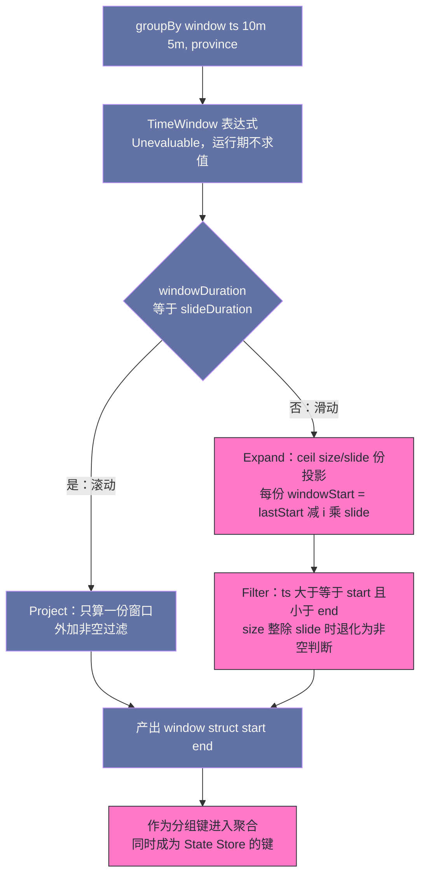
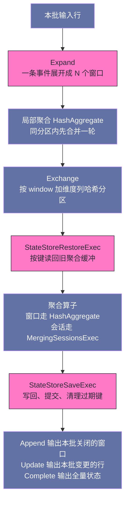
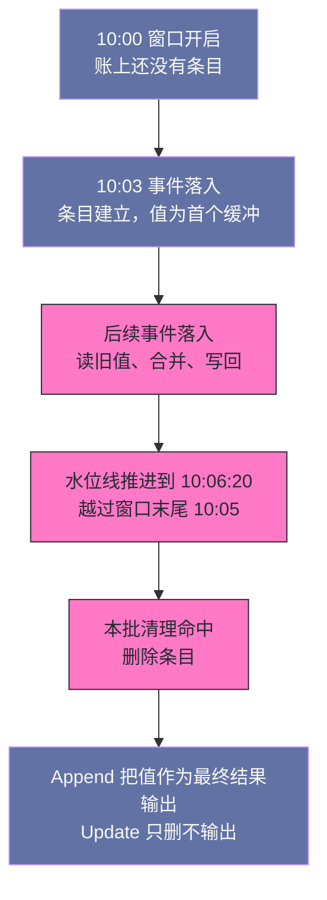
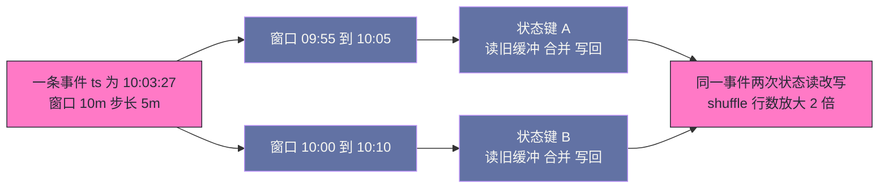
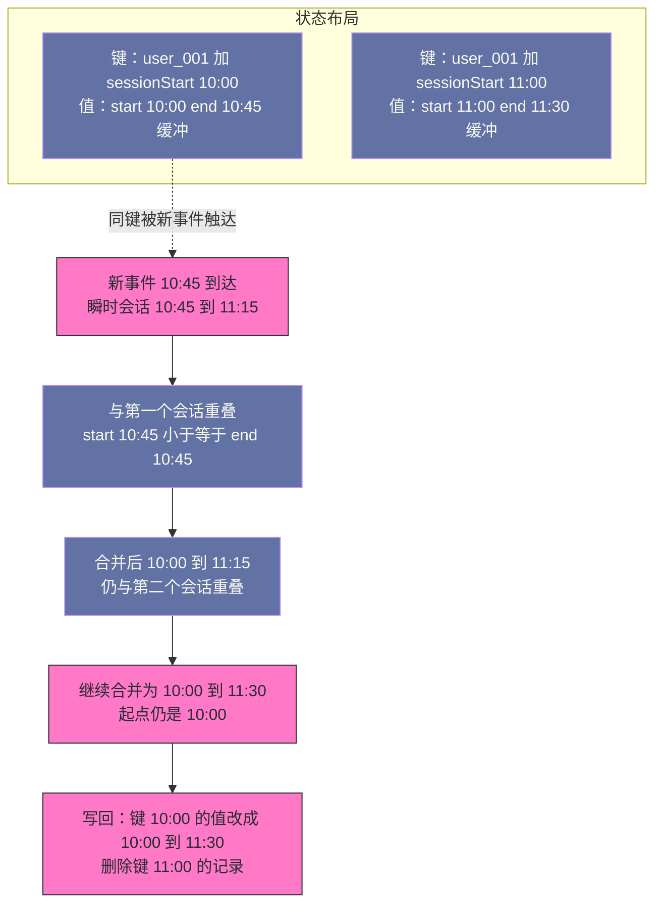
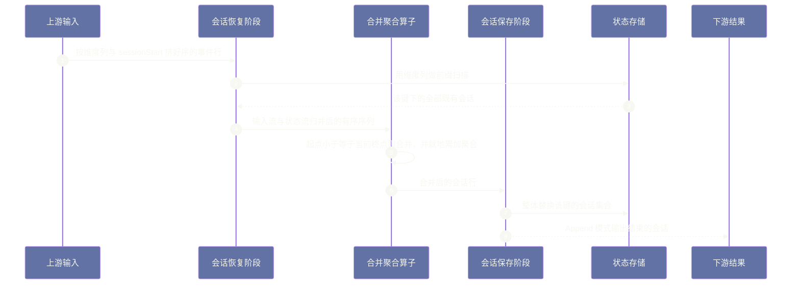

# 06 窗口聚合：滚动窗口、滑动窗口与会话窗口的实现机制

**摘要：**

窗口聚合在 API 层只有三五个参数：时间列、窗口长度、滑动步长，会话窗口再换成 gap。但它落到执行层时是一笔状态账：每一个（窗口，分组键）组合都是 State Store 里的一条记录，一个查询同时在账上的条目数，由窗口长度、滑动步长、Watermark 延迟与分组键基数这四个数字共同决定。本文按这笔账展开：先说明 `window()` 为什么是一个在分析期被 `Expand` 与 `Filter` 改写的占位表达式，以及展开份数 `ceil(size/slide)` 与平均归属数 `size/slide` 之间的差额从哪来；再拆开窗口聚合在微批里的四个算子，看一条事件如何读回旧缓冲、合并、写回，看 Watermark 越过窗口末尾时清理发生在哪一行代码，以及为什么滚动窗口上的清理是一次全量扫描；随后把三种窗口的状态键布局并排比较，说明会话窗口为什么只能把 `sessionStart` 放进键、把 `sessionEnd` 留在值里，它为什么被限制在 Append 模式，默认又为什么不做局部预聚合；最后用示例推算给出高基数场景的条目数与字节数，并逐条交代 slide 远小于 size、没有 Watermark、gap 过大这几类反例。文中口径为 Spark 4.3.0（Scala 2.13 预编译），源码细节以对应版本文档或源码为准。

---

## 第 1 章 窗口的分组键是怎么算出来的

### 1.1 按时间分组，难的不是分组

普通 `GROUP BY` 的分组键来自行内的某个值，一行归到哪个组，在它被读出来的时候就已经确定，聚合器只需要维护一张"键到累加器"的表，表的大小由键的基数决定，与数据量无关。窗口聚合的写法看起来同构，实际多出两道坎。

第一道坎是归属不唯一。滑动窗口下一条事件同时属于多个窗口，分组键不再是一个值，而是一组值，行在进入聚合之前要先被"复制成几份"，每份带一个不同的窗口区间，这是 `Expand` 这类算子存在的全部理由。

第二道坎是窗口要能关闭。分组本身不会产生"结束"这个概念，普通 `GROUP BY` 的组只要还有输入就一直开着；窗口却在语义上必须有个终点，否则结果永远出不来、状态永远删不掉。而无界流上没有任何东西天然知道一个窗口是否还会有新数据落入，于是才有事件时间的进度估计，也就是 Watermark。这三个东西必须同时成立：分组键算得出来、状态存得下去、窗口关得掉。

Structured Streaming 的选择是把窗口压缩成一个普通的分组键，让窗口聚合复用已有的有状态聚合框架——同一套 State Store 布局、同一套输出模式判定、同一套 checkpoint 与恢复流程。复用的收益很大，代价也清楚：窗口的语义必须被塞进"键"这个概念里，凡是键表达不了的信息，都得靠额外的约定去补。

### 1.2 `window()` 是一个占位表达式

`window("event_time", "10 minutes", "5 minutes")` 在物理计划里并不是一次函数调用。Spark 4.3 里 `TimeWindow` 继承 `Unevaluable`，源码注释写得很直白：这个表达式会在分析器里被替换掉。它只是给分析器留的一个标记，让 `TimeWindowing` 规则知道这里要生成窗口列。

真正计算窗口区间的代码在分析期生成的投影里，逻辑只有三步：

```scala
// Spark 4.3 TimeWindowResolution.buildTimeWindowRewrite 的核心
val remainder = (timestamp - window.startTime) % window.slideDuration
val lastStart = timestamp - CaseWhen(Seq((LessThan(remainder, 0),
  remainder + window.slideDuration)), Some(remainder))
val windowStart = lastStart - i * window.slideDuration   // i 为第几份投影
val windowEnd = windowStart + window.windowDuration
```

`lastStart` 是"不晚于事件时间戳的最后一个网格点"，网格由滑动步长与起始偏移共同决定；第 `i` 份投影则从这个网格点继续向前退 `i` 个步长。窗口区间是左闭右开的 `[start, end)`，所以落在边界上的事件归后一个窗口，这一点与 SQL 里 `window` 函数的文档描述一致。

这段代码出现在分析期而不是运行期，带来一个容易被忽略的后果：**展开份数在查询开始时就被固定下来了**。它由 `windowDuration` 与 `slideDuration` 两个字面量算出，运行期不随数据变化；参数校验也发生在同一时刻，`slideDuration > windowDuration`、`windowDuration <= 0`、`|startTime| >= slideDuration` 都会直接报错，而不是在跑起来之后才发现。顺便说一句，一个聚合里只能出现一个窗口表达式，多个窗口列会被明确拒绝，这也是"窗口先被折叠成键"这条路线的一个副产品。

### 1.3 展开：`ceil(size/slide)` 份投影加一道过滤

滑动窗口无法从时间戳直接推出"这条记录属于哪几个窗口"的确切个数——带偏移、不整除的情况下，不同事件归属的窗口数并不相同。Spark 的做法是先高估再过滤：按 `ceil(windowDuration / slideDuration)` 生成这么多份投影，然后用一个过滤条件把"事件时间不在该窗口区间内"的行丢掉。

源码注释里给了一个 12 分钟窗口、5 分钟步长的例子，事件时间 12:05，起始偏移为 0 时三份候选窗口是 `11:55-12:07`、`12:00-12:12`、`12:05-12:17`，三份都包含 12:05，全部有效；把偏移改成 2 分钟，候选变成 `11:52-12:04`、`11:57-12:09`、`12:02-12:14`，第一份不包含 12:05，被过滤掉。偏移一改，同样三份投影里只有两份是真的。

这里值得把两个数字分开：展开份数是 `ceil(size/slide)`，那是每行被复制出的份数上限；平均归属数是 `size/slide`。整除的时候两者相等，每条事件恰好属于 `size/slide` 个窗口；不整除的时候，比如 12 分钟窗口配 5 分钟步长，处在窗口前段的事件会落进 3 个窗口、后段的只落进 2 个，平均下来仍是 12/5=2.4 个。多出来的那份投影白做了一次计算、白占了一个 `Expand` 输出行，随后被过滤掉。放大倍率按 `ceil` 估不会错，按 `size/slide` 算平均值更贴近实际，规划容量时两个都要看一眼。

当两个时长相等时，这条路径根本不走 `Expand`：分析器只生成一份窗口投影，再加一个兼容性的非空过滤，一条事件就是一行。这就是滚动窗口与滑动窗口在物理计划上的第一处、也是最根本的一处分岔。

### 1.4 一条事件展开成几行的账

把展开这件事算清楚，后面所有状态与计算量的估算才有依据。

一条事件进入 `Expand` 之后变成 `ceil(size/slide)` 行，每行携带一个不同的 `(start, end)` 结构体；这 N 行随后作为分组键的一部分参与局部聚合、再经过 shuffle 落到下游。对 5 分钟滚动窗口，N=1；对 1 小时窗口配 1 分钟步长，N=60；对 1 小时窗口配 1 秒步长，N=3600。这个数字同时是行数放大倍率、shuffle 数据量放大倍率和状态写入次数放大倍率，三者在实现上是同一件事的三个投影。

```text
滚动窗口  window("ts", "5 minutes")
  事件 10:03:27 → [10:00, 10:05)                     1 行

滑动窗口  window("ts", "10 minutes", "5 minutes")
  事件 10:03:27 → [09:55, 10:05)、[10:00, 10:10)      2 行

滑动窗口  window("ts", "12 minutes", "5 minutes")
  事件 10:01:00（余数 1 分整，落在窗口前段）
    → [09:50, 10:02)、[09:55, 10:07)、[10:00, 10:12)   3 行
  事件 10:03:27（余数 3 分 27 秒，落在窗口后段）
    → [09:55, 10:07)、[10:00, 10:12)                   2 行（第 3 份被过滤）
```

### 1.5 一条贯穿全篇的查询

为了让后面的机制有具体的着力点，笔者设想一个实时数仓的曝光与成交看板，三条查询并行跑在同一份用户行为事件流上（订单事件与浏览事件混在一起，靠事件类型区分）：

- 查询 A：5 分钟滚动窗口，按省份算 GMV 与订单数，Append 模式写入 ClickHouse，供大屏每五分钟刷新一次。
- 查询 B：1 小时窗口、1 分钟步长，按省份算"近一小时 GMV"曲线，Update 模式写入指标库，供风控看趋势。
- 查询 C：会话窗口，gap 设为 30 分钟，按 `userId` 算一次浏览会话的页面数与时长，Append 模式落数据湖，供次日用户行为分析。

三条查询读的是同一条流，写出的却是三种完全不同的状态形状：A 的每个键只挂着三个窗口、B 的每个键挂着七十个窗口、C 的每个键挂着若干个边界还在变化的会话。后文反复回到这三个查询上，比较它们的条目数、清理时机与输出节奏。

### 1.6 状态账本的第一层

把窗口折叠成分组键之后，状态账本就变得很好写：State Store 的键就是分组键，一条记录对应一个（窗口，维度值）组合，值是这个组合的聚合缓冲。于是"窗口聚合要多少状态"这个问题，被翻译成两个可以分别估算的量：有多少个键，每个键同时挂着几个窗口。

三个查询在这一层的差别立刻显现。查询 A 的键是 `(window, province)`，省份数几十个，账上同时活着的窗口只有三个，条目数以百计；查询 B 的键同样是 `(window, province)`，但同时活着的窗口有七十个，条目数是 A 的二十余倍；查询 C 的键是 `(session, userId)`，用户数可能是千万级，每个用户挂着几个未关闭的会话。同一份输入，三条查询的状态量差了五六个数量级，而 API 上它们的差别只是传了几个参数。

三种窗口在第一层的对照如下，后面章节会逐行展开这些差异的技术来源。

| 维度 | 滚动窗口 | 滑动窗口 | 会话窗口 |
|---|---|---|---|
| 窗口边界 | 固定网格，`size == slide` | 固定网格，`size > slide` | 由事件间隔决定 |
| 一条事件归属几个窗口 | 恒为 1 | 平均 `size/slide`，上限 `ceil(size/slide)` | 参与会话合并，归属在运行期才确定 |
| 分析期改写 | 单份 `Project` | `Expand` + `Filter` | 单份 `Project`，随后在状态层合并 |
| 状态键 | `(window.start, window.end) + 维度列` | 同左 | `维度列 + sessionStart`，`end` 在值里 |
| 每键并发条目数 | `1 + delay/size` 量级 | `(delay + size)/slide` 量级 | 该键未关闭的会话个数 |
| 可用输出模式 | Append、Update、Complete | Append、Update、Complete | 仅 Append（Complete 分支存在但代价极高） |
| 清理判据 | `window.end <= watermark` | 同左 | `session.end <= watermark`（判在值上） |

表的最后一列值得先记住结论：会话窗口在几乎所有维度上都与另外两种不同，根因只有一个——它的键不包含那个会变化的边界。

---



图中那条"是"与"否"的分岔，是三种窗口里唯一在分析期就分道扬镳的地方；会话窗口走的是"是"这一侧的单份投影，它的复杂性全部留到了状态层。

---

## 第 2 章 状态键、写路径与清理时机

### 2.1 键的 schema 与值的 schema

窗口聚合的状态键就是分组表达式组成的结构体：窗口结构体两列（`start`、`end`，都是微秒精度的时间戳），加上维度列。源码里 `stateKeySchema = keyExpressions.toStructType`，`keyExpressions` 正是 `IncrementalExecution` 从逻辑计划搬过来的分组键。

值的 schema 经历过一次优化。状态格式版本 1 里，键和值都保存完整行，键列在值里重复一份；版本 2 把重复的键列从值里剔掉，值只保留"输入行属性减去键属性"的部分，源码注释称这是为了减少键值对里的重复列、节省空间。这个改动对宽表尤其明显：一个 30 列的输入行，如果 5 列参与分组，值就只需要存 25 列。当前默认版本以对应版本配置为准，本文不依赖具体版本号，只依赖"键列不重复存储"这个性质。

### 2.2 微批里的四个算子

一条窗口聚合查询被翻译成物理计划后，与状态相关的算子按自上而下的顺序是四段：`StateStoreSaveExec`、聚合算子、`StateStoreRestoreExec`，以及再往下、经过一次 `Exchange` 的局部聚合。它们的职责可以一句话概括：Restore 负责把旧缓冲捞出来，聚合算子负责合并，Save 负责写回并在该关窗的时候把结果吐出去。



图里 `Expand` 位于 `Exchange` 之前，这一点在容量规划上很关键：行数放大发生在 shuffle 之前，放大后的行要真的过网络。会话窗口的计划形状与这张图基本一致，只是"聚合算子"换成了专门的合并算子，且没有 `Expand`——会话窗口一条事件只产出一行，它的放大不在行数上，而在键上挂着的会话个数上。

### 2.3 一批数据走完的五步

把一个微批摊开，一条事件在窗口聚合里的完整旅程是这样的。

第一步是展开：`Expand` 按分析期定下的份数复制行，`Filter` 丢掉不属于对应窗口的那些。第二步是局部聚合：同一次 shuffle 之前，落在同一分区、同一个键上的行先合并成一份部分聚合结果，这一步纯粹为了少传数据，与状态无关。第三步是 shuffle：按分组键把行重排到状态分区，同一个键的所有行进入同一个 task。第四步是 Restore：对每个键，从 State Store 读回上一批留下的聚合缓冲，与本次的部分结果一起交给聚合算子，聚合算子把两者合并成一份完整缓冲。第五步是 Save：把完整缓冲写回 State Store，提交这个版本的改动，然后在提交前后完成清理与输出。

这五步里只有第四步和第五步碰状态，但它们的成本与"本批处理了多少行"关系不大，而与本批"触达了多少个键、账上还有多少条记录"关系很大。这个性质是后面容量问题的根源。

### 2.4 存储的物理形态：每个分区一张内存哈希表

社区发行版默认的状态存储实现是 `HDFSBackedStateStoreProvider`，它的机理比名字听起来要朴素：每个状态分区对应一张堆内的并发哈希表，键值都是 `UnsafeRow`（值外面还包一层可变包装），表的内容由最近一次快照加上此后的增量文件重建；增量文件累积到 `spark.sql.streaming.stateStore.minDeltasForSnapshot` 指定的个数（默认 10）之后合并成新快照，旧文件清理。

这个形态决定了两件事。其一，**状态必须在堆里装得下"一个分区"的全部条目**，而不是装得下平均值：`spark.sql.shuffle.partitions` 决定状态被切成几份，条目按分组键的哈希散开，散得匀不匀决定每个 task 的实际负担。其二，**每次提交写的是增量，重建读的可能是全量**：正常批次只写本批变动的条目，但一旦触发快照或从 checkpoint 恢复，成本就与状态总量成正比。

RocksDB 实现把哈希表换成嵌入式 KV 存储：条目落在本地磁盘，堆内只留 memtable、块缓存与索引。它不改变"条目数由窗口参数决定"这个事实，改变的是"条目数超内存时会发生什么"——从 OOM 变成读盘变慢、checkpoint 变大。

### 2.5 一条状态条目的字节账

估算状态大小的第一步是把一条记录拆成字段。以查询 A 的键 `(window, province)`、聚合 `sum(amount), count(*)` 为例，可以列出这样一张账（示例推算，取整到便于计算的量级，真实字节数受序列化格式、字符串长度、哈希表负载因子影响）：

| 组成部分 | 典型字节数 | 说明 |
|---|---|---|
| 键：`window.start` | 8 | 微秒精度的 long |
| 键：`window.end` | 8 | 同上；可由 start 加长度推出，但参与哈希与比较仍要存 |
| 键：维度列（如省份字符串） | 8 至 24 | 短字符串的 `UnsafeRow` 变长区加偏移量 |
| 值：`sum` 的 double | 8 | 定长 |
| 值：`count` 的 long | 8 | 定长 |
| 行头与变长偏移 | 8 至 16 | 两条 `UnsafeRow` 各有一小段头部 |
| 容器开销 | 48 至 72 | 并发哈希表的节点、包装对象、对齐填充 |
| 单条合计 | 约 96 至 152 | 取 120 字节做后续估算的中位值 |

同一批数据在 RocksDB 里的单条占用要小一些，因为键值以连续字节写入块、容器开销被摊薄，代价是读放大与 compaction 的后台开销。两边都别指望精确到个位，估算顺序对就够了：**十万条是十兆量级，一千万条是吉字节量级，一亿条是十吉字节量级**，拿这个尺度去和 executor 的堆比，结论通常不会被细枝末节推翻。

### 2.6 清理发生在哪一行代码

窗口状态不是靠"过期时间"被动回收的，而是靠每批主动比对水位线。判定条件写在 `WatermarkSupport.watermarkExpression` 里：如果参与判定的键属性是窗口结构体，取它的第二个字段（`end`）与水位线比较；否则直接拿属性本身比较。比较用的是小于等于，也就是**窗口末尾一旦被水位线跨过，这个窗口就算关闭**。

水位线本身的推进规则（多源取最小、单调不减）由另一套机制负责，可参考 [[大数据/Spark/Spark-Structured-Streaming流处理深度解析/04 Watermark 全解：事件时间语义与延迟数据处理|Watermark 全解]]。这里有个细节容易被忽略：窗口聚合里其实同时存在两个水位线。一个是上一批结束时记录的水位线，用来判定"这批数据算不算迟到"，命中的行在写入状态之前就被丢掉；另一个是当前批推进后的水位线，用来判定"哪个窗口可以关闭、哪条状态可以删除"。在单层聚合里两者差别不大，但在链式聚合（一次窗口聚合的输出再喂给下一次聚合）里就必要了：上游算子按当前水位线清掉的状态，对下游算子来说只是"刚好按时到达"的数据，不能按迟到丢掉。源码注释把这个理由写得很清楚，这也是读源码时判断"为什么同一个概念要存两份"的典型线索。

判定条件成立之后，动作分三种输出模式而完全不同：

- Append 模式：遍历状态，凡是键命中清理判定的，就地删除，并把被删记录的值作为最终结果输出。没有 watermark 时这个模式直接报错，因为"关闭窗口"这件事无法定义。
- Update 模式：写入本批变更后，再扫描一遍全部键，删掉命中的，但被删的行不输出——它们在上几批里已经作为变更输出过了。
- Complete 模式：不清理。状态就是结果表，删掉任何一条都会让输出错。

### 2.7 清理为什么是一次全量扫描

从代码形状看，三种模式里真正"到处走"的是清理这一步：Append 模式在遍历状态时顺便判定并输出，Update 模式调用 `removeKeysOlderThanWatermark`，两者都是对状态分区的一次完整迭代，逐条判断键是否命中水位线判定，命中就删。也就是说，**每批的清理成本与该分区账上的条目数成正比，与本批到达的数据量无关**。

这个成本在低延迟场景里会变成主要开销。设想一个每秒触发一次微批、账上挂着两千万条窗口状态的查询：每批只来几千条数据，却要把两千万个键扫一遍，`allRemovalsTimeMs` 会稳定地占据批次时长的大头，端到端延迟被清理而不是被计算拖住。Spark 4.3 里能看到两条针对性的改进：一条是内部配置 `spark.sql.streaming.statefulOperator.incrementalCleanupFactor`，把"每处理一条输入就顺带删掉若干条可清理记录"的策略做成参数，默认 0 表示仍然在批末集中清理，调到 k 就把清理摊到批内；另一条是清理迭代器本身记录了扫描行数与删除行数两个计数，让"扫了很多、删得很少"这种状态一眼可辨。这些机制都还在演进，具体默认值与适用范围以对应版本文档或源码为准。

---

## 第 3 章 滚动窗口：同时活着的窗口不止一个

### 3.1 一个直觉上的错误

谈到滚动窗口，很容易认为"每个键只维护一个窗口的状态"：窗口不重叠、一条事件只进一个窗口，于是同一个键下应该只有一条记录。这个直觉错得很自然，因为它把"同时活着的窗口"和"一条事件归属的窗口"混为一谈了。

窗口关闭的判据是 `window.end <= watermark`，而 watermark 等于"已见最大事件时间减去延迟容忍"。假设延迟容忍是 10 分钟、窗口长度是 5 分钟，那么当水位线推到 10:06:20 时，窗口 `[10:00, 10:05)` 关闭，可此时到达的最大事件时间已经到 10:16:20，`[10:05, 10:10)`、`[10:10, 10:15)`、`[10:15, 10:20)` 三个窗口都还开着。同一个键在账上同时挂着三个窗口，而不是一个。

推而广之，设窗口长度为 W、步长为 S、延迟容忍为 D。活着的窗口必须满足 `end > watermark`，而最年轻的窗口其 `end` 不会超过 `最大事件时间 + W`；两头一夹，活窗口的个数约为 `(D + W) / S`。滚动窗口 S=W，公式退化成 `1 + D/W`：延迟越大、窗口越短，同一个键上同时挂着的窗口就越多。这条公式是整个容量估算的骨架，后面滑动窗口与高基数场景都从它出发。

### 3.2 三组参数下的条目数

把公式套到几个常见配置上（示例推算，只按下式计算条目数，不含容器与序列化的额外开销）：

| 窗口长度 W | 步长 S | 延迟 D | 每键并发窗口数约 | 100 万键的条目数 | 按 120 字节估算的堆内占用 |
|---|---|---|---|---|---|
| 5 分钟 | 5 分钟 | 10 分钟 | 3 | 300 万 | 约 0.36 GB |
| 5 分钟 | 5 分钟 | 1 小时 | 13 | 1300 万 | 约 1.6 GB |
| 1 分钟 | 1 分钟 | 10 分钟 | 11 | 1100 万 | 约 1.3 GB |
| 1 小时 | 1 小时 | 10 分钟 | 约 1.2（实际取 2） | 200 万 | 约 0.24 GB |
| 1 天 | 1 天 | 10 分钟 | 约 1（实际取 1） | 100 万 | 约 0.12 GB |

表里第四、第五行的取整值得说明：公式算出的 1.17 与 1.007 是平均值，实际计数只能是整数，某一瞬间通常落在 1 与 2 之间交替。这也解释了为什么"把窗口拉长"能显著压低状态：长窗口的 `D/W` 很小，每键几乎只挂一个窗口，而短窗口在同样的延迟下会堆积出十来个。

一个窗口从建立到被清理，中间只在两个时刻被真正"动"到：事件落入时改一次值，水位线越过末尾时删一次条目，其余批次只是跟着扫描一遍。下图把这条生命周期画成一条单向链。



图中"读旧值、合并、写回"这一步每来一条事件就重复一次，它的次数就是第 4 章要算的写放大；而"本批清理命中"这一步每批才走一次全量扫描，两者不是同一量级的成本。

### 3.3 输出模式与状态的耦合

同一条窗口聚合，换一个输出模式，状态的行为就完全不同，这一点在规划容量时比窗口参数本身更容易出错（三种模式的语义边界见 [[大数据/Spark/Spark-Structured-Streaming流处理深度解析/03 输出模式深度解析：Append、Update 与 Complete 的适用边界|输出模式深度解析]]）。

| 输出模式 | 何时输出 | 状态清理 | 未设 Watermark 时的行为 | 典型下游 |
|---|---|---|---|---|
| Append | 窗口关闭的那一批，输出被删记录的最终值 | 每批清理，删除即输出 | 直接报错 | ClickHouse、文件、数据湖 |
| Update | 每批输出本批发生变更的行 | 每批清理，删除不输出 | 不报错，但状态永不清理 | 指标库、Kafka 更新流 |
| Complete | 每批输出全量状态 | 从不清理 | 不报错，状态永不清理 | 小基数的维度表、内存表 |

Append 模式与清理的关系最紧密：它不是"先算结果再判断能不能输出"，而是**在清理的同一趟遍历里把要关的窗口的输出顺手带出来**。源码里那个循环读起来很朴素——遍历状态、判定键是否过期、过期就删并把值返回——但正因如此，Append 模式下的输出延迟等于"窗口关闭延迟"，即 `W + D` 的量级，再叠加批次间隔；这也解释了为什么大屏看板通常容忍五分钟的窗口配十分钟的延迟，实际能在十五分钟之后看到完整数字。

Update 模式则相反：它每批输出变更，状态清理是后台动作，因此延迟低，但下游必须能处理同一窗口的多次更新。这里有一个容易被忽略的连带问题：Update 模式下如果没有 watermark，查询不会报错，状态却会一直长；这类故障不会在启动时暴露，往往在跑了几周之后以 executor OOM 或 checkpoint 超时的形式出现。

### 3.4 只有水位线前进的时候

还有一个机制值得单独提，它解释了"没有新数据为什么也会出结果"。有状态算子在提交时，会把"本批输入水位线是否超越了已处理的水位线"作为判据之一，决定是否需要再跑一批；源码里对应 `shouldRunAnotherBatch` 这个方法。它的意义在于：窗口关闭由水位线驱动，当上游短暂没有新数据、水位线却因为后续批次的前进而越过窗口末尾时，即使本批没有新行，算子也要再跑一次把该关的窗口关掉。没有这个机制，关窗动作会被推迟到下一次有数据为止，输出时间就变成了数据到达时间而不是水位线时间。

### 3.5 水位线停住的那一天

把上一节反过来看，就是滚动窗口最典型的线上故障。水位线是单调不减的，但推进它的只有事件时间；只要某个输入源不再产出带新时间戳的数据，水位线就会停住，即使其他源还在源源不断进来。多源查询取的是各源水位线的最小值，空闲分区、暂停的分区、上游某个 topic 某一批全是补数据，都会把最小值钉在原地。

水位线停住之后，窗口不会关闭、状态不会删除、Append 模式不会输出；表面症状是"看板不更新了"，指标上的症状是 `watermark` 停滞、`numRowsTotal` 只增不减、`allRemovalsTimeMs` 接近零而 `memoryUsedBytes` 缓慢爬升。这类问题往往要等到 OOM 或磁盘打满才被发现，而它的根因不在窗口参数上，在数据源是否有空闲感知的能力上。

---

## 第 4 章 滑动窗口：放大倍率与代价

### 4.1 放大来自展开，而不是来自清理

滑动窗口与滚动窗口在状态布局上一模一样，键都是窗口结构体加维度列，值都是聚合缓冲，清理判据也一模一样。两者的全部差别集中在一点：一条事件被展开成几行。

展开发生在 shuffle 之前，于是放大一路向下传导：`Expand` 输出的行数是输入的 `ceil(size/slide)` 倍；这些行要真的经过网络，所以 shuffle 的字节数同比例放大；每个（窗口，键）组合都要独立做一次状态读改写，所以状态写入次数同比例放大；最终账上的条目数由第 3 章那条公式决定，其中步长 S 出现在分母上。



图里两个状态键的值并不是"各存一半"，每个窗口的聚合结果都包含了这条事件的完整贡献。这也是滑动窗口容易被误解的地方：它不像"分片"那样把一条记录切成几份，而是把同一条记录完整地计入多个窗口，因此结果更"重"，状态也更"重"。

### 4.2 条目数怎么算

把第 3 章的公式代进查询 B：1 小时窗口、1 分钟步长、延迟容忍 10 分钟，每键并发窗口数约为 `(10 + 60) / 1 = 70`。若活跃省份数是 30 个，条目数是 2100 条，微不足道；如果把维度换成 `userId`，键基数一百万，条目数就是 7000 万，按每条 120 字节估算约 8.4 GB（示例推算）。

再往下算一步会更直观。假设输入速率是每秒 5 万条事件，每条展开 60 行，那么每秒钟要处理的聚合输入是 300 万行，每分钟 1.8 亿行；每条展开后的行都要经过 shuffle、落到某个状态键上、读一次旧缓冲、写回一次。即使状态条目数还能装下，这套读改写节奏也会先把 CPU 与网络打满。所以对滑动窗口来说，"状态有多大"往往不是第一个瓶颈，**"每条事件要碰多少次状态"才是**。

| 窗口长度 / 步长 | 展开份数 | 每键并发窗口数（延迟 10 分钟） | 每条事件的状态读改写次数 | 相对 5 分钟滚动的倍数 |
|---|---|---|---|---|
| 5 分钟 / 5 分钟 | 1 | 3 | 1 | 1 |
| 10 分钟 / 5 分钟 | 2 | 4 | 2 | 约 2.7 |
| 1 小时 / 5 分钟 | 12 | 14 | 12 | 约 56 |
| 1 小时 / 1 分钟 | 60 | 70 | 60 | 约 1400 |
| 1 小时 / 1 秒 | 3600 | 3610 | 3600 | 约 430 万 |

表里最后一列的算法是：每键并发窗口数乘以展开份数，再除以滚动窗口那一行的对应乘积。它想说明的是一件容易被忽视的事：滑动窗口的代价是**乘法**，不是加法。窗口拉长带来一份开销，步长缩小带来另一份，两者叠在一起，量级很快就会脱离单机可承受的范围。

### 4.3 批成本与条目数成正比

回到第 2 章那个性质：清理是扫描，扫描量等于账上条目数。滑动窗口把这个性质放大得最明显，因为它同时抬高了条目数与"每批要更新的条目数"。

每批的开销可以粗分成三块：更新块，与本批展开后的行数成正比；清理块，与本分区条目数成正比；提交块，与本批变更的条目数成正比，并在触发快照时跃升到与总量成正比。三块里只有第一块会因为"流量小"而变小，后两块与流量无关。一个常见误判是"这条查询平时流量很低，偶尔峰值才高"，于是按峰值流量配资源；实际上低流量时段的状态仍然要扫、要提交，真正压垮它的可能是"账上条目太多"，而不是"这一批数据太多"。

### 4.4 省状态的替代路线

倍率压不下来时，实现层面还有别的走法，各有代价。

一条是切片式预聚合：先把粒度定在步长 S 上做滚动聚合，把每个切片的聚合结果存下来，查询时再把 `size/S` 个相邻切片合并成滑动窗口的结果。这样状态条目数从"每键 (D+W)/S 个滑动窗口"变成"每键 (D+W)/S 个切片"，看起来数量级没变，但每条事件只更新一个切片而不是 `size/S` 个，写放大被消掉了。代价是读取侧要做合并，且 Update 模式下"某个滑动窗口变了"与"某个切片变了"不是一一对应的，下游语义要跟着改。另一个流处理引擎在滑动窗口聚合上走的就是这条切片路线，取舍点是一样的：把写放大换成读放大，把状态条目从"窗口"降到"切片"。

另一条是在状态里放数组：把 `size/S` 个部分聚合结果作为一个数组存在同一个键下，一条事件只做一次状态读改写，由用户代码负责数组的滚动与合并。这条路需要放弃 `groupBy(window(...))` 的声明式写法，改用自定义有状态算子，把窗口逻辑自己接管；收益是状态访问次数从 `size/S` 降到 1，代价是正确性责任转移给了业务代码。

还有一条最朴素：把滑动窗口改成"大步长窗口加查询侧滑动"，或者在业务上接受更粗的粒度。看板的"近一小时"曲线如果每分钟才刷新一次，那就没必要把步长压到 10 秒；很多所谓的滑动窗口需求，本质是展示层的平滑，不是计算层的语义。

---

## 第 5 章 会话窗口：一个键挂着多个进行中的会话

### 5.1 边界由数据决定

滚动与滑动窗口的边界来自网格，一个时间戳能落在哪些窗口里，只取决于窗口参数，与数据本身无关。会话窗口反过来：一个会话的终点是"最后一次活动时间加上 gap"，而下一次活动什么时候来，只有数据到达时才知道。于是窗口边界在运行期会变，而且可能越过已有窗口的边界与别的窗口合并。

这种"边界可变"直接击穿了前两种窗口赖以为生的两个假设。第一个假设是"键是稳定的"——滚动窗口的键 `(window.start, window.end, 维度列)` 一旦算出就不再变；会话窗口的 `end` 会一直往后推，如果把它放进键，每来一条新事件就要删一条旧记录、插一条新记录，同一个会话在状态里反复搬家。第二个假设是"一条事件只更新一个键"——会话合并意味着一批新事件可能让原本独立的两个会话变成一个，两条状态要合成一条。

### 5.2 键里只放 start

Spark 的解法是把会变的边界从键里挪出去：状态键是 `维度列 + sessionStart`，`sessionEnd` 留在值里，与聚合缓冲一起存。键里的 `sessionStart` 也有讲究，它取的是会话的起点，而会话只会向右延伸，起点不变，所以这个键在整个生命周期里是稳定的。

这个设计带来的连锁效果值得逐个数。其一，同一个键下会有多条记录，每条是一个进行中的会话，因此状态管理器必须支持"按键前缀扫描"——把 `维度列` 作为前缀，`sessionStart` 作为后缀，前缀扫描一次取出某个键的全部会话。源码里状态键的 schema 就是"分组列 + `sessionStartTime`"，前缀列数等于分组列数，扫描用前缀扫。其二，改一个会话的终点是**值更新**，不涉及键的增删；只有会话合并才需要删除一条键，被合并掉的那个会话起点消失。其三，清理判定不能看键，因为键里没有终点，只能看值——这就解释了第 1 章那张表里会话窗口的清理判据为什么与另外两种不同。



图中的合并判定用的是"新会话起点小于等于当前会话终点"。因为每条事件先被投影成 `[ts, ts+gap)`，两个瞬时会话相交就等价于"新事件落在当前会话的 gap 窗口内"，判定因此可以用一次比较完成，不需要算距离。

### 5.3 合并怎么在一批里完成

合并不是把整个键的会话读出来两两比较，而是利用排序做一次归并。子算子被要求按 `(维度列, sessionStart)` 排序输出，Restore 阶段把状态侧该键的会话取出来物化成一个小列表、按起点排好序，然后与输入侧的已排序流做归并；归并过程中，一旦遇到起点小于等于当前会话终点的新会话，就把它并进来并扩张终点，否则开一个新会话。

合并与聚合是同一趟完成的：会话一旦扩张，新的行就直接累加进同一个聚合缓冲，不需要先把原始行缓存下来再重算。源码在 `MergingSessionsExec` 的注释里把这一点当作设计目标写明——合并窗口的同时应用聚合，从而避免缓存输入行。这个取舍很实际：缓存原始行意味着内存占用与本批事件数成正比，而直接累加意味着内存占用只与"当前正在处理的会话数"成正比。

归并算法的前提是"每个键下的会话不多"，源码注释也承认这一点：状态侧的会话会被整个物化进内存再排序。这个假设在正常业务下成立，因为大多数用户的并发会话只有个位数；但它没有上界，第 7 章会给出它失效的场景。

### 5.4 整体替换而不是增量修补

合并完成之后，写回状态的动作是"整体替换"：Save 阶段把该键在本批产生的全部会话（包括那些没有被新事件碰到、但要透传下去的会话）收集起来，一次性替换掉这个键原有的会话集合——旧记录里不在新集合中的被删除，在新集合中的被覆盖写入。源码里对应的接口语义写得很明确：用给定会话替换该键的所有会话，未包含在参数里的既有会话会被移除。

这样设计的原因在归并逻辑里：一旦发生过合并，几个会话的聚合缓冲已经被揉在一起，再想区分"哪部分来自哪个旧会话"就没有意义了；整体替换把复杂度压到最低。代价是写放大——即使只有一个会话被新事件碰到，同键下所有会话都要重新写一遍值。对每键会话数个位数的场景这无所谓，对每键成百上千个会话的场景就是另一回事。

还有一个实现细节能看出这条路径的取舍：写入时如果某个会话的起点与旧记录相同，直接覆盖值而不做"删除再插入"，这样不会为同一个键产生墓碑记录。这个优化只对"值更新"有效，对真正的合并无效——合并必然伴随一条键的消失。

把这一节的流程按算子顺序排一遍，能看清"排序、归并、聚合、替换"这四件事是怎么串在一批之内的。



第 4 步的前缀扫描是会话窗口独有的状态访问方式，滚动与滑动窗口只需要按键做点查；第 7 步的整体替换则解释了为什么单个会话的更新会牵连同键的其他会话。

### 5.5 分区与排序要求

会话窗口的分区键是维度列，不含 `sessionStart`。这一点与前两种窗口形成鲜明对比：滚动窗口的分区键包含窗口结构体，同一个 `userId` 在不同窗口里的记录会被哈希到不同分区；会话窗口把同一个 `userId` 的全部会话钉在同一个分区里，否则合并就无法在一处完成。

钉在一起带来两个后果。好的一面是合并只需要本地状态，不需要跨分区协调，也不需要额外的 shuffle。坏的一面是倾斜：一个高频用户、一个爬虫账号、一个内部压测账号，其所有会话都落在一个 task 上；如果这个键下同时挂着上万个会话，这个 task 的内存与 CPU 就是全查询的短板，而其他 task 早就跑完了。前两种窗口的倾斜表现为"某个键的某些窗口在同一分区"，会话窗口的倾斜是"某个键的全部历史会话在同一分区"，后者更集中。

配套的排序要求也是硬约束：子算子必须按 `(维度列, sessionStart)` 排序输出，归并才有意义。这个要求在物理计划里体现为算子的 `requiredChildOrdering`，一旦上游因为别的算子打乱了顺序，计划里会插入一次排序，成本由上游数据量决定。

### 5.6 限制从哪来

会话窗口在文档里被列出的限制比其他两种多，逐条看下来，每一条都能追到上面那几个设计决定上。

Append 之外的模式不可用。Update 模式要求"输出的每一行都对应一个确定的键"，而会话在合并之后会产生一个"把两条旧结果合成一条新结果"的动作——下游看到的是新会话，却没有任何机制能撤回它之前看到的两个旧会话。源码注释对这件事的说法很直接：Update 模式的语义对会话窗口不可行。Complete 模式在物理实现里有分支，但它意味着不清理状态，与实际使用场景相悖，因此实际可用的只有 Append。

分组键里必须有 `session_window` 之外的列。这不是实现偷懒，而是"按 key 维护多个会话"这个模型的必要条件：如果分组键只有会话本身，每个不同的会话起点都会变成一个独立的组，合并就退化成了"每组一条"，前缀扫描也没有前缀可用。文档对此的表述是"流式查询里该分组键至少还要有一列"，批查询允许全局会话窗口——批处理没有状态分区与增量合并的问题。

默认不做局部预聚合。滑动窗口的 `Expand` 之后跟着一次局部聚合，把同一分区里同键的行先合并一轮；会话窗口默认没有这一步，因为局部预聚合要先在分区内按会话排序、再合并，多做一次排序。源码与文档给的是同一个解释：默认不做是因为要额外排序，只有在同一批里很多行属于同一个会话时，多出来的排序才划算。开关是布尔配置，打开后同一批内的会话会在 shuffle 之前先合并一轮，shuffle 数据量随之下降。

### 5.7 gap 决定了会话能活多久

会话的终点是"最后一条事件时间加 gap"，它的关闭条件是 `session.end <= watermark`。把两件事连起来看：一条事件到达之后，即使后面再没有任何数据，这个会话也要等到水位线越过"该事件时间加 gap"之后才会关闭，也就是至少要等 gap 加上延迟容忍 D。

于是 gap 同时扮演两个角色。语义上它是"多久没有活动就算会话结束"；资源上它是"一个会话在状态里最少存活多久"。gap 从 30 分钟调到 24 小时，语义上只是"跨天的活动算一次会话"，资源上却意味着每个活跃用户的状态存活时间拉长了 48 倍，同时每条事件可能并进一个很久以前开始的会话，会话总数与最长存活时间一起膨胀。

### 5.8 动态 gap 的连带影响

`session_window` 的 gap 可以是一个按行求值的表达式，不同用户用不同的 gap。这让"会话终点"不再能由"最后事件时间"单独决定——会话范围变成所有事件区间的并集，每条事件按自己的 gap 算出一个区间，再求并。文档对此的表述是：动态 gap 下会话的关闭不再依赖最新输入，而是由各事件区间的并集决定。

实现上的两条约束值得记住。第一，gap 为 0 或负数的行会被直接过滤掉，不会参与聚合；第二，因为每条事件的区间长度不同，合并判定不能再假设"后一个会话的起点减去前一个会话的终点恰好是 gap"，判定仍然是"起点小于等于当前终点就合并"，但这意味着部分区间的并可能跨越很长的空洞，状态存活时间由最大的那个 gap 决定。这类场景下按平均值估算状态会低估，得按上界算。

---

## 第 6 章 高基数：把 OOM 算出来

### 6.1 条目数的三个因子

到这里可以把条目数写成一行式子：

```text
状态条目数 ≈ 分组键基数 × 每键并发窗口数
           ≈ 基数 × (延迟容忍 D + 窗口长度 W) / 步长 S        （滚动与滑动）
状态条目数 ≈ 基数 × 该键未关闭的会话个数                       （会话）
```

三个因子各有各的脾气。基数由业务决定，通常最难改；`(D+W)/S` 由窗口参数与延迟容忍决定，改动它等于改动语义；会话个数由数据分布决定，长尾极重。所谓"高基数窗口的内存压力"，本质就是这三个因子相乘。

### 6.2 三组场景的估算

把常见配置放进同一张表（示例推算，条目数按公式计算，内存按每条 120 字节、无压缩、装载在堆内估算）：

| 场景 | 分组键基数 | 窗口配置 | 延迟容忍 | 条目数 | 估算内存 | 结论 |
|---|---|---|---|---|---|---|
| 省份维度滚动窗口 | 30 | 5 分钟 / 5 分钟 | 10 分钟 | 90 | 约 11 KB | 可忽略 |
| 省份维度滑动窗口 | 30 | 1 小时 / 1 分钟 | 10 分钟 | 2100 | 约 250 KB | 可忽略 |
| 用户维度滑动窗口 | 100 万 | 1 小时 / 1 分钟 | 10 分钟 | 7000 万 | 约 8.4 GB | 需 RocksDB 与容量规划 |
| 用户维度滑动窗口（放大版） | 1000 万 | 5 分钟 / 1 分钟 | 10 分钟 | 1.5 亿 | 约 18 GB | 单查询已接近集群上限 |
| 用户会话窗口 | 100 万 | gap 30 分钟 | 10 分钟 | 数百万（取决于活跃度） | 数百 MB 至数 GB | 与长尾强相关 |

表里第三行与第四行的对比最值得琢磨：同样是 1 分钟步长、10 分钟延迟，把窗口从 1 小时缩到 5 分钟本应让每键并发窗口从 70 降到 15，基数却从 100 万涨到 1000 万，两相抵消后条目数反而净涨一倍多；而第二行到第三行只是把维度从省份换成用户，条目数涨了三万多倍。这两组对比说明一件事：**在窗口聚合里，基数与倍率是两个独立的放大器，任何一个单独放大都还能忍，同时放大就很难看**。

### 6.3 分区与倾斜

条目数只是总账，落到 executor 上还要除以状态分区数。状态分区数由 shuffle 分区数决定，条目按分组键的哈希分散，理想情况下每分区条目数是总数的几分之一。两个因素会让理想情况失效。

一是哈希不均。键的基数小的时候（比如省份），哈希分布天然不均；键的基数大的时候，单键的记录数才是不均的来源。二是窗口结构体参与哈希。滚动与滑动窗口的分组键包含 `(start, end)`，同一个维度的不同窗口会散到不同分区，这其实是有利的——它把热点摊开了；会话窗口则相反，分区键里没有 `sessionStart`，同一个键的全部会话集中在同一分区，热点更集中。

估算单分区负担时，用"总条目数除以分区数"能给出下界，但必须再检查一遍最热的那个键：它在一个分区里占多少条。会话窗口下这个数字可能是几万，滚动窗口下通常是"并发窗口数"那么多。

### 6.4 内存还是磁盘

两条路的分界点不是"内存装不装得下"，而是"装不下时你想要什么后果"。

`HDFSBackedStateStoreProvider` 把每个分区的状态装进堆内哈希表，装不下就是 OOM，没有中间态；它的优势是读写都在内存里，延迟稳定，且实现简单、恢复路径清晰。`RocksDBStateStoreProvider` 把条目写到本地磁盘，堆内只保留块缓存与 memtable，装不下时表现为读盘变慢、compaction 跟不上，而不是直接崩；代价是本地盘容量与 IOPS 成为新的容量维度，checkpoint 也要额外处理（changelog 机制把变更单独落盘，避免每次快照都复制整个库）。选哪条路的判断依据通常不是"状态有多大"，而是"OOM 与变慢哪个更不能接受"，以及"能否接受本地盘这一层依赖"。

### 6.5 checkpoint 的连带成本

状态变大的代价不止内存。每批提交要写增量文件，增量累积到阈值要合并快照；快照的大小与状态总量成正比，快照期间的状态读写会被拖慢；从 checkpoint 恢复时，要先把最近的快照读回来，再重放增量，恢复时间同样与状态总量成正比。一个状态十吉字节的查询，重启一次可能要好几分钟，而这几分钟里上游数据在堆积，恢复后第一批要追赶的量又进一步拉长批处理时间——这是一条正反馈。

估算时可以按"状态总量除以吞吐"给出一个粗口径的恢复时间，再和业务能接受的停机窗口比。如果恢复时间超过窗口，就得考虑缩短快照周期（更多写放大）、降低状态量，或者把查询拆成多个小状态查询。

### 6.6 指标怎么读

判断状态是否失控，不需要等到 OOM。每个有状态算子在进度报告里都有一组指标，最常用的几个是：状态行数总量与内存占用（看绝对规模与增长趋势）、本批更新行数（看写放大）、本批删除行数（看清理是否在工作）、清理耗时与提交耗时（看每批固定成本是否已经压过计算成本）、被水位线丢弃的行数（看迟到数据的规模）。这些指标在 Spark UI 的 Structured Streaming 页面按算子列出，名字在不同版本里可能略有差异，语义是一致的。

更细的排查可以直接读状态。Spark 提供了实验性的 `statestore` 数据源，可以按 checkpoint 路径、批次、算子读出状态内容与变更流，用来回答"某个键下到底挂了几条记录""某个窗口为什么没被清掉"这类问题。它是排障工具而非生产接口，行为可能随版本变化。

### 6.7 治理的顺序

面对状态压力，手段有先后，顺序错了会白忙。

先降倍率：把 `size/slide` 压下来、把延迟容忍 D 调小。这一层改的是语义参数，收益最直接，且不需要动架构。再降基数：在窗口聚合之前做一层预聚合（按更粗的维度先合并，把行数与键数同时压下来），或者干脆把分组键里的高基数列去掉——先问一句"真的需要按用户维度算窗口吗"，很多看板要的是省份或渠道维度，用户维度只是顺手加上去的。然后才是换存储实现：把堆内换成本地盘，用变慢换不崩。最后才是加内存、加分区。

这个顺序背后是一个判断：窗口状态的大小首先是窗口语义的函数，其次才是集群资源的函数。把资源当第一手段，等于承认语义参数不可改；而实践中大部分状态爆炸的场景，起因都是一个"当初随手设的"步长或延迟。

---

## 第 7 章 边界与反例

### 7.1 slide 远小于 size

最常见的反例是"1 小时窗口、1 秒步长"，通常来自一句"要秒级刷新的近一小时曲线"。展开份数 3600，每条事件产生 3600 行，延迟容忍 10 分钟时每键并发窗口数约 3610；键基数哪怕只有一万，条目数也是三千六百万，而每条事件要碰 3600 次状态。这类查询在测试环境用几千条数据时看起来完全正常，上生产后第一批就卡住，因为第一批的展开行数就等于"事件数乘 3600"。

识别它的信号很明确：`Expand` 之后的输入行数、shuffle 读取字节数、状态更新行数三者同时是原始事件数的数千倍；批次时长里 `allUpdatesTimeMs` 占绝对多数，而实际聚合结果只有几千行。处置方式不是调资源，而是改语义：把"近一小时曲线"拆成"每分钟一个滚动窗口的曲线"加查询侧滑窗，或者接受 1 分钟步长。

### 7.2 没有 Watermark 的窗口聚合

三种输出模式在这件事上表现完全不同，因此这个反例经常以"为什么我的查询不报错但不清理"的形式出现。

Append 模式会直接拒绝：有状态聚合在 Append 模式下要求水位线判定非空，否则抛错。这是好事，故障在启动时暴露。Update 模式不会报错，但清理判定为空，于是每批只写入不删除，条目数单调增长，直到 OOM 或 checkpoint 无法完成。Complete 模式同样不清理，而且它的输出是全量状态，所以连输出都会随着状态增长而变慢。

还有一类变体是"写了 Watermark 但没有生效"，通常有三种原因：水位线加在了与聚合列不同的时间列上；水位线加在了聚合之后（顺序颠倒）；窗口用的时间列与水位线列不是同一列。这几种情况下判定谓词为空或对不上，效果与没写一样，文档里对前两种都有明确说明。排查时看两处：逻辑计划里是否有事件时间水位线算子，以及有状态算子是否拿到了清理用的水位线（每批的进度报告里能看到水位线的值）。

### 7.3 会话窗口配超大 gap

把 gap 从 30 分钟调到 24 小时，语义上只是"跨天的活动算一次会话"，资源上是三重放大：每个会话至少要存活 gap 加延迟容忍；每条新事件可能并进一天前开始的会话，于是"活跃会话数"接近"日活用户数"；合并时被物化进内存的会话列表也变长。

真正的危险在于它不报错。条目数增长是缓慢的、可解释的，而会话窗口默认不做局部预聚合，写入又是整体替换，于是每批的写放大随会话数线性上升。等到发现时，状态已经大到无法在不丢数据的前提下缩短 gap——改参数意味着已有会话的边界全部作废，从 checkpoint 恢复的状态与新语义不兼容。这类参数要在设计阶段就按"最长会话存活时间"算清楚。

### 7.4 用 Complete 模式跑窗口聚合

Complete 模式的语义是"每批输出全量结果"，实现上就是"不清理状态"。把它用在窗口聚合上，等于要求系统同时保留所有历史窗口的聚合结果，输出时把全量结果都吐一遍。数据量小的时候它能跑，看起来还比 Append 简单（不用管水位线）；一旦窗口数与基数上去，输出量、状态量、批次时长会一起爆，而且没有任何指标提示"这是模式选错了"。

判断方式很直接：如果窗口聚合的输出行数随时间单调增长、并且每批都在重写全部历史结果，那就是 Complete 模式。窗口聚合的正确模式只有 Append（要最终结果）与 Update（要增量更新）两种，Complete 只适合基数极小、且需要"全量快照"语义的场景。

### 7.5 水位线停滞与清理滞后

水位线停滞的症状与处置如下。症状是一组指标的组合：水位线数值长时间不动；状态行数总量只增不减；本批删除行数长期为零；清理耗时接近零而提交耗时缓慢上升。这四条同时出现，基本可以断定是"水位线没有推进"，而不是"窗口参数不对"。

根因通常在上游：某个分区长时间没有数据、某个源被暂停、多源查询里有一个源的时间戳滞后、或者上游数据的时间戳字段开始出现大量空值。处置方向也对应：确认每个源的空闲判定行为、给空闲源设置合理的心跳或过滤、检查时间戳解析是否在某些记录上失败。需要注意的是，水位线停滞时 `shouldRunAnotherBatch` 也帮不上忙，因为它的判据正是"输入水位线是否前进"。

### 7.6 键上会话数爆炸

会话窗口的归并算法假设"每个键下的会话不多"，这个假设在系统日志、设备埋点、共享账号这类场景里会失效：一个 `userId` 下面同时挂着几百上千个未关闭的会话，每次都整体物化进内存排序、整体替换写回。症状是少数 task 的耗时与内存远高于其他 task，`numRowsUpdated` 集中在这些 task 上，且 `allUpdatesTimeMs` 出现尖峰。

缓解手段有几个方向：把 gap 调小让会话尽快关闭；在分组键里加一层维度（比如加设备号），把单键会话数摊开；或者在进入会话窗口之前先做一步会话内去重与预聚合，减少同键事件的密度。这几个手段都改变语义或增加一步计算，取舍要看业务能否接受。

### 7.7 一份反例清单

把上面几类反例压成一张对照表，方便排障时快速定位（症状与证据栏里的指标名以对应版本的进度报告为准）：

| 反例 | 典型症状 | 关键证据 | 处置方向 |
|---|---|---|---|
| slide 远小于 size | 首批就卡住，批次时长暴涨 | 展开后行数、shuffle 字节数、状态更新数是事件数的数百至数千倍 | 改步长或改查询形态 |
| 无 Watermark 的窗口聚合 | Update 模式不报错但状态只增不减 | 状态行数单调增长、删除行数恒为零 | 补水位线并确认列与顺序正确 |
| 会话窗口 gap 过大 | 状态缓慢膨胀、写放大高 | 会话数接近日活、每批更新行数远大于输入行数 | 按最长存活时间重设 gap |
| Complete 模式跑窗口 | 输出行数随时间单调增长 | 每批输出等于全量状态、状态从不清理 | 换成 Append 或 Update |
| 水位线停滞 | 结果不再输出、状态不清理 | 水位线不动、删除行数为零、提交变慢 | 查源的空闲与时间戳质量 |
| 单键会话数爆炸 | 少数 task 拖尾 | 个别分区更新行数与耗时远高于均值 | 降 gap、拆分组键、预聚合 |
| 窗口列与水位线列不一致 | 不清理但也不报错 | 清理判定为空、计划里水位线列与分组列不同 | 统一时间列 |

最后一行值得单独强调：它是最隐蔽的一类，因为语法完全合法、计划也能跑，只是清理谓词永远不成立。要读执行计划里水位线算子挂在哪个列上，再对比分组键里窗口用的是哪个列。

---

## 小结

三种窗口在实现上的分野，可以归结为一句话：窗口的语义信息有多少能放进分组键，决定了它的状态布局有多简单。

滚动窗口的边界完全由参数决定，键里放得下 `(start, end)`，一条事件一个键，清理按窗口末尾判定，一切都沿着"分组"这条既有路径走。滑动窗口的键与滚动窗口同构，唯一的增量是分析期的一次展开，代价是乘法级放大的行数、shuffle 与状态写入，而放大倍率由 `size/slide` 决定。会话窗口的边界由数据决定，键里只能放不变的 `sessionStart`，`end` 退到值里，随之而来的是前缀扫描、排序归并、整体替换写入、分区键的特殊设计，以及只能 Append 输出的限制——所有这些不是实现上的将就，而是"边界可变"这一个事实的连锁后果。

落到资源上，有一个判断顺序值得记住：窗口状态的大小首先是窗口语义的函数，其次才是集群的函数。每键并发窗口数 `(D+W)/S` 与分组键基数两个因子相乘，得到的条目数再乘每条字节数，才是真正的账；而每批的固定成本又与这个条目数成正比，与到达的数据量无关。把这两条放在一起看，就能解释为什么"流量很小但状态很大"的查询会突然在某一天变慢——它的瓶颈从来不是流量。

至于高基数场景，可用的手段有明确优先级：先压倍率，再压基数，然后换存储实现，最后才是加资源。这个顺序不是在节省成本，而是在坚持一件事——窗口参数是业务语义的一部分，不该被资源约束反向定义。

---

## 参考资料

1. Apache Spark 4.3.0 文档：[Structured Streaming Programming Guide：Window Operations on Event Time 与 Types of time windows](https://spark.apache.org/docs/latest/streaming/apis-on-dataframes-and-datasets.html)
2. Apache Spark 源码：[TimeWindow.scala](https://github.com/apache/spark/blob/master/sql/catalyst/src/main/scala/org/apache/spark/sql/catalyst/expressions/TimeWindow.scala)（窗口表达式的参数校验与 `Unevaluable` 约定）
3. Apache Spark 源码：[ResolveTimeWindows.scala](https://github.com/apache/spark/blob/master/sql/catalyst/src/main/scala/org/apache/spark/sql/catalyst/analysis/ResolveTimeWindows.scala)（展开份数 `ceil(size/slide)` 与过滤条件）
4. Apache Spark 源码：[TimeWindowResolution.scala](https://github.com/apache/spark/blob/master/sql/catalyst/src/main/scala/org/apache/spark/sql/catalyst/analysis/TimeWindowResolution.scala)（`Expand` 与 `Filter` 的生成逻辑）
5. Apache Spark 源码：[statefulOperators.scala](https://github.com/apache/spark/blob/master/sql/core/src/main/scala/org/apache/spark/sql/execution/streaming/operators/stateful/statefulOperators.scala)（`StateStoreSaveExec`、`SessionWindowStateStoreSaveExec`、水位线判定与清理）
6. Apache Spark 源码：[EvictionIterator.scala](https://github.com/apache/spark/blob/master/sql/core/src/main/scala/org/apache/spark/sql/execution/streaming/state/EvictionIterator.scala)
7. Apache Spark 源码：[StreamingSessionWindowStateManager.scala](https://github.com/apache/spark/blob/master/sql/core/src/main/scala/org/apache/spark/sql/execution/streaming/operators/stateful/StreamingSessionWindowStateManager.scala)（会话状态键布局与整体替换写入）
8. Apache Spark 源码：[MergingSessionsIterator.scala](https://github.com/apache/spark/blob/master/sql/core/src/main/scala/org/apache/spark/sql/execution/aggregate/MergingSessionsIterator.scala)（会话归并判定）
9. Apache Spark 源码：[HDFSBackedStateStoreProvider.scala](https://github.com/apache/spark/blob/master/sql/core/src/main/scala/org/apache/spark/sql/execution/streaming/state/HDFSBackedStateStoreProvider.scala)
10. Apache Spark JIRA：[SPARK-10816 Session Window support in Structured Streaming](https://issues.apache.org/jira/browse/SPARK-10816)
11. Apache Spark 文档：[Structured Streaming State Data Source](https://spark.apache.org/docs/latest/streaming/structured-streaming-state-data-source.html)

---

> [!note] 思考题
> 1. 展开份数是 `ceil(size/slide)`，平均归属数是 `size/slide`，差额那部分计算被 `Filter` 丢掉。如果让你来设计，是先按精确份数展开，还是接受这份浪费换实现简单？
> 2. 滚动窗口在延迟容忍 10 分钟、窗口 5 分钟时，每键并发窗口约 3 个。如果业务允许把窗口拉长到 30 分钟、延迟压到 1 分钟，条目数会变成多少，输出延迟又变成多少？
> 3. 会话窗口的合并依赖"每键会话数不多"这个假设，归并时会把状态侧会话整体物化。有没有办法把这个假设换成可观测的上界，而不是靠运气？
> 4. 清理是一次全量扫描，成本与账上条目数成正比。如果让你在"批末集中清理"与"按输入行摊薄清理"之间选，判断依据应该是什么？
> 5. 用 `statestore` 数据源读出某个键的全部窗口记录，能不能反推出这个查询的 `(D+W)/S` 与水位线位置？动手试一次比读文档更直观。