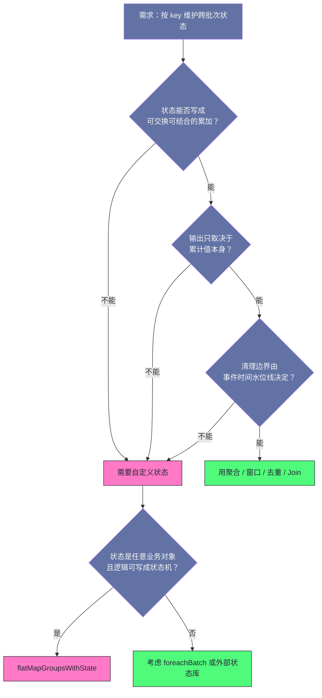
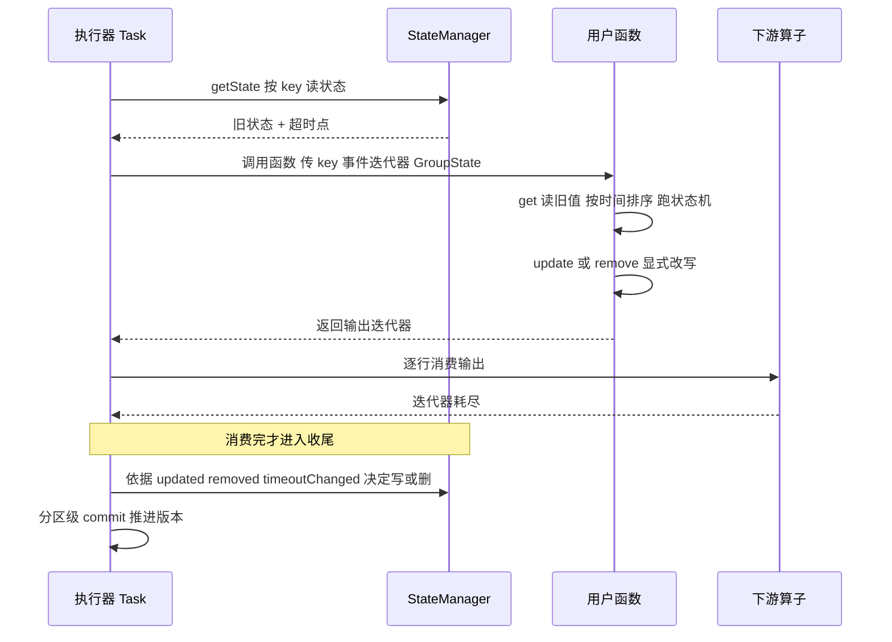
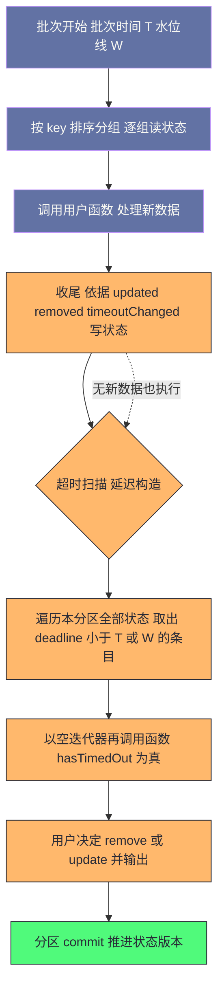
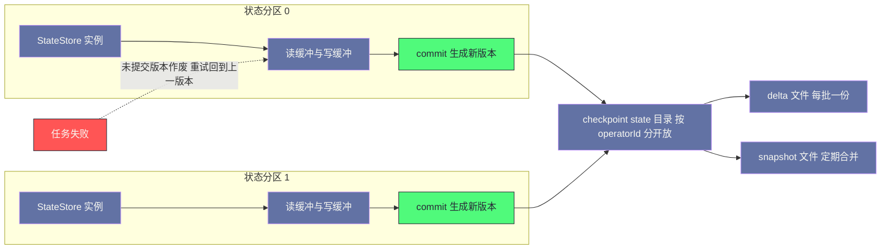
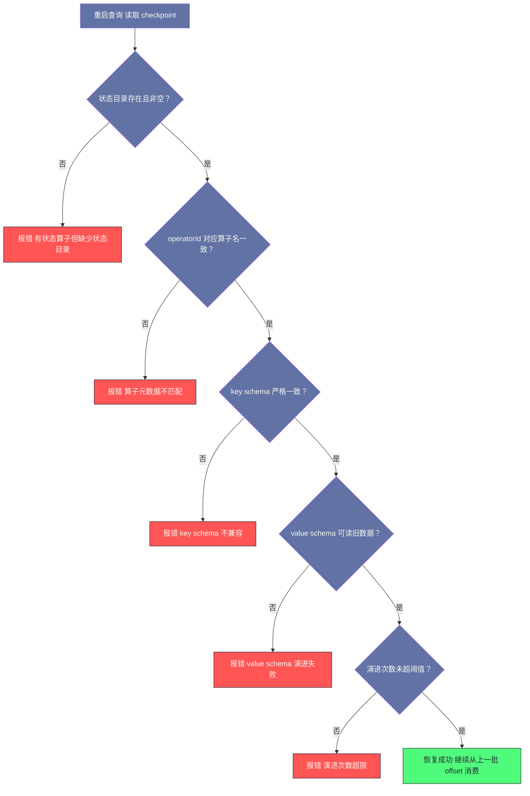

# 07 flatMapGroupsWithState：任意有状态逻辑的终极武器

**摘要：**

Structured Streaming 的内置有状态算子——窗口聚合、去重、流-流 Join——覆盖了绝大多数"按 key 累计"的需求，但它们的状态结构由引擎定义，用户只能选聚合函数与时间窗，无法表达"先看到小额试探、再看到大额消费才告警"这类依赖事件序列与相对时间间隔的判断。`flatMapGroupsWithState`（及其前身 `mapGroupsWithState`）就是为这类需求留出的出口：每个分组携带一个用户自定义的状态对象，每次有该组数据时调用用户函数，由用户决定读什么、写什么、什么时候删、什么时候超时。它把状态的所有权从引擎交给业务代码，也把状态大小、状态清理、状态兼容性这三项责任一并交了出去。

本文沿五问推进：先界定内置算子的表达力边界与自定义状态的判据；再拆开两个算子的签名差异，说明输出行数与输出模式的双重约束为何构成最常见的分析期报错；接着逐条过 `GroupState` 的接口契约，讲清"更新是显式的"这一条与"自动保存"的直觉差在哪里；然后把两种超时机制的阈值比较、触发时机、以及"超时不等于删除"讲透；最后落到执行内幕、状态序列化与演进、生产反例与边界。全文以 Spark 4.3.0（Scala 2.13）为口径，源码细节以对应版本文档或源码为准。

---

## 第 1 章 内置算子的边界：什么时候必须自己管状态

### 1.1 内置算子的状态长什么样

Structured Streaming 自带的有状态算子可以列成一张很短的清单：带时间窗的分组聚合、无窗口的分组聚合、`dropDuplicates` 系列的去重、以及流-流 Join。它们共享同一个特征——状态的结构由引擎在规划阶段定死，用户能改的只有两件事：聚合函数是什么、时间窗怎么切。

聚合的状态是一个累加器。以 `sum(amount)` 为例，每个 key（含窗口）对应一个 `UnsafeRow`，里面躺着中间值；`count`、`min`、`max`、`avg`、`collect_list` 都是同一形态，区别只在累加器的类型与合并规则。去重的状态是一个键集合，元素是去重列组成的元组。Join 的状态是两侧的缓冲区，元素是带事件时间的整行数据。这三种状态都不是用户定义的对象，用户也无法在批次之间对它们做条件判断——没有哪个 API 提供"读出这个 key 的累加器、看看它像不像欺诈、然后决定改写哪几个字段"的能力。

因此判断一个需求能不能用内置算子表达，可以先问三个问题：

- 状态能否写成"可交换、可结合"的累加？顺序不影响结果的，能；顺序决定结果的，不能。
- 输出是否只取决于该 key 的累计值？只取决于累计值的，能；取决于"上一次发生了什么"的，不能。
- 状态的清理边界是否由事件时间的水位线决定？由水位线推进决定关闭的，能；由"这个 key 自己空闲了多久"决定的，不能。

三条里有一条答"不能"，内置算子基本就到头了。

### 1.2 一个贯穿全文的例子

笔者用一个支付风控会话贯穿全文，它的输入是一条事件流，每条事件带设备标识、事件类型、金额、事件时间：

```scala
case class Event(deviceId: String, kind: String, amount: Double, ts: Long)
// kind: login / probe（小额试探）/ pay（支付）/ refund（退款）
```

业务方给出三条规则：R1，同一设备在 10 分钟内先出现小于 10 元的试探、再出现大于 1000 元的支付，判定为疑似盗刷并即时告警；R2，设备超过 30 分钟没有任何事件，视为会话结束，输出一条会话摘要；R3，会话内连续三次支付失败，把设备标记为高风险，后续事件持续带上这个标记。

三条规则各自踩中一个判据。R1 需要记住"最近一次试探的时间与金额"，并且在看到支付时做一次相对时间差判断——这是**顺序加相对间隔**，不是窗口。R2 的空闲判定以该设备最后一条事件为起点，而水位线是全查询共享的进度，别的设备在灌数据并不会让某台静默设备"结束会话"，两者不是一回事。R3 需要读旧状态再决定新状态，而聚合函数只拿到"输入行"，拿不到"这个 key 上一次的输出"。

### 1.3 拿内置算子硬凑会怎样

不引入自定义状态，这三条规则都有看似可行的替代写法，但每一种都会在某个边界上失效。

先看 R1 用固定窗口硬凑：按 `window(ts, "10 minutes")` 分组，再 `agg(collect_list(struct(kind, amount, ts)))`，然后在 `foreachBatch` 里遍历列表找"试探后接大额"。它在窗口边界上直接漏判：试探发生在 12:07、支付发生在 12:12，两条事件分属 [12:00,12:10) 与 [12:10,12:20) 两个窗口，永远不会进入同一个分组。把窗口改成滑动窗口并加大重叠可以缓解，但重叠意味着同一对事件被重复判断，还要在告警侧去重；而滑动窗口的状态条目数按"每个事件落入多少个窗口"放大，内存代价随重叠系数线性上升。

再看顺序问题。分组函数拿到的迭代器是无序的，聚合函数里 `collect_list` 的拼接顺序取决于 Shuffle 后的读入顺序，同一批数据重跑一次就可能得到不同的列表。把"先小额后大额"的判断建立在无序列表上，等于把正确性寄托在执行顺序上。

最后看用两条流 Join 表达 R1：把试探事件过滤成一条流、把大额事件过滤成另一条流，按 `deviceId` 做带时间范围的 Join。这个方案在语义上能跑通，代价却完全换了一个量级：Join 的状态是两侧的原始行缓冲，10 分钟范围内有多少条事件就要存多少条，而 R1 真正需要的只是"最近一次试探的时间戳与金额"这两个标量。同样一批数据，前者每个 key 存一个几百字节的摘要，后者要存几百行的原始记录。更重要的是，Join 输出的是"配对结果"，它不表达状态转移——R3 那种"连续三次失败后进入高风险并持续带标记"的语义，用 Join 拼不出来。

> [!info] 判据的另一种说法
> 内置算子的状态是"引擎替你想好的最小充分统计量"，自定义状态则是"你自己认为足够的那份摘要"。前者覆盖常见模式，代价是模式之外的表达力；后者覆盖任意逻辑，代价是摘要的取舍、大小、生命周期全由你负责。

### 1.4 它到底是什么

`flatMapGroupsWithState` 是 `Dataset` 上的一个分组算子：先按 key 把流分组，再对每个分组维护一份**跨批次存活**的状态，每次该分组有数据到达时调用用户函数，函数可以读取状态、改写状态、删除状态，并输出零到多行结果。

把它和 `groupByKey(...).flatMapGroups(...)` 对照着看更容易理解：后者对每个分组调用一次函数、返回一个结果迭代器，函数结束分组就结束，什么也不留下；前者在函数之外多了一层状态存储，函数返回的迭代器消费完之后，状态的变更才随批次一起提交，下一个批次同一个 key 再来数据时，读到的是上一次提交后的状态。状态存储本身不是用户可见的对象，用户只拿到一个 `GroupState[S]` 句柄，所有读写都要经过它。

这个算子在官方文档里的名分几经变化。`mapGroupsWithState` 在 Spark 2.2 引入，一次调用只能产出一行；2.3 补上 `flatMapGroupsWithState`，把"零到多行"这条路接通，此后它长期是有状态流处理里唯一的"任意逻辑"出口。到 4.0，文档把 `mapGroupsWithState` 与 `flatMapGroupsWithState` 一并称为 legacy 算子，推荐的替代品是新的 `transformWithState`。不过 legacy 不等于不可用，这两个算子在 4.3 的 API 里仍然完整保留，方法签名没有标注废弃，本章之后的所有机制也仍然适用于存量作业。

下图把"该不该用它"的判断路径画出来，三条判据按顺序问下去，任何一条落到"不能"，就离开内置算子的地盘。



### 1.5 代价在前，能力在后

如果说内置算子是为标准尺寸货物准备的集装箱，装卸快、堆场规则统一，代价是货必须切成标准尺寸；自定义状态则是自备货箱，形状随货而定，但报关、堆存、保险全得自己办。集装箱的标准化对应引擎定义好的累加器结构，自备货箱的自由度对应 encoder 编码的用户对象。

把状态的所有权拿过来，同时也接下了三份账单。第一份是空间：状态条目数等于活跃 key 数，状态字节数等于条目数乘以单条摘要的大小，这个乘积没有上限，只有超时机制能给它封顶。第二份是时间：每个批次要把该分区内所有 key 的状态读出来、改完写回去，提交时还要把变更落成 checkpoint 文件，状态越大，批次尾部的提交时间越长。第三份是兼容：状态被编码成二进制躺在 checkpoint 里，作业升级时如果状态类型变了，恢复就会失败，而且失败的形态往往出现在"上线之后第一次重启"这个最不该出事的时刻。

三份账单里，前两份是运行期的，可以靠监控和调参缓解；第三份是发布期的，只能靠事前的设计纪律规避。这也是为什么后文要把状态演进单列一章——它不是边缘话题，而是这套机制最容易被低估的成本。

---

## 第 2 章 两兄弟的分岔：一次调用输出几行

### 2.1 签名上的差别只有一处

两个算子都在 `KeyValueGroupedDataset` 上，都要先 `groupByKey` 拿到分组视图。核心签名如下：

```scala
// 每次调用恰好产出一行；输出模式在算子内部固定为 Update
def mapGroupsWithState[S: Encoder, U: Encoder](
    timeoutConf: GroupStateTimeout)(
    func: (K, Iterator[V], GroupState[S]) => U): Dataset[U]

// 每次调用产出 0 到多行；输出模式由调用方指定
def flatMapGroupsWithState[S: Encoder, U: Encoder](
    outputMode: OutputMode,
    timeoutConf: GroupStateTimeout)(
    func: (K, Iterator[V], GroupState[S]) => Iterator[U]): Dataset[U]
```

差别看起来只是 `U` 与 `Iterator[U]`，落到实现上是一行包装：`mapGroupsWithState` 把用户函数包成 `Iterator(func(key, it, state))`，再复用同一个逻辑计划节点，只是把 `isMapGroupsWithState` 标为 `true`。因此两者的状态存储、超时、编码器、提交协议完全一致，唯一分岔在输出侧。

输出侧的差别决定了两者的适用形态。告警、异常检测、只对少数事件感兴趣的过滤型逻辑，天然是"大多数 key 返回空迭代器"，用 `flatMapGroupsWithState` 才不必为了维持"每批一行"而输出占位行；实时看板、每个 key 每批都要刷新一行指标的，用 `mapGroupsWithState` 更直接。

### 2.2 `mapGroupsWithState` 的三处硬编码

第一处硬编码在输出模式。`mapGroupsWithState` 内部把逻辑节点的输出模式写成 `Update`，且不接受调用方传模式。这意味着查询级输出模式必须是 Update，写成 Append 会在分析阶段失败，报错文本是 `mapGroupsWithState is not supported with Append output mode on a streaming DataFrame/Dataset`。

第二处硬编码在输出行数。函数的返回值类型是 `U` 而不是 `Iterator[U]`，所以"这一批这个 key 什么都不用说"在类型上就无法表达，只能返回一个占位对象。设计告警逻辑时这一点很别扭：为了满足类型，你要么输出空告警结构并在下游过滤，要么放弃这个算子。

第三处是超时语义的连带约束。超时触发时函数同样被调用一次，也照样必须返回一行；如果这一行表示"会话结束"，`mapGroupsWithState` 恰好顺手；如果它表示"告警"，那"会话正常结束"也会被迫产出一条假告警。

### 2.3 分析期的输出模式检查

`flatMapGroupsWithState` 允许 Append 与 Update，但"允许"不等于"随便"：算子内部声明的输出模式必须与查询最终写出的模式一致，这条一致性由分析期的 `UnsupportedOperationChecker` 逐条校验，对不上就抛 `AnalysisException`。把常见组合列出来，报错文本几乎可以背下来：

| 算子 | 算子内声明的模式 | 查询写出模式 | 结果 |
|---|---|---|---|
| `mapGroupsWithState` | 固定 Update | Update | 通过 |
| `mapGroupsWithState` | 固定 Update | Append | 报错：`mapGroupsWithState is not supported with Append output mode` |
| `flatMapGroupsWithState` | Append | Append | 通过，且下游可接聚合 |
| `flatMapGroupsWithState` | Update | Update | 通过，但查询内不能有聚合 |
| `flatMapGroupsWithState` | Append | Update | 报错：`flatMapGroupsWithState in append mode is not supported with Update output mode` |
| `flatMapGroupsWithState` | Update | Append | 报错：`flatMapGroupsWithState in update mode is not supported with Append output mode` |
| `flatMapGroupsWithState` | Update | —（查询内含聚合） | 报错：`flatMapGroupsWithState in update mode is not supported with aggregation` |
| `flatMapGroupsWithState` | Append / Update | Complete | 报错：Complete 与自定义状态不相容 |

"编译期困惑"多数出在表里第 6、7 行的附近：开发者记得"Append 只支持 flatMapGroupsWithState"，于是一路 Append；过两天为了在算子后接一个 `groupBy().agg()`，把算子内的模式改成 Update 忘了改写出模式，报错就出现了。反过来，先写了 Update 查询、又想在下游聚合，也会撞上第七行。

### 2.4 Append 模式的下游契约

Append 之所以能与下游聚合共存，是因为它给出了一条可依赖的承诺：进入结果表的行只出现一次，不会被撤回或改写。下游聚合因此可以按增量方式累加。Update 模式每批都可能重发同一个 key 的新版本，下游若要聚合，就必须定义"旧版本如何被新版本覆盖"，这在流式语义里没有通用答案，所以直接不支持。

Append 的承诺还有一条容易忽略的尾巴：`flatMapGroupsWithState` 的物理算子把输出水位线返回为"无"。源码里这个方法只有一行，注释说明了理由——用户函数太自由，输出行是否绑定到事件时间完全无法推断，引擎不敢替它宣称"输出的水位线推进了"。后果是这个算子之后的算子拿不到可传播的水位线，有状态算子的正确性检查因此拒绝在它之后再接有状态算子（Append 下也一样）。这也解释了为什么文档建议把多条有状态逻辑拆成多个查询，每个查询只放一个有状态算子。

除了下游限制，Append 对算子自身的数量也有规定：多个 `flatMapGroupsWithState` 只有在全部使用 Append 时才允许共存；`mapGroupsWithState` 不允许出现两个，也不允许与 `flatMapGroupsWithState` 混用。这些限制写在分析器里，报错信息都能直接定位。

### 2.5 选择矩阵

把能力与约束放在一起，选择其实只剩几种组合：

| 场景 | 输出要求 | 推荐算子 | 输出模式 | 备注 |
|---|---|---|---|---|
| 实时风控告警，大多数设备无异常 | 只在命中规则时输出 | `flatMapGroupsWithState` | Append | 空迭代器即"无话可说" |
| 会话结束输出摘要，会话中不输出 | 只在超时输出 | `flatMapGroupsWithState` | Append | 超时分支返回摘要，正常分支返回空 |
| 每个活跃设备每批刷新一行指标 | 每批一行 | `mapGroupsWithState` | Update | 类型上强制返回一行 |
| 自定义状态之后还要做聚合 | 追加后聚合 | `flatMapGroupsWithState` | Append | 下游不能再有其他有状态算子 |
| 需要把一次状态转移展开成多行明细 | 一对多 | `flatMapGroupsWithState` | Append 或 Update | 注意下游模式一致性 |
| 只是去重或计数 | 内置能力即可 | 聚合 / 去重 | Append / Update | 不必引入自定义状态 |

---

## 第 3 章 `GroupState` 的契约：显式更新、显式删除

### 3.1 接口全貌

`GroupState[S]` 的公开方法不多，但每个都带着强契约，违反契约的后果在运行期才显现：

| 方法 | 语义 | 违反契约的后果 |
|---|---|---|
| `exists` | 该 key 当前是否有状态 | 无 |
| `get` | 取状态值 | 状态不存在或已被删除时抛 `NoSuchElementException` |
| `getOption` | 取状态，安全版本 | 无 |
| `update(newState)` | 覆盖状态值，不存在则创建 | 传 `null` 抛 `IllegalArgumentException` |
| `remove()` | 删除状态 | 删除后 `get` 抛异常、`exists` 转 false |
| `hasTimedOut` | 本次调用是否由超时触发 | 未启用超时时恒为 false |
| `setTimeoutDuration(ms \| String)` | 设置处理时间超时 | 未启用 `ProcessingTimeTimeout` 时抛 `UnsupportedOperationException`；时长非正抛 `IllegalArgumentException` |
| `setTimeoutTimestamp(ms \| Date, additionalDuration)` | 设置事件时间超时点 | 未启用 `EventTimeTimeout` 时抛异常；时间戳不晚于当前水位线时抛异常 |
| `getCurrentWatermarkMs()` | 当前水位线 | 查询未定义 watermark 时抛异常 |
| `getCurrentProcessingTimeMs()` | 当前批次的处理时间 | 无；同一批次内为常量，任务重试也不变 |

需要先纠正一处常见的记忆偏差：4.x 的 `GroupState` 里没有 `isTimingOut`，也没有 `hasTimedOut` 的同义别名。`isTimingOut` 在 2.3 就被 `hasTimedOut` 取代，4.x 的 API 里已经看不到它；照着旧博客写代码会在编译期直接失败。

### 3.2 更新是显式的

这是整个算子最容易被误读的一条契约：读到的旧状态**不会自动写回**，只有调用 `update` 或 `remove`，状态才会发生变化。如果函数只是 `get` 出来看了看、算了算、然后原样返回，本次调用不会对状态产生任何影响。

可以把 `GroupState` 想成一本登记簿：翻看不会改变任何记录，只有落笔（`update`）或撕页（`remove`）才留痕，而且这本簿子要到当天业务结束、也就是输出迭代器被消费完之后才归档。技术上的限定是，归档按分区批量执行，一次任务失败会让整批未归档的修改一起作废。

实现层面，`GroupStateImpl` 只维护三个布尔量：`defined`（当前是否有值）、`updated`（本次调用是否改写过值）、`removed`（本次调用是否删除过），再加上一个 `timeoutTimestamp`。函数返回的迭代器被完整消费之后，执行器的收尾逻辑按下面的顺序决定写不写：

```scala
// FlatMapGroupsWithStateExec 中状态落库的判定
if (groupState.isRemoved && !groupState.getTimeoutTimestampMs.isPresent()) {
  stateManager.removeState(store, stateData.keyRow)     // 只删状态，不留超时标记
} else {
  val currentTimeoutTimestamp = groupState.getTimeoutTimestampMs.orElse(NO_TIMESTAMP)
  val hasTimeoutChanged = currentTimeoutTimestamp != stateData.timeoutTimestamp
  val shouldWriteState = groupState.isUpdated || groupState.isRemoved || hasTimeoutChanged
  if (shouldWriteState) {
    val updatedStateObj = if (groupState.exists) groupState.get else null
    stateManager.putState(store, stateData.keyRow, updatedStateObj, currentTimeoutTimestamp)
  }
}
```

三个条件缺一不可：改过值、删过状态、或者改过超时点，三者任一成立才落盘。这解释了两种常见故障：其一，函数里对取出的 `case class` 做了 `copy` 却忘了 `update`，下一批读到的仍是旧值，表现为"状态怎么都不生效"；其二，超时回调里既不 `update` 也不 `remove`，状态原封不动留在库里，而它的超时点仍在过去，于是下一批又被判超时，函数被反复调用。

`remove()` 之后调用 `update()` 是合法的，语义上等于"先删后建"，`exists` 会重新变回 true。但反过来，`remove()` 之后调 `get()` 会抛异常，所以函数里若要在删除后继续用值，必须先把值取出来存到局部变量。

### 3.3 迭代器的三条纪律

用户函数收到的 `Iterator[V]` 有三条纪律，冒犯任何一条都会得到难以排查的错误结果。

第一条，**只能消费一次**。它是 Shuffle 之后逐行反序列化出来的流式迭代器，不是集合。两次 `foreach` 第二次什么也拿不到；想复用就必须先 `toSeq` 落到内存，而这一步会把该 key 本批次的所有事件物化，大 key 会直接推高堆内存。

第二条，**顺序不保证**。文档明确写了迭代器里元素的顺序没有保证，既没有按事件时间排，也没有按到达顺序排。要做状态机转移，必须先按业务时间排序，这既是正确性要求，也是"为什么 `flatMapGroupsWithState` 常见的写法里总有一个 `sortBy`"的答案。排序的代价是物化，于是又回到第一条的约束。

第三条，必须在返回前决定输出。函数返回的迭代器是惰性消费的，Spark 会一边消费一边把输出的行交给下游，等到消费完才执行状态落库。若用户在函数里把迭代器交给别的线程、或者在返回后才去改 `GroupState`，行为未定义。更稳妥的写法是先在函数体内把要输出的行收集到缓冲区，最后统一返回 `buffer.iterator`，这样状态更新与输出构造都发生在函数返回之前，边界清晰。

### 3.4 状态类型与编码器

状态类型 `S` 必须能被 `Encoder` 编码成 Spark SQL 类型。实践上这意味着 `case class`、基本类型、`Option`、`Seq`、`Map`、嵌套的 `case class` 都可以，而任意带行为、带非公开字段、带不可序列化引用的对象不行——即便 Kryo 能序列化，`Encoder` 这一关也过不去。

这一点直接决定了状态在磁盘上的形态：状态不是 Java 对象，而是 encoder 编码后的 `UnsafeRow`。`case class` 的字段顺序与类型就是状态 schema，字段名只是可读性装饰。第 6 章讲演进时，这个事实会成为所有结论的起点。

编码器通常不需要显式写，`import spark.implicits._` 之后 `case class` 的隐式编码器会被推导出来。但有一类情况值得显式声明：状态类型里嵌套了泛型或 `Option[Seq[...]]` 这类组合，推导偶尔会给出与预期不同的 schema，显式写一个 `Encoders.product[RiskState]` 能让 schema 稳定下来，避免"代码没改、schema 变了"的意外。

### 3.5 修正后的完整实现

把前面的契约落到风控会话上，代码大致如下。注意几个刻意的选择：超时分支先取旧值再删除、事件先排序再跑状态机、每次调用都重设超时、没有待跟踪信息时主动删除状态。

```scala
import org.apache.spark.sql.streaming.{GroupState, GroupStateTimeout, OutputMode}

// 状态：只保留规则需要的标量，不存历史事件
case class RiskState(
    lastTs: Long,
    eventCount: Long,
    probeTs: Option[Long],
    probeAmount: Double,
    failStreak: Int)

case class Alert(deviceId: String, reason: String, ts: Long)

def trackRisk(
    deviceId: String,
    events: Iterator[Event],
    state: GroupState[RiskState]): Iterator[Alert] = {

  // 超时调用：没有新事件，先把旧值取出，再删状态，最后用它构造摘要
  if (state.hasTimedOut) {
    val expired = state.getOption
    state.remove()
    return expired
      .map(s => Alert(deviceId, s"SESSION_CLOSED events=${s.eventCount}", s.lastTs))
      .iterator
  }

  var st = state.getOption.getOrElse(RiskState(0L, 0L, None, 0.0, 0))
  val out = scala.collection.mutable.ArrayBuffer.empty[Alert]

  // 迭代器顺序无保证，按事件时间排序后再跑状态机
  events.toSeq.sortBy(_.ts).foreach { e =>
    st = st.copy(lastTs = e.ts, eventCount = st.eventCount + 1)
    e.kind match {
      case "probe" if e.amount < 10.0 =>
        st = st.copy(probeTs = Some(e.ts), probeAmount = e.amount)
      case "pay" if e.amount > 1000.0 &&
          st.probeTs.exists(t => e.ts - t <= 10 * 60 * 1000L) =>
        out += Alert(deviceId, "PROBE_THEN_LARGE_PAY", e.ts)
        st = st.copy(probeTs = None, probeAmount = 0.0)   // 消费掉这次试探，避免重复告警
      case "pay_fail" =>
        st = st.copy(failStreak = st.failStreak + 1)
        if (st.failStreak >= 3) out += Alert(deviceId, "FAIL_STREAK", e.ts)
      case "pay_ok" =>
        st = st.copy(failStreak = 0)
      case _ =>
    }
  }

  // 显式写入 + 显式重设超时；没有可跟踪的信息就主动清理
  if (st.probeTs.isDefined || st.failStreak > 0) {
    state.update(st)
    state.setTimeoutDuration(30 * 60 * 1000L)
  } else {
    state.remove()
  }
  out.iterator
}

val alerts = events
  .as[Event]
  .groupByKey(_.deviceId)
  .flatMapGroupsWithState[RiskState, Alert](
      outputMode = OutputMode.Append,
      timeoutConf = GroupStateTimeout.ProcessingTimeTimeout)(trackRisk)
```

这段代码里有一处值得单独说明：探测规则命中后把 `probeTs` 置空。若不清空，后续每来一笔大额支付都会重新命中同一次试探，同一次试探被反复计费成多条告警。这是"状态是摘要而不是日志"的直接体现——摘要被消费之后要主动失效，否则它会被反复读取。

下面的时序图把一个 key 从读状态到写状态的生命周期摊开，虚线是惰性消费的边界：只有输出迭代器被消费完，收尾逻辑才执行。



---

## 第 4 章 超时：两种时钟与两个阈值

### 4.1 不设超时等于永不清账

自定义状态没有"引擎自动清理"这回事。窗口聚合的状态会随水位线推进被丢弃，去重的状态在有 watermark 时随水位线清理，没有 watermark 时同样会一直增长，而 `flatMapGroupsWithState` 的状态只有在函数里调用 `remove()`、或设置超时后由超时回调驱动 `remove()`，才会从存储里消失。

不清理的后果不是"多占一点空间"这么轻。状态条目数等于历史上出现过的 key 总数而不是当前活跃 key 数，一个按设备分组的作业跑上一个月，只要设备不重复，状态就会**单调增长**；每个批次都要把这些条目读一遍、提交时把变更写成 checkpoint 文件，于是批次尾部时间随运行时长缓慢爬升，直到某个凌晨触发 checkpoint 超时或执行器 OOM。从监控上看，症状是 `commitTimeMs` 与批次时长同步上涨，而输入速率并没有变化。

超时机制就是为这件事设计的：给每个 key 记录一个截止时间点，当批次时间或水位线越过这个点，引擎以"没有数据"的方式再调用一次用户函数，并把 `hasTimedOut` 置为 true，由用户决定删除还是更新。

两种超时的差别，好比墙上的挂钟与信件上的邮戳：挂钟决定你什么时候去收发室看信，邮戳决定这封信本身属于哪个时间。前者受运行节奏支配，后者受数据携带的时间支配。

### 4.2 处理时间超时

`GroupStateTimeout.ProcessingTimeTimeout` 的超时点是一个绝对时间戳，但它的来源是批次时间而不是用户调用 `setTimeoutDuration` 那一刻的墙钟时间：`GroupStateImpl` 里执行的是 `timeoutTimestamp = durationMs + batchProcessingTimeMs`，`batchProcessingTimeMs` 是本次触发的时间，整批一致，任务重试也不变。

判定发生在每个批次的状态扫描里，阈值是当前批次时间，条件是严格小于：`timeoutTimestamp < batchTimestampMs` 才算超时。因此有两条推论。其一，超时的**精度等于触发间隔**而不是设置时指定的时长，设了 30 分钟，实际触发落在"最后写入后的 30 分钟到 30 分钟加一个批次间隔"之间。其二，没有批次就没有超时，若上游长时间无数据、触发间隔又很长，超时会被推迟到下一次批次开跑。

这一点与"空批次"机制相互作用。默认配置下 Spark 允许运行没有新数据的批次，目的正是让有状态算子处理超时；`flatMapGroupsWithState` 在处理时间超时下对这个问题的回答是"永远需要再跑一批"，于是驱动端会周期性地起空批次，把到期状态扫出来。若把 `spark.sql.streaming.noDataMicroBatches.enabled` 关掉，空批次不再产生，超时只能等下一批真实数据到达时才被处理，空闲期的状态清理就停滞了。

处理时间超时的语义弱点也在这里：它读的是系统时钟，时钟回拨、时区调整、容器漂移都会影响判定；更关键的是它不可重放——同一份历史数据补跑两次，超时触发的位置会因运行速度不同而不同，输出也就不同。

### 4.3 事件时间超时

`GroupStateTimeout.EventTimeTimeout` 的超时点由用户通过 `setTimeoutTimestamp` 给出，判定阈值是当前水位线，条件是 `timeoutTimestamp < eventTimeWatermarkForEviction`。水位线推进多少，超时就追多少，与系统时钟无关。

这个模式有三条硬约束。第一，查询必须先 `withWatermark`，否则分析期直接报错 `Watermark must be specified in the query ... for using event-time timeout`；即便绕过分析期，运行期取水位线也会抛异常。第二，设置的时间戳不能早于当前水位线，`GroupStateImpl` 会显式校验并抛 `IllegalArgumentException`，理由是"早于水位线的截止点意味着状态本该已经被清理"，允许设置只会制造语义混乱。第三，事件时间超时下，Spark 会在调用用户函数之前过滤掉事件时间早于水位线的迟到数据。第三条常被忽略：它意味着晚到的行根本不会进入状态函数，也不会产生输出，静默丢弃。

事件时间超时还有一个首批陷阱。水位线是在批次末尾传播的，所以第一个微批里 `getCurrentWatermarkMs()` 返回 0。若照着"水位线加 30 分钟"的写法设置超时，首批算出来的截止点是 1970-01-01 00:30，而真实数据的事件时间是当下，第二批水位线一跳，这个 key 立刻满足"截止点小于水位线"，状态被立即清理，会话摘要提前输出。正确写法是基于事件自身的时间戳加时长，而不是基于首批的水位线。

```scala
// 事件时间超时：以最后一条事件的事件时间为基准，而不是以首批水位线为基准
val df = events.withWatermark("ts", "10 minutes")

def trackRiskEventTime(
    deviceId: String,
    rows: Iterator[Event],
    state: GroupState[RiskState]): Iterator[Alert] = {
  if (state.hasTimedOut) {
    val expired = state.getOption
    state.remove()
    return expired.map(s => Alert(deviceId, "SESSION_CLOSED", s.lastTs)).iterator
  }
  // 此处省略 R1 到 R3 的规则处理，只看超时基准怎么取
  var st = state.getOption.getOrElse(RiskState(0L, 0L, None, 0.0, 0))
  var lastSeen = st.lastTs
  rows.toSeq.sortBy(_.ts).foreach { e => st = st.copy(lastTs = e.ts); lastSeen = e.ts }
  state.update(st)
  // 截止点必须不早于当前水位线，故用事件时间推进
  state.setTimeoutTimestamp(lastSeen + 30 * 60 * 1000L)
  Iterator.empty
}
```

这段代码里 `setTimeoutTimestamp` 用 `lastSeen` 而不是 `getCurrentWatermarkMs()`，同时满足了"不早于水位线"的校验——因为迟到数据已被过滤，`lastSeen` 必然不早于水位线。

事件时间超时的可重放性来自水位线的确定性：同一份数据、同样的水位线推进，超时触发点固定，补跑历史数据与实时跑得到相同结果。代价是它对数据到达的依赖更强——水位线不动，超时永远不触发。如果上游某个分区长时间没有新数据、或者某条流被限速，水位线会停在那里，所有基于事件时间的清理一起停摆。

### 4.4 超时不等于删除

这是本章最需要强调的一条。超时只是"再调用一次函数"的**触发器**，删不删由函数决定。函数若在 `hasTimedOut` 分支里既不 `update` 也不 `remove`，前面那段落库判定会得出 `shouldWriteState = false`，状态原样保留，而它的超时点仍然是过去的时间，下一批次扫描又会命中，函数再被调用一次，如此往复。对外表现是：日志里同一批 key 每个批次都打印"超时"，状态条目数不降，`numRemovedStateRows` 一直是零。

还有一种半清理的形态：在超时分支里同时调用了 `remove()` 与 `setTimeoutTimestamp`。此时落库判定走 else 分支，`exists` 为 false，写进去的是一个空值加一个新的超时点，语义上等于"状态值删了，但超时标记还在"，下一批到了新时间点还会再触发一次超时回调。这通常不是使用者想要的结果，但在"删状态值、保留一个稍后输出墓碑"的设计里是有意为之的手段。

### 4.5 同一批次里既有数据又超时

一个 key 完全可能在同一批次里命中两件事：上一批的截止点已经过期，本批又收到了新数据。执行器的处理顺序是数据在前、超时在后，且超时扫描器是延迟构造的——只有数据迭代器被消费完、状态更新写进存储之后，超时扫描才开始。源码注释把这个顺序写得很直白：先更新所有有数据的 key 的超时信息，再统一处理超时。

于是行为可以精确描述：若该 key 的新数据在函数里重设了超时点（`hasTimeoutChanged` 为真），新的截止点在未来，超时扫描扫到它时不满足"小于阈值"，本次不会触发超时回调；若新数据没有改超时点，旧截止点仍在过去，数据先被处理、状态被更新，随后超时回调再以空迭代器调用一次，`hasTimedOut` 为 true。后者对应"上一批就该结束的会话，这一批又来了一条事件"，语义上要把两条逻辑都跑一遍，业务代码必须能处理"刚处理完数据又被通知超时"的组合。

### 4.6 超时扫描的固定成本

启用超时后，每个批次结束时执行器要对本分区的状态做一次全量扫描，把 `timeoutTimestamp` 小于阈值的条目挑出来。这是一笔与"本批有多少新数据"无关的**固定开销**：批次里没有一行数据，扫描照样发生；状态条目越多、单分区越大，扫描越慢。

把两种超时放在一起对照：

| 维度 | 处理时间超时 | 事件时间超时 |
|---|---|---|
| 时间来源 | 批次时间（系统时钟） | 水位线（事件时间进度） |
| 截止点计算 | 批次时间 + 时长 | 用户给定的绝对时间戳 |
| 判定条件 | `deadline < batchTime` | `deadline < watermark` |
| 是否依赖 watermark | 否 | 是，未设置则分析期报错 |
| 迟到数据 | 照常进入函数 | 早于水位线的行被过滤 |
| 空批次 | 算子声明"总需要再跑一批"，默认配置下周期触发 | 仅当水位线推进时才需要再跑 |
| 可重放性 | 差，与运行速度相关 | 好，与数据一致 |
| 时钟异常影响 | 会 | 不会 |
| 精度 | 一个触发间隔量级 | 一个批次加水位线推进量级 |
| 典型用途 | 会话空闲关闭、状态兜底清理 | 事件时间语义的会话、补跑一致性 |

精度可以用一个示例推算说明（示例推算，非实测）：触发间隔 1 秒，批处理耗时 200 毫秒，`setTimeoutDuration(30 分钟)`。最后一条事件在第 N 个批次被处理，该批次时间为 T，截止点为 T+30 分钟；此后每个空批次在约 1 秒后开跑，扫描判定 `T+30min < batchTime`，所以触发落在 T+30 分钟之后 0 到 1.2 秒左右的区间内。把触发间隔改成 10 秒，误差区间就放大到 10 秒量级。这就是"超时精度约等于触发间隔"的实际含义。

下面的图把批次内部的先后顺序画出来，可以看到数据阶段与超时阶段的边界，以及状态写入发生在这两个阶段之间。



---

## 第 5 章 一个批次的执行内幕：从分组到提交

### 5.1 计划形态

逻辑计划上的 `FlatMapGroupsWithState` 节点在物理规划阶段变成 `FlatMapGroupsWithStateExec`。这个算子自己就是状态读写者：它不依赖外层的 restore/save 包装，而是在 `doExecute` 里直接对每个分区取一个状态存储实例，读、算、写一气做完。物理执行的主干是一句 `mapPartitionsWithStateStore`——给每个分区开一个 `StateStore`，把该分区的数据迭代器交进来，剩下的交给算子自己。

计划中每个有状态算子都会拿到一个从 0 开始递增的 `operatorId`，状态目录以它命名，checkpoint 里的算子元数据也以它为键。这个编号按算子在物理计划里出现的顺序分配，是第 6 章那类恢复故障的根源。

### 5.2 分区与排序

分组不是免费的，算子对子节点提出两条要求。其一是分布：数据必须按分组键的哈希均衡到状态存储分区上，分区数等于本次查询的状态存储数，默认继承 `spark.sql.shuffle.partitions`。其二是顺序：子节点输出必须按分组键排序，这样算子才能用一次顺序扫描把同一个 key 的行攒成一个迭代器，读完即丢弃，不必把整批数据物化成分组映射。

排序加哈希分布合起来产生一个直接后果：一个 key 的全部数据落在同一个任务里，即**同 key 同任务**。这是状态一致性的前提——同一 key 的状态只能被一个任务读写，否则并发更新无法协调。它同时也是一条性能约束：key 的分布决定任务负载，某个 key 的数据量远大于其他 key 时，那个任务会成为整批的尾巴。

### 5.3 惰性写与提交

状态的写入是惰性的，这条性质在源码里体现为一个 `CompletionIterator`：用户函数返回的输出迭代器被包装起来，下游每消费一行就向下游发一行，全部消费完之后才执行收尾逻辑，把状态变更写进存储的写缓冲。整个分区跑完之后，算子调用 `store.commit()`，把写缓冲变成一个状态版本，并把变更增量与 checkpoint 目录里的文件对应起来。

这个设计带来两个可观察的行为。批次的 `commitTimeMs` 指标包含提交耗时，与状态变更的条数正相关，而不是与输出行数正相关——一个把大部分 key 都删掉的批次，提交反而可能更重。任务失败时，未提交的版本会作废，重试从上一个已提交版本重新开始；由于状态版本与批次号绑定，重算同一个批次会得到同样的起点，这正是 exactly-once 的基础。

把状态分区的视角铺开，每个分区各自持有一个存储实例，各自提交版本，最后统一落到该有状态算子的 checkpoint 目录下；失败重试时未提交的版本作废，从这个分区的上一个版本重新开始。



### 5.4 两种状态存储实现

默认实现是 `HDFSBackedStateStoreProvider`：状态常驻在 JVM 堆内的哈希表里，每个批次提交时把变更写成 checkpoint 目录下的 delta 文件，积累若干 delta 后合并成 snapshot。它的优点是读路径极快，缺点是**全部状态常驻堆内**，key 数上千万时 GC 压力显著，批次耗时的抖动会变大。

另一条路是 `RocksDBStateStoreProvider`（3.2 起内置）：状态放在 RocksDB 的原生内存与本地磁盘上，提交时把文件上传到 checkpoint 目录，必要时配合 changelog 增量上传。堆压力被挪到堆外与磁盘，代价是每次读写多一次序列化与本地 IO。

| 维度 | HDFSBacked（默认） | RocksDB |
|---|---|---|
| 状态位置 | 执行器 JVM 堆 | RocksDB 原生内存 + 本地磁盘 |
| 读路径 | 内存哈希表，快 | 序列化 + 本地读，略慢 |
| 大批量状态的稳定性 | 差，GC 抖动明显 | 好，堆压力小 |
| checkpoint 写入 | 每批 delta，定期 snapshot | 文件上传，可配合 changelog |
| 运维复杂度 | 低 | 中，需要关注本地盘容量与压缩 |
| 适用规模 | 状态较小、批次耗时稳定优先 | key 数上千万、GC 敏感 |

选择在查询级别生效，通过 `spark.sql.streaming.stateStore.providerClass` 指定，同一查询的所有状态存储共用一种实现。

### 5.5 状态规模与提交时间的关系

状态规模的估算可以拆成三个乘数：活跃 key 数、单条摘要的字节数、以及分区数。用一个示例推算说明（示例推算，非实测）：假设峰值活跃设备 2000 万，每条摘要编码后约 200 字节（两个时间戳、两个计数字段、一个 `Option` 标记、以及少量编码开销），总状态约 4 GB。若状态分区数为 200，每个任务约 20 MB，落在堆内的哈希表加序列化缓冲之后大致是 60 到 100 MB 的瞬时占用，单执行器跑多个任务时这个数字会叠加；若把分区数提到 2000，每个任务只剩 2 MB，但任务数增加、调度与小文件开销上升。

这个乘积还决定 checkpoint 的形态：每批的 delta 只包含变更，规模与"本批有多少 key 发生变化"成正比；snapshot 包含全量，规模与总状态成正比。因此"批次很轻但提交很慢"的一种常见成因是 snapshot 周期到了，与数据量无关。

### 5.6 值得盯的几个指标

`flatMapGroupsWithState` 的进度信息里有一组专门的状态指标，配合 StreamingQueryListener 采集即可：

| 指标 | 含义 | 异常信号 |
|---|---|---|
| `numUpdatedStateRows` | 本批写入或更新的状态条目数 | 长期等于活跃 key 数，说明每批全量改写 |
| `numRemovedStateRows` | 本批删除的状态条目数 | 长期为 0 且状态持续增长，说明超时没生效 |
| `numOutputRows` | 本批输出行数 | 与输入量脱钩时检查是否误判 |
| `allRemovalsTimeMs` | 超时扫描与回调耗时 | 随状态数上涨，说明扫描成本失控 |
| `commitTimeMs` | 分区提交耗时 | 阶梯式上升，检查 snapshot 与状态大小 |
| `numTotalStateRows` | 当前状态条目总数 | 单调上升且无回落，检查 key 空间与超时设计 |

把 `numTotalStateRows` 与输入速率画在同一张图上，能最快看出"状态是否在被正确清理"：正常形态是随活跃设备数波动并趋于平台，异常形态是一条不回头的斜线。

---

## 第 6 章 状态演进：升级作业时最容易翻车的地方

### 6.1 磁盘上到底存了什么

一个 key 的状态在存储里是三元组：分组键的 `UnsafeRow`、状态值的 `UnsafeRow`、以及一个 `Long` 类型的超时点（没有设置时是哨兵值 `-1`）。三者都由 encoder 与内部序列化规则决定，与用户代码里的类定义并非一一对应——类只是生成 schema 的来源。

这条事实推翻了两个常见直觉。第一，改字段名不影响恢复，因为 `UnsafeRow` 按位置存取，**字段名不落盘**。第二，加一个字段一定影响恢复，因为值 schema 变了，旧行里没有这一列。6.3 节会看到，4.x 对"加字段"其实给了兼容通道，但通道有前提。

### 6.2 两道恢复校验

恢复一个有状态查询时，Spark 会先过两道校验，任何一道失败都会在首个批次失败，查询起不来。

第一道是状态 schema 兼容。checkpoint 目录里保存着每个有状态算子的状态 schema 文件，恢复时把当前计划的 key schema 与 value schema 拿出来比对。key schema 必须严格一致，改动分组键的类型或顺序会直接抛不兼容；value schema 在新版本里走 Avro 的 `canRead` 策略校验——新的 schema 能否读懂旧数据。能读懂才允许演进，否则抛 `stateStoreInvalidValueSchemaEvolution` 一类错误；演进本身也有次数上限，超过阈值会抛另一个错误。这条通道解决的是"加字段"这一类变更，但它要求旧数据能被新 schema 解释，删除字段、改变字段类型仍然过不去。

第二道是算子身份匹配。状态目录按 `operatorId` 组织，checkpoint 元数据里记录了每个 `operatorId` 对应的算子名，恢复时逐个比对；对不上就抛 `statefulOperatorNotMatchInStateMetadataError`。这条校验的杀伤面比 schema 更大：只要在计划里插入或删除一个有状态算子，其后所有算子的 `operatorId` 就会**整体错位**，第 0 号状态目录原本属于聚合，现在被新插入的去重算子认领，名字对不上，恢复失败。即便侥幸名字相同，读到的也是别人的状态。

两道校验之外还有一条前置条件：checkpoint 目录下的 `state` 子目录必须存在且非空，否则会抛"有状态算子但缺少状态目录"的错误。手工清理 checkpoint 时删错目录，常在这里暴露。

### 6.3 常见变更的可行性

把工程上真实发生过的变更列出来，结论比想象中保守：

| 变更 | 是否可恢复 | 原因与处理 |
|---|---|---|
| 只改状态字段名 | 可 | 字段名不进入 `UnsafeRow` 的位置语义 |
| 在末尾加一个带默认值的字段 | 通常可 | Avro `canRead` 允许新 schema 读旧数据，但受演进次数阈值约束 |
| 加一个无默认值、且在旧行中缺失的字段 | 不可 | 旧行无法提供该列，解码失败或语义错误 |
| 删除字段 | 不可 | 新 schema 不能读旧数据中的多余列 |
| 改字段类型（如 `Int` 改 `Long`） | 不可 | 编码宽度与解释都变了 |
| 改分组键的类型或顺序 | 不可 | key schema 要求严格一致 |
| 调整分组键的取值（如加前缀） | 表面可恢复，实际语义断裂 | 旧 key 与新 key 不重叠，旧状态成为孤儿 |
| 在计划中新增一个有状态算子 | 不可 | 后续算子 `operatorId` 整体错位，名字校验失败 |
| 删除计划中的有状态算子 | 不可 | 同上，且状态目录残留 |
| 调换两个有状态算子的顺序 | 不可 | `operatorId` 与算子名错配 |
| 修改用户函数但状态类型不变 | 可 | 状态是数据，不是代码 |
| 更换状态存储实现（HDFSBacked 与 RocksDB） | 不可直接切换 | 存储格式不同，需要重建或迁移 |

表中最后两行值得对照着看：**改逻辑安全，改状态形状危险**。这条不对称决定了演进策略的基本方向——把会变的东西放进代码与外部存储，把必须稳定的东西留在状态里。

### 6.4 可行的演进路径

路径一，向前兼容地扩字段。新增字段带默认值、只做追加、不改既有字段的类型与顺序，让新 schema 能读懂旧数据。这条路成本最低，但只适用于"新字段可以从旧数据推出默认语义"的变更，且不宜频繁演进，演进次数阈值会兜住过度设计。

路径二，重建状态。把新版本部署到新的 checkpoint 目录，从上游保留的原始数据（Kafka 的起始 offset、数据湖的原始分区）回放，重新累积状态。代价是回放窗口内的输出会重复，必须保证下游幂等，或者把新旧两个查询的输出按时间切分后再合并。

路径三，双跑切换。新查询并行起跑、只写观测侧，等它的状态追平且输出与旧查询一致后再切主。代价是双份资源与一段并行期，好处是切换可控、可回滚。

路径四，把状态降级成可重建的缓存。状态里只存"从外部可重建"的摘要，真值放在外部存储，状态丢失时按 key 回查重建。这条路径牺牲了一部分延迟，换来状态演进几乎不受约束——它把兼容性问题从 checkpoint 转移到了外部存储的 schema 上。

### 6.5 两个真实形态的反例

第一个反例是"改个字段就发布"。给 `RiskState` 加一个 `riskLevel: Int`，想着"新字段默认 0，应该没事"，直接把新包滚上去重启。结果在首个批次就失败：不是所有版本的兼容通道都覆盖这种变更，即便覆盖，语义上也把历史上所有设备的 `riskLevel` 都读成了 0，而代码里 `riskLevel == 0` 被定义为"未评估"，于是全量设备被当成新设备重算了一遍，输出里出现一波错误的"首次评估"事件。兼容通道只保证"读得出来"，不保证"读出来有意义"。

第二个反例是"顺手加个去重"。风控链路前面加了一个 `dropDuplicates("eventId")` 想压掉重复投递，本地测试通过、上线后重启失败。原因是 `dropDuplicates` 本身是有状态算子，被插在了 `flatMapGroupsWithState` 之前，`operatorId` 重新分配，原来的状态目录被认为属于另一个算子，名字校验直接失败。正确做法是把去重放到上游的独立查询里，或者用无状态的过滤代替。

下面的图把恢复时的决策次序画出来，两道校验的顺序决定了你看到的第一个报错是哪一类。



---

## 第 7 章 生产实践与三则反例

### 7.1 热点 key 与单任务串行

分组键的选择直接决定并行度。一个 key 的所有事件进同一个任务，状态也只能由这个任务读写，因此单个 key 的处理能力，就是一个任务**串行处理的上限**：反序列化、排序、状态机、序列化，全在一个线程里顺序执行。

风控场景里这类热点很常见：某台设备被爬虫脚本刷、某个商户的收单事件占了总量的一成、某个测试设备一直在发心跳。它们不会让作业整体挂掉，而是让批次里出现一条长尾——99% 的任务几十毫秒结束，一个任务跑十几秒，批次的端到端延迟由最长的那条决定。极端情况下长尾任务内存爆掉，整个批次重试，重试后又是同一个长尾。

缓解手段各有代价。给 key 加盐（`deviceId + "#" + (hash % 16)`）能把热点拆成 16 份并行处理，但同一设备的状态被拆成 16 份，跨分片的规则（R1 需要"试探"与"支付"落在同一份状态里）就失效了，必须在输出侧再聚一次，等于把状态机拆成两段。把大 key 的通配规则下沉到无状态过滤（先用无状态 `filter` 拦掉明显不可能的流量），能减轻状态函数的负担而不破坏语义。最根本的办法还是在 key 的设计上做隔离：把设备标识换成"设备 + 商户 + 日"这类更细的粒度，让状态天然分散，代价是跨设备、跨商户的规则要重新定义，等于改一次业务口径。

### 7.2 状态里不要放大对象

状态里每多存一个字段，付出的是三重复利：每批次读写都要序列化与反序列化、每次提交都要写进 delta、每次 snapshot 都要复制全量。存一个 `List[Event]` 保存"最近 1000 条事件"，看起来只是每 key 几十 KB，乘以百万 key 就是几十 GB，且这个成本随运行时间只增不减。

正确的做法是只存判断所需的摘要：计数、最近一次时间戳、有界窗口内的聚合值、布隆过滤器的位图。确实需要保留一段序列时，也必须有硬上限，并在超限时按业务规则裁剪（丢弃最旧的、按时间桶合并、只保留关键事件类型）。

```scala
// 有界摘要：固定长度的事件类型计数，替代无界的 List[Event]
case class BoundedHistory(
    lastTs: Long,
    counts: Map[String, Long],      // 事件类型到次数，键空间有限
    recentProbes: Seq[Long])        // 至多保留最近 8 次试探的时间戳
```

`Map` 的键空间有限、`Seq` 有硬上限，这样的状态大小有确定上界，序列化成本可估。判断一个状态设计是否安全，可以问一句：如果这个 key 连续来一亿条事件，状态会不会变大？答案必须是"不会"。

### 7.3 不要在状态函数里做外部 IO

状态函数在每个任务里同步执行，调用一次外部服务就阻塞一次任务。按 key 计的成本很直观：一个批次 10 万个 key，每个 key 查一次 Redis，假设每次 2 毫秒，仅这一项就是 200 秒的单线程时间，摊到 200 个任务上是每个任务 1 秒，批次时长直接由外部服务的延迟决定。

比性能更严重的是正确性。Spark 的 exactly-once 覆盖的是"从 source offset 到 sink 写入"这条链路，状态函数里的**外部写不在其中**。任务失败重试时，状态会回滚到上一个已提交版本，但已经写进 Redis 的那一次调用不会回滚——同一批事件可能对外部系统写两次。超时回调同样会调函数，空批次也可能触发一批外部调用，这层放大常被忽略。

要做外部查询，有两条更稳的路。其一是把维表变成广播变量或流-流 Join，让关联发生在 Spark 内部，状态函数只做纯计算；其二是把外部写集中到 `foreachBatch`，用幂等 upsert（以业务主键覆盖）、事务或版本号去重来吸收重放。若必须在函数里查，至少要用连接池、批量合并、本地缓存与超时熔断，并把幂等键设计进目标系统。

### 7.4 三则反例

反例一，用自定义状态实现本该用窗口的逻辑。需求是"每 5 分钟按类目统计金额"，有人用 `flatMapGroupsWithState` 自己维护"当前窗口起点 + 累计金额"，在事件时间跨过窗口边界时输出并重置。这个实现能跑，但代价全在细节里：乱序数据跨边界时归属哪个窗口要自己判、窗口状态需要自己按水位线清理、每个 key 每个窗口一个状态条目导致状态条目数按"key 数乘以窗口数"膨胀、Append 语义下重复输出的边界要自己兜。而 `window().groupBy().agg()` 把这些全部交给引擎，状态清理与水位线天然对齐。这里的判据很简单：状态能写成累加、清理能交给水位线，就不该自己管。

反例二，在状态函数里写数据库。每来一批事件就对数据库做一次 `INSERT`，本地小数据量测试毫无问题，上线后先是吞吐被数据库延迟拖垮，随后在任务重试时发现同一批数据被写了两遍，最后在超时回调里对已经不存在的会话又写了一条结束记录。修法是把这个写操作挪到 `foreachBatch`，用一个幂等主键加 `MERGE` 语义，再把状态函数压缩成纯内存计算。

反例三，状态对象无限增长。把"最近 30 天的事件"塞进 `List`，理由是"业务要回溯"。前三天一切正常，第四天开始批次耗时抖动，第七天 checkpoint 从几百 MB 涨到几十 GB，某个执行器 OOM 后任务重试，重试又要读更大的状态，最终整个查询卡在恢复阶段。修法是把回溯需求交给外部存储（明细进数据湖，状态只放摘要），状态里保留有界窗口。

### 7.5 落地清单

把前面几节收敛成一张可执行的检查表：

| 关注点 | 具体做法 | 反例特征 |
|---|---|---|
| 分组键 | 粒度足够细，避免单 key 热点；跨分片规则要么不拆要么补聚合 | 某个任务耗时是其他的百倍 |
| 状态结构 | 只存标量与有界结构，字段数控制在十个以内 | 状态大小随单 key 事件数增长 |
| 超时 | 每次调用都重设；超时分支必须 `remove` 或 `update` | `numRemovedStateRows` 长期为零 |
| 外部依赖 | 状态函数内纯计算；外部读写走广播、Join 或 `foreachBatch` | 任务重试后外部系统出现重复记录 |
| 输出模式 | 算子内部模式与查询写出模式保持一致 | 分析期报"in append mode is not supported with ..." |
| 状态存储 | 状态上千万 key 时切 RocksDB，并盯本地盘容量 | 批次耗时的长尾与 GC 时间同步 |
| 演进预案 | 状态 schema 只做向前兼容扩展；破坏性变更走重建 | 上线重启后首个批次失败 |

---

## 第 8 章 边界：什么时候不该用它

### 8.1 能力与责任的对应关系

`flatMapGroupsWithState` 把状态的所有权交给用户，这句话的另一面是：引擎不再替你决定状态的形状、清理时机与兼容策略。它适合的场景有清晰的轮廓——状态是任意业务对象、转移逻辑依赖事件顺序或相对时间、输出与输入不是一一对应、清理边界由业务空闲而非水位线决定。四条都满足，它几乎无可替代。

它不适合的场景同样清晰。状态本质上是累加、清理边界由水位线决定时，内置算子更省心，而且状态存储与清理策略经过更多生产验证。需要跨 key 的全局视图（譬如按城市维度做排名）时，分组状态表达不了，那属于聚合或外部存储的领域。需要毫秒级延迟时，微批模型本身是瓶颈，自定义状态救不了。需要状态在查询之间共享时，checkpoint 是单查询私有的，共享状态得另找方案。

| 需求特征 | 更合适的选择 |
|---|---|
| 数值累加、计数、去重 | 分组聚合、窗口聚合、`dropDuplicates` |
| 两条流在时间窗口内配对 | 流-流 Join |
| 任意状态机、有序规则、会话摘要 | `flatMapGroupsWithState` |
| 一次输入展开成多行且要跨批记忆 | `flatMapGroupsWithState`（Append） |
| 需要多种状态变量、自动 TTL、定时器 | `transformWithState`（4.x 推荐） |
| 需要在写 sink 时做批量外部操作 | `foreachBatch`（可与上面组合） |
| 需要跨查询共享状态 | 外部存储（Redis、HBase、数据湖） |

### 8.2 4.x 的继任者

`transformWithState` 从 4.0 起成为官方推荐的任意状态算子，文档把它定位为 `mapGroupsWithState` 与 `flatMapGroupsWithState` 的下一代替代品。它把"一个状态对象"换成"一组命名的状态变量"：`ValueState`、`ListState`、`MapState` 各自声明、各自带编码器与 TTL；把"函数式的一次调用"换成面向对象的状态处理器：`init` 里声明状态变量，`handleInputRows` 处理输入，`handleExpiredTimer` 处理定时器，`close` 做清理；把"超时"换成显式注册的定时器，粒度从整组一个截止点变成可以注册多个。

对存量作业而言，这些差别意味着迁移不是改个名字：状态变量的组织方式、超时的表达方式、输出的时机都变了，状态 schema 也不兼容，迁移等同于一次重建。对新建作业而言，选择反而简单：需要多状态变量、TTL、定时器这类能力时用 `transformWithState`；只需要一个摘要对象加一个截止点，`flatMapGroupsWithState` 的模型更小、心智负担更低，且在 4.3 仍然完整可用。Spark 4.3.0 起 `transformWithState` 的 Scala 与 Java API 还支持实时模式触发，这是另一个只有新算子才有的能力。

### 8.3 落点

回看这套机制，它解决的从来不是"能不能算"的问题，而是**谁来承担状态的复杂度**。内置算子把复杂度收进引擎，换来表达力的上限；自定义状态把上限打开，换来三份要自己还的账。判断该用哪一边，本质上是在判断业务的状态转移逻辑是否已经复杂到值得自己管理生命周期——如果规则的形状是"累计"，交给引擎；如果规则的形状是"经过"，自己管。

真正需要警惕的不是选错算子，而是选了自定义状态却按内置算子的习惯去用它：以为状态会自动保存、以为超时会自动清理、以为改了状态类还能无缝恢复。这三条误解各自对应一次线上事故，也各自对应本章之前的一节源码。

---

## 小结

`flatMapGroupsWithState` 是 Structured Streaming 里表达力最强的有状态算子，它的能力来自"状态由用户定义、转移由用户编码、清理由用户决定"这三件事。代价同样来自这三件事：状态大小没有上界、清理必须显式、schema 变更会阻断恢复。

几条可以带走的结论：`mapGroupsWithState` 内部固定 Update 模式且每次必须返回一行，`flatMapGroupsWithState` 的算子内模式必须与查询写出模式一致；`GroupState` 的更新是显式的，不 `update` 就等于不变；超时只是回调触发器，不 `remove` 就会每批重复触发；启用超时后每批都有一次全量状态扫描；状态是编码后的 `UnsafeRow`，key schema 严格不可变，价值 schema 只能向前兼容地演进；计划里插入有状态算子会让 `operatorId` 错位，恢复直接失败。

这些约束看起来琐碎，但它们共同定义了这个算子的使用边界：它适合承载"经过"型业务逻辑，不适合承载"累计"型统计。边界之内，它几乎是唯一的选择；边界之外，内置算子与新的 `transformWithState` 都更省心。

---

## 参考资料

1. [Apache Spark 官方文档：Structured Streaming Programming Guide](https://spark.apache.org/docs/latest/structured-streaming-programming-guide.html)，Arbitrary Stateful Operations 一节（Spark 4.x 已拆分至 `docs/streaming/apis-on-dataframes-and-datasets.md`）
2. Apache Spark 官方文档：Structured Streaming Programming Guide，Output Modes 支持矩阵与 Unsupported Operations 一节
3. Apache Spark 源码：`org.apache.spark.sql.streaming.GroupState`（`sql/api` 模块，含超时与读写契约的完整注释）
4. Apache Spark 源码：`org.apache.spark.sql.KeyValueGroupedDataset`（`mapGroupsWithState` 与 `flatMapGroupsWithState` 的签名与内部包装）
5. Apache Spark 源码：`org.apache.spark.sql.execution.streaming.operators.stateful.flatmapgroupswithstate.FlatMapGroupsWithStateExec`（批次内数据与超时的处理顺序、状态落库判定）
6. Apache Spark 源码：`...flatmapgroupswithstate.GroupStateImpl`（`updated` / `removed` / `timeoutTimestamp` 的内部状态机）
7. Apache Spark 源码：`org.apache.spark.sql.catalyst.analysis.UnsupportedOperationChecker`（输出模式与分析期报错文本）
8. Apache Spark 源码：`org.apache.spark.sql.execution.streaming.state.StateSchemaCompatibilityChecker`（状态 schema 校验与 Avro 兼容演进）
9. Apache Spark 源码：`org.apache.spark.sql.execution.streaming.runtime.IncrementalExecution`（`operatorId` 分配与算子元数据校验）
10. Apache Spark 官方文档：Structured Streaming Programming Guide，TransformWithState 专页（4.0 起的继任算子）
11. [Arbitrary Stateful Processing in Apache Spark Structured Streaming（Databricks Engineering Blog，2017）](https://www.databricks.com/blog/2017/10/17/arbitrary-stateful-processing-in-apache-spark-structured-streaming.html)

---

> [!note] 思考题
> 1. 你的风控作业用处理时间超时做"30 分钟无事件即结束会话"，补跑历史数据时发现同一天的数据跑两次得到不同的会话切分。这个差异的根源在哪个判定条件上？换成事件时间超时后，还有哪些条件会让切分结果与实时跑不同？
> 2. 一个 `flatMapGroupsWithState` 的 `numTotalStateRows` 单调上升且从不回落，`numRemovedStateRows` 长期为零。在超时配置正确、函数里也确实调用了 `remove()` 的前提下，还有哪些原因会造成这个现象？
> 3. 若在现有查询的两个有状态算子之间插入一个新的 `flatMapGroupsWithState`，`operatorId` 会如何变化？为什么即便新算子的 key schema 与原有状态完全无关，恢复仍然会失败？
> 4. 状态里存一个 `Map[String, Long]` 与存一个 `List[String]`，在序列化成本与内存占用上的差别体现在哪些环节？为什么"键空间有限"是判断状态是否安全的关键条件？
> 5. `transformWithState` 提供了多状态变量与显式定时器，`flatMapGroupsWithState` 只有一个状态对象和一个截止点。在什么情况下这个更简单的模型反而是更好的选择？