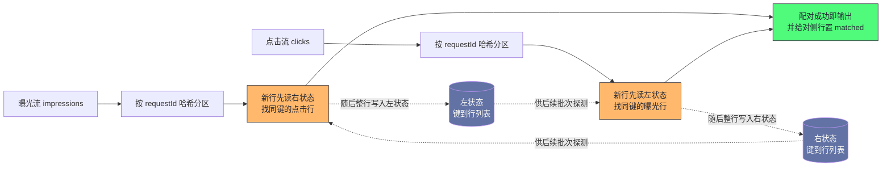
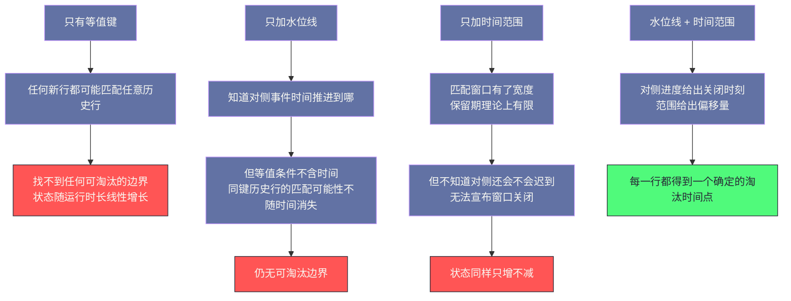
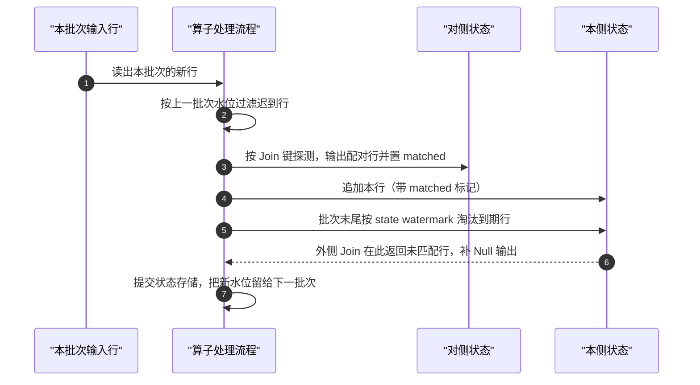
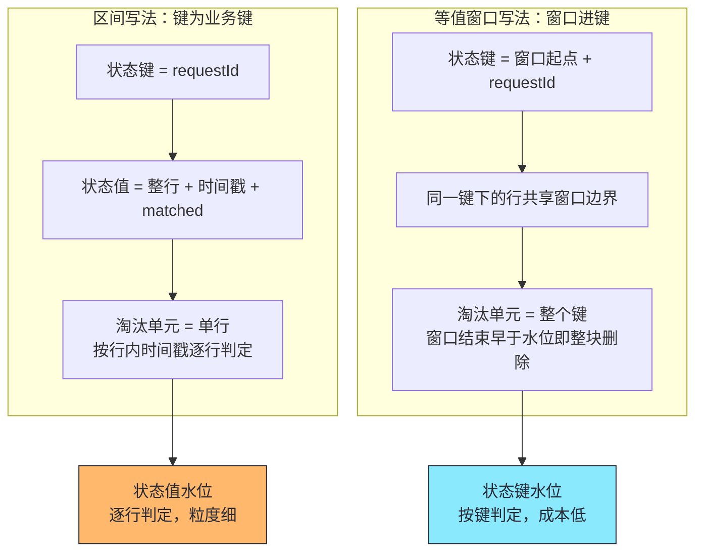
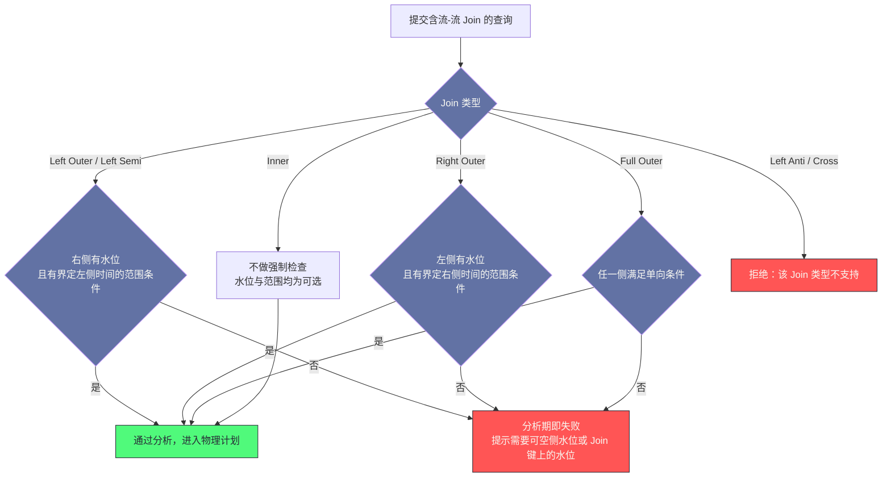
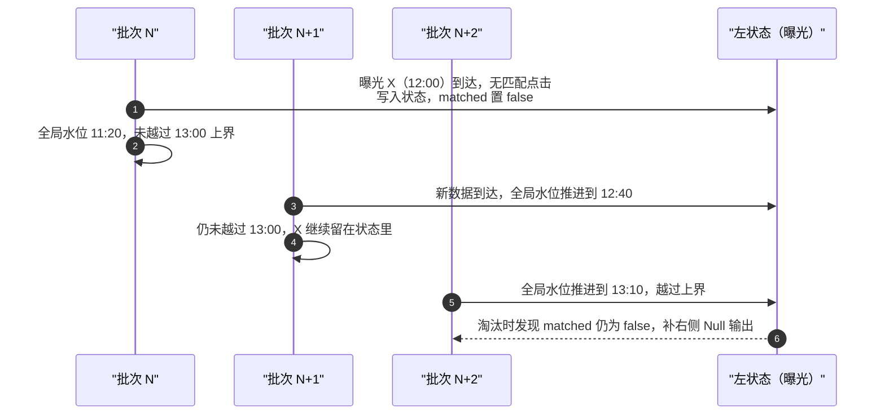

# 08 流-流 Join：两条流如何在时间维度上对齐

**摘要：**

批处理的 Join 有一个从不言明的前提：两张表都已经完整物化，扫描一遍、合并一次，输出即是终局。流上这个前提在两侧同时失效——任何一侧新到的行，既可能匹配对侧已经到达的历史行，也可能匹配对侧尚未到达的未来行，于是引擎必须先替两边记住历史。Structured Streaming 用对称哈希 Join（Symmetric Hash Join）实现这件事，两条流各自维护"Join 键到历史行列表"的状态，而这份状态能否收敛，取决于两件事能否同时成立：水位线（Watermark）给出对侧事件时间的推进下界，时间范围条件把匹配窗口折成一个有限的保留期。缺了前者窗口永不关闭，缺了后者窗口宽度无限，状态都会随运行时长线性增长。本文从一个曝光流与点击流的归因场景出发，先说明两侧状态为什么必然存在、在物理上落在哪里，再逐层拆开淘汰线（state watermark）的推导方式、可空侧水位规则与判定表、Append 模式下 Null 行的输出时机，最后把缓冲区折算成 GB 与批次成本，并列出几类会让状态失控的写法。

---

## 第 1 章 两条流互为缓存：状态从哪里来

### 1.1 批处理的前提在流上必然失效

批处理的 Join 之所以简单，是因为它从不面对"数据还没到齐"这件事。`SortMergeJoin` 先把两侧按 Join 键重分区并排序，再归并；`BroadcastHashJoin` 把小表广播到每个 Task，大表逐行探测。两种算法共享同一个前提：参与 Join 的行全部可见，扫描与合并只做一次，输出之后不会再有新行来改变结论。代价被摊进一次全量扫描里，摊销得很彻底，也就掩盖了一件事——**Join 的本质是"为每一行找到对侧的所有匹配行"，而这件事对输入完整性极其敏感**。

流上没有这个完整性。2018 年 2 月发布的 Spark 2.3 引入流-流 Join 时，官方编程指南把困难写得很克制：在任意时刻，两侧数据集都是不完整的视图，任意一侧收到的行都可能与对侧未来才会收到的行匹配。这句话展开来是一个两难：如果不等，就漏匹配；如果等，就要记住已经到过的行，而记住多久没有天然答案。批处理用"全量可见"绕过了这个问题，流处理绕不过去。**流-流 Join 新增的不是算法，而是"谁替谁记住历史"这份责任**。

不妨先排除一个偷懒的方案：只缓存一侧。若只把曝光行留在状态里，点击到来时确实能回溯到更早的曝光；可曝光到来时却无从回溯更早的点击，"点击先到、曝光后到"的顺序就漏配了。反过来只缓存点击，对另一种到达顺序同样漏配。乱序在流上是常态而非例外——两端埋点的采集时延不同、网络路径不同、客户端重试策略不同，任何单向缓存都只能覆盖一半的到达顺序，**而 Join 的结果对漏配极其敏感**：少一条匹配就是少一次归因，报表上看不出异常，只是数字偏小。两侧都缓存，本质是让"谁先到"这件事不再影响结果，代价则是两份状态都要养。

引入这条算子的那份 PR 描述里，机制被压缩成三句话：每侧把过去的行作为状态存进 State Store；同一个 Join 键可能对应多行，所以状态实际上是一个键到行列表的多值映射；每批输入到来时，先拿键去对侧状态里探测，再把本行追加进本侧状态。这三句话里最不起眼的是第二句，但它决定了状态的形态：状态不是"一行一条 KV"，而是"一个键挂一串行"，探测一侧返回的是迭代器而不是单行。

### 1.2 多值映射与两级存储

为什么必须容忍一个键挂多行？因为等值键在业务上几乎从不唯一。按广告位 ID 关联曝光与点击，同一广告位在窗口内有成千上万条曝光；按用户 ID 关联两条行为流，同一用户更是反复出现。即便把键换成曝光请求 ID 这种近似唯一的标识，重复上报、客户端重试、埋点重复采集依然会造成同键多行。引擎不能假定键唯一，否则要么丢匹配，要么在探测时只取一行。

多值映射在物理上是两级结构：一张"键到值列表"的索引，加一张"(键, 值序号) 到整行"的存储。前者的作用是让探测只扫一个键下的行，后者的作用是让淘汰能够落到具体的某一行上。Spark 4.3.0 的 `SymmetricHashJoinStateManager` 在状态格式版本 1 与 2 里正是用四个 State Store 拼出这个结构——每侧各两个；从版本 3 起合并为一个 State Store 的虚拟列族（virtual column family），版本 4 又在同一份存储里加了一条 `(时间戳, 键)` 的二级索引，专门伺候按水位淘汰。这条演进线值得记住：状态格式的每一次升级，改的都是"淘汰怎么找行"，而不是"匹配怎么做"。

版本 2 之后，状态的每一行还多带一个布尔位：`matched`。它记录这行是否已经与对侧匹配过。Inner Join 用不上它，外侧 Join 离不开它——因为 Outer 语义要求"确认没有匹配时补 Null"，而"是否匹配过"必须跨批次持久化，不能等淘汰时再回头探一遍。版本 1 正是靠"淘汰时重新探测对侧"来判断的，那条路径有正确性缺陷（源码注释直接指向 SPARK-26154），版本 2 才改成随行记标志位。源码里还有一句值得玩味的注释：版本低于 2 却用了非 Inner 的 Join，算子构造时会直接抛出异常，并提示丢弃 checkpoint 重跑。

### 1.3 状态的物理位置：每个分区一份

状态不在 Driver 上，而是按 Join 键哈希分区，散落在各个 Task 的 State Store 里。这意味着 Join 之前必然有一次两侧的 Shuffle：广播不成立（两张表都在增长，没有小表），分区裁剪不成立（同一个键的两侧行必须落到同一个分区才能探测）。两条流各按 Join 键重分区之后，同一个 `requestId` 的曝光行与点击行才可能躺在同一个 Task 的左右两份状态里。

这条约束带出两个经常被忽略的推论。其一，Join 的分区数直接决定状态实例数，也决定单个状态实例的体积——总量不变，分区越多单实例越小，但状态实例数、文件句柄与 checkpoint 元数据的开销同时上升。其二，倾斜从 Join 键直接传染到状态体积：如果按广告位 ID 关联，头部广告位的键会撑爆某一个分区，其余分区却很闲；换成请求 ID 这类高基数键，倾斜被摊平，但状态总量反而上升，因为键更多、索引更长。状态倾斜与数据倾斜是同一个病灶的两种症状，后者在 Task 的耗时分布上看得到，前者只能通过状态算子报告的占用字节才看得见。

### 1.4 一个贯穿全文的归因场景

后面所有代码、推算与反例，都围绕同一个场景展开：一个实时广告归因作业，把曝光流与点击流按请求 ID 对齐，判定"这次点击是否应归因于 1 小时内的一次曝光"。两条流的迟到容忍不同，曝光最多迟到 2 小时，点击最多迟到 3 小时——点击往往经过客户端缓存与重试，比曝光更不守时。

```python
impressions = spark.readStream.table("ods.ad_impression") \
    .withWatermark("impressionTime", "2 hours")

clicks = spark.readStream.table("ods.ad_click") \
    .withWatermark("clickTime", "3 hours")

attributed = impressions.join(
    clicks,
    expr("""
        requestId = clickRequestId AND
        clickTime >= impressionTime AND
        clickTime <= impressionTime + INTERVAL 1 HOUR
    """),
    "leftOuter"   # 归因口径要求未点击的曝光也进结果集，故用左外
)
```

这里用左外而不是内连接，不是随手选的：归因报表要统计"曝光未点击"，这类行在 Inner Join 里会被直接丢掉。而恰恰是这个业务口径，让作业进入了"外侧 Join 必须有水位"的约束范围，第 5 章会把这条规则讲透。

下图把一次探测的完整路径画出来。要注意箭头的方向：新行先读对侧状态，再写回本侧状态；「先读后写」这个顺序是 Join 语义的要求，否则一批内的行会匹配到自己。



把这张图与批处理的执行图放在一起对比，差别集中在一处：批处理的中间结果在 Shuffle 之后被下游读走就失去意义，而这里的两份状态要跨批次活下去，每一批都被读、被写、被淘汰。

| 维度 | 批处理 Join | 流-流 Join |
|---|---|---|
| 输入完整性 | 两侧全量可见 | 两侧都只有历史，未来不可知 |
| 执行次数 | 一次 | 每个批次执行一次，反复进行 |
| 中间结果 | Shuffle 后落盘，下游读完即弃 | 双侧状态长期驻留，跨批次存活 |
| 输出时机 | 作业结束即终局 | 逐批产出；外侧 Join 还有额外延迟 |
| 失败恢复 | Stage 重提，按缺失分区重算 | 状态存储版本回滚，从 checkpoint 续跑 |
| 主要优化手段 | 广播、AQE、处理倾斜 | 收窄时间范围、双侧水位、RocksDB |

---

## 第 2 章 两个约束：水位线与时间范围

### 2.1 水位线单独解决不了问题

水位线的定义在聚合场景里已经很清楚：当水位推进到 T，意味着事件时间不晚于 T 的数据不会再到达。它给的是"进度"，不是"边界"。放到 Join 上，进度能做的事情很有限，只有一件——在输入行进入状态之前把过晚的行挡掉。源码里这一步叫迟到过滤（late record filtering），作用在本侧输入迭代器上，被挡掉的行既不参与探测，也不写入状态。

但"挡掉迟到行"不等于"状态可以淘汰"。设想一个只有等值键、且两侧都设了水位的 Inner Join：水位推进到 12:00，一条 `requestId=X` 的新行在 12:05 到达，它当然只能匹配 `requestId=X` 的历史行——而历史行里的 `X` 是哪一年写进去的，水位管不着，因为等值条件里根本没有时间。只要键还对得上，任何历史行都还有匹配的可能。**水位给的是进度，而淘汰需要的是匹配可能性的边界**，两者不在同一个维度上。

### 2.2 时间范围条件单独也解决不了问题

反过来，只写时间范围条件、不设水位同样不成。假设只保留 `clickTime BETWEEN impressionTime AND impressionTime + INTERVAL 1 HOUR`，从这条条件能推出"一条曝光最多被 1 小时内的点击匹配"，看起来保留期有界了。但引擎还需要回答另一个问题：**这 1 小时的窗口什么时候算关闭**。没有水位，就没有任何关于"对侧最晚行进到哪"的知识，一条 10:00 的曝光，理论上可以等到明天 10:30 才来点击，窗口永远不能宣布关闭。区间给出了窗口宽度，水位给出了窗口的关闭时刻，缺任何一半，淘汰都无从下手。

把两个约束的失效后果画成一张图，能看清它们不是"两个建议"，而是同一把锁的两半。



两个约束的分工用一张表说得更直接。左边一列是水位线负责的事，右边一列是时间范围负责的事，它们各自失效时的症状完全不同，这也决定了线上排障时该往哪个方向查。

| 维度 | 水位线（Watermark） | 时间范围条件 |
|---|---|---|
| 回答的问题 | 对侧事件时间推进到了哪 | 一行还有可能与哪些时间范围内的行匹配 |
| 信息来源 | 对侧输入的最大事件时间减延迟阈值 | Join 条件里的不等式与区间字面量 |
| 直接作用 | 在入状态前过滤迟到行 | 在批次末尾决定哪些状态行到期 |
| 缺失后的症状 | 窗口永不关闭，状态只增不减 | 匹配窗口无限长，同样只增不减 |
| 可调参数 | 延迟阈值、多水位合成策略 | 归因窗口宽度、窗口对齐方式 |
| 语义代价 | 阈值越小丢的迟到数据越多 | 窗口越窄漏配的真实事件越多 |

### 2.3 两个约束如何合成一条淘汰线

两个约束合起来，才给出每行的"到期时刻"。对一条左侧（曝光）行，它的到期时刻等于"对侧水位推进到 `本行时间 + 范围上界` 的那一刻"；对一条右侧（点击）行，到期时刻等于"对侧水位推进到 `本行时间 + 下界偏移` 的那一刻"。注意这里的方向：**一条行的生死，由对侧的水位决定，而不是由本侧的水位决定。** 原因不难想通：本侧水位只能说明本侧不再有新行进来，而"会不会有匹配"取决于对侧还会不会来。

这也解释了为什么两个约束必须成对出现：时间范围把"匹配可能性"折成了一段有限的时间区间，水位则给出这段区间另一端的坐标。区间给出长度，水位给出起点，两者相乘才是一个可以执行的淘汰判断。Spark 源码把这条判断命名为状态水位（state watermark），并且分成两种形态：状态值水位（按行内时间戳淘汰单行）与状态键水位（整个键一起淘汰）。第 3 章讲前者怎么算，第 4 章讲后者在什么写法下出现。

还有一处容易忽略的配套要求：时间范围条件里的两列必须是事件时间列，而且 `withWatermark` 要定义在参与条件的那一列上。若水位加在摄入时间 `ingestTime`、条件里比的却是 `eventTime`，求解器找不到带水位元数据的列，淘汰线一样算不出来。这类错误在外侧 Join 上会以"缺少可空侧水位"的形式被拒绝，报错信息里并不会点名是哪一列选错了；在 Inner Join 上则完全静默，只剩状态在涨。

---

## 第 3 章 淘汰线是怎么算出来的

### 3.1 从 Join 条件反解出一个时间阈值

推导过程本身不复杂，但方向容易记反。设左侧时间列为 `impressionTime`，右侧为 `clickTime`，对侧（右侧）的事件水位为 W。条件里有 `clickTime <= impressionTime + 1 HOUR`，它的含义是：任何能与本行匹配的点击，其时间不晚于 `impressionTime + 1 HOUR`。而对侧水位 W 的含义是：不会再有时间早于 W 的点击到来，即未来的点击都满足 `clickTime > W`。两式相接：若 `W > impressionTime + 1 HOUR`，那么未来任何点击都不满足匹配条件，本行不再有匹配可能。

于是左侧的淘汰线就是 `W − 1 HOUR`：所有 `impressionTime <= W − 1 HOUR` 的行可以整个清掉。同理，条件里的 `clickTime >= impressionTime` 用左侧水位 W′ 反解，得到右侧淘汰线 `W′`：所有 `clickTime <= W′` 的行可以清掉。同一条 `BETWEEN` 的两端，分别被用在两个方向上，一端清左侧、一端清右侧。

源码把这件事做成一个通用求解器，位置在 `StreamingJoinHelper.getStateValueWatermark`。它的输入是"要给哪一侧算淘汰线"与"哪一侧持有水位"，做法是把合取条件拆成若干不等式，要求形如 `leftTime + c1 < rightTime + c2`（含 `<=`、`>`、`>=` 的规约），再把水位值代入求解。有几个实现细节值得留意：条件里若同一侧的属性出现多次（例如两边都带系数），求解器直接放弃，返回空；`<=` 与 `>=` 会额外减 1 个时间单位，避免边界行被提前淘汰；多个条件解出多个阈值时，取其中最小值，也就是最保守的那个。

### 3.2 一个批次里，淘汰发生在最后

知道阈值之后，还要知道它什么时候被用来干活。一个批次内的顺序是固定的：先按上一批次的水位把过晚的输入行过滤掉，再让两侧的新行分别去对侧状态探测并输出配对行，然后把本行追加进本侧状态（外侧 Join 还要写上 `matched`），最后由批次末的淘汰流程按阈值清掉到期行——对左外 Join 而言，清掉且未匹配的行会被补上右侧的 Null 一起输出。



这个顺序解释了一个常见困惑：为什么外侧 Join 的 Null 行总比匹配行晚一批甚至晚很多批。因为 Null 行不是"没匹配上"的时候产出，而是"到期淘汰时仍未匹配"才产出，而淘汰只发生在批次末尾。水位在批次末尾推进、下一批次才用于淘汰，这个时序是文档里明确写着的，它带来一个直接后果：**没有新数据触发下一批次，水位不推进，Null 行就一直压着不输出。**

顺带说清另一处容易被忽略的时序：按 4.3.0 的默认配置，迟到过滤比较的是上一批次的水位，而不是当前批次已经算出的水位。开启多状态算子支持（`spark.sql.streaming.statefulOperator.allowMultiple`，默认开启）之后，同一条链路里的相邻算子要看到一致的水位快照，迟到判定因此特意滞后一批。排查"这批数据为什么被当成迟到丢掉了"时，参照系是上一批的水位，不是当前批的。

### 3.3 谁能被识别成淘汰条件，谁不能

求解器识别的条件形态很窄，只有两个时间列之间的比较，加上常量区间。窄不是实现偷懒，而是因为"从条件反解阈值"本质上是一次线性不等式求解，任何非线性包装都会让反解失效。这条限制在实践中会以两种方式咬人：外侧 Join 在分析期直接被拒；Inner Join 悄悄失去一侧的淘汰能力，状态慢慢涨上去，而日志里只有一行 warning。

下表把常见的条件形态与推导结果对齐，左侧一列是写法，右侧两列分别表示能否算出左侧与右侧的淘汰线。

| Join 条件片段 | 推出左侧淘汰线 | 推出右侧淘汰线 | 说明 |
|---|---|---|---|
| `clickTime >= impressionTime` | 否 | 是 | 下界只约束右侧，左侧无界 |
| `clickTime <= impressionTime + INTERVAL 1 HOUR` | 是 | 否 | 上界只约束左侧，右侧无界 |
| `clickTime BETWEEN impressionTime AND impressionTime + INTERVAL 1 HOUR` | 是 | 是 | 展开为两条不等式，各用一端 |
| `window(impressionTime, '1 hour') = window(clickTime, '1 hour')` | 是（键级） | 是（键级） | 窗口进 Join 键，走状态键水位 |
| 含 `INTERVAL 1 MONTH` 的条件 | 否 | 否 | 月/年区间不参与水位换算，仅告警 |
| 时间列被函数包裹（如 `date_format`） | 否 | 否 | 无法归一化成线性不等式 |

表里最后两行值得单独交代。月与年的区间长度不固定（28 到 31 天、闰年），参与事件时间换算会让阈值产生歧义，源码在解析区间字面量时一旦发现 `months != 0` 就把整个条件判为无效，只留一条 warning 级别的日志，提示改用天级区间。函数包裹则更隐蔽：`date_format(clickTime, 'yyyy-MM-dd')` 之后比较的已经不是时间戳而是字符串，求解器拿不到线性项，自然算不出阈值。

### 3.4 淘汰与输出在同一个版本里提交

淘汰不是即时生效的删除。一个批次内对状态存储的所有改动——追加新行、置位 `matched`、删除到期行——都先在本次批次版本里累积，批次成功时随输出偏移量一起提交，失败则中止并回退到上一版本。这个机制保证了两件事：失败重跑的批次看到的是同一份状态快照，不会因为上一次尝试已经删过行而少算匹配；同一条曝光行也不会在一个失败批次里被淘汰、又在重试批次里被重复输出成 Null 行。

代价落在这条提交路径上。状态越大，提交与快照越慢，而快照周期由 `spark.sql.streaming.stateStore.minDeltasForSnapshot` 控制（默认 10 个增量合并一次）。周期短，恢复快、写放大高；周期长，批次提交轻、故障恢复要回放更多增量。**淘汰与输出在同一个批次版本里提交**这条性质，把"状态体积"直接接到了"故障恢复时间"上，这也是第 7 章估算状态大小时必须同时看恢复预算的原因。

### 3.5 淘汰水位本身是两侧合成的

还有一层容易被忽略：算子手上只有一个淘汰水位，它不是"本侧水位"，而是查询的全局水位——默认取两侧水位的较小值，由 `spark.sql.streaming.multipleWatermarkPolicy` 决定（默认 `min`，可选 `max`，且不允许在同一个 checkpoint 上改）。取较小值是保守选择：慢的一侧会把水位拖住，两边的淘汰都跟着变慢，状态因此比理论上更大，但不会因为快侧跑得太远而误删慢侧还能匹配的行。

这条策略直接连着缓冲区大小。假设曝光侧水位只落后 10 分钟、点击侧落后 3 小时，`min` 策略下全局水位停在 3 小时前，曝光行要等到对侧水位越过 `impressionTime + 1 HOUR` 才淘汰，实际保留时长变成 4 小时而不是 1 小时 10 分。把策略改成 `max` 能把淘汰提前到 1 小时 10 分，代价是慢侧（点击）的数据会被激进丢弃。省下的状态空间，是用点击侧的迟到数据换来的，谈不上哪一边更先进。

---

## 第 4 章 时间约束的三种写法与它们的代价

### 4.1 区间写法：键是业务键，淘汰按行

第一种写法就是前文的 `BETWEEN`。它的状态键只有一个业务键（请求 ID），时间戳躺在状态值里，淘汰时逐行判断行内时间是否越过阈值。这种写法的优点是语义贴合业务口径——归因窗口本来就是"点击发生在曝光之后 1 小时内"，区间写法可以把这句话原样写进条件，不需要为了让引擎好算而扭曲语义。

代价在淘汰的粒度上：淘汰是按行进行的，一行一行比对时间戳，键本身不能整块删除。若同一键下挂着大量行（按用户 ID 关联时的典型情况），单键的体积会很大，淘汰时需要遍历该键的所有行。版本 4 的存储为这种情况加了按 `(时间戳, 键)` 的二级索引，让淘汰从"全量扫描"退化成"按时间范围扫"，但扫描的仍是行级别。

### 4.2 等值窗口写法：窗口进键，淘汰按键

第二种写法把时间窗口做成 Join 键的一部分：两侧各按 1 小时滚动窗口聚合（或至少把 `window` 列带进 Join 键），条件写成 `window(impressionTime, '1 hour') = window(clickTime, '1 hour')`。这时窗口起点进入了状态键，水位可以整键淘汰——凡是窗口结束时间早于水位的键，整块删掉，不需要逐行比对。

源码的文档注释把这类查询列为三种形态中的第一种，并给出结论：因为窗口相等是比时间范围更强的条件，直接用水位做状态键水位即可，淘汰粒度最粗、成本最低。听上去是更优解，但语义代价很实在：**窗口对齐会把"1 小时内的任意时刻"切成固定的桶，跨桶边界的配对会漏掉。** 曝光发生在 12:59、点击发生在 13:01，两者相隔 2 分钟，按区间写法应当匹配，按 1 小时对齐窗口却分别落在 12:00–13:00 与 13:00–14:00 两个桶里，永远配不上。

规避办法是把桶放宽（例如按 6 小时窗口对齐、桶内再按区间过滤），代价是桶内的行数变多、淘汰变粗。等值窗口适合"业务本身就是按固定周期对齐"的场景，譬如按小时对齐的计费、按天对齐的账期对账；归因这种"滑动窗口内任意时刻"的语义，用等值窗口就得接受精度损失。

### 4.3 半区间写法：看起来有约束，实际只清一侧

第三种写法最危险，因为它看起来完全合理：只写下界，`clickTime >= impressionTime`。语义上它表达了"点击不早于曝光"，业务上通常也够用（没人会点击一个还没展示的广告），但它只能算出右侧的淘汰线——因为下界约束的是"点击不能太早"，反解出来的是"点击行何时可以淘汰"，左侧曝光行的到期时刻根本没有解。

后果按 Join 类型分成两种。用在外侧 Join 上，它连分析都过不去——左外 Join 必须有能界定左侧时间的条件，单向不等式给不出这条淘汰线，报错就发生在提交阶段。用在 Inner Join 上则完全静默：右侧的点击状态按阈值正常淘汰，左侧的曝光状态没有任何淘汰线，随运行时长线性增长。一个能跑、结果也对、状态一直涨的内连接，排查时很难第一眼怀疑到 Join 条件上。

三种写法放在一起对照，差异集中在状态键的构成与淘汰单元上。

| 写法 | 状态键 | 淘汰单元 | 能否双侧清理 | 语义代价 |
|---|---|---|---|---|
| 区间条件 | 业务键 | 单行 | 能 | 无，最贴近业务口径 |
| 等值窗口 | 窗口起点 + 业务键 | 整个键 | 能 | 窗口对齐会切断跨边界的配对 |
| 半区间（单向不等式） | 业务键 | 仅一侧单行 | 不能 | 外侧 Join 分析期被拒，Inner 则另一侧状态无界 |

下图把前两种写法的状态结构并排画出来，差别落在"淘汰时按什么单位找行"上。



### 4.4 混合写法：窗口进键，同时保留区间

实际工程里还有第四种组合：窗口列进 Join 键做对齐，同时再写一条区间条件做粗过滤。源码注释把这类查询归为"第一种加第二种"，并给出结论——窗口相等是比区间更强的条件，因此淘汰直接走状态键水位，按窗口整键删除，区间条件只负责过滤桶内不满足的行。

这样写的好处是把两种写法的优点拼在一起：淘汰成本按窗口计算，一笔一笔地清，不必逐行扫；语义上仍能用区间表达"点击必须晚于曝光"，把桶内违反先后顺序的行剔掉。代价是状态键的基数变成"窗口数 × 业务键数"，键数按窗口粒度放大，索引开销随之上升。窗口越细（比如 5 分钟），键越多、单键越小；窗口越粗，键越少、单键越大，淘汰时的单次删除代价越高。选择窗口粒度，本质是在键的数量与单键的体积之间找平衡。

---

## 第 5 章 哪些 Join 必须带水位：可空侧规则

### 5.1 规则记在哪一行代码上

流-流 Join 的约束不是"能不能跑"，而是"跑起来会不会状态失控"。Spark 把这条约束的检查放在分析阶段，位置是 `UnsupportedOperationChecker.checkForStreamStreamJoinWatermark`，只对左外、右外、全外与左半四种 Join 生效。它的判定只有两个条件，满足其一即可通过：一是水位就定义在 Join 键上（等价于窗口进键的写法）；二是可空侧（nullable side）上有水位，且存在一个能把可空侧时间与保留侧时间关联起来的范围条件。

报错信息把规则写得很直白：流-流的外侧 Join 不被支持，除非水位定义在 Join 键上，或者"可空侧带水位且配有恰当的范围条件"。**规则的主语是可空侧，不是保留侧。** 这条正是最容易记反的地方。

### 5.2 为什么是可空侧而不是保留侧

从语义上推一遍就不容易忘了。左外 Join 要输出的结果有两类：匹配上的行，与"左有右无"的 Null 行。前者的判定在匹配发生那一刻就完成了，后者则需要回答"右侧确定不会再有匹配行了吗"。这个问题的答案只能来自右侧的进度——也就是右侧的水位。所以分析器强制要求左外 Join 的右侧（可空侧）带水位：只有右侧的进度能回答"匹配还会不会来"。而真正让 Null 行输出的，是左侧状态上那条以右侧水位为基准算出的淘汰谓词——它还需要左侧自己带水位元数据，这一点 5.4 节展开。

右外 Join 完全对称，要求左侧水位。全外 Join 两侧都可能输出 Null，因此任一侧满足单向条件即可通过分析——但"通过分析"离"状态可控"还有距离，这一点 8.2 节会展开。左半 Join（Left Semi）只保留左侧且有匹配的行，淘汰的是左侧未匹配的行，判定同样依赖右侧进度，规则与左外一致。

左半 Join 的实现里还有一个单向优化值得一提：右侧先被处理，右侧新行在探测左侧状态时一旦匹配成功，就把左侧那一行直接从状态里删掉，因为半连接语义下这条左侧行不会再产生任何输出。这个删除发生在批次中段、而不是等淘汰阶段，效果相当于把左侧状态的存活期从"水位到期"缩短到"首次被匹配"，也让左半 Join 的左侧状态通常比左外 Join 小得多。

把规则、后果与不支持的组合收进一张判定表。这张表可以直接当作设计评审时的核对清单：先看 Join 类型，再看必需侧有没有水位，最后看条件方向是否与之匹配。

| Join 类型 | 保留侧 | 可空侧 | 分析器的必需条件 | 只配必需侧水位的实际后果 |
|---|---|---|---|---|
| Inner | 无 | 无 | 无强制要求，水位与范围均为可选 | 若无范围条件，两侧状态只增不减 |
| Left Outer | 左 | 右 | 右侧水位 + 界定左侧时间的范围条件 | 两侧都没有淘汰谓词：状态不清理、Null 不输出 |
| Right Outer | 右 | 左 | 左侧水位 + 界定右侧时间的范围条件 | 与左外镜像：同样两侧都不清理 |
| Full Outer | 两侧 | 两侧 | 任一侧单向条件即可通过分析 | 同样两侧都没有淘汰谓词 |
| Left Semi | 左 | 右 | 同 Left Outer | 两侧都不清理，左侧不会因淘汰而收缩 |
| Left Anti | — | — | 不支持，4.3.0 的算子只接受五种类型 | — |
| Cross | — | — | 不支持，无等值键则无法分区与探测 | — |

表里有两行需要额外说明。`Left Anti` 在批处理里很常用（"找出没有点击过的曝光"），但流-流 Join 在 4.3.0 的算子实现里明确只接受 Inner、LeftOuter、RightOuter、FullOuter、LeftSemi 五种，反连接要换一种写法：左半 Join 先取有匹配的曝光，再与全量曝光做差集，或者把这段逻辑交给有状态算子处理。Cross Join 被拒的理由更根本：没有等值键就无从哈希分区，两条流的行会散落在不同 Task 上，对称哈希 Join 的探测根本建立不起来。

### 5.3 判定流程

下图把分析阶段的判定路径画出来，注意分岔点只有两处：Join 类型、可空侧是否满足"水位 + 范围条件"。



流程里有三个节点通向同一个失败出口，但只有内连接那条路是"不检查"而不是"通过检查"——这个差别决定了内连接的状态失控不会有任何提示，它只会安静地涨上去。

### 5.4 一条水位过分析，两条水位才清得动

官方支持矩阵里有一句容易被跳过的措辞：左外 Join 必须在右侧指定水位以获得正确结果，可选地在左侧指定水位以获得完整的状态清理。前半句是分析期的门槛，后半句听起来像"锦上添花"，但对走范围条件的写法来说，它其实是淘汰能不能发生的前提。

拆开看谓词的构造条件。要给一侧算淘汰线，需要两样东西同时在场：被淘汰的那一侧自己要带事件时间的元数据（否则引擎不知道该拿哪一列与阈值比较），对侧也要带水位（求解器得用对侧的水位元数据与区间偏移算出阈值）。两条都满足才产出一个淘汰谓词，任何一条缺失，谓词为空；而空谓词在实现里等价于"永不删除"，外侧 Join 的 Null 行也随之不输出，因为 Null 行正是在淘汰阶段产出的。

于是只配可空侧水位的左外 Join 会出现一个尴尬局面：分析通过、运行不报错，但左右两侧都拿不到淘汰谓词。左侧没有淘汰就没有"未匹配"的判定，Null 行不出现；右侧没有淘汰谓词，状态只增不减。**"必需侧"是分析器的最低门槛，不是清理的充分条件。**

例外是水位直接落在 Join 键上的写法。等值条件里的时间列（或窗口列）自带水位元数据时，淘汰走状态键水位，用全局水位直接切键，不依赖被淘汰侧自己的水位声明，未配水位的那一侧同样会被清掉、外侧 Null 同样会输出。这也是窗口写法在工程上更省心的原因：它绕开了范围条件那条对两侧水位都挑剔的路径。

所以矩阵里那句"可选"，可以这样理解：走范围条件就把两侧水位都配上，走 Join 键等值则一侧也够。判断依据不是注释怎么写，而是自己的条件属于哪一条路径。

---

## 第 6 章 批次末尾的账：输出模式与 Null 行的时机

### 6.1 Append 什么时候敢输出

Append 模式承诺的语义很硬：一行写出去之后不会再被修改。放到 Join 上，这个承诺对不同类型的 Join 兑现时机不同。

Inner Join 最痛快：一对行匹配上的那一刻就能输出，因为这条结果不会再变——后续即便再来一行同键数据，也只是多输出一对，不会推翻已经写出去的那对。所以 Inner Join 在 Append 下可以边匹配边输出，不需要等任何水位。

外侧 Join 就没这么自由。一条曝光行在匹配失败时并不能立刻输出"Null 行"，因为对侧还有可能来一条迟到的点击把它配上；只有等右侧水位越过"曝光时间 + 范围上界"，确认这条曝光再也不可能匹配，才能补 Null 输出。这就把 Null 行的输出时机钉在了两个量上：水位延迟与范围上界之和，再加上批次间隔。

### 6.2 水位是两侧合成的，所以两侧都要动

这里需要把"两侧都越过水位"这句话说得更准确一些。算子手上的淘汰水位是全局水位（默认取两侧较小值），因此只要有一侧停止推进，全局水位就被钉住，另一侧再怎么跑也不会触发淘汰——Null 行于是压着不出。这就是"两侧都要越过"的真正含义：不是一个判断条件，而是一个合成结果。

文档把这个现象列为 caveat：外侧 Null 结果是在批次末尾水位推进后、由下一个批次产出的，而批次只在有新数据时触发，所以两条输入流中任意一条长时间没有数据，外侧输出都会延迟。Kafka 分区静默、上游断流、某个 topic 突然停写，都会让归因报表里的"未点击曝光"停在某一时刻不动，而匹配结果仍在正常输出——这种"部分指标正常、部分指标不动"的故障画像，几乎总是指向水位合成。

下图把一条未匹配曝光的生命周期画出来，三段水位推进对应三次批次。



### 6.3 三种输出模式的边界

输出模式与 Join 类型的组合有一张不太整齐的边界，其中既有官方文档的保守口径，也有 4.3.0 算子实现里更宽松的一行判断。

| 输出模式 | Inner Join | 外侧 Join（左/右/全） | 依据 |
|---|---|---|---|
| Append | 支持，配对即输出 | 支持，Null 行延迟到水位越界 | 官方指南与算子实现一致 |
| Update | 4.3.0 算子允许（仅 Inner 与 Left Semi） | 不支持，算子构造时抛异常 | 源码里的 require；指南仍写 Join 仅支持 Append |
| Complete | 不支持 | 不支持 | 需保留全量结果，与水位淘汰冲突 |

关于 Update 这一行，需要如实交代口径差异：算子构造时的检查只允许 Inner 与 Left Semi 走 Update，其余类型直接拒绝；而官方编程指南自 2.4 之后一直写的是"Join 只在 Append 模式下可用"。两处并不完全一致，实际取哪一边，以对应版本的文档或源码为准。工程上更稳的做法是把 Join 一律按 Append 设计，真要上 Update，先在测试环境把"Join 之后再叠一个状态算子"的链路跑通——4.3.0 对多状态算子的支持默认开着（`spark.sql.streaming.statefulOperator.allowMultiple`），但链路里每个算子的水位语义会互相影响。

还有一个与输出模式无关、但会影响下游的限制：Join 的输出水位取两侧状态水位与输入水位的最小值。外侧 Join 的 Null 行事件时间本来就落后，一旦下游再叠一个带水位的聚合，这些行可能被判定为"迟到行"直接丢弃。要么把 Join 放在链路末端，要么把下游的延迟容忍按 Join 的最坏输出延迟来放大。

触发方式这一层还有一条边界。算子在批次末尾会判断是否需要再跑一批，判据是"存在淘汰谓词，且新水位高于本批次用过的水位"。`Trigger.Once` 与 `AvailableNow` 正是靠这个请求补做那些只做淘汰、不带新数据的批次。但判据要求水位确实推进过，而水位只能由新数据推动，所以流一旦彻底停写，再跑多少空批次也补不出 Null 行——这跟触发器选哪一种无关，是水位语义本身决定的。

---

## 第 7 章 把缓冲区折算成 GB 与批次成本

### 7.1 稳态状态大小的估算

估算公式只有一行，但要算对三个量：本侧状态保留时长、本侧行到达速率、单行在状态里的实际占用。保留时长由"全局水位滞后 + 对侧范围偏移"决定，行速率来自业务量，单行占用要算上键、时间戳、整行与索引开销。

> [!info] 稳态状态估算（示例推算，非实测）
> 曝光 5000 行/秒，点击 2000 行/秒；曝光迟到容忍 2 小时，点击迟到容忍 3 小时；归因窗口上界 1 小时。
>
> 全局水位滞后取 `max(2h, 3h) = 3h`。曝光状态保留 ≈ 3h + 1h = 4h，行数 ≈ 5000 × 14400 = 7200 万；点击状态保留 ≈ 3h，行数 ≈ 2000 × 10800 = 2160 万。合计约 9360 万行。
>
> 单行逻辑宽度按 120 字节估（请求 ID、广告位、时间戳、少量属性），加上两级索引与编码开销按 1.8 倍算，约 216 字节。稳态状态约 20 GB，分布在全部状态分区上。
>
> 同样条件若把归因窗口从 1 小时放宽到 24 小时，曝光保留时长变成 27 小时，行数约 4.86 亿，状态总量放大到 5 倍以上。

这个估算里最容易被低估的是水位滞后这一项。很多人只按业务窗口算状态（1 小时 × 速率），忽略了全局水位取的是两侧较小值，实际保留时长是"最慢那侧的延迟 + 窗口"。上例中业务窗口只贡献 1 小时，真正决定体积的是点击侧 3 小时的迟到容忍——**状态大小由最不守时的那条流决定。**

### 7.2 缺水位时的增长曲线

把条件换成只在一侧设水位，估算就从"常数"变成"随运行时长线性增长"。还是上面的量：若只有曝光侧设水位、点击侧不设，按 5.4 节的谓词构造规则，两侧都拿不到淘汰谓词。按 5000 加 2000 行/秒合计算，一天攒下约 6 亿行，按同样的单行估算在 130 GB 上下，一个月后是数 TB 量级。此时作业不会立刻报错，只是每批的扫描越来越慢、checkpoint 越来越大，最终以两种方式之一倒下：状态存储写满磁盘，或者单个批次超时被后续批次追上而堆积。

这也解释了版本 4 的存储为什么专门加时间戳索引：淘汰在旧版本里要靠全量扫描来做，状态 20 GB、批次间隔 10 秒，一天要扫 8640 遍。扫描成本与状态体积成正比，状态涨一倍，批次时长也差不多涨一倍，而批次变长又会让水位推进变慢，状态进一步变大——这是一个自我强化的正反馈，也是流-流 Join 事故最常见的演化路径。

换存储格式并不像改一个配置那么轻。状态格式版本默认是 2，配套的 State Store 实现是 `HDFSBackedStateStoreProvider`（堆内映射加 HDFS 上的增量文件）；版本 3 与 4 只支持 RocksDB，版本 4 还会在建查询时校验 RocksDB 的 merge operator 版本是否为 2，不满足就直接拒绝。**状态格式不允许在中途切换**，已经在跑的作业要换格式，只能换一个 checkpoint 位置、从无状态重建，这意味着上游必须能被重新消费一段历史。把这笔迁移成本算进去，很多团队会选择先收窄时间范围，而不是立刻换存储。

### 7.3 六个可以调的地方

把可调的杠杆排在一起，会发现问题不在"有没有优化手段"，而在每一手段都在拿别的量换状态体积；没有一项是纯赚。

| 杠杆 | 作用点 | 收益 | 代价 |
|---|---|---|---|
| 收窄时间范围上界 | 保留时长 | 状态线性缩小 | 漏掉窗口之外的配对，业务口径未必允许 |
| 补齐另一侧水位 | 淘汰谓词的存在性 | 从"没有谓词"变成两侧同时收敛 | 迟到数据丢弃率上升 |
| 降低水位延迟阈值 | 全局水位推进速度 | 淘汰更早，Null 输出更早 | 迟到数据被丢得更多 |
| 改用 RocksDB 与状态格式 4 | 淘汰扫描方式 | 按时间范围扫，而非全量扫 | 堆外内存与磁盘、额外序列化开销 |
| 增大状态分区数 | 单实例体积 | 单分区变小，并行度提高 | 状态实例数、小文件与元数据开销上升 |
| 能维表化的场景维表化 | 是否需要双向缓存 | 直接消除一侧状态 | 要求对侧可整体加载 |

第二行与第一行经常配套出现，第三行则与第二行方向相反：补齐水位会让慢侧水位参与合成，把全局水位往下拽，状态在短期内反而可能变大。工程上的做法是先按业务可接受的迟到率定死延迟阈值，再补齐两侧水位，最后才考虑收窄窗口——顺序反了就会出现"调小窗口却不见状态下降"的怪现象。

### 7.4 用什么指标看住它

流-流 Join 的状态在进度报告的状态算子部分可见，能拿到三个关键量：`numRowsTotal`（当前状态行数）、`numRowsUpdated`（本批新增与更新）、`memoryUsedBytes`（状态占用）。判断状态是否受控，最直接的方法不是看绝对值，而是看 `numRowsTotal` 是否在业务峰值之后回落——如果它只涨不回落，淘汰线就没有生效，或者只在一侧生效。

> [!warning] 一个容易误判的现象
> `numRowsTotal` 在业务高峰后仍然不降，未必是淘汰失效。峰值期间到达的行事件时间集中，水位随之推进，理论上应逐步淘汰；但若全局水位被另一侧的静默分区钉住，淘汰就被卡住了。此时更该查的是两侧的水位差，而不是状态存储本身。

拿到水位差之后，排障路径就清楚了：两侧水位差在合理范围（约等于延迟阈值之差）内，问题在条件写法；差距持续扩大，问题在某一侧的输入或水位推进；两侧都在推进而状态仍不降，才轮到怀疑状态格式与淘汰算子的配置。

---

## 第 8 章 反例与边界

### 8.1 只写等值条件的内连接

最常见的一类写法是把批处理的 Join 条件原样搬过来：`requestId = clickRequestId`，加 `how="inner"`，两侧顺手各加一个水位——看着该有的都有。它能通过分析、能稳定运行、匹配结果也对，唯一的问题是没有一条淘汰线：等值条件不含时间，水位给不出边界，于是两侧状态随运行时长线性增长。

这类作业的故障画像很一致：跑一周没问题，跑一个月开始出现批次时长抖动，跑三个月 checkpoint 动辄几十分钟，最后在某次重启时因为状态加载超时而起不来。排查时看到的第一个信号通常不是内存，而是 checkpoint 的耗时曲线——状态越大，快照与恢复越慢，而这条曲线在前期几乎是平的，容易让人误判成"近期数据量变大了"。

### 8.2 外侧 Join 把水位加错了侧

第二类反例是把水位加在保留侧。归因作业用左外 Join，工程师想着"曝光是主表，当然给曝光加水位"，于是只有 `impressions` 带 `withWatermark`，`clicks` 不带。这条查询在提交时就会失败，报错大意是外侧 Join 不被支持，除非水位定义在 Join 键上，或者可空侧带水位并配有恰当的范围条件。

这个错误的好处是它在分析期就暴露了，不会有隐性成本。真正麻烦的是它的变体：全外 Join 只写单向条件。分析器的检查对全外 Join 是"任一侧满足单向条件即通过"，于是一条 `clickTime >= impressionTime` 的全外 Join 能通过分析、能跑、匹配结果也对，但左侧与右侧的淘汰线只算出了右侧那条，曝光状态永远不淘汰。**在外侧 Join 这个范围里，全外是唯一"分析通过、状态照样失控"的组合**，因为它的检查取的是"存在任一方向"，而完整清理要求两个方向都在。

### 8.3 时间范围过大

第三类反例不涉及写错，而是选错参数：把归因窗口设成 7 天、30 天，理由是"业务上确实可能隔几天才点击"。语义上没错，代价却同时落在三个地方——状态体积按窗口线性放大；Null 行要等到水位越过"曝光时间 + 7 天"，报表延迟以周计；每批次的淘汰扫描范围同步放大。

这三笔代价里最难接受的是第二笔。归因报表如果按天出，7 天的窗口意味着当天的"未点击曝光"要等一周后才会补齐，等于报表永远缺最近一周的数据。这类需求更适合拆成两条链路：实时链路用短窗口（1 小时）覆盖绝大部分归因，长窗口归因交给批处理按天重算。流上追求长窗口归因，本质是把批处理的语义硬塞进一个要求低延迟的引擎里。

### 8.4 区间写法里的月份

`INTERVAL 1 MONTH` 看起来是合法的区间，在 Join 条件里也确实能参与比较，但它无法参与水位换算：月份长度不固定，阈值会随月份漂移。源码在解析区间字面量时发现月份非零就判整个条件无效，只留一条 warning。后果按 Join 类型分两种：外侧 Join 因为算不出淘汰线，在分析期被拒；Inner Join 通过分析，但那个方向上的淘汰悄悄消失。

这条边界值得单独记住，因为它的信号太弱：一条 warning 日志，出现在作业启动时，之后再也不出现。要把月级窗口写对，办法是换成固定天数（30 天、31 天），或者在业务上接受"按月对齐"的语义，改用等值窗口写法。

### 8.5 下游再叠状态算子

第五类边界不在 Join 内部，而在它与下游的衔接上。Join 的输出水位取两侧状态水位与输入水位的最小值，外侧 Join 的 Null 行事件时间本来就落后若干个小时；如果下游紧接着一个带水位的聚合（例如按小时统计归因率），这些 Null 行进入下游时可能已经低于下游水位，被当作迟到行丢弃，且不会有任何报错。

处理办法有两种：把 Join 放在链路末端，让结果直接落 Sink；或者在下游放大迟到容忍，把 Join 的最坏输出延迟（水位延迟 + 范围上界 + 批次间隔）算进下游的阈值里。两种办法都不便宜，前者限制了链路形态，后者放大了下游状态。这也是为什么归因这类"外侧 Join + 多级聚合"的需求，往往被拆成两条独立查询，中间用一个可回放的存储衔接。

### 8.6 静默的输入流

最后一条边界与代码无关，与输入形态有关。水位由批次末尾推进，批次由新数据触发，于是任意一侧长时间无数据时，Null 行就会一直压着。Kafka 某个分区静默、上游任务停写、topic 换了名字但消费者还挂在旧地址，都会造成这个效果。表面上匹配链路完全正常，只有"未点击"这类依赖外侧输出的指标停住不动。判断方法很直接：看两侧状态算子报告的水位，停滞的那一侧就是问题所在。

---

## 第 9 章 与维表关联的分工

流-流 Join 的复杂度全部来自"两侧都可能变"。如果其中一侧其实是个缓慢变化的维表（用户信息、商品详情、广告主资质），那就不该走这条路：维表在单个批次内可以整体加载与广播，每个批次做一次普通 Join 即可，既没有双侧状态，也不需要水位与时间范围。判断标准只有一条——对侧的行是否需要与"未来才会到达"的行匹配。需要，就是流-流 Join；不需要，就是流-批 Join。

这条标准还能反过来解释一类误用：业务上其实不需要双向等待，但工程师图省事把维表也做成流（例如把维表变更日志读成流去 join），于是两侧都要缓存、都要水位、都要担心状态膨胀，而业务只要求"用最新的维表版本关联"。这类场景下，维表的变更日志更应该被当作刷新信号，而不是 Join 的右输入。

维表侧的刷新策略、广播与按批读取的取舍、以及维表更新后的一致性处理，属于另一条线索的题目，此处不展开（见 [[10 流批一体查询：Static DataFrame 与 Streaming DataFrame 的混合使用]]）；水位本身的推进算法与多源对齐，见 [[04 Watermark 全解：事件时间语义与延迟数据处理]]。

面对一条状态失控的流-流 Join，笔者建议按三个问题顺序排查。第一问，条件里有没有时间范围，两个方向是否都覆盖到了——只写一端就等于只清一侧。第二问，两侧是否都有水位——分析器只管结果对不对，不管状态涨不涨。第三问，窗口宽度与水位延迟分别是多少，两者相加是否超过了业务能接受的状态与延迟预算。三个问题问完，绝大多数"状态一直涨"的现象都能落到一个具体写法上，而不是停在"调大状态存储"这种无从验证的动作上。

## 小结

流-流 Join 的两侧状态不是实现细节，而是语义的必然：两侧视图都不完整，就只能各自缓存对方的历史行等待匹配。让这份缓存收敛的，是水位线与时间范围条件这对组合——水位给出窗口关闭的时刻，范围给出窗口的长度，缺任何一半，淘汰线都算不出来。外侧 Join 的水位要求落在可空侧而非保留侧，这条规则决定了查询能否通过分析；但淘汰谓词的构造要两侧都齐，只配一侧的结局是状态不清理、Null 行也不出现。分析门槛与清理能力之间的这段落差，是生产事故最集中的地方。状态体积由最慢那条流的延迟决定，而非由业务窗口独自决定，这一条推算比任何调参建议都更能解释线上的容量曲线。

把这些线索收在一处，可操作的判断只有三条：条件要覆盖两个方向，水位要覆盖两条流，窗口与延迟之和要落在容量预算之内。三条都满足时，这个算子是一个可靠的时间对齐工具；少任何一条，它都会变成一个缓慢泄漏状态的容器，而且漏得不响。

---

## 参考资料

1. Apache Spark 4.3.0 文档：Structured Streaming Programming Guide，Join Operations 一节（含流-流 Join 支持矩阵与外侧结果延迟的 caveat）。https://spark.apache.org/docs/4.3.0/streaming/apis-on-dataframes-and-datasets.html
2. Apache Spark 4.3.0 源码：`StreamingSymmetricHashJoinExec.scala`，对称哈希 Join 的算子文档注释、状态水位三种形态、外侧 Null 输出与淘汰流程。https://github.com/apache/spark/blob/v4.3.0/sql/core/src/main/scala/org/apache/spark/sql/execution/streaming/operators/stateful/join/StreamingSymmetricHashJoinExec.scala
3. Apache Spark 4.3.0 源码：`SymmetricHashJoinStateManager.scala`，多值映射状态、`matched` 标志位、按条件与按时间戳淘汰，以及版本 4 的 `(时间戳, 键)` 二级索引。https://github.com/apache/spark/blob/v4.3.0/sql/core/src/main/scala/org/apache/spark/sql/execution/streaming/operators/stateful/join/SymmetricHashJoinStateManager.scala
4. Apache Spark 4.3.0 源码：`StreamingSymmetricHashJoinHelper.scala`，状态水位谓词的构造（键水位与值水位）。https://github.com/apache/spark/blob/v4.3.0/sql/core/src/main/scala/org/apache/spark/sql/execution/streaming/operators/stateful/join/StreamingSymmetricHashJoinHelper.scala
5. Apache Spark 4.3.0 源码：`StreamingJoinHelper.scala`，从 Join 条件反解状态值水位的求解器与区间字面量限制。https://github.com/apache/spark/blob/v4.3.0/sql/catalyst/src/main/scala/org/apache/spark/sql/catalyst/analysis/StreamingJoinHelper.scala
6. Apache Spark 4.3.0 源码：`UnsupportedOperationChecker.scala`，`checkForStreamStreamJoinWatermark` 与可空侧水位规则。https://github.com/apache/spark/blob/v4.3.0/sql/catalyst/src/main/scala/org/apache/spark/sql/catalyst/analysis/UnsupportedOperationChecker.scala
7. Apache Spark 4.3.0 源码：`SQLConf.scala`，`spark.sql.streaming.join.stateFormatVersion`（默认 2）、`spark.sql.streaming.multipleWatermarkPolicy`（默认 min）、`spark.sql.streaming.statefulOperator.allowMultiple`。https://github.com/apache/spark/blob/v4.3.0/sql/catalyst/src/main/scala/org/apache/spark/sql/internal/SQLConf.scala
8. Databricks Engineering Blog, "Introducing Stream-Stream Joins in Apache Spark 2.3"（2018-03-13），对称哈希 Join 的状态清理推导与当时的能力边界。https://www.databricks.com/blog/2018/03/13/introducing-stream-stream-joins-in-apache-spark-2-3.html
9. Apache Spark JIRA：SPARK-26154，外侧 Join 基于探测判断"是否匹配过"的正确性问题与 `matched` 标志位的引入。https://issues.apache.org/jira/browse/SPARK-26154

---

> [!note] 思考题
> 1. 给一条只写等值条件的内连接补上 `clickTime >= impressionTime`，两侧状态是否都能收敛？如果只能收敛一侧，是哪一侧，依据是什么？
> 2. 官方矩阵把左外的左侧水位标为"可选"，但从淘汰谓词的构造看它并不真的可选。什么情况下这个措辞不会出问题？
> 3. 等值窗口写法的淘汰成本最低，但会切断跨窗口边界的配对。若业务窗口是 1 小时、允许 5 分钟误差，有没有既不退化成整键淘汰、又保住语义的折中写法？
> 4. `spark.sql.streaming.multipleWatermarkPolicy` 从 `min` 改成 `max` 能显著缩小状态，代价是慢侧数据被激进丢弃。在归因场景里，这个交换值得做吗，取决于哪些业务前提？
> 5. 一个流-流 Join 在业务高峰后 `numRowsTotal` 不回落，两侧水位却都在推进。除了"淘汰条件写错"，还有哪些可能？