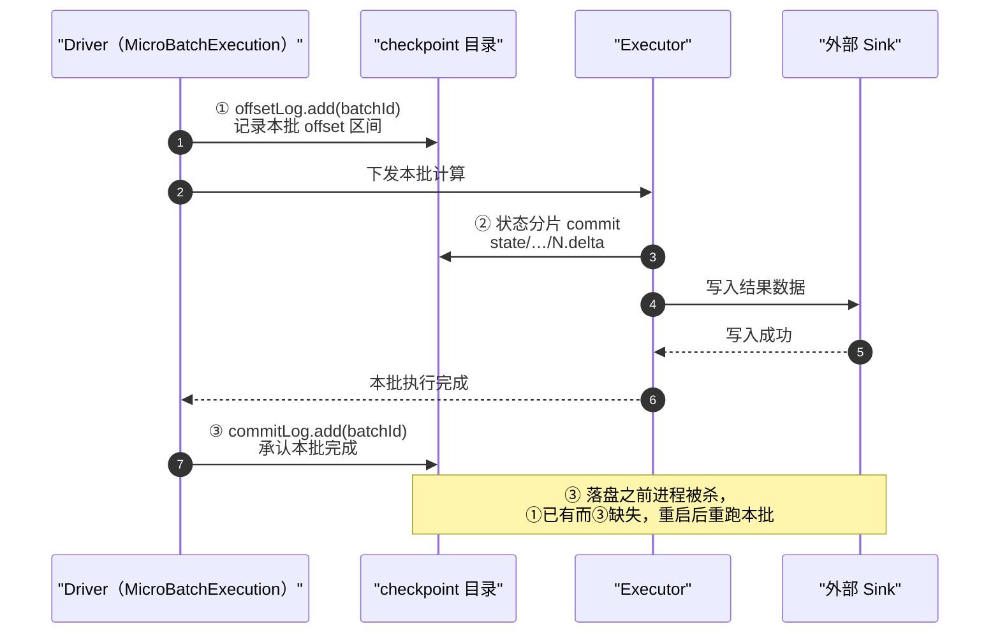
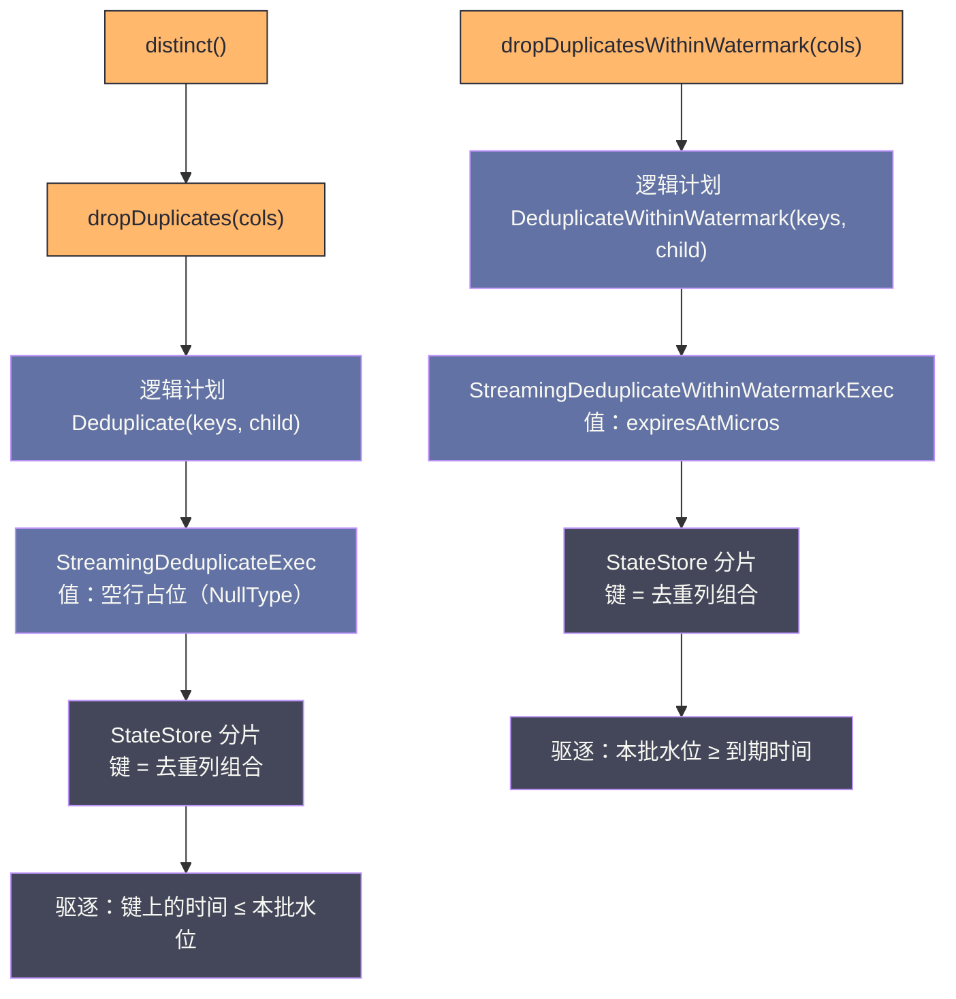
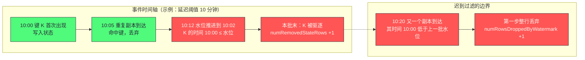
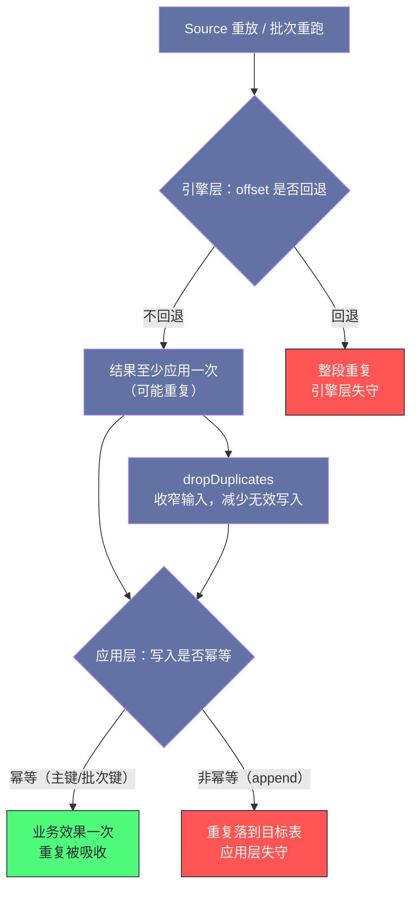
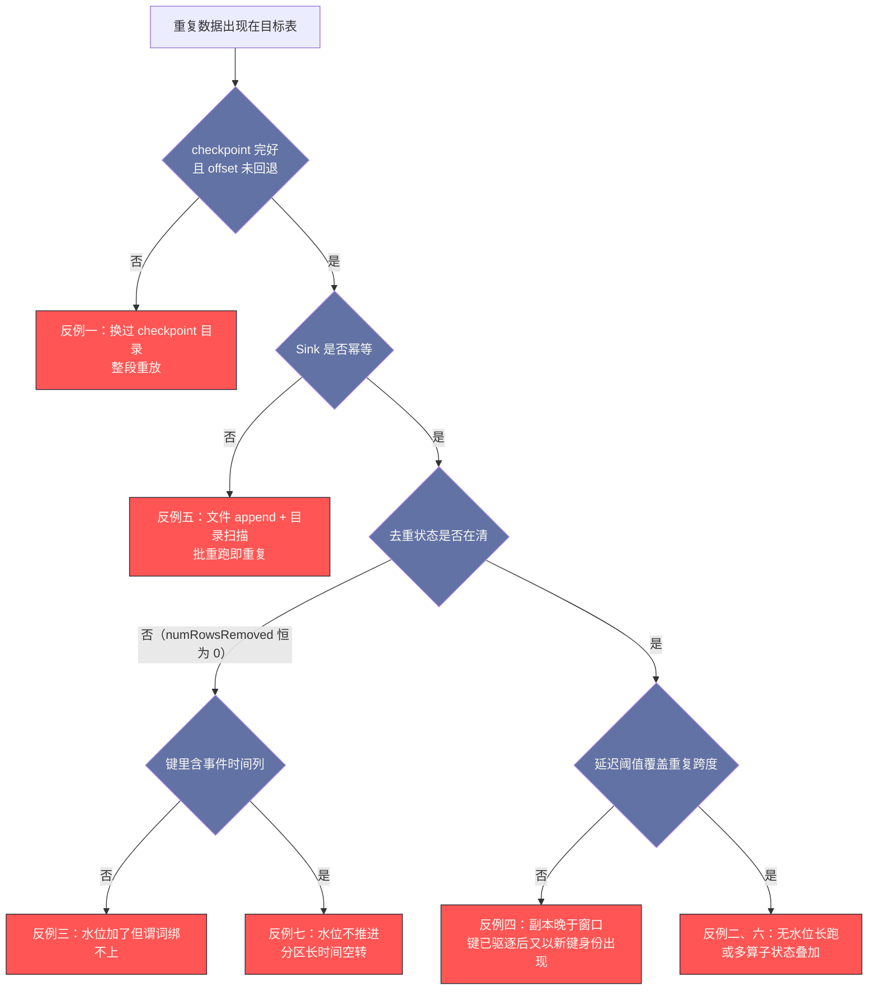

# 09 dropDuplicates 与精确去重：Exactly-once 的应用层保障

**摘要：**

「精确一次（Exactly-once）」这句承诺在这套技术栈里至少被用来指四件事：源端每条消息被读取一次、状态被更新一次、结果被写出一次、业务效果只发生一次。四件事各有自己的负责方，而生产上重复数据的绝大多数来源，是把这四件事当成同一件事来承诺。本文沿一条支付事件流，把责任切成三层——引擎层的 checkpoint 与预写日志、算子层的 `dropDuplicates`、应用层的幂等写入——再逐层检查每一层实际守住了什么。

文章的重心在中间那层。用源码把机制拆开后会发现几件与流行说法不一致的事：去重状态里只存键，值是一个空行，所以状态本身不记录「首次出现时间」；驱逐谓词只有在**去重键里含事件时间列**时才能绑定，缺了这条条件，水位加了也不会清掉一个键，而且不报错；真正为「按业务键、窗口内去重」设计的第二个入口是 `dropDuplicatesWithinWatermark`，它把到期时间写进状态值，判据从「键上的时间早于水位」换成「水位越过首次出现时间加延迟」，保留期因此是延迟阈值的两倍。最后把 `distinct` 的批语义与流语义分开算账：同一个逻辑节点，输出方式一变，代价就从「增量加可驱逐状态」变成「全量重写加不可清理状态」。文末给出 Sink 幂等的五种落地形态与七类反例。

**关键词（Keywords）**：dropDuplicates, dropDuplicatesWithinWatermark, 去重, 幂等, 状态清理, 水位, DeduplicateExec, checkpoint, 端到端 Exactly-once

---

## 第 1 章 三个层次：一笔被记了两次的支付

### 1.1 症状先出现，责任后定位

笔者用一个贯穿全文的场景：某电商的实时数仓里有一条支付事件流 `payment_events`，从 [[中间件/Kafka/00 专栏导览|Kafka]] 读出，解析成 `eventId / userId / merchantId / amount / event_time` 五个字段，去重后写入明细宽表，宽表再供两个消费者使用——实时看板的每分钟 GMV，以及 T+1 的对账报表。这条链上有三个可能出问题的地方：Kafka 端可能重发，Spark 可能重跑，写入端可能重复落盘。

某次大促之后，实时看板的 GMV 比第二天对账的结果高出万分之三，差额集中在 21:00 到 21:15 之间，正好是客户端弱网重试最密集的十五分钟。把明细表按 `eventId` 分组，能找到一批出现两次的记录，同一个 `eventId`、同一个 `amount`、`event_time` 相差两三分钟，两条都被宽表收下了。

追查的结论有点意思：Kafka 端那两条消息都是合法的，它们占据不同的 offset，`eventId` 相同只是 Producer 重试造成的结果；Spark 端没有丢数据也没有重复读，每条都读了一次；写入端每一次 append 都成功，Delta 的提交日志里是两笔干净的事务。每一层都在自己的合同范围内履约，最后却出现了一份重复的账。原因是这条管道里没有任何一层被要求回答一个问题：`eventId` 相同，是否意味着业务上是**同一件事**。

这个问题只能由写下 `eventId` 语义的人回答。它不在 Kafka 的合同里，不在 checkpoint 的合同里，也不在 Delta 的事务语义里。三层责任的分界线，就是从这句话开始画的。

### 1.2 重复的四个根因，四条责任线

把常见成因摊开来看，四类重复的触发条件、外部症状与责任方几乎没有交集：

| 根因 | 典型触发 | 不处理时的症状 | 责任方 |
|---|---|---|---|
| 源端重放（offset 回退） | checkpoint 目录丢失或被换成新目录、`startingOffsets` 被手工改成 `earliest`、topic 被删除重建、offset 超出保留期后回落到最早 | 从回退点之后整段重复，规模以小时计 | 部署与运维：checkpoint 的生命周期管理 |
| 批次重试 | 批执行到一半失败（Executor 掉线、Sink 超时），重启后重跑该批 | 该批输出重复，规模以批为单位 | Sink：幂等或事务写入 |
| 算子非确定性 | 批次内调用 `current_timestamp()`、`rand()`、`uuid()`，或依赖未排序的 `limit` / 无 `orderBy` 的聚合 | 同一批重跑得到不同结果，重复判定失效 | 应用代码：把非确定性钉在批次上 |
| Sink 非幂等 | 追加型文件写、无主键的 `INSERT`、向 Kafka 生产消息 | 重跑即重复，且无法自动合并 | 应用层：主键、upsert、事务 |

四行里只有第二行是「Spark 自己重试」造成的，其余三行 Spark 都只承担一半责任：它能提供批次号、能提供可重放的源、能提供状态，但要不要把这些能力接起来，是使用者的决定。这也是为什么后面每一章都要回到同一句判据——这一层的输入里，有没有一个可以被判重的东西。

### 1.3 一个词，四种命题

「精确一次」被混用的程度，从下面这张表就能看出来。四种命题在英文里都叫 exactly-once，在中文里都译作精确一次，但它们的证明义务完全不同：

| 命题 | 严格含义 | 由谁保证 | 不成立时的症状 |
|---|---|---|---|
| 读一次 | 每个 offset 区间只被读取一次，且不回退 | checkpoint 的 offset 日志与 commit 日志 | 数据缺失，或整段重复 |
| 状态一次 | 同一个 offset 区间对状态的更新只生效一次 | 状态存储按批次版本提交 | 聚合值重复累加，去重状态错乱 |
| 写一次 | 同一个 offset 区间产生的结果只被写出一次 | Sink 的分布式事务，或幂等写 | 输出行数翻倍 |
| 效果一次 | 同一个业务实体只被记录一次 | 应用层主键 + 去重键 + 下游 upsert | 业务口径偏差，如 GMV 虚增 |

前两条属于引擎的职责，也是 Spark 文档里那些「端到端精确一次」段落真正在讲的东西。第三条开始就需要 Sink 配合，第四条则完全出了引擎的表达范围：Spark 不知道 `eventId` 是什么，也不知道两条 `eventId` 相同的记录在业务上应该只算一笔。

行文至此可以给出本文的基本判断：引擎层保证的是「每个 offset 的处理结果被应用一次」，它保证不了「结果不重复出现」。两句话的差别不在措辞，而在前者只覆盖到「应用」这个动作，后者要求「应用」这个动作本身可重复执行而无副作用。

### 1.4 一个比喻：面单、入库单与记账凭证

把这条链想成一次重复投递的快递。快递公司（源端）承诺把包裹送到，识别的依据是运单号；它不保证只送一次，超时重派是它的正常工作方式。仓库（算子层）收货时按运单号登记，见过的运单号不再入库，这一层靠的是一本登记簿。财务（Sink）按入库单记账，账本上每一笔都有唯一凭证号。

包裹被送了两趟，运单号相同，仓库翻本子拒收第二趟，重复到此为止。但这个链条上有三处会漏：登记簿丢了（状态丢失），登记规则写错了（去重键选错），记账不认运单号只认「收到一笔」（追加入账）。第一种漏在灾难恢复时会遇到，第二种漏最安静，第三种漏最常见。

比喻的技术限定在于：Spark 的登记簿记的不是「运单号」，而是「指定列组合的取值」，并且这本簿子会被主动撕页——水位推进越过某一页之后，早于那一页的键会被清掉。撕页这个动作是让状态收敛的唯一手段，也同时是「去重保证范围有限」这个结论的来源。

### 1.5 本文的口径

版本口径为 Spark 4.3.0（2026-10-30 发布，预编译包基于 Scala 2.13）。文中的源码级结论以对应版本分支为准；两个去重物理算子的主干逻辑自 3.5 以来没有实质变化，4.3.0 动的是键的解析路径（SPARK-57489 与 SPARK-59315），这一点会在第 5 章单独交代。所给的状态大小与耗时为示例推算，用于说明量级关系，不是实测数据。

---

## 第 2 章 引擎层：checkpoint 保证的是哪一句话

### 2.1 checkpoint 目录里的四本账

Streaming 查询的 checkpoint 目录不是一份快照，而是四类记录并排放在一起，各有各的写者与读者（这些记录与 [[02 Source 与 Sink：DataSource V2 的流式读写接口|流式读写接口]] 的两阶段配合，是整个机制的地基）：

| 路径 | 内容 | 谁写、何时写 | 恢复时被谁读 |
|---|---|---|---|
| `offsets/<batchId>` | 本批要读的 offset 区间，附带批次元数据（水位、批次时间戳、SQL 配置） | Driver，在执行前写入 | 启动时定位到最新批 |
| `commits/<batchId>` | 本批已完成的标记，附带本批结束时的水位 | Driver，在 Sink 返回之后写入 | 启动时判断最新批是否完成 |
| `state/<operatorId>/<partitionId>/<version>.delta` | 状态分片的增量 | Executor，任务末尾提交 | 状态提供者在恢复时重放 |
| `metadata` | query id 与 run id | 首次启动时写入 | 校验 checkpoint 与查询是否匹配 |

还有一类容易被忽略的：`sources/<n>/` 下是源端自己的日志，Kafka 源会把每个批次的 offset 元数据单独写一份，用于在 offset 超出保留期时给出明确错误而不是静默跳读。

`state` 目录下的文件命名值得单独看一眼：每个状态分片每个批次产出一个 `<version>.delta`，累积到一定数量后合并成一个 `<version>.snapshot`，这个数量由 `spark.sql.streaming.stateStore.minDeltasForSnapshot` 控制（默认 10）。它直接决定恢复时要重放多少个文件：状态越大、快照间隔越长，重启时的恢复时间越长。这条参数与去重的关系在于——去重状态是会持续增长的那种状态，它的 delta 文件数量和单批 checkpoint 时长会一起上涨，涨到某个程度时，作业的瓶颈不再是处理数据，而是每批都要把状态余量刷一遍。

### 2.2 一个批次的三次落笔

一个微批从开始到结束，要在三个地方各留一次痕，而这三处没有共同的事务边界：

```text
① offset 落盘        driver：把本批的 offset 区间写进 offsets/<batchId>
② 结果写 Sink        executor：任务执行，写入外部系统；状态分片各自 commit 出 delta
③ commit 落盘        driver：把 batchId 写进 commits/<batchId>，同时记下本批水位
```

第①步早于执行，这是有意的：先把「我要处理哪一段」写下来，再动手处理。第③步晚于 Sink 返回，也是有意为之：只有结果确实落地了，才承认这批完成。中间那个窗口——数据已经在目标库里，但 commit 记录还没写——就是所有重复的出生地。

代码上的对应很短：批次构造完成后调用 `markMicroBatchStart()`，里面做 `offsetLog.add(currentBatchId, ...)`；Sink 的 `addBatch` 返回之后调用 `markMicroBatchEnd()`，里面做 `commitLog.add(currentBatchId, CommitMetadata(watermark))`。两行日志中间的那段执行，是整个精确一次语义里唯一没有原子性保护的部分。

这三处落笔像一笔跨行转账：先在自家账上记「待付」，钱到了对方账上，最后才回填「已付」。区别在于银行那三步最终由清算所轧平，而这里没有清算所——中间任何一步断掉，都只能靠事后的重跑来对齐，而对齐的代价就是重复。技术限定是，重跑在这里是常态而不是故障，所以「对齐」这个动作必须由接收方容忍。



### 2.3 恢复只有三种情形

启动时的定位逻辑写在一段不到五十行的代码里，主干只有三个分支：

- `offsets` 的最新批号等于 `commits` 的最新批号：上一次结束得干净，从下一批开始。
- `commits` 的最新批号等于 `offsets` 最新批号减一：**最后一次执行没有走完**，重启后重跑那一批。
- `commits` 的最新批号比 `offsets` 最新批号更旧：日志里会打一条警告，说明完成记录不是紧随其后，随后仍然按重跑处理。

第三种情形只出现在人为干预之后（比如从备份里恢复了 `offsets` 却恢复了更旧的 `commits`），它不会自动修复，只会让作业带着一段不确定的历史继续跑。第二种情形则是日常：任何一次停机、任何一次 Executor 集合崩溃，都会落到这个分支上。

关键在于把这件事看成**既定动作**而不是异常：重跑一个已经向 Sink 写过的批次，引擎不认为这是错误，也不打算避免——它只保证重跑使用的是同一段 offset，因而读到的输入与上次一致（这也是为什么第 1.2 节那个「算子非确定性」的根因会破坏整条链：输入相同，处理结果却不同，重跑就不再是幂等的重放）。

### 2.4 从「offset 一次」推不出「结果不重复」

用一条时间线把 2.2 的窗口讲清楚。批次 37 执行：offset 落盘，数据写进 Delta 成功，事务提交成功；紧接着进程被 kill，`commits/37` 没来得及写。重启后走到第二个分支，重跑批次 37，Delta 里又多了一份同样的数据。

Delta 这一侧完全没有做错事：两笔事务各自合法、各自提交成功。它无从知道「这一批」和「上一批」是同一批，因为它的接口收到的只是两个 DataFrame。分布式事务保证的是「一次写入整体成功或整体失败」，它不等于**两次写入只算一次**，把两者混为一谈是这一层最常见的误解。要让第二次写变成空操作，写入必须携带一个可比较的标识——批次号或业务主键——并且目标端愿意拿这个标识做判重。

那么有没有可能让 Sink 参与一个横跨「数据写入」与「commit 记录」的事务？原理上可以，两阶段提交的 Sink 就是这么做的：先写数据但不提交，等 Driver 把 commit 决策记下来，再提交。这套做法对 Sink 的实现要求很高（要有外部可见的未提交状态、要有超时后的清理机制），Spark 生态里只有少数连接器提供，绝大多数团队用的 Delta、ClickHouse、HBase、文件系统都不在这个名单里。工程上通行的替代方案是幂等写入，而「幂等」这个性质必须由使用者在数据模型里造出来，引擎给不了。

### 2.5 文件 Sink 的 manifest 边界

文件 Sink 经常被举成「Spark 自带的两阶段提交」的例子，这个说法需要打两个补丁。它的实现是在目标目录下放一个 `_spark_metadata` 日志，每批写完把本批产出的文件名登记进去；`addBatch` 的第一句是判断批号，`batchId` 不大于日志里的最新批号就直接跳过。这个判重保证了「同一个批次不会被登记两次」，配合重跑时跳过已登记批次，已经提交的数据不会重复出现。

补丁一：日志保证的是登记不重复，不是目录不重复。源码注释里写得很直白（大意：部分失败时目标目录里可能存在重复数据，只是日志里每个文件只有一份）。一个批次写到一半失败，已经落地的那些文件不会被登记、也不会被删除，它们成了孤儿；重跑该批会写出新文件，孤儿留在原地。

补丁二：谁能看见孤儿，取决于读者怎么读。以 Structured Streaming 的文件源方式读取（会读 `_spark_metadata`）时，读到的就是日志里登记过的那份；但用 `spark.read.parquet(路径)`、外部 Hive 表、或者别的引擎直接扫目录，读到的是目录现状，孤儿一定被算进去。也就是说，同一个目录，两种读法给出两种行数——这本身就是「Sink 是否幂等」的判定依据，与 Spark 无关，与读者有关。

把四类 Sink 并排放：

| Sink 形态 | 幂等依据 | 失败窗口里的残留 | 谁能看见重复 |
|---|---|---|---|
| 文件 Sink（manifest） | 批次号 | 未登记孤儿文件 | 绕开 `_spark_metadata` 的读者 |
| Delta / Iceberg / Hudi 事务表 | 表事务；主键需要 `MERGE` 才生效 | 无半成品，但同一批写两次仍是两笔事务 | 直接 `append` 的表与下游 |
| Kafka Sink | 官方文档未作事务承诺 | 重复消息 | 所有消费者 |
| `foreachBatch` + 外部库 | 应用自定义的键 | 取决于库的能力 | 看库的幂等实现 |

### 2.6 引擎层能承诺的最后一句话

把这一章收在一句话上：引擎层承诺「offset 不回退，且每个 offset 区间的处理结果至少被应用一次」。它给出的工具是批次号、可重放的输入、按批次提交的状态，以及一份明确的恢复规则。它不承诺「应用一次」，因为它管不到 Sink 与 commit 日志之间那个窗口。

留下这个窗口不是疏忽，而是分工的必然：要关掉它，必须让外部系统参与一个分布式事务；而外部系统的种类太多，能力参差不齐，引擎无法替所有 Sink 编造这个能力。于是它选择把窗口暴露出来，把关闭窗口的责任交给使用者的数据模型。

窗口既然关不掉，接下来要问的就是应用层怎么接住它：先去重、还是先幂等写，这两件事的先后顺序决定了重复是被「收窄」还是被「放大」。

---

## 第 3 章 dropDuplicates：一个只记键的状态表

### 3.1 从 API 到物理算子

`dropDuplicates` 在逻辑计划里对应 `Deduplicate`，它只有一个必需信息——键属性列表，其余全部由子计划的状态决定。到了物理计划阶段，Spark 把它分给两个不同的算子：



图里左侧那条支路值得注意：`distinct()` 不是独立的实现，它在 Dataset API 上就是一次无参的 `dropDuplicates()`，键取全部列。后文第 5 章会把这条支路的代价单独算一遍。

键从列名解析成属性的动作，在 4.3.0 里已经挪到了共享的分析器规则里（SPARK-57489）。在此之前，这件事由 DataFrame 的实现方法完成，而且为了去重列名，它做过一次 `toSet.toSeq`——集合的迭代顺序不保证稳定。对批查询无所谓（输出不受列序影响），对流查询有所谓：状态存储按位置绑定列，列序一变，同一个 checkpoint 里的旧状态就与新计划对不上。这条历史包袱在源码注释里留着一句「流的状态存储依赖 groupCols 的顺序」，4.3.0 之后列序由规则决定，随之也带来了新的兼容处理。

### 3.2 状态里存的是什么

去重算子的状态结构简单到有点出人意料：键是去重列组合的 `UnsafeRow`，值是**一个只含空值的占位行**。`StreamingDeduplicateExec` 里为此定义了一个单列 `NullType` 的 schema，并且顺手关掉了状态存储对该值的格式校验，理由是这一行与输出 schema 无关，它只是一个「占位符」。

这件事的技术含义值得说透：状态里没有「首次出现时间」，没有计数器，也没有原始行。算子对每一行做的判断是一次存在性判断——`store.get(key)` 返回空就是没见过，返回非空就是见过。整张状态表等价于一个只存键的哈希集合，它的唯一信息量是「这个组合出现过」。

打个比方，它更像小区门禁的访客名单，只记「这个人来过」，不记几点来、来干什么、来了几次；名单什么时候撕掉不归名单自己管，归物业（水位）的规则管。技术限定在于，名单丢了等于状态丢失，重建名单的唯一方式是重放数据——而重放本身就会带来重复，这也是为什么状态存储的持久化与 checkpoint 的生命周期绑得那么紧（见第 2 章）。

由此可以推出三个直接后果。其一，去重不依赖行内容，只依赖键，所以 `amount` 变化、`userId` 变化都不影响判定，键相同就是重复。其二，状态大小与键的基数成正比，与行的宽度无关——把 60 列的宽表整行塞进键里，状态会跟着宽表的宽度走，这是第 5 章 `distinct` 的代价来源。其三，状态里没有时间，所以清理无法「按自己记的时间做淘汰」，只能拿键里的事件时间与外部推进的水位作比较，这就引出了第 4 章那个绑定条件。

### 3.3 一批之内发生的五件事

把算子主干展开，一批数据的处理顺序是固定的五步，顺序本身就是语义的一部分：

```scala
// BaseStreamingDeduplicateExec 的主干（结构、顺序与源码一致，省略计时与指标）
val baseIterator = watermarkPredicateForDataForLateEvents match {
  case Some(p) => applyRemovingRowsOlderThanWatermark(iter, p)  // ① 迟到过滤
  case None    => iter
}
val result = baseIterator.filter { r =>
  val key = getKey(r)
  val value = store.get(key)
  if (value == null) {
    putDupInfoIntoState(store, r, key, reused)   // ② 没见过：写状态
    numOutputRows += 1
    true                                         // ③ 放行
  } else {
    numDroppedDuplicateRows += 1                 // ④ 见过：丢弃
    false
  }
}
// ⑤ CompletionIterator 收尾：evictDupInfoFromState(store) → store.commit()
```

第一步就把「事件时间早于上一批水位」的行整行丢掉，这些行既不进状态也不输出，指标里记在 `numRowsDroppedByWatermark` 上。第四步只记一个计数，不修改状态——重复的行对状态没有贡献，这一点决定了去重状态的写入量等于唯一键的数量，而不是输入行数。

第五步是唯一带全量扫描性质的动作。驱逐的实现是拿一个谓词遍历整个状态分片，命中就删除，删除数记在 `numRemovedStateRows` 上；遍历结束才调用 `store.commit()` 把这一批的变更写成 delta 文件。也就是说，**驱逐发生在输出之后、提交之前**，一批之内的顺序是不可调的，调换任何两步都会改变语义（后文会说明为什么这个顺序恰好堵住了一个边界漏洞）。

### 3.4 三次开销，只有一次与数据量有关

稳态运行时，每批的固定成本由三块构成，它们随状态增长的方式完全不同：

| 阶段 | 实现动作 | 成本随什么增长 | 观测指标 |
|---|---|---|---|
| 查找 | 对每个输入行做一次键查找 | 输入行数 | `numUpdatedStateRows`、`allUpdatesTimeMs` |
| 驱逐 | 遍历状态分片的全部键，命中谓词则删除 | 状态中的键总数 | `numRemovedStateRows`、`allRemovalsTimeMs` |
| 提交 | 把本批变更写成 delta 文件，必要时合并快照 | 本批变更量 + 状态总量 | `commitTimeMs`、checkpoint 时长 |

第二行是最容易被忽略的：驱逐的成本与新增数据无关，只与状态里的**键总数**有关。一个装着四千万个键、按每键百字节量级估算接近 4 GB 的分片，即使这一批一条新数据都没来、一个键都不会被删，也要把这些键连同谓词求值完整过一遍；分片之间并行，但每批都有这笔固定开销，与吞吐无关（此为示例推算，用于说明形状，不是实测）。这也解释了为什么去重作业的「每批处理时间」曲线会随运行时长缓慢上翘，最后稳定在一个由状态大小决定的值上。

### 3.5 去重键决定分区，改键就是一次 Shuffle

去重算子对上游提出一条分布要求：子节点的输出必须按去重键分区。这条要求在代码里是一行 `requiredChildDistribution`，它取键表达式去问「上游当前的分区是否已经兼容」，兼容则复用，不兼容则插入一次 Shuffle。

这条约束在单算子管道里没什么感觉，在多算子链路上会立刻显形。譬如先按 `eventId` 去重，再按 `userId` 做窗口聚合：两次要求的分布键不同，中间必然有一次重分区；如果两个算子都带状态，就要为两份状态各付一份内存、各付一次 checkpoint 时长。改变去重键（比如为了「把事件时间放进键以便驱逐」而加了一列）不是一次无害的改动，它同时改变了状态的 schema、状态的分布和 checkpoint 的兼容性——升级时能不能原地恢复，取决于新旧状态 schema 是否可映射。

### 3.6 无界去重能撑多久：把数字摊开

不带水位的去重，状态里只增不减。用贯穿案例的规模做一次推算：支付事件按每秒一万条估算，一天 86400 秒，约 8.64 亿条，`eventId` 是 36 字符的 UUID 字符串。状态里一个键的占用远不止字符串本身：

```text
示例推算（单键占用，量级估算，非实测）
  UUID 字符内容            36 B
  UnsafeRow 编码与对齐      ~8 B（含 null bitmap、变长偏移）
  哈希表条目 / RocksDB 键值开销   40 ~ 60 B
  delta 文件里的再次序列化         另计
  → 单键按 100 B 量级估算
```

8.64 亿键 × 100 B ≈ 86 GB，一天的量。这个数字还只是「键」，不含 delta 文件、不含快照、不含 JVM 里的对象头与哈希表装载因子余量。摊开之后结论就很清楚：无界去重在真实流量下不是「跑久一点会变慢」，而是「第一天就过不去」，能不能撑住与代码写得好不好无关，只与基数有关。反过来说，如果去重键是低基数的（比如按 `merchantId + 日期` 组合，全量不过几十万），无界去重反而是最省心的选择——不必为了省状态去承担水位带来的延迟与丢弃语义。所以在谈时间窗口之前，先要把基数过一遍——这是第 4 章那两条判据之外的前置判断，也是最容易被跳过的一个。

---

## 第 4 章 有界去重：水位只能清它认得的键

### 4.1 谓词绑定的三个条件

「加了水位，状态就有界了」这句话在工程上流传很广，但它比看起来要严格得多。水位的推进与合成机制在 [[04 Watermark 全解：事件时间语义与延迟数据处理|Watermark]] 一节里有完整推导，这里只关心它的一个用途：给驱逐谓词提供比较基准。看源码里构造驱逐谓词的那几行：

```scala
private def watermarkPredicateForKeys(watermarkExpression: Option[Expression])
    : Option[BasePredicate] = {
  watermarkExpression.flatMap { e =>
    if (keyExpressions.exists(_.metadata.contains(EventTimeWatermark.delayKey))) {
      Some(Predicate.create(e, keyExpressions))
    } else {
      None                       // 键里没有事件时间列：谓词构造失败，静默返回空
    }
  }
}
```

一个 `else None`，把三种情况合流到同一个结果上：驱逐谓词不存在，于是 `removeKeysOlderThanWatermark` 里的 `if` 判空之后什么也不做，于是状态一个键都不会被清，而且没有任何警告。要让谓词真的绑上，需要同时满足三个条件：

- 子计划上确实有水位，也就是 `withWatermark` 必须写在 `dropDuplicates` **之前**。写成 `df.dropDuplicates(...).withWatermark(...)` 时，水位算子挂在去重算子之上，去重算子的子节点没有水位元数据，谓词无从产生。
- 事件时间列必须在去重键里。`dropDuplicates("eventId")` 配上 `withWatermark("event_time", "10 minutes")` 是最常见的组合，也是这条条件最常被违反的地方：写法看起来完全合规、语义上很自然，但键是 `eventId`，事件时间不在其中，谓词构造不出来，状态照旧无限增长。
- 键的顺序必须与状态里绑定的位置一致。状态按位置绑定列，跨版本改动键的顺序会让旧状态与新表达式错位，这也是 4.3.0 要把列名解析统一到规则里的原因之一。

第二条之所以隐蔽，是因为它在语义上看起来更「正确」：业务上你只想按 `eventId` 去重，不希望事件时间参与判重。而引擎要做的是「按时间淘汰旧键」，它需要在键里读到时间才能判断该不该淘汰。两个需求撞在一起时，Spark 的第一种写法要求你把时间列放进键，代价是同一事件两次事件时间不同就不再算重复；另一个入口 `dropDuplicatesWithinWatermark` 则是专为此设计的，代价从「判重精度」挪到了「保留期」，见 4.5。

### 4.2 文档样例为什么把 eventTime 也放进键

官方编程指南在去重一节给的两段样例，恰好把这两种写法并排放在一起：

> With watermark - If there is an upper bound on how late a duplicate record may arrive, then you can define a watermark on an event time column and deduplicate using both the guid and the event time columns. The query will use the watermark to remove old state data from past records that are not expected to get any duplicates any more. This bounds the amount of the state the query has to maintain.

> Without watermark - Since there are no bounds on when a duplicate record may arrive, the query stores the data from all the past records as state.

样例代码也是 `withWatermark("eventTime", "10 seconds").dropDuplicates("guid", "eventTime")`——时间列老老实实写在键里。多数读者把这一行当成「顺手带上时间」，实际它是状态能被清理的唯一依据。文档措辞其实很准确：它写的是 using **both** the guid and the event time columns——时间列与业务键并列，不是附带。

代价也写在措辞里。键里含时间，意味着判重的粒度是「业务标识 + 事件时间」这个组合，同一个 `eventId` 若两次上报的事件时间差了三分钟，就是两个不同的键，两条都会被输出。对支付这类事件时间由服务端生成、天然稳定的场景，这个代价可以接受；对移动端埋点这类时间由客户端打点、重试时重新取当前时间的场景，这个代价直接让去重失效。

### 4.3 两个水位：迟到过滤为何要滞后一批

`WatermarkSupport` 这个 trait 里定义了两个水位值，名字起得很克制：`eventTimeWatermarkForLateEvents` 与 `eventTimeWatermarkForEviction`。它们的取值来自不同批次——迟到过滤用**上一批**结束时记录的水位，驱逐用**本批**的水位。源码注释解释了为什么要分开：在链式聚合里，第一个聚合的驱逐对于第二个聚合的输入而言，不应该被判成迟到，所以两个用途的时间基准必须错开一批。

这个错开，恰好堵住了去重的一个边界漏洞。设想一条事件时间是 T 的记录已经在状态里，它的一个重复副本姗姗来迟。假如过滤和驱逐都用本批水位，那么在一批里，副本可能先被驱逐谓词判定为「该键已过期」而清掉，随后又被当作首次出现输出——重复重现。而按现在的顺序（先用上一批水位过滤、再用本批水位驱逐、且驱逐在输出之后）可能出现的最坏情况是：副本在本批被放行、键在本批末被删掉，那么它到下一批再来时，上一批水位已经越过 T，会被第一步直接丢掉。先过滤、后驱逐、水位错开一批，这三件事合起来，才是「被淘汰的键不会被复活重放」这条保证的全部来源。

这条保证有一个前提：水位是单调的。Spark 在恢复时把水位取成「持久化水位」与「commit 记录里的水位」的较大值，所以重启不会让水位回退——这一条是引擎守住的。反过来，任何让水位被人为拉回的操作都会破坏这个前提，最典型的是把 checkpoint 换成一个更旧的备份，或者把 `startingOffsets` 手工改到过去。

### 4.4 驱逐在什么时候发生

最后一个关于时序的细节：驱逐需要水位推进才会发生，而水位只在有新数据时推进。如果一条流安静了半小时，水位不动，那么状态也不会被清理——已经满足淘汰条件的键会继续留在状态里，直到下一条数据把水位推上去。

Spark 为此留了一个补偿机制：状态算子可以回答「我是否希望再跑一批」。去重算子的实现是判断「新水位是否超过了上次看到的驱逐水位」，超过则返回真，引擎据此可能调度一个只做清理的空批次。也就是说，清理的触发点不完全是「有新数据」，还包括「水位涨了但没数据」，这两种情形都会让状态的过期部分被扫掉。

不过这个机制有一个现实前提：水位要涨，必须有带事件时间的数据进来。若上游是分区的（比如读 Hive 表的分区目录），而某几个分区长时间没有新文件，水位就会卡住，去重状态里的键也跟着卡住——这类现象在批流一体的离线补偿作业里很常见，排查时看的是 `numRowsRemoved` 指标是否长期为零，而不是看内存。

### 4.5 dropDuplicatesWithinWatermark：把到期时间写进值

Spark 3.5 起提供了第二个入口 `dropDuplicatesWithinWatermark`，物理算子换成 `StreamingDeduplicateWithinWatermarkExec`。它与前一个的根本差别在状态值上：不再是空占位行，而是一个 `expiresAtMicros` 长整型，取值为「该行事件时间 + 水位延迟阈值」。

```scala
// 写入时：到期时间 = 事件时间 + 延迟阈值
val expiresAt = timestamp + DateTimeUtils.millisToMicros(delayThresholdMs)
timeoutRow.setLong(0, expiresAt)
store.put(key, timeoutRow)

// 驱逐时：水位越过到期时间就删
if (watermarkForEviction >= expiresAt) { store.remove(rowPair.key) }
```

这个入口的 API 文档把语义写得很克制：「Events are deduplicated as long as the time distance of earliest and latest events are smaller than the delay threshold of watermark.」——承诺的跨度是一个延迟阈值，并且明确「too late data older than watermark will be dropped」。实现上键的保留期比这个承诺更长（见下文），文档选择报小不报大，这是接口设计的常规做法。

两个算子的判据放在一起对照，含义就清楚了：

| 维度 | `dropDuplicates`（键含事件时间） | `dropDuplicatesWithinWatermark` |
|---|---|---|
| 状态值 | 空占位行 | `expiresAtMicros` |
| 驱逐条件 | 键上的事件时间 ≤ 本批水位 | 本批水位 ≥ 首次出现时间 + 延迟阈值 |
| 事件时间是否必须在键里 | 必须，否则不清理 | 不必 |
| 同一业务键、时间不同能否去重 | 不能，算两个键 | 能 |
| 键在状态里的保留期 | 约一个延迟阈值 | 约两个延迟阈值 |
| 清理失效的表现 | 静默地不清（谓词为空） | 参数配错时才不清 |

第四行与第五行这两条经常被一起忽略。保留期的差异来自水位的定义：水位本身已经是「已见最大事件时间减去延迟阈值」，所以「超过水位」对应的物理时间已经是延迟之后；而 `expiresAt` 又加了一次延迟阈值，等价于要求水位再走一个阈值才删。以 `withWatermark("event_time", "10 minutes")` 为例，前一种写法下键在状态里停留约十分钟，后一种约二十分钟，状态体积因此差一倍（示例推算：按到达速率与键宽估算的量级关系）。这是用「保留期」换「容忍事件时间抖动」的直接代价，也解释了为什么 API 文档敢只承诺一个阈值——实现留出的余量正好覆盖掉最晚的那批副本。

换个说法，前者是仓储里「确定不会再有人来取货就下架」的规则，后者是给每件货贴一张「入库时间加保质期」的标签，只有过了保质期才下架。技术限定在于，这张标签按**首次出现**的时间算，而不是最后一次——所以一条重复行反复出现不会延长键的寿命，热点键占不住状态，这一点在重复率高的场景里是有利的。

### 4.6 两条判据

把这一章压成两条可以在评审会上直接用的判据：

第一条判的是键。同一业务事件的多次副本，事件时间是否**恒定相同**？如果恒定（服务端生成时间、日志文件里的原始时间戳），用 `dropDuplicates` 并把事件时间列放进键，状态保留期最短；如果不恒定（客户端打点、上游 ETL 重写时间），只能用 `dropDuplicatesWithinWatermark`，并把延迟阈值设得大于「副本之间事件时间的最大差值」。

第二条判的是状态是否真的在清。看 `StateOperatorProgress` 里的两个数：`numRowsRemoved` 是否在持续增长，`numRowsTotal` 是否在波动之后趋于平稳。如果 `numRowsTotal` 单调上升而 `numRowsRemoved` 长期为零，那么无论代码里写没写 `withWatermark`，实际的驱逐都没有发生——要么键里缺事件时间列，要么水位根本没推进。这条判据比读代码可靠，因为它读的是运行结果。



图里虚线那一步是整章论证的落点：键被驱逐之后，同一条事件的迟到副本还能不能再产生一行输出，取决于迟到过滤有没有在下一步把它挡掉。这道挡板就是 4.3 那对错开一批的水位。

---

## 第 5 章 distinct：同一个节点，两种语义

### 5.1 一行源码带来的混淆

`Dataset.distinct()` 的实现只有一行：`dropDuplicates()`。而无参的 `dropDuplicates()` 又是一行：`dropDuplicates(this.columns)`。也就是说，`distinct` 与 `dropDuplicates` 在逻辑计划层面是同一个节点、同一段物理实现，差别只在键的取值——前者取全部输出列，后者取用户指定的子集。

这一行源码解释了两件常被误解的事。第一，`distinct` 不因为「名字不同」而拥有不同的去重机制，它同样用状态存键、同样受 4.1 那三个绑定条件约束。第二，`distinct` 的键宽度等于整行宽度，一张 60 列、平均 400 字节的宽表，去重键就是 400 字节的行——同样的状态存储，能装的键数量比按 `eventId` 去重少一个数量级。

真正的差别不在去重，而在「去重之后怎么把结果交出去」。这一层差别，就是批语义与流语义的分水岭。

### 5.2 流上的 distinct 输出的是增量

批处理里的 `distinct` 是一次求值：扫描全表，输出当前数据的唯一集，输出即终局。流上没有「全表」这个对象，去重算子只在新键第一次出现时放行一行，这个行为在两种输出模式下的表现不同，但无论哪种模式，它都不会把「当前唯一集」整份重发一遍。

于是流上的 `distinct` 得到的是一串增量。把各批输出并起来、再做一次去重，才等于批处理意义上「截至此刻的唯一集」。对于「只关心新出现的唯一值」的下游（比如把新出现的商户 ID 送去开户流程），增量正是想要的；对于「每批要看到当前全量快照」的下游（比如核对表、指标快照），增量不是。

这层差别经常被一句「流上 distinct 要 Complete 模式」带过去，而这句话需要拆成两半看（三种输出模式的边界见 [[03 输出模式深度解析：Append、Update 与 Complete 的适用边界|输出模式]]）：`Deduplicate` 这个节点本身没有 Complete 输出，它能给的只有增量；要想每批拿到全量，通常的做法是绕到聚合上去，用 `groupBy(全部列).count()` 走 Complete 模式。聚合的 Complete 输出才是「每批重算并发出全量」的那种语义。

### 5.3 两条路的代价完全不同

把两条路并排放，代价的差别不在状态存了多少键，而在每批要往外搬多少东西：

| 维度 | `dropDuplicates` + Append（增量语义） | 按列分组聚合 + Complete（快照语义） |
|---|---|---|
| 每批输出 | 本批首次出现的行 | 当前全量唯一集，批次数 × 基数 |
| 状态内容 | 键集合，可随水位驱逐 | 全量键与计数，Complete 模式不做迟到过滤 |
| 状态能否清理 | 满足 4.1 条件即可清 | 不能清，清了就丢全局唯一性 |
| 下游写入压力 | 增量，与新增键数成正比 | 全量重写，与累计基数成正比 |
| 适应的下游 | 明细表、事件流 | 小基数维表、看板快照 |
| 典型误用 | 期待它输出全量快照 | 拿它给大表做去重 |

第四行是最容易被低估的一格。按批次数乘以基数估算：唯一键 200 万，批次间隔 30 秒，一天 2880 批，Complete 模式一天要物化并输出 57.6 亿行（示例推算），而增量语义下一天只输出新增的那部分。同一份数据、同一个去重判断，输出量差了三个数量级，这就是「批语义的 distinct 在流上复刻」这件事的真实价格。

### 5.4 键宽：宽表用 distinct 的第一个坑

回到底层：`distinct` 的键是全部列。这意味着任何一个列的变化都会让「同一业务实体」变成两个键，包括那些与业务无关的列——采集时间、客户端版本、写入批次号、`_metadata` 里的文件路径。业务上认为「这两行是同一笔」，引擎认为「两行的键不同」。这类失败不报错、不告警，只在对比报表时表现为「去重没生效」。

第二个坑是列序。3.1 提到过键从列名到属性的解析路径在 4.3.0 有了变化，`distinct` 正好落在受影响最大的位置：它一次性把全部列塞进键，列的先后顺序、重复列名的处理、元数据列是否计入，都会改变状态的 schema。SPARK-59315 记录的就是这样一个案例：`dropDuplicates()` 之后再 `select` 出 `_metadata.file_path` 的查询，在新解析逻辑下 `_metadata` 被计入了去重键，于是同一个 `value` 来自两个不同文件时不再被判为重复，输出从一行变成两行。这不是实现错误，而是「键里到底有什么」这件事一直没有被明确定义过的后果；两个工单都在 4.3.0 里处理完毕，但对升级路径的含义是明确的：跨越这类版本升级时，去重作业的**状态 schema 可能变化**，能不能原地恢复要以对应版本的兼容说明为准，必要时应以新 checkpoint 重跑并接受一次全量回填。

### 5.5 判据

`distinct` 适合两类场景：基数小、列少的维表，以及批处理的离线分支。流上要按业务实体去重，应该用指定键的 `dropDuplicates`，键的选择要满足两个条件——它能区分业务实体，且它的事件时间列（若有）能支撑驱逐。若这两个条件打架（业务键稳定、事件时间抖动），那就是 4.5 那个入口存在的理由。

---

## 第 6 章 应用层兜底：两层为什么缺一不可

### 6.1 两张网叠在一起

引擎层的网眼是「offset 区间」，应用层的网眼是「业务主键」。两张网的方向不同：前者保证同一段输入不被跳过，后者保证同一份结果不被重复算。



图里两条失守路径是独立的：上边那条（offset 回退）去重算子救不了，因为回退之后重放的数据在算子看来是新的 offset、新的行，同一条业务事件可能在状态被驱逐之后重新以首次出现的身份通过；下边那条（写入非幂等）去重算子也救不了，因为去重只管到「这一批输出什么」，管不到「这批输出被写了几次」。

### 6.2 幂等键的两种来源

应用层的幂等，说到底是在写入时携带一个「重复可判」的键。键的来源有两种，能吸收的重复类型不同：

- 业务主键（如 `eventId`）：能吸收源端重放、上游重发、批次重跑的全部形态，因为同一笔支付无论被送几次，主键都是那一个。前提是主键的生成必须幂等——用 `uuid()` 在消费端现场生成主键，等于给每次重跑发一张新身份证，幂等性当场失效。
- 批次键（如 `batchId`）：能吸收批次重跑，因为重跑用的是同一个批次号。`foreachBatch` 的第二个参数就是批次号，可以写成「按批次分区覆盖」或「先删该批次再写」的形式。它吸收不了源端重放——重放的数据落在新的批次号里，两批内容有重叠，批次键看不出这一点。

把这两种键落到具体技术上是这样：

| 落地形态 | 幂等键 | 吸收的重复类型 | 残留问题 |
|---|---|---|---|
| Delta `MERGE INTO` | 业务主键 | 源重放、批重跑 | 需要稳定主键；`MERGE` 有写放大 |
| 按 `batchId` 分区覆盖写 | 批次键 | 批重跑 | 源重放仍会重复 |
| ClickHouse `ReplacingMergeTree` | 排序键 + 版本列 | 合并期的重复（最终一致） | 未合并前仍可能读到重复，查询需 `FINAL` 或聚合去重 |
| HBase / Redis 按 rowkey 覆盖 | 业务主键 | 源重放、批重跑 | 覆盖语义要确认是整行还是部分列 |
| 文件追加 + 目录扫描 | 无 | 无 | 全部重复都可见，见 2.5 |

### 6.3 只靠应用幂等会怎样

有人会问：既然 `MERGE` 按主键写就能吸收重复，那还要 `dropDuplicates` 做什么。答案在成本曲线里。一次十五分钟的源端重放，按每秒一万条计，就是九百万行重复数据要依次走完解析、`MERGE` 的匹配与写入（示例推算）。`MERGE` 的写放大与匹配成本都不低，九百万次无效写入在夜间批处理窗口里可能直接把窗口撑爆。

去重算子的价值在于把这个量压回去：它让「进入写入端的数据」等于「唯一键的数量」，而不是「投递次数」。同时它还给出一项观测能力——`numDroppedDuplicateRows` 是重复程度的直接度量，用它除以 `numOutputRows` 得到重复率，这个数在容量规划和上游质量治理里比任何估算都可靠。

### 6.4 只靠引擎去重会漏什么

反过来，`dropDuplicates` 也替代不了应用层。它解决的问题是「同一个键在同一段状态生命周期内不重复输出」，它不解决的问题有三个：

一是状态窗口之外的重复。键被驱逐之后，同一条业务事件若再来一次，算子会把它当新键放行（这也是 4.3 那对错开水位在防线上的位置——但防线只挡「事件时间低于水位」的那种副本，若副本的事件时间被上游改写成更晚的时间，它就绕过了过滤）。二是不同作业之间的重复：两个下游作业各自从同一个 topic 读，各自的去重状态互不相干，写到同一张表时一定会撞。三是写入侧的重复：一次批重跑，去重算子给出的是与上次相同的结果集，重复与否完全由 Sink 决定。

三个缺口都指向同一个结论：去重管输入的唯一性，幂等管输出的唯一性，两者作用在不同位置，任何一方都覆盖不到对方的漏洞。

### 6.5 顺序：先去重，再幂等写

同一段逻辑里，两个动作的先后顺序会影响成本但不影响正确性（正确性由幂等写保证），所以顺序应当按成本来定：先去重，写入端拿到的就是收窄后的行集，`MERGE` 的匹配次数与写入量都跟着下降。

有一种情形可以先不做去重：当业务主键与幂等写的键完全一致、且重复率很低时，`MERGE` 本身就承担了去重的职责，中间那层状态可以省掉。此时判据是两个数——重复率，以及状态存储的成本；重复率低于千分之一而状态每天要涨几十 GB 时，把去重砍掉、只留 `MERGE`，是一笔划算的交换。

---

## 第 7 章 反例与边界

把前面几章的机制反过来用，就是七种在真实系统里反复出现的写法，每一种都给出症状、识别方法与根因。它们的共同点是：代码能跑、不报错、监控上不会红，只有在核对数据时才发现少了一层。



### 7.1 开了 checkpoint 却以为不会重复

症状：作业重启之后，目标表某个时间段的行数变成原来的两倍，而 Spark UI 上没有任何失败记录，只有一个 Stage 被重跑。

识别：Driver 日志里能搜到 `Resuming at batch N with committed offsets ... and available offsets ...`，配合 `commits/` 目录的修改时间可以确认哪一批被重跑。若目标表按批次能切分（比如写入了批次号列），重跑的那一批会多出一份。

根因在 2.3 的第二个分支：`offsets` 有而 `commits` 没有，重跑是设计行为。checkpoint 保证的是「不丢」，不是「不重」。处置方式只有一条：让 Sink 侧能识别「这一批已经写过」。最省事的实现是 `foreachBatch` 里用批次号做幂等键，或者让写入走按业务主键的 `MERGE`。指望调大重试次数、增加 Executor 内存来避免这一类问题，方向是错的。

### 7.2 不带水位跑长任务

症状：作业能稳定跑几天到几周，然后开始出现批次时长上涨、Task 端 GC 时间占比升高、checkpoint 从秒级走到分钟级，最终在一次 Executor 失联后不再恢复（恢复时要重放大量 delta 文件，超时或 OOM）。

识别：`StateOperatorProgress` 里 `numRowsTotal` 单调上升、`numRowsRemoved` 为零；状态目录的物理大小以天为单位线性增长。3.6 那次推算给出的量级是每天几十 GB，实际曲线的形状比数值更有诊断价值——只要它是一条不弯的斜线，清理就没有发生过。

处置：按 4.6 的两条判据重新设计键。若业务上确实无法界定重复的时间范围（上游可能在任意时间重放），那么有界去重不成立，应当把去重挪到应用层（主键 upsert），而不是靠算子扛住无界状态。

### 7.3 带了水位，但键里没有事件时间

症状：代码里明明写了 `withWatermark`，状态照样涨。这是本文最想让人记住的一条，因为它同时具备三个特征：写法看起来完全正确、语义上很自然、不产生任何告警。

识别：把物理计划打出来（`query.explain` 或 `query.lastExecution.executedPlan`），确认水位算子在去重算子之上还是之下；再确认去重键是否包含事件时间列。两者任一不满足，驱逐谓词就是空的。

根因在 4.1 那个 `else None`：谓词需要从键里读事件时间，读不到就放弃，而不是报错。处置有两条路：把事件时间列加进去重键（代价是同一事件两次时间不同就不算重复），或换成 `dropDuplicatesWithinWatermark`（代价是保留期翻倍）。两条路都要重新评估状态规模，不能只改一行代码就上线。

### 7.4 延迟阈值小于真实的重复跨度

症状：绝大多数重复都被去掉了，但对账时仍能看到少量重复，且这些重复的事件时间与首次出现的间隔大约等于两倍延迟阈值上下。

识别：把重复样本按「首次出现时间与副本到达时间之差」做分布，如果分布的长尾超过了阈值，就是这一类。这类重复的成因是键在配额用完之后被驱逐，而副本的事件时间又被上游改写得更晚，于是绕过了 4.3 的迟到挡板。

处置：延迟阈值应当由三个量决定——上游重试的最长窗口、事件时间抖动幅度、以及晚于水位的数据的容忍度。三者的和才是阈值下限；用「十秒钟看起来够了」来定参数，是把一个数据问题变成一个概率问题。

### 7.5 用 append 写文件，却承诺不重复

症状：业务方拿着目录里的 parquet 做外部报表，行数与实时看板对不上；用 Structured Streaming 的文件源读同一个目录，行数又是对的。

识别：目标目录下存在 `_spark_metadata`，但消费方没有走它。查一次失败批次的痕迹——目录里有未被登记的文件，文件名里的批次号或时间戳与日志里那一批对得上。

根因是 2.5 说过的两件事：manifest 只保证登记不重复，失败批次留下的孤儿文件不会被清理；而目录扫描的读者看到的是目录的现状。处置要么统一读者（都用文件源读），要么换到事务表并按主键写，要么接受「目录不是表」这个事实，把重复的清理放到下游查询里。

### 7.6 多个有状态算子串在一起

症状：一个作业里先按 `eventId` 去重，再按 `userId` 做窗口聚合，状态总量、checkpoint 时长、恢复时间都是两个单算子作业之和的两倍以上，且每次改动去重键都要重建状态。

识别：`query.lastExecution.executedPlan` 里数 `StateStoreWriter` 的个数，再看各自的 `requiredChildDistribution` 是否要求不同的分区键。分区键不一致时，中间会多一次 Shuffle，这份 Shuffle 数据落在磁盘上，与状态一起拖慢每一批。

处置：让相邻算子的分区键尽量一致（比如都用 `userId`，把去重键从 `eventId` 换成 `userId + eventId` 的组合以保持分布），或者把链路拆成两个作业、中间落地一层。链式状态算子省下的是一份存储，付出的是耦合与恢复成本，取舍取决于状态规模和改键频率。

### 7.7 水位卡在一个没有数据的分区上

症状：去重状态不清理，但流量明明正常；`numRowsDroppedByWatermark` 为零，说明不是丢弃太多，而是水位根本不涨。

识别：看 `StreamingQueryProgress` 里的 `eventTime.watermark` 是否长时间不变，同时看源的 `numInputRows` 是否集中在少数分区。水位由全局最慢的输入决定（多流场景下按最小策略合成），一条卡住的流会把整个作业的水位钉在原地。

处置：要么让慢流也能推进（比如给它一个基于处理时间的兜底水位），要么把两条流拆开。这类问题在去重上的表现是「算子没问题、它等的那个数字没来」，与去重本身的实现无关。

---

## 第 8 章 落到工程：把三层装进一条管道

### 8.1 一段参考实现

把前面的结论拼成一条可用的管道：源端解析后按业务键做窗口内去重，写入端按主键做幂等合并，批次号留作幂等键的备份。

```python
from pyspark.sql.functions import col, from_json
from delta.tables import DeltaTable

# ① 源端：只做解析，不做去重；保留 Kafka 的原始 offset 列以便排查
events = (spark.readStream.format("kafka")
    .option("kafka.bootstrap.servers", brokers)
    .option("subscribe", "payment-events")
    .option("maxOffsetsPerTrigger", "200000")      # 控制单批规模，避免一批重跑代价过大
    .load()
    .select(from_json(col("value").cast("string"), schema).alias("d"))
    .select("d.*"))

# ② 算子层：键里同时放业务键与事件时间，让驱逐谓词能绑定
deduped = (events
    .withWatermark("event_time", "30 minutes")     # 阈值 = 重试窗口 + 抖动 + 余量
    .dropDuplicates(["eventId", "event_time"]))    # 时间列在键里，状态才有界

# ③ 应用层：按业务主键做幂等合并
def upsert(batch_df, batch_id):
    (DeltaTable.forPath(spark, target).alias("t")
        .merge(batch_df.alias("s"), "t.eventId = s.eventId")   # 键一旦匹配，重跑即覆盖
        .whenMatchedUpdateAll()
        .whenNotMatchedInsertAll()
        .execute())

(deduped.writeStream
    .foreachBatch(upsert)
    .option("checkpointLocation", ckpt)            # 生命周期与作业绑定，不随部署变更
    .trigger(processingTime="30 seconds")
    .start())
```

三个位置各有分工：源端负责把结构解析干净，算子层负责把状态关进笼子，应用层负责让重复写入变成空操作。注释里那两处是最容易写错的：把时间列放进键、把 checkpoint 路径当成作业的一部分而不是部署参数。

### 8.2 该盯哪些数

去重作业的可观测性不需要自建指标，`StateOperatorProgress` 已经给出了判断去重是否健康的全部数字：

| 指标 | 含义 | 健康形态 | 异常形态与指向 |
|---|---|---|---|
| `numRowsTotal` | 当前状态里的行数 | 随流量波动后趋于平稳 | 单调上升：驱逐没发生（7.2、7.3） |
| `numRowsUpdated` | 本批写入状态的键数 | 与唯一事件量同阶 | 接近输入行数：重复率极低，去重收益小 |
| `numRowsRemoved` | 本批驱逐的键数 | 持续非零，与流量成正比 | 恒为零：谓词未绑定或水位不推进 |
| `numRowsDroppedByWatermark` | 因迟到被整行丢弃的行数 | 少量 | 大量：阈值过小或源端大面积乱序 |
| `customMetrics.numDroppedDuplicateRows` | 被判定为重复而丢弃的行数 | 与上游重试率对应 | 突增：上游重试或重放 |
| `memoryUsedBytes` | 状态驻留内存 | 与估算规模同阶 | 远超估算：键宽或基数失控（5.4） |

`numDroppedDuplicateRows` 除以 `numOutputRows` 得到的重复率，是这条管道对外唯一需要汇报的业务指标。它同时回答了三个问题：上游质量如何、去重是否在起作用、容量该按什么口径规划。

### 8.3 参数怎么定：以延迟阈值为例

延迟阈值是这条链上唯一一个「拍脑袋就会出事」的参数。它的下限由三个量相加：上游重试的最长窗口（客户端退避上限）、事件时间抖动幅度（客户端时钟偏移与打点时机差异）、以及水位推进本身的滞后（一批的间隔）。前两个量可以从数据里量出来——统计同一 `eventId` 的副本到达时间差的分位数，取 P99.9 再加一个批次的余量；第三个量是配置决定的，不必猜。

阈值的上限由状态预算反推：保留期越长，状态越大，而保留期与阈值成正比（`dropDuplicatesWithinWatermark` 下是两倍关系）。给定分片内存预算与到达速率，可以解出一个可行的阈值区间；区间为空，说明这笔账在单作业里算不过来，要么降低键宽，要么把去重挪到应用层。用「三十分钟应该够了」来定阈值，本质上是把数据一致性问题交给了一个未经测量的猜想。

### 8.4 一次该做的演练

上线前值得做一次破坏性演练：让作业稳定运行到状态不再增长，然后杀掉 Driver（不是优雅停止），重启之后核对三件事——目标表的行数是否变化、`commits/` 目录里是否多了一条记录、`numDroppedDuplicateRows` 是否在重启后的第一批出现一次跳变。

行数不变，说明应用层的幂等生效；多一条 commit 记录，说明重跑确实发生过（若行数变了而记录也变了，说明只有引擎层在工作）；重复计数跳变，说明 Sink 层的幂等吸收了这次重跑。三个观察合起来，才能证明「引擎保证 + 应用幂等」这两层是真装上了，而不是写在文档里。

---

## 小结

一条流处理管道的重复数据，来自四个互不相交的根因：源端重放、批次重试、算子非确定性、Sink 非幂等。把它们分开看之后，三层的职责就清楚了：引擎层用 checkpoint 与预写日志保证 offset 不回退、每个区间的结果至少应用一次；算子层用 `dropDuplicates` 收窄进入写入端的行集；应用层用主键或批次键让重复写入变成空操作。

中间那层的机制比文档措辞要严格。状态里只存键、值是一个空占位行，驱逐谓词只有在去重键包含事件时间列时才能绑定，缺了这一条，水位加了也一个键都不清，并且不报错。键里含时间的写法把保留期压到一个延迟阈值，代价是同一事件的时间抖动会变成两个键；`dropDuplicatesWithinWatermark` 把到期时间写进状态值，保留期翻倍，换来的是按业务键去重而不受时间抖动影响。两条判据因此可以写在纸上：先看同一事件的副本是否共享恒定的事件时间，再看 `numRowsRemoved` 是否真的在涨。

`distinct` 在这个框架里不是另一种去重，它只是键取全部列的 `dropDuplicates`；真正的分歧在输出方式——增量输出让状态可以随水位驱逐，快照输出则要求状态不可清理且每批重发全量，两者的输出量能差三个数量级。

最后一层不能省。引擎不知道 `eventId` 意味着什么，去重算子也管不到写入发生了几次；把重跑变成空操作这件事，只能由数据模型里那个可判重的键来完成。反过来，只靠应用层幂等也不是免费的——它把重复流量原样送到写入端，用写放大换正确性。两层各自的位置与代价，才是「精确一次」这个词在工程上唯一站得住的说法。

---

## 参考资料

1. Apache Spark 官方文档：Structured Streaming Programming Guide — Streaming Deduplication 与 Watermarking 两节，含 `dropDuplicatesWithinWatermark` 的语义说明，<https://spark.apache.org/docs/latest/structured-streaming-programming-guide.html>
2. Apache Spark API 文档：`Dataset.dropDuplicates`、`Dataset.dropDuplicatesWithinWatermark`，<https://spark.apache.org/docs/latest/api/scala/org/apache/spark/sql/Dataset.html>
3. Apache Spark 源码 `statefulOperators.scala`（`StateStoreWriter`、`WatermarkSupport` 的两个水位与谓词绑定、`StreamingDeduplicateExec`、`StreamingDeduplicateWithinWatermarkExec`），<https://github.com/apache/spark/blob/branch-4.0/sql/core/src/main/scala/org/apache/spark/sql/execution/streaming/statefulOperators.scala>
4. Apache Spark 源码 `MicroBatchExecution.scala`（offset 日志、commit 日志与三条恢复分支），<https://github.com/apache/spark/blob/branch-4.0/sql/core/src/main/scala/org/apache/spark/sql/execution/streaming/MicroBatchExecution.scala>
5. Apache Spark 源码 `FileStreamSink.scala`（`_spark_metadata` 清单、批次跳过与孤儿文件的注释），<https://github.com/apache/spark/blob/branch-4.0/sql/core/src/main/scala/org/apache/spark/sql/execution/streaming/FileStreamSink.scala>
6. Apache Spark JIRA SPARK-57489：Deterministic dropDuplicates key resolution via shared analyzer rule（4.3.0），<https://issues.apache.org/jira/browse/SPARK-57489>
7. Apache Spark JIRA SPARK-59315：New resolution logic for dropDuplicates(WithinWatermark) introduced correctness issue with metadata column（4.3.0），<https://issues.apache.org/jira/browse/SPARK-59315>
8. Databricks Community：Deep Dive - Streaming Deduplication（两个去重入口的状态驱逐差异），<https://community.databricks.com/t5/technical-blog/deep-dive-streaming-deduplication/ba-p/105062>
9. Confluent Blog：Exactly-Once Semantics Are Possible: Here's How Apache Kafka Does It，<https://www.confluent.io/blog/exactly-once-semantics-are-possible-heres-how-apache-kafka-does-it/>

---

> [!note] 思考题
> 1. 若把 `dropDuplicates` 的键从 `eventId` 改成 `eventId + event_time`，状态能清理了，但同一笔支付的两次上报会变成两条记录。这个代价能否用下游的 `MERGE` 补回来，补回来之后去重算子还剩什么价值。
> 2. 一个作业的 `numRowsTotal` 稳定在五千万、`numRowsRemoved` 每批数千，看起来健康；但流量翻倍之后状态涨到了八千万。这是阈值设小了，还是水位推进变慢了，两者如何用指标区分。
> 3. `foreachBatch` 里用批次号做幂等键，能吸收批次重跑；若上游重放的数据落在新批次里，这个键失效。有没有一种键能同时吸收两种重复，它的代价是什么。
> 4. 文件 Sink 的 manifest 只保证登记不重复，孤儿文件会留在目录里。如果要求「目录本身即真理」，该如何改写写入路径，改写之后 checkpoint 的作用发生了什么变化。
> 5. 假设上游是一条事件时间恒定、但重复可能延迟两小时的流。延迟阈值设两小时会让状态保留四小时，设十分钟则会漏掉长尾重复。除了调参数，还有哪些结构性手段可以在不放大状态的前提下覆盖长尾。