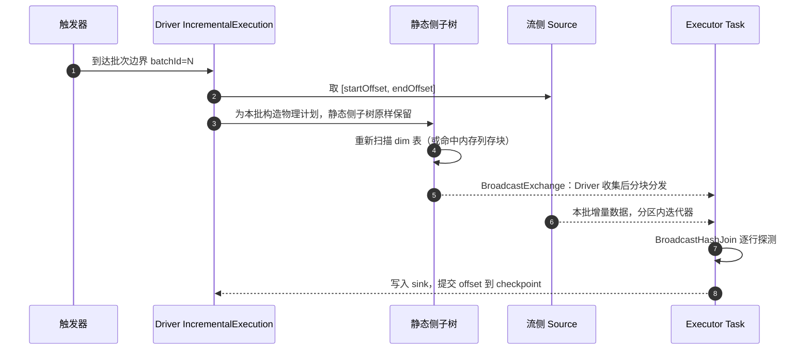
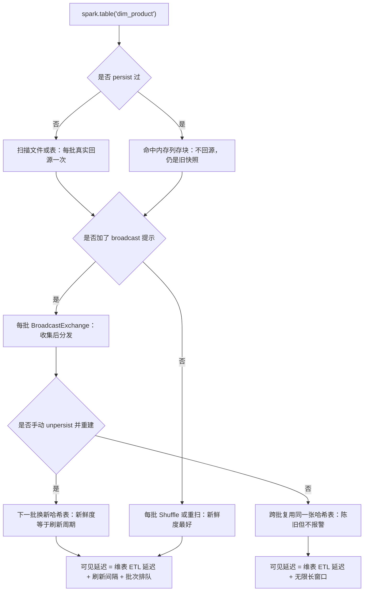
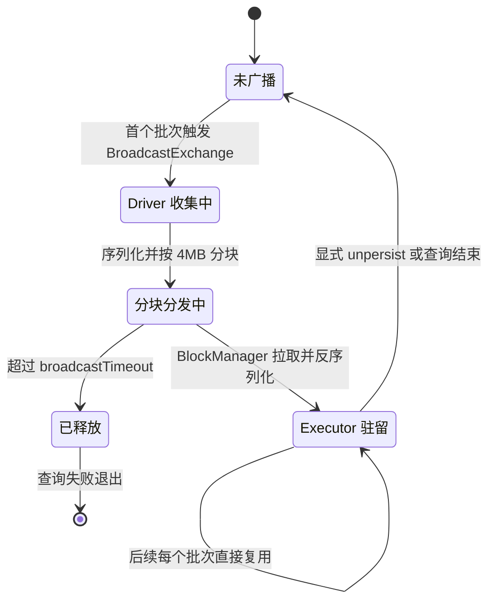
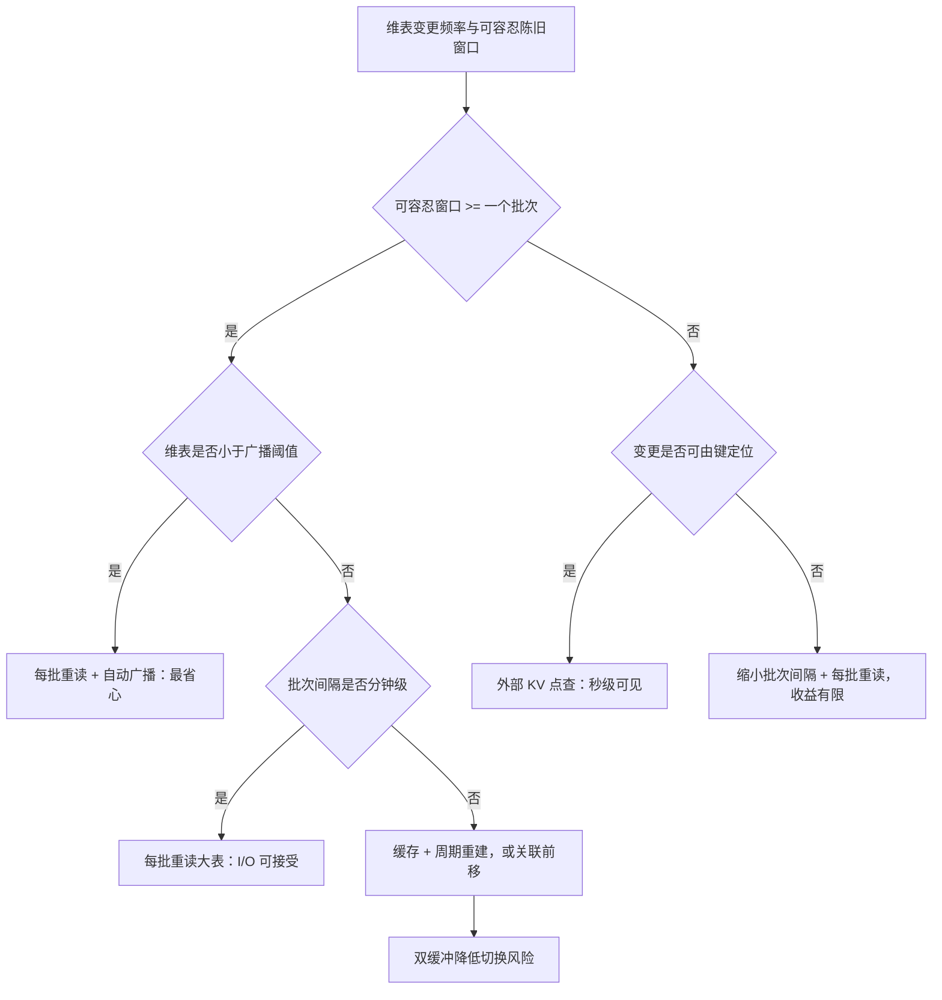
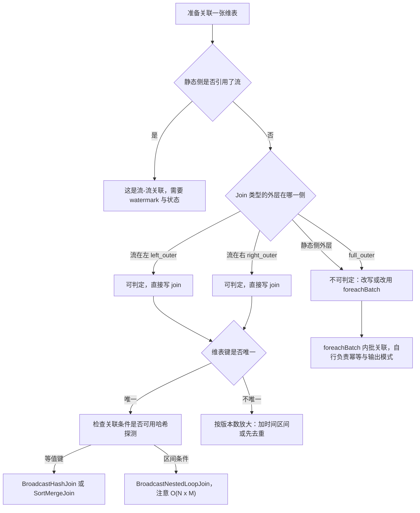
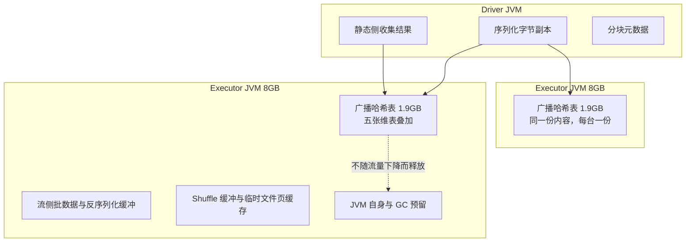

# 10 流批一体查询：Static DataFrame 与 Streaming DataFrame 的混合使用

**摘要：**

Structured Streaming 允许静态 DataFrame 与流 DataFrame 出现在同一个查询里，实时数仓里最常见的用法就是拿一张维表去给事件流打宽。这件事看起来只是"语法上允许混着写"，但它的全部性质其实都由一句实现细节决定：静态侧在每个微批（micro-batch）里都会被重新执行一遍，成为这一批次物理计划里一棵独立的子树。重新执行的这一刻同时给出了两个属性——数据新鲜度，以及代价。

本文沿这条线索展开：先说明流批混算在语义层凭什么成立、到物理层又退化成什么形状，以及为什么它不产生任何状态；再把"重新读一遍"拆成四层遮蔽，讲清静态侧到底能读到多新的数据，以及 Hive 覆盖写这类场景下为什么连批内一致都保不住；接着把每批全量扫描折算成批次时长与 I/O 带宽，并交代广播（Broadcast）的真实成本与它的不可回收性；然后把刷新这件事的四条路径摆开，说明 `unpersist` 的时序坑与 `foreachBatch` 的幂等责任；最后落到语义边界上，回答静态侧能不能是任意查询、流侧为什么只能站在某些 Join 类型的左边、N 张维表叠加后的内存账为何无法靠分区裁剪缓解，以及查询层的"一体"与运行时的一体究竟差在哪一层。

文章口径为 Spark 4.3.0（4.x 预编译 Scala 2.13）；源码与参数行为以对应版本文档或源码为准。

**关键词（Keywords）**: Stream-Static Join, 维表关联, BroadcastHashJoin, IncrementalExecution, foreachBatch, 广播变量, 维表刷新

---

## 第 1 章 无界表与有界表：流批混算被允许的根据

### 1.1 一次建模选择带来的副作用

2016 年 Spark 2.0 把 Structured Streaming 作为实验特性放出来时，它没有走"把流切成小批交给批引擎"这条直白的路，而是先做了一次建模替换：流不再是 RDD 序列，而是一张不断被追加的无界表（unbounded table）。批处理读的是一张有界的表（bounded table），一次分析、一次物化、输出终局；流处理读的是同一张表"截至目前"的部分，每次触发只把新增的行算一遍。两者被塞进同一个抽象之后，算子对输入的要求就只剩"它是一张表"这一条，至于这张表是有限还是无限，变成了执行层需要区分的事，而不是语义层需要区分的事。

这次替换的副作用在两年后才被充分利用。既然算子只认表，那么一个查询里同时出现一张无限表和一张有限表，在语义上就没有任何理由被禁止——`JOIN` 的两侧本来就不必同构。2018 年前后，流-批关联（Stream-Static Join）在各种实时数仓的讨论里成为高频模式，恰好是因为现实世界的数据形状本来就是这样分裂的：行为数据是流式的、按秒增长，而维度数据是快照式的、按天或按小时更新。让维表也伪装成一条流去参与流-流关联，是把数据形状硬拗成引擎的形状；允许两者混算，则是让引擎去适配数据形状。

这个区分值得先说清，因为后文所有的"代价"都从这个建模选择里长出来：流批混算不是优化器技巧，也不是把批作业塞进流的调度器。**真正需要引擎额外承担的，只是"静态的那一侧在每个批次里怎么重新出现"这一件事。**

### 1.2 物理层它退化成了什么

把同一段代码分别按批与按流分析，可以看到静态侧在两侧的处境完全不同。批作业里 `spark.table("dim_product")` 被解析成一个 `LogicalRelation`，它属于那次查询的整个计划，扫一遍就结束；流作业里 `spark.readStream.table("ods_order")` 被解析成 `StreamingRelation`，它在分析阶段就要被标记为流式叶子，而 `LogicalRelation` 只是一个普通叶子。分析器对"这是不是一个流查询"的判断，看的是计划里有没有、以及有几个流式叶子，静态叶子根本不参与这个判断。

真正把两者缝起来的是执行阶段。Structured Streaming 的每个微批都会走一遍 `IncrementalExecution`（位于 `org.apache.spark.sql.execution.streaming`），它继承自批处理的 `QueryExecution`，在物理计划前后插入一批流专用规则：把 `StreamingRelation` 换成这一批次 offset 区间对应的数据、给有状态算子挂上 state store 的读写、控制输出模式的投影。走完这些规则之后，剩下的编译与执行路径与批作业共用同一套 `toRdd`。静态侧那棵子树没有被任何规则改写，它以 `FileSourceScanExec`、`HiveTableScanExec` 或 JDBC 扫描节点的形态留在计划里，随批次的执行被重新拉起。

由此可以推出一条常被忽略的结论：流-批关联在算子层没有"流专用实现"。`JoinSelection` 面对的是一个普通的两侧 `Join`，它按广播阈值、表大小、键的可排序性挑出 `BroadcastHashJoinExec`、`SortMergeJoinExec` 或 `ShuffledHashJoinExec`，选法与离线作业完全一致；`StreamingJoinStrategy` 那条规则只负责流-流关联，因为它要处理的是"两侧历史都要留在 state store 里、并按事件时间淘汰"这种批处理从未面对的问题。静态侧不需要被记住，所以它不会被写进状态。

反过来说，如果硬把维表做成一条流去参与流-流关联，代价立刻显形：维表的历史版本永远等不到"可以淘汰"的信号（维表的更新没有统一的事件时间，水位线无从推进），状态会一直长；而结果正确性还会依赖于两条流的到达顺序。用流-批关联去承载维表，本质上是把"维表已经被完整物化"这个前提还给了引擎，让引擎在一次批次内大胆地做批处理 Join。

### 1.3 一个贯穿全文的打宽作业

为使后文的成本与边界有具体着力点，笔者设想一个实时订单打宽作业 `order_enrich`：订单事件从 Kafka 的 `ods_order_event` 主题进入，每条事件带有 `orderId`、`productId`、`userId`、`regionCode` 与事件时间；打宽需要三张维表——商品维表 `dim_product`（约两千万行，含类目、品牌、价格带）、用户维表 `dim_user`（约八千万行，含注册渠道、会员等级）、地区码表 `dim_region`（十万行以内，含省市与销售大区）。三张表都在 Hive 里，由离线链路按小时或按天重写。

```python
# 静态侧：三张维表在逻辑上都是"有界表"
product_dim = spark.table("dim_product")
user_dim    = spark.table("dim_user")
region_dim  = spark.table("dim_region")

# 流侧：订阅订单事件主题
orders = (spark.readStream
          .format("kafka")
          .option("subscribe", "ods_order_event")
          .load())

enriched = (orders
            .join(region_dim,  "regionCode", "left_outer")   # 十万行，广播
            .join(product_dim, "productId",  "left_outer")   # 两千万行，阈值之上
            .join(user_dim,    "userId",     "left_outer"))  # 八千万行，阈值之上

(enriched.writeStream
 .outputMode("append")
 .format("delta")
 .option("checkpointLocation", "/ckpt/order_enrich")
 .start("/dwd/order_enriched"))
```

这段代码的形状值得记下来：它没有任何一处出现"刷新""缓存""批次"之类的字眼，`join` 的写法与离线作业一模一样，但三个 `join` 在物理层的待遇会完全不同——十万行的那张会被广播，两千万与八千万的那两张会走 Shuffle。同一个查询里同时存在两种关联实现，这件事由优化器按阈值自己决定，用户看不到。

### 1.4 名册与钉在墙上的名册

把静态侧想成车间开工前要领的一份当班名册。每个批次开工都得重新去领一次：这份名册是"当前版本"，谁被调走了、谁新来了，这一班立刻知道；代价是每班都要跑一趟档案室。另一种做法是把名册钉在车间墙上，抬头就能看，省掉了跑腿，但墙上那份是钉下去那天的版本，人事变动不会自己浮现，得有人定期撕下来换新——而且 Spark 里这份"墙上的名册"往往撕不干净。这就是"每批重读"与"广播缓存"的分野：不在快慢，而在变化以什么节奏被看见。

这个比喻有一个必须交代的技术限定：Spark 的静态侧并不是"每班都去档案室"，中间还夹着几层缓存与元数据，所以"每批重读"未必读到磁盘上的最新版本。

下图是一个微批从触发到提交的完整时序，注意静态侧子树的出现位置：它不在批次的准备阶段，而是随每次执行重新生成。



图中两个箭头最容易误读。第三个箭头"为本批构造物理计划"里没有"读取"这个动作，读发生在执行阶段；而第五个箭头把广播画在了 Task 之前，实际上收集与分发由 Driver 与各 Executor 的 BlockManager 协同完成，Task 只是最终消费方。至于没有出现 watermark 与 state store，是因为这条路径上确实没有它们的位置。

---

## 第 2 章 新鲜度：静态侧"重新读一遍"究竟读到什么

### 2.1 四层遮蔽

"每个批次重新读一遍维表"这句话里，"读"是一个逻辑动作，落到物理路径上要穿过至少四层缓存，任何一层都能让读到的东西不再是数据源上最新的版本。

第一层是表格式与元数据层。Hive 表的读取要先问 metastore 拿分区列表，若上游作业刚写完数据但还没有完成分区的提交动作，读者看不到这些分区；反之，若元数据缓存没有失效，读者可能还在按旧的分区列表扫。Spark 的 `spark.sql.hive.metastorePartitionPruning` 与元数据缓存（`spark.sql.hive.filesourcePartitionFileCacheSize`）加速了这一层，也让"最新"多了一点延迟。

第二层是 DataFrame 级的缓存。对静态侧调用 `persist()` 之后，后续批次读到的是内存（或磁盘）里的列存块，不再回源。这一层是明确的手动选择，但它有个容易忽略的连带效果：缓存持有的是一份旧快照，而 `spark.table` 每次返回的 `DataFrame` 对象虽然是新的，只要它指向同一份被缓存的计划，读到的就还是旧块。

第三层是广播（Broadcast）。一旦静态侧被 `broadcast()` 提示并被 `BroadcastExchangeExec` 物化成广播变量，它在 Executor 上是一张哈希表，跨批复用，与数据源已经完全脱钩。这一层的陈旧最容易发生，因为它的失效不说话。

第四层在被关联的对象自己的系统里。静态侧如果是 JDBC 读 MySQL，读者看到的是只读副本上的数据，副本延迟、连接池里的缓存、乃至源库上的读写分离策略都会叠加到新鲜度上；此时"每批重读"仍然成立，但读到的可能是一分钟前的从库。

把这四层与它们对更新的敏感度并排放在一起，"新鲜度"才变成一个可以讨论的量。

| 静态侧形态 | 是否感知维表更新 | 单批代价 | 失效时的外部症状 |
|---|---|---|---|
| `spark.table()` 每批重读，不缓存 | 是，下一批即可见 | 全表扫描一遍，随维表大小线性增长 | 批次时长被维表扫描支配，反压积累 |
| `persist()` 后重读 | 否，直到 `unpersist` | 首批一次扫描，后续读内存块 | 新维表行在输出里长期缺失 |
| `broadcast()` 且跨批复用 | 否，直到重建 DataFrame | 首批收集分发，后续零读取 | 新用户事件整列为 NULL，且无明显报错 |
| `broadcast()` + 定时 `unpersist` 重建 | 是，刷新周期即可见窗口 | 每个刷新周期一次收集分发 | 可见窗口等于刷新间隔，需与业务约定 |
| JDBC 直连（每批查询远端库） | 是，受从库延迟约束 | 每批一次远程查询，QPS 压力落在源库 | 源库连接被打满，批次超时 |
| Delta 表 + `versionAsOf` 批读（`foreachBatch` 内） | 是，且可见窗口可由版本号精确指定 | 每批一次带版本的文件列举与扫描 | 版本号语义未落血缘，回溯困难 |

### 2.2 批内快照与跨批不一致

流-批关联给出的语义是一句相当弱的话：**同一个批次内的所有流记录，看到的是同一份静态侧快照；不同批次之间不保证任何版本关系。** 这既不是事件时间对齐，也不是单调递增的版本推进，只是"一批一次"。

先说批内。同一个微批里静态侧只被执行一次（或按分区并行执行多次，但共享同一份分区列表与同一批文件），因此这一批里成千上万条流记录打宽时看到的是同一版本的商品价格、同一版本的会员等级。多数场景下这正是想要的：批内口径一致，聚合出来的数不会自相矛盾。

但"批内一致"有两个漏洞。其一是静态侧若是被 `persist()` 或广播持有的旧快照，那么"一致"是对一份陈旧数据的一致，一致性有了，正确性没有。其二更隐蔽：静态侧若是 Hive 上被 `INSERT OVERWRITE` 全量重写的分区表，且扫描跨了多个分区，那么覆盖发生的时刻恰好落在扫描中间时，读者完全可能读到"一半分区是新数据、一半是旧数据"的混合体。分区级提交在文件系统层面是原子的，跨分区的提交不是；批次并不会因此失败，只会安静地产出一批混了口径的输出。这类问题在报表上的表现是"某一小时的类目占比突然畸变"，而在作业日志里什么也看不到。

再说跨批。第 N 批看到维表版本 V1、第 N+1 批看到 V2，中间没有任何过渡；如果 V2 是一次错误发布，那么从 V2 可见的那一批开始，输出就错了，直到下一次发布修正。流-批关联没有任何"回滚到上一版本"的能力，因为批次已经提交、offset 已经推进。这决定了维表发布流程必须有校验环节（见 4.4），不能指望流作业自己兜住。

### 2.3 新鲜度的真实上限

把可见性写成一条不等式会更清楚。一条维表变更从产生到出现在打宽结果里，要经过三段延迟：

```text
可见延迟 = 维表 ETL 完成延迟            # 源库 → Hive/Delta 的同步作业周期
         + 维表可见窗口                  # 缓存/广播刷新的间隔，未缓存时约等于 0
         + 批次排队延迟                  # 本批结束到下批开始，受批次间隔与积压影响
```

三段里最容易被低估的是第三段。`Trigger.ProcessingTime("10 seconds")` 只规定"上一批结束后至少等 10 秒"，不规定"至多等 10 秒"；单批执行一旦超过间隔，下一批紧接着开始，堆积的批次会把端到端延迟推到一个与间隔无关的量级上。

三段之外的第四个约束是语义性的：**流-批关联不可能比它的批次更细。** 即便维表在 T 时刻已经可见，落在 T 之前那个批次里的流记录也已经用旧版本打宽并提交了，无法回改。想把可见窗口压到秒级，唯一的路是把维表搬到一个支持逐行点查的外部存储（Redis、HBase、Phoenix 之类），让"每批"变成"每行"，那是另一种成本结构。

下图把四层遮蔽与可见窗口画在一起，可以看清"每批重读"这条路径上真正省掉的是哪一层。



图里最右一列是本文反复要落到的那个点：所有"快"的路径都把延迟换成了陈旧，而陈旧在流查询里不会以异常的形式暴露出来，只会以"某些行的关联字段为空"或"分组占比轻微偏移"的形式存在。

---

## 第 3 章 代价：每批一次全量扫描的账怎么算

### 3.1 一次示例推算

先把"代价"从形容词变成数字。以第 1 章那个打宽作业为参数：`dim_product` 两千万行、行宽约 200 字节、Parquet 列存压缩比按 3:1 估，落盘约 1.3GB；`dim_user` 八千万行，落盘约 5.3GB；`dim_region` 十万行，可以忽略。批次间隔取 10 秒。（以下均为示例推算，用于说明量级关系，不是实测。）

若两张表都不缓存、每批重读，那么每个批次要回源读取约 6.6GB，折算成持续读带宽是 660MB/s，且这个速率与流里有多少条事件毫无关系。共享 HDFS 集群上这个量级通常直接触发 NameNode 与 DataNode 的压力，即便存储撑得住，单批执行时间也会远远超过 10 秒，于是下一批立刻开始、队列堆积，端到端延迟从"10 秒"滑到几分钟。

把间隔改成 5 分钟再看：每批 6.6GB、每小时 12 批，约 79GB/小时的持续读取。这个量级在专用存储上勉强可接受，但每小时的 I/O 预算是固定的，与订单量无关——大促期间订单涨十倍，读取成本一分不变。

"按批计费、不按行计费"是流-批关联成本模型的核心，也是很多误判的来源。批作业里读一次维表是有回报的，因为它服务了这一次查询的全部数据；流作业里读一次维表只服务一个批次，批次越小回报越低。极端情形是"空批次"——某个 200 毫秒的批次只来了 30 条事件，维表照样全量扫了一遍，这一次扫描的回报率是 30 行除以两千万行。

```text
单批成本  ≈ 维表扫描代价（I/O + 反序列化） + Join 探测代价 + 广播收集分发代价
批次时长  ≈ max(流侧增量处理, 静态侧树执行) + 排队等待
吞吐上限  ≈ 批次内流记录数 / 单批成本        # 静态侧恒定时，吞吐随批次粒度下降而下降
```

### 3.2 广播的代价不是零

"把静态侧广播出去就不用每批读了"这句话在流的语境里要打个折扣，因为广播本身也是一笔每批都要付的钱（除非跨批复用）。一次 `BroadcastExchangeExec` 的执行包含三段（详见[[大数据/Spark/Spark-SQL深度解析与性能调优/05 Physical Planning：从逻辑计划到物理算子的策略选择|物理计划的选择]]）：Driver 端执行静态侧子树并把结果 `collect` 到堆内、序列化成按 `spark.broadcast.blockSize`（默认 4MB）切分的块、各 Executor 通过 BlockManager 拉取并反序列化成探测用的哈希关系。

第一段对 Driver 堆的要求常被低估。收集过程中，Driver 上要同时容纳"行对象"与"序列化后的字节数组"，峰值通常是原始数据量的两倍以上；一张 2GB 的解压后维表，实际要求 Driver 至少有 4 到 5GB 的可用堆，否则就是 `java.lang.OutOfMemoryError: Java heap space` 发生在 Driver 而非 Executor 上——这类 OOM 在流作业里比批作业更常见，因为批作业只广播一次，流作业每个批次都要再走一遍，累积的垃圾回收压力也更大。

第三段的网络总量则等于"表大小 × Executor 数"。TorrentBroadcast 让 Executor 之间可以互相取块、避免 Driver 出口成为瓶颈，但它改变的是流量分布而非总量；100 个 Executor 分发一份 1GB 的广播，网络上就要走 100GB。分发时间超过 `spark.sql.broadcastTimeout`（默认 300 秒）时，查询不是退化成 Shuffle，而是直接失败并抛出 `BroadcastTimeoutException`，然后按查询失败策略终止。这个失败形态值得记住：广播超时是硬失败，不是性能退化。

还有一条不容易想到的约束：广播提示只能加在静态侧。`broadcast()` 的语义是"把这一侧完整物化后复制到每个 Executor"，而流侧在任意时刻只有本批的增量可见，把它作为 build 侧与"增量"这件事自相矛盾，这样的写法在分析阶段就会被拒绝（不同版本文案略有差异）。所以"给流侧加广播提示来加速"这条路是堵死的，能调的只有静态侧的形态。

### 3.3 新鲜度、单批延迟与常驻内存

把几种做法摆到同一张表里，会看清它们其实是在三个约束上各让一步：可见延迟能压到多短、每个批次要付多少 CPU 与 I/O、以及这些数据要常驻多少内存。

| 方案 | 可见延迟 | 单批 CPU/IO | 常驻内存 | 主要故障面 |
|---|---|---|---|---|
| 每批重读，不缓存不广播 | 一个批次 | 一次全表扫描 + 一次 Shuffle 或广播 | 几乎为零 | 静态侧大时批次时长失控 |
| 每批重读，`persist()` 缓存 | 直到手动解除缓存 | 首批一次扫描，之后读内存块 | 维表大小（分布于 Executor） | 缓存与源脱钩，无人察觉的陈旧 |
| 广播且跨批复用 | 直到重建 DataFrame | 首批收集分发，之后近似零 | 维表大小 × Executor 数，另加 Driver 一份 | Driver OOM、广播超时、内存只增不减 |
| 广播 + 周期重建 | 刷新周期 + 批次排队 | 每个刷新周期一次收集分发 | 同上一行，切换瞬间双份 | 切换时序错误导致取块失败 |
| 大表走 SortMergeJoin | 一个批次 | 每批两侧 Shuffle，代价随表线性增长 | Shuffle 缓冲与临时文件 | 键基数低时严重倾斜 |
| 外部 KV 逐行或批量点查 | 行级（秒级以内） | 每行或每分区一次 RPC | 连接池与本地小缓存 | 源库 QPS 与 P99 延迟 |

这张表最右一列比中间几列更值得看。前几种方案的故障都是"资源不够"或"慢"，会自己喊出来；只有"广播且跨批复用"这一行，故障面是"数据陈旧"，而陈旧在监控上没有任何直接指标，只能靠业务侧发现输出的关联字段为空。这也是为什么它是最常见的生产事故形态。

### 3.4 比喻：发手册、跑档案室与打电话

给工人发一本手册，等于广播并缓存：抬头就能查，但手册是发下去那天的版本，改版要靠人回收重印，而 Spark 里这本手册往往收不回来。让工人每次查都跑一趟档案室，等于每批重读：永远是当前版本，代价是每一趟的路程固定，与"要查几个字"无关。装一部电话打给总部问，等于外部 KV 点查：版本永远最新，但每问一次都要占用一条线路，且要等对方接听。

三种方式没有优劣，只有与业务节奏的匹配度：维表一天变一次而事件每秒都在来，跑档案室显然浪费；维表每分钟都在变而事件量不大，发手册就是灾难。

下图是广播从创建到释放的状态迁移，注意它在"驻留"状态上的自循环——每个批次执行都会回到同一个状态，没有任何自动退出条件。



这条状态机解释了"广播不可回收"这个说法在工程上的准确含义。理论上广播变量在失去引用后会被 `ContextCleaner` 清理，但在一个长期运行的流查询里，物理计划对象往往被跨批复用，广播块就一直被引用着；实践中观察到的现象是"广播内存在查询重启前不会下降"，所以规划内存时必须按"不会自动归还"来算。

---

## 第 4 章 刷新：把新鲜度找回来的四条路

### 4.1 unpersist 的时序坑

发现广播陈旧之后，第一反应通常是在 `foreachBatch` 里先 `unpersist()` 再重建。这个写法有一个真实的时序风险：`unpersist` 会请求 `ContextCleaner` 移除各 Executor 上的广播块，而当前批次的 Task 可能还在使用它——典型报错是 `SparkException: Failed to get broadcast_17_piece_0`，或者更含糊的取块超时。旧批次正在跑的 Task 与刷新动作之间没有任何同步机制。

安全的做法有两种。其一，把刷新动作放在批次边界之外，由一个独立的控制流触发（例如另一条心跳查询或外部调度），主查询在批次开始时只读取一个已经切换好的引用。其二，不用"原地刷新"，而用双缓冲：两个变量交替持有新旧 DataFrame，批次开始时切换引用，等旧引用确定无人使用后再解除缓存。第二种方式能把切换点控制在批次边界上，代价是要自己维护引用计数，代码复杂度明显上升。

```python
# 双缓冲：切换发生在批次开始前，解除缓存留到下一批次
dims = {"cur": spark.table("dim_product").cache(), "old": None}

def enrich_with_swap(batch_df, batch_id):
    # 只有走完一个完整批次才允许换血，避免 Task 还在用旧广播块
    if dims["old"] is not None:
        dims["old"].unpersist()      # 上一个引用至少已经服务过一整个批次
        dims["old"] = None
    dims["old"], dims["cur"] = dims["cur"], spark.table("dim_product").cache()
    batch_df.join(dims["cur"].hint("broadcast"), "productId", "left_outer") \
            .write.format("delta").mode("append").save("/dwd/order_enriched")
```

这段代码的重点不在 API，而在两处顺序：先换引用、再用新引用，以及把解除缓存推迟到"下一个批次的开始"。它不是唯一正确的写法，但它把"释放"与"使用"在时间上彻底分开，避开了最难复现的那类偶发失败。

### 4.2 四条刷新路径

**路径一，每批重读。** 不缓存、不广播，静态侧每批从源回源。优点是没有任何刷新逻辑，也没有失效点，正确性最高；缺点是 3.1 节算过的那笔账。它适合维表小或批次间隔长的场景，也适合作为其他方案的对照基线。

**路径二，周期重建。** 缓存或广播静态侧，另设一条心跳查询按固定周期触发重建。社区里常见的心跳做法是读一个 `rate` 源，在它的 `foreachBatch` 里执行"解除缓存、重读、重新缓存"，主查询持有一个可变引用指向当前的静态 DataFrame。这种写法能用，但它把两个查询耦合在 Driver 的同一个 JVM 变量上：主查询可能在刷新动作刚换掉引用、尚未完成缓存的瞬间读到它，读到的东西虽然正确但会触发一次额外的全量计算。要稳妥就必须加一个"就绪标记"，让主查询只在标记为真时使用新引用。

```python
# 心跳查询只负责刷新，不产出业务数据；主查询读同一个可变引用
import time

state = {"dim": None, "ready": False, "loaded_at": 0.0}
REFRESH_SECONDS = 600

def refresh(batch_df, batch_id):
    state["ready"] = False
    if state["dim"] is not None:
        state["dim"].unpersist()
    fresh = spark.table("dim_product").cache()
    fresh.count()                       # 触发物化，确保缓存已就绪再放行
    state["dim"], state["ready"], state["loaded_at"] = fresh, True, time.time()

spark.readStream.format("rate").option("rowsPerSecond", 1).load() \
     .writeStream.foreachBatch(lambda df, i: refresh(df, i) if time.time() - state["loaded_at"] > REFRESH_SECONDS else None) \
     .option("checkpointLocation", "/ckpt/dim_refresh").start()
```

`fresh.count()` 那一行不是冗余：`cache()` 是惰性的，调用它不会立刻物化，所谓的"缓存"只是登记了一个意图，真正使用之前仍需重算一遍，而这一遍重算恰好可能发生在主查询的批次里。

**路径三，外部 KV 点查。** 把维表同步到 Redis、HBase 或 Phoenix，在 `foreachPartition` 里用连接池批量点查。它的新鲜度可以做到秒级甚至更好，维度也不受批次约束；代价是每一行关联都变成一次远程调用，必须在分区级做批量、必须控制并发，且目标存储的可用性从此进入流作业的故障域。

```python
def enrich_partition(rows):
    import redis
    pool = redis.ConnectionPool(host="dim-cache", max_connections=8)
    r = redis.Redis(connection_pool=pool)
    for row in rows:
        payload = r.hgetall(f"dim:product:{row.productId}")   # 分区内复用连接
        yield (row.orderId, row.productId, payload.get("category"), payload.get("brand"))
```

这种写法的隐藏成本在延迟分布而不是平均值上。点查的 P50 可能只有 0.5 毫秒，但 P99 一旦抖到几十毫秒就会拖慢所有分区，而 `foreachPartition` 的耗时直接计入批次时长。适用前提是目标存储的 P99 足够稳，不是平均延迟足够低。

**路径四，把关联前移。** 干脆不在流里关联：离线侧把维表字段冗余进事件表，或者维护一张打宽后的宽表，流侧只做过滤与聚合。这条路把"新鲜度"问题转成了"宽表更新"问题，通常配合数据湖的 upsert 能力使用。它的代价是事件体积变大、历史数据不会被新维表回改，适合维表本身变化极慢（地区码、类目树）的场景。

| 刷新路径 | 可见延迟 | 实现复杂度 | 主要危险点 | 适配场景 |
|---|---|---|---|---|
| 每批重读 | 一个批次 | 最低 | 静态侧大时批次时长失控 | 小维表、长批次间隔 |
| 周期重建（心跳） | 刷新周期 + 排队 | 中 | 引用切换与物化时序、双查询耦合 | 中维表、可容忍分钟级陈旧 |
| 双缓冲重建 | 刷新周期 + 排队 | 较高 | 引用释放时机的正确性 | 对偶发失败零容忍 |
| 外部 KV 点查 | 秒级以内 | 中高 | 目标存储 P99 抖动、连接池耗尽 | 高基数、强实时维表 |
| 关联前移到离线宽表 | 取决于宽表更新周期 | 中 | 历史不回改、事件膨胀 | 变化极慢的静态维度 |

### 4.3 foreachBatch 里的幂等责任

`foreachBatch` 是把流"降级成批"的接口：每批给你一个普通 DataFrame，你随便怎么写。它有两个行为细节必须知道。第一，Spark 在调用这个函数之前会 `persist` 这个批次 DataFrame，函数返回后再 `unpersist`，因此函数体里多次引用 `batch_df` 不会重复消费 Kafka，也就不需要自己再缓存一遍。第二，批次函数可能被判为失败并重跑——作业重启后从上一个成功批次继续，或者批次内部抛出异常后按策略重试，都会让同一个 `batch_id` 的写操作再做一次。

第二个细节意味着：函数体内的所有外部副作用都必须幂等。写 Delta 可以用 `txnAppId` 与 `txnVersion` 组成的事务标识，让重复提交被自动忽略；写不支持事务的系统，只能靠"按 `batch_id` 覆盖写一个确定的分区"来获得幂等，而这会限制分区的组织方式。把它和流-批关联放在一起看会更清楚：关联本身是纯计算，天然可重放；真正不可重放的是关联之后的写出动作，这也是 `foreachBatch` 相较 `join` 唯一的额外负担。

还有一条容易撞上的限制：在有状态查询的 `foreachBatch` 里，不能反过来去读算子状态。`foreachBatch` 拿到的是输出行的 DataFrame，state store 不在它的视野内；想做"带状态的批内决策"，得先在有状态算子那一侧把需要的量算出来并写进输出。

### 4.4 版本对齐：把"哪一版维表"写进血缘

Delta 表天然带版本号，看起来是流-批关联的理想维表：每个批次读最新版本，且事后能查到当时用的是哪一版。这里有一个 API 层面的限制需要说清——Delta 的流式读不支持 `versionAsOf` 这类时间旅行参数（流读的语义是从某个起始位置持续跟进，而不是固定在某一个版本），因此"按版本对齐"只能落在 `foreachBatch` 内：用批读加 `versionAsOf` 拿到确定的版本，再把版本号作为列写进输出。

```python
def enrich_at_version(batch_df, batch_id):
    # 批读可以用时间旅行，流读不行；版本号随输出一起落地，便于事后复盘
    dim = spark.read.format("delta").option("versionAsOf", VERSION["dim_product"]).load(DIM_PATH)
    (batch_df.join(dim, "productId", "left_outer")
            .withColumn("dim_product_version", lit(VERSION["dim_product"]))
            .write.format("delta").mode("append").save(OUT_PATH))
```

与版本对齐配套的还有一个工程惯例：维表侧维护一个"发布标记"，只有当某个版本被显式标记为已发布时，流侧才切换到它。这能避免"读到半发布状态"——上游正写到一半，读到的是一份自洽但语义上不完整的维表。第 2 章提到的跨分区覆盖写导致的口径混串，正是这种半发布状态最典型的形态。

下图把四条路径的判定顺序画成决策树，判定的第一个问题不是"维表多大"，而是"能容忍多久的陈旧"。



---

## 第 5 章 语义边界：静态侧能是什么，流侧为什么只能站左边

### 5.1 静态侧的合法形态

判断静态侧能放什么，有一条干净的标准：它必须是一个"不引用流也能被完整分析"的批计划。满足这条标准的形态比多数人以为的多——视图、多表 `union`、带 `where` 的过滤读、JDBC 远端表、带 UDF 的派生列、乃至一个已经聚合成几十行的汇总子查询，都能放在静态侧。分析器不会为静态侧设额外的闸门，因为它看到的就是一个普通的 `LogicalRelation`，与离线作业里完全一样。

不满足这条标准的形态也有几个，且失败方式各不相同。放 `readStream` 的关系进去，整个查询就变成[[大数据/Spark/Spark-Structured-Streaming流处理深度解析/08 流-流 Join：两条流如何在时间维度上对齐|流-流关联]]，语义与成本都换了一套账，第 8.3 节另有一例。想引用另一个 StreamingQuery 的输出，则根本没有这样的机制：查询之间只能通过落表发生关系，一旦落表，它就是一个静态侧，于是又回到"读到别人正在写的一半"的风险上。在静态侧调用 `collect`、`count` 之类的 action 也不行，静态侧只是计划的一部分，不拥有自己的执行权。

有一个合法但需要辨析的用法：静态侧可以带非确定性表达式。`where dt = current_date()` 这种写法在 T+1 维表上很常见，语义是"每个批次求值一次"，因此每个批次可能聚焦到不同的分区，甚至不同批次读到的是不同日期的快照。批内它仍然一致（静态侧在一个批次里只算一次），所以不会出现批次内部自相矛盾。但如果把这个函数写到流侧，性质就变了：checkpoint 重放时求值结果与首次执行不同，重放的确定性被破坏。**同一个函数放在 Join 的哪一侧，决定了它是"每批一次的合法快照"还是"破坏重放的隐患"。**

### 5.2 流侧站哪一边：可判定性而不是性能

Join 类型的方向限制经常被当成引擎的实现缺陷，其实它是一条可判定性（decidability）结论：一条输出行的最终结果，能不能在有限输入之后被确定。

流在左、静态在右的左外关联（`left_outer`）：每一条流记录到达时，静态侧已经完整可见，探测一次就能定局——没匹配就补 NULL，此后不会再有变化。可判定。流在左的左半连接与左反连接同理，它们只决定"这条流记录要不要输出"，而不需要断言任何关于静态侧未来的事。内关联两侧都只输出匹配上的行，方向写反也不改变语义，所以 Spark 对两侧顺序不设限。

静态在左、流在右的右外关联，看起来是"把左外关联写反"，其实性质不同：右外关联要求静态侧的每一行都出现在输出里，于是必须回答"这一行在未来会不会有流记录匹配它"。这个问题在流上永远无法回答——流不结束，"没有匹配"这个断言就永远不能成立。全外关联把两侧的"等未来"叠在一起，更加不可能。

| Join 类型 | 流在左（静态右） | 流在右（静态左） | 判定依据 |
|---|---|---|---|
| 内关联 Inner | 支持 | 支持 | 只输出匹配行，方向不改变语义 |
| 左外关联 Left Outer | 支持 | 不支持 | 要求静态侧每行必出，需等待流结束 |
| 右外关联 Right Outer | 不支持 | 支持 | 外层必出的一侧是流，可即时定局 |
| 全外关联 Full Outer | 不支持 | 不支持 | 两侧都要求"等未来"的断言 |
| 左半关联 Left Semi | 支持 | 不支持 | 只判定流行是否命中静态侧 |
| 左反关联 Left Anti | 支持 | 不支持 | 同上，判定是否未命中 |

表里"右外关联（流在右）支持"这一格常被读错。它支持的根据不是"静态侧在左边所以特殊"，而是"必出的一侧是流"。所以左外关联支持的是"流在左"，右外关联支持的是"流在右"，两条规则其实同一条：**外层必须在流那一侧。** 记住这一条比记住六个格子有用。

还有一条流-批关联独有的自由度值得单独说：Join 条件可以是任意表达式，不必是等值键，也不必带时间范围。流-流关联之所以要求等值键加时间范围，是因为它要为两侧都建索引、还要按事件时间淘汰状态；流-批关联没有状态，静态侧就是一个可以被任意方式探测的完整集合，所以拉链维表那种区间条件（`orderTime between effectiveFrom and effectiveTo`）可以直接写。代价藏在物理层：非等值条件无法用哈希探测，物理计划会退化成 `BroadcastNestedLoopJoin`，复杂度从 O(N+M) 变成 O(N×M)，十万行维表乘上每批百万事件，就是一万亿次比较——写得出来，但跑不完。

```python
# 拉链维表的区间关联：语义完全合法，但要接受 BroadcastNestedLoopJoin 的代价
enriched = orders.join(
    price_history,
    expr("""productId = ph_productId AND
            orderTime >= effectiveFrom AND
            (effectiveTo IS NULL OR orderTime < effectiveTo)"""),
    "left_outer")
```

### 5.3 foreachBatch：逃生口与语义降级

反对"方向限制"最直接的办法是不用 `join`，改用 `foreachBatch`。这个接口把每个批次变成一个普通 DataFrame，于是右外关联、全外关联、多表任意拓扑、多路写出，全都畅通无阻。从能力上看，它覆盖了 `join` 做不到的部分。

但换来的能力是有价格的，价格不在性能上，在语义上。一旦进入 `foreachBatch`，输出模式的判定权就交回给你：引擎不再替你决定这是 append 还是 update，也不再检查"你的写法会不会破坏幂等"。`foreachBatch` 内部的逻辑是批逻辑，它得到的保证是"这个函数会被每个批次调用一次"，而不是"这些行会被正确地合并进结果表"。第 4.3 节说过的重跑问题在这里从"要注意"升级成"必须自己解决"。

第二条价格是流式算子的缺席。`mapGroupsWithState`、`flatMapGroupsWithState`、窗口聚合的流式版本，在批 DataFrame 上都不存在；一旦你把逻辑搬进 `foreachBatch`，就等于宣布这个查询不需要跨批状态。想"既要状态又要全外关联"，只能拆成两个查询：前者按流写出到一张表，后者在 `foreachBatch` 里把这张表当静态侧去做全外关联。这能成立，但它把"一个查询"变成了"两个查询加一张中间表"，故障域与延迟都随之翻倍。

### 5.4 重复键：被"维表"这个词掩盖的放大

维表这个称谓自带一个暗示：每个键对应一行。引擎不做这个假设，也不会校验。静态侧若存在重复键，流-批关联就是一对多放大，输出行数按重复度膨胀，而流侧对此一无所知——它只是发现"订单明细表的行数比订单流多了三倍"。

最常见的一种重复不是脏数据，而是拉链维表（slowly changing dimension）。同一 `productId` 在价格历史表里有多个版本行，如果关联条件只写了 `productId` 而忘了时间区间，结果就是每条订单按历史版本数被复制多份，且每一份的价格都不同。这类错误在数据量小时看不出来，在维表积累了半年历史之后突然爆发，排查时又因为"关联本身没报错"而绕远路。

| 静态侧形态 | 放大风险 | 处置方式 | 处置的代价 |
|---|---|---|---|
| 唯一键维表 | 无 | 无需处理 | 需要上游保证唯一性 |
| 含重复键维表 | 按重复度放大 | 关联前 `distinct` 或 `row_number` 取一 | 每批一次全量 shuffle |
| 拉链维表（多版本） | 按版本数放大 | 关联条件加时间区间 | 退化为嵌套循环关联 |
| 分区未裁剪的维表 | 按分区数放大 | 静态侧加分区谓词 | 需要维表带稳定分区列 |

表里第三行是真正的两难：加时间区间是语义正确的做法，但它把执行计划推向了 `BroadcastNestedLoopJoin`；不加区间是执行高效的做法，但结果是错的。这个取舍没有通用答案，取决于维表是"当前值表"还是"历史拉链表"——前者不需要区间，后者必须付代价。**同一个业务里两张表可能分属两种形态，代码里却长得一模一样，这是维表关联最难自查的地方。**

下图是判断一条 `join` 写法是否成立的流程，起点不是 Join 类型，而是"维表到底是什么形态"。



---

## 第 6 章 多张维表：N 份广播与不可裁剪

### 6.1 内存账：Driver 一份，每个 Executor 各一份

打宽作业很少只关联一张维表。一个日志流的打宽链路上常常挂着机器维表、业务线维表、机房维表、应用维表、负责人维表，每张都不大，单独看都能广播。把它们的体积加起来，账目会变得很难看。

以五张表为例：解压后分别为 400MB、300MB、120MB、80MB、60MB，合计约 960MB。这个量级在"单张表可广播"的判断下全部通过，实际负担却是：Driver 端至少需要容纳 960MB 的原始对象与序列化副本（峰值两倍以上，接近 2GB），每个 Executor 各持有一份反序列化后的哈希关系。**广播内存按"表大小 × Executor 数"计，不按"表大小"计**——Executor 从 20 个扩到 100 个，网络总量涨五倍，而每个 Executor 的常驻内存一份不少。

哈希关系本身还有放大系数。`UnsafeHashedRelation` 要为每个键保存哈希槽位与行地址，value 列越多、key 越长，放大越明显；经验区间是原始行对象的 1.5 到 3 倍（此处为示例推算，实际取决于列数与编码方式，可用 Spark UI 中各 BroadcastExchange 报告的大小做校准）。按 2 倍估，960MB 的解压数据在 Executor 上占约 1.9GB，这还没算流侧的数据缓存、Shuffle 缓冲与 JVM 自身开销。

| 维表 | 解压后 | 广播后单 Executor 常驻（按 2 倍估） | 是否值得广播 |
|---|---|---|---|
| 机器维表 | 400MB | 约 800MB | 键基数高、变更慢，值得 |
| 业务线维表 | 300MB | 约 600MB | 键基数低，更该广播以躲开倾斜 |
| 机房维表 | 120MB | 约 240MB | 值得 |
| 应用维表 | 80MB | 约 160MB | 值得 |
| 负责人维表 | 60MB | 约 120MB | 值得 |
| 合计 | 960MB | 约 1.9GB | 单 Executor 已接近 2GB |

这张表里没有一行是错的，五张表单独看都该广播，叠加之后的效果却等价于给每个 Executor 挂了一张 2GB 的只读表；Executor 堆若是 8GB，广播已占四分之一，OOM 只差一个变大的批次。

### 6.2 广播不可分区裁剪

分区裁剪（partition pruning）是静态侧唯一能"少读"的手段，它的前提是过滤条件落在静态侧自己的列上。`where regionCode in (...)` 能让扫描只碰部分分区，这个优化在每批重读时真实有效。

广播把这条路堵死了，原因在于广播的执行位置：`BroadcastExchangeExec` 在 Driver 端收集静态侧的**全部**输出，然后整份分发。它不关心流侧的键分布，也不关心这一批事件实际只涉及哪几个地区。哪怕这一批的一万条事件全部来自华东、而维表里 90% 的行属于其他大区，广播仍然搬运整张表。

这里缺少的机制是"用流侧的键集合裁剪静态侧"。批处理里有一类相近的优化——运行时过滤、动态分区裁剪、semi-join 下推——但它们的共同前提是能在执行前拿到一侧的键集合。流侧的键集合是逐批到达的，Spark 并没有把"本批去重后的 join 键"回灌给静态侧的扫描算子，也就没有对应的下推路径。相比之下，Flink 的 lookup join 是逐行点查，天然只碰需要的行；Trino 的动态过滤也是把 build 侧的键集合广播成布隆过滤器再下推。广播型关联把"裁剪"这件事整体让给了内存，换来的是零 Shuffle 与零 RPC。

于是有一个容易被忽略的成本对比：当流侧只涉及维表的一小部分键时，广播的代价是"全量搬运"，而点查的代价是"按需访问"，两者的差距可以到两个数量级。判据不是维表多大，而是"每批实际用到的维表行占比"——占比低就该点查，占比高就该广播。

### 6.3 阈值该按大小还是按键基数

`spark.sql.autoBroadcastJoinThreshold` 默认 10MB，调大它就能让更多表自动广播。多数调优建议围绕"表大小不超过 Executor 内存的 10% 到 20%"展开，这个建议只说了一半。

另一半是键基数。广播关联没有倾斜概念：探测是每行一次哈希查找，键的分布不影响耗时。SortMergeJoin 则完全由键分布支配——若关联键是销售大区（全国几十个取值），Shuffle 之后几十个分区会扛下几乎全部数据，其余分区空转；若关联键是订单 ID（高基数），分布均匀，SMJ 就很健康。所以"大表 + 低基数键"是最坏组合：表大到不能广播，键又低基数导致 SMJ 倾斜。这种情形下正确的做法反而是强行广播（用内存换掉倾斜），并且接受 Driver 收集与分发的代价。

反过来，"小表 + 高基数键"也没有理由走 SMJ：小表 Shuffle 出去再拉回来，付出了网络却什么也没省下。判据因此可以写成一句话：**广播的代价是内存乘以 Executor 数，SMJ 的代价是 Shuffle 量乘以倾斜程度；比较的是这两个乘积，而不是表的大小。**

还有一条更少被提到的限制：桶化（bucketing）优化在流-批关联上基本不成立。静态侧若是按 join 键分桶的表，SMJ 本可以省掉一侧的 Shuffle；但这要求另一侧也按相同的桶数与键分布组织，而流侧的增量数据分区由 Source 决定——Kafka 的分区按主题分区划分，与 join 键毫无关系。桶对齐的前提在流侧无法满足，`EnsureRequirements` 里那条桶优化规则因此形同虚设。

### 6.4 编排顺序与共享 Executor

多个 join 的书写顺序会影响中间结果。关联本质上是按匹配行数放大：与唯一键维表关联不改变行数，与含三个版本的拉链表关联放大三倍。若先做放大倍数大的关联，后续每一次关联都要处理放大后的数据量；调换顺序则能把放大推迟到最后。这个道理与离线作业一样，但在流里更敏感，因为放大后的数据量直接决定单批时长，而单批时长又决定反压程度。

另一件只在流里出现的事是广播的共享。一个 Executor 上通常跑着多个流查询——明细打宽、实时指标、特征拼接各一个——每个查询都有自己的广播表。这些广播块在同一份 Executor 内存里累加，而每个查询的开发者只看得到自己那张表的体积。生产上出现"单看每个作业都合理、一起跑就 OOM"的情形，多一半是这么来的；把多个打宽逻辑合并到一个查询里（它们的维表可以共用一次广播）往往比拆成多个作业更省内存，代价是耦合度上升、重启粒度变粗。

下图把单个 Executor 内存在多维表广播下的分布画出来，可以看到广播占据了多么固定的一块，且它不会随输入流量下降而释放。



图里两台 Executor 的广播块内容完全相同，这是广播的定义决定的，也是"扩 Executor 不能缓解广播内存"的原因：加机器只分摊了计算，没有分摊这份只读副本。

---

## 第 7 章 流批一体的真与假：查询层的一体不等于运行时的一体

### 7.1 三层同构

"流批一体"这个词在 Spark 的语境里至少有三种含义，混着用就会得出错误结论。

第一层是 API 同构。同一套 DataFrame 与 Column 算子定义在"表"上，一个变换函数既可以接受批 DataFrame 也可以接受流 DataFrame，只要它不含流专有算子。第二层是优化器同构。谓词下推、列裁剪、常量折叠、Join 重排、基于代价的 Join 选择，这些 Catalyst 规则在两侧都跑，因此同一个逻辑计划在批与流两条路径上可以收敛到同一个物理算子。第三层是执行器同构。`HashAggregateExec`、`BroadcastHashJoinExec`、`SortMergeJoinExec` 这些算子在批作业与微批内部是同一份代码，流只是在外围套了一层批次边界、offset 管理与状态读写。

三层都成立，所以"一体"不是营销话术。但它成立的位置在**语言与引擎**，不在**运行时**。运行时的差别是：批作业有确定的输入边界、一次性的资源分配、作业级的失败重试；流作业有持续的触发器、跨批的状态、以及一个必须永远在跑的进程。把前者的一体性当作后者的保证，是绝大多数"流批一体"误判的起点。

### 7.2 真正一体的部分

源与表的能力是真正一体化的地方，也是最容易验证的地方。DataSource V2 里一个 Table 可以同时声明批读与流读能力，Delta 表与文件源就是这种形态：`spark.read` 与 `spark.readStream` 面对的是同一张表、同一份元数据、同一套分区与统计信息，差异只在读取语义。反过来，Kafka 只有流读能力——`spark.table` 读一个 Kafka 表没有批语义可言，因为它没有"当下这一刻的完整视图"。**能不能一体，首先由源的能力决定，而不是由查询写法决定。**

SQL 层也确实是同一套。同一段 `SELECT ... FROM a JOIN b` 文本，在批与流上都能通过分析（前提是算子落在流的支持集内），并且在两侧共享同一批优化规则。这让"写一遍 SQL，两处跑"在语法层面成立，也是很多团队把实时与离线指标写成同一份定义的技术基础。

`Trigger.AvailableNow`（Spark 3.3 起）把这条线又推了一步：它让一次流查询把当前所有可用数据处理完就停止，从而用同一个查询、同一份 checkpoint 去做存量回填与增量跟进。它把批伪装成"一次性流"，价值在复用而不在性能——回填吞吐仍受微批调度约束。

### 7.3 假装一体的部分

`foreachBatch` 是最常见的"伪一体"。它的调度是流的，逻辑是批的：你写的是一个 `(DataFrame, Long) => Unit` 的批函数，引擎按批次反复调用它。用户视角上"一套逻辑跑两边"达成了，但引擎视角上这只是一个批函数被反复调用——输出模式、幂等、状态清理全在函数外面，引擎不替你把关。它是一体化的工具，不是一体化的保证。

更彻底的一种是"两条独立作业共享一个变换函数"。批作业每天跑一次全量，流作业持续跑增量，两者 import 同一个模块里的 `transform(df)`。这在工程上往往是最稳的选择，因为批需要的快照隔离与流需要的增量语义本来就冲突；但它不是运行时一体，它是"一份代码、两个部署、两套资源、两套失败域"。把它叫做一体会掩盖真实成本：两边的口径漂移需要人工对齐，两边的资源需要分别规划，两边的故障需要分别排查。

| 能力 | 批模式 | 流模式 | 说明 |
|---|---|---|---|
| 全局排序 `orderBy` | 支持 | 仅 Complete 模式下的聚合结果 | 无界输入无法确定全局最小 |
| `limit` | 支持 | 不支持 | 需要"取前 N 条"的终止条件 |
| `distinct` 与 `dropDuplicates` | 支持 | 支持，带状态 | 状态随基数增长，需水位线或接受无界 |
| 无水位线全局聚合 | 支持 | 仅 Update 与 Complete 输出 | Append 模式必须依赖水位线 |
| 单查询多 Sink | 不适用 | 不支持 | 需 `foreachBatch` 内多路写出 |
| 多源 `union` | 支持 | 支持 | 多条流可以合并为一个流 |
| 关联静态表 | 支持 | 支持，方向受限 | 外层必须在流侧 |
| 关联另一条流 | 支持 | 支持，需水位线与时间范围 | 两侧都要维护状态 |
| `mapGroupsWithState` | 不支持 | 支持 | 流专有算子，批无对应语义 |
| `show`、`collect`、`count` | 支持 | 不支持 | 必须通过 `writeStream` 输出 |
| Kafka 作为源 | 不支持 | 支持 | 没有"当下完整视图"的批语义 |
| 文件或 Delta 作为源 | 支持 | 支持 | 同一张表两种读取语义 |
| JDBC 作为源 | 支持 | 不内置 | 需要自定义流式 Source |

这张矩阵的意义在于它划出了"一体"的边界：左边三列全部相同的行，才是可以一份代码两处跑的；一旦某行的第三列出现"不支持"或"仅某模式"，这段逻辑就必须分叉，而分叉点往往正是业务语义最关键的地方。

### 7.4 一体到什么程度才值得

判断标准可以压成一句话：这段逻辑在批上跑出的结果，是否与它在流上跑出的"最终一致结果"相同。若相同，共享代码是纯收益，因为两边的语义天然对齐；若不同——比如依赖流的到达顺序、依赖批次边界、依赖水位线的截断——那所谓一体就只是把两套语义塞进一个函数里，迟早要在某个口径上打架。

流-批关联恰好落在一个有利的位置上：它是"一体的"，因为关联本身没有状态、没有时间语义、没有输出模式依赖。同一个 `enrich(df)` 函数用在批 DataFrame 上得到全量打宽，用在流 DataFrame 上得到增量打宽，两者拼起来恰好等于全量打宽——这是可以做严格对齐的一类逻辑。真正难的从来不是关联，而是关联之后的聚合与去重。

---

## 第 8 章 反例与边界

### 8.1 反例一：用广播缓存做高频变化的维表

用户状态表（会员等级、风控标签、是否黑名单）每分钟更新，为了省掉每批扫描，把它广播后跨批复用。作业上线当天一切正常，一个月后运营发现"新注册用户的等级全是空"，追查下去是广播停留在上线那天的版本。

这个反例的恶劣之处不在错误本身，而在它的静默性。广播陈旧不会让作业失败、不会让指标异常、不会触发告警；它只是让新键的关联字段全部为空，而空值在报表上通常被当作"未知"处理，错误就此被平滑地吸收进统计口径。可靠的发现方式只有对比关联命中率，或定期抽样比对维表与输出。

### 8.2 反例二：每批重读超大维表

商品维表在 GB 级，为了拿到最新数据，每批从 Hive 全量重读。批次执行时间从 20 秒涨到 4 分钟，触发器间隔只有 10 秒，于是批次不断堆积。表现是 `processedRowsPerSecond` 远低于输入速率、`batchDuration` 稳定高于触发间隔、端到端延迟持续爬升，而 CPU 与内存看起来都不紧张——瓶颈在扫描。

这类作业的调优方向常常被搞错：看到延迟高就去加并行度、加 Executor，结果扫描更慢，因为更多并发扫描把存储打得更满。正确的方向是缩短扫描量（缓存、分区裁剪、预聚合宽表）或降低批次频率，而不是加资源。

### 8.3 反例三：在流里 join 一个本身是流的表

本意是关联一张"实时更新的维表"，于是把维表也做成 Kafka 主题，写成 `streamA.join(streamB, ...)`。运行起来之后发现两个后果：一是需要水位线，而维表流没有统一的事件时间语义，水位线无从推进；二是状态无界增长，checkpoint 越来越慢，最终超出可接受范围。

这不是写法错误，而是把"维表"这个概念用错了位置。维表的价值在于"完整、可按需探测"，一旦它变成流，就同时失去了完整性与可探测性。若确实需要"维表实时更新"，正确的形态是外部 KV 点查或周期重建，而不是流-流关联。

### 8.4 反例四：静态侧读到半发布状态

维表由上游每小时 `INSERT OVERWRITE` 全量重写，流侧每批重读。某个批次恰好在覆盖中途开始扫描，读到了"部分分区是旧数据、部分分区是新数据"的混合体，输出的一小时数据口径混串。

这类问题的取证很困难，因为错误数据本身是自洽的。可行的防护有三条：维表侧改为原子发布（Delta 的 `replaceWhere` 或带发布标记的换表）、流侧固定读某个已发布版本（`versionAsOf`）、输出里带上维表版本号。

### 8.5 反例五：foreachBatch 里写外部系统却不幂等

在 `foreachBatch` 里把打宽结果通过 HTTP 推给下游，接口不支持幂等键。某次网络抖动导致批次失败并重跑，下游收到两份重复数据，事后靠订单号去重才修正。

批次函数会被重跑这件事是接口契约的一部分，不是异常。任何在 `foreachBatch` 里产生的外部副作用都要按"至少一次"设计，幂等键要么由业务提供（订单号加版本），要么由存储提供（Delta 事务标识、Kafka 幂等生产者）。

### 8.6 反例六：广播表叠加撑爆 Executor

六张维表各自 100MB 到 400MB，单个作业看都合理，同一个 Executor 上还跑着另外两个流作业。上线后频繁 `FetchFailed` 与广播超时，GC 时间占比长期在 30% 以上。

处置方向不是加大堆，而是重新编排：把共享维表的几个打宽逻辑合并到一个查询里（一次广播多处使用），把变化慢的维表前移到离线宽表，把只有少数键需要的维度改成点查。**广播的成本是"每个 Executor 一份"，所以减少广播份数比增大 Executor 内存更根本。**

| 外部症状 | 最可能的归因 | 取证位置 | 处置方向 |
|---|---|---|---|
| 新键关联字段整列为空，无报错 | 广播陈旧，未刷新 | 对比维表行数与广播大小 | 周期重建或改为每批重读 |
| `batchDuration` 持续高于触发间隔 | 静态侧扫描支配单批时长 | Spark UI 的批次时长与扫描算子耗时 | 缓存、裁剪、前移关联 |
| `BroadcastTimeoutException` | 广播过大或网络拥塞 | 驱动器日志与广播大小 | 拆表、降低阈值、合并查询 |
| `FetchFailed` 伴随 GC 时间升高 | Executor 内存被广播占满 | Executor 的 GC 与 BlockManager 页面 | 减少广播份数 |
| 状态体积持续增长 | 静态侧被误写成流 | checkpoint 的 state 目录大小 | 改回流-批关联 |
| 输出行数成倍膨胀 | 静态侧存在重复键 | 关联前后行数对比 | 去重或加时间区间 |
| 下游出现重复记录 | `foreachBatch` 副作用无幂等 | 批次重跑日志 | 引入幂等键 |

---

## 小结

流-批关联的全部性质可以从一句话推导出来：静态侧在每个批次里被重新执行一次。由此得到新鲜度（每批能看到最新版本，但不会比批次更细）、代价（每批一次全表扫描或一次收集分发）、以及零状态（没有两侧历史、不需要水位线）。

在这条主线上，工程决策被压缩成三个问题。第一，能容忍多久的陈旧——它决定选每批重读、周期重建还是外部点查。第二，每次重新读或重新分发要付多少代价——它决定维表能不能全量进内存，以及批次间隔能配多激进。第三，语义上是否成立——外层必须在流侧，否则就要退到 `foreachBatch` 并自己接管幂等与输出模式。

多维表叠加的场景把这三个问题放大：广播内存按"表大小乘以 Executor 数"计，且它不参与分区裁剪，扩机器只能分摊计算、分摊不了副本；阈值该按内存与倾斜的乘积来定，而不是按表的大小。

至于"流批一体"，它在查询层是真的：同一套算子、同一个优化器、同一批物理算子。它在运行时不是：批的边界与流的持续性是两种不同的执行模型，`foreachBatch` 与"两条作业共享一个函数"都是把两种模型拼在一起，而不是合成一种。看清这条界线，才不会把"代码写一遍"当成"系统只跑一套"。

---

## 参考资料

1. [Apache Spark 官方文档：Structured Streaming Programming Guide（Join Operations 与 stream-static join 支持范围）](https://spark.apache.org/docs/latest/structured-streaming-programming-guide.html)
2. [Apache Spark 官方文档：Configuration（`spark.sql.autoBroadcastJoinThreshold`、`spark.sql.broadcastTimeout`、`spark.broadcast.blockSize`）](https://spark.apache.org/docs/latest/configuration.html)
3. Apache Spark 源码：`org.apache.spark.sql.execution.streaming.IncrementalExecution`、`ForeachBatchSink`、`org.apache.spark.sql.execution.joins.BroadcastHashJoinExec`
4. [Databricks 文档：Work with joins（stream-static join 的类型支持与语义说明）](https://docs.databricks.com/gcp/en/transform/join)
5. [Databricks 知识库：What is a stream-static join](https://answers.databricks.com/stream-static-join)
6. [Delta Lake 文档：Table streaming reads and writes（版本与幂等写）](https://docs.delta.io/latest/delta-streaming.html)

---

> [!note] 思考题
> 1. 如果一个批次内的静态侧只被计算一次，那么把 `where dt = current_date()` 写在静态侧与写在流侧，分别会在 checkpoint 重放时导致什么差异？
> 2. 广播的内存成本是"表大小乘以 Executor 数"，而外部点查的成本是"行数乘以 RPC 延迟"。当每批实际用到的维表行占比只有 1% 时，两者谁更划算，判据里还缺哪个变量？
> 3. 左外关联要求外层在流侧，右外关联要求外层在流侧——两条规则合起来看，能不能推出"任何要求静态侧全量输出的写法都不可判定"这一结论？
> 4. 若用 `foreachBatch` 来实现全外关联，输出模式与幂等的责任分别转移到哪里，又该用什么机制把它们补回来？
> 5. 同一个 Executor 上跑着三个流作业、共八张广播表时，你会优先合并查询、前移关联还是改点查，判断依据是什么？