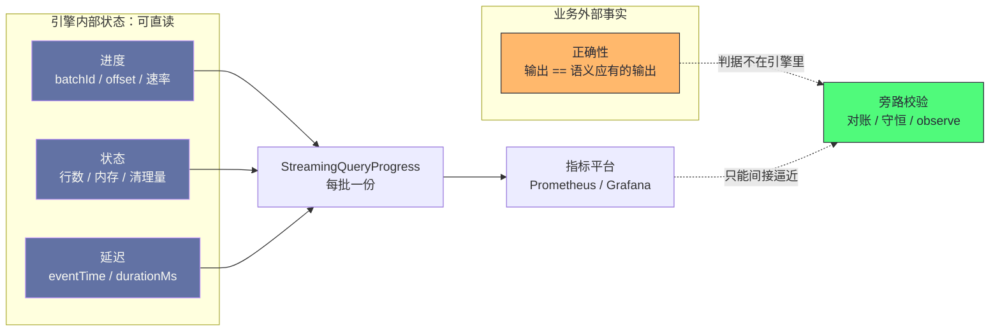
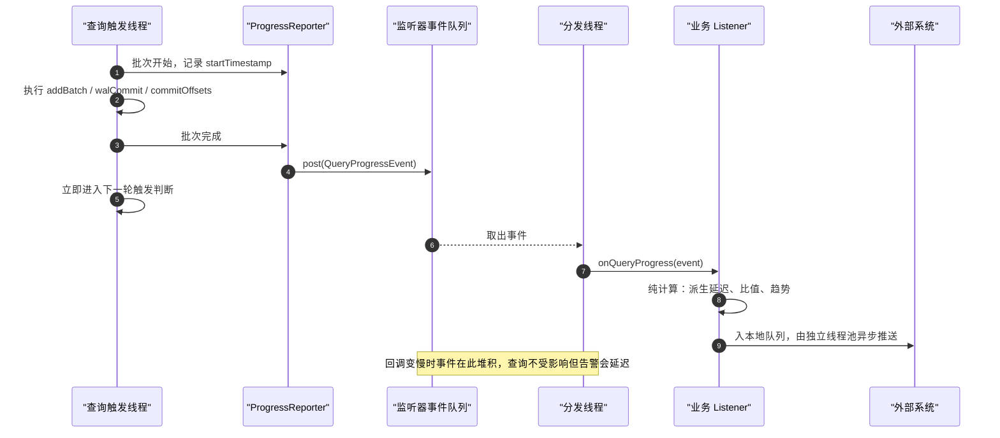
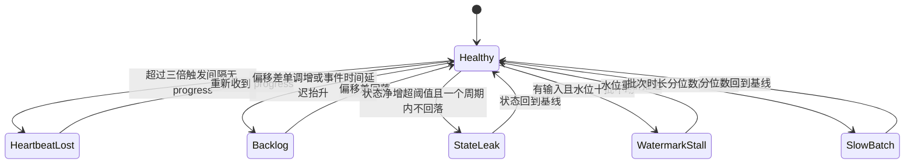
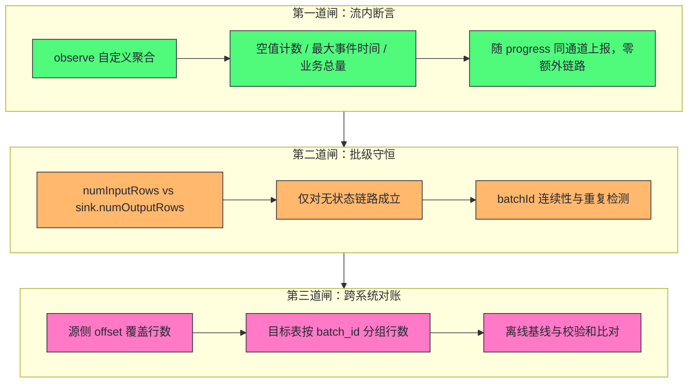
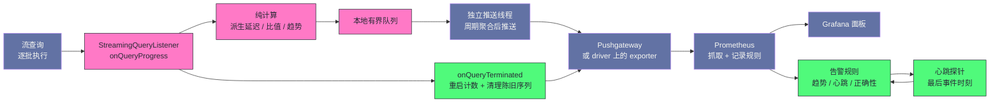

# 11 监控与可观测性：StreamingQueryListener 与生产指标体系

**摘要：**

流处理作业的监控有一个反直觉的性质：指标最丰富的地方，往往不是出问题的地方。Structured Streaming 每一批都会产出一份 `StreamingQueryProgress`，里面装着速率、各段耗时、事件时间、状态规模、源偏移与汇行数，把这些字段接进 Prometheus 就得到一套看上去完整的看板；但这套看板能回答的问题只覆盖四类状态里的三类——进度是否在推进、状态是否在膨胀、延迟大概多少，第四类「数据对不对」它一个字也答不上来。这篇文章按这个划分展开。先界定四类状态与指标平台的覆盖边界，再拆开 `StreamingQueryListener` 的三个回调与 `StreamingQueryProgress` 的四块结构，逐条交代速率、时长、状态、事件时间这几组指标的语义与误读方式；随后把「引擎不直接给延迟」这件事算清楚，用 watermark 与处理时间拼出三个可用的事件时间口径延迟；接着给出一套以趋势与心跳为核心的告警设计，逐条说明判据与误报来源；最后单列盲区一章，讲算子逻辑错误、汇的部分失败与重复写入这三类「指标全绿而业务出错」的情形，以及行数守恒、`observe` 自定义指标与跨系统对账能补到什么程度。口径为 Spark 4.3.0（2026-10-30，Scala 2.13），涉及版本差异处单独标注。

---

## 第 1 章 四类状态：可观测性的边界画在哪

### 1.1 一个查不出问题的夜间告警

设想一个实时数仓的账单作业：从 Kafka 的 `payment-events` 主题读支付事件，解析、过滤掉测试商户的记录，按商户与五分钟滚动窗口聚合交易额，再通过 `foreachBatch` 写进 ClickHouse 的汇总表。查询带着十分钟的 watermark，触发间隔十秒，状态存在 RocksDB 里。

某个凌晨，这个作业触发了对账告警：汇总表的当日累计交易额与离线 T+1 的结果差了千分之七，偏差连续三天稳定在同一个量级。值班的人打开 Grafana，逐块面板看过去——输入速率平稳贴着上游的写入曲线，处理速率始终不低于输入速率，批次时长在两秒上下小幅波动，状态行数在四万八附近有涨有落，watermark 一路推进没有停过。所有面板都是绿的。

根因在五天前上线的一次字段调整上：金额列从 `decimal(18,2)` 改成了 `decimal(10,2)`，超出十位整数部分的金额在转换时没有抛错，而是静默变成 null，聚合用的 `sum` 又把 null 跳过。从流引擎的角度看，这一批读了多少行、处理了多少行、写了多少行，全都正常；只有那个 `sum` 少加了一部分钱。

这件事的教训不在于「要采集更多指标」，而在于先回答一个更前置的问题：我要观测的状态到底有几种，每一种状态的判定权在谁手上。

### 1.2 四类状态的界定

把流查询的可观测对象按「谁有资格判定」切开，得到四类。

第一类是进度（Progress）：查询还在往前走吗，走得比数据到得快还是慢。这一类信息的判定权完全在引擎手里，batchId 在递增、offset 在推进、每批读了多少行写了多少行，都是引擎自己的账，它不需要知道这些数据是什么意思。

第二类是状态（State）：为了语义正确而必须留住的中间结果有多大。判定权也在引擎，`numRowsTotal` 与 `memoryUsedBytes` 都是内部计数器。但这里出现第一个缝：引擎知道自己存了多少，不知道「应该」存多少——应该多少取决于业务语义与上游的键基数，那不在引擎里。

第三类是延迟（Latency）：一条事件从产生到能被下游看到过了多久。引擎只掌握其中一段，处理侧各分段的耗时是准的，源侧的驻留与汇侧的可见时刻都在它的视野之外。

第四类是正确性（Correctness）：输出是否等于按其声明语义应有的输出。这一类引擎完全没有判定权。它能保证的是「同一批输入重放两次得到同样的输出」，不能保证「这次输出的内容是对的」——表达式写错、类型截断、窗口时区偏移，全都不在它的检查范围内。

四类之间有一条清晰的界线：前三类是引擎的**内部状态**，第四类是业务的**外部事实**。前三类可以在完全不知道数据含义的前提下报出来，第四类必须有业务知识才能判定，而业务知识从来不在引擎里。

### 1.3 指标平台为什么止步于第三类

把这条界线落到工程上，会看到三个具体原因让指标平台停在第三类。

第一个是判据的位置。第四类需要对照物，对照物要么是源系统的全量数据，要么是批处理侧的基线结果，要么是一条独立的业务规则；这三样都不在与指标平台同一条采集链路上。

第二个是计数的不变性。类型截断、空值吞并、时区偏移这类错误，输入行数、输出行数、批次时长、状态规模全都不变，因为错误发生在表达式求值内部，行还是那些行。指标平台的每一个面板都是计数器或计时器的投影，投影不变，面板自然不动。

第三个是成本量级。前三类的采集成本是 O(1)——每批一次回调，把几个数推出去；第四类的验证成本是 O(全量)，必须把两侧数据读出来比对。用 O(全量) 的成本做每分钟一次的自动检查，在数据量稍大的场景里就不成立了，这也是为什么对账在实践里总是按小时或按天跑，而不是按批跑。

把四类状态的责任划分列成一张表，边界就很清楚了。

| 状态 | 要回答的问题 | 判定依据从哪来 | 典型数据源 | 能否由引擎自动告警 |
|---|---|---|---|---|
| 进度 | 还在往前走吗，快还是慢 | 引擎内部计数器 | batchId、offset、速率比 | 能，且可靠 |
| 状态 | 代价是否在膨胀 | 引擎内部计数器 | `numRowsTotal`、`memoryUsedBytes` | 能，但需要趋势判据 |
| 延迟 | 多久能被下游看到 | 引擎时间戳 + 墙钟 | `eventTime`、`timestamp`、`durationMs` | 部分能，要自己组合 |
| 正确性 | 结果对不对 | 业务语义 | 源侧对账、批处理基线、`observe` | 不能，只能旁路校验 |

这张表也是后文的目录：第 3 章到第 5 章处理前三类，第 6 章把它们变成告警，第 7 章专门处理第四类。

### 1.4 一个比喻与它的技术限定

仪表盘与签收单的差别，可以当作这四类状态的分界。转速、水温、油量由传感器直读，读数即事实，司机看一眼就知道车况；但「这趟运输的货有没有送错地址」永远不会出现在仪表盘上，它只能由签收单回答，而签收单是运输系统之外的另一个系统出具的。

这个比喻的技术限定在于传感器本身也有死角。油量传感器读的是油箱里的液位，读不出油路正在渗漏——油量在缓慢下降，传感器认为这是正常消耗。`inputRowsPerSecond` 与 `numInputRows` 就是这种传感器：它们忠实地报告了「有多少行经过了引擎」，但一条被 `cast` 成 null 的行同样会被计入，它的异常不在传感器的量程里。

下图把四类状态与它们的数据来源、以及指标平台能覆盖的范围并排放开。虚线那一段是全部难点的来源：正确性只能被间接逼近，没有任何一条采集链路可以直接把它变成计数器。



---

## 第 2 章 StreamingQueryListener：三个回调与它们各自的账本

### 2.1 为什么是回调而不是轮询

`query.lastProgress` 同样能拿到进度，很多临时脚本也是这么用的，但它有三个不可替代的缺陷，决定了它只能用于排障而不能用于监控。

轮询是有损的。`lastProgress` 只保留最近一份，轮询间隔一旦大于批次间隔，中间的批次就被永久跳过；用被抽稀的样本去判断「状态是否单调增长」或者「批次时长是否在劣化」，结论会随采样相位漂移。回调则是逐批全量，一批不落。

轮询需要自己管理生命周期。放在 driver 主线程里要自己起线程、自己处理查询重启后的重新绑定；放在外部进程里则多了一个需要跟着作业发版的组件。`StreamingQueryListener` 的注册与注销跟着 `SparkSession` 走，查询恢复时 listener 仍然在，不需要重新挂载。

轮询拿不到边界事件。启动与终止这两个时刻没有对应的可轮询字段，而终止时刻尤其重要：进程崩溃前的最后一份进度往往来不及被轮询到，只有回调能在崩溃前把它投递出去（`kill -9` 这种强制退出除外）。

### 2.2 三个回调分别能拿到什么

`StreamingQueryListener` 是一个抽象类，业务侧继承它并实现三个方法，注册方式是 `spark.streams.addListener(listener)`。三个方法对应三种事件，事件的字段多寡差别很大。

| 回调 | 事件对象 | 关键字段 | 能回答的问题 | 需要注意 |
|---|---|---|---|---|
| `onQueryStarted` | `QueryStartedEvent` | `id`、`runId`、`name`、`timestamp` | 查询何时启动、本次运行的 `runId` | 启动不等于就绪，首个批次可能很久之后才有 |
| `onQueryProgress` | `QueryProgressEvent` | `progress`（完整进度对象） | 逐批的进度、状态、延迟指标 | 只在批次完成后发出，卡住的批次不发 |
| `onQueryTerminated` | `QueryTerminatedEvent` | `id`、`runId`、`exception` | 正常停止还是异常崩溃、异常栈 | `exception` 为空不代表健康退出，也可能是被正常 stop |
| `onOtherEvent` | 任意 `SparkListenerEvent` | 取决于投递方 | 业务自定义事件透传 | 默认空实现，需要自己约定事件类型 |

三个回调里，`onQueryProgress` 承担了九成以上的信息量，`onQueryStarted` 与 `onQueryTerminated` 主要的价值是**边界**：前者给出本次运行的起点，后者给出终点与失败原因。实践中一条常见的疏漏是把重启当成无事发生——查询因为 executor 丢失或者 OOM 崩过一次，重启后 `batchId` 从 checkpoint 恢复继续，所有累计型指标连续，看板上看不出任何断点。要发现这类事件，必须在 `onQueryTerminated` 里把 `runId` 与 `exception` 落库并计数，用「重启次数」这个派生指标来做告警。

### 2.3 回调跑在哪条线程上

这个问题的答案与很多人的直觉相反。`StreamingQueryListenerBus` 继承的是异步事件总线，事件被投进一个队列，由一个专用的分发线程取出、逐个调用已注册的监听器。这条线程与查询的触发线程是两条不同的线程。

由此得出三条工程结论。第一，回调里的慢操作不会直接拖住批次调度，那种「在 `onQueryProgress` 里发 HTTP 请求会阻塞下一批」的说法只对了一半——阻塞是间接发生的。第二，队列是无界的，回调的消费速度一旦长期低于事件的产生速度，事件就在 driver 堆里堆积，内存随之上涨，告警到达的时间也开始漂移；事件里的 `timestamp` 是批次完成的墙钟时刻，用它算延迟不受影响，但「什么时候被处理」会受影响，所以不要在回调里再取一次当前时间当作批次时间。第三，事件总线在分发时对单个监听器的异常做了捕获与日志，一个写坏的监听器通常不会把查询打挂——它是双刃的，坏掉的监听器既不生效也不报警，只能靠自己在回调体里 `try/catch` 并单独计数。

正确的形态是把回调做成「计算 + 入队」两段式，真正的网络推送交给一个独立的单线程池，队列满了就丢最旧的样本并计数。

```python
class MetricsSink(StreamingQueryListener):
    def __init__(self, exporter, max_queue=1000):
        self.exporter = exporter
        self.queue = collections.deque(maxlen=max_queue)
        self.dropped = 0
        self.failures = 0

    def onQueryProgress(self, event):
        try:
            # 只做纯计算，任何 I/O 都不在这条线程上做
            sample = build_sample(event.progress)
            if len(self.queue) == self.queue.maxlen:
                self.dropped += 1
            self.queue.append(sample)
        except Exception:
            # 事件总线会吞掉异常，必须自己留痕，否则监听器静默失效
            self.failures += 1
```

### 2.4 StreamingQueryProgress 的四块结构

进度对象可以拆成四块，每块的时间口径都不同，混用是绝大多数误读的源头。

| 字段块 | 内容 | 口径 | 常见误读 |
|---|---|---|---|
| 标量 | `batchId`、`numInputRows`、两个速率、`batchDuration` | 单批，批次粒度 | 把「每秒」字段当成秒级采样 |
| `durationMs` | `latestOffset`、`getBatch`、`queryPlanning`、`addBatch`、`walCommit`、`commitOffsets`、`triggerExecution` | 处理侧分段耗时 | 以为各项之和等于端到端延迟 |
| `eventTime` | `max`、`min`、`watermark` | 事件时间轴 | 以为 watermark 是「已经处理到哪」 |
| `stateOperators[]` | `numRowsTotal`、`numRowsUpdated`、`numRowsRemoved`、`memoryUsedBytes`、各段耗时、`numRowsDroppedByWatermark` | 状态存储，跨批累积 | 把 `numRowsRemoved` 当清理效率 |
| `sourceProgress[]` / `sinkProgress` | 源汇描述、`startOffset`、`endOffset`、`latestOffset`、`numOutputRows` | 源汇各自的偏移与行数 | 忽略 `latestOffset`，于是永远算不出真实积压 |

下面是一份自洽的示例（数值为示例，不是实测），对应贯穿案例那个按商户窗口聚合、`foreachBatch` 写 ClickHouse 的查询。注意 `durationMs` 里除 `triggerExecution` 之外的六项之和正好是 2100 毫秒，与 `batchDuration` 相等；而 `batchDuration` 不含上一次批次结束到本次触发之间的那段空闲。

```json
{
  "id": "8f1c7d2a-4b3e-4a91-9c6d-2f0a7b51e3c8",
  "runId": "c02b7e14-9a3d-4f52-8b61-7d4e2c9a10f5",
  "name": "billing_stream",
  "timestamp": "2026-11-19T10:30:02.140Z",
  "batchId": 10427,
  "batchDuration": 2100,
  "numInputRows": 4200,
  "inputRowsPerSecond": 2000.0,
  "processedRowsPerSecond": 2000.0,
  "durationMs": {
    "latestOffset": 42,
    "getBatch": 118,
    "queryPlanning": 36,
    "addBatch": 1812,
    "walCommit": 61,
    "commitOffsets": 31,
    "triggerExecution": 2100
  },
  "eventTime": {
    "max": "2026-11-19T10:29:52.000Z",
    "min": "2026-11-19T10:21:03.000Z",
    "watermark": "2026-11-19T10:19:52.000Z"
  },
  "stateOperators": [
    {
      "operatorName": "stateStoreSave",
      "numRowsTotal": 48120,
      "numRowsUpdated": 4200,
      "numRowsRemoved": 3900,
      "allUpdatesTimeMs": 811,
      "allRemovalsTimeMs": 187,
      "commitTimeMs": 96,
      "memoryUsedBytes": 12582912,
      "numRowsDroppedByWatermark": 0
    }
  ],
  "sources": [
    {
      "description": "KafkaV2[Subscribe[payment-events]]",
      "startOffset": {"payment-events": {"0": 918400, "1": 903150}},
      "endOffset": {"payment-events": {"0": 921300, "1": 906450}},
      "latestOffset": {"payment-events": {"0": 921300, "1": 906450}},
      "numInputRows": 4200
    }
  ],
  "sink": {
    "description": "ForeachBatchSink",
    "numOutputRows": 2180
  }
}
```

示例里两个速率恰好相等，因为这是一条读限未生效、汇侧未限速的链路；一旦链路里有聚合、有读限、有汇侧反压，两者就会分开，而那正是下一章要拆的东西。

### 2.5 两个容易误用的字段

第一个是 `id` 与 `runId` 的分工。`id` 是写进 checkpoint `metadata` 文件的查询标识，跨重启保持不变；`runId` 是每次运行新生成的。做指标 label 必须用 `id`，否则每次重启都会长出一整套新的时间序列，Prometheus 的基数会随重启次数线性膨胀；而判断「这次是新一次运行」必须用 `runId`，它是重启检测的唯一可靠依据。

第二个是 `timestamp`。它是本批完成时刻的墙钟时间（UTC），是与 `eventTime` 做差求延迟的唯一正确基准。用采集时刻去减 `watermark`，等于把监控链路的投递延迟也算进业务延迟里，而这个量在高峰期可以有几秒到几十秒。

三个回调与事件总线的关系如下图。注意 `onQueryProgress` 的投递是异步的：触发线程把事件放进队列就返回，监听器在另一条线程上被调用，两条线之间没有同步点。



---

## 第 3 章 速率与时长：三个被单独读错的指标

### 3.1 inputRowsPerSecond 不是上游的生产速率

这个字段的名字极具误导性。它不是在描述 Kafka 那一侧每秒写入了多少行，而是在描述「本批在 Spark 眼里到了多少行，除以本批所占的时间窗」。三处偏差都能让它与上游的真实写入速率脱钩。

批次粒度会让读数被平均掉。触发间隔一分钟时，这个数字是一分钟的均值，秒级尖峰被抹平；触发间隔十秒时，上游一次补数会被放大成十倍的读数。它本质上是一个**每批一个的样本**，不是秒级的瞬时值。

读限会让分子变成「你能读多快」。一旦设了 `maxOffsetsPerTrigger` 或 `maxFilesPerTrigger`，每批读取量就有了上限，此时这个字段反映的是读限除以批次时长，与上游供给无关。这个偏差最隐蔽，因为它恰好出现在系统最健康的时候——处理能力很强，读限把每批压得很小，速率读数看起来很稳。

没有新数据时它是 0。一条查询在凌晨断流两小时，这个字段就报两小时的零；如果把速率设成「过低即告警」，凌晨会周期性误报。用它判断上游断流，方向从一开始就错了，断流要看的是 `latestOffset - endOffset` 是否在增长，或者源侧的写入指标。

所以这个字段唯一可靠的用法是当分子用：它背后那个 `numInputRows` 才是本批真正读到的行数，速率只是它的一个投影。

### 3.2 比值才有意义：一条式子里的三种状态

把 `processedRowsPerSecond` 除以 `inputRowsPerSecond`，得到的是「本批的处理速率与到达速率之比」。因为两个字段共用同一批、同一个时间窗、同一个分子，比值退化成了一句关于时间的判断：这一批花的时间比它「应该」花的时间长还是短。比值小于一，说明处理这批数据所花的时间超过了数据到达所需的时间，积压在这一批里增加了。

| 比值区间 | 含义 | 积压趋势 | 处置 |
|---|---|---|---|
| 大于 1.2 | 批内有余量，正在追赶，或读限生效 | 下降 | 观察是否自然回落到 1 附近 |
| 0.9 到 1.2 | 供需基本平衡 | 平稳 | 作为该作业的基线 |
| 0.5 到 0.9 | 处理慢于到达 | 缓慢增长 | 拆 `durationMs` 定位瓶颈 |
| 小于 0.5 | 明显落后 | 快速膨胀 | 立即介入：放开读限、扩资源、重设触发间隔 |

不过这个比值有两个必须写进运维手册的前提，否则它会在最危险的时候给出「健康」的读数。

第一个前提是：比值只在「有积压可追」时可信。当批次时长已经贴住触发间隔，每一批都在满负荷运转，比值会趋近于 1，而积压仍在增长——因为读限决定了每批只能读这么多，剩下的留在 Kafka 里等下一批，下一批又被同样的读限压住。这个组合的指纹是：**比值贴住 1、批次时长贴住间隔、偏移差持续增长**。此时唯一能看见积压的指标是源侧的偏移差，速率比完全失明。

第二个前提是：比值对「批内数据量」敏感，而批内数据量本身受上游节奏影响。上游每分钟的最后一秒集中推送时，同一批里既有大量到达又有长时间计算，比值会在一个区间内来回跳，单批读数几乎没有意义。这也是为什么告警要落在滑动窗口的均值或分位数上，而不是单批。

### 3.3 batchDuration 不含等待

`batchDuration` 的语义是本次触发从开始执行到本批提交完成所花的时间，它**不含两次触发之间的空闲等待**。这个定义带来的后果远比它看起来大。

设触发间隔为十秒、`batchDuration` 为 2.1 秒，则每条记录的等待时间取决于它落在哪个位置：在批次执行期间到达的记录要等到下一次触发，等待约 7.9 秒；刚触发后才到达的记录要等接近一整个间隔。按均匀到达估算，等待段的均值约为（10−2.1）/2≈4 秒，最坏接近十秒。也就是说，真实的处理侧延迟均值是 2.1 秒与 4 秒之和，而 `batchDuration` 只报了其中三分之一。

还有两段它同样不含。一是汇侧的异步完成：在 `foreachBatch` 里把数据交给外部系统的事务提交，只要用户函数返回了，引擎就认为这一批写完了，外部系统真正可见的时间点在引擎视野之外。二是源侧的驻留：记录已经写进 Kafka、却因为读限或者积压还没被读到的那段，同样是一段真实的端到端延迟，而它对 `batchDuration` 没有任何影响。

把这三段补上，才能得到「处理侧延迟」的完整口径：等待段 + 批内执行段 + 汇侧提交段。这三段里只有第二段有现成指标。

### 3.4 durationMs 的分段与瓶颈定位

`durationMs` 把批内执行段又切成了若干小段，每一段变大指向的根因完全不同，这是定位瓶颈最有效的一张表。

| 分段 | 语义 | 变大时指向什么 |
|---|---|---|
| `latestOffset` | 向源询问末位偏移 | 源元数据服务慢：Kafka 分区数过多、对象存储列举慢 |
| `getBatch` | 构造本批的数据集 | 文件源列目录、Kafka 偏移换算、源侧反序列化 |
| `queryPlanning` | 每批重新规划执行计划 | 计划复杂、catalog 调用慢、首次规划的额外开销 |
| `addBatch` | 提交 Job 并等待其完成 | 真正的计算：CPU、IO、Shuffle、数据倾斜 |
| `walCommit` | 状态存储的写前日志落盘 | 状态容器大、RocksDB 写放大、本地盘慢 |
| `commitOffsets` | 写偏移日志与提交 | checkpoint 所在存储的小文件写慢（对象存储尤甚） |

读这张表的正确方式是看**占比的变化**，而不是绝对值。数据量翻倍时 `addBatch` 翻倍是正常的，而 `commitOffsets` 在数据量不变的情况下从 30 毫秒涨到 800 毫秒，就是一个明确的存储侧劣化信号。后者在对象存储上很常见，也很容易被误判成「Spark 变慢了」——它的真实含义是每批的日志提交要跟对象存储做一次往返，而对象存储的 P99 延迟可以比 HDFS 高一个数量级。

下图把一个批次的两段拼在一起，标出了 `batchDuration` 的起止边界。这张图值得记住的原因很实际：几乎所有「延迟比预期高」的争论，最后都落在这条边界画在哪。

```mermaid
%%{init: {'theme': 'dracula'}}%%
flowchart LR
    A["上一次批次完成<br/>t = 0"] --> B["空闲等待<br/>约 7.5s<br/>不计入 batchDuration"]
    B --> C["触发：latestOffset<br/>约 42ms"]
    C --> D["getBatch<br/>约 118ms"]
    D --> E["queryPlanning<br/>约 36ms"]
    E --> F["addBatch<br/>约 1812ms"]
    F --> G["walCommit<br/>约 61ms"]
    G --> H["commitOffsets<br/>约 31ms"]
    H --> I["批次完成<br/>batchDuration ≈ 2.1s"]
    I --> J["下一次触发判断"]
    classDef wait fill:#44475a,stroke:#ff79c6,color:#f8f8f2
    classDef exec fill:#6272a4,stroke:#bd93f9,color:#f8f8f2
    classDef done fill:#50fa7b,stroke:#282a36,color:#282a36
    class B wait
    class C,D,E,F,G,H exec
    class A,I,J done
```



---

## 第 4 章 状态指标：不降就是泄漏

### 4.1 三个行数字段的关系

`stateOperators` 数组里每个元素对应一个有状态算子，三个行数字段分别记录当前状态总行数、本批被更新或新增的行数、本批被清理的行数。

三者之间不存在严格的等式关系，原因有两个：一是 `numRowsUpdated` 同时包含新增与更新，一条记录从写入到被驱逐可能都在同一批里发生，于是它既被计入更新又被计入清理；二是状态清理按分片在 executor 上完成，driver 汇总时取的是各分片的加总，而清理动作本身可能跨批完成。实践中的用法是看趋势：稳态下 `numRowsTotal` 应当围绕一个基线做锯齿波动，`numRowsRemoved` 应该持续大于零。

判断状态是否泄漏的正确姿势不是看绝对值，而是看「在一个完整业务周期内能否回到基线」。对按事件时间窗口聚合的查询，状态行数应当呈现明显的锯齿——白天累积、窗口关闭后回落、凌晨低谷。若锯齿的上沿在逐日抬高，即使每天的增量都不大，也说明键基数在增长或者清理没跟上；若锯齿干脆消失了，只剩单调上升的一段，那就是典型的泄漏形状。

### 4.2 memoryUsedBytes 的口径陷阱

这个字段在两种状态存储实现下含义不同，把它们按同一个阈值对待是常见的错。

| 实现 | 存储位置 | `memoryUsedBytes` 的口径 | 还需要额外看什么 |
|---|---|---|---|
| `HDFSBackedStateStore`（默认） | executor 堆内 map + checkpoint 目录 | 堆里那份映射的实际占用 | 驻留比例、GC 时间、快照体积 |
| `RocksDBStateStore` | executor 本地盘，可配 changelog | block cache 与 memtable 等内存侧占用 | SST 与快照体积、本地盘余量 |

第一个陷阱是量纲。状态存储是**每个分区一个实例**，`stateOperators` 里的数值是 driver 汇总后的加总，不是一个 executor 上的瞬时占用。用「超过 executor 内存的 50%」这种阈值去套汇总值，在多 executor 的作业上会严重误判——一个十 executor 的作业，汇总值达到单机内存的一半是常态。

第二个陷阱是可见性。`HDFSBackedStateStore` 把状态放在堆里，`memoryUsedBytes` 与 GC 压力高度相关，这个指标可以用来预测 OOM；`RocksDBStateStore` 把大部分状态放在本地盘上，`memoryUsedBytes` 只反映内存侧的那一部分，堆是安全的，但本地盘会持续增长，而本地盘余量根本不在这条指标里。换句话说，换了状态存储实现之后，同一个指标从「内存预警」变成了「内存无预警」，真正的风险转移到了磁盘，必须补一条本地盘使用率的监控才有意义。具体的口径以对应版本源码为准。

### 4.3 状态不降的四种成因

状态持续增长只是症状，成因有四种，处置方式完全不同。

第一种是查询里根本没有 watermark。无 watermark 的 `dropDuplicates` 会与历史全量比较，流-流 join 的缓冲两侧都没有边界，这两类写法在代码上完全合法，运行时也不报错，状态会一直涨到 executor 崩掉为止。这类问题的判定特征是：查询日志里根本没有水位推进的记录，`numRowsRemoved` 长期为零，而 `numRowsTotal` 线性上升。

第二种是 watermark 停了。它可能在两种情形下停：没有新数据（正确行为），或者多个带水位的事件时间列取最小值时被其中一个拖住（错误行为）。后者的指纹是 `eventTime.max` 在涨而 `watermark` 不动，这个组合在第 6 章还会用到。多源水位合成的细节参见 [[大数据/Spark/Spark-Structured-Streaming流处理深度解析/04 Watermark 全解：事件时间语义与延迟数据处理|04 Watermark]]。

第三种是清理在干活，但键基数涨得更快。这在按商户、按设备号这类业务主键聚合时很常见：新客户持续进入，每个客户的窗口虽然在按时关闭，但存量的活跃键数量在增长。这类增长是业务事实，不是 bug，处置方向是调整状态存储实现或者拆分查询，而不是去改 watermark。

第四种是清理的触发粒度与期待不符。用处理时间超时实现的自定义状态（`flatMapGroupsWithState` 里的 `GroupStateTimeout.ProcessingTimeTimeout`）依赖定时器，而定时器的检查发生在批次边界，批次间隔越大，超时越晚生效；把触发间隔从十秒改成五分钟，状态峰值的抬升会非常明显。这类问题的判定特征是状态峰值与触发间隔同步变化。

### 4.4 状态规模与 checkpoint 成本

状态规模不只影响内存，它还是 `walCommit` 与 `commitOffsets` 的线性因子，而后者决定了批次时长能否稳定。这里给一段示例推算（非实测），用来说明量级关系。

假设某查询稳态状态为五百万行，每行 key 与 value 序列化后约 200 字节，逻辑数据量约 1GB。默认实现每批产出一个 delta 文件，并且按 `spark.sql.streaming.stateStore.minDeltasForSnapshot`（默认 10）的节奏插入一次全量快照，于是每十批就有一次全量重写，平均下来每批的写放大接近全量的十分之一，即约 100MB。这个量级在 HDFS 上是秒级，在对象存储上则是几十次 PUT 加一段明显的等待，落到指标上就是 `commitOffsets` 的周期性尖峰。

这也解释了为什么状态规模一大，批次时长会先变得不稳定、然后整体抬升。RocksDB 的实现把状态放在本地盘、用 SST 组织，快照同样要全量生成，但它省掉了堆内驻留与大对象 GC 的代价，恢复时间也更可控，代价是本地盘的可靠性与容量要单独规划。两种实现的 checkpoint 成本都随状态规模线性增长，差别在写放大位置与恢复路径。状态存储的选型与调优细节参见 [[大数据/Spark/Spark-Structured-Streaming流处理深度解析/12 生产调优手册：吞吐量、延迟、背压与资源配置全攻略|12 生产调优手册]]。

---

## 第 5 章 延迟：引擎不直接给，只能自己算

### 5.1 三种延迟

「延迟」这个词在流处理里至少对应三个不同的量，混用会造成无休止的争论。

源侧驻留是指事件写入 Kafka 到被 Spark 读到之间的时间，由积压、读限、触发间隔共同决定。处理侧延迟是指从读到本批数据到本批提交完成的时间，由 `batchDuration` 与等待段构成。可见延迟是指事件时间到数据出现在下游可查询之间的时间，这是业务真正关心的那个数。

三者是串联关系，端到端延迟约等于三者之和再加上汇侧提交与下游可见的延迟。实践中之所以要用事件时间口径来量端到端延迟，是因为只有事件时间是可比的：同一条记录的事件时间是确定的，而处理时间会随负载漂移，用处理时间口径算出来的「延迟」在不同时段之间没有可比性。

### 5.2 为什么 progress 里没有这个数

引擎不直接给出端到端延迟，不是设计疏漏，而是三处信息它确实没有。

第一处是事件时间的物理含义。`eventTime` 里的 `max` 与 `min` 是用户声明的那一列的值，引擎不知道这一列是否真的等于记录的物理产生时刻，也不知道上游的时钟是否同步。它能做的是把这列当事件时间的坐标轴用，不能保证这条轴与墙钟对齐。

第二处是汇侧的可见时刻。对文件汇，可见时刻是文件原子重命名的那一瞬；对 Kafka 汇，是 broker 确认写入的那一瞬；对 `foreachBatch` 里用户自己写的系统，引擎只知道用户函数返回了。这三种可见性的定义完全不同，引擎无法用一个统一的时间戳表达。

第三处是粒度。`progress` 是批次粒度的聚合，而延迟是单条记录的属性。一批一百万条记录各自有各自的延迟，`progress` 能给的只有端点（`min`、`max`）与水位，给不出分布。

结论是：`progress` 提供的是**计算延迟的材料**，不是延迟本身。要把材料算成延迟，得自己补上公式。

### 5.3 用 watermark 与处理时间反推三个延迟

`progress` 里有三个可以直接组合的字段：批次完成时刻 `timestamp`、本批事件时间最大值 `eventTime.max`、全局水位 `eventTime.watermark`。两两相减、再加一项修正，就得到三个派生量，各有各的用途。

第一个是水位滞后：`eventTime.max − eventTime.watermark`。它度量的是数据自身的乱序与延迟程度，量级约等于配置的延迟阈值加上上游的乱序幅度。它基本不随负载变化，因为负载升高时两侧同向漂移；它变化时说明的是数据质量问题（上游重放、时钟偏移、某个分区堆了旧数据），而不是性能问题。

第二个是事件时间延迟：`progress.timestamp − eventTime.watermark`。这个派生量是整个监控体系里价值最高的一个数——它把「积压了多少行」换算成了「积压了多少时间」。没有积压时，它约等于延迟阈值加触发间隔；出现积压时，水位推不动，而墙钟继续走，这个数就线性增长。用它可以给延迟 SLA 直接设阈值，而不用去猜行数与时间之间的换算关系。

第三个是可见延迟的估计下界：事件时间延迟加上半个批次时长，再加汇侧提交耗时。前两项可从 `progress` 取，最后一项只能由业务侧埋点补。

```python
def derive_latency(progress):
    """只用 progress 里的字段推三个事件时间口径的延迟，单位秒。"""
    et = progress.eventTime or {}
    wm = et.get("watermark")
    if not wm:
        return {}
    # 必须用批次完成时刻做基准；用采集时刻会把监控链路的投递延迟算进业务延迟
    now_ts = parse_spark_ts(progress.timestamp)
    wm_ts = parse_spark_ts(wm)
    out = {
        "event_time_lag_s": (now_ts - wm_ts).total_seconds(),
        "visible_lag_lower_bound_s":
            (now_ts - wm_ts).total_seconds() + progress.batchDuration / 2000.0,
    }
    if et.get("max"):
        # 水位与最大事件时间的差：数据乱序程度，不随负载变化
        out["watermark_lag_s"] = (parse_spark_ts(et["max"]) - wm_ts).total_seconds()
    return out
```

三个量的用法可以各归一处：水位滞后做数据质量告警，事件时间延迟做 SLA 告警，可见延迟下界做容量规划时的估算依据。它们的共同前提是查询真的声明了 watermark；对没有 watermark 的查询，这三个数都不存在，延迟只能靠业务埋点，这一点常被忽略。

### 5.4 汇侧缺失的那一段

把几种延迟口径并排放，缺什么就一目了然。

| 口径 | 计算方式 | 覆盖范围 | 缺失 |
|---|---|---|---|
| `batchDuration` | 直接读字段 | 批内执行段 | 等待、源侧、汇侧 |
| 触发间隔 | 配置值 | 采样周期 | 它不是延迟，只是延迟的采样粒度 |
| 事件时间延迟 | `timestamp − watermark` | 源侧、等待、处理 | 汇侧提交与下游可见 |
| 业务埋点 | `now − event_ts` | 全链路 | 需要在数据里带事件时间字段 |

对 `foreachBatch` 写外部系统的场景，可见延迟只能在业务侧量：在写入的数据里带上 `spark_batch_id` 与写入开始时刻，在业务查询侧用当前时间减事件时间。引擎侧能做的是把事件时间延迟当作代理指标，并在文档里写明它是下界而不是测量值。这个声明很重要——指标口径不清比没有指标更危险，因为它会给出一个稳定而错误的结论。

---

## 第 6 章 告警设计：四条趋势线加一条心跳

### 6.1 五条告警与它们的判据

告警设计的第一原则是：告警必须对应一个可执行的动作。对应不到动作的告警最终会被静音，而静音之后真正的故障也一起消失了。按这个原则筛下来，流查询值得设的告警只有五条。

| 告警 | 判据 | 窗口 | 主要误报来源 | 分级 |
|---|---|---|---|---|
| 积压增长 | `latestOffset − endOffset` 单调增，或事件时间延迟单向抬升 | 5 到 10 批 | 上游补数、读限生效、源分区扩容 | P2 |
| 状态不收敛 | `numRowsTotal` 在窗口内单调不减且净增超阈值 | 一个业务周期 | 业务周期（促销、夜间批）、键基数自然增长 | P2 |
| 批次时长劣化 | `batchDuration` 的分位数相对基线上移 | 30 分钟 | 数据量正常波动、触发间隔被改、规划开销 | P3 |
| 水位停滞 | `watermark` 连续多批不变且 `numInputRows` 大于零 | 10 批 | 空闲源、多源取最小值被慢源钉住 | P1 |
| 进度心跳超时 | 距最后一份 `progress` 超过三倍触发间隔 | 持续 | driver 重启、查询被正常停止（要区分） | P1 |

这张表里有两条 P1，都是「查询可能已经死了」的判据。之所以把它们排在最高优先级，是因为它们对应的故障模式最严重：前者意味着水位不再推进，状态清理与迟到判定同时失效；后者意味着引擎根本没有在跑。

### 6.2 水位停滞这一条最容易误报

水位停滞的告警有两条独立的误报路径，两条都很常见。

第一条是无数据。水位只在出现新的事件时间时前进，没有新数据就没有推进，这是正确行为而不是故障。所以判据里必须带上 `numInputRows` 大于零这个条件；更进一步，还可以要求「连续 N 批都有输入但水位不动」，把凌晨的低谷期排除掉。

第二条是多源合成。查询里有多个带水位的输入时，全局水位取各源的最小值，一个源闲置或者推进缓慢，全局水位就被钉住。此时 `eventTime.max` 可能一直在涨，形成一个很好认的指纹：最大值在涨、水位不动、水位滞后持续膨胀。定位方法是把两路输入分别统计事件时间——因为 `progress` 只给全局值，需要自己在 `withWatermark` 之前用 `observe` 分别挂上两路的最大事件时间，才能看出是哪一路在拖。多路水位合成的策略细节参见 [[大数据/Spark/Spark-Structured-Streaming流处理深度解析/04 Watermark 全解：事件时间语义与延迟数据处理|04 Watermark]]。

### 6.3 为什么绝对值不可用

给流查询设绝对值阈值，几乎注定失败，理由有三条。

数据量有日周期。批量对账集中在凌晨两点跑、营销活动集中在晚上八点，同一套阈值在一天里的误报率能差几十倍。

触发间隔一改，所有与批相关的阈值全部失效。批次时长、每批行数、状态峰值都与触发间隔强相关，把间隔从十秒改成六十秒，之前辛苦调出来的阈值全部要重调一遍。

跨作业不可比。同一个团队二十个查询，每个查询的绝对值范围都不同，写二十套阈值意味着二十份需要维护的配置，最终必然会退化成「都设成一个大数」。

可用的替代方案有三类。一是相对基线：与上周同日同时段的分位数比较，偏离超过 N 倍才告警。二是趋势与斜率：不看值本身，看它在一个窗口内是否单调、斜率是否超过门限，这也是 6.1 表里几条告警都写成「单调」而不是「大于」的原因。三是物理上限：这类可以放心用绝对值，因为它们的上限是客观的——本地盘余量、checkpoint 所在存储的配额、executor 的内存上限，这些数字不随负载变化。

### 6.4 缺失型告警：没有事件本身就是事件

绝大多数监控都是「有数据才判断」的形态：收到一个样本，判断它是否越界。这个形态有一个结构性盲区——查询卡死时一个样本都不会来，看板上一条平线和一条健康的空闲曲线长得一模一样，而所有基于样本的规则都不会触发。

所以心跳必须是一条独立的、以「最后一份事件的时间戳」为输入的告警，它是唯一能覆盖**缺失型故障**的形态。实现上可以把它做成一个外部探针，定期检查一个由 `onQueryProgress` 更新的 gauge，判据是「当前时间减最后更新时刻超过三倍触发间隔」且「查询状态应为 ACTIVE」。

反过来也要处理：查询被正常 `stop` 之后，心跳会永久超时。如果不处理，每次正常发版都会触发一次 P1，几次之后这条告警就废了。处理办法是在 `onQueryTerminated` 里把该查询的心跳指标标记为过期或直接删除对应的时间序列，让探针跳过它。这个细节看起来琐碎，却决定了 P1 告警能不能长期保持有效。

下图把五条告警的判定关系画成状态机。注意所有回到健康态的边都要求「指标回落」而不只是「告警被确认」，这是避免抖动告警的常规做法，也意味着告警系统必须有状态而不能只做无状态的阈值比较。



---

## 第 7 章 盲区：指标全绿而业务出错

### 7.1 算子逻辑错误

这类错误的特点是：它不改变任何引擎可见的计数。输入行数、输出行数、批次时长、状态规模、水位推进，全都正常，出问题的只有那几行数据的值。

类型截断是最常见的一种。金额从 `decimal(18,2)` 收窄到 `decimal(10,2)`、整数列在 `cast` 时溢出、时间戳精度从毫秒降到秒，这些转换在 ANSI 模式关闭时会静默返回 null，而下游的 `sum`、`avg` 恰好都跳过 null。指标上什么都不会发生，因为被跳过的记录仍然被读了、被算了、被写了。

时区错位是第二常见的一种。`window()` 与 `date_trunc` 使用的是会话时区，容器镜像里 `TZ` 未设置时按 UTC 解释，而开发机上是东八区，同一份代码在两边算出的窗口边界相差八小时。数据行数完全正确，窗口边界整体偏移；这种错误在单机测试里几乎不可能被发现，因为测试机的时区恰好是对的。

语义漂移是第三种。`dropDuplicates` 在有 watermark 与无 watermark 两种写法下，语义差别是「在窗口内去重」与「与历史全量比较」，两者的代码只差一个 `withWatermark` 调用，性能与结果却完全不同。同理，流-流 join 的时间范围条件写得宽一点或窄一点，输出行数会变但不会报错。去重语义的细节参见 [[大数据/Spark/Spark-Structured-Streaming流处理深度解析/09 dropDuplicates 与精确去重：Exactly-once 的应用层保障|09 dropDuplicates]]。

空值参与聚合是第四种。`count(*)` 数行数、`count(col)` 数非空值，一个解析失败的字段就能让两者相差一个可观的量，而两个数都「合法」。这类偏差在对账时表现为一个稳定的比例，而不是随机波动，这也是它与数据延迟问题最直接的区分点。

### 7.2 汇的部分失败与重复写入

`foreachBatch` 是一个刻意留白的接口：它把「一批数据」交给用户，由用户自己决定怎么写外部系统，引擎不再介入。留白换来的是灵活性，代价是这一批内部的原子性由用户负责。

设想一个典型的实现：先往明细表写一份，再往汇总表写一份。第一批执行到一半，明细表写成功、汇总表超时失败，用户函数抛出异常。引擎的处理是标准的——这一批没有提交，`commits` 日志不写，恢复后从上一批的 offset 重放这一批。重放时明细表会被写第二遍，除非明细表按 `batchId` 做了幂等化。

这一类问题在指标上的痕迹极浅。`batchDuration` 会出现一次尖峰（重试让某一批变长），`numInputRows` 正常，`sinkProgress.numOutputRows` 对 `ForeachBatchSink` 甚至可能为零——因为引擎根本不知道用户写了多少行。所以「汇聚指标看有没有重复」这条路从一开始就走不通。

有效的检测手段有三条。一是让每一批的写入带上 `batchId`，下游按 `batchId` 做主键做**幂等化**，同时用 `batchId` 的连续性做审计：缺失意味着有批次被跳过，同一个 `batchId` 出现多次意味着有重放。二是双写两套存储后离线比对行数与校验和。三是汇侧对账：源侧 offset 覆盖的记录数，与目标表按 `batch_id` 分组后的行数之和，必须逐个批次相等。三条里第一条成本最低，也最容易在故障发生时就给出信号。

### 7.3 行数守恒与 observe：用指标补指标的缺口

在完全没有业务埋点的前提下，进度指标本身还能提供一类有限的正确性校验，前提是能判断链路的「行数守恒」性质。

无状态链路（只有 `select`、`filter`、`map`、`union`）是可守恒的：没有过滤条件时 `sink.numOutputRows` 应当等于 `numInputRows`，有过滤条件时应当小于等于且比例稳定。有状态链路（聚合、join、去重）行数不守恒，这条校验就用不了。

对不守恒的链路，引擎留的唯一口子是 `observe`：在查询里挂自定义聚合，结果会随进度一起出现在 `observedMetrics` 里，走同一条指标通道。这是把业务量纲塞进 `progress` 的官方方式。

```scala
val audited = df
  .withWatermark("event_time", "10 minutes")
  // observe 挂在聚合之前：断言打的是进入算子的原始行，聚合之后这些列已经不存在了
  .observe(
    name = "billing_audit",
    // 金额为空的行数：解析失败最直接的信号，正常情况下应为 0
    count(when(col("amount").isNull, 1)).as("null_amount_rows"),
    max("event_time").as("max_event_time"),
    sum("amount").as("gmv_total")
  )
  .groupBy(window(col("event_time"), "5 minutes"), col("merchant_id"))
  .agg(sum("amount").as("gmv"), count(lit(1)).as("cnt"))
```

这三个断言各有用途：`null_amount_rows` 恒为零是对 7.1 里类型截断的第一道防线；`max_event_time` 用来分源诊断水位停滞；`gmv_total` 与离线基线的比值可以做趋势告警。`observe` 的局限同样明确：它只能统计流内的量，无法与源侧对账；聚合本身有开销，挂太重的表达式会直接吃掉批次预算。

### 7.4 盲区与补法的对照

| 盲区 | 典型症状 | 为什么现有指标看不见 | 最小可行补法 |
|---|---|---|---|
| 表达式逻辑错误 | 对账偏差稳定在某个比例 | 行数不变，错误在求值内部 | 断言式 `observe`（空值、越界、负数计数） |
| 窗口与时区错位 | 每个窗口都有值但整体错位 | 计数与延迟全正常 | 用固定事件时间的金丝雀数据比对窗口边界 |
| 汇部分失败 | 目标表行数多于源 | 引擎不知道外部写入结果 | `batchId` 幂等 + `batchId` 连续性审计 |
| 重复写入 | 同一条记录出现两次 | 重放被当作一次正常重试 | 下游按主键去重 + 差异告警 |
| 迟到数据被丢弃 | 少量记录静默消失 | 只体现在 `numRowsDroppedByWatermark` | 把这个字段当正确性指标单独告警 |

表里最后一行值得单独强调：`numRowsDroppedByWatermark` 是一个**正确性指标**，它记录的是有多少行因为晚于水位被丢弃，而不是性能数字。在实践中它经常被放进「性能面板」和批次时长并排展示，结果就是没人看——它在正常情况下应当是零或者极小，一旦明显抬升就意味着上游出现了超出延迟阈值的乱数据，或者某个源里混进了事件时间远超当前时刻的脏数据，把水位一次性推得太远，连仍在正常范围内的迟到数据也被判成过期。

下图把三道校验闸并排画出来。三道闸的成本递增、覆盖递减，任何一个都替代不了另一个。



---

## 第 8 章 落地：从回调到面板

### 8.1 四条采集路径的分工

流查询的指标有四条可能的来路，各自覆盖的范围与局限差别很大，落地前先分清能省掉很多弯路。

| 来源 | 覆盖范围 | 输出形式 | 局限 |
|---|---|---|---|
| Spark UI 的 Streaming 页 | 人工查看的进度与批次时间线 | 网页 | 不持久、只保留有限历史、单 driver 实例 |
| Spark Metrics System | JVM、executor、Shuffle、BlockManager 等已注册指标源 | `/metrics/prometheus` 文本 | 每批进度默认不在指标源清单里，需自建 exporter |
| `StreamingQueryListener` | 查询与批次粒度的完整进度 | 完全自定 | 采集、聚合、推送都要自己写 |
| `SparkListener` | Job、Stage、Task 粒度 | 完全自定 | 与 `batchId` 之间没有稳定的关联键 |

第三行与第四行的分工值得展开。`SparkListener` 回答的是「这一批的计算花了多少资源、卡在哪个 Stage、有没有倾斜」，`StreamingQueryListener` 回答的是「这一批读了什么、写了什么、状态变了多少」。两者互补，但**没有现成的 join key**：批次提交的 Job 在 `SparkContext` 上带了与查询相关的属性，具体字段名与可用性以对应版本源码为准，能否据此把 Job 事件与 `batchId` 对上，取决于版本与作业配置。实践中的折中做法是按时间窗对齐——用批次的起止时刻去圈定落在其中的 Job 事件，误差在一个批次内可接受。

至于 Metrics System，有一处常见误解需要点明：把 `/metrics/prometheus` 打开就能看到 `inputRowsPerSecond` 之类的字段，这个假设多半不成立。这个 HTTP 端点暴露的是已注册指标源的输出，而结构化流查询的逐批进度并不在默认的指标源里——旧版 DStream 有一套 `streaming.*` 指标，两者不是一回事。想在 Prometheus 里看到流进度，主流做法是在 Listener 里自建指标并暴露或推送。具体清单以对应版本的指标源文档为准。

```properties
# 打开 Spark 自身的 Prometheus 端点（提供 JVM、executor 等指标，不含逐批进度）
spark.ui.prometheus.enabled=true
spark.metrics.conf.*.sink.prometheusServlet.class=org.apache.spark.metrics.sink.PrometheusServlet
spark.metrics.conf.*.sink.prometheusServlet.path=/metrics/prometheus
```

### 8.2 推送模式的四个坑

在 Listener 里把指标推向 Prometheus 有两种形态：推到 Pushgateway，或者在 driver 上起一个轻量 HTTP 端点由 Prometheus 抓取。前者上手快，坑也集中。

第一个坑是**陈旧值**。Pushgateway 的设计是「保留最后一次推送」，driver 挂掉或查询停止之后，旧值会一直躺在那里，直到有人手动删除。看板上会显示一个永远健康的历史快照——这比没有指标更糟。必须用 `push_time_seconds` 做陈旧检测，或者在 `onQueryTerminated` 里主动删除对应的分组键。

第二个坑是分组键冲突。同一 `job` 标签下、同一组 label 集合的推送会互相覆盖，多个查询共用一个推送目标时，后推的把先推的盖掉，看板上只有一个查询的数据在跳。每条查询必须带 `id` 作为 label，且 `job` 或 `instance` 要能区分不同 driver。

第三个坑是基数。把 `batchId`、`runId` 当 label 是典型的基数炸弹：`batchId` 每十秒新增一个值，一天就是八千多个序列。`batchId` 只能进日志，不能进 label；`runId` 只能用于重启计数器，不能用于主标识。

第四个坑是推送频率。每批一次推送，在十秒触发、五十个查询的规模下就是每秒五次写入 Pushgateway，而 Pushgateway 不是为高频写设计的目标。可行的做法是本地聚合后按固定周期推送（比如十五秒一次，取窗口内的最大值与均值），或者干脆换成抓取模式，让 Prometheus 按自己的节奏来拉。

### 8.3 面板清单

面板的价值在于「一眼看出该不该动手」，所以每一块都要有明确的判读口径，而不是把字段都画成曲线。

| 面板 | 数据来源 | 判读要点 |
|---|---|---|
| 速率比 | `processedRowsPerSecond / inputRowsPerSecond` | 只看趋势与分位数，不看单点；贴近 1 时不可信 |
| 事件时间延迟 | `timestamp − watermark` | 与配置的延迟阈值做基线对比，单向抬升即异常 |
| 偏移积压 | 按源分区汇总 `latestOffset − endOffset` | 最直接的积压信号，不依赖速率比 |
| 批次时长分解 | `durationMs` 各段堆叠 | 看占比变化而不是绝对值 |
| 状态规模 | `numRowsTotal`、`memoryUsedBytes` | 看一个业务周期内能否回到基线 |
| 状态清理量 | `numRowsRemoved` 与 `numRowsUpdated` 同图 | 判断清理是否真的在干活 |
| 迟到丢弃 | `numRowsDroppedByWatermark` | 应恒为零或极小，属于正确性面板 |
| 进度心跳 | 当前时间减最后一份 progress 的时刻 | 必须独立存在，不能用其他面板代替 |

这八块面板里，前三块回答「进度」，中间三块回答「状态与成本」，最后两块回答「正确性与心跳」。缺任何一块，对应的那一类问题就只能靠人去猜。

下图把整条管道画出来。两个值得注意的地方是：回调线程与推送线程之间必须有队列；Pushgateway 之外必须有陈旧检测，否则整条链路在 driver 挂掉之后会安静地撒谎。



---

## 第 9 章 三个反例与一条边界

### 9.1 反例一：盯住 inputRowsPerSecond

最常见的错误是把输入速率单独设成告警：低于某个值就认为上游断流，高于某个值就认为流量异常。这个做法在第一次凌晨低谷就会被推翻——没有新数据时字段是零，告警照发；而在上游补数时字段会翻几倍，告警也照发。两次误报之后，这条告警被静默，于是真正的断流也不会有人知道。

正确的做法在 3.1 已经给过：把速率当投影，真正的信号是偏移差。上游断流的判据是 `latestOffset − endOffset` 停止增长且 `numInputRows` 归零，而不是速率字段变小。

### 9.2 反例二：把 batchDuration 当延迟

第二类错误在性能优化时尤其容易犯：为了让 `batchDuration` 好看，把触发间隔从十秒调到一秒，批次时长随之从两秒掉到两百毫秒，看板一片绿。但端到端延迟并没有按预期收窄——等待段确实从四秒降到不到半秒，可每批的数据量也跟着少了十倍，规划、提交、checkpoint 这些与数据量无关的固定开销摊到单位数据上翻了十倍，吞吐明显下降，而单条记录的平均延迟只从六秒出头降到一秒以内，收益与代价并不对称。

这个反例的教训是：`batchDuration` 是**内部效率指标**，不是对外承诺指标。对外承诺要看事件时间延迟，而它由图 3.4 的两段共同决定。要真正降低延迟，得同时压等待段与执行段，只压一段会在另一段上撞墙。

### 9.3 反例三：告警只看绝对值

第三类错误是把批处理时代的阈值思维搬到流上：批次时长超过五秒告警、状态行数超过十万告警。这类阈值在业务增长的第一个月就会失效——数据量翻倍，所有绝对值都翻倍，于是阈值被上调，下次再翻倍再上调，几轮之后阈值变成了一个远高于任何正常值的数，等于没有告警。

可用的替代方案在 6.3 已经列出：与上周同日同时段比、看单调性与斜率、只对物理上限用绝对值。这三条的共同点是它们都不依赖一个需要人来维护的魔法数字。

### 9.4 边界：另一条执行路径下的进度形状

以上讨论默认的是微批执行路径。换到连续处理或实时模式，`progress` 的形状会变，照搬会得到错误结论。

连续处理取消了批次，`batchId` 变成 epoch 序号，`durationMs` 各段的含义随之改变，有状态算子完全不支持，`stateOperators` 基本是空的；事件时间与水位语义也不适用。用微批的判据去读它的进度，会把「每个 epoch 都很短」误读成「批次时长健康」。

实时模式保留了批次区间这个概念，但它内部的推进是流水化的：一个批次区间可以长达五分钟，区间内部逐条推进。此时 `batchDuration` 的数值会覆盖整个区间，用它做延迟指标会得到一个完全错误的结论——五分钟的 `batchDuration` 并不代表五分钟延迟。对这种模式，延迟只能靠业务侧埋点或者执行引擎自身的延迟指标来量，`progress` 里的批次字段不再具备微批语境下的含义。两条路径的语义差异参见 [[大数据/Spark/Spark-Structured-Streaming流处理深度解析/01 微批执行模型：MicroBatch 与 Continuous Processing 的本质差异|01 微批执行模型]]。

---

## 小结

流查询的可观测性有一个清楚的形状：前三类状态是引擎的账，第四类是业务的账，两者之间没有桥。`StreamingQueryProgress` 每批给出一份相当完整的内账，`StreamingQueryListener` 提供了一条把内账送出去的通道，而误差几乎全部来自两处——把内账的字段当成对外承诺的指标，以及把内账的正常当成业务的正确。

把这两处拆开之后，指标的口径就收敛了：速率看比值不看单值，时长看分段占比不看总数，状态看能否回到基线不看绝对值，延迟只能用事件时间口径自己算，告警落在趋势与心跳上而不是绝对值上。剩下的那部分，也就是「数据对不对」，只能靠流内断言、批级守恒与跨系统对账三道闸去逼近，且这三道闸的成本严格递增、覆盖严格递减，谁也替代不了谁。

这套体系的代价也很实在：每一条有效告警背后都有一个具体的误报路径需要被堵掉，每一个派生指标背后都有一处口径需要写进文档。监控的复杂度不会消失，它只是从「故障发生后才被发现」转移到了「设计阶段就要想清楚要观测什么」。

---

## 参考资料

1. Apache Spark 官方文档：[Structured Streaming Programming Guide − Monitoring Streaming Queries](https://spark.apache.org/docs/latest/structured-streaming-programming-guide.html#monitoring-streaming-queries)（`StreamingQueryProgress` 字段与 Spark UI 的对应关系）。
2. Apache Spark 官方文档：[Monitoring and Instrumentation](https://spark.apache.org/docs/latest/monitoring.html)（Metrics System 配置、`PrometheusServlet` 与指标源清单）。
3. Apache Spark 源码：`org.apache.spark.sql.streaming.StreamingQueryListener`、`StreamingQueryProgress`、`SourceProgress`、`SinkProgress`、`StateOperatorProgress`（三个回调与四块进度字段的定义）。
4. Apache Spark 源码：`org.apache.spark.sql.execution.streaming.ProgressReporter`（`batchDuration`、`durationMs` 与 `eventTime` 的取值位置）。
5. Apache Spark 源码：`org.apache.spark.sql.execution.streaming.StreamingQueryListenerBus`、`org.apache.spark.scheduler.AsynchronousListenerBus`（回调的异步分发与异常处理）。
6. Apache Spark 源码：`org.apache.spark.sql.execution.streaming.state`（`memoryUsedBytes` 在 `HDFSBackedStateStore` 与 `RocksDBStateStore` 下的口径差异）。
7. Apache Spark 官方文档：[Performance Tuning − State Store](https://spark.apache.org/docs/latest/structured-streaming-programming-guide.html#performance-aspects-of-stateful-operations)（状态规模、快照与 checkpoint 成本）。
8. Apache Spark 官方文档：[Real-time Mode](https://spark.apache.org/docs/latest/streaming/real-time-mode.html)（批次区间与逐条推进对进度口径的影响）。
9. Prometheus 官方文档：[Pushing metrics](https://prometheus.io/docs/instrumenting/pushing/)（Pushgateway 的陈旧值与分组键语义）。

---

> [!note] 思考题
> 1. 无状态链路可以用 `numInputRows` 与 `sink.numOutputRows` 做守恒校验，有状态链路不行。能否为聚合链路设计一个可自动化的守恒式，例如「输入行数等于各窗口 `count` 之和」？它需要引擎提供什么额外信息？
> 2. 事件时间延迟用 `timestamp − watermark` 计算，这个量在查询完全追上时约等于「延迟阈值 + 触发间隔」。若业务方要求它不超过一分钟，而延迟阈值本身已经是十分钟，应该改阈值还是改口径？
> 3. 回调是异步分发的，因此一个慢监听器不会拖住批次，但会让告警延迟。如果要求告警延迟不超过五秒，监听器端到端的时间预算应该怎么分配？
> 4. 多源水位取最小值时，一个闲置源会把全局水位钉住。除了把两路拆成两个查询，还有别的办法让水位不被拖住吗？各自要付什么代价？
> 5. `foreachBatch` 的幂等化依赖 `batchId`，而 `batchId` 在查询重建后会从 checkpoint 继续。若 checkpoint 目录被误删重建，`batchId` 会从头开始，下游的去重逻辑会怎样失效？