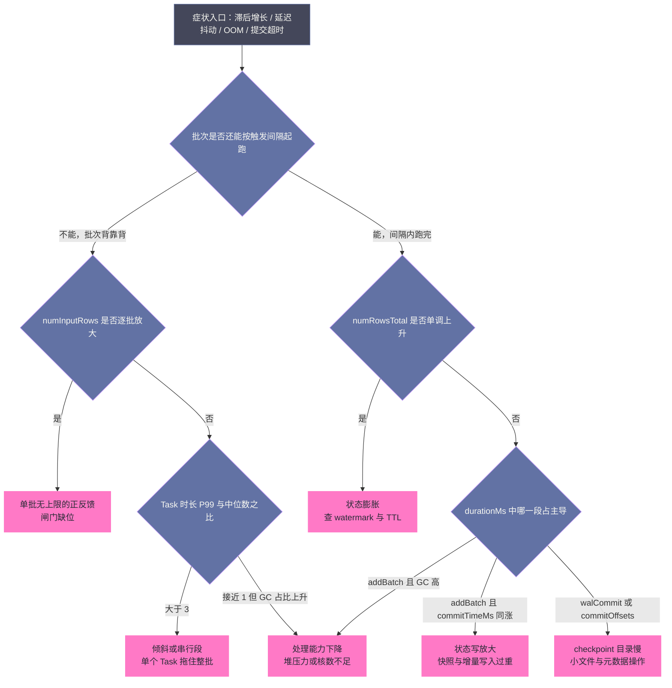
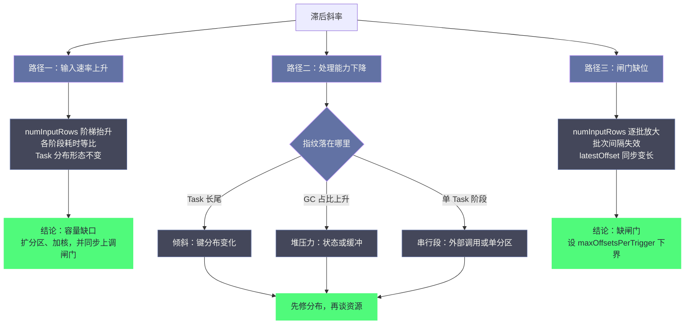
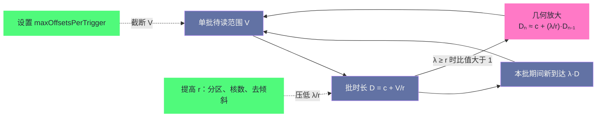
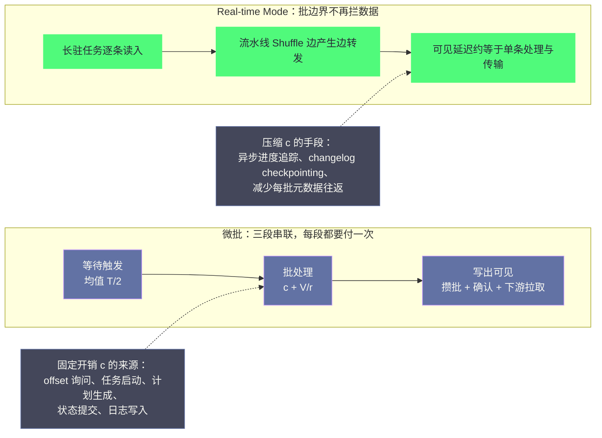
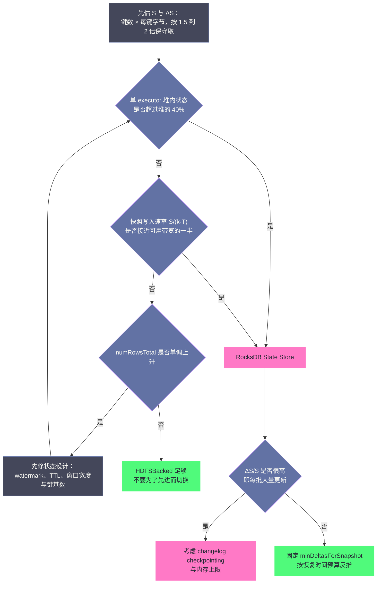
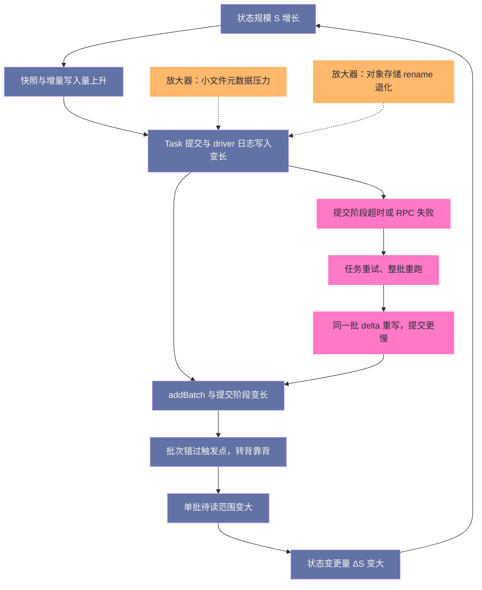

# 12 生产调优手册：吞吐量、延迟、背压与资源配置全攻略

**摘要：**

流查询调优之所以难，难在它没有单一的最优点，只有一组互相挪用的预算：单批读得越多，吞吐越接近处理上限，批时长与失败重放代价也同步上升；触发间隔压得越短，等待越少，固定开销在批时长里的占比越高，端到端延迟反而可能回升；状态留在堆里读得最快，但堆内状态直接决定 GC 的停顿长度；把状态挪到 RocksDB 换来内存解耦，代价是每个实例的原生内存与本地盘 I/O。本文不按参数组织，而按判据组织：先给出积压增长、延迟抖动、状态膨胀、OOM、checkpoint 超时五类症状各自的判别信号，说明为什么调错参数会让症状换一种形式出现；再沿输入上升、能力下降、闸门缺位三条路径拆积压，用批时长与处理速率的分解推出吞吐两个旋钮的配比关系；然后把端到端延迟拆成等待触发、批处理、写出可见三段，论证延迟下限由固定成本与利用率决定，而非由触发间隔决定；最后落到 State Store 选型、checkpoint 超时的因果链、OOM 的三种形态、executor 核数的保守取值，并附四个常见反例。

---

## 第 1 章 先分类，再调参

下面这条链条在支付、广告、风控类流作业上都出现过，数字做了取整，形状一致。凌晨两点四十分，一个支付风控流作业的消费滞后从三万条涨到一千二百万条。值班工程师的做法很标准：把 `maxOffsetsPerTrigger` 从 20 万调到 200 万，滞后在四十分钟内清零；三点十六分，executor 开始 OOM；把堆从 8GB 加到 16GB，OOM 消失，`commitOffsets` 的 P99 从 800ms 涨到 11 秒；把任务超时与重试都放宽，查询稳定了六小时；中午流量再涨一档，滞后重新出现，而这时的单批时长已经是 90 秒，失败重放要吃掉二十分钟的数据。整个过程里每一次参数调整都"有效"，只是把问题从一处搬到了另一处。

这个案例的教训不是"参数不要乱调"，而是**在分类之前调参，等于把症状换个出口**。滞后、慢、抖、挂、涨，五种现象背后的能量是同一份，调参只是决定它从哪个出口释放。

### 1.1 五类症状各有判据

流查询的性能问题在监控上看起来很像：都表现为"这个作业不太行"。但把这五类拆开，第一判据完全不同，误判的代价也不同。

| 症状家族 | 第一判据 | 判据来源 | 典型误判 |
|---|---|---|---|
| 积压增长 | 已提交 offset 与 topic 末尾 offset 的差值斜率 | 自采 offset 差值，或 `numInputRows` 趋势 | 看到 `processedRowsPerSecond` 恒定就以为正常 |
| 延迟抖动 | 端到端延迟的 P99 与 P50 之差 | 源侧到达时间戳与写出时间戳对减 | 拿 `batchDuration` 当端到端延迟 |
| 状态膨胀 | `numRowsTotal` 的斜率是否随运行时长收敛 | State Store 指标、watermark 差值 | 用堆使用率判断状态是否该清理 |
| OOM | 报错在 driver 还是 executor，堆满还是容器被杀 | 异常栈、GC 日志、容器退出码 | 一律加内存 |
| checkpoint 超时 | `commitOffsets`、`walCommit` 的分位值与重试次数 | `durationMs` 分段、checkpoint 目录文件数 | 把超时阈值调大当作修复 |

判据之所以必须来自口径明确的可观测量，是因为流查询有两类指标天生会骗人。第一类是**自归一化**指标：`inputRowsPerSecond` 的定义是"本批读入行数除以本批耗时"，一个已经饱和的作业每批都在满负荷运转，这个数字会稳定停在处理能力附近，看上去毫不异常，而滞后正以每秒数千条的速度堆积。第二类是阶段归属错位的指标：状态写入的成本记在 `addBatch` 里而不是 `commitOffsets` 里，把它算到提交阶段头上，就会得出"checkpoint 慢"的错误结论，进而去调 checkpoint 目录，白费一轮。

### 1.2 滞后不能用消费组去看

一个具体的口径陷阱值得单独说明。Kafka 生态里查滞后最顺手的命令是 `kafka-consumer-groups.sh --describe`，但 Structured Streaming 的 Kafka Source 并不把 offset 提交给消费组：它用 `assign` 指定分区而不是 `subscribe` 加入消费组，offset 只落在 checkpoint 的 `offsets/` 日志里。于是这条命令对这个查询要么看不到条目，要么显示一个陈旧的组位点。

可靠的判据得自己造：从 `StreamingQueryProgress` 里取每批的 `endOffset`，与同时刻自己采集的 topic 末尾 offset 对减；或者在 Listener 里把 `numInputRows` 按秒累加，与上游生产速率对照。前者给出绝对滞后量，后者给出趋势。两者都不依赖消费组语义，也就不会因为一次重分区、一次 `group.id` 变化而失真。

### 1.3 批时长的分解与归属

`StreamingQueryProgress.durationMs` 是一张分段的账，读懂它比读任何一个参数文档都重要。它不是"批时长"一个数字，而是若干阶段各自耗时，键名以对应版本源码里的实现为准，长期稳定的是下面这几段。

| 键 | 阶段含义 | 变慢指向 |
|---|---|---|
| `latestOffset` | 向 Source 询问最新可读 offset | Kafka Admin RPC 往返、分区数过多、鉴权与元数据刷新 |
| `getBatch` | 根据 offset 范围构造本批输入 | 分区切分（`minPartitions`）、对象存储列举、小文件数 |
| `queryPlanning` | 分析、优化、生成物理计划 | 计划过大、UDF 与动态规则开销、AQE 规划 |
| `addBatch` | 执行作业，含 Task 内 State Store 提交 | 计算、Shuffle、GC、倾斜、状态写放大 |
| `walCommit` | 把本批 offset 写入 offset 日志 | checkpoint 目录的写延迟与小文件数 |
| `commitOffsets` | 把本批提交标记写入 commit 日志 | 同上，且受同一存储的元数据操作能力约束 |
| `triggerExecution` | 本批从开始到结束的总时长 | 以上各段之和的上界 |

这张表里最容易混淆的是后两段与 `addBatch` 的关系。状态不是等批次结束才写的：Task 在自己的提交阶段把状态增量刷到 checkpoint，这段耗时被算进 `addBatch`；driver 之后才写 offset 日志与 commit 日志。所以"状态慢"要靠 `addBatch` 与 State Store 的 `commitTimeMs` 一起看，"存储慢"才看 `walCommit` 与 `commitOffsets`。把这两件事混成一件事，就会在状态膨胀时去优化 HDFS，或者在 HDFS 抖动时去换 State Store。

下图给出从症状入口到具体判据的分流路径，五类问题在前三个判断就分开了。

### 1.4 基线：没有基线就没有"变差"

判据的另一半是参照系。一个作业上线两周后滞后开始增长，究竟是流量涨了还是代码退化了，只有基线能回答。基线不需要复杂，需要的是口径固定、能被同一段代码反复采集，下面是笔者在流作业上固定采集的一组量。

| 基线量 | 采集方式 | 正常口径 | 何时算变差 |
|---|---|---|---|
| 每批读入行数 | `numInputRows` | 围绕 `输入速率 × 触发间隔` 波动 | 单批持续超过 1.5 倍均值 |
| 批时长 P50/P99 | `durationMs.triggerExecution` | P99 ≤ 0.7 × 触发间隔 | P99 连续 10 批越界 |
| 各阶段占比 | `durationMs` 分段 | `addBatch` 稳定在 70% 以上 | 某一段占比突然翻倍 |
| 状态行数 | `numRowsTotal` | 与 watermark 阈值、窗口宽度匹配 | 斜率不随水位推进回落 |
| 水位与最大事件时间之差 | `eventTime.max` 与 watermark | 约等于声明的乱序容忍 | 差值持续扩大 |
| 提交阶段耗时 | `walCommit` + `commitOffsets` | 毫秒级到百毫秒级 | 进入秒级并出现重试 |
| 端到端延迟 | 业务时间戳打点 | 稳定区间 | 分位数右尾变厚 |

这组量的采集出口是 `StreamingQueryListener` 与每批的进度对象，字段口径与埋点位置在 [[11 监控与可观测性：StreamingQueryListener 与生产指标体系]] 里已经展开。

基线要按"同一时段、同一流量档位"比较，否则大促期间的一切指标都会显得异常。更实用的一条经验是把基线绑定到流量分档：低于两千行每秒、两千到两万、两万以上各留一组数值，比对时先看落在哪一档，再看差异是否超出预算。

---

## 第 2 章 积压增长的三条归因路径

滞后增长是流作业最常见也最容易误诊的问题，原因是同一个滞后曲线可以来自三种完全不同的病因，而三者的处置方向互相冲突：一种要加资源，一种要先修数据分布或内存，还有一种只要设一个闸门。

### 2.1 三种滞后曲线形状

在把滞后画成时间序列之前，先看它的形状。线性上升意味着消费速率恒定地低于到达速率，差值就是斜率；几何上升意味着每一批的待读范围都比上一批大，系统在自我放大；锯齿则意味着闸门在工作，只是闸门设得比处理能力还紧，滞后降不下去但也涨不快。形状是免费的信息，比任何参数都更早给出方向。

### 2.2 路径一：输入速率上升

这类问题其实是容量问题，只是发生在流上。判据有三条同时成立：`numInputRows` 呈阶梯式抬升并停在新的平台上；批时长与各阶段耗时同比例上升，没有哪一段单独跳变；Task 时长分布的形状不变，P99 与中位数之比维持原值。三条都满足，说明单位数据的处理成本没有变化，只是数据多了。

这一路径的处置不是调参数，而是补容量：Kafka 分区数决定 Source 的并行上限，分区不够时加 executor 也没用；Shuffle 与状态分区数（`spark.sql.shuffle.partitions`）决定状态算子能铺开的宽度；executor 核数决定一批能同时跑多少任务。三者的关系在第八章展开。需要提醒的是，容量补上去之后原来的闸门值会变成新的瓶颈，`maxOffsetsPerTrigger` 必须同步上调，否则会出现"资源加了、滞后没降"的假象。

### 2.3 路径二：处理能力下降

能力下降的表现是"同一份数据突然算得慢了"，判据因此集中在内部分布而不是总量上。三类子形态各有指纹：

倾斜的指纹是 Task 时长的长尾，P99 与中位数之比超过 3，且长尾固定落在少数几个分区上；如果开了 AQE 的倾斜 Join 处理，长尾会被拆开，表现为作业内出现额外的、规模不均的子阶段。流入倾斜的成因通常是键分布变化，譬如大促期间头部商户的事件量占比从 5% 涨到 40%，按键聚合时这些键所在的分区就成了长尾。

GC 的指纹是 Task 的 GC 时间占 Task 时长的比例上升，同时堆使用率在高位锯齿，`addBatch` 上升而 `commitTimeMs` 基本不变。堆压力常有两个来源：状态留在堆内缓慢长大，或者 Shuffle 缓冲与聚合哈希表在小批次下反复扩张。

串行段的指纹最隐蔽：并行度没变、GC 正常、也没有明显长尾，但批时长就是上不去。常见成因是算子链里存在单点瓶颈，譬如 `foreachBatch` 里同步调用一个外部接口、写维表时逐条查询数据库、或者 `repartition(1)` 之后再做聚合。这类问题在 Spark UI 的 Stage 视图里表现为某个 Stage 只有一到两个 Task，其余阶段都在等它。

这一路径的处置顺序是先修分布、再修内存、最后才加资源。反过来做，等于给一条正在堵塞的管道加压。

### 2.4 路径三：闸门缺位

第三条路径最少被识别，因为它的症状最像"数据太多"。Structured Streaming 的微批引擎在取 offset 时有一个默认假设：Source 有多少可读数据，就取多少。Kafka Source 的 `maxOffsetsPerTrigger` 默认不设上限，File Source 的 `maxFilesPerTrigger` 默认是 1000，两者都意味着单批体积没有硬边界。当处理速率低于到达速率时，每批的待读范围都比上一批更大，于是形成一个正反馈。

把这个反馈写成式子会看得更清楚。设固定开销为 `c`（秒），单批读入量为 `V`，持续处理速率为 `r`（行每秒），则批时长 `D = c + V/r`；若不设闸门，下一批的待读量约等于本批期间新到达的数据，即 `V ≈ λ·D`，代回得到递推 `Dₙ = c + (λ/r)·Dₙ₋₁`。当 `λ ≥ r` 时这个递推的发散比就是 `λ/r`：取 `c = 0.6` 秒、`λ/r = 1.2`，批时长依次约为 1.32、2.18、3.22、4.46、5.95 秒，第十二批之后已经超过 35 秒，若到达速率为每秒八千行，那时的单批体积约二十八万行。这是示例推算，用于说明形状而非预测具体数值，但结论是稳的：**没有闸门时，处理能力不足会以几何速度变成批体积过大**，随后撞上内存上限或提交超时。

有意思的是，同一递推在 `λ < r` 时是收敛的，稳态批时长 `D* = c/(1 − λ/r)`。这意味着即便不设闸门，只要处理能力有余量，单批体积最终会稳定在 `λ·D*` 附近，滞后不会无限增长。这条结论解释了生产上一类看似矛盾的现象：某个作业的滞后涨了两小时后自己回落了，因为它那段时间的流入峰值超过了处理能力，峰值一过就重新收敛。它也解释了为什么"峰值前主动限流"是有意义的：让 `λ/r` 在峰值区间保持在 0.8 以下，收敛点就低。

三条路径的判据并列放在一起，误判率会明显下降。

| 维度 | 输入速率上升 | 处理能力下降 | 闸门缺位 |
|---|---|---|---|
| `numInputRows` 曲线 | 阶梯抬升后走平 | 平稳 | 逐批放大，无上界 |
| 批时长形状 | 与数据量同比例上升 | 相同数据量下变长 | 与上一批成正比放大 |
| 阶段归属 | 各段等比 | 集中在 `addBatch` 内某一段 | 各段都涨，`latestOffset` 也涨 |
| Task 分布 | 形态不变 | 长尾或单 Task 阶段 | 形态不变但规模变大 |
| GC 表现 | 占比不变 | 占比上升或锯齿加剧 | 占比随批体积上升 |
| 处置方向 | 补容量并同步上调闸门 | 修倾斜、修内存、找串行段 | 设闸门下限并核算 `r` |
| 错误处置的后果 | 只调闸门 → 滞后短暂下降后反弹 | 只加内存 → 批时长与滞后同时上涨 | 只加资源 → 症状转为 OOM 或提交超时 |

下图把三条路径的判断证据与处置结论画在一起，注意三者的证据是在同一批指标上分叉的，不需要额外埋点。

---

## 第 3 章 吞吐量的两个旋钮

一旦把问题归到积压上，能动的参数看似几十个，真正改变吞吐的只有两个：一批能并行处理多少（并发），以及一批允许多少数据（每批量）。其余参数要么在改这两个量的成本结构，要么在掩盖它们的后果。

### 3.1 吞吐是比值，不是容量

吞吐的定义是单位时间内处理的行数，也就是 `V/D`。这个除法结构决定了两个反直觉的推论。其一，把单批体积 `V` 翻倍，吞吐只在新批时长增长不足一倍时才会提高；其二，把批时长 `D` 压到极小并不提高吞吐，反而因为固定开销占比上升而降低。流查询的调优曲线因此不是单调的，存在一个使 `V/D` 最大的配比点。

把 `D = c + V/r` 代进去，得到 `S(V) = V/(c + V/r)`，这条曲线在 `V → 0` 时趋于 0，在 `V → ∞` 时趋于 `r`，中间没有峰值，只有逼近上限的过程。也就是说，**吞吐的上限就是处理速率 r，闸门只能让你更接近它，不能超过它**。这个结论可以直接用来判断一类求助是否成立：当有人问"把 `maxOffsetsPerTrigger` 调到多少才能消费完积压"，答案是"调到多少都不能，除非 `r` 大于到达速率"。

### 3.2 并发的三个入口

并发不是一个参数，而是三个层面的量，各自卡在不同的环节。

第一个入口是 Source 的分区数。Kafka 的分区数决定了一个批次最多能并行读多少个分区，改这个数需要在上游扩分区，作业侧无能为力。分区数不足时，增加 executor 只会在同一批里堆积空闲槽位。

第二个入口是 Shuffle 与状态分区数，即 `spark.sql.shuffle.partitions`。它决定了 Shuffle 之后的任务数量，也决定了状态算子被切成多少个状态分区。这个参数对无状态链影响的是任务粒度，对有状态链影响的是状态实例数与单实例体积，两者方向相反：分区越多，单任务越快、单实例越小，但实例数与每实例固定开销同步上升。

第三个入口是 executor 的核数，它决定一批里能同时跑多少个任务。核数对批时长的影响遵循 `D ≈ c + V/(C·ρ)`，其中 `C` 是总并发槽位，`ρ` 是单槽位每秒处理行数。这条式子给了加核的有效性边界：只有当 `V/(C·ρ)` 这一段在 `D` 里占主导时，加核才降批时长；当 `c` 占主导时，加核几乎无效，只会让槽位空转。

### 3.3 每批量：闸门的分摊规则与两个副作用

`maxOffsetsPerTrigger` 是 Kafka Source 上最直接的限流参数，注意它的单位是"全部订阅分区合计的行数"而不是每分区行数。实现上，Kafka Source 在取到各分区的可读 offset 范围后，按每个分区范围占总范围的比例分摊这个上限，滞后大的分区拿到更多配额。这个分摊规则有一个副作用值得记住：当某个分区因为上游写入不均匀而严重滞后时，它会拿走大部分配额，于是同一批里各分区的延迟差异被进一步拉大，长尾分区的数据却要更晚才被处理。

闸门的另两个副作用更常被忽略。其一是锯齿：闸门生效时，每批固定消费 `M` 行，滞后曲线从"无界上升"变成"锯齿下降"，看起来健康了，但下游看到的数据节奏变成了脉冲，对下游做分钟级聚合的作业不友好。其二是单批上限掩盖了批时长上限：`M` **只约束体积，不约束时间**，如果某一批因为这批数据特别"重"（大消息、复杂 Join、冷启动加载状态）而跑了很久，闸门不会介入，滞后会在这批之后再次跳升。

下面这张表把两个旋钮的作用点、影响量与代价并列，它是第三章的核心结论。

| 维度 | 并发（分区数 / 核数） | 每批量（`maxOffsetsPerTrigger`） |
|---|---|---|
| 直接影响的量 | 处理速率 `r` 与批时长中的并行段 | 单批体积 `V` |
| 吞吐上限 | 抬高上限，最高到集群能力 | 不抬高上限，只逼近当前 `r` |
| 对固定开销的影响 | 基本无效（`c` 由引擎与存储决定） | 占比随 `V` 增大而下降 |
| 主要代价 | 资源成本、GC 压力、状态实例内存 | 批时长上升、失败重放量、内存峰值 |
| 失效条件 | 数据量 `V` 太小、`c` 占主导、倾斜未修 | `λ ≥ r` 时完全无效，只放大单批 |
| 误用后的症状 | 槽位空闲、GC 抖动、批时长不降 | 锯齿、OOM、提交超时、重放变慢 |
| 建议的设定顺序 | 先确定（决定 `r`） | 后确定（按 `r` 与 `c` 反推） |

### 3.4 配比原则

两个旋钮不能独立设定，因为闸门的下界由处理速率与固定开销共同决定。要求批时长能跟上触发间隔 `T` 且留出余量，需要同时满足两件事：闸门至少覆盖一个间隔内到达的数据，即 `M ≥ λ·T`；批时长不超过间隔的七成，即 `c + M/r ≤ 0.7·T`。把 `M = λ·T` 代入第二式，得到间隔的下界 `T ≥ c/(0.7 − λ/r)`。

这组不等式给出三条可操作的判断。第一，利用率 `λ/r` 决定了间隔能压到多低：`c = 0.6` 秒、`λ/r = 0.4` 时间隔下界约 2 秒，`λ/r = 0.6` 时下界约 6 秒，`λ/r = 0.7` 时下界无穷大，因为七成的余量已经不够覆盖固定开销。第二，闸门的下界会随利用率急剧放大：若按"积压不增长"推导，`M ≥ λ·c/(1 − λ/r)`，`λ = 8000`、`c = 0.6` 时，`λ/r = 0.4` 需要 `M ≥ 8000`，`λ/r = 0.8` 需要 `M ≥ 24000`，`λ/r = 0.9` 需要 `M ≥ 48000`。第三，因此正确的顺序是**先抬 `r` 再定闸门**：先抬高 `r` 把利用率压到 0.7 以下，再按 `1.2 到 2 倍` 的理论下界设闸门；反过来先调闸门，会在利用率高位上得到一个必须越调越大的死循环。

以上数字是示例推算，`c` 与 `r` 在真实集群上要实测：`c` 可用低流量时段的批时长近似，`r` 可用"单批行数除以批时长中扣掉 `c` 的部分"估算，两个量都随批次体积变化，取工作区间内的值才有意义。

### 3.5 正反馈的形状

把闸门缺位与能力不足放在一起，能看清为什么积压问题总在恶化之后才被发现。下图画的是这个回路，箭头上的条件是它闭合的条件。

回路里两个断点对应两种正确的干预：截断 `V`（设闸门）能让回路变成锯齿，压低 `λ/r`（提并发）能让比值小于 1。只做前者不做后者，积压就从"涨"变成"一直不降"；只做后者不做前者，则在能力提升的窗口里仍可能撞上一次超时。

---

## 第 4 章 延迟的三个组成与可压缩性

吞吐与延迟在流查询里不是一对可以同时优化的指标，但它们的关系也不是教科书上那句"批次越大延迟越高"那么简单。要看清这层关系，得先把"延迟"拆到能分别下手的粒度。

### 4.1 先钉死量的是哪一种延迟

"这个作业延迟五秒"这句话至少有三层含义。第一层是源内积压延迟，即一条数据在 Kafka 里等了多久才被读走，它等于滞后量除以到达速率，与批时长无关；第二层是处理延迟，即从 offset 被读入到结果被提交的时间，它近似等于一批数据的平均等待加上批处理时长；第三层是端到端可见延迟，即业务时间戳到下游可消费时间戳之差，它还要叠加写出与下游消费的开销。

三层延迟的优化手段不同，混用会得出错误结论。最常见的混淆是把 `triggerExecution` 当作端到端延迟：当滞后为零时两者接近，当滞后存在时前者完全无法反映用户感受到的延迟，因为数据可能在 Kafka 里已经躺了十分钟。反过来说，一个端到端延迟忽高忽低的作业，如果滞后长期为零，那抖动来自批处理或写出，与 Source 无关。

### 4.2 三段的成本结构

微批模式下，一条数据的端到端可见延迟可以写成三段之和：数据到达后等待下一个触发点的平均时间，约为间隔的一半；本批的处理时长 `c + V/r`；以及写出到下游可见的时间，包含攒批、确认与下游拉取。三段的可压缩性差别极大。

等待段是唯一可以被压到接近零的一段，代价是固定开销占比上升。处理段有一个**无法压缩的下界** `c`，`c` 由 offset 询问、任务启动、计划生成、状态提交与日志写入构成，每批都要付一次，与体积无关。写出段的下界由 Sink 语义决定：Kafka Sink 的下界是生产者攒批与副本确认的时间，文件类 Sink 的下界是文件关闭后元数据提交被下游读到的时间，Append 模式的可见性还依赖这一批的 commit 标记被下游识别。

下面的表是一次示例推算，用 `λ = 8000` 行每秒、`c = 0.6` 秒、`r = 20000` 行每秒、写出段 0.3 秒，看触发间隔从 10 秒压到 0.2 秒时各段如何变化。数字只用于展示趋势。

| 触发间隔 `T` | 单批行数（按 `λ·T`） | 处理段 | 等待段均值 | 端到端估算 | 固定开销占比 | 实际状态 |
|---|---|---|---|---|---|---|
| 10 秒 | 80000 | 4.6 秒 | 5.0 秒 | 9.9 秒 | 13% | 间隔内跑完，余量充足 |
| 2 秒 | 16000 | 1.4 秒 | 1.0 秒 | 2.7 秒 | 43% | 间隔内跑完，余量约 30% |
| 1 秒 | 8000 | 1.0 秒 | 0.5 秒 | 1.8 秒 | 60% | 临界，批时长等于间隔，P99 开始越界 |
| 0.5 秒 | 4000 | 0.8 秒 | 0.25 秒 | 1.35 秒 | 75% | 批时长已超过间隔，转背靠背 |
| 0.2 秒 | 1600 | 0.68 秒 | 0.1 秒 | 1.08 秒 | 88% | 表格值不可达，见下文 |

表中前四行的算法是"每批独立"：单批行数取 `λ·T`，处理段取 `c + λ·T/r`。这一算法在批时长小于间隔时成立，从 0.5 秒一行起已经不成立——批时长超过了间隔，引擎不再等待触发点，下一批在上批结束的瞬间开始，单批体积反过来由批时长决定，回路闭合在 `D = c/(1 − λ/r) = 1.0` 秒上，端到端落在 1.3 秒附近。把这个闭合值与表格口径对照，会看到一个差得很远的结论：0.2 秒一行若按表格算法显示 1.08 秒，实际却到不了，真实值被闭合点钉在 1.3 秒；而 0.5 秒一行按表格算是 1.35 秒，反而更接近真实值。这条闭合点就是**微批模式在这个并发与利用率下的延迟下界**，要突破它必须动 `c` 或利用率，动 `T` 没有用。

### 4.3 降低延迟的四条真实路径

按有效性排序，压延迟的路径只有四条。

第一条是削减固定开销 `c`。手段包括：无状态查询启用异步进度追踪（`asyncProgressTrackingEnabled`），把 offset 日志与 commit 日志的写入从关键路径上挪走；RocksDB 状态启用 changelog checkpointing，把每批的全量快照上传换成增量日志上传；减少每批的 `latestOffset` 往返，譬如不要在上游频繁扩分区、避免每批刷新元数据。这一条直接抬高延迟下界，是唯一能突破前节的闭合点的方向。

第二条是提高处理速率 `r`，等价于降低利用率，让闭合点下移。这条路径的边际收益随利用率降低而递减，因为闭合点 `c/(1 − λ/r)` 在 `λ/r` 小时趋近于 `c`。

第三条是减小写出可见延迟。对 Kafka Sink，关键是生产者攒批参数与确认级别；对文件类 Sink，关键是让下游依赖 commit 标记而不是文件出现时间；对下游本身是流式消费的系统，还要看它自己的拉取间隔。这一条常被忽略，却在端到端延迟里占了固定的一份。

第四条是换执行模式。Spark 4.1.0 引入 Real-time Mode，4.3.0 起支持去重、聚合与 JVM 侧 `transformWithState` 这三类有状态算子。它把"每批规划一次、启动一批短任务"换成"每个输入分区一个长驻任务"，记录到达即处理，不再等批边界；对带状态的算子，它用流水线化的 Shuffle 让生产阶段与消费阶段同时运行，边产生边按 key 转发，而不是先落盘再读。官方口径的延迟从微批的约 100 毫秒下界降到毫秒量级。代价同样明确：只支持 `update` 输出模式；触发间隔的含义变成检查点间隔而非延迟目标，且有最短 5 秒的限制（`spark.sql.streaming.realTimeMode.minBatchDuration`，各类 Trigger 的语义差别见 [[05 触发器 Trigger：ProcessingTime、Once、AvailableNow 与 Continuous]]）；有状态算子不支持异步进度追踪；流-流 Join、`flatMapGroupsWithState`、会话窗口等尚不在支持列表内；处理语义是 exactly-once，但投递语义仍由 Sink 决定，内置 Kafka Sink 是 at-least-once。

下图把两种模式的延迟结构并排，可以看到微批的三段在 Real-time Mode 里被压成了一段。

### 4.4 抖动的归因

延迟抖动与延迟高是两件事。抖动的判据是 P99 与 P50 的差，成因通常是下面四类之一：GC 停顿（周期性、与堆使用率相关）、检查点或快照的周期性重活（与 `minDeltasForSnapshot` 的倍数关系吻合）、状态实例在 executor 之间漂移导致的重载（与资源调度事件相关）、外部依赖的慢调用（与自身节奏无关，随机出现）。四类成因在时间序列上的特征不同，把它们画在一起看，比单看分位数更快。

---

## 第 5 章 State Store：判据、代价与选型

状态是流查询与批查询的分水岭，也是调优里唯一不能靠"加资源"绕开的部分。选错 State Store 的代价不在当下，而在状态长到某个规模之后突然出现：批时长台阶式抬升、GC 停顿变长、检查点写入打满带宽。

### 5.1 两种实现的物理差异

默认的 `HDFSBackedStateStoreProvider` 把状态放在 executor 的 JVM 堆里，每个状态分区一份哈希映射；每批结束时，把本批的增量写成 checkpoint 目录下的一个 delta 文件，隔若干批再把整份状态写成快照文件并回收旧 delta。它的读取路径极快（纯内存哈希），代价是状态体积被堆上限锁死，且每次快照都要把整份状态写一遍。

`RocksDBStateStoreProvider` 自 Spark 3.2 引入，状态落在本地磁盘上的 RocksDB 实例里，热数据在块缓存，冷数据从盘上读；每批把变更作为增量上传到 checkpoint，快照按配置周期在后台上传。它的读取路径多了一次序列化与本地 I/O，换来的是状态体积与堆解耦、GC 压力下降、以及后台压缩不阻塞批处理。

两种实现**不能互相恢复**：checkpoint 里的状态格式不同，从 HDFSBacked 的旧目录切到 RocksDB 会直接失败。这条限制决定了选型要在上线前定，而不是在状态长到几十 GB 之后。

| 维度 | HDFSBacked | RocksDB |
|---|---|---|
| 状态位置 | JVM 堆内哈希映射 | 本地盘 + 原生内存块缓存 |
| 状态上限 | 受堆与 GC 约束，单 executor 数十 GB 已很勉强 | 受本地盘容量约束，可达数百 GB |
| 每批持久化 | 增量 delta 文件，每分区每批一个 | 增量写入 checkpoint，快照周期后台上传 |
| 快照成本 | 整份状态写一次，且发生在任务提交路径上 | 后台执行，可配 changelog 只传增量 |
| 读取成本 | 内存哈希，微秒级 | 块缓存命中时接近内存，未命中走本地盘 |
| 内存归属 | JVM 堆，计入 `executor.memory` | 原生内存，计入 `memoryOverhead` 与容器限额 |
| 倾斜敏感度 | 高：单分区状态大直接压垮单个 Task 的堆 | 较低：单分区大只影响该实例的盘与缓存 |
| 恢复路径 | 快照 + delta 链重放，链越长越慢 | 快照 + 增量，changelog 模式下依赖日志回放 |
| 适用判据 | 状态小、变更密集、GC 可接受 | 状态大、键多、堆压力已经出现 |

### 5.2 判据要量化到字节

"状态多大该换"这个问题有可算的答案。先估状态总量：`S ≈ keys × 每 key 字节数`，每 key 字节数包含 key 本身、value 与行开销（编码开销、哈希索引、对齐填充），实践中按 1.5 到 2 倍于裸数据估算更稳。再算每个 executor 的堆内占用：`S / 状态分区数 × 每 executor 并发状态任务数`。第三个量是**快照写入速率**：`S / (minDeltasForSnapshot × T)`，这个速率要和 checkpoint 目录可用带宽比较，且要按同一目录上的并发查询数分摊。

三个量各自对应一条判据。堆内状态超过单 executor 堆的 40% 到 50% 时，GC 停顿开始主导尾延迟；单状态分区超过几百 MB 时，倾斜或单个 Task 超时的风险显著上升；快照写入速率接近可用带宽的一半时，提交阶段会开始出现秒级尖峰。状态能不能被清理，取决于水位线能否推进，这条链上的坑在 [[04 Watermark 全解：事件时间语义与延迟数据处理]] 里已逐条拆过；而窗口实例的数量、窗口宽度与滑动步长的关系，见 [[06 窗口聚合：滚动窗口、滑动窗口与会话窗口的实现机制]]。

三条中任意一条越界，就该考虑 RocksDB；三条都在界内时，RocksDB 反而可能因为序列化开销而更慢。

举个示例推算：去重加窗口聚合，峰值五百万去重键加六百万窗口实例，每 key 约 200 字节，`S` 约 2.2GB；铺在 96 个状态分区上，每分区约 23MB，单 executor 五个并发任务约 115MB 堆内状态，HDFSBacked 完全够用，切到 RocksDB 只会多一次序列化。把去重键换成五千万，`S` 变成 10GB 以上，每分区超过 100MB，单 executor 堆内状态接近 600MB，再叠上 Shuffle 缓冲与聚合哈希表，堆压力就开始显形；此时按 `minDeltasForSnapshot = 2`、`T = 10` 秒计算，快照写入速率约为 `10GB / 20秒 = 500MB/s`，这已经会打满一条共享 HDFS 的写通道。两个数字都说明，这一个作业的边界在五百万到五千万键之间，而不是在"多大算大"这种定性问题上。

### 5.3 两个容易踩的隐藏成本

HDFSBacked 的隐藏成本是文件数与**delta 链**。每个状态分区每批写一个 delta 文件，96 个分区、1 秒间隔意味着每天约 830 万个状态文件被创建（旧文件随快照回收，但瞬时文件数与元数据操作量依然是这个量级）。NameNode 的元数据操作能力会被这条作业单独吃满一部分，表现为所有依赖同一 HDFS 的作业在提交阶段都变慢。delta 链的另一个代价在恢复：executor 丢失或作业重启时，需要从最近的快照重放其后所有 delta，链越长恢复越慢，而链长由 `minDeltasForSnapshot` 决定。

RocksDB 的隐藏成本是每实例的固定内存与本地盘 I/O。块缓存默认 8MB、写缓冲由 RocksDB 自动决定，两者都是原生内存；一个 executor 上并发跑五个状态任务，就是五份实例，粗算 300 到 500MB 原生内存，这部分不在 `executor.memory` 里，只能靠 `memoryOverhead` 兜住。本地盘上的 SST 文件还会被操作系统页缓存，在 cgroup 记账下这部分也计入容器内存（可回收，但压力大时会触发回收与抖动）。压缩在后台跑，会与同一块盘上的 Shuffle 争 I/O，表现为偶发的批时长尖峰。

### 5.4 三个相关开关的取舍

`spark.sql.streaming.stateStore.minDeltasForSnapshot` 控制快照间隔，默认 2（以对应版本的 SQLConf 为准）。调大它减少快照次数、降低提交阶段尖峰，代价是 delta 链变长、恢复变慢。这个参数与批间隔耦合：间隔 10 秒、取 10，意味着每 100 秒一次全量快照；如果状态有 10GB，这等于每 100 秒写 10GB，仍然可观，真正的解法是把状态设计改小或者换 provider。

RocksDB 的 changelog checkpointing（`spark.sql.streaming.stateStore.rocksdb.changelogCheckpointing.enabled`，3.5 起提供，默认关闭）把"每批上传全量快照"换成"上传增量日志、后台周期快照"，直接把批提交路径上的写入量从 `S` 降到 `ΔS`。代价是恢复时要回放日志，恢复时间与日志长度相关，而且状态格式与旧 checkpoint 的兼容性需要单独确认。

RocksDB 的内存上限（`boundedMemoryUsage` 与 `maxMemoryUsageMB`、`highPriorityPoolRatio`）用于在多个实例共享一个 executor 时给原生内存封顶。开了上限意味着部分块缓存会被挤掉，未命中率上升，读取变慢；不开则可能在容器层面被杀，两者之间的选择取决于本地盘是否够快。

下图给出从状态规模与变更率出发的选型路径，四个判断足以覆盖绝大多数场景。

### 5.5 兼容性与迁移成本

切 provider 不是改一行配置的事。旧 checkpoint 的状态格式与新 provider 不兼容，必须换新的 checkpoint 目录，并从源头重放或从业务侧导入一份初始状态；如果业务能接受"状态从零开始"，重放时间要按积压量与 `r` 估算，一个两千万行的存量在 `r = 20000` 时是十六分钟级的重放，这段时间的输出是空窗。这也是"新业务上线直接用 RocksDB"这条建议的由来：省下的不是切换的操作成本，而是空窗与重放的时间成本。

状态格式版本（`stateFormatVersion`）与状态模式校验（`stateSchemaCheck`）也有类似性质：前者决定序列化格式，改了就必须重放；后者默认开启，能在查询的 schema 与 checkpoint 不一致时尽早失败，而不是在运行几小时后产出错数据。这两项都属于"上线前定，上线后别碰"的范畴。

---

## 第 6 章 checkpoint 超时的成因链

checkpoint 超时是五类问题里最像"存储问题"的一类，实际上它的触发点往往在状态设计上。把它当成独立的存储故障去修，通常只能买到一段时间的安静。

### 6.1 一条完整的因果链

链条的起点是状态规模。状态大，快照就大，而快照写发生在状态提交的路径上：Task 结束前要把状态刷到 checkpoint，driver 要等所有 Task 提交完才能写 offset 日志与 commit 日志。写入时间一长，批时长上升，批次错过触发点，单批待读范围变大，状态变更量变大，快照与增量都变大。链条走到这里已经闭合，后面的两段才是真正的恶化：一旦提交阶段触到超时，任务重试、**整批重跑**，重跑又要重写同一批的 delta，于是下一次提交更慢。

两条外部放大器会让这条链走得更快。第一条是存储侧的小文件能力：每批两个日志文件加每分区一个 delta，文件数与批频率成正比，NameNode 或元数据服务的操作延迟一旦进入百毫秒级，累加到每批就是秒级。第二条是对象存储的语义差异：HDFS 上的写入是"写临时文件再 rename"，rename 是元数据操作，代价固定；对象存储上的 rename 退化为复制加删除，代价与对象大小成正比且不原子，状态快照这种大对象的上传会被拆成多次请求，延迟与请求数双双上升。把 checkpoint 目录放在对象存储上，等于把每一批的提交都变成一次小规模数据搬运。

下图把这条链画成一个环，环上每个节点都对应一个可观测的量。

### 6.2 判据：先分清是哪一段在超时

超时在不同位置的日志形态不同，认错了位置就会修错对象。

| 现象 | 证据 | 指向 | 处置 |
|---|---|---|---|
| `walCommit` 或 `commitOffsets` 出现秒级尖峰并伴随重试 | `durationMs` 分段、driver 日志中的 RPC 超时 | checkpoint 目录的写延迟或元数据服务 | 换目录到低延迟存储、降低批频率、减少保留批次数 |
| `addBatch` 上升且 State Store `commitTimeMs` 同涨 | 状态指标、Task 的提交阶段耗时 | 状态写放大，快照过大 | 先减状态，再调 `minDeltasForSnapshot`，最后换 provider |
| 目录文件数随时间线性增长不回落 | `hdfs dfs -count` 或对象存储清单 | 清理策略与快照回收未生效 | 检查 `minBatchesToRetain` 与快照回收，确认没有残留临时文件 |
| 重试次数上升但单次耗时正常 | Stage 重试计数、`spark.task.maxFailures` | 偶发 RPC 失败被放大成整批重跑 | 修存储稳定性，避免用重试掩盖 |
| 作业停止耗时超时 | `spark.sql.streaming.stopTimeout` 相关日志 | 长事务未提交或 Task 卡在写 | 缩短批时长，避免大事务 |

`minBatchesToRetain` 是一个经常被误解的参数，它控制 checkpoint 目录里保留的批次数，默认 100（以对应版本文档为准）。调小它能让旧日志更快回收，减少目录规模与元数据压力，代价是故障后可选的重放起点变少；但它不影响状态快照与 delta 的保留，那是快照回收逻辑的职责，两者不能互相替代。

### 6.3 处置顺序

面对一条正在超时的作业，处置要按代价从低到高排，而不是从配置看起来最相关的开始。

第一步是减状态，因为它同时降低快照量、增量与恢复时间，是唯一的多赢动作，手段是收紧 watermark、缩小窗口宽度、给去重加时间边界、清理不需要的键维度。第二步是降低批频率，即拉长触发间隔，让每批付一次固定开销的次数变少，同时快照间隔的绝对时间也变长；这一步会牺牲延迟，但通常在事故处置期可以接受。第三步是调快照频率与 provider，也就是前面两章讨论的取舍。第四步才是动存储的物理位置：把 checkpoint 从对象存储挪到 HDFS，或从跨机房挪到同机房，或给目录单独限流与配额。最后一步才是放宽超时阈值，而且必须清楚它只是把失败推迟，因为有环路的系统会在更长时间后以更大的规模失败。

---

## 第 7 章 OOM 的三种形态

流作业的 OOM 之所以难处理，是因为同一个报错文本可能来自三个完全不同的位置，而三者的处置方向互相冲突：driver 侧的 OOM 要减广播与缓存，executor 堆的 OOM 要减状态或调结构，容器被杀要加堆外预算。用同一个"加内存"去应付三种情况，通常会把问题变成更难查的形态。

### 7.1 driver 侧

driver 侧的 OOM 有三种常见来源。第一种是广播：把一张几 GB 的商户维表用 `broadcast` 提示强制广播，广播对象的构建与分发都在 driver 上发生，driver 堆（默认 1GB 量级）会先被打满。判据很干净，异常栈里出现广播相关类，且发生在查询启动或维表刷新时。第二种是驱动端缓存：`foreachBatch` 里对批数据做 `collect` 或 `toPandas`，把整批数据拉到 driver。第三种是进度对象累积：每批的 `StreamingQueryProgress` 会保留最近若干条（`numRecentProgressUpdates`，默认 100），其中含各源各分区的 offset 与状态指标，分区数上千、批频率一秒时，这部分会缓慢吃掉几十到几百 MB。

三种来源的处置方向一致：把数据搬到 executor 去算，不要搬到 driver。维表超过广播阈值（`spark.sql.autoBroadcastJoinThreshold`，默认 10MB）时改用普通 Join 或按批读取的流-批关联；`foreachBatch` 里避免 `collect`；分区数极多时适当降低进度保留条数。

### 7.2 executor 堆

堆内 OOM 的判据是异常出现在 executor 的 stderr、Task 失败、`java.lang.OutOfMemoryError: Java heap space` 或 `GC overhead limit exceeded`。来源按出现频率排：状态（HDFSBacked 的状态全在堆里，这是头号来源）、Shuffle 缓冲与聚合哈希表、倾斜导致的单分区超大、以及批次体积突增。

判据的细分靠 GC 日志与堆使用曲线。状态导致的 OOM 通常伴随"堆使用率长期在 70% 以上缓慢抬升"，并在水位推进不畅时明显加速；Shuffle 导致的 OOM 表现为堆使用率随批到达呈锯齿，且与 `spark.sql.shuffle.partitions` 的设定强相关；倾斜导致的 OOM 只发生在个别 executor 上，节点间堆使用率差异很大。

### 7.3 容器被杀

第三种形态最容易被误读，因为 JVM 没有抛 OOM，进程就直接没了。YARN 上的日志是 `Container killed by YARN for exceeding memory limits`，Kubernetes 上的现象是 Pod 的 `OOMKilled` 或退出码 137。判据是容器被杀前 JVM 堆使用率并不高——如果堆只用了六成就被杀，说明超出的部分在堆外。

堆外的构成在流作业里比批作业复杂得多。RocksDB 的块缓存、写缓冲与压缩临时空间都是原生内存；Netty 的直接内存缓冲随 Shuffle 分区数与并发任务数上升；Python 侧的 worker 进程有自己的 RSS，需要 `spark.executor.pyspark.memory` 单独预留；长期运行的 executor 还有线程栈、代码缓存、JIT 元数据等缓慢增长的部分。此外本地盘文件的页缓存也会计入 cgroup 内存（虽属可回收），在磁盘读密集时会推动容器触顶。

`spark.executor.memoryOverhead` 的默认口径是 `max(executor.memory × 0.1, 384MB)`，这个比例是为批作业设计的，对带 RocksDB 状态的流作业往往不够。堆外内存估算与平台取整规则、Kubernetes 上的独立口径，在资源分配那篇里有完整推导（见 [[3. Spark集群资源分配与并行度调优]]），此处只给结论：状态用 RocksDB 时，overhead 至少按每 executor 状态的块缓存与写缓冲之和再加 512MB 估算，且不要低于堆的 25%。

三种形态并列，判别靠"报错在哪、堆满没满、退出码是什么"三问。

| 形态 | 报错位置 | 堆使用率 | 退出码 / 日志 | 处置方向 |
|---|---|---|---|---|
| driver 侧 | driver 日志，广播或 collect 附近 | driver 堆被打满 | driver 进程 OOM 退出 | 减广播、移走 collect、降进度保留 |
| executor 堆 | executor stderr，Task 失败 | 接近 100%，GC 频繁 | 任务失败但容器存活 | 减状态、切 provider、修倾斜、调分区 |
| 容器被杀 | 无 JVM OOM | 常常只有五到七成 | 137 / `OOMKilled` / YARN 超限日志 | 抬 overhead、给 RocksDB 封顶、算清本地盘页缓存 |

### 7.4 为什么"把堆加到 16g"常常只是换了一种症状

加堆能换来一段稳定期，但代价被推迟到两处。第一处是 GC：堆越大，一次 full GC 的停顿越长，而流作业的批时长由最慢的那个 Task 决定，一次 3 秒的停顿足以让一批错过触发点，于是尾延迟变差。第二处是状态上限的错觉：状态在堆内时，堆大小就是状态容量上限，把堆加到 16GB 只是把容量上限从"十 GB 级"挪到"二十 GB 级"，状态继续长下去还会撞墙，而那时能选的余地更小。

正确的做法是把内存参数当作结果而不是手段：先用状态设计与闸门控制住单批与总量，再用内存参数留余量。次序反过来，参数就会变成症状的转移工具。

---

## 第 8 章 资源配置：核数、executor 数与批时长

资源配置常被当成"给多少机器"的问题，实际它决定的是批时长的形状。同一个作业给同样的总核数，拆成十台五核还是五台十核，批时长的分布与尾延迟会明显不同，原因在下面三类开销里。

### 8.1 批时长的任务视角

把一批作业看成若干波任务：任务总数由状态分区数或 Shuffle 分区数决定，一波能跑多少由总并发槽位决定，波数等于任务数除以槽位再向上取整。批时长近似为固定开销加各波时长之和，而当任务数不能整除槽位数时，最后一批不满载的波会带来尾延迟。这条视角解释了两个常见现象：任务数远多于槽位时，加槽位几乎线性降低批时长；任务数少于槽位时，加槽位毫无作用，因为并行度已经受任务数限制。

判断当前落在哪个区间有一个简单办法：看 Spark UI 中 Stage 的任务数与 executor 核数之比。比值大于 2，加核有效；比值小于 1，先加分区而不是加核。

### 8.2 为什么流作业的核数要比批作业保守

批作业的习惯是"每 executor 多核，减少 Shuffle 跨节点比例"，流作业沿用这个习惯会踩三类问题。

第一类是内存预算被除薄。每个并发任务需要自己的堆内工作区，状态任务还需要状态本身的堆内占用（HDFSBacked）或原生内存（RocksDB）。每 executor 十六核、堆十六 GB，等于每任务一 GB 的预算，其中还要放状态、Shuffle 缓冲与聚合哈希表，一批稍大的数据就会挤爆。

第二类是原生内存被放大。RocksDB 的状态实例按"曾经在自己身上跑过的状态分区"驻留，一个 executor 上同时跑的任务越多，驻留的实例越多，块缓存与写缓冲之和按实例数线性增长。每 executor 五核是三百到五百 MB 原生内存，十六核就是 GB 级，这部分不在堆里，却计入容器限额。

第三类是**尾延迟**被放大。一批的完成时间取决于最慢的任务，同一 executor 上共置的任务越多，其中出现一个慢任务（读盘、GC、外部调用）的概率越高，整批就被它拖住。核数少、executor 多的排布把这种相关性摊开了，代价是 Shuffle 的跨节点流量与调度开销上升。

### 8.3 三档配置的推导

下面三档不是抄来的模板，而是从上面的约束反推的起点值：每核配 3 到 5GB 堆，overhead 不低于堆的 25%，每 executor 2 到 5 核（小档可以更少，因为它并发跑的状态任务本来就少），状态分区数等于 `spark.sql.shuffle.partitions`，并且单状态分区不小于 10MB。

| 档位 | 典型速率 | executor 排布 | 堆 / overhead | `shuffle.partitions` | 触发间隔 | 状态量级 |
|---|---|---|---|---|---|---|
| 小 | 两千行每秒以内 | 4 台 × 2 核 | 6GB / 2GB | 32 | 5 到 10 秒 | 5GB 以内，HDFSBacked 可用 |
| 中 | 两千到两万行每秒 | 8 台 × 5 核 | 16GB / 4GB | 96 | 10 秒 | 5 到 50GB，建议 RocksDB |
| 大 | 两万行每秒以上 | 20 台 × 5 核 | 24GB / 8GB | 256 | 30 秒 | 50GB 以上，必须 RocksDB |

三档之间的比例关系本身也是判据。相邻档位按 2.5 到 5 倍的容量差设计：槽位从 8 到 40 再到 100，堆内存从 24GB 到 128GB 再到 480GB；中档到大档这一段，槽位涨 2.5 倍而堆内存涨 3.75 倍，多出来的比例是给状态与提交路径的，因为高档作业的瓶颈通常从"算不过来"转向"状态与提交写不过来"。若线上发现加 executor 之后吞吐只涨了两成，而 GC 与提交耗时同时上涨，说明瓶颈已经不在算力，该往状态与存储侧找。

### 8.4 动态分配与常驻作业的矛盾

弹性伸缩的前提是"任务可以在任意时刻被搬走"，而状态任务的前提恰好相反：状态分区绑在 executor 上，executor 退场后状态实例要重新加载，恢复期间的头几批会明显变慢。如果 Shuffle 依赖外部 Shuffle 服务，退场不会丢数据，但状态重载的代价仍在；如果不依赖，退场还会导致 Shuffle 数据不可读，任务重算。

因此流作业的弹性策略要保守：给最小实例数兜底、给缩容延迟留足余量、避免在流量峰值附近触发缩容。更稳妥的做法是常驻固定实例，把弹性留给上游的无状态作业。这个取舍的代价是资源利用率，收益是批时长的可预测性，对延迟敏感的作业通常值得。

---

## 第 9 章 反例与判据链

前面各章的道理落到操作上，最常见的偏差是"用一个参数去治一个不属于它的症状"。这一章把四个高频反例拆开，再给一条从头到尾的判据链。

### 9.1 调大 `maxOffsetsPerTrigger` 治积压

这个动作的直觉是"多读一点就追上了"，实际效果取决于状态。当 `λ < r` 时，调大闸门确实会让滞后的收敛点变低，但收敛点本身已经由 `c` 与 `λ/r` 决定，闸门只是把锯齿拉平；当 `λ ≥ r` 时，调大闸门完全不改变消费能力上限 `r`，只是把更多数据塞进同一批，于是批时长上升、批次数下降、滞后不变，而单批体积与重放量同步上升。

更糟的是失败模式的变化：闸门放大后，一次提交超时或 executor 失败要重放的批变大，重放期间消费停止，滞后在恢复后跳到更高的位置，然后又被下一批更大的体积放大。这就是第一章那个案例里"参数有效、症状迁移"的机制。

正确的动作是先算 `λ/r`。比值低于 0.7，调大闸门可以缩短滞后的收敛时间；比值高于 0.8，先把 `r` 抬起来，闸门只按 `1.2 到 2 倍` 的 `λ·c/(1 − λ/r)` 设定，不要更大。

### 9.2 把触发间隔设成一秒求低延迟

0.2 秒与 0.5 秒的对比已经在前面的表里：端到端延迟在 `D` 超过 `T` 之后被闭合点钉住，继续缩短间隔只是让系统从有余量变成满载。把间隔设成一秒的作业还额外付三笔账：每批一次 offset 询问的 RPC，分区多时这一笔在 `latestOffset` 上直接可见；每批一次任务调度与计划生成；每批一次日志写入。三笔都随批频率线性增长，与数据量无关。

真正决定延迟下界的是 `c` 与利用率。压不下去时，先看 `c` 里哪一段最大：`latestOffset` 大就去查元数据与分区数，`walCommit` 大就去查 checkpoint 目录，`addBatch` 大就去查状态与倾斜。若 `c` 已经压到毫秒级而业务还要求更低，那说明微批模式到了边界，该考虑 Real-time Mode，而不是继续压间隔。

### 9.3 把状态放 HDFS 却指望它快

HDFS 在流查询里的角色是**持久化位置而不是加速层**。HDFSBacked 的读取走堆内哈希，HDFS 只承担 delta 与快照的落盘；把 checkpoint 放在 HDFS 上并不会让状态读得更快，只会让提交阶段的写入少一点不确定性。反过来，把 checkpoint 放在对象存储上会明确变慢：每批两个日志文件加若干 delta 都是一次对象写入，快照是多次分段上传，rename 退化为复制删除，成本随对象大小增长。

真正影响状态读取速度的是三件事：状态是否在堆内（HDFSBacked 是，RocksDB 只有块缓存命中部分）、状态实例是否在本机（executor 漂移会导致重新加载，表现为 `loadedMapCacheMissCount` 上升与首批变慢）、以及状态分区是否倾斜（倾斜分区读得慢、写得也慢）。把 checkpoint 目录换个位置解决不了这三件事中的任何一件。

### 9.4 加核与加内存当作万能解

加核只在"任务数远多于槽位、且固定开销不占主导"时有效；加内存只在"瓶颈是堆压力而不是状态设计"时有效；两者都会把瓶颈推到下一个环节。判断是否推到下一环节的方法，是在变更前后对比同一组判据：`addBatch` 的构成、State Store 的 `commitTimeMs`、`walCommit`、GC 占比、Task 时长分布。五个量里只有一个明显改善，说明瓶颈已经转移，继续在同一处加资源不会再有收益。

四个反例并在一起，可以看到它们共享同一个错误前提：把"参数"当成"病因"。

| 反例 | 直觉 | 实际机制 | 正确动作 |
|---|---|---|---|
| 调大闸门治积压 | 多读就追上了 | 不改变吞吐上限 `r`，只放大单批与重放量 | 先算 `λ/r`，高于 0.8 先提 `r` |
| 间隔压到一秒求低延迟 | 等待短了延迟就低 | 批时长闭合在 `c/(1 − λ/r)`，`T` 不再起作用 | 压 `c`、降利用率，或换 Real-time Mode |
| 状态放 HDFS 求快 | HDFS 可靠，应该也快 | HDFS 只承担落盘，读取走堆内或本地盘 | 判断状态是否超堆、实例是否在本地、分区是否倾斜 |
| 加核加内存万能 | 资源多了自然快 | 只在特定区间有效，其余把瓶颈推到下一环 | 用五个判据定位当前瓶颈再决定加什么 |

### 9.5 一条判据链

把前面的判据串成一条可执行的动作链，遇到流查询变慢时按顺序问，每一步都能落到一个具体参数或一个明确"不改参数"的结论。

第一问，滞后（自采的 offset 差值）是否在增长。不增长就跳到第五问；增长则进入第二问。

第二问，批次是否还能按间隔起跑。不能，说明单批已经超时，进入第三问；能，则进入第四问。

第三问，`numInputRows` 是否逐批放大。是，说明闸门缺位且 `λ ≥ r`，先用闸门止损、防止单批继续放大，同时按配比原则抬 `r`，再按新的 `r` 重定闸门值；否，说明能力下降，看 Task 时长分布与 GC 占比，修倾斜或修堆压力。

第四问，吞吐是否够用。够用则问题在延迟，压 `c` 与写出段；不够用则算 `λ/r`，低于 0.7 就加容量并同步上调闸门，高于 0.8 先修并行度与倾斜。

第五问，状态是否单调增长。增长就查 watermark、TTL、窗口宽度与键基数；不增长则进入第六问。

第六问，`commitOffsets` 与 `walCommit` 是否进入秒级。是，查 checkpoint 目录的文件数与存储延迟；否，查 `addBatch` 内的状态 `commitTimeMs`。

第七问，OOM 发生在哪一侧。driver 侧看广播与 collect，executor 堆看状态与倾斜，容器被杀看 overhead 与原生内存。

第八问，最近一次变更是什么。流作业的退化大多与变更同时发生：上游扩了分区、维表变大、业务新增了维度、代码加了一个 UDF。这一问常能省掉前七问。

---

## 小结

流查询调优的难点不在参数多，而在症状与病因之间是多对多的映射：滞后可以由流量、能力、闸门三种原因造成，而同一个参数误调又会让一种症状变成另一种。把五类症状的判据先分开，再沿输入上升、能力下降、闸门缺位三条路径归因，是这套手册唯一想固定下来的方法。

两条结论贯穿全文。第一条是吞吐的上限由处理速率决定，闸门只能逼近不能突破，因此任何"把闸门调大"的动作都必须先回答 `λ/r` 是多少。第二条是延迟的下界由固定开销与利用率共同决定，触发间隔在批时长超过间隔之后就不再影响端到端延迟，因此压延迟要压 `c`、降利用率，或者在微批边界之外另选执行模式。

状态与资源配置是这两条结论的延伸：状态规模决定了快照写入量与恢复时间，进而决定提交阶段能否稳定；核数与 executor 排布决定了批时长的分布与尾延迟，而流作业需要比批作业更保守的核数，因为它把内存预算、原生内存与尾延迟三件事都押在了同一批并发任务上。取舍始终存在，能做的只是把代价放在自己看得见的地方。

---

## 参考资料

1. Apache Spark 4.3.0 文档：Structured Streaming Programming Guide，Performance Tips 一节（异步进度追踪与 Continuous Processing 的定位）。https://spark.apache.org/docs/latest/streaming/performance-tips.html
2. Apache Spark 4.3.0 文档：Real-time Mode 一节（4.1.0 引入、4.3.0 起支持去重与聚合、触发间隔即检查点间隔、最短 5 秒、支持算子清单与投递语义）。https://spark.apache.org/docs/latest/streaming/real-time-mode.html
3. Apache Spark 4.3.0 源码：`MicroBatchExecution.scala`，微批的触发循环、`latestOffset` 与 `getBatch` 的调用位置，以及背靠背批次的行为。https://github.com/apache/spark/blob/v4.3.0/sql/core/src/main/scala/org/apache/spark/sql/execution/streaming/MicroBatchExecution.scala
4. Apache Spark 4.3.0 源码：`ProgressReporter.scala`，`inputRowsPerSecond` 与 `processedRowsPerSecond` 的自归一化计算方式，`durationMs` 各分段的埋点位置。https://github.com/apache/spark/blob/v4.3.0/sql/core/src/main/scala/org/apache/spark/sql/execution/streaming/ProgressReporter.scala
5. Apache Spark 4.3.0 源码：`HDFSBackedStateStoreProvider.scala`，堆内状态映射、delta 与快照文件命名、快照回收与 `minDeltasForSnapshot` 的实际作用。https://github.com/apache/spark/blob/v4.3.0/sql/core/src/main/scala/org/apache/spark/sql/execution/streaming/state/HDFSBackedStateStoreProvider.scala
6. Apache Spark 4.3.0 源码：`RocksDBStateStoreProvider.scala` 与 `RocksDB.scala`，块缓存与写缓冲配置的默认值、changelog checkpointing 与内存上限相关配置。https://github.com/apache/spark/blob/v4.3.0/sql/core/src/main/scala/org/apache/spark/sql/execution/streaming/state/RocksDB.scala
7. Apache Spark 4.3.0 源码：`KafkaSource.scala` 与 `KafkaSourceProvider.scala`，`maxOffsetsPerTrigger` 的按比例分摊、`minPartitions` 的切分逻辑、offset 不提交消费组的行为。https://github.com/apache/spark/blob/v4.3.0/connector/kafka-0-10-sql/src/main/scala/org/apache/spark/sql/kafka010/KafkaSource.scala
8. Apache Spark 4.3.0 源码：`SQLConf.scala`，`spark.sql.streaming.stateStore.minDeltasForSnapshot`、`spark.sql.streaming.minBatchesToRetain`、`spark.sql.streaming.stateStore.rocksdb.*` 等配置的默认值。https://github.com/apache/spark/blob/v4.3.0/sql/catalyst/src/main/scala/org/apache/spark/sql/internal/SQLConf.scala
9. Apache Spark JIRA：SPARK-34198 与相关讨论，RocksDB State Store 引入的动机与原 HDFSBacked 实现的局限。https://issues.apache.org/jira/browse/SPARK-34198
10. Databricks Engineering Blog，"Introducing Stream-Stream Joins in Apache Spark 2.3"（2018-03-13），有状态算子的状态体积与清理推导，可作为状态容量估算的旁证。https://www.databricks.com/blog/2018/03/13/introducing-stream-stream-joins-in-apache-spark-2-3.html
11. 《Learning Spark, 2nd Edition》（O'Reilly，2020）第八章，Structured Streaming 的性能章节关于微批调优的经验口径。

---

> [!note] 思考题
> 1. 如果 `inputRowsPerSecond` 是自归一化指标，那么在持续饱和的作业上它还会随流量变化吗？仅凭它能否判断"流量涨了"？
> 2. 一条作业的批时长稳定在间隔的 95%，滞后为零。此时把间隔减半，端到端延迟的哪一段会先恶化，为什么？
> 3. 状态从 HDFSBacked 切到 RocksDB 后，批时长先降后升，最可能的两个原因分别是什么？
> 4. 容器被杀但 JVM 堆只用了六成，且该 executor 上跑着五个 RocksDB 状态任务。你会先调整哪两个量，依据是哪条算术关系？
> 5. 某作业把 `maxOffsetsPerTrigger` 从 50 万调到 500 万后滞后先降后反弹，重放时间也从 2 分钟涨到 25 分钟。请用 `D = c + V/r` 与重放量解释这两个变化为什么同源。