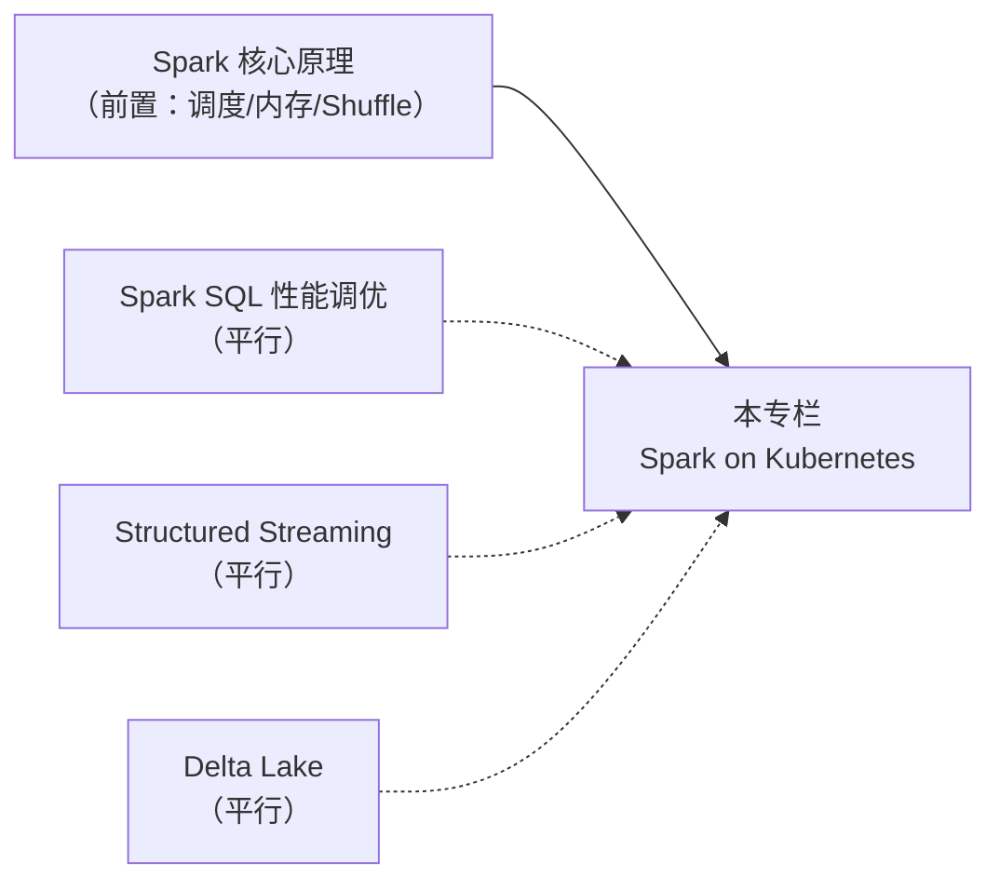

# Spark on Kubernetes 工程实践 · 专栏导览

## 专栏定位

本专栏聚焦 **Spark on Kubernetes（Spark-on-K8s）** 的工程落地实践，面向已具备 Spark 基础知识（了解 RDD、DataFrame、Shuffle、调度模型）和基础 Kubernetes 知识（Pod、Deployment、ConfigMap、RBAC、PVC 等概念）的工程师。专栏不重复介绍 Spark 的通用原理（可参考「Spark 核心原理」系列专栏），而是专注于 K8s 模式下特有的架构差异、工程挑战与生产最佳实践。

**技术版本**：Spark 4.3.0（2026-10-30 发布），Kubernetes 1.37

## 专栏目标

读完本专栏，你将能够：
- 理解 Spark on K8s 的架构与在 YARN 模式下的本质差异
- 独立部署和配置生产可用的 Spark on K8s 环境（含 RBAC、镜像、资源配额）
- 掌握 Driver/Executor Pod 的生命周期管理与动态资源分配
- 配置网络（Ingress/Service）使 Spark UI 可访问
- 实现基于 S3/OSS 的远程 Shuffle Service，解决 Shuffle 文件管理问题
- 使用 Spark Operator 将 Spark 作业声明式管理，接入 CI/CD 流水线
- 优化 Spark on K8s 的资源利用率（Spot 实例、Gang Scheduling、优先级调度）
- 调试生产中常见的 Pod OOMKilled、Executor 丢失、镜像拉取失败等故障

## 专栏目录

| 序号 | 文章标题 | 核心主题 |
|-----|---------|---------|
| 01 | Spark on K8s 架构全景：与 YARN 模式的本质差异 | Pod 与 Container 的语义差别；调度语义与「全有全无」冲突；Driver 的地址归属与两种部署模式 |
| 02 | 镜像构建与依赖管理：如何打包一个可复用的 Spark 镜像 | 三层分层与层缓存命中条件；Python 依赖三方案；`spark.jars.packages` 的解析位置分叉；镜像体积与拉取成本折算 |
| 03 | RBAC 与资源配额：K8s 权限模型在 Spark 中的应用 | 提交侧与 Driver 两个身份；token 的可读性链；配额的准入层结算与 LimitRange 的半写错位 |
| 04 | Driver 与 Executor Pod 的生命周期管理 | 两张状态机；ownerReference 级联的真实开关；心跳与探针的双重判死；动态分配与优先级 |
| 05 | Spark UI 访问：Ingress、NodePort 与 History Server 部署 | 四种访问方案的代价对照；Driver Service 的 headless 语义；Event Log 的持久化与 History Server |
| 06 | 存储与 Shuffle：PVC、HostPath 与 Remote Shuffle Service | 状态存活时间尺度的取舍；ESS 为何只能在 DaemonSet 形态；RSS 的收益与新故障面 |
| 07 | Spark Operator：声明式作业管理与 CI/CD 集成 | 声明式外壳里的命令式内核；两套重试账；清理的两套机制；与 Argo/GitOps 的边界 |
| 08 | 资源优化：Spot 实例、Gang Scheduling 与容量规划 | 中断与重算的成本数学；Gang 死锁的形成与原子绑定；容量规划的算术与口径选择 |
| 09 | 安全加固：Secrets 管理、网络策略与镜像安全 | 凭据的三类落点与泄露面；轮转的三重固化；NetworkPolicy 的表达力缺口；镜像供应链四道关 |
| 10 | 故障排查手册：从 Pod 状态到性能瓶颈的诊断链路 | 四层入口判据与退出码语义；OOMKilled 的额度算术；Executor 丢失的三张死亡证明；四类慢的排除顺序 |

## 与其他专栏的关系

SPARK 核心原理是本专栏的前置：不熟悉 Stage 划分与 Shuffle 物化的读者，先在那边补齐，否则本专栏第 06、10 章会读得很吃力。其余三列与本专栏是平行关系——它们解决的是"数据怎么算"，本专栏解决的是"作业跑在哪"。

## 推荐阅读路径

**新手路径**（从零部署）：01 → 02 → 03 → 04 → 05 → 10  
**运维路径**（已有部署，优化资源）：04 → 06 → 08 → 10  
**平台化路径**（构建内部平台）：03 → 07 → 08 → 09 → 10

---

## 关联专栏

- [[大数据/Spark/Spark-on-Kubernetes工程实践/00 专栏导览|本专栏导览]]：定位、目录与阅读路径
- [[大数据/Spark/Spark-调度系统与执行模型深度解析/00 专栏导览|Spark 调度系统]]：SchedulerBackend 在 K8s 下的实现差异
- [[大数据/Hadoop/Yarn/00 专栏导览|YARN]]：K8s vs YARN 的部署模式对比
- [[可观测/指标/00 专栏导览|指标体系]]：Spark on K8s 的 Prometheus 监控集成  
