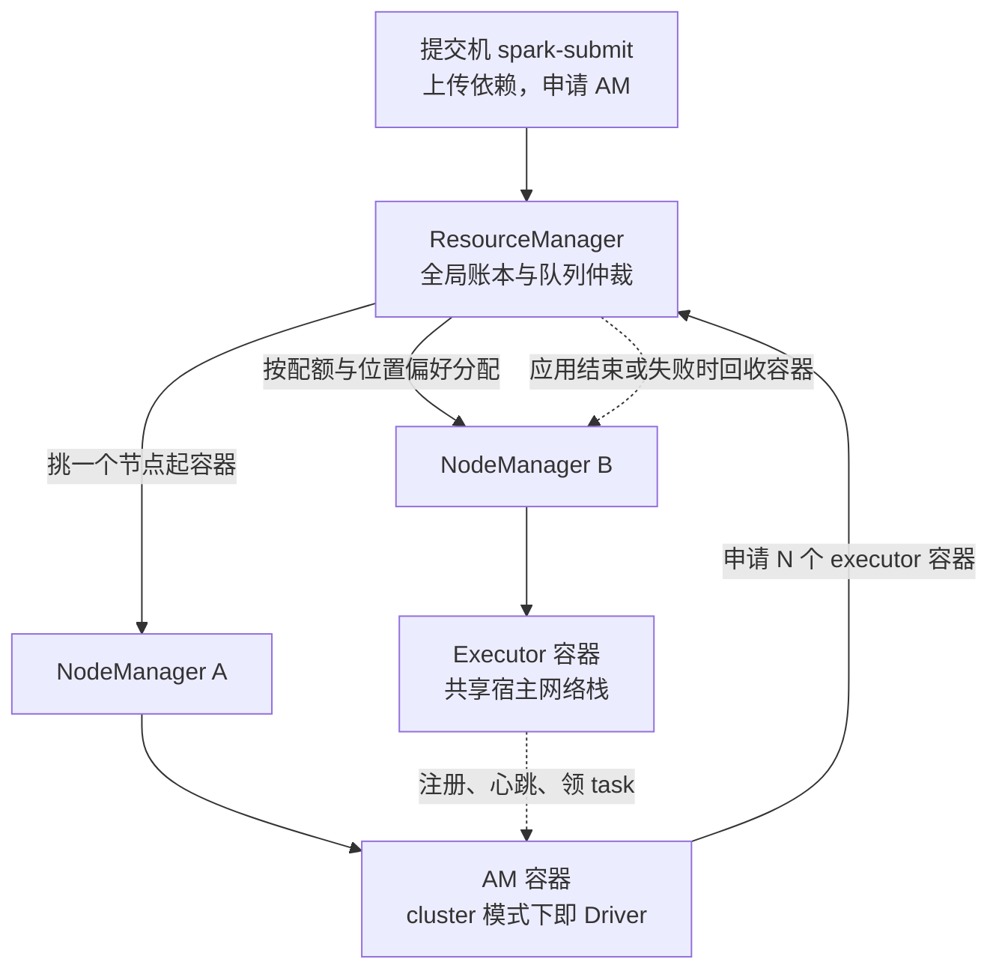
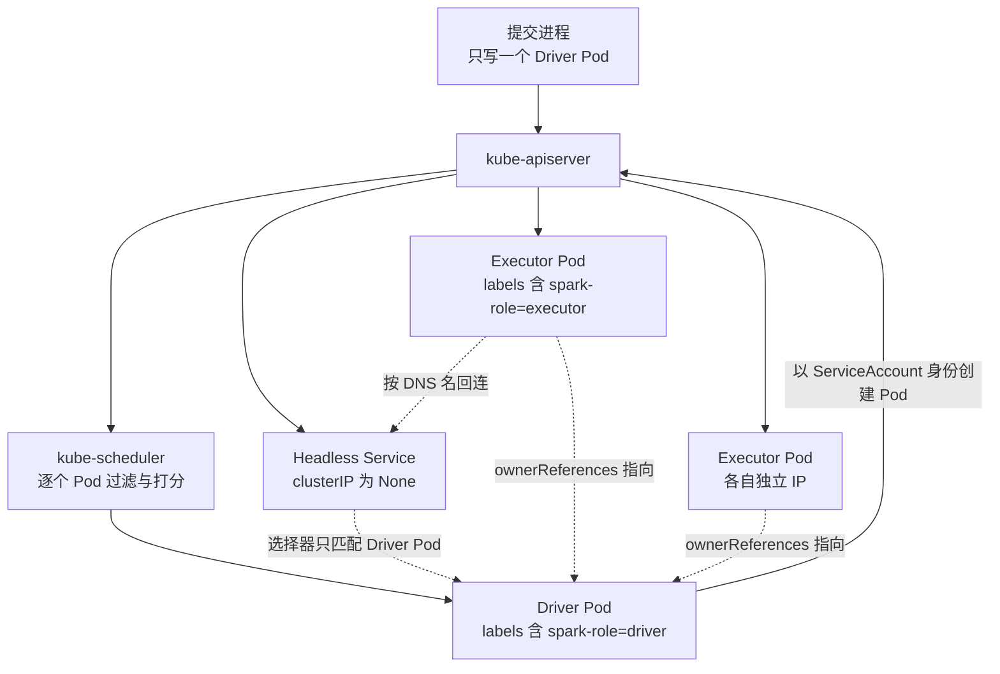
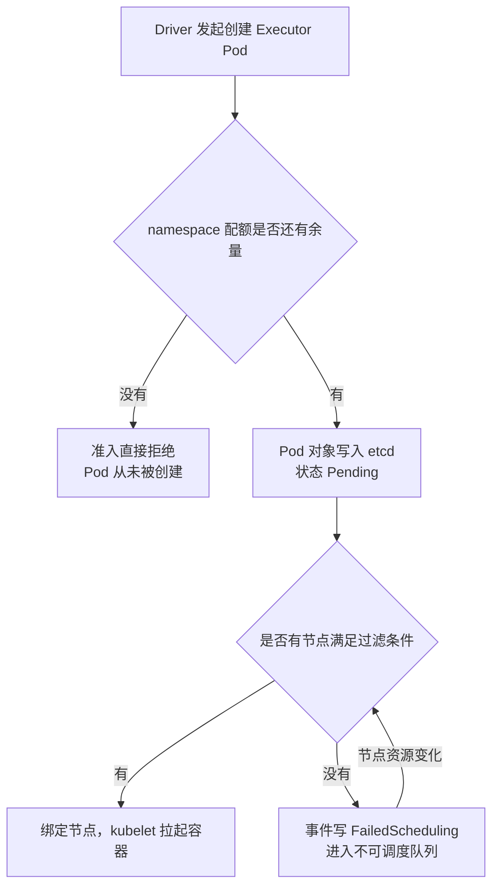
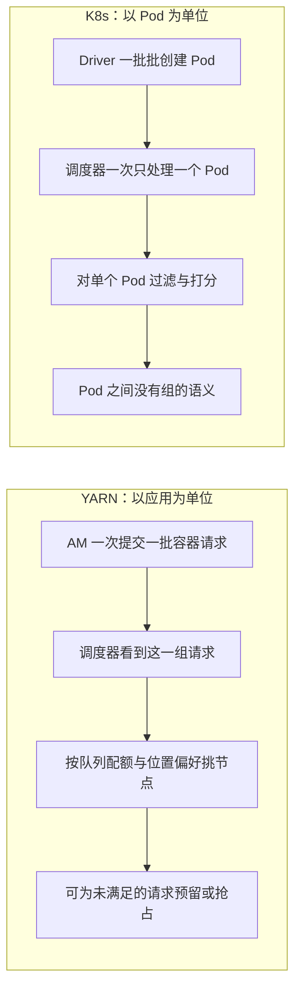
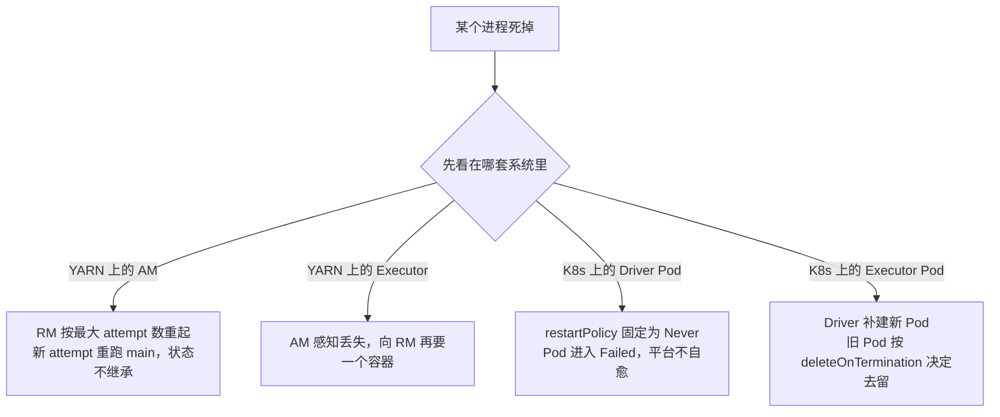
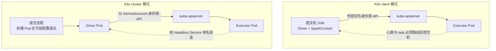

# 01 Spark on K8s 架构全景：与 YARN 模式的本质差异

**摘要：**

Spark 只在属于自己的 JVM 内部决定"哪个 task 去哪台机器跑"，至于那些装着 executor 的箱子由谁发放、记在谁的账上、什么时候被回收，从来由外部的资源系统裁决。2018 年前后，这笔裁决权从 Hadoop YARN 手里分出一支交给 Kubernetes，表面上只是 `--master` 换了个值，实质上是把 Spark 赖以运行的四条前提一并换掉：资源以 Container 计还是以 Pod 计，调度器看到的是一个应用还是一堆孤立的对象，生命周期由 ApplicationMaster 决定还是由 API Server 里的属主引用决定，Driver 该待在集群里还是集群外。

本文沿五问推进：先说清 Container 与 Pod 的语义差别——Pod 同时是调度单位、网络单位、存储单位与生命周期单位，Container 只是账本上的一条配额记录；再回答谁在替 Spark 申请 executor，YARN 的 AM 与 K8s 上的 Driver Pod 究竟是不是同一个东西，以及 attempt 语义为什么在 K8s 上整段消失；接着把"资源不够时队伍排在哪里"拆成两道门，一道在准入、一道在调度，两者的失败形态完全不同；然后把 YARN 的延迟调度与 K8s 的过滤打分并排放好，解释 Spark 期望的"整批到位"如何与逐个决策的调度器发生冲突，并交代 Gang 调度的接口留在何处；最后落到 `spark.kubernetes.*` 的关键旋钮、podTemplate 的接管边界，以及 client 与 cluster 两种模式在 K8s 上真实的样子，包括一个流传甚广的默认值误传。

文章口径为 Spark 4.3.0（2026-10-30 发布，4.x 预编译 Scala 2.13），K8s 侧以 1.37 为准；涉及具体版本的默认值处，以对应版本文档为准。

---

## 第 1 章 两种"资源"：Container 是一行数字，Pod 是一个对象

### 1.1 一条命令被拆成了几段

行文从一条最普通的提交命令开始。执行 `spark-submit --master k8s://https://api:6443 --deploy-mode cluster` 的那一刻，提交机先向 API Server 写一个 Pod 对象，这个 Pod 里跑的是 Driver；此后提交进程可以退出，也可以留着等结果，那是 `spark.kubernetes.submission.waitAppCompletion` 的事。Driver 启动之后自己连上 API Server，按需要一批一批地写 Executor Pod 对象，Executor 起来以后回连 Driver 报到、领 task。

把这条链路和 YARN 上的链路并排放，差别立刻显形：YARN 需要三次跨越进程边界的交接——提交机到 ResourceManager、ResourceManager 到某个 NodeManager 起 AM 容器、AM 再到其余 NodeManager 起 executor 容器；K8s 上只有两次，第二次还是 Spark 自己的代码完成的。少了的那一次，正是 ApplicationMaster 这个中间角色的位置——它在 K8s 上不存在，因为没有哪个组件需要替 Driver 跑腿，Driver 自己就是 API 客户端。

下图把 YARN 侧的交接链路摊开，注意每条箭头跨越的都是进程或调度边界，而 Spark 自己的 TaskScheduler 要等到最后一跳之后才登场：



图中最要紧的是那条回到 ResourceManager 的申请箭头：Spark 对资源的全部诉求都汇聚在这条线上，而它能否被满足，取决于 RM 的队列里还有多少空位。

> [!info] 读法提示
> 本章只谈"资源长什么样"，不谈怎么调。资源的形状决定了后面三章的全部结论：网络怎么回连、清理靠谁执行、资源不够时排在哪里。

### 1.2 Container 这个词从海运借来，只标准化了一件事

Hadoop 2 在 2013 年正式把资源管理从 MapReduce 里拆出来，那时候需要一个词来描述"某个节点上的一组可用资源"，于是从海运借来了集装箱（Container）这个意象：尺寸标准化、可以并排堆叠、装卸不关心里面装的是什么。这个比喻很贴切，但也止步于此——集装箱标准化的是容量，不是地址。YARN 的 Container 同样只有容量：一组虚拟核（vcore）与若干兆字节内存，加上一个由 NodeManager 拉起的进程，仅此而已。

它没有 IP，没有 DNS 名，没有独立的状态机，在 API 里也查不到"这个容器现在什么状态"这种对象；它的身份是 RM 内存里的一条分配记录加一个容器编号，进程退出即消失。资源隔离靠 NodeManager 的 cgroups 限制完成，而网络、PID、挂载这些命名空间默认并不隔离——容器里的 JVM 就是宿主机上的一批普通进程，与同节点其他容器共享同一个网络栈，靠端口区分彼此。

这带来一个很少被明说、却决定了很多配置的事实：**在 YARN 上，一个 executor 的"地址"就是它所在机器的主机名加一个由 Spark 分配的端口**。Spark 之所以有 `spark.port.maxRetries` 这种参数，正是因为同一台机器上并发起多个 executor 时要靠重试抢端口。

### 1.3 Pod 同时是四种单位

Kubernetes 的最小部署单位是 Pod，而 Pod 不是"更大的 Container"：它在"调度单位"之外，还同时承担了四层角色。

第一层是网络单位。每个 Pod 拥有独立的网络命名空间与独立 IP，同一 Pod 内的多个容器共享 `localhost`。这意味着一个 Executor Pod 的地址是稳定的、可被 DNS 解析的，端口固定，不必再和邻居抢。

第二层是存储单位。卷（Volume）挂在 Pod 一级，Pod 内的容器共享挂载点；`emptyDir`、`hostPath`、PVC、ConfigMap、Secret 都以此为单位组织。YARN 上 executor 的工作目录是容器自己的临时目录，容器一死连同 Shuffle 输出一起消失；K8s 上是否保留，取决于挂的是哪种卷。

第三层是生命周期对象。Pod 在 etcd 里有 UID、有 `phase` 状态机、有 `restartPolicy`、可以被 `ownerReferences` 认领、可以被驱逐与抢占、可以被终结器（Finalizer）拦住。一个 Pod 不是"一次资源分配"，而是一个能被查询、被追溯、被级联删除的实体。

第四层是安全主体。Pod 以某个 ServiceAccount 的身份访问 API Server，`securityContext` 决定它以哪个 UID 运行。Spark 的 Driver 正是靠这一层拿到"创建 Pod"的权限。

把这四层与"调度单位"这一层叠起来，才构成 K8s 上"资源"的完整含义；YARN 的 Container 只占了"调度单位"那一层，其余四层要么不存在，要么由别的机制顶替。

### 1.4 一张对位表

下面这张表把两种资源抽象的差别逐项摊开，右列多出来的每一行，都是后面某一章的问题来源：

| 维度 | YARN Container | Kubernetes Pod |
|---|---|---|
| 本质 | 调度器账本上的一条配额记录，加一个被拉起的进程 | API Server 中的一等对象，有 UID、状态机与属主 |
| 是否调度单位 | 是 | 是 |
| 是否网络单位 | 否，默认共享宿主网络栈，靠端口区分 | 是，独立网络命名空间与独立 IP |
| 是否隔离单位 | 靠 cgroups 限资源，不隔离 PID/网络/挂载 | 具备 PID、网络、IPC、挂载等命名空间 |
| 是否存储单位 | 工作目录随容器消失 | 卷挂在 Pod 一级，可挂 PVC/ConfigMap/Secret |
| 生命周期载体 | ResourceManager 内存中的分配记录 | etcd 中的对象，可被属主引用与 GC 回收 |
| 身份标识 | 容器编号 + attempt 序号 | Pod 名 + UID + labels |
| 重启语义 | NodeManager 不管，由框架自行处理 | 由 `restartPolicy` 决定，Spark 固定写 `Never` |

### 1.5 案例与一个比喻

后面的论述需要一个具体的着力点。笔者设一个电商数仓的夜间结算作业 `settle_nightly`：从 HDFS 读入当天的订单明细与商品维表，各按 200 个分区读入，按商品标识关联、按品类汇总成交额，最后写回宽表。集群按 60 台节点估，单节点 16 vcore、64 GiB 内存；这套作业原本跑在 YARN 的 `etl` 队列里，队列上限 400 vcore、1.6 TiB；迁移到 K8s 之后落在 `dw-etl` 这个 namespace，配额按 400 CPU、1600 Gi 配。每个 executor 4 核、8 GiB 堆。

不妨把它想象成一栋写字楼里的两种租法，就很容易记住全部差别。YARN 的租法是"工位制"：物业按工位收租，你申请四个工位，物业就在某层给你划四个位置，你在那儿摆自己的电脑；工位没有门牌号，快递只能送到"某层某区"，而且这层楼的电话交换机是全楼共用的。K8s 的租法是"套间制"：物业按套间出租，每个套间有独立门牌、独立电表、独立门锁，你可以往套间里搬整套家具，也可以要求"只租朝南的套间"；退租时物业按租约把这一整串套间一起收走。

> [!note] 一个容易被忽略的推论
> 工位制下，"资源不够"表现为物业手里没位置；套间制下，"资源不够"可能发生在签租约那一步（配额不够，合同不签），也可能发生在分楼层那一步（楼里有空房但户型不匹配）。这两种失败在日志里长得完全不一样。

---

## 第 2 章 谁在替 Spark 申请 executor

### 2.1 AM 是 ResourceManager 的一等公民

YARN 上跑一个应用，ResourceManager 会为它建一个应用条目，分配一个 ApplicationMaster，并对这个 AM 做三件 Spark 无能为力的事：给它算 attempt 序号、限制它占用的资源比例、在它死后按策略重起一个新的 attempt。AM 因此是"应用在集群里的代表"——它既不是普通容器，也不是 Spark 内部的概念，而是 YARN 调度模型里定义好的一类角色。

cluster 模式下，AM 容器里直接跑 Driver，`YarnAllocator` 与 Driver 同处一个 JVM，一边申请 executor 容器，一边调度 task，角色合并。client 模式下 AM 容器里跑的是 `ExecutorLauncher`，它只替远端的 Driver 向 RM 申请容器，自己不调度任何 task。这两种形态合起来说明一件事：**在 YARN 上，"谁去要资源"这个问题永远有一个集群内的答案**，哪怕答案是"一个跑腿的替身"。

### 2.2 K8s 上没有一个叫 AM 的角色

K8s 的 API 里没有"应用"这个概念，只有对象。Spark 在 K8s 上提交作业，创建的就是一个普通 Pod；这个 Pod 里的 Driver 进程调用 `KubernetesClusterSchedulerBackend`，后者启动 `ExecutorPodsAllocator`，由它按 `spark.executor.instances` 或动态分配的需求，分批向 API Server 写 Executor Pod 对象，并用 Watch 持续跟踪这些 Pod 的状态；Pod 就绪后，Executor JVM 主动连回 Driver 注册。

这里的对位关系必须说准：Driver Pod 在功能上承担了 AM 的职责（申请 executor、调度 task、汇总状态），不过它在 K8s 眼里没有任何特殊性，就是一个带 `spark-role=driver` 标签的 Pod。它不会被 K8s 当成"应用的锚点"，不会因为它是 Driver 就获得额外的重启策略，也不会因为它而让调度器理解"这一组 Pod 属于同一个作业"。功能上的对位与身份上的对位，在这里是分开的。

下面这张图画的是 K8s 侧的拓扑，实线是控制流，虚线是身份与连接关系，两者都不是"应用"级别的：



图里没有一个节点代表"作业"：Driver Pod、Service、Executor Pod 之间只有标签、选择器与属主引用，这四样东西合起来才是 Spark 应用在 K8s 里的全部存在形式。删掉其中任何一环，剩下的部分都不会察觉自己已经残了。

### 2.3 对位表

| 维度 | YARN 的 ApplicationMaster | K8s 上的 Driver Pod |
|---|---|---|
| 由谁创建 | ResourceManager 分配容器后由 NodeManager 拉起 | 提交进程直接写 API 创建 |
| 在调度器眼中的身份 | 一类特殊容器，有专属资源上限比例 | 普通 Pod，与 executor 无差别 |
| 申请 executor 的组件 | `YarnAllocator`（cluster）、`ExecutorLauncher`（client） | `ExecutorPodsAllocator`（Driver 进程内） |
| 申请方式 | 向 RM 提交资源请求，等分配 | 直接写 Pod 对象，等调度 |
| 失败后的重试 | 按最大 attempt 数重起新 attempt | `restartPolicy` 为 `Never`，不会重起 |
| 资源记账位置 | 队列配额中扣除，另受 AM 上限比例约束 | namespace 配额中扣除，无 AM 专属约束 |
| 日志归属 | 容器日志，经聚合进 HDFS | Pod 日志，`kubectl logs` 或日志采集 |
| 收尾责任 | AM 通知 RM 释放容器，RM 负责回收 | 属主引用级联，或 Driver 主动删 Pod |

### 2.4 attempt 语义为什么消失了

YARN 上有一个很容易被误解的机制：`yarn.resourcemanager.am.max-attempts` 与 `spark.yarn.maxAppAttempts` 决定 AM 失败后可以重起几次。它的语义不是"断点续跑"，而是"换一个容器重跑 `main`"——新 attempt 拿到的是全新的 JVM、全新的 Driver 状态，之前的 stage 划分、task 队列、Shuffle 地址表一概不保留。这一点常被误当成容错，实际只是"重来一次"。

到了 K8s，连这个"重来一次"也没有了：Spark 在 podTemplate 的接管清单里把 `restartPolicy` 固定写成 `Never`，文档给出的理由是"Spark 假定 Driver 与 Executor 都不会重启"。于是 Driver Pod 的容器退出即 Pod 进入 `Failed`，K8s 不会去拉起第二个；想重试，只能由集群之外的东西再提交一次——这正是各类 Operator 存在的理由，但它属于另一条线上的话题。

需要留一个判断给读者：**在 K8s 上，"应用级重试"是被移出平台的，它变成了编排层的责任**。YARN 至少在平台内保留了 attempt 计数与重起逻辑，K8s 把它还给了调用方。这个设计并非疏漏，而是 K8s 的通用性代价：它并不知道"一组 Pod 构成一个作业"，自然也就无从判断该重起谁。

### 2.5 client 模式下的替身问题

有一处差异常被忽略，却能反向印证上面的结论。YARN 的 client 模式必须在集群里起一个 AM 容器当跑腿的，因为 RM 只认 AM，不认"集群外的某个进程"；K8s 的 client 模式不需要任何替身，Driver 在本机直接持有 API 凭证，自己写 Pod 对象就行。

代价随之转移：YARN 的 client 模式把"申请资源"这件事外包给了集群内的替身，替身活在集群网络里，连接天然通畅；K8s 的 client 模式让集群外的 Driver 直接面对 API Server，凭证、网络可达性、证书三件事全部落到提交机上。这也解释了为什么 K8s 客户端模式的认证参数是另一套前缀——`spark.kubernetes.authenticate.caCertFile`、`clientKeyFile`、`oauthToken`，而不是 cluster 模式那套 `spark.kubernetes.authenticate.driver.*`。

### 2.6 "应用"从编号变成了一组标签

YARN 的应用有一个由 ResourceManager 分配的编号，全局唯一、有生命周期、在账本里可以查到历史。它是"应用"这个词在 YARN 上的具体所指，能用来杀作业、查日志、对账。

K8s 侧没有对应物，有的是几个标签：`spark-app-selector` 标记这个 Pod 属于哪个应用，`spark-role` 区分 driver 与 executor，`spark-exec-id` 记录 executor 序号，`spark-app-name` 与 `spark-version` 供人眼识别。Spark 自己就靠这些标签做集合操作——盘点存活的 executor、决定删哪个、把哪批 Pod 归给哪个作业。换句话说，**"应用"在 K8s 上是一个约定，而不是一个对象**。

这层约定能被打破。文档里有一句提醒：如果设置了 `spark.kubernetes.executor.podNamePrefix`，强烈建议让它在同一 namespace 内唯一，否则不同作业的 Pod 名字会撞，按名字做的清理会互相踩。标签层面也一样，人工改标签、复制 Pod 定义时不改选择器，都会让某个作业把别人的 Pod 认成自己的。反过来，这个约定也是排查的抓手：`kubectl get pods -l spark-app-selector=<应用标识>` 一条命令就能把一个作业的全部 Pod 捞出来，比在 YARN 上翻应用列表更直接。

---

## 第 3 章 资源不够时，队伍排在哪里

### 3.1 YARN 只有一道门

YARN 把"能不能拿到资源"压缩成一个判断：RM 的调度器手里有没有满足条件的空位。有就分配，没有就把请求留在队列里等着，应用状态显示为运行中但 executor 数量少于请求，AM 侧看到的是一串还没被满足的 pending 请求。队伍的位置很清楚——就在调度器里，和这个应用的其余请求排在一起。

这道门上有三个值得记住的细节。其一是**最小与最大分配单位**：请求会被向上取整到 `yarn.scheduler.minimum-allocation-mb` 的整数倍，而单个容器又不得超过 `yarn.scheduler.maximum-allocation-mb`，超了就被截断，症状是"executor 明明要 16 GiB，起来却只有 8 GiB"。其二是**两个账本**：vcore 与内存各记一本，谁先见底就由谁决定容器数，vcore 是整数账，4 核的 executor 在一个只剩 3 个 vcore 的节点上永远排不上。其三是**调度器会替应用做整体判断**：Capacity Scheduler 的延迟调度（delay scheduling）会为了本地性暂时跳过不合适的节点，预留（reservation）与抢占（preemption）则让"排队中的请求"不至于被后来者无限插队——这些行为都以应用为单位，因为 YARN 的调度器本来就认识应用。

### 3.2 K8s 有两道门，而且失败形态不同

K8s 把同一件事拆成了两步，两步的失败长得完全不一样，这是排查时最实用的一个分界。

第一道门在准入（Admission）。Driver 写 Pod 对象时，API Server 的 ResourceQuota 准入控制器先算一遍：这个 namespace 的 `requests.cpu`、`requests.memory`、`pods` 计数是否已经到顶。到顶就**直接拒绝这次创建请求**，Pod 根本不存在，Spark 侧收到的是一次 API 错误，日志里是 `exceeded quota` 一类的字样。此时用 `kubectl get pods` 什么都看不到，会让人误以为"没提交上去"。

第二道门在调度。Pod 对象已经写进 etcd，状态是 `Pending`，kube-scheduler 对每个 Pod 单独做过滤与打分，找不到合适节点就把事件写成 `FailedScheduling`，附一句"若干节点不可用：资源不足"，然后放进不可调度队列，等集群状态变化再重试。此时 Pod 确实存在，`kubectl describe pod` 能看到原因，`kubectl get pods` 能看到它一直 Pending。

这两种失败在运维上的差别很大：配额拒绝是硬失败、立即返回，需要人去调配额或缩小请求；调度失败是软失败、持续重试，可能过几分钟自己就好了。把它们混成一句"资源不够"，排查就会在两个完全不同的方向上瞎撞。

### 3.3 两道门的示意

下图把一次 Executor Pod 的创建拆成两道门的判定，注意左分支的 Pod 从未存在过，右分支的 Pod 存在但不工作：



还有一处需要注意的连锁反应：Pending 的 Pod 通常仍然计入配额（配额按未终止的 Pod 统计请求量），于是会出现"资源一点没用到、配额却被吃干净"的局面。这种局面的典型症状是：Pod 全部 Pending，新的应用提交被配额拒绝，集群实际利用率却不高。

### 3.4 粒度：vcore 是整数，millicore 是小数

YARN 的 vcore 是整数账，内存以 MiB 计；K8s 的 CPU 以 millicore 计，`0.1`、`500m`、`1.5` 都是合法值，内存以字节计，通常写成 `Mi`、`Gi`。

这个差别在配置上会咬人。Spark 在 K8s 上给 executor 申请的 CPU 默认取自 `spark.executor.cores`，而 `spark.kubernetes.executor.request.cores` 一旦设置就会覆盖它，且只影响 Pod 的请求量、不影响并行度——也就是说你可以让 Pod 只要 3.5 个 CPU，而 executor 里仍然跑 4 个 task。反之，`spark.kubernetes.executor.limit.cores` 设置的是硬上限，与并行度同样无关。两个旋钮一松一紧，能配出"请求少、限额多、并行度不变"这类 YARN 上根本表达不出来的组合。

内存这一侧反而更简单：文档明确写了 Pod 的内存请求与内存上限都由 `spark.executor.memory` 与 `spark.executor.memoryOverhead` 相加得出，两者相等。以 `settle_nightly` 为例，8 GiB 堆加上约 10% 的堆外，Pod 的内存请求就是九 GiB 上下（Spark 内部按 MiB 取整），不多不少。

### 3.5 requests 与 limits 决定了 QoS，而 QoS 决定谁先死

K8s 按 requests 与 limits 的关系给 Pod 分三档服务质量（QoS）：Guaranteed 要求每个容器的 CPU 与内存都设了 limit 且与 request 相等；Burstable 是设了 request 但没全设 limit；BestEffort 是什么都没设。

按 Spark 的默认行为推一遍：内存 request 等于 limit，CPU 只有 request（除非显式设了 `limit.cores`），所以 Executor Pod 的 QoS 是 **Burstable**，不是 Guaranteed。这个结论与"requests 等于 limits 就是 Guaranteed"的流行说法相反，差别恰恰在 CPU 上。想让 Pod 进 Guaranteed 档，得把 `spark.kubernetes.executor.limit.cores` 显式设成与 request 相同的值；想留一点弹性，就别设 CPU limit，接受 Burstable。

QoS 的意义在节点内存吃紧时才显现：kubelet 按 BestEffort、Burstable、Guaranteed 的顺序驱逐，同为 Burstable 时再按"实际用量超出请求的程度"排序。所以一个把堆设得很满、堆外又贴着请求量的 executor，在节点压力下是最先被挑中的那批。

### 3.6 Namespace 加 Quota 不是队列

这是迁移时最容易被想当然的一处。YARN 队列是一个带保证的容器：它有 `capacity` 表示保底份额，有 `maximum-capacity` 表示上限，有用户与应用的提交限制，有层级结构，还能在空闲时把资源借出去、忙时收回来。Namespace 加 ResourceQuota 只提供了其中一项——上限。

| 维度 | YARN 队列 | Namespace + ResourceQuota |
|---|---|---|
| 计量对象 | 队列内所有应用的容器资源 | namespace 内所有 Pod 的 requests 之和 |
| 是否提供保底份额 | 提供，由 `capacity` 表达 | 不提供，只能靠优先级与抢占间接争取 |
| 上限语义 | 软上限，可配置最大容量 | 硬上限，超出即拒绝创建 |
| 超额行为 | 请求排队等待 | API 拒绝，Pod 不存在 |
| 层级与嵌套 | 支持父子队列，逐层配额 | 不支持，namespace 是平铺的 |
| 空闲资源能否被借用 | 可以，按权重与使用量仲裁 | 不能，未被使用的配额只是数字 |
| 是否感知作业 | 感知应用，可按应用限制 | 只感知对象，不知道 Pod 属于哪个作业 |

把这张表读完，可以得到一个不含糊的判断：**Namespace 加 Quota 解决的是"不许超"，YARN 队列解决的是"保证够"**。前者是隔离与止损，后者是共享与仲裁。要做后者，K8s 侧需要优先级类配合抢占，或者引入支持队列语义的调度器。

### 3.7 配额怎么计量，LimitRange 又能改什么

ResourceQuota 的计量口径是 requests 而不是 limits。这个细节决定了两个常见做法都行不通：把 limits 调大、requests 压在低位，配额账上确实"不花钱"，但节点会被超卖，压力来临时最先死的是实际用量贴近 limits 的那批；反过来把 requests 写得比实际需要大，配额被虚占，节点上却空着，账面上"配额用尽"而利用率很低。

LimitRange 是同一道门上的第二个准入控制器，它做两件事：给没有声明 requests 与 limits 的容器注入默认值；给 namespace 设最小值、最大值与"上限与请求之比"的约束。对 Spark 的 Pod，第一件事基本落空，因为 Spark 总会显式算出 `resources`，注入规则没有发挥空间；第二件事却会真的咬人——如果 LimitRange 的 `max.memory` 低于 executor 的堆加堆外，创建请求会被拒绝，报错文本与配额拒绝很像，只有把两个准入控制器的输出都看一遍才能分清。

顺带说一个与 YARN 的对照：YARN 的账本只记申请量，不记实际用量，超卖在平台层是被允许的（只要 cgroups 拉得住）；K8s 把"能不能调度"与"会不会被杀"分成两本账，requests 决定前者、limits 决定后者，超卖的空间正好落在两者之差里。这个差值是可用的资源，也是事故的来源。

---

## 第 4 章 调度语义：延迟调度与过滤打分

### 4.1 YARN 的调度器认识应用

Capacity Scheduler 与 Fair Scheduler 都是为批处理作业设计的，它们共享三个前提：调度单位是容器、请求带位置偏好（hosts 与 racks）、应用是调度的基本参与方。

延迟调度（delay scheduling）是这三个前提的直接产物。当某个请求的偏好节点暂时排不上时，调度器不急着把它降级到机架级或任意节点，而是先跳过若干次调度机会，看看那台机器会不会空出来；跳过的次数由 `yarn.scheduler.capacity.node-locality-delay` 之类的参数控制。它的收益是数据本地性，代价是等待。资源计算器则决定"两个账本怎么合成一个可比的大小"——默认只算内存，切到 DominantResourceCalculator 之后按主导资源（DRF）比较，多租户下的公平性才有了统一尺度。

这三个前提合起来，让 YARN 的调度决策天然带一点"全局观"：它知道这个应用一共要多少容器、知道它们的偏好各是什么、知道队列里还有谁在等，因此可以为一个还没满足的请求保留位置，也可以为了高优先级队列把低优先级应用的容器抢走。

### 4.2 K8s 的调度器只认识 Pod

kube-scheduler 的调度框架（Scheduling Framework）自 1.19 起稳定，把一次调度拆成若干扩展点：`PreFilter` 做预检、`Filter` 做硬性过滤、`PostFilter` 处理无解情形（默认行为是抢占）、`Score` 给候选节点打分、`Reserve` 与 `Permit` 做占位与放行、`Bind` 完成绑定。默认插件里，`NodeResourcesFit` 判断资源是否够、`NodeAffinity` 与 `InterPodAffinity` 处理亲和性、`TaintToleration` 处理污点、`PodTopologySpread` 处理拓扑分布、`VolumeBinding` 处理卷、`ImageLocality` 在打分阶段给"节点上已有镜像"的候选加分。

这套流程有两个性质值得记住。第一，它**逐个 Pod 决策**，调度周期是串行的：同一时刻只有一个 Pod 在被决策，前一个绑定了才轮到下一个。第二，它**眼里只有当前这个 Pod**，除非引入额外的对象（PodGroup 一类），否则它并不知道同时还有七个兄弟 Pod 正在等同一批资源。

默认打分的取向也值得一提：资源最空闲的节点得分高（LeastAllocated），资源比例更均衡的节点得分高（BalancedAllocation），节点上已有镜像的得分高（ImageLocality）。三者叠加的实际效果是"把 Pod 摊开、摊到镜像已经拉过的机器上"，与"把 Pod 聚到数据所在的机器上"是两种不同的直觉。

### 4.3 冲突的根源：一个批次，两种视角

Spark 期望的是"这一批 Executor 尽快全部到位"。这个期望来自它的执行模型：一个 stage 的并行度由可用 slot 数决定，executor 分批到达意味着前面的 task 先跑、后面补上的 task 再跑，Shuffle 阶段还要等所有 map 输出就绪，于是作业时长被最慢的那一批拖住。YARN 上这个期望能得到部分满足，因为 AM 的请求集合作为一个整体进入调度器视野，延迟调度与预留至少能让"这一组请求"被当成一件事来处理。

到了 K8s，同一批请求被拆成 N 个独立对象，由调度器逐个决策，中间的任意一个都可能因为节点碎片而卡住。后果有三个，都真实存在。

一是**碎片化**，譬如集群还有 8 个空闲核，但分散在 8 台机器上，每个 Pod 要 2 核，于是一个也排不上；或者相反，Pod 零散排上了几台机器，剩下的因为凑不出连续空间而 Pending。二是**慢启动**。`spark.kubernetes.allocation.batch.size` 默认 20、批次间隔默认 1 秒，Driver 一批批地写 Pod，每批都要等调度与拉镜像，Executor 数量是爬坡式上升的。三是**部分成功的僵局**。Driver 已经起来、少数 Executor 已经注册、作业已经开始跑，但永远凑不齐并行度；由于没有机制把"已经在跑的"退回去重排，作业就以一个不上不下的并行度拖到结束。

下图把两种视角并排放好，左列的关键在"应用作为一个集合"被看到，右列的关键在"每个 Pod 各自为战"：



需要说清楚的是，YARN 也并非 Gang 调度：它的容器同样是一个一个分配下来的，同样可能出现"起了一半"的局面。差别不在有没有全有全无，而在调度器能否把一组请求当成一个整体来仲裁。前者是能力问题，后者是视野问题，而视野决定了能不能在调度层补救。

### 4.4 本地性从运行时等待退化为部署时约束

YARN 上的数据本地性是"等"出来的：调度器知道每个请求偏好的主机与机架，TaskScheduler 又可以通过 `spark.locality.wait` 在 task 一级再等一轮。两处等待叠加，才有 `NODE_LOCAL`、`RACK_LOCAL`、`ANY` 这样的分级统计。

K8s 上这套机制只剩一半。Spark 依然会计算输入分片的偏好位置，TaskScheduler 依然会按 `PROCESS_LOCAL`、`NODE_LOCAL` 这些级别去匹配 executor 所在主机，但**调度器不会为了数据把 Pod 挪过去**——节点选择在 Pod 创建时就定死了，之后 task 只能在既有的 executor 之间挑。于是本地性从"运行时等一等"退化成"部署时选一选"：要么给节点打上能对应 HDFS 拓扑的标签，用 `spark.kubernetes.node.selector.*` 把 Executor 约束到那批机器上；要么承认本地性不重要，把数据放到对象存储上，让远程读取成为常态。

这也是为什么在 K8s 上"数据放哪儿"会反过来影响部署方式。YARN 集群里，数据在 HDFS 上、计算在哪台机器上，是调度器每时每刻在协调的两件事；K8s 集群里，这两件事在 Pod 创建那一刻就锁定了，之后的协调空间很小。

### 4.5 抢占能救回多少

除了换调度器，K8s 自带的另一个手段是优先级加权抢占。抢占挂在 `PostFilter` 上，默认插件的行为是：一个 Pod 找不到可用节点时，调度器挑一个候选节点，把上面优先级较低的 Pod 删掉腾出位置，再把这个 Pod 放进去。被删的 Pod 不是暂停，而是按优雅期退出；如果被驱逐的是别人的 executor，那个作业就少了一个 executor，对应的 task 要重算。

这条路的门槛在优先级类。Pod 需要有 `priorityClassName` 才会参与抢占，而没有优先级类的 Pod 之间互不抢占，优先级数值相同的也不抢。Spark 没有为优先级提供专门的配置项，做法是在 podTemplate 里写 `priorityClassName`，于是这项能力能不能用，取决于模板有没有管起来。

更关键的是它能解决什么。抢占调整的是**排队的先后**，不是**批量的完整性**：它让重要作业更快拿到位置，却仍然可能在该作业凑到 34 个 executor 时停下，因为节点上剩下的位置被另一批同样高优先级的 Pod 占着。对 `settle_nightly` 这种需要 40 个 executor 一起到位的作业，抢占能缩短等待，不能消除等待。**抢占是排队规则，Gang 是批量承诺**，两者的作用点不在同一层。

### 4.6 Gang 的接口留在哪里

要在 K8s 上恢复"整批到位"的语义，只有两条路：换一个懂组的调度器，或者等上游把组的概念补进 API。

前一条路已经成熟多年。Volcano 用 PodGroup 表达"至少 minMember 个 Pod 一起调度"，Spark 侧通过 `spark.kubernetes.scheduler.name=volcano` 加上 `VolcanoFeatureStep` 与 PodGroup 模板接入，模板里的 `minResources` 还能顺带表达"这批 Pod 合计至少要多少资源"，免得出现"Driver 排上了，Executor 一个也排不上"的局面；YuniKorn 走的是另一条思路，用队列与应用的概念把批处理语义搬进 K8s。后一条路正在成形：K8s 1.37 里 Workload API 进入 Beta，用 Workload 与 PodGroup 描述多 Pod 应用的调度结构，配套的 gang 调度插件借助 `PreEnqueue` 与 `Permit` 两个屏障实现"要么一起进、要么一起等"，但该特性默认关闭，需要打开特性门才生效，实际推广程度要以对应版本文档为准。

具体的调度器选型、队列配置与容量规划不展开，这里只交代接口的位置：**Gang 语义要么由外部调度器提供，要么由 API 对象提供，Spark 自身在 K8s 上没有这个能力**。认清这一点，就不会再把并行度不足当成参数没调好。

---

## 第 5 章 生命周期归属：谁决定、谁清理

### 5.1 YARN 把生命周期写进了状态机

YARN 的应用有一套完整的状态机：提交、接受、运行、结束，attempt 是状态机上的计数器。容器被分配、被启动、被回收，每次变化都由 RM 记录并对外可见。应用正常结束时，AM 通知 RM 注销，RM 释放所有容器；应用异常结束时，RM 依据 attempt 策略决定是否重起 AM。这套机制的代价是中心化，收益是"应用"作为一个整体始终有一个权威的账本。

### 5.2 K8s 把生命周期写进了属主引用

K8s 没有应用状态机，取而代之的是对象之间的引用关系。cluster 模式下，Driver 创建 Executor Pod 时会写入属主引用（`ownerReferences`），指向自己这个 Pod；于是删除 Driver Pod 时，垃圾回收器按级联策略把这些 Executor Pod 一并回收。官方文档把这层关系说得很直白：删除 Driver Pod 会清掉整个应用，包括所有 Executor 与关联的 Service——因为 Driver Pod 就是 Spark 应用在 K8s 里的表示。

清理这件事还有两个补充旋钮。`spark.kubernetes.executor.deleteOnTermination` 默认 `true`，意思是 Executor 无论正常结束还是失败，Pod 都会被删掉；设成 `false` 则保留 Pod 以便翻日志，代价是要靠属主引用或人工清理。`spark.kubernetes.driver.service.deleteOnTermination` 默认 `true`，应用结束时连带把 Driver 的 Service 删掉。加上默认 30 秒的终止宽限期，Pod 的退场是一套有节奏的流程，不是"进程一死就没了"。

下图把两种模式下"进程死了之后谁来管"摊开，左右两列的分叉点是问题的答案所在：



### 5.3 三种没人收尸的情形

属主引用不是万能的，它在三种情形下会失效或根本不存在。

第一种是 client 模式下的默认状态。Driver 跑在集群外，K8s 里没有"属主 Pod"，Executor Pod 也就没有属主引用。文档给的办法是：如果 Driver 确实跑在某个 Pod 里，就把那个 Pod 的名字告诉 Spark——设置 `spark.kubernetes.driver.pod.name`，Spark 会在创建 Executor Pod 时把属主引用指向它。不设的后果文档也写了：应用退出时 Spark 会尝试删除这些 Pod，但网络请求一旦失败，Pod 就留在集群里；好在 Executor 进程连不上 Driver 会自行退出，所以残留的是 Pod 对象而不是计算资源。

第二种是删除动作本身失败。级联删除依赖 API Server 正常工作，网络分区或权限不足时，回收会静默失败，留下一批 `Completed` 或 `Failed` 的 Pod。这类残留不耗资源，但会污染 `kubectl get pods` 的输出，也会让按标签统计作业数的人算错。

第三种是 Pod 被外部删除。人为 `kubectl delete`、节点驱逐、抢占，都会让 Pod 消失，而 Driver 对此的感知是"executor 丢了"，它会补一个新的——前提是 Driver 自己还活着。如果连 Driver 一起被删，cluster 模式下就是整个应用消失，K8s 不会重起，YARN 则会按 attempt 策略再试一次。

### 5.4 归属表

| 事件 | YARN 侧的处理者 | K8s 侧的处理者 |
|---|---|---|
| 应用正常结束 | AM 注销，RM 释放容器 | Driver 退出，Executor Pod 删除，Driver Pod 留在 `Completed` |
| Driver 所在进程异常退出 | RM 按 attempt 数重起 | 没有处理者，Pod 停在 `Failed` |
| 单个 Executor 退出 | AM 发现后重新申请容器 | Driver 补建 Pod，旧 Pod 按配置决定去留 |
| 资源被抢占 | RM 回收容器，AM 得到通知 | 驱逐 Pod，Driver 视其为 executor 丢失 |
| 应用级元数据 | RM 的应用账本与 attempt 计数 | 只有 Pod 对象本身，删掉就没痕迹 |
| 清理入口 | `yarn application -kill` | 删除 Driver Pod，或 `spark-submit --kill` |

表最后一行的差别值得多看一眼：YARN 的锚点是 applicationId，K8s 的锚点是 Pod 名。`spark-submit --kill` 在 K8s 上接受的提交标识形如 `namespace:driver-pod-name`，本质是"按名字找一个 Pod"，而 YARN 上是"按应用编号让 RM 注销一个应用"。同样的动作，前者操作对象，后者操作记录。

### 5.5 一个 Executor Pod 的退场时序

删除一个 Pod 时，API Server 先给它打上删除时间戳，Pod 进入 `Terminating`；kubelet 向容器的主进程发 `SIGTERM`，然后开始计宽限期；宽限期结束仍在运行的，直接 `SIGKILL`。Spark 给 executor 留的宽限期由 `spark.kubernetes.executor.terminationGracePeriodSeconds` 控制，默认 30 秒，这个参数从 4.1 版起可配。

这 30 秒不是摆设，它是优雅下线（decommission）的窗口。Spark 的下线机制会调用一个脚本（`spark.kubernetes.decommission.script`，默认路径 `/opt/decom.sh`）通知 Executor：停止领取新 task，把手上在算的 task 算完，把 Shuffle 输出的位置交代给 Driver，然后自己退出。这套能力需要显式启用，脚本不存在或没有执行权限时，优雅下线就退化为硬杀——Executor 在 `SIGTERM` 到达后直接死掉。

为什么要在这件事上花篇幅，原因在 Shuffle。Executor 的 map 输出写在它自己的本地盘上，硬杀意味着下游要重算这些输出，一个本该几分钟结束的 stage 可能重跑半小时，而日志里只留下一条 `ExecutorLostFailure`。YARN 侧没有对等的优雅期概念，容器被杀就是被杀，NodeManager 那边虽有杀前等待的配置，但默认值极短；于是从 YARN 迁过来的作业，第一次遇到节点缩容导致的大面积重算时，往往找不到原因。

顺着这个机制还能推出一条运维习惯：在 K8s 上做缩容、Spot 实例回收、节点维护，走 `kubectl drain` 而不是直接删 Pod。drain 会尊重中断预算与宽限期，给下线脚本留出时间窗口；直接删除则把 30 秒的窗口压缩成一次信号。

---

## 第 6 章 client 与 cluster 在 K8s 上是什么样子

### 6.1 先核实一个默认值

流传最广的一条说法是"K8s 上默认就是 cluster 模式"。这句话不对。

`spark-submit --help` 里写得很清楚：`--deploy-mode` 的默认值是 `client`；源码里的处理同样直白——部署模式为 `null` 时按 `CLIENT` 处理，并注释"default is client mode"。K8s 并没有改变这个默认。所以一条只写了 `--master k8s://...` 的命令，得到的是 client 模式：Driver 起在提交机上，Executor 起在集群里。生产脚本里那句 `--deploy-mode cluster` 不是冗余，它是必须显式写出来的选择。

这条误传大概来自两类经验。一类是把"官方示例都写 cluster"记成了"默认是 cluster"；另一类是把各类 Operator 的行为记到了 `spark-submit` 头上——Operator 提交的作业确实都是 cluster 模式，但那是 Operator 的选择，不是 `spark-submit` 的默认。

### 6.2 cluster 模式：Driver 是一个 Pod，地址由 Service 接管

cluster 模式下，提交进程在写 Driver Pod 的同时还写一个 Headless Service（是否等结果由 `spark.kubernetes.submission.waitAppCompletion` 决定，默认等待）。服务名由应用名与提交时间戳拼成，形如 `<应用名>-<时间戳>-driver-svc`；`clusterIP` 设为 `None`，选择器只匹配这个 Driver Pod，端口包含 Driver 主端口、BlockManager 端口、UI 端口与 Spark Connect 端口。

这个 Service 不是可有可无的附属品，它直接决定了 Driver 的地址。Spark 会把 `spark.driver.host` 设成 `<服务名>.<namespace>.svc` 这样一个 DNS 名，并把 `spark.driver.port`、`spark.driver.blockManager.port` 一并固定下来；而且这块由框架接管——用户若自己设置 `spark.driver.host` 或 `spark.driver.bindAddress`，Spark 会直接拒绝，理由是这两个值在 K8s 模式下由平台管理。

这处细节解释了 K8s 上几个常见现象：Executor 回连 Driver 用的是稳定域名而不是 Pod IP，所以 Driver Pod 重建后地址语义不变；Spark UI 可以从集群内用域名访问，从集群外访问要靠 `kubectl port-forward` 或 Ingress；client 模式下这份便利不存在，因为 Driver 不在集群里，Service 也就无从选择。

### 6.3 client 模式的三个后果

第一个后果是网络。Driver 在提交机上，Executor 在集群内，Executor 必须能路由回提交机。文档给的正规解法是：如果 Driver 跑在某个 Pod 里（譬如从 Pod 内提交），就给这个 Pod 建一个只选中它的 Headless Service，再通过 `spark.driver.host` 与 `spark.driver.port` 指定地址。如果 Driver 跑在开发者的笔记本上，这条通路通常不存在，只能靠端口转发之类的临时手段。

第二个后果是清理。前面说过，没有属主 Pod 就没有属主引用，Executor Pod 的回收变成"尽力而为"。这是 client 模式在生产上最实际的风险点：它不报错，只是留下垃圾。

第三个后果是权限。cluster 模式下，Driver Pod 以 ServiceAccount 身份创建 Executor Pod，权限由集群管理员通过 RBAC 授予，Driver 容器里不需要任何凭证文件；client 模式下，是提交机上的用户身份在调用 API Server，凭证来自 kubeconfig 或 `spark.kubernetes.authenticate.*` 系列参数。同一份作业换个模式，安全边界就换了一层。

下图把两种模式的进程归属与回连路径画在一起，注意左侧虚线那条跨越集群边界的路径，它是 client 模式一切麻烦的来源：



### 6.4 两种模式的对照

| 维度 | client 模式 | cluster 模式 |
|---|---|---|
| Driver 位置 | 提交机（或提交者所在的 Pod） | 集群内的 Driver Pod |
| 是否默认 | 是，`--deploy-mode` 的默认值 | 否，必须显式声明 |
| 提交进程何时退出 | Driver 结束即退出 | 由 `waitAppCompletion` 决定，默认等到作业结束 |
| Executor 回连方式 | 必须能路由到提交机，常需自建 Headless Service | 经框架创建的 Headless Service 域名，地址由框架接管 |
| Executor 是否有属主引用 | 默认没有，需设 `spark.kubernetes.driver.pod.name` | 有，指向 Driver Pod |
| 调用 API 的身份 | 提交机上的用户凭证 | Driver Pod 的 ServiceAccount |
| 断连后果 | 作业失败，残留 Executor Pod | 作业照常，只是失去跟踪入口 |
| 典型用途 | 交互调试、Notebook、短作业 | 生产批处理、调度系统触发 |

### 6.5 选择判据

判据可以压成一句：**需要人在回路里看着结果、且提交机与集群网络可控时用 client，其余情形一律 cluster**。开发调试、Spark Shell、需要读提交机本地文件的探索性分析，Driver 在本地最顺手；生产批处理、流式写入、被调度系统无人值守触发的作业，Driver 必须在集群里，否则一次网络抖动就是一次半夜重算。

中间情形也值得说清。譬如作业只有几分钟就跑完时，cluster 模式的 Pod 调度与镜像拉取可能比计算本身还慢，client 反而划算；Driver 侧要做大量计算（大广播表、`collect` 大结果集）时，cluster 模式要记得把 Driver 的内存算进配额，而 client 模式吃的是提交机的内存，这笔账在容量规划里经常被漏掉。

---

## 第 7 章 配置面：六个旋钮与一层模板

### 7.1 一段能跑起来的提交命令

把前六章的结论收到一条命令上，形状是这样的：

```bash
spark-submit \
  --master k8s://https://api.example.internal:6443 \
  --deploy-mode cluster \
  --name settle-nightly \
  --conf spark.kubernetes.namespace=dw-etl \
  --conf spark.kubernetes.container.image=registry.internal/spark:4.3.0 \
  --conf spark.kubernetes.authenticate.driver.serviceAccountName=spark-driver \
  --conf spark.kubernetes.driver.podTemplateFile=s3a://conf/driver-template.yaml \
  --conf spark.kubernetes.executor.podTemplateFile=s3a://conf/executor-template.yaml \
  --conf spark.kubernetes.node.selector.spark-pool=etl \
  --conf spark.executor.instances=40 \
  --conf spark.executor.cores=4 \
  --conf spark.executor.memory=8g \
  --conf spark.kubernetes.executor.request.cores=3500m \
  local:///opt/app/settle.jar
```

每一行都有它必须出现的理由。`--deploy-mode cluster` 是显式选择而不是默认；`namespace` 决定配额与网络边界；`serviceAccount` 决定 Driver 有没有权限创建 Pod；两个 podTemplate 承载所有 Spark 配置表达不了的字段；`node.selector` 是本地性从运行时退化为部署时之后的唯一抓手；`request.cores` 与 `executor.cores` 分开写，是为了让 Pod 的请求量与 task 并行度解耦。

### 7.2 关键配置与配错的症状

| 配置项 | 默认值 | 决定什么 | 配错的典型症状 |
|---|---|---|---|
| `spark.kubernetes.namespace` | `default` | 配额、网络、ServiceAccount 的作用域 | Pod 建到了错的 namespace，配额与网络策略全部不生效 |
| `spark.kubernetes.authenticate.driver.serviceAccountName` | `default` | Driver 以什么身份创建 Pod 与 Service | Driver 启动后报无权限，Executor 一个也起不来 |
| `spark.kubernetes.container.image` | 无默认，必须提供 | Driver 与 Executor 的运行时 | 提交直接被拒，或 Pod 卡在镜像拉取 |
| `spark.kubernetes.driver.podTemplateFile` | 无 | Driver 的亲和性、优先级、安全上下文、卷 | 只能靠 `--conf` 拼 pod 规格，表达得七零八落 |
| `spark.kubernetes.executor.podTemplateFile` | 无 | Executor 的同类字段 | 同上，且 Executor 侧最容易缺卷与缺容忍 |
| `spark.kubernetes.node.selector.[labelKey]` | 无 | 把 Pod 约束到某批节点 | 计算跑到没有数据的机器上，或跑到 Spot 池里被回收 |
| `spark.kubernetes.executor.request.cores` | 无，回落到 `spark.executor.cores` | Pod 的 CPU 请求量 | 调度按 4 核请求，实际并行度只需要 3.5 核，容量被少算 |
| `spark.kubernetes.allocation.batch.size` | `20` | Driver 每轮创建多少个 Executor Pod | 批次太小则爬坡慢，批次太大则瞬时压垮 API Server |

### 7.3 podTemplate 能改什么，不能改什么

podTemplate 是 K8s 侧最重要的一个扩展点，不过它的边界经常被误解。它的真实语义是"给 Spark 一个初始 Pod 规格去改造"，而不是"由你定义 Pod"。文档列出的接管清单里，Spark 会覆盖或追加以下字段：

| 字段 | Spark 的处理 |
|---|---|
| `metadata.name` | 用 `spark.kubernetes.driver.pod.name` 的值覆盖 Driver Pod 名 |
| `metadata.namespace` | 强制替换为配置的 namespace，Spark 对两侧命名空间有强假设 |
| `metadata.labels`、`annotations` | 追加 `spark.kubernetes.*.label.*`、`*.annotation.*` 配置的内容 |
| `spec.restartPolicy` | 固定写 `Never`，Spark 假定 Driver 与 Executor 都不重启 |
| `spec.serviceAccountName` | Driver 侧按配置覆盖，且仅在未挂载凭证 Secret 时生效 |
| `spec.nodeSelector`、`imagePullSecrets`、`volumes` | 追加配置里声明的同类内容 |
| 容器 `image`、`imagePullPolicy` | 用 `spark.kubernetes.container.image` 与拉取策略覆盖 |
| 容器 `resources` | 由 `spark.{driver,executor}.cores`、`memory`、`memoryOverhead`、`limit.cores` 计算得出 |
| 容器 `env`、`volumeMounts` | 追加 `spark.driverEnv.*`、`spark.executorEnv.*` 与卷挂载配置 |

读这张表能得出一个实用判断：**能写进 podTemplate 的东西不要试图用 `--conf` 拼；能由 Spark 计算的资源字段不要在模板里写**——前者指亲和性、容忍、优先级、安全上下文、额外卷与 Sidecar，后者指 `resources` 本身，写了也会被覆盖，反而让人误以为生效了。优先级类是个典型例子：K8s 支持 Pod 优先级，Spark 没有为它提供专门的配置项，做法就是在 podTemplate 里写 `priorityClassName`。

### 7.4 一节关于"哪层负责什么"的边角

配置面的混乱多半来自职责错位。把三层的职责分开看，选择就清楚了：Spark 配置负责"这个作业要多少资源、用什么镜像、连哪个 API"；podTemplate 负责"这个 Pod 长什么样、能被调度到哪、以什么优先级"；集群侧（配额、LimitRange、网络策略、RBAC）负责"这个 namespace 允许什么"。

错位的典型是拿 `--conf` 去改集群行为，或者拿 podTemplate 去改资源。前者的例子是把节点亲和性写成 Spark 配置——没有这个配置项，只能写模板；后者的例子是在模板里写 `resources.requests.memory`——会被 Spark 算出来的值盖掉。这类错位不会报错，只会安静地不生效，然后被归因为"K8s 不好用"。

---

## 第 8 章 边界与反例

### 8.1 "K8s 上默认就是 cluster 模式"

错误的默认值会带来一串连锁误判：以为不写 `--deploy-mode` 就是无人值守，于是把作业丢进调度系统；结果 Driver 跑在调度机的 JVM 里，调度槽位被占满到作业结束，网络一抖整个作业重来；再往下还会怀疑 Executor 的权限配置，因为 Driver 用的是提交机身份而不是 ServiceAccount。

笔者把正确的记法压成两句：`--deploy-mode` 的默认值是 `client`；client 模式下 Driver 吃提交机的资源、用提交机的凭证、要求提交机与集群互通。这三件事任一件不成立，就必须显式写 `cluster`。

### 8.2 "requests 等于 limits 就是 Guaranteed"

内存上确实如此，CPU 上不是。Spark 默认只给 CPU 设请求（取自 `spark.executor.cores`）而不设上限，Pod 因此落在 Burstable 档。这个误解的实际危害在节点压力时才显现：以为自己的 Pod 是 Guaranteed、不会被驱逐，结果在节点内存吃紧时第一批被挑走，作业表现为"Executor 无缘无故丢失"。

想让 Pod 真正进 Guaranteed 档，得显式补上 `spark.kubernetes.executor.limit.cores`；想留 CPU 弹性，就接受 Burstable 并给 Driver 侧的超时与重试留余量。两种选择都合理，前提是知道自己在选什么。

### 8.3 "Namespace 就是队列"

前面已经拆过这张表，这里补一个现实后果：如果按 YARN 队列的直觉去配 K8s，通常会把 namespace 配额设成"上限"，然后发现空闲时段资源借不出去、忙时又被硬拒。配额不是份额，它只回答"最多能用多少"，不回答"至少能用多少"。

要接近队列的语义，需要三样东西配合：优先级类让重要作业在争抢中胜出，抢占策略让高优先级能拿回资源，支持队列的调度器提供保证份额。缺一样，行为就会与预期不同。

### 8.4 "Executor 少了就是集群没资源"

在 YARN 上这条经验大致成立，因为只有 RM 一个门。在 K8s 上至少有五种原因会让 Executor 数量不及预期：配额拒绝（Pod 根本不存在）、调度失败（Pod 存在但 Pending）、镜像拉取失败（Pod 存在、容器未启动）、节点选择器写错（亲和性过滤掉全部节点）、属主引用指向了错的 Pod（Executor 起来又被回收）。五种原因在 `kubectl get pods` 里的表现各不相同，靠猜不如下一条命令一条命令地看。

### 8.5 "在 podTemplate 里写资源就会生效"

模板里的 `resources` 会被 Spark 算出来的值盖掉，`restartPolicy` 会被固定成 `Never`。想靠模板把 Pod 改成"失败自动重启"或"申请 16 GiB 内存"，两件事都做不到，而且不会报错——填进去的值在提交时被静默丢弃，事后只能对着 YAML 怀疑人生。

反过来，模板里 Spark 不碰的那些字段才是它存在的理由：亲和性与反亲和、容忍与污点、优先级类、安全上下文、额外的卷与挂载、旁路容器。判断方法很朴素：把文档的接管清单对一遍，清单里有的写模板是白写，清单里没有的才是模板的地盘。

### 8.6 一张反例速查表

| 现象 | 常见误判 | 实际机制 |
|---|---|---|
| Pod 完全查不到 | 提交没成功 | 配额准入拒绝，创建请求被 API Server 挡回 |
| Pod 一直 Pending | 集群坏了 | 过滤条件无解（资源、亲和性、污点、卷），事件里有原因 |
| Executor 数少于 `instances` | 参数没生效 | 批次创建加调度失败，需分头看配额与调度事件 |
| 作业被驱逐且无从追溯 | K8s 不稳定 | Pod 属 Burstable，节点压力下按 QoS 顺序被优先驱逐 |
| 作业结束后残留一批 Pod | 平台有 bug | client 模式无属主引用，删除请求失败后残留 |
| Driver 起不来但无日志 | 镜像问题 | ServiceAccount 无创建 Pod 的权限，Driver 在初始化阶段退出 |
| 明明有空间却排不上 | 调度器失灵 | 单 Pod 尺寸超过任一节点可分配量，或碎片凑不出连续空间 |
| 并行度上不去且无报错 | 资源不足 | 无 Gang 语义，部分 Executor 到位后作业即以该并行度运行 |

---

## 第 9 章 落点

回到开头那句话：Spark 决定 task 去哪台机器，外部系统决定"那台机器上有没有位置"。把这句话从 YARN 换到 K8s，前半句没变，后半句换了三样东西——位置的形状、分配位置的方式、位置的归属。

形状从 Container 换成了 Pod，多出来的是网络、存储与身份，代价是每一个 Pod 都要有名字、有标签、有属主，运维对象从"容器"变成了"对象集合"。分配方式从"面向应用的仲裁"换成了"逐个对象的过滤打分"，好处是通用、可扩展、生态统一，代价是组语义缺失，Spark 期望的整批到位只能靠外部调度器或上游 API 补。归属从"RM 记账、AM 收尾"换成了"属主引用级联、平台不自愈"，好处是清理路径短、对象可追溯，代价是应用级重试被移出平台，落到编排层。

这三次替换没有哪一次是纯粹的升级。资源模型的丰富换来了部署复杂度，调度器的通用换来了批处理语义的缺口，对象化的生命周期换来了应用概念的消解。迁移时真正要提前想清楚的，是这三笔代价分别由谁承担：网络与地址的复杂度由平台的网络方案承担，组语义的缺口由调度器选型承担，应用级重试的缺口由编排层承担。想不清楚，就会在第一个夜里发现作业跑了一半、剩下的一半既没有 Pod 也没有报错。

至于选 YARN 还是选 K8s，答案取决于集群里还跑着什么。全是 Spark 与 MapReduce、数据在 HDFS 上、团队熟悉队列配置，YARN 依然是省心的选择；要跟在线服务共用一批机器、要按 namespace 做多租户、要把作业纳入 GitOps 与声明式管理，K8s 的收益才压得住它的复杂度。**架构里没有免费的选项，只有被明确记在账上的代价**。

K8s 侧的原生组语义还在演进，Workload 一类 API 正在把"多 Pod 应用"变成一个调度器看得懂的概念，但默认关闭、生态适配未完成，短期内指望它替代扩展调度器并不现实。这个方向的进展，以及它会给 Spark 的部署形态带来什么变化，目前仍然言之尚早。

---

## 参考资料

1. Apache Spark 4.3.0 文档：Running Spark on Kubernetes，集群模式与客户端模式、driver service、podTemplate 接管清单、Volcano 与 YuniKorn 接入、集群版本要求。https://spark.apache.org/docs/latest/running-on-kubernetes.html
2. Apache Spark 4.3.0 文档：Configuration，`spark.executor.memoryOverhead`、`spark.kubernetes.memoryOverheadFactor`、动态分配与资源相关配置项。https://spark.apache.org/docs/latest/configuration.html
3. Apache Spark 源码（4.3.0）：`DriverServiceFeatureStep.scala`，Driver 的 Headless Service 创建、`spark.driver.host` 被强制接管、以及 `spark.driver.host` 与 `spark.driver.bindAddress` 被拒绝设置。https://github.com/apache/spark/blob/v4.3.0/resource-managers/kubernetes/core/src/main/scala/org/apache/spark/deploy/k8s/features/DriverServiceFeatureStep.scala
4. Apache Spark 源码（4.3.0）：`SparkSubmit.scala`，部署模式缺省为 client 的判定逻辑，K8s cluster 与 client 两条分支。https://github.com/apache/spark/blob/v4.3.0/core/src/main/scala/org/apache/spark/deploy/SparkSubmit.scala
5. Apache Spark 源码（4.3.0）：`SparkSubmitArguments.scala`，`--deploy-mode` 的帮助文本标注默认值为 client。https://github.com/apache/spark/blob/v4.3.0/core/src/main/scala/org/apache/spark/deploy/SparkSubmitArguments.scala
6. Kubernetes 文档：Scheduling Framework，PreFilter、Filter、PostFilter、Score、Permit、Bind 等扩展点与调度周期的串行性。https://kubernetes.io/docs/concepts/scheduling-eviction/scheduling-framework/
7. Kubernetes 文档：kube-scheduler，默认调度插件与节点打分策略。https://kubernetes.io/docs/concepts/scheduling-eviction/kube-scheduler/
8. Kubernetes 文档：Resource Quotas，配额计量口径、准入拒绝行为与 Pending Pod 计入配额的口径。https://kubernetes.io/docs/concepts/policy/resource-quotas/
9. Kubernetes 文档：Owners and Dependents，属主引用与级联删除策略。https://kubernetes.io/docs/concepts/overview/working-with-objects/owners-dependents/
10. Kubernetes 文档：Workload API，多 Pod 应用的调度结构、PodGroup 与 gang 调度的特性状态（1.37 为 Beta 且默认关闭）。https://kubernetes.io/docs/concepts/workloads/workload-api/
11. Kubernetes 文档：Pod Quality of Service Classes，Guaranteed、Burstable、BestEffort 的判定条件与驱逐顺序。https://kubernetes.io/docs/concepts/workloads/pods/pod-qos/
12. Apache Hadoop 文档：Capacity Scheduler，队列容量、延迟调度、抢占与资源计算器。https://hadoop.apache.org/docs/stable/hadoop-yarn/hadoop-yarn-site/CapacityScheduler.html
13. Apache Hadoop 文档：`yarn-default.xml`，容器分配的最小与最大额度、vcore 与内存默认值。https://hadoop.apache.org/docs/stable/hadoop-yarn/hadoop-yarn-common/yarn-default.xml
14. Volcano 文档：PodGroup 与 gang 调度，`minMember`、`minResources` 与队列配置。https://volcano.sh/en/docs/

---

> [!note] 思考题
> 1. 同一个 executor 规格（4 核、8 GiB 堆）在 YARN 与 K8s 上分别换算成什么请求量？哪一侧的账本会先见底，为什么？
> 2. `settle_nightly` 在 K8s 上提交后，40 个 Executor 只有 24 个变成 Running，剩下 16 个 Pending。你会按什么顺序排查，前三条命令分别看什么？
> 3. 把 `spark.kubernetes.executor.limit.cores` 补上让 Pod 进 Guaranteed 档，会失去什么？在什么场景下这笔交换不值得？
> 4. cluster 模式下 Driver Pod 被节点驱逐，作业还能继续吗？client 模式下同样的驱逐发生在提交机上，结果有什么不同？
> 5. 如果要求"并行度要么 40、要么 0"，在只有默认 kube-scheduler 的集群上能做吗？需要引入什么，代价是什么？
> 6. 把 YARN 队列的配额直接翻译成 namespace 的 ResourceQuota，会在哪些时段表现得与预期不符？