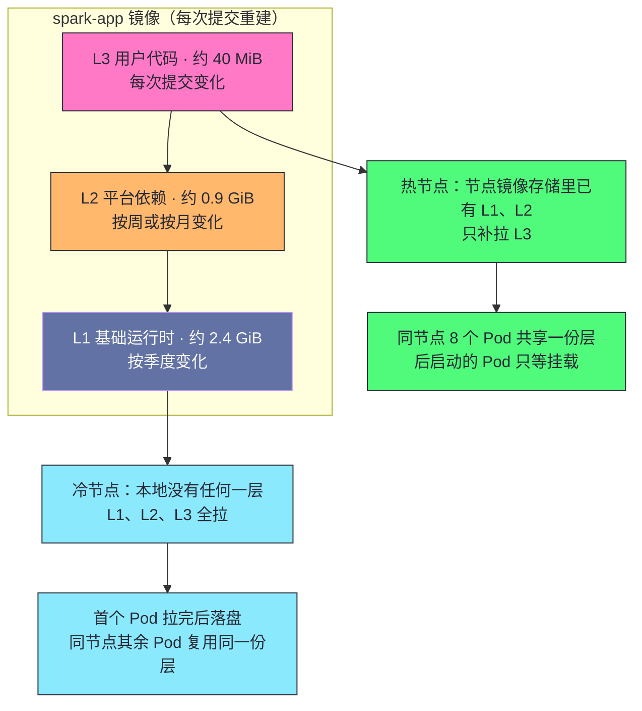
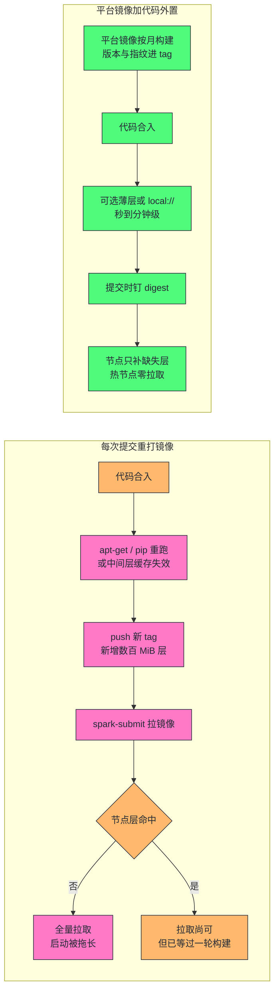
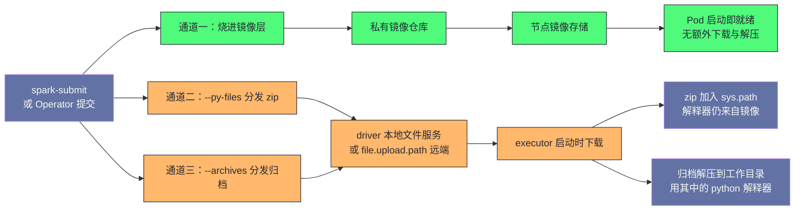
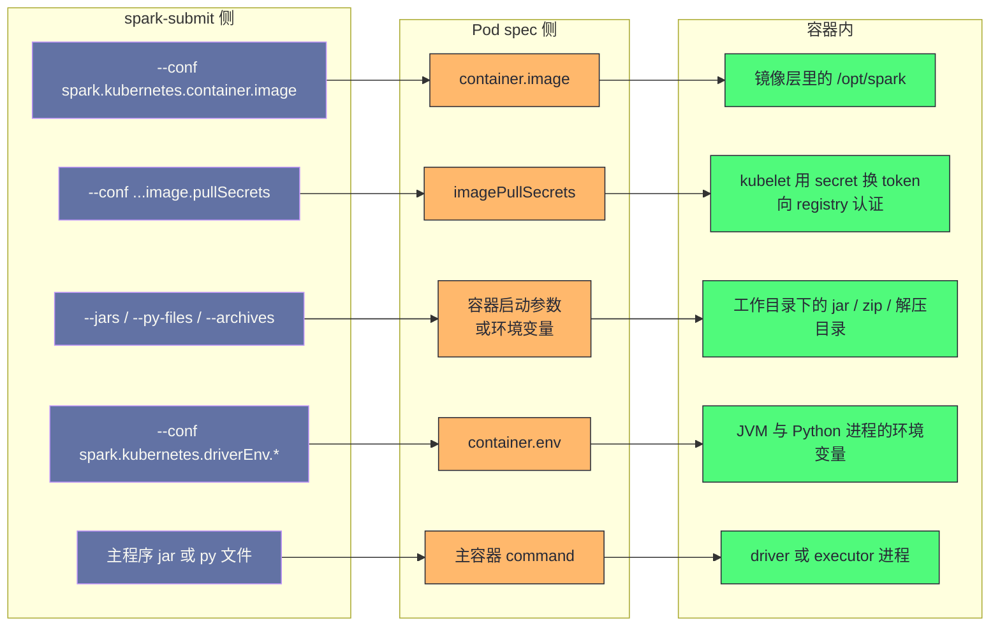
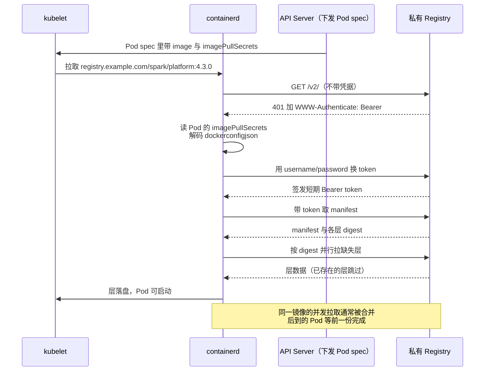

# 02 镜像构建与依赖管理：如何打包一个可复用的 Spark 镜像

**摘要：**

Spark on Kubernetes 把 Driver 与 Executor 一并塞进容器之后，镜像就不再是一份构建产物，而是这套分布式程序在集群上的运行时契约：JDK 从哪来、Spark 发行包落在哪个目录、业务的类与 Python 模块从哪里进入 classpath、时区与证书按谁的口径、私有仓库凭据挂在哪里，全部由镜像决定。YARN 时代那些"到了节点上再本地化"的便利，在容器里或者消失，或者被搬到了另一个位置——而搬到哪里，决定了启动快慢与故障形态。本文沿五问推进：先解剖 `apache/spark` 官方镜像的构成与入口脚本，回答一个镜像里到底装了什么；再说明为什么要把镜像切成基础运行时、平台依赖、用户代码三层，以及层缓存真正命中的条件；接着把"每次提交都重打镜像"当作反模式摊开，算清它在构建时间、仓库存储与可复现性上的三笔账；然后把 Python 依赖的三条通道与 JAR 依赖的解析位置逐条对上，说明 `spark.jars.packages` 在 Kubernetes 上究竟在哪台机器上被解析、为什么与 YARN 不同；最后落到私有仓库的鉴权链路与镜像大小对 Pod 启动时间的影响。全文只回答两个问题：镜像该切几层，依赖该走哪条通道。口径为 Spark 4.3.0（2026-10-30 发布，4.x 预编译 Scala 2.13、要求 Java 17）与 Kubernetes 1.37。

**关键词（Keywords）**: **镜像分层**, **依赖管理**, **JAR**, **Python**, **conda-pack**, **imagePullSecrets**, **spark.jars.packages**, **imagePullPolicy**

---

## 第 1 章 一个容器里必须装下的东西

### 1.1 迁移现场的三个版本

行文从一个具体作业开始。笔者设一个电商数仓的夜间结算作业 `settle_daily`：主体逻辑用 PySpark 写，读 HDFS 上的订单明细与商品维表，中间调用一个 Scala 写的特征工程 JAR，结果写回宽表；作业在 YARN 上跑了两年，几十个 executor 靠 NodeManager 从 staging 目录本地化启动，运维对它唯一的抱怨是"提交时传得慢"。

同一份作业搬到 Kubernetes 上，前三个版本各自撞了一堵墙。

第一个版本照抄 YARN 的习惯：镜像用官方 `apache/spark:4.3.0`，业务 JAR 与 Python 依赖都在提交命令里用 `--jars`、`--py-files` 挂上去。Pod 起来了，但四十个 executor 里只有九个在规定时间内完成注册，其余的在日志里反复出现下载超时。原因并不复杂：Kubernetes 没有 NodeManager 替你在节点上摊开 jar，所有 executor 都要转而向 driver 的本地文件服务索要那份几百兆的依赖，driver 的那块网卡成了唯一出口，executor 越多，队排得越长。

第二个版本改成"依赖全部烧进镜像"：CI 里从官方镜像 `FROM` 出一个新镜像，把 JAR 与 Python 依赖都装进去，每次提交构建一次。启动确实稳了，新的问题换到了流水线上——一次改一行业务代码的提交，要等十几分钟才能拿到可提交的镜像；镜像仓库一周之内涨了几十 GB；某次线上问题回滚时，运维发现"重新构建一遍旧提交"得到的东西和当时那版并不一样。

第三个版本才落到本文要讲的那套做法：镜像按变化频率切三层，只有最上面一层跟着业务代码走，依赖解析从运行时前移到构建期，提交时用 digest 而不是 tag 固定"这一次跑的到底是什么"。

三个版本对应三类失败，分别出在分发、构建与仓库三个环节，而它们其实是同一个问题的三个侧面——**容器镜像在 Kubernetes 上同时承担了运行时契约与分发单元两个身份**，任何一个身份设计失当，都会在另一个身份上表现出来。

### 1.2 镜像的两个身份

先说运行时契约这一面。在 YARN 上，一个 executor 进程的 classpath 由三部分拼成：`$SPARK_HOME/jars`（发行包自带）、NM 本地化下来的应用 jar、以及配置里额外挂进来的路径。这三部分里只有第一部分与机器绑定，后两部分随应用走。容器把这条边界收紧了：Pod 的文件系统在镜像构建完成的那一刻就定死了，运行期唯一还能往里加东西的入口是三处——挂载卷（PVC、ConfigMap、emptyDir）、启动时下载到工作目录（`--jars`、`--files`、`--archives` 走远端 URI），以及以环境变量或命令行参数注入的路径。

紧一分则死，松一分则乱。把所有依赖烧进镜像，运行期就没有不确定性，代价是每次变更都要重走一遍构建与分发；把所有依赖留给运行期下载，构建确实轻了，代价是每个 Pod 的启动路径上多了几个网络往返，而这条路径的任何一个环节抖动，都会以 `ContainerCreating` 卡住或 executor 注册超时的形式表现出来。

再说分发单元这一面。容器的镜像存储是**节点级**的，不是 Pod 级：同一个节点上的八个 executor Pod 共用一份层文件，镜像只落一次盘。这条事实决定了成本模型——镜像变大，付账的是"节点数 × 层大小"，不是"Pod 数 × 镜像大小"；而运行期下载的成本恰恰相反，它按 Pod 计，并且往往要经过同一个出口（driver 的文件服务或对象存储网关），于是随 executor 数线性放大。两种账本形状不同，选择方案时先要认清自己付的是哪一本。

### 1.3 四条成本线

镜像设计上的每个决定，最后都会落到四条成本线上的某一条。把它们并排放好，后面几章的讨论就有了坐标：

| 成本线 | 由什么决定 | 失控之后的现场症状 | 对应章节 |
|---|---|---|---|
| 拉取与启动 | 镜像总大小、层复用率、仓库与节点带宽 | Pod 停在 `ContainerCreating`、`ImagePullBackOff`、executor 迟迟不注册 | 第 3、7 章 |
| 构建迭代 | 层缓存的命中范围、CI builder 是否有缓存 | 改一行代码等十几分钟；开发者绕开流水线手工推镜像 | 第 3、4 章 |
| 可复现 | 是否钉 digest、依赖是否锁版本、构建能否重放 | 同一 tag 在两台机器上内容不同；回滚后问题不复现 | 第 4 章 |
| 升级半径 | 分层的边界画在哪 | 换一次 JDK 要把几十个业务镜像全部重打 | 第 3、8 章 |

四条线彼此拉扯。把依赖全烧进镜像，第一条线变好、第二条线变差；把镜像压到极小、依赖全走下载，第二条线变好、第一条线变差并且多了失败点。所谓"可复用的镜像"，说的不是某个尺寸或某种写法，而是在这四条线上同时留出余量的一种切法。

### 1.4 一个比喻：家属院与连锁酒店

YARN 的节点像老式家属院：车棚里放着一份公共的 jar，谁要用谁去取，管理员还替你记着哪份是哪天放进来的，取过一次之后再来就快了。Kubernetes 的节点像连锁酒店的标准间：房间里只有你自己带进来的行李，酒店不会替你备牙刷；想省事只有两条路——要么每次把行李带齐（依赖烧进镜像），要么把行李寄存在前台（远端对象存储加 URI），入住时自己去取。

这个比喻可以一直用下去，因为三处偏差正好对应本文三章。其一，"带齐行李"的成本按房间数算而不是按入住人数算——同一间房住八个人，行李只搬一次，这就是第 3 章讲的分层复用。其二，"寄存前台"取件要排队，前台只有一个（driver 的文件服务），人越多越慢，这是第 6 章讲的依赖分发路径。其三，"酒店不会替你更新牙刷"，基础层里的证书、时区、JDK 补丁都得你自己排期重打，这是第 8 章要谈的维护代价。

---

## 第 2 章 官方镜像的解剖

### 2.1 构建工具与它的前提

Spark 发行包从 2.3.0 起自带 `bin/docker-image-tool.sh`，用来把发行包本身打成镜像。它没有额外的魔法：读取发行包里 `kubernetes/dockerfiles` 下的 Dockerfile，按参数替换基础镜像与标签，产出三个 tag。

```bash
# 在解压后的 Spark 发行包根目录执行；这里的 4.3.0 必须与发行包版本一致
./bin/docker-image-tool.sh \
  -r registry.example.com/spark \   # 仓库前缀，不含镜像名
  -t 4.3.0 \                        # 用版本号定型，不用 latest
  build

# 产物三个 tag，共用同一份发行包内容：
#   registry.example.com/spark/spark:4.3.0      仅 JVM
#   registry.example.com/spark/spark-py:4.3.0   含 Python 绑定
#   registry.example.com/spark/spark-r:4.3.0    含 R 绑定

./bin/docker-image-tool.sh -r registry.example.com/spark -t 4.3.0 push
```

这个脚本有一个容易被忽略的前提：它假定你手里已经有一份与镜像版本严格对应的发行包。这层约束看似麻烦，其实是它最大的价值——**镜像里的 Spark 与提交机上的 `spark-submit` 必须来自同一个发行包**，否则序列化协议、配置项名与内部 API 会在两个版本之间悄悄错位，症状是 `NoSuchMethodError`、`ClassNotFoundException` 或反序列化失败，而本地跑一遍永远复现不出来。用发行包作为镜像的唯一来源，等于从源头把这条错位堵掉了。

4.x 的发行包默认按 Scala 2.13 编译，运行要求 Java 17；这两个口径都要与集群侧对齐。镜像里的 JDK 版本、提交机的 JDK 版本、以及 shuffle 服务等其他组件的 JDK 版本若不一致，问题往往不在启动阶段暴露，而在某个用到新 API 的算子里突然炸开。

### 2.2 镜像里到底有什么

把官方镜像拆成骨架，大致是下面这个形状（示意，具体基础镜像变体与构建顺序以发行包内 Dockerfile 为准）：

```dockerfile
# 官方 spark:4.3.0 镜像的骨架
FROM eclipse-temurin:17-jre            # ① 基础 JDK 层，JRE 而非 JDK
COPY --from=build /opt/spark /opt/spark   # ② 发行包整体搬入（多阶段构建，build 阶段产出 /opt/spark）
ENV SPARK_HOME=/opt/spark
WORKDIR /opt/spark/work-dir            # ③ 容器内工作目录，属主已放开写权限
COPY entrypoint.sh /opt/entrypoint.sh
ENTRYPOINT [ "/opt/entrypoint.sh" ]    # ④ 按第一个参数分派 driver 与 executor
```

逐层看过去，能裁与不能裁分得很清楚：

| 路径 | 内容 | 量级 | 自建镜像时能否裁掉 |
|---|---|---|---|
| `/opt/spark/jars` | Spark 各模块与自带第三方运行时 jar | 数百 MiB，是镜像的主体 | 不能整体裁；可按需剔除用不到的连接器，但要自己承担类冲突风险 |
| `/opt/spark/examples`、`/opt/spark/data` | 示例代码与样例数据 | 几十 MiB | 可以裁，收益有限，与启动时间关系不大 |
| `/opt/spark/bin`、`sbin` | 提交、启动与守护脚本 | 极小 | 不建议动，镜像内自检会用到 |
| `/opt/spark/work-dir` | 运行期工作目录，`--archives` 也解压在这里 | 空 | 必须保留，且要保证运行用户可写 |
| `/opt/entrypoint.sh` | 角色分派入口 | 几 KB | 必须保留 |

这张表里最值得记住的是第一行与第二行的对比。很多人对"精简官方镜像"的第一反应是删示例、删文档，但示例与数据加起来只有几十兆，而 `jars` 目录动辄几百兆，且它是 Spark 能跑起来的前提。删示例换来的是心理上的成就感，删 jar 换来的是一连串类找不到——真要压缩体积，方向是换 JRE 基础镜像、剔除用不到的数据源连接器，以及把 Python 科学栈这类真正的大件请出基础层。收益的大头始终不在"削"上，而在"不要每次重拉"上，这一点第 3 章会算。

### 2.3 一个镜像演两个角色

官方镜像的入口脚本干的事情很朴素：看第一个参数是 `driver` 还是 `executor`，前者 `exec` 到 `spark-submit`，后者 `exec` 到 `CoarseGrainedExecutorBackend`，中间用 tini 之类的轻量 init 进程兜住 PID 1，好让 `SIGTERM` 能转发给 JVM，executor 被驱逐时有机会把正在写的 Shuffle 文件收尾。

为什么 Driver 与 Executor 要共用一份镜像，而不是各打一个？因为二者的 classpath 必须**逐字节一致**。Driver 序列化闭包与任务结果，Executor 反序列化；两侧的类版本、序列化器实现、甚至依赖里的 protobuf 版本只要有一处不同，就会出现"driver 能跑、executor 报错"这类只在分布式环境里出现的故障。共用一个镜像是最省事的一致性保证，代价是镜像体积按两者中较大的那个算——Driver 只需要的那点东西，Executor 镜像里也得有，反之亦然。

这也是"每个作业一个镜像"这种做法在体积上格外昂贵的原因：它让每个业务作业都复制了一份完整的 Spark 发行包，而这些副本之间 99% 的字节是完全相同的。

### 2.4 官方镜像缺的那几样

官方镜像的定位是"最小可运行的基准"，把它直接当生产镜像用，通常会缺下面几类东西，缺哪一类，症状就出现在哪一段：

- 内网存储的配置与连接器：`core-site.xml`、`hdfs-site.xml`、S3A 或 OSS 的连接器与凭证链；缺了它们是 `ClassNotFoundException` 与 `No FileSystem for scheme` 的高发区。
- 证书与信任链：内网 CA、Kerberos 的 `krb5.conf` 与 keytab 的挂载位置；这类缺失的表现是 TLS 握手失败或认证超时，日志里往往只有一行含糊的 `GSS initiate failed`。
- Python 科学栈：官方 `spark-py` 镜像只带最小可用的 Python 环境，pandas、pyarrow、scikit-learn 都要自己装。
- 时区与 locale：容器默认 UTC，业务按天分区、按小时聚合的作业若没有显式设定，跨零点的那一批数据会算到错误的日期桶里。
- 与提交机一致的版本：自建镜像若从 `ubuntu` 从零复刻发行包，很容易把 Spark 版本、JDK 变体、入口脚本的处理一并丢掉。

这里有一条判断可以省掉很多弯路：**官方镜像是 base，不是 app**。正确的用法是 `FROM` 它往上叠，而不是把它当最终镜像直接部署，也不是推倒重来自己拼一个——后一种做法会把官方对 JDK 变体、非 root 用户、入口脚本与信号处理的那一套处理全部丢弃，换来的只是一份"看起来更干净"的镜像。

---

## 第 3 章 分层：把变化频率排成序

### 3.1 层是内容寻址的

镜像层（Layer）不是"文件快照的堆叠"，而是按内容寻址的只读归档：每一层有一个由内容算出的 digest，镜像的 manifest 按顺序列出这些 digest，运行时用 overlayfs 把它们合并挂载成一个可写视图。这个机制带来两个直接后果。

其一，**拉取是增量的**：节点上已有的层按 digest 命中，不再下载，只补缺的。其二，**存储是按层去重的**：同一节点上八个 Pod 用同一个镜像，磁盘上只有一份层文件；不同镜像之间只要共享了某些层，那些层也只存一份。

但增量命中有一个前提常被忽略：层的 digest 由内容决定，**内容差一个字节，digest 就变，该层及其之上所有层全部失效**。所以"分层"这件事的技术含义不是"把文件分开放"，而是"把会一起变的东西放在一起，把不会一起变的东西隔开"。构建指令的顺序、`COPY` 的粒度、基础镜像的 tag 是否被覆盖，都会影响这条链路。

### 3.2 变化频率不是均匀的

把 `settle_daily` 需要的所有东西按变化频率排一遍，会发现它们的更新周期相差三个数量级：

| 层 | 典型内容 | 变化周期 | 谁触发变更 | 一次变更的失效半径 |
|---|---|---|---|---|
| L1 基础运行时 | 发行版、JRE 17、Spark 4.3.0 发行包、入口脚本 | 季度级 | 平台升级 Spark 或 JDK 补丁 | 全部业务镜像重建，全部节点重拉 |
| L2 平台依赖 | Hadoop/S3A 连接器、内网 CA、Python 科学栈、`core-site.xml` | 周或月级 | 存储集群升级、依赖库安全修复 | 使用该平台的作业全部重建 |
| L3 用户代码 | 业务 JAR、Python 源码与 zip、作业配置 | 每次提交 | 业务代码合入 | 只有这一层失效，几十 MiB |

这张表就是分层的全部理由。把三类内容按这张表的顺序自下而上叠起来，一次业务提交只会打掉 L3，L1 与 L2 的层在原处等着被复用；而把三类内容混在一层里，任何一次业务提交都会让整条链重建，这就是第 4 章要算的那笔账。

### 3.3 三层的落地写法

三层各自对应一个镜像 tag，构建顺序自下而上，每层只做自己那一层的事。

```dockerfile
# L1：spark-base:4.3.0-jdk17
# 变化频率：季度级。只负责"能跑 Spark"，不掺任何业务与平台配置
FROM eclipse-temurin:17-jre

ENV DEBIAN_FRONTEND=noninteractive \
    TZ=Asia/Shanghai \
    SPARK_HOME=/opt/spark

# 发行包从构建上下文拿，不从公网下载：可复现的前提是"字节可控"
COPY spark-4.3.0-bin-hadoop3.tgz /tmp/
RUN tar -xzf /tmp/spark-4.3.0-bin-hadoop3.tgz -C /opt \
    && mv /opt/spark-4.3.0-bin-hadoop3 ${SPARK_HOME} \
    && rm /tmp/spark-4.3.0-bin-hadoop3.tgz \
    # 示例与数据对运行无用，删掉能省几十兆；jars 目录不动
    && rm -rf ${SPARK_HOME}/examples ${SPARK_HOME}/data

ENV PATH="${SPARK_HOME}/bin:${PATH}"

# 入口脚本沿用官方那一份：driver/executor 的分派逻辑不值得自己重写
COPY entrypoint.sh /opt/entrypoint.sh
RUN chmod +x /opt/entrypoint.sh

WORKDIR ${SPARK_HOME}/work-dir
ENTRYPOINT [ "/opt/entrypoint.sh" ]
```

```dockerfile
# L2：spark-platform:4.3.0-h3.4-py311
# 变化频率：周或月级。平台能力都堆在这层，业务镜像只管 FROM 它
FROM registry.example.com/spark/spark-base:4.3.0-jdk17

USER root

# 内网 CA 与 Kerberos 配置：这类东西过期了要重打 L2，不要塞进 L3
COPY certs/internal-ca.crt /usr/local/share/ca-certificates/
RUN update-ca-certificates

# 连接器与存储客户端：版本跟集群对齐，不跟业务对齐
COPY jars/hadoop-client-api-3.4.1.jar \
     jars/hadoop-aws-3.4.1.jar \
     jars/aws-java-sdk-bundle-*.jar ${SPARK_HOME}/jars/

# Python 科学栈：用 BuildKit 的 cache mount 缓存 wheel，避免每次重建重下
COPY requirements-platform.txt /tmp/
RUN --mount=type=cache,target=/root/.cache/pip \
    pip3 install --no-cache-dir -r /tmp/requirements-platform.txt

COPY conf/core-site.xml conf/hdfs-site.xml ${SPARK_HOME}/conf/

# 官方镜像以非 root 运行，装完东西要切回去，否则 work-dir 写不进去
USER 185
```

```dockerfile
# L3：spark-app:settle-20261119-3
# 变化频率：每次提交。只放业务字节，别的一概不放
FROM registry.example.com/spark/spark-platform:4.3.0-h3.4-py311

# 依赖 JAR（变化少）放在下面，业务 JAR（变化频繁）放在最上面
COPY target/lib/ ${SPARK_HOME}/jars/settle-deps/
COPY target/settle-20261119-3.jar ${SPARK_HOME}/jars/settle-app.jar

# Python 代码与 zip 走同一层的两个 COPY，谁变谁失效，互不牵连
COPY src/ /app/src/
COPY dist/settle_py.zip ${SPARK_HOME}/jars/settle_py.zip

ENV PYTHONPATH=/app/src:${SPARK_HOME}/jars/settle_py.zip
```

这三个 Dockerfile 里有几处写法值得单独说明。L1 里的发行包是 `COPY` 进来的而不是 `wget` 下来的：公网下载的字节会随镜像源的内容变化，而 `COPY` 进来的是构建上下文里的固定字节，前者破坏可复现，后者不破坏。L2 里的 pip 安装用 BuildKit 的 cache mount：缓存的是 wheel 下载，不是层缓存，两者互不干扰，前者省网络、后者省重建。L3 里的 `COPY` 顺序是刻意的：依赖 JAR 目录在业务 JAR 之前，前者不变则那一层缓存命中。

还有一个细节值得记住：官方镜像以非 root 用户运行（UID 185），L2 里需要 `USER root` 才能装系统级依赖，装完必须切回 185，否则 `work-dir` 与 `/opt/spark/jars` 的属主会错位，运行期报 `Permission denied`，而报错位置离根因很远。

### 3.4 缓存命中的条件

三层摆好只是必要条件，真正的命中还要满足下面五条，缺一条就可能退化成全量重建：

其一，父镜像 digest 稳定。`FROM spark-base:4.3.0-jdk17` 里的 tag 若被重新 push 覆盖，父层 digest 就变了，L2 与 L3 的缓存全部作废。要防这件事，要么在 `FROM` 里直接写 digest，要么守住"tag 不可变"这条仓库纪律。

其二，层顺序稳定。最常变的放最后，这是所有 Dockerfile 的第一原则，但三层结构里还有一个变体：L2 里的 `requirements-platform.txt` 若在 `COPY conf/` 之前，改一次配置文件不会让 pip 层失效；顺序反了，改配置也要重装依赖。

其三，`COPY` 粒度要小。`COPY . /app` 这种写法会把构建上下文里所有文件的元信息卷进层里，`.gitignore`、编辑器临时文件、甚至构建时间戳都可能让层 digest 变化。三层结构里 L3 最容易犯这个错：`COPY src/` 可以接受，`COPY .` 不行。

其四，别在底层写入每次构建都不同的内容。构建号、commit hash、`date` 输出、`apt-get update` 的索引，只要写进 L1 或 L2，那一层的 digest 就每次都不一样。要传构建号，放到 `LABEL` 里且只放在最顶层。

其五，builder 侧要有缓存。层缓存在没有缓存的 CI runner 上等于不存在。临时 runner 每次都是空机器，必须用 `--cache-from` 指向一个预置镜像，或者用 BuildKit 的 registry cache（`--cache-to type=registry`）把缓存存回仓库；否则"层设计得很好"这件事只在开发者的笔记本上成立。

这里要澄清一个常被混为一谈的区别：**构建缓存**与**拉取复用**是两本账。构建缓存决定"重新构建时要不要重跑指令"，拉取复用决定"新 Pod 启动时要不要重新下载层"。两者都由 digest 决定，但失败的后果不同：前者让构建变慢，后者让 Pod 启动变慢。一个每次重打镜像的流水线，只要 L1、L2 的字节没变，拉取时仍然可以复用——它坏的是构建账，不是分发账。反过来，一个构建得很快的镜像，若基础层每次都被 `apt-get update` 改写，分发账会很难看。

### 3.5 算一笔分发的账

把 `settle_daily` 的镜像按三层设计折成数字：L1 约 2.4 GiB、L2 约 0.9 GiB、L3 约 40 MiB，合计约 3.34 GiB。集群 20 个节点，本批 160 个 executor Pod，每节点 8 个。以下数字只是为了让算术过程可复算，不代表任何一次真实作业的实测值。

不分层、每提交一个新镜像时：20 个节点里若有 16 个是热节点（已有 L1、L2 的层），它们只需补拉 L3 的 40 MiB，合计 640 MiB；4 个冷节点要全量拉 3.34 GiB，合计 13.4 GiB；总出口约 14 GiB。分发账并不难看，难看的是四个冷节点要花的时间：按千兆线速折算约 29 秒，而这四个节点上的 32 个 Pod 全在等。

分层之后：热节点上的 L3 同样是新层，同样要拉，账几乎不变；但冷节点上的 L1、L2 变成了"别的作业已经拉过的层"，只要集群里跑过同版本的任何一个 Spark 作业，这两层就在本地，冷节点也只需补 L3。于是 20 个节点的总出口从 14 GiB 降到 0.8 GiB 量级，Pod 启动的等待从"半分钟级"降到"几秒级"。

这笔账的真正含义是：**分层的收益不体现在第一次，而体现在第 N 次**。首次部署时所有节点都是冷的，三层与一层没有区别；集群稳定运行之后，基础层在节点上是常驻的，收益才显现出来。所以"分层"是一种投资，回报周期取决于作业密度——一个月只跑一次的集群，分层带来的收益很有限。

下面这张图把三层结构与两种节点的命中情况并排放开，注意冷节点补的是"缺失的层"，而不是整个镜像：



图里两条虚线之外还有一层含义：热节点上"后启动的 Pod 只等挂载"这件事，是 Kubernetes 侧最容易被忽略的一处红利。同一批 executor 几乎同时创建，节点运行时通常会把同一镜像的多次拉取合并处理，后到的 Pod 等前一份落盘即可；即便没有合并，层文件在节点存储里也只有一份，不会出现八个 Pod 各拉一份的情况。

### 3.6 层的上限与代价

层不是越多越好。OCI 镜像没有硬性的层数上限，但每一层都意味着一次网络往返请求与一次 overlay 挂载项，层数堆到几十上百时，拉取阶段的元数据开销与挂载开销会变得可观；更实际的问题是，层数多了之后"哪一层该为哪次变更负责"变得难以追踪，排查镜像问题时只能对着 `docker history` 逐行猜。

三层的数量不是教条，而是一个经验平衡点：层数少到能覆盖三类变化频率，多到能让每类变化各自失效而不牵连别人。业务若确实存在"变化频率介于 L2 与 L3 之间"的依赖，譬如每周更新的模型权重文件，可以加一层 L2.5，但加之前要先问一句：这份东西真的需要进镜像吗，还是挂一个 PVC 或走 `--files` 更合适。

还有一处维护代价要提前认下。L1 里的 CA 证书与 JDK 补丁是有保质期的：证书三个月或一年轮换一次，JDK 的安全补丁按季度发布。它们固化在基础层，意味着"平台镜像需要定期重建并推动所有业务镜像重建"，而这件事如果没人排期，半年后集群里会同时跑着五种证书版本，看起来一切正常，直到某次证书过期。

---

## 第 4 章 反模式：每次提交都重打镜像

### 4.1 它的形状

这个反模式有一个非常标准的外形，几乎每个刚把 Spark 搬上 Kubernetes 的团队都会写一遍：

```bash
# CI 流水线里的一段
docker build -t registry.example.com/spark/app:${CI_PIPELINE_ID} .
docker push registry.example.com/spark/app:${CI_PIPELINE_ID}
spark-submit --conf spark.kubernetes.container.image=registry.example.com/spark/app:${CI_PIPELINE_ID} ...
```

Dockerfile 通常长这样：`FROM apache/spark:4.3.0`，然后 `COPY app.jar`、`RUN pip install -r requirements.txt`、`COPY src/`。它没有错，甚至能跑通，问题出在把"构建镜像"放进了每次提交的关键路径。

### 4.2 第一笔账：构建时间

这笔账最容易被感知，也最容易被误判为"CI 慢"。

从官方镜像 `FROM` 起来的构建，若 CI runner 没有缓存，每一次都要重跑 `pip install`、`apt-get` 与依赖下载，分钟级起步；若 runner 有缓存，上层确实能命中，但只要基础镜像被重新 push 过一次，或者有人在 Dockerfile 中间插了一行 `ENV`，后面的层全部重来。更麻烦的是并发：同一个仓库里五个作业并行构建，各自拉一份官方镜像、各自装一遍依赖，runner 的磁盘与出口带宽互相挤占，最后一个构建的耗时可能是单独构建的三倍。

把构建压进提交关键路径还有一层隐性成本：开发者的反馈循环被拉长。改一行代码要等十几分钟才能提交，人的行为会变形——有人开始在本地手工 `docker build` 然后 `docker push`，绕过流水线；有人干脆把多个改动攒在一起提交。前者让镜像来源失控，后者让回滚粒度变粗，两者都比"构建慢"本身更难收拾。

### 4.3 第二笔账：仓库膨胀

镜像仓库的存储是按 blob 去重的，所以"每次构建推一个新 tag"并不等于"每次都多存一份完整镜像"——只要 L1、L2 的字节相同，它们的 blob 只存一份，新 tag 只是新增了 manifest 与 L3 那一层。

真正的成本有三处。其一是层字节的重复：`FROM apache/spark` 之后若加了一条 `RUN apt-get update && apt-get install -y ...`，每次构建产出的这一层字节都不同，于是每个 tag 都带一份几十到几百兆的新层，去重完全失效。其二是tag 与 manifest 的数量：保留策略要同时满足"能回滚到上一版"与"不能让仓库无限增长"，这两个要求天然冲突，最后往往变成手工清理，而手工清理又没人敢删最近三个月之外的镜像。其三是衍生开销：镜像扫描、签名、同步到边缘仓库，每一个动作都按 tag 计费，tag 数量翻十倍，扫描队列也跟着翻十倍。

### 4.4 第三笔账：不可复现

这笔账最贵，因为它不在故障当时显现。

`pip install pandas` 不带版本、`apt-get update` 不锁索引、基础镜像 tag 被覆盖，三者任意一条成立，"同一份代码构建出同一个镜像"就不再成立。于是事故复盘时会出现一种尴尬：用当时的 commit 重新构建一遍，得到的东西和当时跑的并不一样，问题既复现不了也排除不了。

镜像里 Spark 版本与提交机不一致是同一类问题的另一种形态。集群升级到 4.3.0 之后，业务镜像仍基于旧版本构建，提交机已经是 4.3.0，两侧在序列化协议上错位；症状是 `NoSuchMethodError`、反序列化失败、Shuffle 读到一半格式对不上，而这些在本地 IDE 里跑一遍都不会出现，因为本地用的是提交机上的 jar。确认方法很直接：把镜像里的 `spark-submit --version` 与提交机上的输出并排比一次，两处不一致就是它。

### 4.5 反事实：如果不这样

把这三个代价合起来看，就能理解为什么它被称为反模式：它用"每次提交都完整重建一次运行时"的方式，换取"提交即得到唯一镜像"的确定性，但付出的代价恰好落在三处最不该妥协的地方——关键路径上的时间、仓库的长期可维护性、以及事故复盘所依赖的可复现性。

更合理的形态是把产物拆成两份：**平台镜像低频构建、带版本与指纹；业务代码高频变化、走薄层或干脆不进镜像**。业务字节可以不进镜像——用 `local://` 引用镜像内已存在的路径，或用 `--py-files` 把 zip 分发进工作目录，都是把"代码"从"镜像"里解耦出来的做法。提交时用 digest 而不是 tag，把"这一次到底跑的是什么"冻结在提交记录里。

```bash
# 平台镜像按月构建，tag 里带版本与构建指纹（指纹只用于人读，不作缓存依据）
docker build -t registry.example.com/spark/platform:4.3.0-h3.4-py311-20261101 .
docker push registry.example.com/spark/platform:4.3.0-h3.4-py311-20261101

# 提交时钉 digest：tag 可以被覆盖，digest 不会
spark-submit \
  --master k8s://https://api.example.com:6443 \
  --conf spark.kubernetes.container.image=registry.example.com/spark/platform@sha256:8f3c... \
  --conf spark.kubernetes.container.image.pullPolicy=IfNotPresent \
  --jars local:///opt/spark/jars/settle-app.jar \
  settle_daily.py
```

下面这张图把两条流水线的差别按时间顺序摆开，左侧的回路里，每一次提交都要等一次完整构建；右侧的回路里，提交只产生几十兆的可选薄层，或者根本不产生镜像：



### 4.6 它并非全然错误

承认适用边界是有必要的。三种情况下"每提交一镜像"是合理的：多租户隔离要求每个业务线拿到互不影响的独立镜像，且审计要求每次发布有唯一且可追溯的 digest；业务代码与平台依赖强耦合，换个镜像就等于换环境，解耦的成本高于收益；以及镜像本身就是交付物（对面客户要拿走一个能独立运行的镜像），此时构建时间属于交付流程的一部分，而不是提交路径的一部分。

三种情况之外，其余场景用"平台镜像 + 代码外置"更划算。判断标准只有一句：这份变化的东西，真的需要让节点重新下载一个完整运行时吗。

---

## 第 5 章 Python 依赖的三条通道

### 5.1 先分清解释器与包

PySpark 作业在 Kubernetes 上的依赖问题，经常被笼统地说成"Python 环境怎么搞"，但里面其实是两件事：解释器与包。

解释器只有一个来源——镜像。容器里没有第二个 Python 可以选，`PYSPARK_PYTHON` 能换的只是"用镜像里哪一个解释器"，换不了镜像本身。包则有三个去处：烧进镜像层、以 zip 形式分发进工作目录、以归档形式（conda-pack 或 venv 打成的 tar.gz）解压成独立环境。三条通道的成本结构与可复现性完全不同，选哪条取决于包的规模、变更频率以及是否含 C 扩展。

顺带把一处年代感清掉。早期脚本里常见的 `spark.kubernetes.pyspark.pythonVersion` 在 Spark 3.1.0 就已弃用（Python 2 退出之后，它退化成只能填 `3` 的校验项），并在 4.1.0 被彻底移除（SPARK-54189）。4.3.0 上再写这一项没有任何效果，Python 版本由镜像里装了哪个解释器决定，容器内用 `PYSPARK_PYTHON` 环境变量指定路径，通过 `spark.kubernetes.driverEnv.PYSPARK_PYTHON` 与 `spark.executorEnv.PYSPARK_PYTHON` 分别注入 driver 与 executor 的容器。留着旧参数最危险的地方不是报错，而是让人误以为"Python 版本已经换过了"——这类"参数写了就生效"的错觉，在镜像相关的配置里格外多。

### 5.2 三条通道的分布

三条通道从提交侧分叉，落到 Pod 里的位置各不相同：



图里最要紧的一条线是 `F` 这个节点：两条运行期通道都要经过 driver 的文件服务（集群模式下），或者至少要经过一个共享的对象存储（`spark.kubernetes.file.upload.path` 指向的地方）。这就是通道二、三在成本结构上先天吃亏的地方——它们的流量天然集中。

### 5.3 通道一：烧进镜像

把 `requirements.txt` 装进 L2 或 L3，是三种方案里最"老派"也最稳的一种。

```dockerfile
# 依赖放在 L2 还是 L3，取决于它多久变一次：
# 平台级科学栈（numpy/pandas/pyarrow）放 L2，业务级依赖放 L3
COPY requirements-platform.txt /tmp/
RUN --mount=type=cache,target=/root/.cache/pip \
    pip3 install --no-cache-dir --no-compile -r /tmp/requirements-platform.txt
```

这条路的好处是启动开销几乎为零：Pod 起来时包已经在文件系统里，Python 的 `import` 该花多久还是多久，没有额外的网络与解压。可复现性也是三条通道里最强的：镜像 digest 一钉，包版本、wheel 来源、安装顺序全部冻结。

代价落在变更成本上。任何一次依赖变更都要重打镜像，并且要推到所有节点；如果依赖装在 L2，所有基于 L2 的业务镜像会被一起拖着重推。版本冲突也是结构性的：一个镜像只能有一份 Python 环境，A 作业要 pandas 2.0、B 作业要 pandas 1.5，就只能拆成两个镜像，镜像数量随依赖组合数增长。

### 5.4 通道二：`--py-files` 分发 zip

`--py-files` 接受 `.py`、`.zip`、`.egg` 文件，行为是把它们分发到 executor 的工作目录并加入 `sys.path`。对纯 Python 的辅助模块来说，这条通道非常轻便：一个几兆的 zip，改一次传一次，不需要碰镜像。

```bash
spark-submit \
  --master k8s://https://api.example.com:6443 \
  --py-files dist/settle_py.zip \
  --conf spark.kubernetes.file.upload.path=s3a://spark-artifacts/submit/ \
  settle_daily.py
```

它有两个硬边界，踩上去的人不少。

第一个边界是它换不了解释器。虚拟环境（venv 或 conda）打成的 zip 放进 `--py-files` 是不起作用的：zip 只会被挂到 `sys.path` 上，而虚拟环境里的 `bin/python` 是符号链接、脚本 shebang 里写着打包机的绝对路径，executor 最终仍然用镜像里的解释器去 `import` 那些包，C 扩展一旦与镜像的 Python 版本不匹配就报 `ImportError`。要让 executor 用独立环境，只有通道三。

第二个边界是分发是扇出的。zip 从提交侧到每个 executor 都要走一遍，走的是 driver 的文件服务（集群模式）或对象存储；`spark.files.useFetchCache` 默认为 `true`，同节点上的多个 executor 可以复用一份已下载的文件，能省掉一部分重复传输，但跨节点的扇出仍然存在。包的体积越大、executor 越多，启动阶段这条链越容易被拖住。

可复现性介于通道一与"随缘"之间：zip 的内容可控，但"这个 zip 是怎么构建出来的"往往没有记录，CI 里随手 `zip -r` 一下就发出去的团队不在少数。

### 5.5 通道三：`--archives` 分发独立环境

`--archives` 接受归档文件，行为是把它解压到工作目录。conda-pack 与 venv 打包都走这条通道，配合 `PYSPARK_PYTHON` 指向解压出来的解释器，就能让 executor 用一个与镜像完全解耦的 Python 环境。

```bash
# 在 CI 里打包，注意目标机器与打包机器的 OS 大版本要一致
conda create -n spark-env python=3.11 -y
conda activate spark-env
pip install -r requirements.txt
conda pack -n spark-env -o spark-env.tar.gz
aws s3 cp spark-env.tar.gz s3://spark-artifacts/envs/spark-env-20261119.tar.gz
```

```bash
# 提交侧：归档解压到工作目录下的 environment/，两侧解释器都指过去
spark-submit \
  --archives s3a://spark-artifacts/envs/spark-env-20261119.tar.gz#environment \
  --conf spark.kubernetes.driverEnv.PYSPARK_PYTHON=./environment/bin/python \
  --conf spark.executorEnv.PYSPARK_PYTHON=./environment/bin/python \
  --conf spark.executorEnv.PYSPARK_DRIVER_PYTHON=./environment/bin/python \
  settle_daily.py
```

这条路换来的是隔离：同一个镜像可以跑三个依赖互相冲突的作业，各自解压各自的环境。代价有三处。启动时要下载并解压几百兆的归档，解压发生在 Pod 的工作目录里，占的是 `ephemeral-storage`，大归档加多 Pod 会触发节点磁盘压力驱逐。conda-pack 的产物与打包机的 OS 与 glibc 强绑定，用 Alpine 打出来的包在 Ubuntu 镜像里跑不起来，跨发行版迁移时它是第一个出问题的东西。以及老生常谈的一条：归档本身没有"版本管理"，谁都能往对象存储里传一个同名文件，第二天的作业行为就变了。

### 5.6 启动开销的形状不同

把三条通道的启动开销写成式子，形状差异一目了然：

- 通道一：`T ≈ 0`（层在节点上时），否则 `镜像大小 ÷ 有效带宽`。
- 通道二：`T ≈ zip 大小 ÷ 出口带宽 + 解压 + import`，且扇出数等于 executor 数。
- 通道三：`T ≈ 归档大小 ÷ 出口带宽 + 解压到本地盘 + import`，扇出数同样等于 executor 数。

关键差别在"分母"。通道一的分母是节点数：八个 Pod 落在同一节点，只拉一次。通道二、三的分母是"出口带宽"，而出口通常只有一个（driver 的文件服务或对象存储网关），于是 40 个 executor 各要一份 500 MiB 的归档时，理论传输量是 20 GiB，按千兆线速折算约 170 秒，而且这 170 秒里 driver 的网卡被占满，task 的心跳与 Shuffle 取数也要跟着挤。

一条经验判断由此得出：**依赖越大、executor 越多，越应该往镜像里放；依赖越小、变化越频繁，越适合走运行期通道**。反过来做——大依赖走 `--archives`、小改动重打镜像——恰好是把两种成本都放大了。

| 维度 | 烧进镜像 | `--py-files` zip | `--archives` 归档 |
|---|---|---|---|
| 载体 | 镜像层 | 工作目录下的 zip | 工作目录下解压出的目录 |
| 启动开销 | 层已在本节点时接近 0 | 每个 executor 下载一次 zip | 每个 executor 下载并解压一次 |
| 开销随谁放大 | 节点数 | executor 数（经同一出口） | executor 数（经同一出口），另加磁盘 |
| 可替换解释器 | 可以（镜像里装哪个就是哪个） | 不行，只能用镜像的解释器 | 可以，归档自带解释器 |
| 可复现性 | 最强，digest 冻结全部字节 | 中等，取决于 zip 怎么构建 | 中等，但绑定打包机 OS 与 glibc |
| 依赖冲突 | 一个镜像一套环境，冲突只能拆镜像 | 可叠加多个 zip，但解析顺序脆弱 | 每个作业一套环境，隔离最好 |
| 典型适用 | 平台级科学栈、含 C 扩展的稳定依赖 | 几十兆以内的纯 Python 辅助模块 | 依赖树复杂、需要与镜像解耦的 ML 作业 |

---

## 第 6 章 大 JAR 与依赖的解析位置

### 6.1 三类 JAR 与一个胖 JAR

一个 Spark 作业的 JAR 有三类：Spark 发行包自带的（在镜像 `/opt/spark/jars` 里，随 L1 固定）、应用依赖的第三方库（Hadoop 连接器、JDBC 驱动、业务 SDK）、以及业务代码本身。前两类相对稳定，第三类天天变。

Maven Shade 或 Gradle Shadow 的默认做法是把这三类打成一个"胖 JAR"（Fat JAR），提交时 `--jars` 挂一个文件。在 YARN 上这个做法只是"传得慢"，在 Kubernetes 上它的代价翻倍：镜像里若把这个胖 JAR 放在一层，每次代码变更都会让几百兆的那一层失效，构建与推送都要重来；若走运行期分发，几百兆的扇出又要压在 driver 的出口上。

分拆是标准解法：依赖 JAR 单独输出到 `target/lib`，业务 JAR 只含自己的类。

```xml
<!-- 依赖 JAR 与业务 JAR 分开输出：前者变化少，后者变化频繁 -->
<plugin>
  <groupId>org.apache.maven.plugins</groupId>
  <artifactId>maven-dependency-plugin</artifactId>
  <executions>
    <execution>
      <id>copy-dependencies</id>
      <goals><goal>copy-dependencies</goal></goals>
      <configuration>
        <outputDirectory>${project.build.directory}/lib</outputDirectory>
        <excludeArtifactIds>settle-app</excludeArtifactIds>
      </configuration>
    </execution>
  </executions>
</plugin>
```

```dockerfile
# 两层 COPY：依赖目录命中缓存，只有业务 JAR 那一层失效
COPY target/lib/ ${SPARK_HOME}/jars/settle-deps/
COPY target/settle-20261119-3.jar ${SPARK_HOME}/jars/settle-app.jar
```

| 对比项 | 单个胖 JAR | 依赖 JAR + 业务 JAR |
|---|---|---|
| OCI 层大小 | 一次 COPY 就是几百 MiB | 依赖层几百 MiB + 业务层几 MiB |
| 每次提交失效的层 | 整个胖 JAR 层 | 只有业务 JAR 那一层 |
| 推送量 | 数百 MiB | 数 MiB |
| 运行期分发（若走 `--jars`） | 每个 executor 拉数百 MiB | 只有小 JAR 需要频繁分发 |
| 类路径管理 | 简单，一个文件 | 需要保证依赖目录与业务 JAR 出自同一次构建 |

表里最后一行是分拆的真实代价：`target/lib` 与业务 JAR 必须来自同一次构建，否则会出现"依赖是上周的、代码是今天的"这类极难排查的不一致。流水线里把两者放在同一个构建产物目录里一起打包，就能规避。

### 6.2 从提交参数到容器内的路径

`spark-submit` 上的每个参数，最终都会落到 Pod 的某个字段或容器的某个路径上。把这条映射画出来，很多"配置写了没反应"的困惑会当场消失：



图里 A3 那一条最值得盯着看：`--jars`、`--py-files`、`--archives` 不是"传个参数就完了"，它们在提交侧要先变成可被 Pod 访问的 URI，在 Pod 侧还要再变成工作目录里的文件。中间这一段走哪条路，取决于部署模式，这正是下一节要谈的。

### 6.3 `spark.jars.packages` 到底在哪台机器上解析

这是本章最需要写清的一处，因为它与 YARN 的经验差别最大，而且答案不是一句"在 driver 里"或"在 initContainer 里"能概括的。

先看 YARN。无论 client 还是 cluster 模式，`--packages` 的依赖解析都发生在**提交机**的 `spark-submit` 进程里：Ivy 按坐标去 Maven 仓库取包，取到的 jar 与主程序一起写进 HDFS 上的 staging 目录，之后由各节点的 NodeManager 从 staging 本地化。ApplicationMaster 不解析依赖，也不做文件服务，它只负责申请容器。所以 YARN 上这条链是"提交机解析一次，集群按需本地化"。

Kubernetes 上有两种部署模式，答案随之分叉。

client 模式下，Driver 就跑在提交机上（`spark-submit` 进程本身），Ivy 解析同样在提交机上完成。但 executor 是另外的 Pod，看不到提交机的磁盘，这些本地文件要到达它们只有两条路：由 driver 自己起一个文件服务转给 executor（client 模式下 driver 就在提交机上，这条路的出口就是提交机的网卡），或者在 cluster 模式下先上传到 `spark.kubernetes.file.upload.path` 指向的 HDFS 或 S3，再由 Pod 取回。后者若没配而提交里又带了本地文件，提交会直接以"请指定 `spark.kubernetes.file.upload.path`"这类错误终止。

cluster 模式下，Driver 在 Pod 里，提交机只负责把主程序与少量文件送进去；driver Pod 内会再执行一次 `spark-submit`（内部以 `spark.kubernetes.submitInDriver` 标识），**依赖解析随之搬进了 driver Pod**。这一个动作把整条链的形状改了：集群必须能从 Pod 内访问 Maven 仓库（内网 Nexus 或代理），解析出来的 jar 落在 driver 的本地磁盘上，再由 driver 起一个文件服务，executor 从 driver 下载。executor 越多、jar 越大，driver 的出口越吃紧，这正是 SPARK-47475 提出 `spark.kubernetes.jars.avoidDownloadSchemes` 的动机——让符合该 scheme 的 jar 由 executor 直接去远端取，绕开 driver 这个中转站。

Spark Operator 属于第三类。它把 `spark-submit` 放进 driver Pod 里执行，因此依赖解析位置与 cluster 模式相同：在 Pod 内。Operator 自身不做解析，它只负责把 CRD 翻译成 Pod 模板。

至于 initContainer：它不是 Spark 的机制。官方 Kubernetes 后端没有"用 initContainer 预取依赖"这条路径，`--jars` 与 `--packages` 都不会变成 initContainer。平台上偶尔见到的 initContainer，是平台方自己加的包装——预热模型文件、把一个镜像里的 jar 拷进 emptyDir、或者提前拉取大归档——属于自选动作，不是框架行为。把它当成 Spark 的标准做法，会在换版本或换发行版时踩空。

| 形态 | 依赖解析位置 | 分发载体 | 典型失败症状 |
|---|---|---|---|
| YARN client / cluster | 提交机 | HDFS staging + NM 本地化 | 提交慢；staging 目录权限冲突 |
| K8s client 模式 | 提交机 | `spark.kubernetes.file.upload.path` 指向的远端存储 | 未配上传路径导致提交失败；executor 下载慢 |
| K8s cluster 模式 | driver Pod 内（二次 `spark-submit`） | driver 本地文件服务 | Pod 内无 Maven 出口导致解析失败；executor 下载打满 driver 网卡 |
| Spark Operator | driver Pod 内 | 同上 | 同上，另加 CRD 里的镜像与依赖参数不一致 |

这张表解释了一个很常见的现象：同一套提交参数在 YARN 上跑得好好的，搬到 Kubernetes 的 cluster 模式后卡在"依赖下载"上。原因不在参数写错，而在解析位置从"提交机"挪到了"集群内部"，而那台机器可能根本没有到 Maven 仓库的路由。

### 6.4 把大依赖请出运行期

既然运行期解析在 Kubernetes 上有这么多岔路，最省事的做法是让它不要发生：把大依赖固化进镜像，提交时用 `local://` 引用镜像内的绝对路径。

```bash
spark-submit \
  --master k8s://https://api.example.com:6443 \
  --deploy-mode client \
  --conf spark.kubernetes.container.image=registry.example.com/spark/platform@sha256:8f3c... \
  --conf spark.kubernetes.container.image.pullPolicy=IfNotPresent \
  --jars local:///opt/spark/jars/settle-deps/hadoop-aws-3.4.1.jar \
  --py-files local:///opt/spark/jars/settle_py.zip \
  local:///opt/spark/jars/settle-app.jar
```

`local://` 的语义是"这个文件在容器文件系统里已经存在，不要分发"。它的前提只有一条：driver 与 executor 用的镜像里，那个路径下的内容完全一致。三层结构天然满足这个前提，因为两侧都来自同一个 L3 镜像。这样一来，依赖从"运行期解析 + 网络分发"变成了"构建期固化 + 层复用"，启动路径上少了一整段不确定性。

代价是发布节奏被绑定：改一个依赖 JAR 就要重打镜像、重推、等节点拉层。所以适合走 `local://` 的是那些变化频率低于发布频率的东西——连接器、SDK、特征工程库；至于几兆的业务代码，走薄层或 `--py-files` 更灵活。

若确实必须用 `spark.jars.packages`（譬如作业要按参数动态选版本），有三件事要配好：把 `--repositories` 指向内网镜像并保证 Pod 侧可访问；用 `spark.jars.ivy` 指定一个可缓存、可复用的 Ivy 目录（固化进镜像或在 Pod 里挂 emptyDir，避免每次都从零解析）；以及给 driver 的出口留余量，因为 cluster 模式下所有 executor 的 jar 都从它这里出去。

---

## 第 7 章 私有仓库与拉取链路

### 7.1 鉴权链路

私有仓库的拉取不是"配个密码"这么简单，它是一条分三步的握手：先匿名请求，被拒，再凭凭据换 token，最后用 token 拉取。



图里第 4 步与第 5 步是排障的关键分界。若日志停在 `401 Unauthorized`，问题在凭据：secret 不存在、namespace 不对、`dockerconfigjson` 里的 server 与镜像地址不匹配（`registry.example.com` 与 `registry.example.com:5000` 是两个不同的键）。若日志停在 token 之后，问题在网络或权限：token 拿到了但仓库拒绝该路径，或节点到仓库的路由不通。

### 7.2 Spark 侧字段与 K8s 侧字段

Spark 的提交参数最终会被翻译成 Pod spec 的字段，两边的对应关系如下：

| Spark 配置 | K8s 侧字段 | 作用对象 | 使用注意 |
|---|---|---|---|
| `spark.kubernetes.container.image` | `container.image` | driver 与 executor | 用 digest 而不是可变 tag |
| `spark.kubernetes.container.image.pullSecrets` | `spec.imagePullSecrets` | driver 与 executor 各自 | 逗号分隔多个；secret 必须已在目标 namespace 存在 |
| `spark.kubernetes.container.image.pullPolicy` | `container.imagePullPolicy` | driver 与 executor | 与 tag 的不可变性必须配套 |
| `spark.kubernetes.authenticate.driver.serviceAccountName` | `spec.serviceAccountName` | driver Pod | 在 SA 上挂 imagePullSecrets 可免去逐次传参 |
| `spark.kubernetes.driver.podTemplateFile` | 整个 driver Pod 模板 | driver | 平台化时集中管理，但会覆盖部分 Spark 生成字段 |

表里第四行值得单独说一句：平台化场景下，把 `imagePullSecrets` 挂到 ServiceAccount 上比每次提交都传 `--conf` 更可靠，因为前者由集群管理员维护，后者靠每个提交脚本自觉。Kubernetes 会把 SA 上的 `imagePullSecrets` 自动注入到使用该 SA 的 Pod，提交侧少写一个参数，就少一处漏配。

### 7.3 拉取策略的选择

| 值 | 行为 | 适用场景 | 风险 |
|---|---|---|---|
| `Always` | 每次启动都向仓库确认并拉取 | 开发调试，需要立即可见最新镜像 | 大批 Pod 同时启动会把仓库出口打满；tag 可变时行为不可预期 |
| `IfNotPresent` | 本地有则直接用，无则拉取 | 生产默认，配合不可变 tag 与 digest | tag 可变时不同节点上的"同一 tag"内容可能不同 |
| `Never` | 只用本地镜像，从不拉取 | 离线环境，或镜像已预热到全部节点 | 新节点、扩缩容、滚动重启时会直接 `ErrImageNeverPull` |

生产上选 `IfNotPresent` 没有争议，但必须与"tag 不可变"或"用 digest 引用"配套，否则它会变成一类最难查的故障源：同一个作业的 driver 与 executor 跑在不同版本的镜像上，序列化失败的位置随机，日志里看不出任何规律。

> [!warning] 一个真实存在的坑
> `IfNotPresent` 配可变 tag（尤其是 `latest`）时，不同节点上的"同一个 tag"可能是不同内容：有的节点缓存了旧版，有的节点拉到新版。同一个 Spark 作业的不同 executor Pod 因此可能跑在两个版本上，症状是随机的反序列化失败与类找不到，而在提交机上完全复现不出来。生产镜像的 tag 要么带具体版本，要么直接钉 digest。

### 7.4 镜像大小对启动的影响

镜像大小与启动时间的关系，第一近似是一条除法：`拉取时间 ≈ 镜像大小 ÷ 有效带宽`。有效带宽通常远低于链路标称值——仓库出口是共享的、TLS 握手与 manifest 请求有固定开销、多层并行拉取受并发度限制（容器运行时的默认并发下载数通常只有个位数）。

把常见的三档尺寸按两种链路折算一遍，可以看清量级：

| 镜像大小 | 千兆链路（约 119 MiB/s） | 万兆链路（约 1192 MiB/s） | 20 个节点全冷的仓库出口 | 热节点只补 40 MiB 层 |
|---|---|---|---|---|
| 0.5 GiB | 约 4.3 秒 | 约 0.4 秒 | 约 10 GiB | 约 0.3 秒 |
| 3.34 GiB | 约 29 秒 | 约 2.9 秒 | 约 67 GiB | 约 0.3 秒 |
| 8 GiB | 约 69 秒 | 约 6.9 秒 | 约 160 GiB | 约 0.3 秒 |

这张表里最值得看的是倒数第二列。一次扩容拉起的 executor 波次，若节点都是冷的，仓库要吐出的是"节点数 × 镜像大小"的字节；3.34 GiB 的镜像在 20 节点上就是 67 GiB，按千兆出口折算要传九分钟，而这九分钟里所有 executor 都在等。热节点一列则说明了分层的价值：只要 L1、L2 在节点上，每次提交新增的 40 MiB 层折算下来不到半秒。

Pod 侧的并发不是线性的另一个原因在节点本地：同一节点上八个 Pod 等同一份镜像，第一个拉完之后其余的直接挂载即可，实际耗时接近"一次拉取"而不是"八次"。所以镜像大小真正放大的地方有两个——仓库出口带宽与节点磁盘。后者常被忽略：节点的 `imagefs` 有容量上限，kubelet 在磁盘使用率越过阈值（默认高水位 85%、低水位 80% 一类的配置）时会做镜像回收，几个大镜像就能把节点推到水位线附近，回收时旧镜像被删，下一次作业又要重拉，形成抖动。

### 7.5 缩短等待的三条路

其一是提高层复用率，也就是第 3 章那套：把稳定内容沉到 L1、L2，让每次提交只新增一个小层。这条路的收益最大、依赖最少，代价是前期要把分层设计对。

其二是节点预热。用一个 DaemonSet 在目标节点池上常驻一个同镜像的 Pod（`command` 挂 `sleep`），节点一加入就把镜像拉好；执行作业时 `IfNotPresent` 直接命中。代价是常驻 Pod 占一点资源，且预热镜像的 tag 必须与作业镜像一致，否则拉了个用不上的。

其三是仓库侧加速。P2P 分发（如 Dragonfly 一类的方案）让节点之间互相传层，缓解仓库出口压力；懒加载（Nydus、eStargz 一类）把"拉完整个镜像"改成"按需读文件"，启动可以做到秒级。后者的边界要说清：懒加载对顺序读友好、对随机读要付出额外延迟，而 JVM 从 jar 里加载类恰恰是随机定位，所以这类方案在 Spark 上的实际收益要按镜像结构与节点缓存实测，不能直接采信厂商给出的秒级数字；此外它还需要集群运行时与内核侧的配套（快照器或 FUSE 支持），是否可用要以集群能力为准，不能只看提交参数。

---

## 第 8 章 边界与反例

### 8.1 "层数越多越好"

分层的收益来自"让变更只失效该失效的部分"，但层本身有成本：每层一次往返、一次挂载，层数堆到几十上百时，拉取阶段的元数据开销会盖过复用带来的收益。三到六层是实践中比较舒服的区间；超过这个数量，通常说明有人在用分层表达"文件分类"而不是"变更频率"。

### 8.2 "用 conda-pack 就与镜像解耦了"

解耦是真的，代价也是真的。归档与打包机的 OS 大版本、glibc 版本绑定，镜像换发行版（Ubuntu 换 Alpine、22.04 换 24.04）之后归档可能直接跑不起来；解压占 `ephemeral-storage`，大归档配多 executor 会触发节点磁盘驱逐；对象存储里的同名归档没有版本概念，谁都能覆盖。把归档当成"镜像之外的 Python 环境"，就要像管理镜像一样管理它：带版本号、钉 digest（若对象存储支持）、记录打包机的 OS 版本。

### 8.3 "胖 JAR 最省事"

省事的是构建，麻烦留给运行期。分拆之后新增的复杂度主要在两处：`target/lib` 与业务 JAR 必须同源，否则依赖与代码会错位；类路径上多了一个目录，与镜像里 Spark 自带的 jar 出现同名类时，谁先加载取决于类加载顺序。后者可以用 `spark.jars.excludes` 或 `--driver-class-path` 的显式顺序来约束，但要有意识地配，不能指望默认行为。

### 8.4 "把官方镜像削一削就够小"

删示例、删数据、删文档，加起来几十兆，对 3 GiB 量级的镜像来说是 1% 到 2% 的改善。真正的大头是 JDK 与 `jars` 目录，前者从 JDK 换 JRE 能省一些，后者只能靠剔除用不到的连接器来挤。更现实的收益路径是"不要让每个作业都复制一份 Spark"——也就是分层与复用，而不是把一个镜像削得更薄。

### 8.5 "构建慢就加机器"

构建慢的根因多数不是 CPU，而是缓存不命中导致的重复下载。加机器会让并发构建互相争抢出口带宽，反而更慢；正确的做法是让缓存能在 CI 之间传递——`--cache-from` 指向预置的缓存镜像，或用 registry cache 把缓存存回仓库。这一项配置的收益，通常大于把 runner 的核数翻一倍。

### 8.6 反例速查

| 现象 | 常见误判 | 实际机制 |
|---|---|---|
| Pod 长期停在 `ContainerCreating` | 集群调度有问题 | 镜像在拉，层大或仓库出口拥塞；看节点侧拉取进度 |
| `ImagePullBackOff` 且日志是 401 | 镜像不存在 | `imagePullSecrets` 缺失、namespace 不对，或 secret 里的 server 地址与镜像地址不完全一致 |
| executor 启动慢但镜像不大 | 节点性能差 | 大归档走 `--archives`，或多个 executor 同时从 driver 下载，出口被打满 |
| 同一作业部分 executor 报类找不到 | 代码有 bug | 镜像 tag 可变，不同节点拉到不同内容；改用 digest |
| 改了 `requirements.txt` 但运行行为没变 | 配置没生效 | 依赖装在 L2 而节点上还是旧层，且 tag 未变；确认镜像是否真的重建并推送 |
| 提交成功但作业立刻失败在依赖解析 | 集群网络抖动 | K8s cluster 模式下解析在 driver Pod 内，Pod 到 Maven 仓库没有路由 |
| 节点磁盘告警 | 作业写数据太多 | 镜像是 `imagefs` 的一部分，大镜像触发 kubelet 镜像回收，回收之后又重拉 |
| 镜像里 Spark 版本与提交机不一致 | 没影响 | 序列化与内部 API 在版本间会错位，症状随机出现，须并排比对 `--version` |

---

## 第 9 章 落点

回到 `settle_daily` 的三个版本。第一个版本坏在"运行期分发全部压在 driver 的出口上"，第二个版本坏在"把构建放进了提交的关键路径"，第三个版本之所以能用，不是因为某个参数写对了，而是因为它把两件事分清了：**什么该在构建期定型，什么该在运行期流动**。

这份界线可以归成一条判据：先问这份依赖多久变一次，再问它变了以后要让多少节点重新下载。变化慢、体积大、要摊到全部节点的，沉到镜像底层；变化快、体积小、只影响本次运行的，走运行期通道。三层镜像不过是对这条判据的一次具体落笔——基础运行时按季度变，平台依赖按月变，用户代码每次提交都变。

代价是明摆着的，而且无法同时最小化。镜像越厚，启动越不依赖网络，但构建与分发越重；镜像越薄，迭代越快，但启动路径上多了几处可能失败的地方；钉 digest 换来可复现，代价是发布流程里多一步记录与核对；把 Python 环境塞进归档换来隔离，代价是启动时多一次下载与解压。**这些选择没有高下，只有代价记在谁头上**。

判断顺序因此比任何一条参数都重要：先看依赖的变化频率，再看依赖要摊到多少个节点，最后看仓库出口与节点磁盘能否承受一次波次的并发。三步走完，镜像切几层、依赖走哪条通道，答案基本就定了。

至于镜像大小与启动时间这条等式，正在被懒加载与 P2P 分发松动——按需读文件的镜像可以把"3 GiB 镜像的冷启动"压到秒级。但这些能力取决于集群的运行时就绪程度与内核支持，写成通用经验还为时过早，具体能否落地，以对应版本的文档与集群实测为准。

---

## 参考资料

1. Apache Spark 4.3.0 文档：Running Spark on Kubernetes，镜像构建、`spark.kubernetes.file.upload.path`、依赖分发与部署模式。https://spark.apache.org/docs/latest/running-on-kubernetes.html
2. Apache Spark 4.3.0 文档：Configuration，`spark.kubernetes.container.image.*`、`spark.kubernetes.pyspark.*`、`spark.files.useFetchCache` 等配置项与默认值。https://spark.apache.org/docs/latest/configuration.html
3. Apache Spark 源码（4.3.0）：`bin/docker-image-tool.sh`，镜像构建与推送的参数语义。https://github.com/apache/spark/blob/v4.3.0/bin/docker-image-tool.sh
4. Apache Spark 源码（4.3.0）：`resource-managers/kubernetes/docker/src/main/dockerfiles/spark/Dockerfile`，官方镜像的基础镜像、目录结构与入口。https://github.com/apache/spark/blob/v4.3.0/resource-managers/kubernetes/docker/src/main/dockerfiles/spark/Dockerfile
5. Apache Spark 源码（4.3.0）：`resource-managers/kubernetes/docker/src/main/dockerfiles/spark/entrypoint.sh`，driver 与 executor 的角色分派与信号处理。https://github.com/apache/spark/blob/v4.3.0/resource-managers/kubernetes/docker/src/main/dockerfiles/spark/entrypoint.sh
6. Apache Spark JIRA：SPARK-54189，移除 `spark.kubernetes.pyspark.pythonVersion`（4.1.0 修复，3.1.0 起弃用）。https://issues.apache.org/jira/browse/SPARK-54189
7. Apache Spark JIRA：SPARK-47475，`spark.kubernetes.jars.avoidDownloadSchemes` 与 cluster 模式下 driver 文件服务的带宽瓶颈。https://issues.apache.org/jira/browse/SPARK-47475
8. Apache Spark JIRA：SPARK-48651，Spark 4.0 起要求 Java 17 的兼容性说明。https://issues.apache.org/jira/browse/SPARK-48651
9. Kubernetes 文档：Images，`imagePullSecrets`、`imagePullPolicy` 与私有仓库认证。https://kubernetes.io/docs/concepts/containers/images/
10. Kubernetes 文档：kubelet 镜像回收，`imagefs` 容量与镜像 GC 水位。https://kubernetes.io/docs/concepts/architecture/garbage-collection/
11. Docker 文档：Dockerfile best practices，层缓存、`COPY` 顺序与构建缓存。https://docs.docker.com/develop/develop-images/dockerfile_best-practices/
12. conda-pack 文档：把 conda 环境打包为可迁移归档及其平台限制。https://conda.github.io/conda-pack/
13. Apache Maven 文档：Dependency Plugin 的 `copy-dependencies` 目标，依赖与业务 JAR 分拆输出。https://maven.apache.org/plugins/maven-dependency-plugin/copy-dependencies-mojo.html

---

> [!note] 思考题
> 1. 为什么官方镜像让 driver 与 executor 共用一份镜像，而不是各打一个更精简的？这份一致性约束在什么情况下可以放弃？
> 2. 三层结构里，如果把 `apt-get install` 放进 L3，构建缓存与拉取复用的账分别会怎么变？哪一本账坏得更难修？
> 3. K8s cluster 模式下 `spark.jars.packages` 的解析发生在 driver Pod 内，而 YARN 的 cluster 模式仍发生在提交机。这个位置差异会在什么网络条件下直接变成作业失败？
> 4. 一个 500 MiB 的 conda 归档、40 个 executor，为什么它造成的启动延迟与"40 个 Pod 各拉一个 3 GiB 镜像"不是同一量级？
> 5. `IfNotPresent` 配上可变 tag 时，为什么故障往往表现为"部分 executor 报错、部分正常"，而不是整批失败？
> 6. 若一个作业必须在半小时内扩出 200 个 executor，你会优先调镜像分层、仓库分发能力，还是 executor 的启动参数？判据是什么？