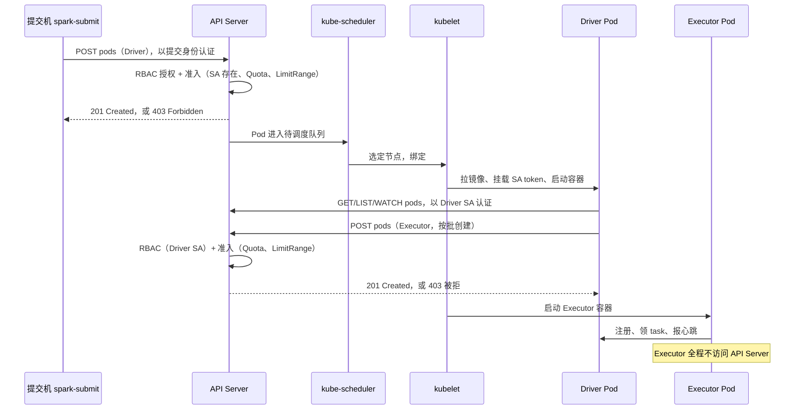
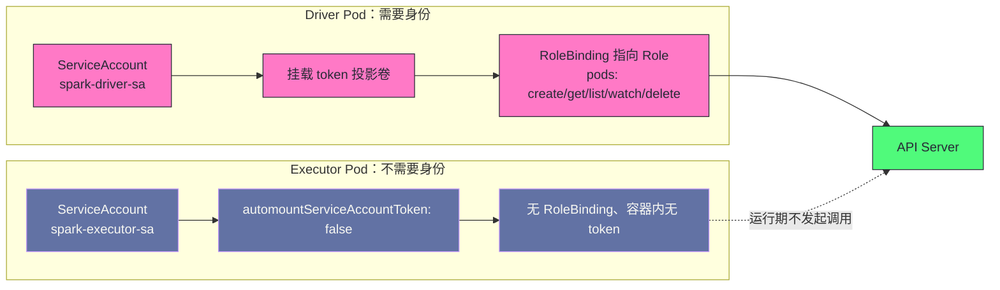
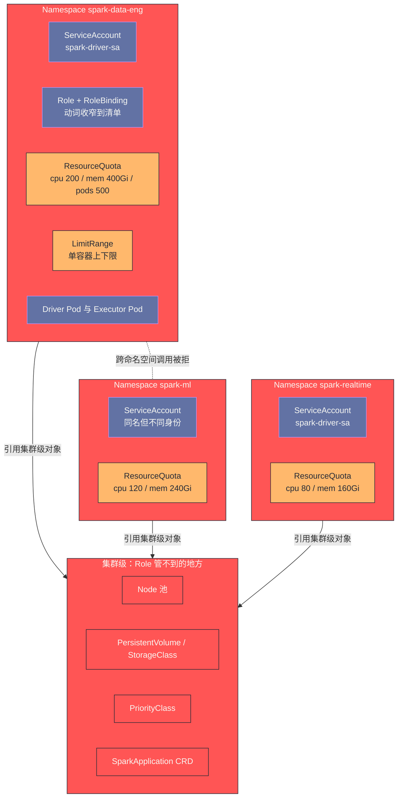
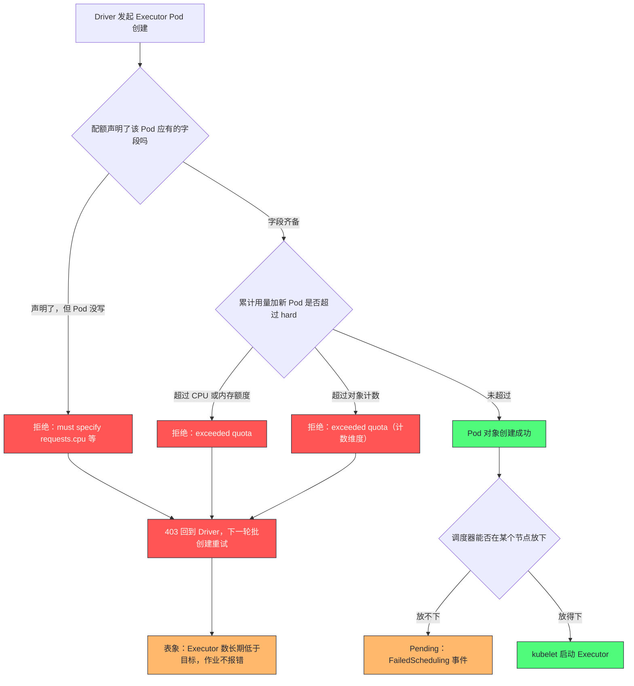
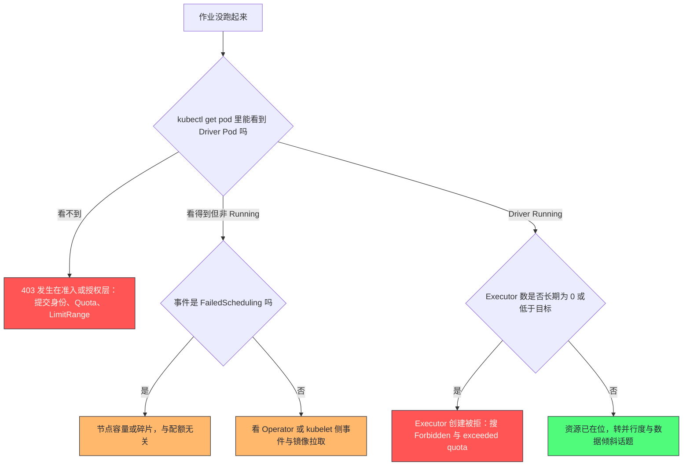

# 03 RBAC 与资源配额：K8s 权限模型在 Spark 中的应用

**摘要：**

把一份 Spark 作业交给 Kubernetes，命令行与交给 YARN 时几乎一样，差别藏在执行过程最后一次对象创建上：Executor Pod 不是由集群管理者创建，而是由作业自己的 Driver 进程调用 API Server 创建。这一句话把「Spark 需要什么权限」从部署细节抬成了安全与多租户的地基——Driver 手里那张凭据既是它开工的许可，也是一条能把整个命名空间甚至整个集群牵连进来的路径。本文沿五问推进：先说明 Driver 为什么必须持有身份、这份身份从哪里来；再把它对 API Server 说的话拆成一张能力清单，逐条区分 driver 必需与 executor 并不需要的部分；然后算清 cluster-admin 这笔「省事」的账，看爆炸半径、审计失效与租户边界如何一起塌掉；接着把 Namespace、ResourceQuota 与 LimitRange 三层约束摊开，解释配额为什么在准入层结算而不在调度层、为什么 Spark 侧最常见的表象是「等」而不是「错」、LimitRange 的默认注入又怎样与 Spark 自己算出的 requests 相互打架；最后落在边界上，说明 RBAC 的粒度只到资源类型、命名空间隔不开集群级对象、配额也治不了节点碎片。贯穿全文的两个问题是：一张多大的权限清单既跑得动又不至于成为事故放大器，以及这些配额与默认值究竟在替谁兜底。文章口径为 Spark 4.3.0（2026-10-30 发布）与 Kubernetes 1.37，凡涉及默认值与字段名之处，以对应版本文档为准。

---

## 第 1 章 一张门票：Driver 为什么要向 API Server 举手

### 1.1 三次创建，两个身份

行文从一条最普通的提交命令开始。`spark-submit --master k8s://https://10.0.0.1:6443 --deploy-mode cluster ...` 被执行之后，集群里会依次发生三次对象创建：提交进程创建 Driver Pod，kubelet 把 Driver 容器拉起来，Driver 在自己的进程里创建一批 Executor Pod。前两次创建的主体是集群之外的提交者与集群之内的 kubelet，第三次创建的主体却是作业本身。

这第三次创建是全文的起点。它意味着 Driver 不只是一个把 task 分下去的进程，它同时是集群 API 的一个客户端：它要知道 Executor 该长什么样（镜像、资源请求、卷、环境变量、亲和性），要能把这份描述 POST 出去，还要能持续看到这些 Pod 后来变成了什么模样——是就绪了，还是因为节点内存压力被驱逐了，还是镜像拉不下来。这三件事在 YARN 上，Spark 一件都不用做。

因此在 YARN 时代，从来没有人问过「Spark 需要哪些 YARN 权限」。不是没人关心权限，而是那个问题在这个组合里根本不存在。

### 1.2 YARN 把「起容器」这件事拿走了

要看清差别，不妨把「容器由谁起」对齐着看。YARN 里，ApplicationMaster（AM）向 ResourceManager 申请容器，ResourceManager 决定在哪台机器上给，NodeManager 负责把进程拉起来；Spark 的代码里从头到尾没有「创建容器」这个动作，只有「申请容器」这个请求。Kubernetes 里，Executor 就是一个 Pod，Pod 的创建者是 Driver 自己——集群里没有任何一个组件替它做这件事，因为集群并不理解「一个 Spark 作业需要几个 Executor」这种应用层语义。

| 维度 | YARN | Kubernetes |
|---|---|---|
| 谁创建 Executor 的容器 | ResourceManager 分配、NodeManager 启动 | Driver 调用 API Server 创建 Pod |
| Spark 进程是否需要调度系统凭据 | 不需要，只有与本应用 AM 通信的 application token | 需要，ServiceAccount token 以卷挂载进容器 |
| 凭据的作用域 | 单个 application 的生命周期 | 命名空间（Role）至整个集群（ClusterRole） |
| 凭据落到恶意方手里，最坏情况 | 顶替本应用的 AM，仍受队列与 app 生命周期约束 | 按该身份被授予的全部权限操作集群对象，可跨作业跨团队 |
| 首次配置失败时看到什么 | 队列满，应用停在 ACCEPTED | 403 Forbidden，或 Driver 正常而 Executor 永远不到 |

严格说，YARN 的 AM 也不是赤手空拳：它从 RM 拿到一个 application token，用来续租、上报状态、申请容器。但那份 token 的权力止于「这个应用自己的容器」，而且 RM 从不校验「提交者是谁」——容量调度器只认队列与用户名的字符串，不认集群身份。Kubernetes 的 ServiceAccount 则是一个集群身份，Role 是这个身份的授权集合，两者叠起来之后，Driver 手里拿的是一张真门票，票面上的权限由管理员预先写好。

权限问题之所以在 Spark on K8s 上突然变得重要，是因为 **Spark 从一个「被调度者」变成了「调度者的客户」**。

### 1.3 凭据的形态：一个被挂进容器的文件

这张门票在 Kubernetes 里叫 ServiceAccount（服务账号）。它不是口令，而是命名空间内的一个对象；被 Pod 引用之后，kubelet 会以投影卷（projected volume）的形式把凭据写进容器，路径固定为 `/var/run/secrets/kubernetes.io/serviceaccount/`，里面通常有三样东西：`token`、`ca.crt`、`namespace`。Driver 侧那些 `spark.kubernetes.authenticate.*` 参数，本质上是在告诉 Spark「去哪个文件读 token、信哪个 CA」，不填就用这个默认位置，于是集群内的 Driver 天然拿到了调用 API 的能力。

这份 token 的形态在近几年变过。早期是把 SA 的长期 Secret token 直接挂进去，后来改成由 kubelet 主动申请、带 audience 与有效期的投影 token，并随 Pod 生命周期轮换（以对应版本文档为准）。形态变化对使用者的影响很小，对攻击面的影响不小：**有效期缩短削减的是盗用窗口，不改变「容器里读得到」这个事实**。

验证一张门票的实际权限，不必真去跑作业，`kubectl auth can-i` 是最直接的入口：

```bash
# 以 Driver 的身份问：我能不能在本命名空间创建 Pod
kubectl auth can-i create pods --namespace=spark-data-eng \
  --as=system:serviceaccount:spark-data-eng:spark-driver-sa

# 再问：我能不能碰节点（期望 no）
kubectl auth can-i delete nodes \
  --as=system:serviceaccount:spark-data-eng:spark-driver-sa
```

这两条命令值得写进团队的准入检查清单，因为它们回答的正是「这张票到底能开几扇门」，而配置文件本身看不出来——Role 的规则会被 RoleBinding 放大还是缩小，只有 API Server 说了算。

### 1.4 一个贯穿全文的作业

后面的讨论需要一个具体的着力点。笔者设一个电商数仓的夜间结算作业 `settle_daily`：从对象存储读入当天订单明细与商品维表，按商品标识连接、按品类汇总成交额，最后写回宽表。集群按 60 个节点估，单节点 16 核、64 GiB；团队独占命名空间 `spark-data-eng`；Driver 要 4 GiB 堆与 1 核，Executor 要 8 GiB 堆与 2 核、常态 20 个；命名空间上挂着 ResourceQuota（`requests.cpu` 200、`requests.memory` 400Gi、`pods` 500）与一份 LimitRange。团队三个人共用一套提交脚本，ServiceAccount 名字写死在 `spark-defaults.conf` 里。

这套作业上线后的两个月里出了四次事故，每一次都能落回本文的某一章。

第一次，有人嫌逐个补权限太慢，把 `spark-driver-sa` 直接绑上了 `cluster-admin`，理由是「反正只有我们三个人用」。第二次，某个夜里 Executor 一个都没起来，Driver 日志里只有反复的 `Failed to create pod`，作业在「等待 Executor」的状态里停了四十分钟。第三次，一位同事把 Executor 堆从 8 GiB 调到 24 GiB，提交立刻被拒，报错说超出了某处内存上限，而他翻遍了 `spark-defaults.conf` 也没找到「上限」这个配置。第四次，Driver Pod 起来十几秒就退出，栈顶是一句 `Forbidden`，指向的却是他自以为早就配好的权限。

四次事故分别对应授权、配额、LimitRange 与权限清单，四件事看着互不相干，其实共用同一个前提：Driver 必须带着一个身份去跟集群打交道，而围绕这个身份的所有约束都在它之外被定义。

### 1.5 一个比喻：调度员与临时工

这份关系可以借仓库打个比方。仓库里有两类人：调度员与临时工。调度员有仓储系统的账号，能开拣货单、能销单、能查某张单是在途还是丢件；临时工只按单搬货，搬完就走，不需要账号，也不该有。账号是按仓授权的，跨仓要另开一个——这正对应 Role 的命名空间作用域。仓里能放多少货、单件货物最大多重，则由仓库本身的规定决定，跟账号无关——这对应后文的配额与 LimitRange。

这个比喻往下走一层会撞上一处真相：临时工身上确实挂着一张卡，是进仓库大门用的，从来不是仓储系统的账号。Kubernetes 的默认行为恰好把这两张卡合成了一张，于是「Driver 需要权限」被自动扩散成「Executor 也有权限」。这件事的后果留到第 4 章再说，此处只需记住：**门票的授权范围与门票的携带者是两件事**——前者由 RBAC 定义，后者由 Pod 模板定义。

---

## 第 2 章 能力清单：Driver 对 API Server 说的三件事

### 2.1 开单、看单、销单

把 Driver 在运行期发出的 API 调用归类，其实只有三件事。

第一件是开单：按当前需要的 Executor 数量创建 Pod。它不是一个一个创建的，而是按批创建，批大小由 `spark.kubernetes.allocation.batch.size` 控制（默认 5），批间隔由 `spark.kubernetes.allocation.batch.delay` 控制；批的存在直接影响配额被打满时的表现，第 6 章会用到这个细节。

第二件是看单：Driver 需要一份持续的 Pod 状态视图。这里的关键词是持续。它不是每隔几秒去查一次，而是建立一个 watch 长连接，让 API Server 把「这个标签选择器下的 Pod 发生了什么变化」推过来。标签选择器大致是「本应用 ID + 角色为 executor」，于是 Driver 看到的是自己这批 Pod 的增删改，而不是整个命名空间的 Pod。

第三件是销单：Executor 正常结束或失败之后，把对应 Pod 删掉。`spark.kubernetes.executor.deleteOnTermination` 默认为真，删 Pod 的动作由 Driver 发起——Executor 自己不会去删自己，它连 API 客户端都没有。

在这三件事之外还有若干附带对象。ConfigMap 用于把 Spark 配置文件带进 Pod（提交侧创建、Executor 挂载）；Service 用于给 Driver 或 Spark UI 一个固定入口；PersistentVolumeClaim 在启用按需创建卷时才会出现。它们是否必需，取决于部署形态，而不是取决于 Spark 本身。

### 2.2 一张能力清单

把上面这些落成 RBAC 的「资源 × 动词」矩阵，就得到下表。表中「必需性」一列是本文的判断，区分了「不给就跑不起来」「视配置而定」「与运行无关」三档：

| API 资源 | 动词 | 发起方 | 必需性 | 缺失后的症状 |
|---|---|---|---|---|
| `pods` | `create` | Driver（Executor）、提交侧（Driver） | 必需 | Executor 一个都起不来；提交侧缺则 Driver Pod 创建即被拒，作业根本进不了集群 |
| `pods` | `get`、`list`、`watch` | Driver | 必需 | watch 建不起来时 Driver 启动阶段直接失败；只能 list 不能 watch 时状态停在创建那一刻，分配逻辑失明 |
| `pods` | `delete` | Driver | 必需 | Executor 结束后 Pod 残留，配额与节点被长期占住，几轮之后连新作业都起不来 |
| `pods/log` | `get` | 运维工具、诊断脚本 | 可选 | 不影响作业，只是少了在集群内直接拉日志的便利 |
| `configmaps` | `create`、`get`、`delete` | 提交侧为主 | 有配置文件时必需 | Driver 启动后挂不到配置卷，或提交阶段被拒 |
| `services` | `create`、`get`、`delete` | 提交侧、Driver | 条件性 | 缺了建不出固定入口，作业本身仍能跑 |
| `persistentvolumeclaims` | `get`、`create`、`delete` | Driver | 条件性 | 启用按需创建 PVC 时缺权限，Pod 卡在卷准备阶段 |
| `pods/exec` | `create` | 人工调试 | 不需要 | 无运行影响；给了等于开一个「进容器执行任意命令」的口子 |

表里有三处值得展开。其一，`pods` 的 `patch` 与 `update` 没有出现——Driver 不改已有 Pod 的 spec，把写动词多给一格，扩大的是别人能改你 Pod 的面。其二，`pods/exec` 的动词是 `create`（子资源创建），它不是「读日志」的同义词，而是「在容器里起一个进程」，任何声称「只给只读权限」却带上 `exec` 的 Role 都不再是只读的。其三，`persistentvolumeclaims` 只在按需创建卷的配置下才需要，普通挂载已有 PVC 时 Driver 只需要能读 Pod spec，不需要碰 PVC 本身。

### 2.3 为什么 Driver 需要，而 Executor 通常不需要

这一节的结论如果只记一句，就记这句：**Executor 的进程里根本没有 Kubernetes 客户端**，它连一个 API 调用都发不出去，给它权限纯属多开一扇窗。

一个 Executor 在它的整个生命周期里只做三件事：启动后向 Driver 注册、领 task、执行并回报状态与心跳。这三件事全部走 Driver 暴露的服务端口，不经过 API Server。把 Executor 删掉的是 Driver，判断它是否就绪的也是 Driver，连「这个 Executor 该不该被替换」都是 Driver 的调度逻辑在算。Executor 唯一与集群的接触面是它自己被创建的那一刻，而那一刻的执行者是 kubelet，不是它自己。

于是可以推出一条更锋利的判断：Executor 上挂着的 SA token，是一份「没人用、但所有人都能拿」的凭据。没有人用，是因为 Spark 的运行时代码不会去读它；所有人都能拿，是因为 Executor 里跑的是**用户提交的代码**。PySpark 的 UDF、Scala 的闭包、自定义的 InputFormat，都在这个进程里。第 4 章会把这条链走完。

### 2.4 为什么 `list` 与 `watch` 一个都不能省

初写 Role 的人最常犯的错，是只写 `get`。理由是「我只是要看 Pod 状态」。这个理由在 kubectl 的交互场景里成立，在 Spark 的控制器逻辑里不成立。

`watch` 缺失的第一个后果是启动即失败。Driver 起来之后第一件事之一，就是把 executor 的 watch 建立起来，建立的动作就是对 `pods?watch=true` 发一次长连接请求。这一步被拒，异常会从 Kubernetes 客户端一路抛到调度后端，SparkContext 初始化失败，作业在「开始」之前就结束了。表现为 Driver Pod 反复重启，日志里是 `KubernetesClientException` 与 `Forbidden`。

第二个后果出现在只给 `list` 不给 `watch` 的情形：视图冻结。Driver 能看到「刚才有多少个 Executor」，但看不到「其中一个刚刚变成 Running」。由于它判断就绪、判断失联都要靠状态变化，冻结的视图会让它一直等，直到某个超时参数兜底，然后重试、再等。

第三个后果更隐蔽：`list` 本身也不能省。watch 建立时的初始同步、Driver 重启后的状态重建、以及某些版本里「先 list 再 watch」的实现路径，都要用 `list`。把 `list` 拿掉只留 `watch`，得到的是一致性很差的视图。

### 2.5 一次提交到 Executor 就绪：谁在哪一层被拦

下图把这条链按时间摊开，注意两次创建用的是两个不同身份，被检查的位置也不在同一个组件上：



图里有两个容易被忽略的点。第一，Driver Pod 的创建先过「提交身份」这一关，再过「准入」这一关；两关的失败都发生在 Pod 对象存在之前，所以 `kubectl get pod` 里看不到任何痕迹。第二，Executor 的创建要重新过一遍同样的两关，只不过检查身份换成了 Driver SA——同一个命名空间、同样的配额，却由作业自己在运行时触发，这就是「配额问题常常在作业跑到一半才爆出来」的结构性原因。

### 2.6 一版可以直接用的最小配置

把上面的清单落成对象，是一个 ServiceAccount、一个 Role、一个 RoleBinding。下面的写法刻意把动词收窄，并且把 RoleBinding 的 `roleRef` 写全——`roleRef` 只认 `apiGroup`、`kind`、`name` 三个字段，写错字段名（譬如写成 `apiRef`）不会报「未知字段」，而是报找不到角色，排查时很容易绕远路：

```yaml
apiVersion: v1
kind: ServiceAccount
metadata:
  name: spark-driver-sa
  namespace: spark-data-eng
---
apiVersion: rbac.authorization.k8s.io/v1
kind: Role
metadata:
  name: spark-driver-role
  namespace: spark-data-eng
rules:
  # Executor Pod 的全生命周期；delete 用于回收，watch 用于状态视图
  - apiGroups: [""]
    resources: ["pods"]
    verbs: ["create", "get", "list", "watch", "delete"]
  # 拉日志给诊断脚本用，不给 exec
  - apiGroups: [""]
    resources: ["pods/log"]
    verbs: ["get"]
  # 配置文件与（可选的）UI 入口
  - apiGroups: [""]
    resources: ["configmaps", "services"]
    verbs: ["create", "get", "delete"]
  # 仅在启用按需创建 PVC 时才需要
  - apiGroups: [""]
    resources: ["persistentvolumeclaims"]
    verbs: ["get", "create", "delete"]
---
apiVersion: rbac.authorization.k8s.io/v1
kind: RoleBinding
metadata:
  name: spark-driver-binding
  namespace: spark-data-eng
subjects:
  - kind: ServiceAccount
    name: spark-driver-sa
    namespace: spark-data-eng
roleRef:
  apiGroup: rbac.authorization.k8s.io
  kind: Role
  name: spark-driver-role
```

配套的 `spark-submit` 参数只有一项是必须显式给的：

```bash
spark-submit \
  --master k8s://https://10.0.0.1:6443 \
  --deploy-mode cluster \
  --conf spark.kubernetes.namespace=spark-data-eng \
  --conf spark.kubernetes.authenticate.driver.serviceAccountName=spark-driver-sa \
  ...
```

不写这一项时，Spark 用命名空间里的 `default` 账号。很多教程里「配了就能跑」，其实跑的是 `default` 的权限，一旦有人把 `default` 收紧，作业就会以一堆 403 的形式集体失效——收权限的人以为自己在做安全加固，业务方以为 Spark 出了 bug。

### 2.7 提交侧也是权限的一环

这里要纠正一个只盯着 Driver SA 的习惯。Kubernetes 后端只支持 cluster 模式，Driver 必然跑在 Pod 里，那么「创建 Driver Pod」这件事由谁做？由提交进程做。提交进程的身份，是提交机上的 kubeconfig 用户，或者当提交发生在集群内（CI 的 Pod、调度平台的 Job）时，是那个 Pod 自己的 ServiceAccount。

于是最常见的漏配出现在 CI 里：平台的 SA 被授予了创建 Pod 的权限，却没有 `configmaps` 的创建权限，提交时 Spark 要写一份配置 ConfigMap，请求被拒，报错落在 CI 日志里，而大家去翻 Driver 日志——那里什么也没有，因为 Driver 根本没被创建出来。

**一次提交涉及两个身份，二者不该共用同一份授权**：提交侧的身份只需要活到 Driver Pod 创建完成，Driver 的身份要活到作业结束。

---

## 第 3 章 cluster-admin 的诱惑：一次授权换来的三笔负债

### 3.1 一行命令解决所有症状

面对第 2 章那张清单，最省事的做法只有一行：

```bash
kubectl create clusterrolebinding spark-admin \
  --clusterrole=cluster-admin \
  --serviceaccount=spark-data-eng:spark-driver-sa
```

执行之后，所有 403 消失，作业跑得比在 YARN 上还顺。这个做法流行，原因不在技术而在反馈结构。最小权限的收益是「可能不会发生的事故」，成本是「现在就要补的配置、将来还要维护的清单」；cluster-admin 的收益是「现在立刻好」，成本是「出事那天才知道」。人在交付压力下几乎必然选后者，何况 403 的报错并不友好——它只告诉你「不能做什么」，不告诉你「还差哪一条」。更麻烦的是，Spark 的 403 有时不在提交终端里，而在 Driver 日志里，甚至被包在「Executor 数量不足」的表象后面。

不过这笔账并不对称：省下的是配置时间，付出的是事故上限。下面三节把这个上限拆开看。

### 3.2 爆炸半径：九成权限唯一的用途是出事那天

一个持有 cluster-admin 的 Driver 能做什么，取决于它被妥协到什么程度。把可能性按破坏力排一遍：读所有命名空间的 Secret，包括镜像仓库凭据、Kerberos keytab、数据库口令；删除任意命名空间的 Pod，等于一键打掉同集群上其他团队正在跑的作业；创建一个带 hostPath 或 privileged 的 Pod，把容器落到节点上，从「容器内」走到「节点上」；修改或删除 CRD、Namespace、PV，把集群的结构本身改掉。最后一项最容易被低估——它不是「弄坏一个作业」，而是「弄坏恢复作业所依赖的东西」。

这些能力在正常运行时一次都用不到。Driver 创建 Pod 只需要 `pods: create`，看状态只需要 `list` 与 `watch`，其余九成权限唯一的用途，是出事那天被用上。这就是爆炸半径的含义：它不描述平均危害，它描述最坏情况的上限。

回到 `settle_daily`：那份 SA 绑上 cluster-admin 之后，作业的每一次批创建都在以集群管理员的身份发请求。作业本身一个字没改，改的是它一旦被写进一段别有用心的 UDF，后果不再是「删掉自己团队的 Executor」，而是「删掉隔壁团队的账单作业」。

更关键的是，这条链的入口不在集群里，而在提交入口。第 1 章说过 token 是一份可读的文件，第 2 章说过 Executor 里跑的是提交者的代码；两句话接起来就是一条完整的路径：任何能提交作业的人，都能写一段在 Executor 里执行的代码，把 Driver 的 token 读出来带回去。他自己不需要任何 Kubernetes 权限，只需要「能提交 Spark 作业」这一项。当 Driver 的身份是 cluster-admin 时，**「会写 PySpark」就等于「集群管理员」**。

### 3.3 审计失效：所有动作记在同一个名字上

第二笔负债是审计。API Server 的审计日志记录调用者身份，共享 SA 的场景下，这个字段永远是 `system:serviceaccount:spark-data-eng:spark-driver-sa`。某天有人删了生产命名空间的 Pod，审计日志能告诉你是这个 SA 干的，不能告诉你是三个人里的谁。

提交侧身份确实能区分人，但它只覆盖「创建 Driver Pod」这一瞬间。之后的每一次 Executor 创建、每一次 Pod 删除，调用者都是 Driver SA。换句话说，集群把「谁提交了这个作业」与「这个作业做了什么」记在两条不同的记录上，而两条记录之间唯一的关联是作业 ID；如果提交入口不把这个关联写进自己的日志，事后基本无法还原。

审计的价值不止于事后追责。当一个人知道自己每一步都会被记到名字上，行为会不一样；当所有动作都记在一个共享账号上，这条心理约束先失效，然后才是取证能力失效。这件事在出事之前没有成本，出事之后没有补救。

### 3.4 多租户失效：钥匙比墙多

第三笔负债是租户边界。多租户的所有设计都建立在「一个身份只能在自己的命名空间里动」这个前提上，cluster-admin 把前提删掉了。此时 Namespace、ResourceQuota、LimitRange 仍然生效——它们限制的是「能创建多少」，不是「能碰谁」——于是会出现一种很别扭的状态：配额把团队关在自己的格子里，而他们的 Driver 手里握着所有格子的钥匙。

把四档授权并排放好，取舍就变成了查表：

| 授权档位 | 能碰的资源 | 跨命名空间 | 审计可归因 | 维护成本 | 典型事故形态 |
|---|---|---|---|---|---|
| 绑定 `cluster-admin` | 全部，含 Node、Secret、CRD | 是 | 否 | 最低，一次绑定 | 一段 UDF 提权成集群操作；误删邻居作业 |
| 命名空间级宽松（Pod 与 ConfigMap 全动词） | 本命名空间对象，含删除任何 Pod | 否 | 否 | 低 | 同命名空间内互相删 Pod；占用配额时无人可查 |
| 收窄到动词清单（2.6 节的写法） | 只能创建、查看、删除 Pod 与少量附属对象 | 否 | 否 | 中，随版本维护 | 作业跑不起来，而非被攻破 |
| 收窄动词 + 提交侧独立身份 + Executor 无 token | 同上，且用户代码拿不到凭据 | 否 | 部分，提交侧可归因 | 高，多一层模板与约定 | 权限不足类故障需要人工定位 |

### 3.5 落点：省掉的十分钟与没有上限的坏日子

把三笔负债合起来看，cluster-admin 不是「权限大了一点」，而是同时取消了爆炸半径的上限、审计的归因与租户的边界。它换来的东西很实在：不用补配置、不用理解动词、不用在版本升级时维护清单。

但这是一笔把成本从「现在」挪到「以后」的交易，而以后的成本由谁承担，往往不是做决定的人。**架构上的省事，通常是把确定性换成了上限**：省掉的是每天的十分钟，留下的是一个没有上限的坏日子。

如果一定要给个判据：单租户、专用集群、提交者就是管理员本人，cluster-admin 尚可容忍；一旦集群上坐着第二个团队，或者提交入口对「能写代码的人」开放，这笔交易就不再划算。

---

## 第 4 章 同一个身份的两个身体

### 4.1 默认继承与它的前提

`spark.kubernetes.authenticate.driver.serviceAccountName` 决定 Driver 用哪个 SA。Executor 的 SA 由 `spark.kubernetes.authenticate.executor.serviceAccountName` 决定，这个参数默认为空，为空时的行为是继承 Driver 的 SA。于是默认配置下，一个作业里的所有 Pod 共享同一个身份。

这个默认值有它的道理：Executor 通常不需要任何权限，继承一个「本来就该最小」的 SA 不会引入额外风险，还少一个必填项。它的前提是「Driver 的 SA 已经足够小」。而现实里最常见的情形恰恰相反——Driver 的 SA 要么绑了 cluster-admin，要么塞了一堆用不到的动词。默认值把 Driver 的授权范围原样复制到每一个 Executor 上，包括那些跑着陌生人代码的 Executor。

### 4.2 用户代码能读到什么

要看清后果，得先承认一件事：Executor 里跑的不是 Spark 的代码，是提交者的代码。一段 PySpark 的 UDF 会在 Executor 的 Python 进程里执行，它能做的第一件事就是打开 `/var/run/secrets/kubernetes.io/serviceaccount/token`。读到之后把内容塞进返回值、写进日志、或者发到某个地址，都只是几行代码的事，不需要任何漏洞，也不需要绕过任何检测。

这条路径的危险在于它绕开了平台方设的所有关卡。平台通常会仔细审查「谁能访问提交入口」，因为那看起来是唯一的门；但作业一旦跑起来，Executor 就变成一个「以 Driver 身份行动、由提交者控制」的执行体。平台审查的是提交权限，实际被授予的是 Driver 的权限，两者之间的差值就是这个设计的全部风险。

token 还不是 Executor 唯一能读的东西：同目录下的 `namespace` 文件告诉它自己在哪个命名空间，`ca.crt` 让它能验证 API Server。三样东西合起来，等于一份可用的集群客户端配置。于是「能不能读一个文件」这个问题，被放大成「能不能操作集群」。

反过来看，如果 Driver 的 SA 早已收窄，这条路径的危害就退化成「用户能删自己团队的 Pod」——仍然不该有，但已从集群级事故降级为团队内事故。第 3 章与本章其实是同一问题的两面：SA 的权限决定「被读走之后能做什么」，token 的可读性决定「多久会被读走」。

### 4.3 把两个身体拆开

拆开需要两步，缺一不可。第一步，给 Executor 一个独立的 SA，并在提交时指向它；第二步，让这个 SA 的 token 根本不进容器——只给一个空权限的 SA 仍然会挂载 token，读到了虽然做不了什么，但也没有理由把它留在那里。

```yaml
# executor-pod-template.yaml：只给 Executor 用
apiVersion: v1
kind: Pod
metadata:
  labels:
    spark-role: executor
spec:
  serviceAccountName: spark-executor-sa   # 一个没有任何 RoleBinding 的 SA
  automountServiceAccountToken: false     # 连 token 都不挂
```

```bash
spark-submit \
  --conf spark.kubernetes.executor.podTemplateFile=executor-pod-template.yaml \
  --conf spark.kubernetes.authenticate.executor.serviceAccountName=spark-executor-sa \
  ...
```

两处都要写。podTemplate 与 SA 参数的合并顺序随版本略有差异，稳妥做法是让两处指向同一个名字；而 `automountServiceAccountToken` 只有模板能控制，Spark 自己不生成这个字段。换句话说，SA 参数决定「用哪个身份」，模板决定「这个身份要不要带凭据进来」。

### 4.4 两张门票的差别

下图把 Driver 与 Executor 的身份链并排画出来，可以看出「有身份」与「有凭据」在这两个 Pod 上是分开的：



图右侧那条虚线是这张图唯一想说的话：Executor 与 API Server 之间没有任何需要授权的交互，所有调用都由 Driver 代办。既然没有交互，凭据就没有存在的理由。

### 4.5 三档方案

| 方案 | Executor 携带的凭据 | 用户代码能做什么 | 配置复杂度 | 适用条件 |
|---|---|---|---|---|
| 默认继承 Driver 的 SA | 同 Driver 的 token | 以 Driver 的全部权限操作集群 | 零配置 | 仅适用于 Driver SA 已收窄且提交入口受控 |
| 独立 SA，但仍自动挂载 token | 空权限 SA 的 token | 读到一个什么都做不了的 token，以及命名空间与 CA | 低，加一个参数 | 过渡方案，能防误用，不防信息泄露 |
| 独立 SA + 关闭自动挂载 | 无 | 拿不到任何集群凭据 | 中，需要维护 podTemplate | 提交入口对多人开放时的基线 |

### 4.6 拆开的代价

拆开的代价是运维面变宽：多一个 SA 对象、多一份模板、多一处需要同步的配置；模板里还会顺带放上许多与权限无关的东西（节点选择器、卷、注解、容忍度），于是「权限模板」与「调度模板」混在一个文件里，改一处忘一处。

更微妙的是排障成本。Executor 若某天真的需要访问 API（譬如自研的 listener 要写事件），缺 token 的报错会以「权限被拒」的形式出现在很深的调用栈里，第一反应往往是「RBAC 配错了」，于是又去补权限，把刚拆开的东西悄悄合回去。因此拆开之后要在团队内把「Executor 不该有凭据」写成约定，而不是当成一处配置。

**这份复杂度买的是「用户代码拿不到集群凭据」**。值不值，取决于谁能提交作业：提交入口只在三个管理员手里，收益有限；对所有分析师开放，它就是必需项。

---

## 第 5 章 Namespace 的边界：RBAC 在集群门口就停了

### 5.1 命名空间隔开了什么

Role、RoleBinding、ServiceAccount、ResourceQuota、LimitRange、Pod、Service、ConfigMap、Secret、PVC 都是命名空间内对象。一个命名空间的 SA 拿到的 Role，只能在这个命名空间里生效。这条边界相当硬：不是靠约定，是靠 API Server 对每个请求做的授权判定。

这条边界也解释了 Spark 在多团队场景下的自然形态：一个团队一个命名空间，每个命名空间一份 SA、一份 Role、一份配额、一份 LimitRange，团队之间不共享对象，也不共享身份。同一个名字 `spark-driver-sa` 在三个命名空间里是三个不同的身份，这一点常被写文档的人弄混——在 `spark-submit` 里省掉命名空间参数时，得到的可能是另一个团队的身份。

### 5.2 命名空间隔不开什么

把「命名空间」等同于「租户」会踩空，因为有一批对象根本不住在命名空间里。

| 对象 | 作用域 | 与 Spark 的关系 | 交给团队自助的后果 |
|---|---|---|---|
| `Node` | 集群级 | 节点选择器、亲和性、驱逐都指向它 | 能读节点就能推断集群规模与他人负载分布 |
| `PersistentVolume` | 集群级 | PVC 最终绑定的存储后端 | 能建 PV 就能把 hostPath 挂进 Pod，隔离形同虚设 |
| `StorageClass` | 集群级 | 动态供给 PVC 的模板 | 能建 StorageClass 就能决定数据落盘位置与回收策略 |
| `PriorityClass` | 集群级 | Pod 的 `priorityClassName` 引用它 | 能建高优先级类就能在资源竞争时挤掉别人 |
| `CustomResourceDefinition` | 集群级 | Spark Operator 的 `SparkApplication` 就在这里 | 能写 CRD 就能定义新的「合法对象」，绕过既有策略 |
| `Namespace` | 集群级 | 团队边界对象本身 | 能删命名空间就能一次清空一个团队 |

这张表的意义在于划出一条能力线：团队可以自助的部分止于命名空间内部；一旦需要 PV、PriorityClass、SparkApplication，就必须有人替他们做，或者授予他们集群级权限——而后者会把刚建好的边界重新打开。现实中常见的折中是「由平台团队预先建好一组合法对象，团队只能引用不能创建」：PV 由存储团队供给、PriorityClass 由平台定义、Operator 的 CRD 由集群管理员安装，团队侧只剩 `priorityClassName: high` 这种引用。

### 5.3 `resourceNames` 的粒度幻觉

写到这里会有一种自然的期待：既然只能删自己的 Executor，那把 `delete pods` 收窄到「只允许删自己创建的 Pod」不就行了。RBAC 确实有 `resourceNames` 字段，可以把规则限定到具体对象名，但它在两处失效。

其一，`create` 不支持 `resourceNames`——创建时对象名要么由提交方给，要么由服务端生成，授权层没有名字可比。其二，Executor Pod 的名字带随机后缀，每一轮都不同，无法预先枚举。于是要让「只能删自己的 Pod」成立，只能放弃 `delete`；而放弃 `delete` 会让 Executor 残留、配额被占满，几轮之后连新作业都进不来。

所以 RBAC 的真实粒度是「资源类型 × 动词 × 命名空间」，标签维度不在它的表达能力里。要按标签或创建者约束，得靠准入控制——校验 Pod 的标签、拒绝越界的删除请求，那是另一套机制。**指望 RBAC 表达「我的」，是把它当成了访问控制框架**——它只是一张授权表。

### 5.4 三个团队的拓扑

把三个团队、一个集群级层与各自命名空间内的对象画在一起，可以看出边界究竟断在哪一层：



图里三个命名空间都向上引用集群级对象，而横向的跨命名空间调用被拒——这两句话合起来就是多租户的真实形态：**隔离发生在命名空间内部，依赖发生在命名空间外部，而依赖的那一头没有隔离。**

### 5.5 谁有权把别人放进来

还差最后一层。命名空间的边界不仅取决于「谁能进入」，还取决于「谁能把别人放进来」。RBAC 里把角色绑给身份的动作由 `rolebindings` 的 `create` 决定；把已有 ClusterRole 绑进命名空间，还要受 `bind` 动词约束（细节以对应版本文档为准）。这意味着：给团队「管理自己命名空间里 RoleBinding」的权限，等于给他们「把集群里任何已有角色绑进来」的能力。

如果集群里恰好存在一个宽松的 ClusterRole（不少发行版自带若干个），这条链就通了：团队不需要被授予集群权限，只需要被允许绑定一个自带宽松权限的角色。于是边界的真实位置不是命名空间，而是「被允许绑定的角色集合」有多大。

这也解释了为什么平台团队更愿意把「创建命名空间」做成一个带全套对象的模板，而不是把「管理 RoleBinding」交给团队：前者把可用的角色集合固定下来，后者把选择权交出去，而选择权本身也是一种权限。

---

## 第 6 章 ResourceQuota：账本在哪一层结算

### 6.1 结算发生在准入层，而不是调度层

一个创建 Pod 的请求要过五道关：认证（你是谁）、授权（RBAC，你能不能做这件事）、准入（Quota、LimitRange、Pod 安全级别、各类策略）、持久化（写进 etcd）、调度（哪个节点放得下）。配额在第三道关，调度在第五道关，中间隔着一次对象写入。

顺序决定了三件事。其一，配额拒绝发生在 Pod 对象存在之前，所以 `kubectl get pod` 里什么都看不到，查调度器也永远查不到。其二，拒绝的形态是 HTTP 403，它回到发起方手里——提交侧或者 Driver，取决于是谁在创建。其三，配额看的是「requests 的总和」这类静态数字，它不关心节点上有没有空间；配额通过之后的调度失败是另一回事，表现为 Pending 与 `FailedScheduling` 事件。

把这两类失败混在一起，是排查时最常见的岔路。

### 6.2 三种触发形态

配额触发的拒绝有几种不同的味道，混着说会把人带偏。

第一种是累计量超限。命名空间内所有 Pod 的 `requests.cpu` 之和加上新 Pod 的请求量超过 hard 限额，创建被拒，报错形如 `exceeded quota`。

第二种是对象计数超限。`pods`、`configmaps`、`services`、`persistentvolumeclaims` 这些键记录的是个数而非用量，超过即拒。Spark 的 Executor 是 Pod，所以 `pods` 这一项实际上是「同时能有多少个 Executor」的另一条表达；`configmaps` 在作业频繁提交的团队里也容易被撞到——每次提交都可能留下一份配置对象，清理不及时就积起来了。

第三种最容易被误读：**必需字段缺失**。配额一旦声明了 `requests.cpu`，此后所有没有声明该 request 的 Pod 都会被拒，报错是「必须指定 requests.cpu」这类措辞。它跟额度用没用完没有关系，是记账口径带来的强制性——账本要按这个维度累计，你这一笔不写，就没法记。很多人把这条读成「配额满了」，于是去扩容配额，扩完还是拒。

| 配额键 | 记账口径 | 什么情况下被拒 | 拒绝时看到什么 | 对 Spark 的含义 |
|---|---|---|---|---|
| `requests.cpu`、`requests.memory` | 所有 Pod 的 requests 之和 | 累计值加新 Pod 超过 hard | `exceeded quota` | Executor 无法继续扩容，作业停在低并行度 |
| `limits.cpu`、`limits.memory` | 所有 Pod 的 limits 之和 | 累计值超限；或 Pod 未写 limits | `exceeded quota`；`must specify limits.*` | Spark 默认不一定写 CPU limits，容易整批被拒 |
| `pods` | 对象个数 | 同时在册的 Pod 数超限 | `exceeded quota` | 等价于「最多几个 Executor」，与 CPU 账本独立 |
| `configmaps`、`services` | 对象个数 | 累计对象数超限 | `exceeded quota` | 每次提交留下的配置对象会慢慢吃满这一项 |
| `persistentvolumeclaims`、`requests.storage` | 对象个数与申请容量 | 超限或未写 storage 请求 | `exceeded quota` | 按需创建 PVC 的作业会同时碰两条线 |

### 6.3 Spark 侧的表现：等，而不是错

配额不足时 Spark 的反应，取决于被拒的是哪一次创建。

Driver Pod 被拒时，提交进程直接失败，终端上能看到 403，这一类反而最好查。如果 Driver 由 Operator 创建，403 落在 Operator 的日志里，用户侧看到的是 `SparkApplication` 停在提交状态，需要顺着 Operator 日志往回找。

Executor Pod 被拒时，情况完全不同。Driver 把「创建 Executor」当成可重试的动作：某一轮批创建失败，失败的那几个被丢掉，下一轮继续按目标数申请。于是作业不会失败，它只是永远凑不齐并行度。UI 上 Executor 数长期是 0 或者远低于目标，作业卡在「waiting for executors」，日志里是一行行 `Failed to create pod` 与 `Forbidden`。如果上游调度器没开等待，提交进程甚至已经以退出码 0 返回了。

批大小在这里会放大症状。假设命名空间的 `pods` 配额只剩 3 个余量，而 Driver 每轮按默认批大小申请 5 个：3 个成功、2 个被拒，下一轮再试，如此往复。Executor 数会在低位震荡，作业以极低的并行度慢慢爬——它既不像「资源不够」那样干脆停住，也不像「配置错了」那样报错退出，它只是慢得离谱。

顺便修正一个流传较广的说法：动态资源分配并不会因为「申请失败」而优雅地降低目标数。它降低目标数的依据是待处理任务量（backlog）变小，而申请失败只是让实际数追不上目标数。把两者混为一谈，会让人误以为「等一会儿它自己会好」。

| 失败形态 | 对象是否已创建 | Spark 侧可见信号 | 该去哪里找原因 |
|---|---|---|---|
| 提交侧创建 Driver Pod 被拒 | 否，`get pod` 为空 | `spark-submit` 直接返回 403 | 提交身份的权限、配额、LimitRange |
| Driver 创建 Executor 被拒 | Driver 在，Executor 不在 | UI 上 Executor 数长期低于目标，`Failed to create pod` | Driver 日志里的 403 与配额名 |
| 对象已创建但调度失败 | 是，处于 Pending | 事件 `FailedScheduling`、`Insufficient cpu/memory` | 节点容量与碎片，与配额无关 |
| Operator 创建 Driver 被拒 | 否 | `SparkApplication` 停在提交状态 | Operator 日志与被创建对象的 403 |

### 6.4 两本账：requests 与 limits 不能混着算

配额里 `requests.*` 与 `limits.*` 是两组独立的键，各自累计，互不折算。Spark 侧写什么，决定哪本账被记。

默认情况下 Spark 主要写 requests：Pod 的内存请求等于堆内存加堆外内存（`spark.executor.memoryOverhead`，默认按堆的 10% 取、下限 384 MiB），CPU 请求等于 `spark.executor.cores` 或 `spark.kubernetes.executor.request.cores`。CPU 的 limits 需要显式给 `spark.kubernetes.executor.limit.cores` 才会出现，内存的 limits 通常来自 podTemplate 或 LimitRange——具体字段以对应版本文档与实际 Pod spec 为准，这也是后文反复建议「把 Pod 打出来看」的原因。

两边一旦错配，症状很直接。配额只声明 `limits.cpu` 而 Spark 不给 limits，每个 Pod 都会因为「必须声明 limits.cpu」被拒，看起来像权限问题。配额只声明 `requests`，团队以为自己管住了峰值，实际上 limits 没有任何上限，节点被超卖到内存压力触发驱逐。

回到 `settle_daily` 算一笔。20 个 Executor，每个堆 8 GiB，堆外按 10% 计约 819 MiB，Pod 内存请求约 8.8 GiB，20 个就是 176 GiB；Driver 4 GiB 堆加堆外约 4.4 GiB；稳态 requests.memory 接近 181 GiB。400Gi 的配额看似宽裕，但这是**一个作业**的数字，同一命名空间里还跑着三个补数作业，叠加之后就会撞线。CPU 一侧则是 20×2+1=41 核，对着 200 核的配额，真正的瓶颈反倒不是 CPU 总量，而是 `pods` 计数与节点碎片。

### 6.5 为什么 Spark 侧要显式给 requests

requests 在 Kubernetes 里有三重身份：调度器分配资源的依据、配额记账的依据、QoS 分类的依据。三者都指向同一个结论——**requests 是写给集群看的承诺，limits 是给容器设的墙**。

不给 requests，Pod 会落进 BestEffort 档，节点内存压力一来，它是最先被驱逐的那一批；配额里按 `NotBestEffort` 划的 scope 也认不出它。给得太小，承诺低于实际用量，节点被超卖，驱逐与 OOM 接踵而来。给得太大，配额被虚耗，别的作业进不来。

Spark 提供的 `spark.kubernetes.driver.request.cores` 与 `spark.kubernetes.executor.request.cores` 是独立于 `spark.*.cores` 的旋钮，存在的理由正是「调度与记账的口径可以比逻辑核数更细」。它们接受分数值（譬如 500m），而 `limit.cores` 只接受整数（以文档为准），于是「小 request、大 limit」成了一种把 CPU 当弹性资源的写法：配额按小值记账，节点上却允许吃满。这种写法是否允许，取决于平台有没有用 LimitRange 的 `maxLimitRequestRatio` 把比值卡住——两条策略在这里正好接上。

### 6.6 一条拒绝路径的全貌

把前面几节串起来，一次 Executor 创建被拒的完整路径如下图：



图下方那条重试环是整张图的核心：拒绝不会终止作业，只会让作业在低配状态下继续。这也解释了为什么配额问题总是以「慢」和「等」的形式出现，而不是以「错」的形式出现。

### 6.7 与 PriorityClass 的交点

ResourceQuota 还有一层不常被用到的能力：按 scope 分账。`scopeSelector` 可以用 `PriorityClass` 作为匹配条件，于是同一个命名空间里可以给高优先级作业单独一本账，避免低优先级作业把额度吃光。

这层能力与优先级本身是两件事。配额决定「能不能进来」，优先级以及由它派生的抢占与驱逐决定「进来之后能不能把别人挤走」。两者叠在一起，才能表达「关键作业保证有位置、非关键作业只能捡剩」；只配其一，压力一来就失效。

但 PriorityClass 是集群级对象，谁能用哪个类本身就是一种权力。团队若被允许自建 PriorityClass，等于被允许把优先级抬到任意高，配额分账随之失去意义。这条线与第 5 章那张表是同一件事的两个侧面。

### 6.8 配额的治理边界

配额有三处它治不了的地方。

其一，它只约束新对象，不驱逐已有对象。把配额从 200 核降到 120 核，正在跑的 180 核不会被赶走，只是新 Pod 进不来。于是「配额已经降了、用量还是超」是正常现象，真正的治理要落到重建、驱逐或缩容上。

其二，它不感知节点碎片。配额是命名空间级的加法，节点是物理上的装箱；配额还剩 100 核而每个节点只剩零散空间时，Pod 会 Pending，这不是配额问题。

其三，它不区分作业的重要性（除非用了 scope）。测试作业与账单作业在账本上是平等的，谁先占谁得。

---

## 第 7 章 LimitRange：默认值的两面

### 7.1 两步：先补齐，再校验

LimitRange 的准入逻辑分两步：先把 Pod 里没写的默认值补上（`defaultRequest` 补 requests，`default` 补 limits），再拿补齐之后的结果去校验 `min`、`max` 与 `maxLimitRequestRatio`。两步都在准入阶段完成，且都是要么全过、要么整次创建被拒。

第二步校验的是补齐之后的值，这一点决定了 Spark 与 LimitRange 的相遇方式：Spark 自己算出的 requests 与 LimitRange 注入的 limits 会在这道校验里第一次对上，而它们此前互不知情。

### 7.2 三种冲突

第一种是请求高于被注入的上限。Spark 的 Pod 内存请求等于堆加堆外，若 LimitRange 的 `default.limits.memory` 低于这个和，准入时「请求不得大于限制」这一条过不去，Pod 创建被拒。`settle_daily` 的第三次事故就是这个形状：同事把 Executor 堆从 8 GiB 调到 24 GiB，请求变成 24.8 GiB，而命名空间里那份 `default.limits.memory` 是 16Gi，注入之后请求大于限制，提交当场失败，报错里提到内存上限，而 `spark-defaults.conf` 里当然找不到这个上限——它在另一份 YAML 里。

第二种是比值越界。`maxLimitRequestRatio` 限制 limits 与 requests 的倍数关系，注入的 limits 与 Spark 算出的 requests 一比就可能超。典型组合出在 CPU 上：`spark.kubernetes.executor.request.cores` 给 500m 以省配额，`spark.kubernetes.executor.limit.cores` 给 2 以允许突发，比值达到 4，而 LimitRange 把上限定在 2，于是每个 Executor 都被拒。这里是两个旋钮各写一半造成的错位——request 由 Spark 显式给、limit 由 LimitRange 补，比值就被凑到了一个双方都没预期的数。

第三种是上下限本身。`max.memory` 挡住「手滑把 Executor 堆写成 128 GiB」，`min.cpu` 挡住「`spark.kubernetes.executor.request.cores` 给 1m 把节点当公共资源」。这两种拒绝其实有益，它们是 LimitRange 存在的正当理由。

同样的错位也会发生在 Driver 上，而且更容易被发现：`spark.kubernetes.driver.request.cores` 给 1，而 `default.limits.cpu` 注入 800m，请求大于限制，Driver Pod 在提交阶段就被拒。报错的措辞会指向一个配置文件里根本不存在的字段，第一次遇到的人往往要来回翻三份 YAML 才明白「上限」是从准入层补进来的。

### 7.3 默认值的静默放大

注入最麻烦的地方在于它不报错。只要 Pod 里有一个字段没写，注入就静默发生，注入的值随后进入配额账本。

由此产生一类很难查的偏差：团队按提交参数算过，20 个 Executor 应该吃 181 GiB，实际消耗却总比这个数高，差的那一截正是被注入的 requests。更隐蔽的是，注入按容器算而不是按 Pod 算；一旦命名空间里存在 sidecar（日志采集、服务网格注入、监控代理），每个 sidecar 也会各吃一份默认值，账本上的差额就变成了「每个 Pod 乘以容器数」。

### 7.4 一张交互表

| LimitRange 字段 | 它的作用 | 与 Spark 侧的交点 | 典型症状 |
|---|---|---|---|
| `default.limits.memory` | 未写 limits 时注入 | Spark 通常只写内存 requests | 容器在堆未满时被 OOMKilled，日志只有 exit 137 |
| `defaultRequest.*` | 未写 requests 时注入 | 只在 Spark 不写该字段时生效 | 配额消耗与提交参数对不上，差额随容器数放大 |
| `max.memory`、`max.cpu` | 单容器上限 | Executor 堆加堆外、核数 | 扩容 Executor 时提交被拒，报错指向上限 |
| `min.memory`、`min.cpu` | 单容器下限 | `request.cores` 的分数值 | 500m 的 request 被下限挡住 |
| `maxLimitRequestRatio.*` | limits 与 requests 的倍数 | `limit.cores` 与 `request.cores` 的比值 | 小 request 大 limit 的写法整批被拒 |

### 7.5 该不该给 Spark 的命名空间设 LimitRange

支持的理由是兜底。Spark 自己会算，但 podTemplate、sidecar、以及同一个命名空间里的非 Spark 工作负载都会漏字段；一份 `max` 能挡住手误，一份 `min` 能挡住把节点当公共资源的写法，这两项与 Spark 不冲突。

反对的理由是定位错位。Spark 恰好属于「知道自己要多少」的客户端：它有堆、有堆外、有核数，requests 是算出来的而不是拍出来的。默认值对它不是兜底，而是叠加。尤其当注入的 limits 落在「堆」与「堆加堆外」之间时，容器会在堆还没满的时候被杀，而现场只留下一个 exit 137，排查方向会被彻底带偏。

折中的办法有两条。一条是只设 `max` 与 `min`，不设 `default`，让 LimitRange 只做边界不做默认；另一条是把 `default` 放在明显高于任何合法请求的位置，使它只在字段缺失时起作用，不参与正常配置。**默认值是给不知道自己该要多少的客户端的**，而 Spark 恰恰是知道自己该要多少的那一类：兜底与干扰之间，只隔着一层边界。

---

## 第 8 章 边界与反例

### 8.1 「最小权限就是越小越好」

收窄动词的方向没错，但收窄到「刚好跑不起来」是一种更贵的错误，因为它的症状与配置错误高度相似。

三种典型的缺权限现场：提交侧缺 `create pods`，Driver Pod 根本不存在；Driver 缺 `watch pods`，Driver 启动阶段就抛 `Forbidden`；Driver 缺 `delete pods`，作业能跑完，但 Executor 残留，配额被一点点占满，几天之后所有作业都起不来。第三种最难归因，因为故障与原因隔了好几天。

排查的顺序应当是：先 `kubectl auth can-i --as=...` 逐个动词问一遍，再在 Driver 日志里搜 `Forbidden`，最后才怀疑 Spark 参数。反过来做，会在参数里绕很久。

### 8.2 「配额给够就行」

配额给够只解决了「能不能进」，没解决「怎么用」。三个反例：配额够而节点碎片化，Pod 照样 Pending；配额只声明 limits 而 Spark 不给 limits，整批被拒；配额降了但已有 Pod 不驱逐，用量看起来没变化。三件事都不在配额的表达范围里。

### 8.3 「设了 LimitRange 更安全」

安全的前提是默认值与负载的实际形态匹配。对 Spark 来说，内存请求已经包含堆外，再被注入一个更低的 limit，等于给 JVM 加了一道它不知道的墙。看到 exit 137 就去调大堆，是把症状当成原因；此时该做的是把 Pod 打出来，看 limits 究竟是 Spark 写的还是准入补的。

### 8.4 「Namespace 就是租户」

命名空间是租户的必要条件，不是充分条件。集群级对象不在其中，授权链也不在其中。一个团队如果既能创建 RoleBinding 又能引用宽松的 ClusterRole，它的实际权限就超出了命名空间；一个团队如果需要 PV 与 PriorityClass，它的作业就依赖了别人手里的对象。

### 8.5 一张排查决策树

把前面几章的判断顺序收成一张图，遇到「作业没跑起来」时按它分岔：



### 8.6 反例速查

| 现象 | 常见误判 | 实际机制 |
|---|---|---|
| Driver Pod 反复重启且日志有 `Forbidden` | Spark 版本不兼容 | `watch` 或 `list` 缺失，Driver 启动阶段被 API Server 拒绝 |
| Executor 数长期为 0，作业不报错 | 集群资源不足 | 配额在准入层拒绝创建，Driver 只重试不失败 |
| `kubectl get pod` 里没有 Driver Pod | 调度器没选到节点 | 对象根本没创建，拒绝发生在准入之前 |
| 提交报错提到内存上限，但配置里没有 | Spark 参数互相冲突 | LimitRange 的默认值或上限在准入层注入与校验 |
| 配额调低之后用量没降 | 配额没生效 | 配额只约束新对象，已有 Pod 不会被驱逐 |
| Executor 被 OOMKilled 而堆并未写满 | JVM 内存泄漏 | 注入的 limits 夹住了堆外内存 |
| 某个团队能删别的团队的 Pod | RBAC 配漏了 | 绑定了宽松 ClusterRole，或该团队能自建 RoleBinding |
| 以为同名 SA 在别的命名空间也有权限 | ServiceAccount 是集群级身份 | SA 是命名空间对象，同名即不同身份，须按 `system:serviceaccount:ns:name` 区分 |

---

## 第 9 章 落点

回到开头那句话：Executor Pod 是 Driver 自己创建的。这一句话把 Spark 从一个「被调度者」变成了「调度系统的客户」，于是它必须带一个身份，必须有一张能力清单，必须活在一本配额账与一层默认值之下。

把这些约束归成五条：身份决定「谁在做事」，清单决定「能做什么」，携带者决定「谁手里有凭据」，账本决定「能创建多少」，默认值决定「没写的时候补什么」。前三条管的是作业能不能被信任，后两条管的是资源能不能被约束。四条事故里，两次落在后两条、两次落回前面三层——现实的比例大致如此：权限配错的概率低于配额配错，但前者的上限高得多。

由此得到一条判断顺序。先分「没起来」与「跑得慢」；没起来再分三类：对象不存在（授权或准入拒绝）、对象存在但 Pending（容量与碎片）、Driver 活着而 Executor 不到（配额或权限）。跳过分类直接改参数，成功与否基本靠运气。

取舍也都在明面上：最小权限换来的是更小的爆炸半径，付出的是随版本维护的清单；把 Driver 与 Executor 的身份拆开，换来的是用户代码拿不到凭据，付出的是多一份模板与一条团队约定；配额换来的是团队之间的公平，付出的是碎片化与「等而不错」的排障成本；LimitRange 换来的是兜底，付出的是与 JVM 堆外的错位风险。这里没有一处是「更安全」或「更省事」的单向选择，**每一处都是把成本从一个口袋挪到另一个口袋**。

集群的权限模型本身也在变：ServiceAccount 的凭据形态、配额的 scope 表达能力、准入层的可编程性都在演进，前些年需要靠约定维持的东西，如今有一部分可以写成策略。但那条界线没有变——应用层知道「要几个 Executor」，集群层知道「还有没有位置」，中间那道授权与配额的门，永远是需要有人手工画清楚的。

---

## 参考资料

1. Kubernetes 文档：RBAC Authorization，Role、ClusterRole、RoleBinding 与 `resourceNames` 的语义。https://kubernetes.io/docs/reference/access-authn-authz/rbac/
2. Kubernetes 文档：RBAC Good Practices，最小权限、`bind` 与 `escalate` 的风险说明。https://kubernetes.io/docs/concepts/security/rbac-good-practices/
3. Kubernetes 文档：Resource Quotas，配额键、scope 与 `scopeSelector`、配额与准入的关系。https://kubernetes.io/docs/concepts/policy/resource-quotas/
4. Kubernetes 文档：Limit Ranges，默认值注入与 min/max、`maxLimitRequestRatio` 的校验规则。https://kubernetes.io/docs/concepts/policy/limit-range/
5. Kubernetes 文档：Service Accounts，Pod 挂载 token 的机制与 `automountServiceAccountToken`。https://kubernetes.io/docs/concepts/security/service-accounts/
6. Kubernetes 文档：Admission Controllers Reference，ResourceQuota、LimitRanger 与准入链的位置。https://kubernetes.io/docs/reference/access-authn-authz/admission-controllers/
7. Kubernetes 文档：Pod Priority and Preemption，PriorityClass 的作用域与抢占语义。https://kubernetes.io/docs/concepts/scheduling-eviction/pod-priority-preemption/
8. Apache Spark 4.3.0 文档：Running Spark on Kubernetes，RBAC 章节、ServiceAccount 参数与 Pod 模板。https://spark.apache.org/docs/latest/running-on-kubernetes.html
9. Apache Spark 4.3.0 文档：Configuration，`spark.kubernetes.authenticate.*`、`spark.kubernetes.*.request.cores`、`allocation.batch.*` 等配置项。https://spark.apache.org/docs/latest/configuration.html
10. Apache Spark 源码（4.3.0）：`resource-managers/kubernetes/core/src/main/scala/org/apache/spark/scheduler/cluster/k8s/ExecutorPodsAllocator.scala`，Executor Pod 的批创建、watch 与失败重试。https://github.com/apache/spark/blob/v4.3.0/resource-managers/kubernetes/core/src/main/scala/org/apache/spark/scheduler/cluster/k8s/ExecutorPodsAllocator.scala
11. Apache Spark 源码（4.3.0）：`resource-managers/kubernetes/core/src/main/scala/org/apache/spark/deploy/k8s/features/BasicExecutorFeatureStep.scala`，Executor Pod 的资源字段、ServiceAccount 与卷的生成逻辑。https://github.com/apache/spark/blob/v4.3.0/resource-managers/kubernetes/core/src/main/scala/org/apache/spark/deploy/k8s/features/BasicExecutorFeatureStep.scala

---

> [!note] 思考题
> 1. 某团队的 Driver SA 只缺 `delete pods` 这一项，作业能正常跑完，问题会以什么形式在第几天暴露？
> 2. 配额里同时声明 `requests.cpu` 与 `limits.cpu`，而 Spark 只写 requests，这两本账的差额会随什么变化？
> 3. 一个命名空间只剩 3 个 Pod 余量，而 Driver 每轮按批大小 5 申请 Executor，观察到的 Executor 数会是什么形状？
> 4. 把 Executor 的 SA 换成独立账号但不关自动挂载，防住了什么，又没防住什么？
> 5. 团队既能创建 RoleBinding 又能引用集群里一个宽松的 ClusterRole，命名空间隔离还剩多少？
> 6. LimitRange 的 `default.limits.memory` 恰好落在 Executor 的堆与「堆加堆外」之间，现场会看到什么，该从哪里确认？