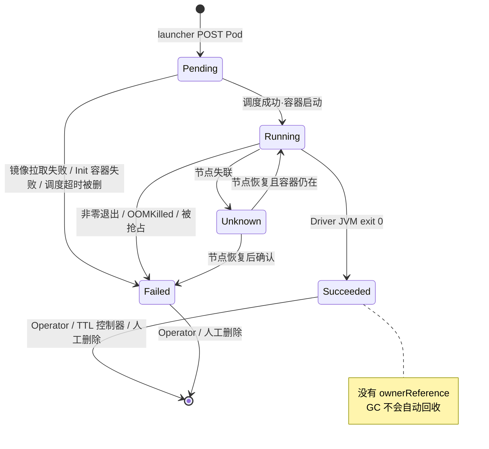
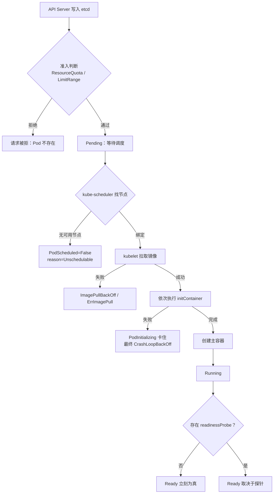
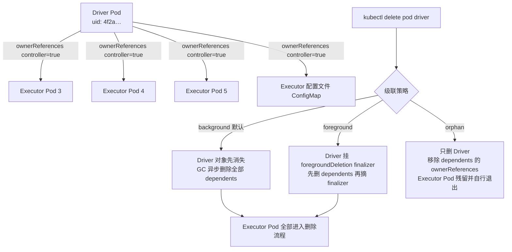
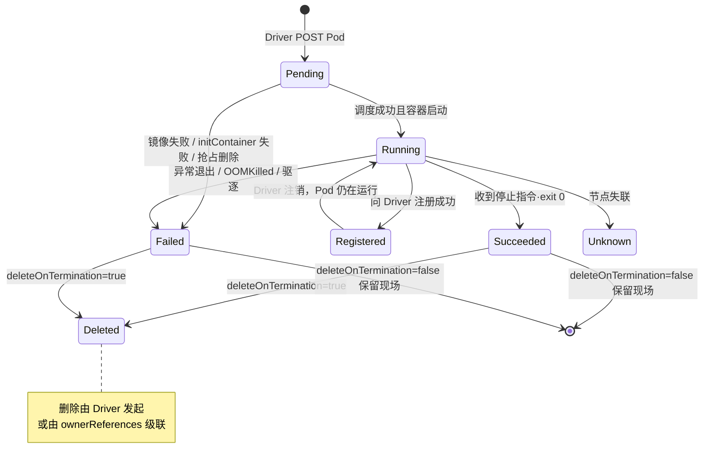
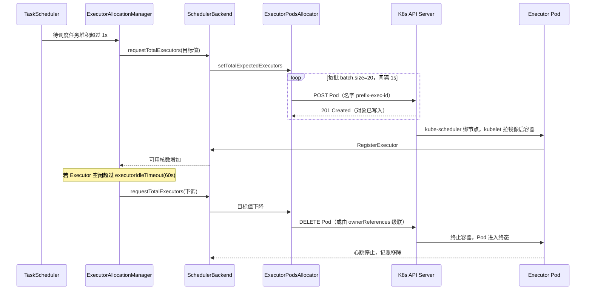
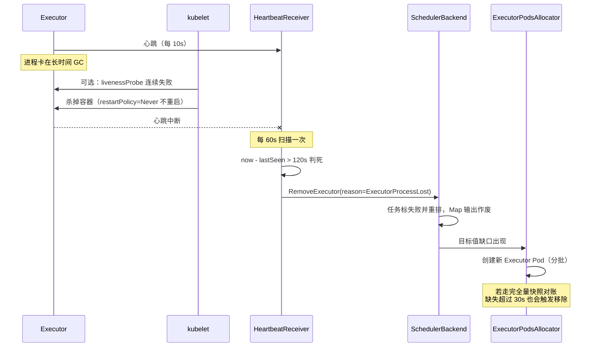

# 04 Driver 与 Executor Pod 的生命周期管理

**摘要：**

Kubernetes 上的一个 Spark 作业，最终只落在两种 Pod 上：一个 Driver，若干个 Executor。它们同样被 kubelet 拉起、同样以 `restartPolicy: Never` 收场，但"谁有权结束它"这件事，两者并不相同。本文盯住的是这两笔账的交界处：先界定 K8s、Spark 与调度器三方各自的所有权范围，再分别走完 Driver Pod 与 Executor Pod 从被创建到被回收的全程；随后拆开 `ownerReferences` 这条级联删除链，说明它为什么在 cluster 模式下默认生效、在 client 模式下必须手动打开，以及引用里的 `uid` 一旦对不上会怎样误伤一批正在跑任务的 Executor；接着讨论动态资源分配在 K8s 上被"没有外部 Shuffle Service"这一事实所绑定的三种前置条件，看它如何把"占着不放"重新切回"按需"；再把 Spark 心跳与 K8s 探针这两套判死机制摆在一起，算清一次误判与一次迟判各自要付多久的代价；最后落到 PriorityClass 与抢占，回答那个最容易被绕过的问题——抢占会不会把正在跑任务的 Executor 干掉。之所以值得把这两笔账分开讲，是因为它们各自都能自洽，合起来却经常互相打脸：Spark 认为某个 Executor 已经失联，K8s 那边它的容器还活着；K8s 认为这个 Pod 已经终止，Spark 却还在给它派任务。这类错位不来自任何一方的缺陷，而来自两边对"死亡"的定义不同。全文以 Spark 4.3.0（2026-10-30 发布）与 Kubernetes 1.37 为口径，具体配置项的默认值以对应版本文档为准。

---

## 第 1 章 两种 Pod，三处账本

2018 年 2 月发布的 Spark 2.3 第一次把 Kubernetes 当作原生调度宿主，同年 11 月的 2.4 又补上了 client 模式。那两年社区讨论的焦点集中在"能不能跑起来"：镜像怎么打、权限怎么给、Driver 怎么拿到集群内的地址。至于跑起来之后谁负责收场，被默认成了一件小事——毕竟一个作业跑完，人总是会在场。

等到作业数量从每天几个涨到每天几百个，小事才变成主线。Spark 的提交端只保证把 Driver Pod 递上去，K8s 的垃圾回收只保证把有主的对象收走，中间那段"既没有主人、又没有进程看管"的时间，成了运维真正要面对的日常。下文沿这条线展开，先看清三方账本的边界。

### 1.1 容器层面的同与不同

如果只从 Kubernetes 的角度看，Driver Pod 与 Executor Pod 的差别小得几乎可以忽略：它们都是裸 Pod（bare Pod），都没有 Deployment、StatefulSet 或 Job 这样的上级控制器，`restartPolicy` 都是 `Never`，容器挂了都只会让 Pod 沉到 `Failed` 而不会被 kubelet 重拉，作业结束后都会安静地留在集群里等别人来收尸。

差异全部落在**容器之外**：Executor Pod 的 `metadata.ownerReferences` 里通常有一条指向 Driver Pod 的引用，而 Driver Pod 的引用列表是空的；Executor Pod 的名字由 Driver 拼出来，Driver Pod 的名字由提交进程拼出来；Executor 的数量由 Spark 的调度器随时改变，Driver 的数量在作业的整个生命周期里恒等于一。也就是说，K8s 看到的是两个容器，Spark 看到的是两种命运。

这个观察决定了本文的写法。讲生命周期，最容易滑向"从创建到删除的流程罗列"，但真正决定一个 Pod 何时消失的，不是流程的顺序，而是**每个阶段谁有签字权**。同一个 `Failed` 状态，Driver 与 Executor 之后的剧本完全不同；同一个 `kubectl delete`，打在 Driver Pod 上和打在 Executor Pod 上，后果也完全不同。

### 1.2 三处账本

Spark on K8s 的生命周期账目分散在三处，各有各的记账人。

第一处是调度器与 kubelet 的账。kube-scheduler 决定 Pod 落在哪个节点，kubelet 负责拉镜像、起容器、跑探针、写 phase。这一层的记账单位是"容器"，关心的是容器的退出码、重启策略与资源规格，不关心容器里跑的是 Driver 还是 Executor。

第二处是 Driver 的账。Driver 是唯一持有全局视角的那一端：它知道该有几个 Executor、哪个 Executor 注册上来了、哪个已经超时失联、哪个该被释放。这一层的记账单位是"进程"，关心的是注册、心跳与任务归属，它甚至能在 Executor 的容器还活着的时候就把这个 Executor 从调度器里除名。

第三处是没有人认领的空白。Driver Pod 完成之后留在集群里，谁来删它？Executor Pod 与 Driver Pod 之间的从属关系是否生效？被抢占的 Pod 该由谁补位？这些问题在 K8s 与 Spark 的职责边界上，恰好落在谁的账本里都没有明确归属的地带。

行文至此可以给出本篇的范围限定：只讨论这两类 Pod 的创建、运行、终止与资源回收，重点是三处账本之间的移交。镜像怎么构建、Shuffle 文件怎么落盘、故障现场怎么一步步定位，都是别的题目，本文一概不碰。

### 1.3 与 YARN 的结构性差别

熟悉 YARN 的人初到 K8s 上会有一个直觉性的误解：以为总有一个"资源管理器"在替他管着资源池，Driver 只是提出申请。YARN 里确实如此——ResourceManager 攥着全集群的队列与容量，ApplicationMaster 向它申请 Container，拿到之后再在 Container 里拉起 Executor。

K8s 上没有这个中间人。Driver JVM 里跑着一个 `ExecutorPodsAllocator`，它做的事情是直接对着 API Server 发 `POST /api/v1/namespaces/{ns}/pods`，一个 Executor 一次请求。资源够不够、节点在哪，是 kube-scheduler 在 Pod 被创建之后才去算的事。这个结构差异会引出三个后果：第一，Driver 进程必须持有创建、查询、删除 Pod 的权限，权限成了生命周期的前置条件；第二，"申请成功"与"资源到手"被彻底解耦，创建请求返回 201 只意味着对象写进了 etcd，不意味着这个 Executor 能跑起来；第三，YARN 里"申请—分配—启动"的三段握手，被压缩成一次 API 调用加一段长度不确定的异步等待，而这段等待正是 Pending 状态的来源。

### 1.4 一个比喻：物业与租户

把集群想象成一栋写字楼。K8s 是物业：它管门禁、管工位分配、管消防通道，租户的办公桌摆在哪里、灯亮不亮，都由它说了算；但它不管租户公司里雇了几个人、谁在上班、谁该被辞退。Spark 的 Driver 则是租户公司的现场负责人：招人（创建 Executor）是他，点名（心跳）是他，裁人（释放 Executor）也是他。

这个分工在绝大多数时候运转良好，麻烦出在两种时刻。一种是负责人失联——公司的现场负责人突然联系不上，员工是继续坐在工位上发呆，还是自己收拾东西走人？另一种是物业清场——大楼要腾给更重要的租户（抢占），物业把某个工位上的员工请出去，公司那边多久才能知道少了一个人？

本篇要讲的，就是这两种时刻前后发生的所有事。

---

## 第 2 章 Driver Pod：谁创建它，谁就有义务删它

### 2.1 cluster 模式：launcher 递上去的一个裸 Pod

cluster 模式下，Driver Pod 不是 Spark 应用自己创建的，而是 `spark-submit` 那一侧的 launcher 进程创建的。launcher 连上 API Server，构造 Driver Pod 的 spec——容器镜像、资源请求、ServiceAccount、环境变量、挂载的配置文件——`POST` 出去，然后开始等。

`spark.kubernetes.submission.waitAppCompletion` 默认为 `true`，意思是 launcher 会一直守着，把 Driver 容器的标准输出转发到本地终端，直到 Pod 进入终态才退出。把它设成 `false`，launcher 就变成"扔下就走"：提交成功即退出，作业在集群里自生自灭。这两种行为的差别不只是终端体验——launcher 退出并不删除 Driver Pod，所以无论哪种模式，launcher 与 Driver Pod 之间都没有所有权关系，它只是一个投递员。

这就解释了第一个常见困惑：作业跑完之后 Driver Pod 为什么还在。因为**从来没有人被指派去删它**。

### 2.2 client 模式：Spark 根本不创建它

client 模式下，Driver 进程跑在提交端——可能是一台跳板机，也可能是用户自己用 Deployment 或 Job 管理的 Pod。Spark 只负责在 Driver 进程里连上 API Server，去创建 Executor Pod。Driver 的"容器"归用户的基础设施管，Spark 既不创建也不需要关心它的回收。

正因为如此，client 模式下 `spark.kubernetes.driver.pod.name` 才有存在的必要：Driver 进程得先知道"我住在哪个 Pod 里"，才能把这个 Pod 作为 owner 挂到 Executor 上去。这个参数在两种模式下的地位并不对等——cluster 模式下 Spark 的 launcher 一定会设置它，client 模式下默认不设，于是下一章要讲的级联删除在 client 模式下默认是关着的。

### 2.3 名字的三条来源

Driver Pod 的名字有三种来路，它们之间的优先关系值得记清，因为名字是后面一切引用关系的锚点。

其一，cluster 模式下若未显式指定，名字取 `spark.app.name` 加当前时间戳，后者用于避免重名冲突。其二，显式设置 `spark.kubernetes.driver.pod.name` 则以它为准；这个值必须符合 K8s 的命名规范，且要保证同 Namespace 内唯一。其三，Pod 模板里的 `metadata.name` 会被覆盖——模板提供的是除名字之外的一切，名字由 Spark 决定。

第三条容易被忽略：很多人用 Pod 模板给 Driver 加注解、加卷、加优先级，顺手在模板里写了个名字，结果发现集群里出现的 Pod 名与模板不符。这不是 bug，模板在 Spark 眼里只是"初始 Pod"，凡是与身份、资源、连接相关的字段，Spark 都会在它之上重写。

### 2.4 没有 owner 的后果

Driver Pod 的 `ownerReferences` 是空的。这个空列表意味着 K8s 的垃圾回收器（Garbage Collector，GC）永远不会主动碰它——GC 只会删除"主人已经不存在"的对象，没有主人的对象不在它的职责范围内。

下图把 Driver Pod 的几个关键状态与触发条件摆在一起，注意其中没有任何一条边是"被 GC 删除"。



状态机里那条从 `Succeeded` 到终止的边，标注了三个执行者，而这三种执行者全都来自 Spark 之外：运维人员、Spark Operator 这样的外部控制器，或者你自己写的清理脚本。K8s 自带的 TTL 控制器（`ttlSecondsAfterFinished`）只处理 Job 对象，裸 Pod 不在它的监听范围内，所以 Pod 模板里写 `ttlSecondsAfterFinished` 是无效的——这个字段属于 Job 的 spec，不属于 Pod。

### 2.5 finalizer：一个能把自己卡死的机制

K8s 的 finalizer 是一种"删除前的关门动作"：对象被标记删除时，只要它的 `metadata.finalizers` 非空，API Server 就只给它盖上 `deletionTimestamp`，真正从 etcd 里抹掉要等所有 finalizer 被移除。前台级联删除就是靠它实现的——删除 owner 时，GC 先给 owner 挂一个 `foregroundDeletion` finalizer，等所有 dependents 都消失之后才摘掉它。

Spark 自身不给 Driver Pod 加 finalizer，但两件事可能把它带进来：一是在 Pod 模板里显式声明，二是集群里装了注入型准入控制器（admission webhook）。一旦 Driver Pod 带上了一个没人负责摘除的 finalizer，就会出现一种很难自证的僵局：Pod 长期停在 `Terminating`，`kubectl get pod` 里它的状态看着像"正在删"，但它既不会消失也不会释放资源；更麻烦的是它作为 owner 依然存在，GC 认为主人还在，于是挂在它名下的 Executor Pod 也不会被级联清理。

**删除请求返回成功，不等于对象真的消失**——这是讨论级联删除时最容易踩的一处认知落点，也是后面那串 owner 关系能不能生效的前提。

### 2.6 谁来决定它结束

Driver 容器的 `restartPolicy` 是 `Never`，容器退出之后 kubelet 不会重拉，Pod 直接沉到 `Succeeded` 或 `Failed`。这个选择的含义是：Driver 被当作一次性进程，重来与否由 Spark 之外的机制决定（重新提交任务、Operator 的 `restartPolicy` 字段、外部工作流引擎的重试），而不是由 K8s 的容器重启策略决定。

另有一个容易误读的参数：`spark.kubernetes.driver.service.deleteOnTermination` 默认为 `true`，它在应用终止时删掉的是 Driver 对应的 Service 对象，而不是 Pod。Service 被删、Pod 留下，这个组合经常让人以为是"Spark 会清理自己的资源"，其实它只清理了自己创建的那一小半。

| 维度 | Driver Pod | Executor Pod |
|---|---|---|
| 创建者 | cluster 模式下由 `spark-submit` 的 launcher | Driver 进程内的 `ExecutorPodsAllocator` |
| 名字来源 | `spark.app.name` + 时间戳，或 `spark.kubernetes.driver.pod.name` | 前缀 + `-exec-` + 递增 ID |
| `ownerReferences` | 空 | 指向 Driver Pod（cluster 模式默认有） |
| `restartPolicy` | `Never` | `Never`（direct 分配器）或 `Always`（deployment/statefulset 分配器） |
| 完成后的清理者 | 外部（Operator、脚本、人工），或永不清理 | Spark 自身（`deleteOnTermination`）或 K8s 的 GC |
| 数量 | 恒等于 1 | 随负载与动态分配变化 |

---

## 第 3 章 从 Pending 到 Running 的六段路

### 3.1 六个阶段与四个条件

一个 Pod 从被写进 etcd 到对外可服务，中间要穿过六个阶段。它们由三个不同的组件接力推进，每一段都可能停住，而每一段停住时 Kubernetes 给出的信号完全不同。

先做一次准入判断（admission）：Namespace 的 ResourceQuota、LimitRange、准入控制器在这一步生效。这一步失败的话 Pod 根本不会被创建，API Server 直接拒绝请求，Driver 收到的是一个 403 或 422，而不是一个卡住的 Pod。

然后是调度：kube-scheduler 为 Pod 找节点，找到之后写回 `spec.nodeName`，这就是所谓的绑定（binding）。随后 kubelet 接手，按顺序拉取镜像、依次执行 initContainer、创建主容器。主容器起来之后，Pod 进入 `Running`；如果有 readiness 探针，还要等它通过，Pod 才算 Ready。

这套进度在 Pod 的 condition 上留下四个里程碑：`PodScheduled`（调度完成）、`Initialized`（initContainer 全部结束）、`ContainersReady`（所有容器就绪）、`Ready`（对外可服务）。它们与 `phase`（`Pending`/`Running`/`Succeeded`/`Failed`/`Unknown`）是两个维度——`phase` 是粗粒度的总账，condition 才是细粒度的进度条。判断一个 Pod "卡住了"，看 phase 几乎没有信息量，全部信息在 condition 与容器的 `state` 里。

下图把这条链路上的推进者与可能的停留点画在一起。



### 3.2 调度：唯一真正决定"资源"的一段

Spark 语境下最容易被误判为"资源不足"的，恰恰是调度之前那一步。ResourceQuota 是准入期检查，它看的是 Namespace 里已有对象的资源请求总和加上本次请求；超了就直接拒绝创建。这时 Driver 端看到的现象是"Pod 创建失败"，而不是"Pod 一直在 Pending"。这两种现象在语义上差得很远：前者意味着 Spark 需要换一个 Namespace 或调整配额，后者意味着集群暂时没有合适的节点。

真正进入调度之后，卡点有三种典型形状。资源碎片化导致的不可调度——总量够，但没有任何单个节点能容纳这个 Pod 的请求；污点与容忍不匹配；以及亲和性与反亲和性的约束无解。这三者的共同点是，调度器会持续重试，Pod 就一直在 `Pending` 里等，直到有人腾出位置或者约束被放宽。

对 Spark 来说，这种等待有一个隐含代价：Driver 已经把 Executor 的创建请求发出去了，它并不知道对方要等多久。这就是为什么 Executor 的"申请"与"可用"之间必须留出足够的容忍时间，也是动态分配在 K8s 上比在 YARN 上更容易"慢半拍"的结构性原因。

### 3.3 拉镜像与 initContainer：两段没有超时语义的路

调度成功之后，kubelet 开始拉镜像。这一步的耗时完全取决于镜像大小、节点缓存与仓库带宽，并且没有"超时"可言——拉不到就一直退避重试，Pod 停在 `Pending`，容器状态是 `Waiting`，原因是 `ImagePullBackOff` 或 `ErrImagePull`。私有仓库的凭据问题、镜像 tag 不存在、跨区带宽不足，都会在这段路上暴露。

私有镜像的凭据通过 `imagePullSecrets` 注入，Spark 侧对应 `spark.kubernetes.driver.imagePullSecrets` 与 `spark.kubernetes.executor.imagePullSecrets` 之类的前缀配置；拉取策略由 `spark.kubernetes.container.image.pullPolicy` 决定。**镜像层的失败与 Spark 无关**，但它的表现却是"Spark 作业起不来"，这是第一类需要划清账本的场景。

initContainer 是第二段没有超时语义的路。它们严格串行、每个都必须以 0 退出，前一个失败后一个就不会启动；而且 initContainer 跑在容器网络就绪之前，任何依赖外部服务的初始化动作在它里面都可能因为 DNS 还没通而永久挂住。Spark 自身默认不注入 initContainer，但 Pod 模板允许用户声明，于是这里成了一个自由度很高、也极易失控的扩展点：把"等下游数据库可连"写进 initContainer，就等于把一个没有超时语义的进程塞进了启动路径。

### 3.4 主容器与 Ready

主容器启动是最后一段。kubelet 创建容器、执行镜像的 entrypoint，对 Spark 来说就是那个被 `spark-submit` 写进 Pod spec 的启动脚本，它读环境变量里的 `SPARK_DRIVER_URL`、`SPARK_EXECUTOR_ID` 等坐标，把 JVM 拉起来。

容器的 `Running` 与 Pod 的 `Ready` 是两件事。**Spark 默认不给 Driver 与 Executor 注入任何探针**，所以对这两种 Pod 而言，容器一起来 `Ready` 就为真，`ContainersReady` 与 `Ready` 几乎同时置位。这一点在后面讨论"两套判死机制"时会变成关键前提：Spark 的 Pod 默认只被 K8s 检查"容器进程在不在"，而不被检查"应用健不健康"。

| 阶段 | 推进者 | 观察信号 | 停留的后果 |
|---|---|---|---|
| 准入 | API Server | 请求被拒（403/422） | Pod 不存在，作业启动失败 |
| 调度 | kube-scheduler | `PodScheduled=False`，reason 为 `Unschedulable` | 长期 Pending，资源等到为止 |
| 拉镜像 | kubelet + 容器运行时 | 容器 `Waiting`，reason 为 `ImagePullBackOff` | 退避重试，无超时上限 |
| initContainer | kubelet | `Initialized=False`，`PodInitializing` | 串行阻塞，后续容器不启动 |
| 主容器启动 | kubelet + 运行时 | 容器 `Running` | 进入运行态，JVM 开始引导 |
| Ready | kubelet（探针） | `Ready` 条件 | 默认无探针，等同于 Running |

---

## 第 4 章 Executor Pod 的诞生：Driver 直接对着 API Server 说话

### 4.1 没有资源池，只有 API

YARN 模式下，Executor 的创建是一句"我申请 N 个 Container"，剩下的由 ResourceManager 排队、分配、通知 NodeManager 落地。K8s 模式下这句申请没有了，取而代之的是一次次 Pod 创建请求。Driver 并不掌握任何资源池的状态，它只能提出愿望，然后等 kube-scheduler 裁决。

从代码路径看，这条链是：`KubernetesClusterSchedulerBackend` 收到"总共该有几个 Executor"的指令（静态模式下是 `spark.executor.instances`，动态模式下是 `ExecutorAllocationManager` 算出来的目标值），交给 `ExecutorPodsAllocator`；分配器把目标值减去当前已知的 Executor 数，得到缺口，再按批次向 API Server 提交创建请求。

这里有一个语义上的微妙之处：**"目标总数"是幂等的，"创建动作"不是**。分配器维护着一份"已请求但尚未在任何快照里出现"的 Executor ID 集合（`newlyCreatedExecutors`），靠它避免同一个缺口被重复创建。这份内存状态一旦与集群实际状态失配，就会出现"Spark 认为已经创建、集群里却找不到"的幽灵账——第 8 章讲的全量快照对账，正是为修这笔账而存在的。

### 4.2 一次扩容请求之后发生了什么

目标值一旦上调，分配器并不是一次性把缺口全部发出去，而是按 `spark.kubernetes.allocation.batch.size`（默认 20）分批提交，两批之间间隔 `spark.kubernetes.allocation.batch.delay`（默认 1 秒，且校验要求大于 0.1 秒）。这个节流设计在 4.x 里还有另一层兜底：`spark.kubernetes.allocation.maximum`（默认不设上限）限制整个作业生命周期内最多尝试创建多少个 Pod。

节流的动机很实际。假设一个作业要从 0 扩到 1000 个 Executor，如果上千个创建请求在同一秒内砸向 API Server，受伤的不只是这个作业——API Server 是所有控制器、所有 kubelet 的心跳中枢，它一旦排队，整个集群的协调延迟都会被拉长。分批的代价是扩容变慢：1000 个 Pod 按每批 20 个、间隔 1 秒算，光是把请求发完就要近一分钟，而这还没算调度与镜像拉取的时间。**这是一个典型的"把峰值削平、换来整体可用"的取舍**，K8s 侧的每一次限流几乎都是这个形状。

### 4.3 名字：一条隐形的主键

Executor Pod 的名字形如 `$prefix-exec-$id`，其中 `id` 是递增的正整数。前缀有两个来源：显式设置的 `spark.kubernetes.executor.podNamePrefix`，或者由应用名加一段随机后缀拼出的默认值。

这个设计里藏着两条约束。其一是 DNS 合规：前缀必须满足 DNS 子域名的规则，且前缀加固定后缀的总长度不能超过上限（上限由 DNS 规范决定，具体数值以对应版本文档为准）。其二是唯一性：前缀在同一个 Namespace 内最好唯一，否则并发作业的 Pod 名字会撞车，而撞车的后果不是"启动失败"，是更难查的"两个作业的 Executor 被混在一起数"。

名字还是 Pod 的 hostname 的来源。容器内看到的主机名取 Pod 名字的末尾 63 个字符（也就是 DNS label 的长度上限），这样既保留了唯一性——名字尾部包含 Executor ID——又不违反 hostname 的长度约束。顺带一提，`spark-role`、`spark-app-selector`、`spark-executor-id` 这几个标签也在这时候写进 Pod，它们构成了运维视角下唯一稳定的检索维度：名字不可预测，标签可以。

### 4.4 Spark 往 Pod 里填了什么

下发之前，Spark 会在 Pod 模板（如果提供了的话）之上重写一大批字段。理解"模板只是起点"这一点，可以避免大量"我明明在模板里配了为什么没生效"的困惑。

| 字段 | Spark 填入的内容 | 为什么必须由 Spark 决定 |
|---|---|---|
| `metadata.name` | 前缀 + `-exec-` + ID | 名字是分配器的账本主键 |
| `metadata.labels` | `spark-app-selector`、`spark-role`、`spark-executor-id` 等 | 跨作业检索与资源归属的依据 |
| `metadata.ownerReferences` | 指向 Driver Pod（条件见第 5 章） | 决定 Driver 消失后 Executor 是否残留 |
| `spec.restartPolicy` | direct 分配器为 `Never`；deployment/statefulset 分配器为 `Always` | 决定"进程挂了谁来重来" |
| `spec.terminationGracePeriodSeconds` | 默认 30 秒（4.1 起可配） | 决定被删时留多少时间做优雅退出 |
| `spec.hostname` | Pod 名字的末 63 个字符 | 保证同一作业内主机名唯一 |
| 容器 command/args | 启动脚本与环境变量（Driver 地址、Executor ID 等） | 进程靠这些坐标找到 Driver |

表中最值得停留的一行是 `restartPolicy`。direct 分配器下它是 `Never`，意味着 Executor 进程一旦退出，Pod 就沉到终态，补位由 Driver 的新一轮创建完成。这个设计把"重来"的权力集中在 Spark 手里，好处是能区分"任务级失败该重试"与"环境级失败不该重试"，坏处是 Spark 必须自己盯住每一次消失。

而 4.x 引入的 deployment 与 statefulset 分配器把这件事翻了过来：Pod 由控制器创建与维持，`restartPolicy` 变成 `Always`，容器崩溃后由控制器重拉，Spark 只负责调整副本数。这个模式的优势是与 K8s 原生的弹性伸缩、滚动更新对齐，代价是**生命周期的主导权从 Spark 移交给了控制器**——容器重启的细节不再出现在 Spark 的事件流里，排障时的第一现场也随之改变。

### 4.5 两条观察通道

Driver 感知 Executor Pod 状态变化，有两条通道：一条是基于 Watch 的事件流，一条是全量轮询。事件流延迟低，但会漏——连接中断、资源版本过期、API Server 侧的压缩，都可能让某个事件永远到不了；全量轮询兜底，它定期拉取该作业名下所有 Pod 的完整列表，慢但不会漏。

两条通道合并成一份快照序列（snapshot），再交给生命周期管理器逐条对账。这个"事件 + 全量对账"的组合是分布式系统中反复出现的模式：事件负责快，全量负责对。只留事件，遗漏会永久固化成错误状态；只留全量，延迟与 API 压力都不可接受。

顺带还有一个启动期的细节：`spark.kubernetes.allocation.driver.readinessTimeout`（默认 1 秒）让分配器在应用启动时先等 Driver Pod 进入 Ready 再创建 Executor。等待超时也不会阻塞——Executor 照样创建。这个等待存在的原因很具体：Executor 要靠 Driver 的 headless Service 解析出地址，而 Service 的 Endpoint 在 Driver Pod Ready 之前是空的。

---

## 第 5 章 ownerReferences：一条会被误用的级联删除链

### 5.1 一条引用的五个字段

`ownerReferences` 是 K8s 表达"从属"的唯一原生机制。它是一组引用，每条形如 `{apiVersion, kind, name, uid, controller}`，其中 `uid` 是硬绑定——GC 判断"主人是否还在"用的不是名字，而是 UID。名字可以复用，UID 不行。

GC 的行为规则很朴素：owner 对象被删除时，删除它的 dependents。这条规则带来两个硬约束，后面会详细展开：owner 与 dependent 必须在同一个 Namespace，跨 Namespace 的引用会被忽略；UID 必须精确匹配，否则引用被当作悬空引用处理。

### 5.2 Executor 为什么要挂在 Driver 名下

Driver 进程与 Executor 进程之间原本没有任何 K8s 层面的联系。如果没有 `ownerReferences`，Driver Pod 被删掉之后，Executor Pod 会留在集群里——它们会连不上 Driver 而自己退出（后文会讲这条自杀路径），但退出是一个"尽力而为"的过程，API 请求失败、节点不响应、进程被挂起，都可能让它们变成挂着 `Running` 状态却不干活的僵尸。

挂上 `ownerReferences` 之后，这件事就从"尽力而为"变成了"由控制面保证"：Driver Pod 一被删除，GC 顺着引用把 Executor Pod 一起收掉。这条链把进程层的自杀兜底换成了对象层的强保证，代价是把 Executor 的生死与 Driver Pod 这个对象的存在绑定在了一起。

下图是这条级联链的完整形状，包括它在两种删除策略下的不同走向。



图中那枚 `uid` 标注不是装饰。它是判断一条引用是否有效的主键，也是下一节要讲的误伤机制的源头。

### 5.3 开关就是 driver.pod.name

Executor 上到底有没有这条引用，取决于 `spark.kubernetes.driver.pod.name` 是否被设置。分配器在启动时会读这个配置：设了，就按名字去 API Server 里把 Driver Pod 查出来（查不到直接抛异常，因为这意味着配置指错了对象）；没设，`driverPod` 为空，后续构造 Executor Pod 时就跳过引用这一步。

两种模式下这个参数的地位完全不同。cluster 模式下 Spark 的启动路径里有硬性要求——driver pod 名字必须提供，否则集群管理器初始化时就 `require` 失败；所以 cluster 模式的 Executor 默认带有指向 Driver 的引用。client 模式下它默认为空，于是引用默认缺失，Executor 的回收退回"尽力而为"。

这也解释了官方文档在 client 模式那一节反复强调的一句话：如果你的 Driver 跑在 Pod 里，强烈建议把 `spark.kubernetes.driver.pod.name` 设成那个 Pod 的名字。**这是一行配置换来的一条强保证**，成本近乎为零，收益是所有 Executor 都会在 Driver Pod 消失时被一起收走。

### 5.4 两个硬约束与一次误伤

第一条约束是同 Namespace。GC 不会跨 Namespace 追引用，所以 Executor 必须与 Driver 在同一个 Namespace——这不是 Spark 的选择，而是 K8s 的设计。

第二条约束是 UID 精确匹配。这条约束制造了一种很隐蔽的故障：如果配置指向的那个 Pod 名字被复用——比如 Driver Pod 被删掉之后，另一次提交恰好用了同一个名字，或者配置里写的名字其实是另一个作业的 Driver——那么 Executor 的引用会指向一个 UID 不同的对象。GC 在对账时发现引用指向的 UID 不存在，会把它当作悬空引用处理，最坏的结果是**一批正在跑任务的 Executor 被提前终止**。

这个机制在正常路径上没有成本，在异常路径上的杀伤力却很大，是一个典型的"平时看不见、出事就是批量"的设计。防御方式并不复杂：不要手工指定一个可能与别人重合的 Driver Pod 名，也不要让两份配置指向同一个名字。

> [!info] 一条引用撑起的两种语义
> `spark.kubernetes.driver.pod.name` 同时承担了两个职责：告诉 Driver"我住在哪个 Pod 里"，以及决定 Executor 上有没有那条指向 Driver 的引用。前一个职责在 client 模式下靠人工保证，后一个职责则直接决定作业结束时会不会留下一批孤儿 Pod。配置项的名字只描述了前者，真正的分量在后者。

### 5.5 三种删除策略

| 策略 | 触发方式 | Driver 对象何时消失 | Executor Pod 的结局 |
|---|---|---|---|
| 后台删除 | 默认 | 立即 | GC 异步删除，可能延迟数秒 |
| 前台删除 | `--cascade=foreground` | 等全部 dependents 删完 | 先被删，Driver 随后消失 |
| 孤儿化 | `--cascade=orphan` | 立即 | 引用被摘掉，Pod 残留并自行退出 |

这张表里第三行值得多说一句。孤儿化删除不是"安全模式"，它只是把清理责任从控制面推回给进程——Executor 会因为在若干次心跳之后连不上 Driver 而自杀，但如果那个 Executor 恰好卡在长时间的 GC 或磁盘 I/O 里，它可能在自己退出之前先占着节点资源很久。所以在生产上，除非你在做故障注入或者迁移演练，孤儿化删除对 Spark 作业没有正面价值。

### 5.6 Driver 被删之后，Executor 会不会残留

把前面的机制合起来，可以给出三种情形的答案。

第一种，Driver Pod 被删且引用有效：GC 级联删除全部 Executor Pod，残留概率极低，唯一的不确定性是 GC 的异步延迟。

第二种，Driver Pod 被删但引用缺失（client 模式的默认形态）：Executor Pod 不会被 GC 收走，它们会在心跳超时之后自行退出，Pod 停在 `Failed`。这时如果 `deleteOnTermination` 为 `true`（默认），Driver 早已不在，没有人来执行删除动作，Pod 就永久留在集群里。**这是"客户端模式作业跑完一地鸡毛"的主要成因**，也是 `spark.kubernetes.driver.pod.name` 为什么值得在 client 模式下必配的原因。

第三种，Driver 进程崩溃但 Pod 还在：进程没了，Pod 未必立刻进终态。Executor 会因为连不上 Driver 而退出，Pod 进入 `Failed`，然后由谁清理取决于 Driver 是否还有机会执行清理逻辑——通常没有，所以等价于第二种情形。

---

## 第 6 章 Executor 的退场

### 6.1 正常退场

一条正常的退场路径是这样的：Driver 上所有任务完成，调度器通知后端可以释放资源，后端向 Executor 发送停止指令，Executor 的 JVM 执行收尾（关闭 BlockManager、清理临时文件、上报最终状态）后以 0 退出，容器随之终止，Pod 进入 `Succeeded`。

接下来是清理动作。生命周期管理器在快照里看到这个 Pod 进入终态，把它从 Spark 的 Executor 记账里移除，并根据 `spark.kubernetes.executor.deleteOnTermination` 决定要不要向 API Server 发起删除。默认值是 `true`，所以正常退场的 Executor 会被删掉，不会在集群里留下 `Succeeded` 的墓碑。

这个默认值在 3.0 之后才统一。在此之前，"作业结束时 Executor Pod 会不会被清理"在几种路径下行为不一，`Succeeded` 的 Pod 常常堆积，等到有人发现 etcd 里对象数量异常时才回头清理。把它改成默认删除，等于承认了一个判断：**Executor 的 Pod 对象没有存档价值**，它的价值在日志与事件里，不在对象本身。

### 6.2 非正常退场的五种形状

异常退场比正常退场复杂，因为"Pod 怎么了"与"Spark 怎么记账"是两套语言。

| 退场原因 | Pod 与容器状态 | Spark 侧的丢失原因 | 后续动作 |
|---|---|---|---|
| 用户代码抛未捕获异常 | `Failed`，退出码非 0 | `ExecutorExited` | 任务失败重试，按需补位 |
| JVM 堆内存溢出 | `Failed`，退出码 52 | `ExecutorExited`，触发 recovery mode | 补位，新 Executor 可能只接一个任务 |
| 容器内存超 limit 被内核杀 | `Failed`，`OOMKilled`（137） | `ExecutorExited` | 同上，需查内存开销配置 |
| 节点故障或 kubelet 失联 | `Unknown` 转 `Failed` | 心跳超时，`ExecutorProcessLost` | 任务重排，Map 输出作废 |
| 被抢占或被驱逐 | 删除流程，带 `DisruptionTarget` 条件 | 心跳超时或全量快照里消失 | 同上，取决于作业优先级设计 |

表里第二行与第三行的区别常被混为一谈：退出码 52 是 JVM 自己决定退出（堆内存耗尽），137 是被外部信号杀死（多半是 cgroup 内存超限）。它们都会触发 4.x 的 recovery mode——分配器一旦从丢失原因里读到 OOM 字样，就切换成"新 Executor 只宣布 `ceil(spark.task.cpus)` 个核、一次只接一个任务"的模式，用独占内存的方式让吃不饱的任务跑完。这是一个很务实的补丁：它不解决内存不够的问题，只是把"反复一起失败"改成"逐个成功"。

补位这件事还有一处容易漏掉的地方：新 Executor Pod 的 spec 与原 Pod 逐字相同，于是它很可能被调度回同一个节点、撞上同一段被挤爆的内存。K8s 的调度器只知道哪台机器还有余量，不知道上一个住在这里的 Executor 是怎么死的；它没有任何理由把一个"看起来一样"的 Pod 安排到别处去。这种"驱逐—补位—再驱逐"的循环在驱逐型故障（内存压力、磁盘压力）上尤其顽固，因为触发条件是节点级而不是 Pod 级。4.x 的 recovery mode 只能缓解 OOM 这一支，其余几支仍要靠反亲和性、节点污点与容量隔离来挡——这类规则表达的是同一个意思：**别让同一个位置的失败重复发生**。

### 6.3 deleteOnTermination 的现状

`spark.kubernetes.executor.deleteOnTermination` 自 3.0 起存在，默认 `true`，语义是"Executor Pod 在失败或正常终止时是否删除"。它在代码里出现的位置有三处：分配器停止时按它决定是否清空 Pod、生命周期管理器在终态时按它决定是否调用删除、以及后端停止时按它决定是否清理 Executor 的 ConfigMap。

实现里有一个细节：删除之前会先看 Pod 上有没有 `deletionTimestamp`，有就跳过 API 调用。这个判断省下的不只是几次请求——在抢占、驱逐、手动删除这些场景下，Pod 已经在删除流程里，再发一次删除请求除了增加 API Server 的负担，还会让日志里多出一批无意义的"删除成功"。

配套的还有两个参数。`spark.kubernetes.executor.terminationGracePeriodSeconds`（4.1 起可配，默认 30 秒）决定 Pod 被删时留给容器收尾的时间；`spark.kubernetes.executor.checkAllContainers`（默认 `true`）决定判定 Pod 状态时看全部容器还是只看 Executor 容器。后者在有 sidecar 的环境里是个关键开关：日志采集、服务网格的代理容器一旦退出，若按"全部容器"判定，这个 Pod 就会被当作已终止，Spark 会认定 Executor 丢失，而实际上 Executor 容器可能还在正常工作。

### 6.4 Executor Pod 的状态机

把 Driver 视角与 K8s 视角叠在一起，Executor Pod 的状态机比 Driver 多了两条边：一条是"已注册"这个 Spark 内部状态，一条是"被主动删除"这条由 Spark 发起的删除路径。



图中 `Registered` 与 `Running` 之间的往返容易被理解错：注册成功并不意味着这个 Executor 会一直是"活着"的，Driver 可以在任何时刻把某个 Executor 从记账里摘掉（动态分配缩容），此时 Pod 可能还停在 `Running`，而它进入删除流程是稍后发生的事。**Spark 的"注销"与 K8s 的"删除"是两件事，中间隔着一次 API 调用与一段时间**，这段时间正是各种"幽灵 Executor"传闻的来源。

---

## 第 7 章 动态资源分配：把"占着不放"重新切成"按需"

### 7.1 粗粒度留下的账

Spark 的调度单位是进程而非任务，这在性能上是划算的：JVM 复用、类只加载一次、Shuffle 输出可以留在本地磁盘。代价是资源的占用粒度也被抬到了进程级——一个作业申请了多少个 Executor，在它整个生命周期里就占着多少份资源，哪怕某一刻只有十分之一的任务在跑。

动态资源分配（Dynamic Resource Allocation，DRA）就是为这笔账打的补丁：空闲的 Executor 被释放，需要的时候再申请。在 YARN 上，这件事是"归还 Container"；在 K8s 上，是"删除 Pod"与"创建 Pod"。动作看着相似，但有一块拼图在 K8s 上是缺的。

### 7.2 缺的那块拼图

Shuffle 的机制决定了 Reduce 任务要去 Map 任务所在的 Executor 上取数据。Executor 一被删除，它本地磁盘上的 Shuffle 文件就跟着消失，于是下游要么重算、要么失败。

YARN 上的解法是外部 Shuffle Service：一个常驻在每台节点上的独立进程，接管 Shuffle 文件的读写，Executor 死了文件还在。K8s 上至今没有对应的原生组件——Spark 的文档写得很直白，K8s 模式不能通过打开 `spark.shuffle.service.enabled` 来使用外部 Shuffle Service。于是"删除一个空闲 Executor"这个动作，在 K8s 上天然带着数据丢失的风险。

### 7.3 三条替代路径

要让 DRA 在 K8s 上可用，必须先回答"删了这个 Executor，它写的 Shuffle 数据怎么办"。Spark 4.3 给了三条路，任选其一。

| 路径 | 关键配置 | 机制 | 适用取舍 |
|---|---|---|---|
| Shuffle 追踪 | `spark.dynamicAllocation.shuffleTracking.enabled=true` | Driver 跟踪每个 Executor 上未被消费的 Shuffle 块，有未读数据的一律不释放 | 配置最轻，释放变保守，长尾 Stage 会让缩容滞后 |
| 优雅下线 Shuffle 块 | `spark.decommission.enabled` 与 `spark.storage.decommission.shuffleBlocks.enabled` 同时开启 | 下线前把 Shuffle 块迁移到别的节点 | 释放更彻底，代价是下线时的数据搬迁 |
| 自定义 Shuffle 数据层 | `spark.shuffle.sort.io.plugin.class` 指向可靠的 `ShuffleDataIO` | 由插件保证数据在 Executor 之外可恢复 | 灵活，但要把可靠性自己兜住 |

第一条路是绝大多数集群最常见的选择，因为它只要一行配置。它的语义也很清楚：**宁可少缩容，不冒险丢数据**。这条取向带来的副作用是缩容迟钝——只要还有一个 Reduce 任务没读完某个 Executor 的 Map 输出，那个 Executor 就释放不了，于是资源占用曲线会更像阶梯而不是滑梯。

### 7.4 扩容：从待调度任务数到 Pod 请求

DRA 的扩容判据是"有待调度的任务堆积"，触发时机是堆积持续超过 `spark.dynamicAllocation.schedulerBacklogTimeout`（默认 1 秒），之后每 `spark.dynamicAllocation.sustainedSchedulerBacklogTimeout`（默认同前）再触发一次。每一轮申请的数量比上一轮翻倍：1 个、2 个、4 个、8 个，直到逼近上限。

这个指数增长的动因与 TCP 慢启动如出一辙：一开始谨慎，因为也许加一点点就够了；一旦确认需求真实存在，就必须尽快把资源拉满。**在 K8s 上，这个"尽快"还要再打一次折扣**，因为请求落到 API Server 之后，还要经过调度、镜像拉取、容器启动、JVM 引导、注册这一长串环节，才会变成调度器眼里可用的核数。这串环节的耗时通常以秒到几十秒计，具体取决于镜像是否已缓存、节点是否宽裕。

下图把扩容与缩容两条路径放在一次会话里对照。



### 7.5 缩容：空闲判定与释放

缩容的判据比扩容简单得多：一个 Executor 空闲超过 `spark.dynamicAllocation.executorIdleTimeout`（默认 60 秒），就可以被释放。若它上面还有缓存的数据块，改用 `spark.dynamicAllocation.cachedExecutorIdleTimeout`（默认 `infinity`，意思是永不释放）来判定——这个默认值背后是一个很硬的取舍：缓存块丢了要重算，重算的代价通常远高于多占一份资源。

其余几个参数决定了缩容的边界：`minExecutors` 默认 0，`maxExecutors` 默认不设上限，`initialExecutors` 默认取 `minExecutors` 的值，`executorAllocationRatio` 决定资源利用的激进程度（默认 1.0，即尽量用满）。这些值在 YARN 与 K8s 上语义一致，差别只在"释放"的具体动作——YARN 归还 Container，K8s 删 Pod。

缩容时还有一个"体面"的问题。直接删 Pod 等于把正在收尾的进程硬切，Pod 的 `terminationGracePeriodSeconds` 与（若开启）`preStop` 里的下线脚本才给了它一点缓冲：先声明自己要走了，让 Driver 不再往上派任务，把 Shuffle 块搬完，再退出。这段缓冲在默认配置下只有几十秒，对于 Shuffle 数据量大的 Executor 未必够用。

### 7.6 缩与不缩之间的那道界线

DRA 在 K8s 上最容易出的误判，是把它当成"弹性伸缩"来用——期待它在秒级跟上负载的起伏。做不到，原因不在配置，而在结构：**每一次扩容都要穿过一整条 Pod 启动链路**。这条链路在 YARN 上短一些（Container 启动），在 K8s 上长得多（调度、镜像、初始化、注册）。

所以 DRA 真正能省下的是"整段时间的空闲"，而不是"波峰波谷之间的细小落差"。一个每天跑两小时的批作业，用 DRA 能省下十几个小时的空占；一个每秒负载都在剧烈抖动的流式作业，用 DRA 只会得到一堆创建了又删、删了又创建的 Pod。判断标准其实很朴素：如果负载的空闲期显著长于 Executor 的启动时间，DRA 就是划算的；如果两者处在同一个量级，它只会把资源账做得更难看。

---

## 第 8 章 两套判死：Spark 心跳与 K8s 探针

### 8.1 Spark 侧的账

Executor 定期向 Driver 发心跳，间隔由 `spark.executor.heartbeatInterval` 决定（默认 10 秒）。心跳里带的不只是"我还活着"，还有正在跑的任务进度、累加器更新、GC 统计——它同时是健康信号与指标通道。

Driver 侧负责记账的是 `HeartbeatReceiver`。它维护一张表，记录每个 Executor 最后一次心跳的时间戳；一个定时任务按 `spark.network.timeoutInterval`（默认 60 秒）扫一遍这张表，凡是超过 `spark.network.timeout`（默认 120 秒，若设置了 `spark.storage.blockManagerHeartbeatTimeoutMs` 则以它为准）没有心跳的，判定为失联。

阈值与扫描间隔叠在一起，就得到了最坏情况下的判死延迟：**超时阈值加上一次扫描间隔，约 180 秒**。这个结论很值得记住，因为它解释了一个常被当作玄学的现象——节点挂了快两分钟，Spark 的 UI 上那个 Executor 还在，任务还标着 RUNNING。

### 8.2 判死之后

判死并不只是改一个状态位。`HeartbeatReceiver` 会把该 Executor 送上"替换"路径：通知调度器后端发一条 `RemoveExecutor`，丢失原因是 `ExecutorProcessLost`；调度器把这批任务标为失败、重新入队；Map 输出跟踪器把这些 Executor 的 Map 结果标记为不可用，下游 Stage 可能因此整体重算。

这里有一个关键的设计取向：**Spark 从不尝试"修复"一个 Executor**。它只会把这个 Executor 从账上划掉，然后重新买一个。前面提到的几条自杀路径、这里的一次判死，全都指向同一个原则——进程是可以被替换的，不可替换的是账目的一致性。

### 8.3 K8s 侧的账：默认没有裁判

与 Spark 相比，K8s 对这两个 Pod 的健康判断朴素得近乎放养。Spark 默认不给 Driver 也不给 Executor 注入任何探针，所以 kubelet 只做一件事：看容器主进程还在不在。进程在，Pod 就是 `Running`；进程没了，Pod 就是终态。

探针只能由 Pod 模板带进来。一旦带进来，就有了第二套裁判：livenessProbe 失败会让 kubelet 杀掉容器，readinessProbe 失败只是把 Pod 从 Service 的 Endpoint 里摘掉。对 Spark 而言，readinessProbe 基本没有意义——Executor 不对外提供 K8s Service，Driver 也不通过 Endpoint 被访问（除了 client 模式下的 headless Service 场景）；真正有杀伤力的是 livenessProbe。

| 维度 | Spark 心跳 | K8s livenessProbe |
|---|---|---|
| 判据 | 应用层消息是否按时到达 | 容器内探针命令是否成功 |
| 默认是否启用 | 是 | 否，需在 Pod 模板中声明 |
| 判死阈值 | `spark.network.timeout` 120s，加 60s 扫描间隔 | `periodSeconds × failureThreshold`，由用户设定 |
| 判死的动作 | 从调度账本除名，任务重排，补新 Executor | kubelet 杀容器，`restartPolicy: Never` 下 Pod 进 `Failed` |
| 误判的代价 | 一批任务重算，可能引发 Stage 重试 | 一个 Executor 被杀，Shuffle 输出丢失，代价同上再加数据重算 |
| 谁最适合用它 | 判断"这个进程还能不能干活" | 判断"这个容器是不是卡死了" |

### 8.4 两者打架的三种情形

第一情形是探针过紧。JVM 的停顿是常态而非异常：一次 Full GC 几秒到几十秒、堆外内存吃紧时的频繁回收、Python UDF 拉起子进程的抖动，都会让一个健康的 Executor 在探针眼里"无响应"。如果 livenessProbe 的阈值比 GC 停顿还短，kubelet 就会定期把健康的 Executor 杀掉，而 Spark 那边看到的是"Executor 莫名其妙消失"。这类故障的排查非常反直觉：Spark 的日志里只有丢失记录，凶手在 kubelet 的事件里。

第二情形是探针过松。阈值设得比 Spark 的心跳超时还长，探针就完全失去了意义——Spark 早就判完死了，kubelet 还没动静。此时那个 Executor 的容器可能还挂着，Pod 还在 `Running`，Spark 已经在别处补了一个新的。两者的账本彻底错位。

> [!warning] 两侧阈值必须一起调
> `spark.executor.heartbeatInterval`（默认 10 秒）与 `spark.network.timeout`（默认 120 秒）是同一套判定里的两个量，前者是"多久报一次平安"，后者是"多久没报就当你死了"。只改后者而不动前者，常见的后果是"本来偶发延迟的健康 Executor 被批量判死"；只改前者而不动后者，则是"故障发现越来越慢"。经验上两者的比值至少要留出四倍以上的余量，且一旦引入了 livenessProbe，探针的容忍时间必须落在"最长 GC 停顿"与"`spark.network.timeout`"之间，否则两个裁判必然有一个会先犯错。

第三情形是"Spark 判死但 Pod 还在"。这是最常见的一种。Spark 判死只看消息，不看对象，所以它可以在 Pod 依然健康的情况下把一个 Executor 除名（网络分区、长时间 GC、心跳线程被阻塞都会造成这种局面）。此后这个 Pod 变成了幽灵：Spark 不再给它派任务，它也不再被计入可用资源，但它还占着节点上的 CPU 与内存。收场的办法只有一条——让 `deleteOnTermination` 保持为 `true`，让 Spark 在除名之后把 Pod 也删掉。

### 8.5 第三条判死路径：全量快照对账

除了心跳，还有一条容易被忽略的判死路径。前文提过，Driver 除了 Watch 事件流，还有一条全量轮询通道。如果某次删除事件被漏掉，Watch 侧永远不知道那个 Pod 没了，心跳也会在超时后兜底；但还有一种更微妙的错位——Pod 在注册之后立刻消失，心跳还没来得及建立。

为这种情况准备的机制是 `spark.kubernetes.executor.missingPodDetectDelta`（默认 30 秒）：把"Spark 认为已注册的 Executor"减去"全量快照里实际存在的 Pod"，差集里那些注册时间早于最近一次快照超过 30 秒的，判定为缺失，以 `ExecutorExited` 的方式移出账本，丢失原因里会写明"该 Executor 可能在 Driver 漏掉删除事件后被删除了"。

这条路径的价值在于它不依赖任何事件，只依赖最终一致的全量视图。**只要还有一条通道能拿到全量状态，事件丢失就不会固化成永久错误**，这是所有基于 watch 的系统都该抄的一条作业。

### 8.6 一次丢失的完整时序

下图把两套裁判的动作放在同一条时间轴上，注意 Spark 的判死点总是晚于 K8s 的删除点。



---

## 第 9 章 PriorityClass 与抢占：谁会先死

### 9.1 三层作业挤在一个集群里

一个典型的共享集群里往往同时跑着三类负载：凌晨的大批 ETL、白天的人工分析查询、以及 7×24 常驻的流式作业。它们的时效性要求完全不同——批作业有明确的截止时间，分析查询要的是交互延迟，流式作业要的是不中断。当资源不够时，集群必须能表达"谁该让路"，这就是 PriorityClass 的用途。

### 9.2 只能通过 Pod 模板设置

这里要先纠正一个流传很广的误解：Spark 没有 `spark.kubernetes.driver.priorityClassName` 这类专用配置项。设置优先级的唯一正规途径是 Pod 模板——在模板的 `spec` 里写 `priorityClassName`，然后用 `spark.kubernetes.driver.podTemplateFile` 或 `spark.kubernetes.executor.podTemplateFile` 把它带进来。

也就是说，优先级设置与其余 Pod 定制走的是同一条路：先准备一份模板，再让 Spark 在它之上重写那些必须由 Spark 决定的字段。优先级不在重写之列，所以模板里的值会被保留。

```yaml
# executor-template.yaml：只写 Spark 不会覆盖的字段
apiVersion: v1
kind: Pod
metadata:
  labels:
    workload-tier: streaming
spec:
  # 优先级不在 Spark 的重写范围内，模板里写什么就是什么
  priorityClassName: spark-normal
```

### 9.3 value 的边界

`PriorityClass` 的 `value` 是 32 位整数，值越大越优先。用户自定义的上限是 10 亿（1000000000），再往上是留给系统组件的保留区间（`system-cluster-critical` 与 `system-node-critical` 都在这段里）。这个边界不是形式主义：它保证控制面组件在极端资源压力下依然能插队进来，否则整个集群可能因为一个贪心的业务优先级而失去自我修复能力。

| 层级 | 建议 value | 承载的负载 | 抢占行为 |
|---|---|---|---|
| 关键 SLA | 1000000 | 截止时间硬的账务类批作业 | 可以抢占其余三层 |
| 流式 | 500000 | 常驻的 Structured Streaming | 只低于关键层，避免被频繁打断 |
| 常规 | 100000 | 一般 ETL、日常调度任务 | 只被上面两层抢占 |
| 分析 | 10000 | 临时查询、探索性作业 | 最容易被抢占 |

把流式作业放在"常规之上、关键之下"是一个实践中常见的安排。流式作业一旦被打断，代价不是一个任务重算，而是 checkpoint 之后的整段恢复；但它又不该压过有硬截止时间的批作业，因为后者的失败是确定的业务损失，前者的失败只是延迟。

### 9.4 抢占发生的那一刻

当高优先级的 Pod 因为资源不足无法调度时，kube-scheduler 会尝试抢占：在候选节点上挑一组低优先级的 Pod，估算驱逐它们之后能否腾出足够资源，能就先标记"提名节点"，再逐个发起删除。被选中的 Pod 会走正常的删除流程——带 `terminationGracePeriodSeconds` 的缓冲，而不是被瞬间掐断。

这里有两个细节值得记。其一，抢占只考虑优先级严格低于自己的 Pod，同级之间不会互相驱逐，这也意味着**同一优先级的作业在资源紧张时会一起饿着**。其二，被抢占的 Pod 在较新版本的 K8s 上会带一条 `DisruptionTarget` 条件，用来区分"这个 Pod 是被主动清理的"与"这个 Pod 自己失败的"，具体字段与取值以对应版本文档为准。

### 9.5 正在跑任务的 Executor 会不会被干掉

会。抢占的选择依据是优先级与资源量，不看这个 Pod 上有没有正在跑的任务。一个正在写 Shuffle 文件的 Executor，与一个刚创建还没注册的 Executor，在调度器眼里没有区别。

于是抢占在 Spark 侧呈现出的样子，与"Executor 意外死亡"完全一样：Pod 消失、心跳中断、任务重排、Map 输出作废。这个设计有意为之——把"被驱逐"与"崩溃"统一成同一种故障语义，可以让 Spark 的容错路径只有一条。代价是运维视角下失去了区分度：如果只看 Spark 的日志，你分不清一个 Executor 是被抢占的还是自己 OOM 的，必须回到 K8s 的事件流里去找。

围绕这一点，4.x 提供了几个对冲手段。`spark.kubernetes.executor.decommissionLabel` 可以在 Executor 进入下线流程时给它打上标签，配合 PodDisruptionBudget 或集群的驱逐逻辑，能让"优雅下线"这件事有据可依；`spark.kubernetes.executor.podDeletionCost`（4.2 起）则用于 deployment 分配器场景，通过 `controller.kubernetes.io/pod-deletion-cost` 注解，让 K8s 缩容时挑选的 Pod 与 Spark 想释放的 Pod 保持一致。这两个参数解决的是同一类问题：**两个系统各有一套"该删谁"的判断，得让它们对齐**。

### 9.6 一个反例：把所有作业都设成高优先级

优先级设计里最常见的错误，是给几乎所有作业都设成最高层。它的初衷通常是"我们都很重要"，结果却是抢占机制彻底失效：一样高就没有人可以让路，资源不足时全体一起排队，优先级退化成噪声。

另一种错误是反向的：把流式作业设成最低，指望它在资源宽裕时才跑。流式作业的资源需求是常驻的，一旦被反复抢占，它会陷入"恢复—被抢占—再恢复"的循环，checkpoint 目录里堆满半成品状态，恢复时间越拉越长。**优先级不是标签，而是一份在资源不足时谁先退场的排序协议**，只有真正分层的排序才有意义。

---

## 第 10 章 边界与反例

### 10.1 反例一：以为 Executor 会自愈

Executor 的自愈能力是零。注册失败它就退出，构造失败它就退出，Driver 断连它就退出，心跳连败它就退出。它的全部韧性来自"能被重新创建"，而"重新创建"这件事由 Driver 负责。

认清这一点，就能理解几个只靠直觉想不通的现象：为什么 Driver 的一次长时间停顿会让整批 Executor 消失（断连即自杀）；为什么调大 `spark.executor.heartbeatInterval` 会同时推迟故障发现与减少误杀（同一个阈值管两头）；为什么有些 Executor 的日志显示"自我退出"却查不到谁杀了它——是它自己。

### 10.2 反例二：以为 Driver Pod 会被自动清理

Driver Pod 是裸 Pod，没有 owner，没有控制器，K8s 的垃圾回收不碰它，TTL 控制器只管 Job。它在作业结束后会一直留着，直到有人删它。

在每天几十上百个作业的集群里，这批 `Succeeded` 的 Pod 会持续累积，既让 etcd 里的对象数量只增不减，也让 `kubectl get pods` 的输出变得不可读。解决的路径只有三条：交给 Operator 统一管理（它在作业终态时清理）、在提交端加一步删除、或者接受堆积并定期跑清理脚本。**三条路都要在 K8s 之外补一个执行者**，这一点常常是平台建设初期被低估的工作量。

### 10.3 反例三：把 deleteOnTermination 当"保留现场"的开关

`spark.kubernetes.executor.deleteOnTermination=false` 确实能保留现场——Pod 对象还在，`kubectl logs`、`kubectl describe`、容器退出码都还查得到；但它保不住可被使用的数据：Shuffle 文件还躺在节点磁盘上，读它们的 BlockManager 已经随进程消失，下游要来取也取不到。

更值得警惕的是这个开关的连带效应：Pod 不删，意味着它们会占着节点上的资源请求额度（在调度器眼里，一个 `Succeeded` 的 Pod 依然"占着"资源，因为它没有被删除），于是后续作业可能因为没有可调度资源而排队，而集群的实际利用率却低得可怜。**保留现场是有成本的，成本以"不可用资源"的形式支付**。

### 10.4 反例四：用 livenessProbe 做健康检查

给 Spark Pod 加 livenessProbe 的动机通常很朴素：希望卡住的 Executor 被自动重启。但 `restartPolicy: Never` 决定了 kubelet 杀掉容器之后不会重启它——探针的真实作用不是"重启"，而是"杀掉并让 Spark 来补一个新的"。

既然效果是杀，那么探针阈值就必须按最坏情况的停顿来设，而不是按正常响应时间来设。用 HTTP 探针去戳 Spark UI 的端口，或者用 exec 探针去跑一个需要 JVM 内存的命令，都会在压力大的时候把健康的 Executor 判死。这个反例的教训是：**探针的阈值应当由"最坏情况"决定，而不是由"平均情况"决定**。

### 10.5 反例五：以为抢占只打空闲 Executor

抢占的判据是优先级与资源，与 Pod 上有没有正在跑的任务无关。一个正在写 Shuffle 的 Executor 被驱逐，与一个空闲的 Executor 被驱逐，对调度器来说是同一件事。所以"把低优先级作业的长任务放到夜里跑就不会被打断"这个假设是不成立的——只要出现高优先级的需求，夜里一样会被清场。

### 10.6 反例六：以为缩容会等任务跑完

DRA 的空闲判定看的是"这个 Executor 是否空闲"，而不是"这个 Executor 上还有没有未完成的收尾工作"。当一个 Executor 刚刚跑完最后一个任务、正在把 Shuffle 文件刷盘时，它在 Spark 的账上已经空闲了。从这一刻起倒计时 60 秒，如果没有新任务派过来，它就会被释放。默认的 `terminationGracePeriodSeconds` 是 30 秒，两者相加才是它真正能用来收尾的时间，而这个数字对大数据量的 Shuffle 往往不够。

---

## 第 11 章 落点

回到开头那个问题：一个 Spark 作业的两个 Pod，究竟由谁决定它们的生死。

答案分三层。容器层面，kubelet 是唯一的裁判，它只看进程在不在、探针过不过，不问应用语义；进程层面，Driver 是唯一的裁判，它只管消息到不到、任务归不归位，不问对象还在不在；对象层面，K8s 的垃圾回收器按 `ownerReferences` 决定从属对象的存亡，而这条链的开关握在提交参数手里。

三层各管一段，交接处就是所有麻烦的来源。Driver Pod 没有上一层的引用，所以它的回收没有归属；Executor Pod 的引用取决于一个提交参数的取舍，client 模式下的默认值让这条链断掉；Spark 的判死与 K8s 的删除各有一套时钟，两个时钟的差值就是幽灵 Pod 存在的时间。

如果要从整篇里抽一条可迁移的判断方式，笔者会留下这一条：**当两套系统共同管理同一个对象的生死时，先问"谁拥有删除权"，再问"谁拥有判死权"，最后问"两个时钟的差值由谁承担"**。所有权决定回收是否可靠，判死权决定故障是否被及时发现，时钟差值决定这段时间里有多少资源在被浪费。三个问题问完，一个跨系统的生命周期设计基本就清楚了。

Spark on K8s 的生命周期管理之所以显得零碎，正是因为它把这三件事分别交给了三个组件：K8s 管容器、Spark 管进程、调度器管资源。这种分离带来了可替换性——任何一层都可以换成别的实现，Executor 可以是 Pod 也可以是别的容器的形态，Driver 可以跑在集群里也可以跑在集群外；代价是每一处交接都需要有人显式地补上那条线。`spark.kubernetes.driver.pod.name` 是补一条线，`deleteOnTermination` 是补一条线，`shuffleTracking` 也是补一条线。这些参数单看都是琐碎的开关，放在一起，恰好构成了一套跨系统的所有权协议。

---

## 参考资料

1. Apache Spark 4.3.0 文档：Running Spark on Kubernetes（Pod 模板、Client Mode Executor Pod Garbage Collection、Priority Scheduling、Recovery-mode Executors、Executor Memory Resize）。https://spark.apache.org/docs/4.3.0/running-on-kubernetes.html
2. Apache Spark 4.3.0 文档：Job Scheduling（Dynamic Resource Allocation 的配置前提、请求策略与移除策略、优雅下线）。https://spark.apache.org/docs/4.3.0/job-scheduling.html
3. Apache Spark 4.3.0 配置参考：`spark.dynamicAllocation.*`、`spark.network.timeout`、`spark.network.timeoutInterval`、`spark.executor.heartbeatInterval`（Kubernetes 相关项见第 1 条页面的 Spark Properties 表）。https://spark.apache.org/docs/4.3.0/configuration.html
4. Apache Spark 源码（4.3.0）：`resource-managers/kubernetes/core/src/main/scala/org/apache/spark/scheduler/cluster/k8s/ExecutorPodsAllocator.scala`、`ExecutorPodsLifecycleManager.scala`、`KubernetesClusterSchedulerBackend.scala`。
5. Apache Spark 源码（4.3.0）：`resource-managers/kubernetes/core/src/main/scala/org/apache/spark/deploy/k8s/features/BasicExecutorFeatureStep.scala`（`restartPolicy` 与 `ownerReferences` 的构造）、`BasicDriverFeatureStep.scala`。
6. Apache Spark 源码（4.3.0）：`resource-managers/kubernetes/core/src/main/scala/org/apache/spark/deploy/k8s/KubernetesConf.scala`、`KubernetesConfig.scala`（配置项定义与默认值）。
7. Apache Spark 源码（4.3.0）：`core/src/main/scala/org/apache/spark/HeartbeatReceiver.scala`（心跳超时的判定与替换路径）。
8. Kubernetes 文档：Owners and Dependents（`ownerReferences` 与级联删除策略）。https://kubernetes.io/docs/concepts/overview/working-with-objects/owners-dependents/
9. Kubernetes 文档：Pod Lifecycle（phase、condition、容器状态与探针）。https://kubernetes.io/docs/concepts/workloads/pods/pod-lifecycle/
10. Kubernetes 文档：Pod Priority and Preemption（`PriorityClass` 取值与抢占行为）。https://kubernetes.io/docs/concepts/scheduling-eviction/pod-priority-preemption/

---

> [!note] 思考题
> 1. cluster 模式下 Executor 默认带 ownerReference，client 模式下默认不带——这个差异是历史包袱，还是设计上必然的取舍？
> 2. `deleteOnTermination` 默认 `true` 意味着放弃现场，默认 `false` 又会留下占着资源额度的墓碑 Pod。如果要为两类作业（批、流）分别设定，你会按什么依据区分？
> 3. Spark 判死最坏要 180 秒，而 K8s 的删除动作在几秒内就完成。这段差值里，集群上究竟有哪些资源在空转？
> 4. 抢占把"被驱逐"与"进程崩溃"统一成 `ExecutorExited` 一类的丢失语义，这带来容错路径的简化，也带来可观测性的损失。有没有办法既保留统一语义又保留区分度？
> 5. 动态分配在 K8s 上必须依赖 shuffle 追踪、优雅下线或自定义 Shuffle 数据层三者之一。如果集群已经部署了远程 Shuffle Service，这三条是否还需要？
> 6. 如果让你设计一个"作业结束后自动清理 Driver Pod"的方案，`ownerReferences`、TTL 控制器、Operator 三条路各自的失效场景是什么？