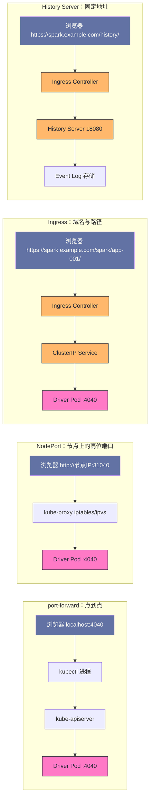
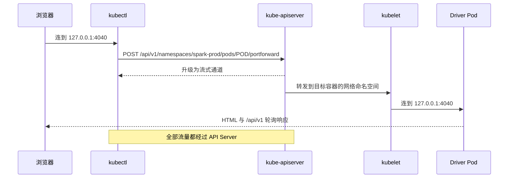
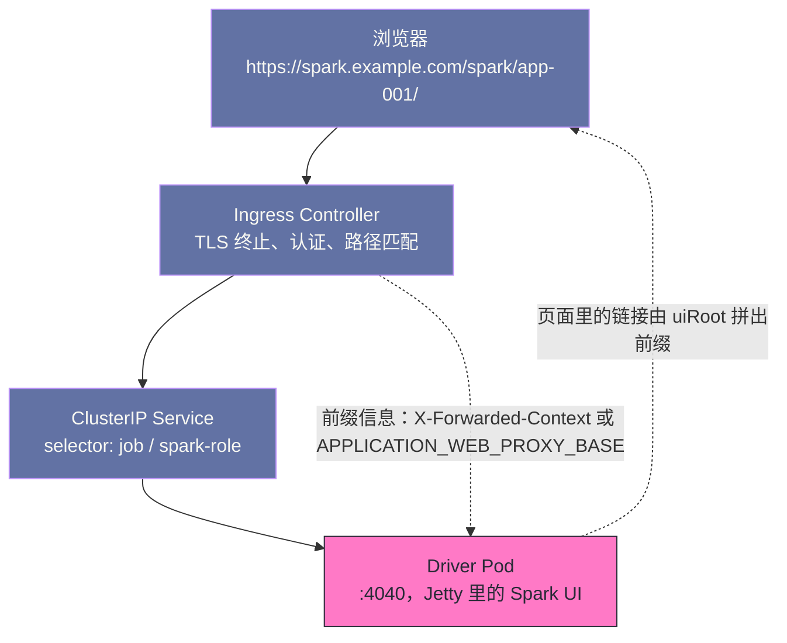
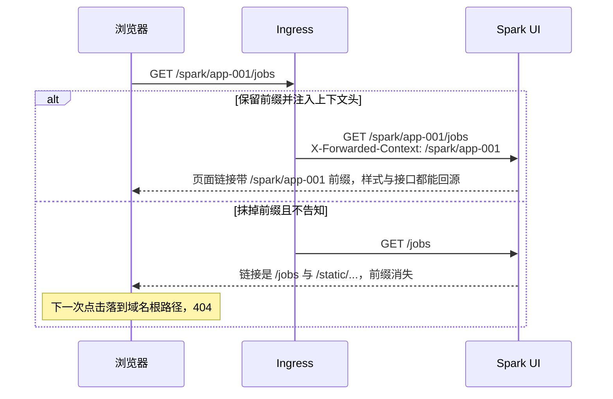
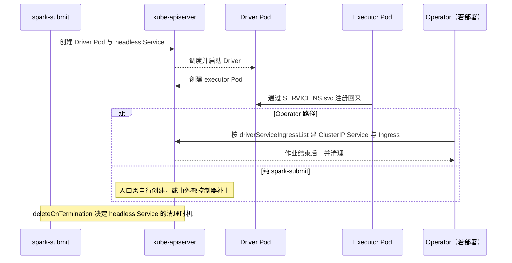
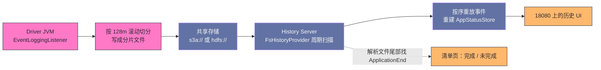

# 05 Spark UI 访问：Ingress、NodePort 与 History Server 部署

**摘要：**

Spark UI 是诊断作业的第一现场，可它在 Kubernetes 上的可达性远不如 YARN 时代。YARN 集群有一台位置固定的 ResourceManager UI，有一个替所有应用兜底的代理路径，还有一套贯穿始终的用户身份；到了 K8s，Driver 变成了一个带随机后缀、随时会被回收的 Pod，Pod IP 在 CNI 里飘，入口、身份与生命周期这三件事一起从调度系统里被摘走了。这篇文章要把这一小段"运维可用性"的账算清楚。

文章沿五问推进：先说明 Spark UI 在 K8s 上难访问的三处根因——短命的 Driver、会变的 Pod IP、不存在的稳定 Service 入口，并交代 UI 本身是一个跑在 Driver JVM 里的 Java Web 应用，页面链接由服务端拼路径；再把四种访问方式摆到同一张图上看流量走向，给出 `kubectl port-forward`、NodePort、Ingress 与 History Server 各自的适用面与代价；接着逐条拆解 Ingress 方案里真正会卡住人的地方——Service 必须选中那个 Driver Pod、路径前缀与 Spark 相对路径的冲突、末尾斜杠与 `pathType` 的陷阱、长连接与认证该落在哪一层；随后核实"Spark 内置 Ingress 支持"这件事的真伪，上游 `spark-submit` 到底提供了什么、Operator 又补了什么；最后落到 Event Log 的持久化与 History Server，解释 `spark.eventLog.*`、`spark.history.fs.update.interval`、incomplete application 与有损压缩之间的关系。

文章口径为 Spark 4.3.0（2026-10-30 发布）、Kubernetes 1.37；内置 Ingress 一项牵涉上游与 Operator 两条线，凡涉及版本行为处，以对应版本文档与所部署的 Operator 版本为准。

**关键词（Keywords）**: **EventLog**, **History Server**, **Ingress**, **NodePort**, **port-forward**, **driver-svc**, **proxyBase**, **X-Forwarded-Context**, **incomplete application**, headless Service

---

## 第 1 章 一条旧书签为什么失效了

### 1.1 从 ResourceManager 的那个链接说起

行文从一次很普通的排障动作开始。凌晨三点，值班的同学收到告警说夜间结算作业的分区产出为零，他要做的事只有一件：打开浏览器，点开那个存了两年、从没失效过的书签。

在 YARN 时代，这个书签是 `http://rm-host:8088`。ResourceManager 的位置是固定的，它维护着所有运行中应用的 ApplicationMaster（AM）地址，点进去能看到应用的 Tracking URL，顺着代理路径走进去就是 Spark UI，端口 4040，页面上写着这个作业划了几个 Stage、每个 Task 读了多少字节、哪几个 Task 在抖动。这条链接之所以能被写进值班手册，是因为链路上的每一个环节都有稳定地址：RM 有固定域名，代理路径由 RM 生成，身份由 RM 顺带带上。

在 K8s 上，同一个动作变成了一串临时的仪式。值班同学先 SSH 到跳板机，`kubectl get pods -n spark-prod` 找出那个名字里带时间戳的 Driver Pod，再敲一条 `kubectl port-forward`，然后浏览器打开 `http://localhost:4040`。这套动作当然能用，但它有两个隐含前提：跳板机的会话不能超时，且此刻只有他一个人在排这个作业。

### 1.2 三处前提一起消失了

把 YARN 与 K8s 摆在一起看，会发现消失的不是一个功能，而是三个前提。下面这张表把它们逐条对上：

| 前提 | YARN 时代由谁提供 | K8s 上缺了什么 | 补救方向 |
|---|---|---|---|
| 稳定入口 | RM 的固定 UI 与 `/proxy/<appId>/` 代理路径 | Driver 只有 Pod IP，没有固定域名与端口 | Service、Ingress 或端口转发 |
| 用户身份 | RM 的代理路径携带提交者身份，可做 ACL 判定 | Driver 以镜像里的 UID 运行，"谁在看"没有答案 | 认证前移到入口网关 |
| 生命周期 | AM 退出后由 History Server 读取 Event Log 兜底 | 同样依赖 Event Log，但默认没开，删 Pod 即失忆 | `spark.eventLog.*` 加 History Server |
| 命名稳定 | 应用 ID 由 RM 分配，可预测、可检索 | 资源名由 `<appName>-<随机ID>` 派生，提交前不可知 | 固定 Pod 名、自建 Service 或交给 Operator |

四条里最容易被低估的是第二条。很多团队会把 Spark UI 当成"只读的仪表盘"，于是只考虑"能不能打开"，不考虑"打开之后能看到什么"。但 Spark UI 的 Environment 页会列出这个作业的全部 Spark 配置、系统属性与 classpath，Thread Dump 页能把 Driver 的调用栈打成文件下载下来，`spark.ui.killEnabled` 默认还是 `true`——也就是说，一个没有认证的 Spark UI 不只是只读面板，它同时是一份配置泄露面和一次误杀作业的机会。

这一条的机制值得补一句。YARN 那个 `/proxy/<appId>/` 路径不只是一个转发规则，它还挂在一套已经跑通的认证链之后：请求先过 RM 的认证，再带着用户身份被代理到 AM，AM 侧的 Spark UI 才能在 Servlet 里看到一个 remote user，`spark.acls.enable` 才有判定的依据。K8s 的 Ingress 只做 HTTP 路由，它对"谁在请求"没有任何意见，于是身份这一环必须由入口之外的组件补上，否则 Spark 侧那一整套 ACL 配置只是在等一个永远不会到来的用户名。

**K8s 把"入口"这件事从调度系统里摘了出去，交给了一层与 Spark 完全无关的基础设施**，而那一层对"Spark 应用"没有任何概念，只有 Pod、Service、Ingress 这些通用原语。后面所有方案，本质上都是在用通用原语重新拼出一个 Spark 能用的入口。

### 1.3 UI 到底是什么东西

要判断一个入口方案能不能成，得先知道入口后面站着的是什么。Spark UI 不是静态页面，也不是一个独立进程，它是 Driver JVM 内嵌的一个 Jetty 实例，由 `spark.ui.port` 指定端口（默认 4040），在 `SparkContext` 初始化时启动。它有三个属性决定了后面全部麻烦：

其一，页面是服务端渲染的，链接由服务端拼出来。`UIUtils.uiRoot` 会算出这个 UI 的根路径，再由 `prependBaseUri` 把根路径拼到每个链接前面——也就是说，UI 放在哪个路径前缀下，是 Spark 自己认为自己知道、但其实需要被外部告知的一件事。

其二，页面的实时性靠浏览器定时拉取 JSON，不靠长连接。Jobs、Stages 这些页面会周期性地请求 `/api/v1/...` 端点，把状态刷回来。这个设计与反向代理基本兼容，代价是 HTTP 请求频次高，代理侧的缓冲与超时设置会直接影响"页面是不是在动"。

其三，它随 Driver 一起生灭。这一点与 YARN 并无不同，区别在于 YARN 的 AM 至少有个能被 RM 记住的地址，而 K8s 上 Driver Pod 被回收之后，连"这个作业曾经有过一个 UI"这件事都无从查起。

### 1.4 一个贯穿全文的作业

后面的论述需要一个具体的着力点。笔者设一个电商数仓的夜间结算作业 `settle-nightly`：每晚 01:00 由调度系统提交，从 HDFS 读当天的订单明细与商品维表，按商品与品类汇总成交额，写回宽表；Driver 申请 4 GiB 堆、1 个核，executor 起 20 个、每个 4 GiB 堆 2 个核，全部跑在 `spark-prod` 命名空间里。同一个命名空间里还有另外三支业务线的作业，夜间峰值同时在跑的 Driver 大约三十个。

这个作业在半年里依次踩过：跳板机会话超时导致排障中断、值班同学想两个人一起看同一份 Stage 明细、把 Driver 端口用 NodePort 暴露之后安全组提了工单、接 Ingress 之后页面样式全丢、作业跑完之后回看不了历史。这五件事分别落在本文第 3、4、5、7 章里；第 6 章要核实的那个"内置 Ingress 支持"，则是这几条方案的自动化版本。

### 1.5 示教窗与病历档案室

笔者用一个比喻贯穿全文。运行中的 Spark UI 像手术室墙上的单向示教窗：只能站在窗前看正在进行的那台手术，房间一旦拆掉，窗也就没了；它的价值在于"此刻"，而不在于"曾经"。History Server 则像病历档案室：手术结束后，凭一份被逐步记录下来的事件流水，可以在事后重建出当时的界面，但它只能还原因被记录过的东西，没记录下来的细节永远补不回去。

这个比喻顺着用下去会带出三个推论。其一，示教窗的数量与手术室数量同阶——三十个 Driver 就有三十个窗，靠人一个个去开是不现实的，所以运行中 UI 的入口必须自动化。其二，病历档案室的可用性取决于"记录习惯"，也就是 Event Log 有没有开、写到哪里、谁能改。其三，窗与档案室解决的不是同一个问题，任何"我把 UI 暴露出去就完事了"的方案，都在档案室这一格留了空白。

---

## 第 2 章 四种方式：先把问题拆成两问

### 2.1 看活作业，还是看死作业

面对"Spark UI 访问不了"这个笼统的抱怨，先把问题拆成两问，判断会清晰很多。第一问是看活作业还是看死作业：活作业的 UI 长在 Driver 进程里，入口方案解决的是"如何把 HTTP 请求送到某个 Pod 的 4040 端口"；死作业的 UI 已经不存在，只能靠 Event Log 重放，入口方案解决的是"如何把请求送到一台长期在线的 History Server"。第二问是看的人是谁：是提交者本人临时看一眼，是值班同学半夜排查，是平台要给全部业务线提供一个带登录的统一入口，还是监控系统要去拉 REST 接口——这四种身份对并发、认证与稳定性的要求完全不同。

**先分"活作业/死作业"，再分"看的人是谁"**，这两问交叉出来的格子里，才放得下具体方案。跳过这一步直接问"Ingress 怎么配"，往往会得到一个能打开、但没人愿意用的入口。

### 2.2 四条流量路径

下面这张图把四种方式的流量走向并排画出来，注意它们的差异不在于协议，而在于"请求从谁那里进入集群"：



图中的分叉点很直白：port-forward 绕过了 Service 这一层，NodePort 绕过了域名与路径这一层，Ingress 把两者都补上但要求 Service 精确选中目标 Pod，History Server 则把"目标"从 Pod 换成了一个进程。**入口方案的复杂度，基本等于你决定在链路上补几层抽象。**

严格说来 History Server 与前三种不在同一个分类里：前三种解决的是"活作业的 UI 有一条路可达"，第四种解决的是"死作业还剩下什么可看"。把它们画在一张图上，是因为很多平台最终会同时部署两套，而人的直觉容易把二者混为一谈——看到 Ingress 里有一条 `/history` 规则，就以为"UI 的事都办完了"。

顺带提一条未被广泛使用的路径：`kubectl proxy` 可以把整个 API Server 暴露成一个本地 HTTP 代理，理论上也能顺着 API Server 的 service 代理走到 Pod。它的好处是一条隧道覆盖多个目标，坏处是把 API Server 的只读接口也一起放了出来，且路径形如 `/api/v1/namespaces/<ns>/services/http:<svc>:<port>/proxy/`，长到无法作为书签。它更适合临时验证，不适合当方案。

### 2.3 四种方式的对照

把维度摊开，四种方式的取舍一目了然。这张表建议在选型会议之前先贴出来，因为它能挡掉大半"为什么不直接用 NodePort"的争论：

| 维度 | `kubectl port-forward` | NodePort | Ingress | History Server |
|---|---|---|---|---|
| 适用场景 | 单人临时排障、首次验证 | 测试环境、无 Ingress Controller 的裸集群 | 面向多人的生产入口 | 事后复盘、审计、跨夜排障 |
| 能看什么 | 活作业的 UI | 活作业的 UI | 活作业的 UI | 已结束作业的 UI |
| 入口稳定性 | 无，每次手动建立 | 节点 IP 加固定端口 | 域名加路径，稳定 | 域名加路径，稳定 |
| 多人共享 | 差，一人一条隧道 | 可，但共享同一个无认证入口 | 好，可统一认证 | 好，可统一认证 |
| 认证落点 | K8s 的身份认证与 RBAC | 实际上没有，只能靠网络策略 | 网关层（OIDC、SSO、IP 白名单） | 网关层与 History Server ACL |
| 主要代价 | 只覆盖一个人、一次会话 | 端口账本与暴露面 | 代理配置与前缀问题 | 需要 Event Log 持久化与额外组件 |
| 典型缺陷 | 断线即失、经 API Server 转发 | 端口耗尽、每节点都是入口、无法做域名级认证 | Service 名不可预知、路径重写易错 | 只读、incomplete 应用处理、扫描成本 |

### 2.4 三条判别口径

从表里可以抽出三条落地时真正好用的判据。

第一条，能共享的和不能共享的要分开配。值班场景要的是"三个人能同时看同一个作业"，port-forward 根本上满足不了；而首次排查、验证一个新镜像、确认 UI 有没有起来这种动作，用 Ingress 反而慢。

第二条，认证必须在一层上做一次，而不是在每个作业上各做一次。Spark 自带的 UI ACL 只能在"已经知道用户是谁"之后做判断，它自己不做认证——这一条会在第 5 章展开，但选型时就要先想清楚。

第三条，入口与档案是两条独立的链路，缺一条就会在某个凌晨被叫起来。Ingress 解决"现在能看"，History Server 解决"事后能看"，两者之间唯一的桥是 Event Log。

---

## 第 3 章 port-forward：一个人的临时入口

### 3.1 隧道是怎样建立的

`kubectl port-forward` 之所以能在不改动任何 K8s 资源的情况下打通，是因为它借用了 API Server 已有的能力。kubectl 向 API Server 发起一个针对 Pod 的 portforward 子资源请求，连接升级成流式通道，API Server 再经 kubelet 把字节送进容器的网络命名空间，最终连到 Pod 里的 4040 端口。整个过程不需要 Service、不需要 Ingress、也不需要在节点上开端口：



这张图里最值得留意的是最后一行注释。port-forward 的便利是有代价的：它的字节流全部穿过 API Server，而 API Server 是整个集群的控制面咽喉。一个人开着 UI 翻页问题不大，几十个人同时开着，API Server 的连接数与带宽就成了新的瓶颈——这也是为什么它只适合"临时"。

### 3.2 四条能力边界

**port-forward 解决的是"一个人临时进去看一眼"，它从来不是入口。** 把它的边界列清楚，能省掉很多"为什么不能给业务方发个链接"的讨论。

第一条边界是单人单会话。一条隧道服务一个本地端口，第二个人要看，就得自己再建一条；即便第一个人用 `--address 0.0.0.0` 把本地端口开放给同事，那也是把"共享"建立在某个人的笔记本或跳板机不关机的前提上。

第二条边界是断线即失。网络抖动、跳板机会话超时、`kubectl` 进程被 Ctrl-C，隧道都会立刻消失，且没有任何重连或保活机制。**隧道断掉不会留下任何痕迹，这既是它的安全属性，也是它的运维负债**——安全，是因为不存在一个长期敞开的入口；负债，是因为排障过程可能在第 40 分钟被打断，而现场只剩一句"连接被重置"。

第三条边界是权限模型不同。能 `kubectl get pods` 不等于能 port-forward，后者需要 Pod 的 `portforward` 子资源权限；在只给了 `get/list/watch` 的只读角色下，这条隧道建不起来。反过来，能给出去 port-forward 权限，等价于给出去"能连到 Pod 任意端口"的能力，这个授权粒度值得在 RBAC 设计时单独想一想。

第四条边界是地址不可引用。隧道只存在于执行它的那台机器上，任何需要"写进工单、发给同事、配进监控"的地址都不能是它。

### 3.3 它依然是最安全的临时入口

把边界说完，也要把它的优点说完整：port-forward 是目前唯一一个"不新增任何网络暴露面"的方式。请求走的是 API Server 已有的认证通道，谁能建隧道，取决于集群已有的身份体系；不需要安全组开口子，不需要 Ingress 规则，也不会因为一条忘记删的规则在半年后被人翻出来。

有些团队会把"共享"这件事往后推一步：在一台常驻的跳板机或运维容器里用 `--address 0.0.0.0` 建隧道，让同事连过来。这是一个可行的折中，但它把单点从"某个人的笔记本"换成了"某台常驻机器"，同时把访问控制交给了那台机器的网络位置——谁能连到这台机器，谁就能看到这个 UI。它比 NodePort 收敛得多，但仍不是身份级别的控制，仍然会在跳板机重启时一起失效。

三条实践建议能让它更好用。其一，用 `kubectl port-forward service/<名字>` 的写法，让 kubectl 自己按 Service 的 selector 找 Pod，比手抄 Pod 名稳；其二，把"找 Pod、建隧道"写成一行脚本，减少凌晨手抖；其三，如果只是要看 Driver 日志而 Spark 版本在 4.0 以上，Driver UI 已经可以把日志页挂在自己身上（配 `spark.driver.log.localDir`），隧道打通之后连 `kubectl logs` 都能省一次：

```bash
# 一行找到正在跑的 driver，并建隧道；stderr 里会打印实际端口
kubectl -n spark-prod get pod \
  -l spark-role=driver,spark-app-name=settle-nightly \
  -o jsonpath='{.items[0].metadata.name}' \
| xargs -I{} kubectl -n spark-prod port-forward pod/{} 4040:4040

# 若是通过 Service 转发（名字仍需先查到），selector 会替你找 Pod
kubectl -n spark-prod port-forward svc/settle-nightly-xxxx-driver-svc 4040:4040
```

### 3.4 什么时候它是正解

有些场景里，port-forward 不是退而求其次，而是唯一正确的选择。镜像刚换、想确认 UI 是否随 Driver 起来；作业卡在 Pending、想看看 Driver 是否已经启动到绑定端口那一步；CI 流水线里要截一张 Stage 图存证；甚至排查 Ingress 本身的问题时——先用 port-forward 确认"后端是好的"，再去查"入口是坏的"，这条排除顺序能省下大量时间。诊断的第一原则永远是把链路切成两段，先证明其中一段没问题。

### 3.5 端口不一定就是 4040

`spark.ui.port` 只是起始端口。若该端口被占用（同一个 Pod 里跑了别的东西，或者客户端模式下本机已经开着一个 UI），Spark 会尝试向上找可用端口，最终真正生效的端口会打在 Driver 日志里那一行 `Started SparkUI at http://...`。于是在脚本里把 4040 写死的做法，会在某些环境里表现为"隧道建成了但页面打不开"。

规避办法有两条：给 `spark.ui.port` 显式指定一个不常用的端口；或者在提交之后从日志里把实际地址捞出来。这类"看起来是网络问题、其实是端口假设"的故障，在 Spark UI 的排障里占了不小比例。

---

## 第 4 章 NodePort：端口是一份公共资源

### 4.1 机制与那份被忽略的账本

NodePort 的思路极其直白：在每个节点上开一个 30000 到 32767 之间的端口，kube-proxy 把它 DNAT 到 Service 后面的 Pod。对使用者来说，只要拿到任意一个节点 IP 加上这个端口，就能进到 UI。

问题出在"端口"这个资源的属性上。NodePort 的端口号是集群范围的，不是命名空间范围的：两个不同命名空间的 Service 不能声明同一个 nodePort。于是当平台上同时跑几十个作业、每个作业都想要一个自己的 UI 端口时，这份账本的管理责任就落到了人头上——谁申请过哪一段、哪个端口可以回收、某个已删除作业留下的 Service 是否还占着号码，全靠人工记录。**NodePort 把管理成本从"一个域名"转移到了"一片端口号"**，而端口号既不可读也不可记。

### 4.2 每台节点都成了一扇门

第二个代价是暴露面。**NodePort 暴露的不是一个链接，而是集群所有节点 IP 上的同一个端口**——三十台节点就是三十个入口，任何一个节点的 IP 被扫到，这个 UI 就对外可达。企业网络里节点通常在内网，但"内网可达"本身就意味着任何一台被攻陷的跳板机、任何一个能连 VPN 的终端，都能把它翻出来。

与之相伴的是认证的缺位。NodePort 工作在四层，它没有 Host、没有路径、没有 Cookie 的概念，也就没有地方挂 SSO。想限制访问，只能用 NetworkPolicy 或安全组按源地址过滤，而这两种手段表达的都是"哪台机器能连"，不是"哪个人能看"。

这里有一处容易想当然的地方：NetworkPolicy 看起来能兜住 NodePort，实际效果取决于源地址有没有被保留。默认的 `externalTrafficPolicy: Cluster` 下，请求经过 kube-proxy 转发时源地址常被改写为节点地址，策略里按客户端网段写的规则就落到了"节点自己访问自己"这条路径上；把策略改成 `Local` 能保住源地址，代价是只有运行 Driver Pod 的节点接受流量。换句话说，网络层的兜底能力是有的，但它要求你把转发策略、节点分布与策略规则一起设计，而不是加一条 deny 规则了事。

第三个代价出现在文档与脚本里。地址写成"任意节点 IP 加端口"看起来省事，实际没有一个稳定的字符串可以写：告警模板里写哪个 IP，值班手册里写哪个 IP，同事之间发链接发哪个 IP，全靠约定。节点扩缩容或故障切换之后，这条约定就会悄悄失效，而失效的表现是"链接打不开"，不是"链接指错了地方"，于是排查又从网络开始。

### 4.3 Spark 不会替你建 NodePort

一个常见的误解是"Spark 在 K8s 上会自动为 Driver 建 Service，所以 NodePort 只要改个 type 就行"。事实上 Spark 确实会建 Service，但它建的是一个 headless Service（`clusterIP: None`），用途是给 executor 与 Driver 之间提供稳定的 DNS 名字，不是给外部用户当入口。它的端口里确实有一个名为 `spark-ui` 的端口，但 headless Service 没有 ClusterIP，作为 Ingress 后端时的行为取决于控制器实现，因此拿它当对外入口并不是一个好主意。

要在 NodePort 这条路上走通，得自己建一个 Service：

```yaml
# 自建 NodePort Service：selector 同时限定作业与角色，避免选中同名的其它 Pod
apiVersion: v1
kind: Service
metadata:
  name: settle-nightly-ui
  namespace: spark-prod
spec:
  type: NodePort
  selector:
    job: settle-nightly     # 自定义标签，提交时用 spark.kubernetes.driver.label.job 打上
    spark-role: driver      # 没有这一条，可能选中 executor
  ports:
    - name: ui
      port: 4040
      targetPort: 4040
      nodePort: 31040        # 集群级唯一，需要登记；不写则随机分配
```

提交时还得让 Spark 把标签打对，并在作业结束后把 Service 一起清掉，否则端口账本会在几个月里悄悄漏掉几十个号码。**NodePort 的工程成本不在配置那几行 YAML，而在它引入了一份需要长期维护的端口分配表。**

### 4.4 它还剩下的位置

NodePort 并非全无价值。在没有 Ingress Controller 的裸集群、在做一次性的演示、在隔离的测试环境里，它是成本最低的可行方案；如果集群本身只在受控网段内，暴露面的问题也可以被网络层兜住。

还有一条比 NodePort 更差的路，值得点一下以免有人踩：用 `hostPort` 或 `hostNetwork` 让 Driver Pod 直接占用节点的端口。它省掉了 Service，代价是把 Pod 的调度绑死在那台节点上，并且和节点上已有的进程抢端口；`hostNetwork` 还会让 Driver 的监听地址与节点地址混在一起，Spark 内部用来连接 executor 的地址也可能受影响。这条路的收益远小于它带来的不确定性。

真正的判断标准是"看的人是谁"。如果看的人是三名工程师，且都在同一个受控网段内，NodePort 够用；如果看的人包括业务方、包括外部合作方、包括需要按人审计的场景，那么 NodePort 这条路注定要返工——它缺的不是功能，而是身份。

---

## 第 5 章 Ingress：把入口收到 80 与 443 之后

### 5.1 一条请求走过的四跳

Ingress 方案的核心是把入口统一到 80 与 443，再由 Ingress Controller 按域名与路径把请求分发给后端 Service。一条请求要经过四跳才落到 Driver 的 4040：



这两条虚线是整章的重点：前一条说明"前缀"这件事必须由代理告诉 Spark，后一条说明 Spark 会用这个前缀去拼页面里所有的链接。任何一条断掉，表现都是页面能打开、样式与链接全丢。

**Ingress 方案的成败，九成取决于两件事：Service 选得准，前缀说得清。** 其余配置都是细枝末节。

### 5.2 关键一：Service 必须指向那个 Driver Pod

Ingress 的后端只能写 Service 名，写不了 Pod。于是第一件要解决的事是：让一个名字可预知、selector 精确的 Service 指向目标 Driver Pod。

难点在于名字。上游 Spark 为 Driver 建的 headless Service，名字由 `resourceNamePrefix` 派生，形如 `<appName>-<随机ID>-driver-svc`；`resourceNamePrefix` 又由应用名加一个随机 ID 组成，名字过长时还会退化成 `spark-<随机ID>-driver-svc`。这与 Ingress 需要的"提交前就把后端名字写进 YAML"直接冲突，而 Ingress 规则通常是提前 apply 的，二者只能靠自动化弥合。

这里要补一个事实：K8s 模式下 `spark-app-selector` 这个标签的值并不是应用名，而是 `spark-` 加一串随机十六进制，提交之后才生成；拿它当 selector，等于要求 Service 与 Ingress 都在作业提交后动态生成。想让资源可以提前写死，就要自己打一个稳定的标签（`spark.kubernetes.driver.label.<键>=<值>`），再用它配合 `spark-role=driver` 定位 Pod。

实践中有三条路可走。第一条是自建 Service，selector 用自定义标签加 `spark-role=driver`，名字自己起——前提是提交参数里把那个标签打上。第二条是把名字固定下来：`spark.kubernetes.driver.pod.name` 可以让 Pod 名可预知，至少能让查找与书签稳定下来，但 Service 名依然独立派生，所以仍需配合第一条。第三条是交给 Operator 建，Operator 手里有 Driver Pod 的元数据，可以同时建 Service 与 Ingress，并在作业结束时一起清理——这是唯一不需要人写胶水逻辑的路。

顺带说明一个容易混淆的点：Spark 自动建的那个 Service 带 `spark.kubernetes.driver.service.deleteOnTermination`（默认 `true`），作业结束它就被删。若 Ingress 规则是静态的，规则会留下来指向一个不存在的后端，表现为 502 或 503——这类"白天好好的、夜里全 502"的现象，多半是静态规则与动态后端脱节。

### 5.3 关键二：前缀从哪里来

Spark UI 的每个链接前都要带一个根路径。这个根路径由 `UIUtils.uiRoot` 在服务端算出来，取值顺序是固定的：先看 JVM 系统属性 `spark.ui.proxyBase`，再看环境变量 `APPLICATION_WEB_PROXY_BASE`，再看请求头 `X-Forwarded-Context`，三者都没有则为空。

| 机制 | 怎么设置 | 优先级 | 失效条件 |
|---|---|---|---|
| JVM 系统属性 `spark.ui.proxyBase` | `spark.driver.extraJavaOptions=-Dspark.ui.proxyBase=/spark/app-001`；`spark.ui.reverseProxy=true` 时由 Spark 自己设置 | 最高 | 写成 `--conf spark.ui.proxyBase=...` 不会生效，因为它进的是 SparkConf 而不是系统属性 |
| 环境变量 `APPLICATION_WEB_PROXY_BASE` | `spark.kubernetes.driverEnv.APPLICATION_WEB_PROXY_BASE=/spark/app-001` | 次之 | 每个 Driver 只能有一个值，多作业需按作业分别配置 |
| 请求头 `X-Forwarded-Context` | 由代理在**每一次请求**上注入 | 最低 | 代理只在首跳注入、或用了别的头名（如 `X-Forwarded-Prefix`）时失效 |

表里第一行与第三行各自藏着一个坑，值得单独说。

**`spark.ui.proxyBase` 不是 Spark 配置项，而是一个 JVM 系统属性。** 这一点从源码里看得很清楚：UI 只查 `System.getProperty`，而 `--conf` 写进去的东西落在 SparkConf 里，两者并不互通。旧笔记里常见的 `--conf spark.ui.proxyBase=/spark/xxx` 之所以在 YARN 上"看起来能用"，是因为 YARN 的 AM 会自己把这个属性设进 JVM；换到 K8s 上，这条路径不存在了。要让它生效，正确写法是通过 `spark.driver.extraJavaOptions` 传 `-D`（注意 `-D` 会对 Driver 的所有 Java 进程生效），或者干脆用环境变量那一行。

第三行的坑在头名上。Spark 读的是 `X-Forwarded-Context`，而 nginx Ingress 的 `nginx.ingress.kubernetes.io/x-forwarded-prefix` 注解注入的是 `X-Forwarded-Prefix`，两个名字看起来是一回事，但在 Spark 眼里后者不存在。这就解释了一类经典现象：注解配了、日志里能看到前缀、页面里的链接却仍然是根路径。要么在 `configuration-snippet` 里补一行 `proxy_set_header X-Forwarded-Context $x_forwarded_prefix;`，要么把前缀交给环境变量。

下面这张时序图把两种代理策略的后果并排画出来：



### 5.4 关键三：重写规则与末尾斜杠

前缀有两套自洽的走法，选一套并贯彻到底，比"两套都试"更省时间。

第一套是保留前缀、不重写。代理把 `/spark/app-001/...` 原样转给 Driver，同时告诉 Spark 它的根路径是 `/spark/app-001`。优点是一个域名下可以挂多个作业，缺点是必须解决 5.3 节的"告诉"问题。

第二套是抹掉前缀、让 Spark 以为自己在根路径。适合"一个作业一个域名"的场景：`settle-nightly.spark.example.com/` 直接映射到根，UI 不需要知道任何前缀。这种写法最不容易出错，也是很多平台最终收敛到的形态——代价是每个作业一条 DNS 记录，证书要走泛域名。

两套走法之外还有两处细节要落到具体配置上。其一是 `pathType`：`networking.k8s.io/v1` 要求显式声明，而 `Prefix` 类型不做正则匹配。若照抄旧模板写出 `path: /spark/(.*)` 加 `pathType: Prefix` 再加 `rewrite-target: /$1`，在新版控制器上往往匹配不到——要用 `ImplementationSpecific` 并配 `nginx.ingress.kubernetes.io/use-regex: "true"`，或者干脆用固定前缀。

其二是末尾斜杠。`/spark/app-001` 与 `/spark/app-001/` 在 Jetty 看来不是同一个路径，前者会触发一次重定向，而重定向的目标地址若由 Spark 生成，可能指回它自己以为的地址。代理侧要负责把裸路径重定向到带斜杠的形态；若还有重定向问题，`spark.ui.proxyRedirectUri` 可以让 Spark 把 302 的目标改写成代理地址。

与重定向同源的一处现象来自 TLS 终止：浏览器到入口这一段是 https，入口到 Driver 那一段是明文 http。Spark 生成的大部分链接相对于根路径，不受影响；但重定向响应里的 `Location`、以及少数把服务地址写进页面内容的场景，会带着 http 或集群内地址返回，浏览器一侧就表现为混合内容被拦截，或者跳到打不开的内网域名。`spark.ui.proxyRedirectUri` 正是为这类场景准备的：它只填协议、域名与端口，不带应用前缀，前缀仍由 5.3 节那三种机制之一提供。

### 5.5 关键四：长连接与缓冲

Spark UI 本身不依赖 WebSocket，也不依赖 SSE，它靠定时轮询 JSON。这意味着代理层最需要的不是"升级连接"，而是三件不起眼的小事：不要把轮询响应缓冲起来（压缩与缓冲叠加会让页面看起来"卡在上一秒"）、把读超时调到一个合理值、以及不要对 `/api/v1` 路径做激进缓存。

真正需要考虑 WebSocket 与 SSE 的，是平台在同一入口后面挂的其它东西。若把 Spark Connect 的 gRPC 端口也塞进同一个 HTTP Ingress，会发现走不通——gRPC 需要 HTTP/2 端到端与专门的注解或后端协议声明；若平台自己做了日志流页面或事件推送，则要显式打开升级（`proxy-http-version`、`proxy-read-timeout`）并关掉响应缓冲。**把"UI 的入口"与"长连接的入口"当成两条入口来设计，比在一条规则上打补丁干净。**

### 5.6 关键五：认证放在哪一层

Spark 自带一套 UI ACL：`spark.acls.enable`、`spark.ui.view.acls`、`spark.modify.acls` 这些键能让 UI 按用户与组做判定。它的文档里有一句关键的话——若没有安装认证过滤器，这个开关不起任何作用。原因不难理解：ACL 判定需要请求里带一个已认证的用户身份（Servlet 的 remote user），而 Spark UI 自己不做登录。

在 K8s 上这条限制会变得更尖锐。Driver Pod 以镜像里的默认 UID 运行，容器里没有"提交者"这个概念，于是 Spark 认定的"应用所有者"对所有作业都是同一个名字；通过 ACL 只放行 owner 的做法，实际上是把所有人的作业都放给了同一个身份，或者把所有人都挡在外面。再加上同一个命名空间里的作业共享同一套 Ingress 规则，按作业粒度做授权几乎无从下手。

结论是：**认证必须在入口层完成，Spark 的 UI ACL 只负责"拿到身份之后怎么判"。** 可行的落地形态是让 Ingress Controller 前置一个 OIDC 代理（`auth-url` 一类注解），登录之后才允许访问 `/spark` 与 `/history` 前缀；授权粒度做到命名空间或路径前缀一级，同一命名空间内互相可见是这套结构默认接受的结果。要不要再细，取决于平台是否愿意为每个团队维护独立的入口与命名空间——这又是一处成本与隔离度的换算。

### 5.7 一份可用的清单

把前面五件事收进一份 YAML 里，形态大致如下。注意它同时做了两件事：自建 ClusterIP Service（而不是复用 headless 的 driver Service），以及把前缀当作环境变量交给 Driver：

```yaml
# 一、Service：名字自己定，selector 精确到作业与角色
apiVersion: v1
kind: Service
metadata:
  name: settle-nightly-ui
  namespace: spark-prod
spec:
  type: ClusterIP
  selector:
    job: settle-nightly
    spark-role: driver
  ports:
    - name: ui
      port: 80
      targetPort: 4040

---
# 二、Ingress：保留前缀，不做 rewrite；认证交给注解背后的 OIDC 代理
apiVersion: networking.k8s.io/v1
kind: Ingress
metadata:
  name: settle-nightly-ui
  namespace: spark-prod
  annotations:
    nginx.ingress.kubernetes.io/auth-url: "https://sso.internal/oauth2/auth"
    nginx.ingress.kubernetes.io/proxy-read-timeout: "600"
    # 只补上下文头，不改写路径：前缀由 Spark 自己拼
    nginx.ingress.kubernetes.io/configuration-snippet: |
      proxy_set_header X-Forwarded-Context /spark/settle-nightly;
spec:
  ingressClassName: nginx
  tls:
    - hosts: [spark.example.com]
      secretName: spark-wildcard-tls
  rules:
    - host: spark.example.com
      http:
        paths:
          - path: /spark/settle-nightly
            pathType: ImplementationSpecific   # 用固定前缀，避免依赖正则匹配
            backend:
              service:
                name: settle-nightly-ui
                port:
                  number: 80
```

配套的提交参数至少要三条：把自定义标签打对（否则 selector 选不中）、把前缀交给 Driver（否则页面链接丢掉前缀）、把 UI 端口固定（否则 4040 只是起始值）：

```bash
spark-submit \
  --conf spark.kubernetes.driver.label.job=settle-nightly \
  --conf spark.kubernetes.driverEnv.APPLICATION_WEB_PROXY_BASE=/spark/settle-nightly \
  --conf spark.ui.port=4040 \
  # ... 其余集群、镜像与资源参数
  app.jar
```

---

## 第 6 章 内置的 Ingress 支持：核实的结果

### 6.1 先给结论

社区里流传着一种说法：Spark 提供了一族 `spark.kubernetes.ingress.*` 配置，配上 `ingressClassName`、`path`、`annotations`、`TLS` 就能让 Spark 自己把 Ingress 建出来。笔者在 4.3.0 的口径下核对了两处：一是 `running-on-kubernetes.html` 的配置表与整篇文档，二是上游 `resource-managers/kubernetes/core` 下的 `Config.scala`。**上游 4.3.0 的 `spark-submit` 里没有 `spark.kubernetes.ingress.*` 这一族配置**，全文检索 `ingress` 在这些文件里没有命中。

真正的 Ingress 能力出现在另一条线上：Apache Spark Kubernetes Operator。它有 SPARK-51347 这个议题，明确写着"用户普遍希望能通过 ingress 与 service 把 Driver 暴露给集群外，例如为了访问 Spark UI"；实现落在 `DriverServiceIngressSpec` 与 `DriverServiceIngressUtils`，CRD 字段是 `driverServiceIngressList`。换句话说，**能声明式建 Ingress 的是 Operator 的 CRD，而不是 `spark-submit` 的 `--conf`**。若你的平台用的是纯 `spark-submit`，这一段能力需要自己用脚本或控制器补。

### 6.2 上游真正提供的：Service 一族

虽然 Ingress 缺席，Spark 对"服务发现"这一层给得相当完整。下表是 4.x 口径下与 Driver Service 相关的配置项：

| 配置项 | 默认 | 作用 | 起始版本 |
|---|---|---|---|
| `spark.kubernetes.driver.service.deleteOnTermination` | `true` | 作业结束时删除 Driver Service；置 `false` 则在 Pod 删除时清理 | 3.2.0 |
| `spark.kubernetes.driver.service.annotation.[Name]` | 无 | 给 Driver Service 加注解 | 3.0.0 |
| `spark.kubernetes.driver.service.label.[Name]` | 无 | 给 Driver Service 加标签 | 3.4.0 |
| `spark.kubernetes.driver.service.ipFamilyPolicy` | `SingleStack` | 双栈环境下的 IP 族策略 | 3.4.0 |
| `spark.kubernetes.driver.service.ipFamilies` | `IPv4` | 指定 IPv4、IPv6 或双栈组合 | 3.4.0 |
| `spark.kubernetes.driver.service.publishNotReadyAddresses` | `false` | 让 Service 在 Pod 未就绪时就发布 DNS，便于配了就绪探针的 Driver 尽早被 executor 解析 | 4.3.0 |
| `spark.kubernetes.ingress.*` | 不存在 | 上游没有这一族配置，需 Operator 或外部控制器 | 无 |

表里最后一行是核实结论，不做延伸。前六行则透露了一个设计取向：Spark 关心的是"executor 怎么找到 Driver"、"作业结束时资源怎么收"，它把 Driver 当成集群内部的一个成员，而不是一个对外的服务。**Spark 给你的是服务发现，不是入口暴露**——把这句话记住，很多选型上的期待落差就能提前消掉。

既然没有内置的 Ingress，注解那两个配置项就有了新的用法。`spark.kubernetes.driver.service.annotation.[Name]` 可以把任意注解打到 Driver Service 上，于是"谁负责建 Ingress"这件事可以外包给集群里已有的控制器：外部 DNS 控制器看注解补记录，证书控制器看注解签证书，自研的小控制器看注解生成 Ingress 规则并在作业结束时回收。这条路不改变 Spark 的能力边界，但它把"每个作业手写一份 Ingress"的成本压到了"一次性的控制器开发"，在纯 `spark-submit` 的平台上相当实用。

### 6.3 内置 Service 的形态与创建时序

这个自动创建的 Service 有三个值得知道的特点。它是 headless 的（`clusterIP: None`），靠 DNS 直接解析到 Pod；它带四个命名端口，分别是 Driver 端口、BlockManager 端口、`spark-ui` 端口与 Spark Connect 的服务端口；它的 selector 就是 Driver Pod 的标签集合，所以天然只选中那一个 Pod。名字方面，前面已经说过，由 `resourceNamePrefix` 派生，超长时退化为随机名。

创建与清理的时序如下：



图中那条"通过 Service 名注册回来"的箭头是 headless Service 存在的理由：executor 需要一个稳定的名字找到 Driver，而 Pod IP 会变。分叉处则说明谁来建入口：纯 `spark-submit` 只交付一个 headless Service，Operator 才会在同一次提交里把可路由的 ClusterIP Service 与 Ingress 一并建出来。这也解释了为什么 headless 那个不适合当对外入口——它的设计目标是内部解析，不是外部路由。

### 6.4 Operator 侧的声明式 Ingress

Operator 的做法是把 Service 与 Ingress 都当成 Driver 的附属资源，在 CRD 里声明。它的实现有两个体贴的默认行为：若 `serviceSpec.selector` 为空，就用 Driver Pod 的标签作为 selector，保证 Service 一定选中那个 Pod；若 `ingressSpec.rules` 为空，就自动补一条 `path: /`、`pathType: ImplementationSpecific` 的规则指向该 Service。写法大致如下：

```yaml
apiVersion: spark.apache.org/v1
kind: SparkApplication
metadata:
  name: settle-nightly
  namespace: spark-prod
spec:
  mainClass: org.example.SettleNightly
  runtimeVersions:
    sparkVersion: "4.3.0"
  driverServiceIngressList:
    - serviceMetadata:
        name: settle-nightly-ui
      serviceSpec:
        ports:
          - protocol: TCP
            port: 80
            targetPort: 4040
      ingressMetadata:
        name: settle-nightly-ui
        annotations:
          nginx.ingress.kubernetes.io/rewrite-target: /
      ingressSpec:
        ingressClassName: nginx
        tls:
          - hosts: [settle-nightly.spark.example.com]
            secretName: spark-wildcard-tls
        rules:
          - host: settle-nightly.spark.example.com
            http:
              paths:
                - path: /
                  pathType: Prefix
                  backend:
                    service:
                      name: settle-nightly-ui
                      port:
                        number: 80
```

这段声明里最省事的地方在于"名字可预知"的问题被消掉了：Service 名由你定，Operator 负责把它建出来、接上 Driver Pod 的标签、并在作业结束后一起清理。同一层的规格里还有两个同源的字段——`driverHttpRouteList` 与 `driverGrpcRouteList`，它们用 Gateway API 的 HTTPRoute 与 GRPCRoute 表达同样的意图；集群里装了 Gateway API 时，这一路比 Ingress 更贴近上游标准。三个字段各自的支持程度随 Operator 版本变化，落地前先对着 release notes 与 CRD 定义核一遍，比照抄示例稳妥。

### 6.5 版本口径与一处常见误传

把这一章收成一句话：**能预知的是 Pod 名与标签，不能预知的是 Service 名**——上游如此，Operator 用"你声明名字"绕过了它。网上不少文章给出 `spark.kubernetes.driver.service.name` 这个配置项，声称可以固定 Service 名；笔者在上游 4.3.0 的 K8s 配置源码里没有找到这个键，Service 名的派生逻辑里也没有读取它的分支。这类写法是否在你的发行版或分支上被加过，只能以对应版本的文档与源码为准；把它写进标准模板之前，先在测试集群上 `kubectl get svc` 看一眼实际名字，是最省事的确认方式。

---

## 第 7 章 History Server：让 UI 比 Pod 活得久

### 7.1 Event Log 是事件流，不是录像

Driver 在运行期间，会把作业生命周期的每一件事以 JSON 事件的形式追加写进 Event Log：应用启动、Job 开始与结束、Stage 提交、Task 开始与结束（含各类指标）、Executor 增减、应用结束。History Server 读这些事件，按顺序重放，就能把当时的 UI 重新构建出来——Jobs、Stages、Tasks、SQL 这些页面都能还原。

**Event Log 是一份事件流，而不是一段录像。** 这个区别决定了两件事：其一，UI 里能被还原的只是被记录过的事件，没写进事件的细节（譬如某些 Driver 侧的日志内容）不会凭空出现；其二，日志的大小与作业的事件密度成正比，一个跑了三天的流式作业可能产出几十 GB 的事件流，而重放它的代价会直接压到 History Server 上。

### 7.2 从写入到读取的链路

整条链路有四个环节，任何一环断掉，"事后能看"就不成立：



图中的实线串成一条单向流水线：Driver 写入、存储承接、History Server 扫描并重放、最后呈现为页面。只要有一段断掉，"事后能看"就不成立——写入侧要求 Driver 有可写的共享存储，读取侧要求 History Server 能读到同一块存储、且两侧路径完全一致。虚线则指向另一条更廉价的通路：不必重放也能读出应用是否已经结束。

### 7.3 两侧都要配的那几个键

写入侧由作业的 `spark-submit` 负责，读取侧由 History Server 负责，两边必须指向同一个目录。下表把最常调的键列在一起：

| 配置项 | 默认 | 作用 | 备注 |
|---|---|---|---|
| `spark.eventLog.enabled` | `false` | 是否记录事件；不打开就没有任何事后证据 | 必须显式打开 |
| `spark.eventLog.dir` | 无 | 事件写入目录，如 `s3a://bucket/spark-events/` | 需与 `spark.history.fs.logDirectory` 一致 |
| `spark.eventLog.compress` | `true` | 是否压缩事件 | 4.x 默认编解码为 zstd |
| `spark.eventLog.rolling.enabled` | `true` | 是否按大小滚动切分 | 长跑作业必须开 |
| `spark.eventLog.rolling.maxFileSize` | `128m` | 单个分片的上限 | 与重放代价相关 |
| `spark.eventLog.buffer.kb` | `100k` | 写缓冲大小 | 高频小事件时值得调 |
| `spark.history.fs.logDirectory` | `file:/tmp/spark-events` | History Server 扫描的目录 | 默认值在 K8s 上几乎一定要改 |
| `spark.history.fs.update.interval` | `10s` | 扫描新日志的周期 | 越短越实时，代价是重复读 |
| `spark.history.fs.endEventReparseChunkSize` | `1m` | 从文件尾部取多少字节用于判定是否结束 | 清单页廉价的来源 |
| `spark.history.retainedApplications` | `50` | 内存中缓存多少个应用的 UI 数据 | 缓存上限，不是保留策略 |
| `spark.history.ui.maxApplications` | `Int.MaxValue` | 清单页最多展示多少个 | 展示上限，与缓存无关 |
| `spark.history.fs.numReplayThreads` | 核数的 25% | 并行重放日志的线程数 | 首屏慢时先看这一项 |
| `spark.history.store.path` | 无 | 把重放结果缓存到本地磁盘 | 重启后不必全部重来 |
| `spark.history.fs.cleaner.enabled` | `false` | 是否按时间与数量清理日志 | 与对象存储生命周期规则二选一 |

第一行值得单独强调：`spark.eventLog.enabled` 默认是关的。这意味着一套没有显式配置 Event Log 的 Spark on K8s 平台，在作业结束的那一刻就永久失去了这个作业的全部过程证据——不是"不好查"，而是"没有"。**没有 Event Log，就没有事后。**

存储选型上还有一处容易含混的地方：`spark.eventLog.dir` 接受的不只是 HDFS 与对象存储，也可以指向挂到 PVC 上的共享文件系统（NFS、CephFS 之类）。走 PVC 的好处是不必引入对象存储，延迟也更可预期；前提是那块文件系统支持多写者并发追加与目录列举的一致性，否则几十个 Driver 同写一个目录时，会出现彼此看不见对方文件的怪现象。单机路径只适合单机验证，多副本的 History Server 与它无缘。

> [!warning] `s3://` 与 `s3a://` 差一个字母，事件日志就废了
> S3 上的事件日志必须写 `s3a://`，不能写 `s3://`。两者的区别不在协议名，而在底层实现：`s3://` 走的是早期的 S3NativeFileSystem，不支持重命名与追加语义，而事件日志既需要追加写、也需要在作业结束时改名收尾；用错前缀时，表现往往是文件被写出来但内容残缺，或者改名失败导致作业永远显示为进行中。HDFS 侧同理，要在所有作业与 History Server 两侧都确认 `core-site.xml` 里的默认文件系统与 `spark.eventLog.dir` 一致。

### 7.4 部署形态

History Server 只是一个 Java 进程（`org.apache.spark.deploy.history.HistoryServer`），可以跑成 Deployment，也可以被 Operator 当成一个特殊的 SparkApplication 来跑（把 `mainClass` 指过去、让 UI 端口由 Driver 暴露）。前者的好处是常驻、与作业生命周期解耦；后者的好处是复用同一套镜像与依赖管理。

无论哪种形态，容器里都需要两样东西：Spark 的二进制与配置，以及通向事件存储的 Hadoop 客户端。走 S3 时要带 `hadoop-aws`；走 HDFS 时要么把 `core-site.xml`、`hdfs-site.xml` 挂进去，要么用 `spark.hadoop.*` 逐项传；集群开了 Kerberos 则要挂 keytab 并配 `spark.history.kerberos.enabled`、`spark.history.kerberos.principal`、`spark.history.kerberos.keytab`。

```yaml
# 只保留关键字段：常驻 Deployment，端口 18080，日志目录与作业侧一致
apiVersion: apps/v1
kind: Deployment
metadata:
  name: spark-history-server
  namespace: spark-prod
spec:
  replicas: 1                 # 单副本即可，多副本会让缓存与清理逻辑互相打架
  selector:
    matchLabels: { app: spark-history-server }
  template:
    metadata:
      labels: { app: spark-history-server }
    spec:
      serviceAccountName: spark-history
      containers:
        - name: history-server
          image: registry.internal/spark:4.3.0-scala2.13
          command: ["/opt/spark/sbin/start-history-server.sh"]
          env:
            - name: SPARK_HISTORY_OPTS
              value: >-
                -Dspark.history.fs.logDirectory=s3a://spark-events/prod/
                -Dspark.history.fs.update.interval=30s
                -Dspark.history.store.path=/var/cache/spark-history
                -Dspark.history.fs.cleaner.enabled=false
          ports:
            - containerPort: 18080
          volumeMounts:
            - { name: cache, mountPath: /var/cache/spark-history }
      volumes:
        - name: cache
          emptyDir: { sizeLimit: 20Gi }
```

这段 YAML 里有三个选择需要解释。第一是扫描周期给了 30 秒而不是默认的 10 秒：扫描本身就是一次目录列举，日志量大时它比"更实时"更值得省。第二是缓存目录：配上 `store.path` 之后，History Server 重启时不必把所有应用重新重放一遍。第三是清理器关掉：对象存储上的日志更适合用桶的生命周期规则来管，让 History Server 去删对象既慢又容易与规则冲突。

还有一件与部署无关、与权限有关的事：事件日志目录是所有作业共享的可写目录，谁有写权限，谁就能往里塞一份伪造的事件流，History Server 会照单全收并在 UI 上原样呈现。这不是 Spark 的漏洞，而是"把过程数据集中到一处"必然带来的信任边界——写权限只应给作业侧的身份，History Server 用的身份最好只读（若开了有损压缩，则要单独授予那条路径的写权限）。审计场景里这一点尤其要紧，因为它决定了 UI 上的历史能不能被当作证据。

### 7.5 只读语义与 incomplete application

History Server 常被描述成"只读"，这个说法大体正确但不完全。它对存储的读取是只读的，但有两处会写：一是 `store.path` 指向的本地缓存，二是事件日志的压缩（compaction）。当设置了 `spark.history.fs.eventLog.rolling.maxFilesToRetain`，History Server 会把应用较早的分片合并成一份更小的日志，这个过程会丢弃部分事件——**compaction 是有损操作**，官方文档明确提示"压缩之后有些事件在 UI 上不再可见"，并建议开启前先确认会丢什么。

incomplete application 是另一个反复被问到的话题，机制可以拆成三层。

第一层是判定方式。History Server 判断一个应用是否结束，不需要全量重放：它从文件尾部取 `spark.history.fs.endEventReparseChunkSize`（默认 1 MB）这么多字节，去找 `ApplicationEnd` 事件。找不到就记为未完成。**清单页比打开作业页便宜得多**，原因就在这里。

第二层是收尾动作。作业正常结束时会对日志做一次改名，把它从"进行中"的形态转成最终形态。对象存储上的改名不是廉价操作，也可能失败；一旦失败，这个早已结束的作业就会永远留在未完成列表里。`spark.history.fs.inProgressOptimization.enabled` 默认开启，它让 History Server 维护一份进行中文件的清单以提高扫描效率，代价正是文档里那句提醒：某些完成应用可能因为改名失败而被列为进行中。

第三层是更新节奏。作业结束、日志收尾、History Server 扫描、UI 反映，这四步之间隔着 `spark.history.fs.update.interval`。默认 10 秒的节奏意味着刚跑完的作业不会立刻出现在清单里；把它调小能缓解"我刚跑完怎么看不到"的困惑，调大则能换取扫描成本的下降。这个取舍在日志量大时非常明显。

### 7.6 扫描的经济学

当事件日志落在对象存储上时，"扫描"这个动作本身会变成一笔开销。每次扫描都是一次目录列举：请求要走网络、要计费、要等延迟返回；日志按应用分目录、数量到几万个之后，一次列举可能就是几十秒。

Spark 4.2 起提供了一个直接的解法：`spark.history.fs.update.scanDisabledPathPatterns` 可以按路径前缀关掉周期扫描，命中的目录改为按需加载。文档把使用姿势写得很清楚——访问到某个 appId 时元数据立即填充，没被访问过的日志不做扫描，因此清理器也不会去碰它们，这些对象的生命周期应当交给存储侧的生命周期规则。

配套手段还有几条。目录分区（按日期或按团队分层）能让"只扫近期"变得可能；`spark.history.ui.maxApplications` 限制清单页展示数量，避免一次渲染几万行；`spark.history.retainedApplications` 控制内存缓存，避免 History Server 的堆被历史 UI 撑爆。这几个键常被张冠李戴，其实是三件事：缓存、展示、扫描，分别对应内存、页面与 IO。

### 7.7 首屏慢时的排查顺序

History Server 页面打不开、或者打开后转圈很久，排查顺序大致是：先看事件日志目录是不是列举得慢（对象存储上的目录规模与 LIST 延迟）；再看单个日志是不是过大（没有开滚动、或者事件密度极高）；再看 `numReplayThreads` 是否太少（核数受限的容器里，默认的 25% 可能只有一两线程）；最后看 `store.path` 有没有配（没有缓存时，每次重启都要从零重放）。这四步里，前两步是存储侧的账，第三步是资源配额，第四步是配置缺口——把顺序反过来，先去调重放线程数，多半会空转。

---

## 第 8 章 边界与反例

### 8.1 "把 UI 暴露出去就等于可观测"

**UI 是"看一次"的工具，不是"一直看"的监控。** 它没有历史聚合，没有告警，没有跨作业的对比视图，而且它的数据是拉取式的——没人打开页面时，页面上的一切指标都不会被记录。把 Ingress 配好、SSO 接上，解决的是"人能进去看"，与"系统能在没人看的时候告诉你出事了"是两件不同的事。

更实际的副作用是它会被误用。一旦入口变得容易打开，值班流程里就会出现"先点开 UI 看看"的习惯，而 UI 首屏在有几十个 Stage 的作业上可能要等十几秒；真正该做的是把关键指标送进指标系统，在告警里带上下文，再让人带着线索去开 UI。

### 8.2 "有了 Ingress 就不用 History Server"

这条误判的代价通常在第一次跨夜排障时付清。Ingress 指向的是 Driver Pod，Pod 被回收之后后端就不存在了，规则还在、页面报错；而 History Server 指向的是一个常驻进程，读的是持久化的日志。两者的可用性前提完全不同：Ingress 方案的前提是"作业还活着"，History Server 的前提是"日志还留着"。

反过来也有一处误判：以为开了 Event Log 就有历史。Event Log 只是写入，还得有一个能读到它的 History Server；而且写入目录、读取目录、认证方式三者必须对齐，否则表现是"日志文件明明在，History Server 里一个应用都没有"。

### 8.3 "`proxyBase` 一配就通"

第 5 章已经拆过这个键的来源。这里补两处反例：一是把 `--conf spark.ui.proxyBase=/spark/x` 写进模板，实际不生效，页面链接仍然是根路径；二是给代理配了 `X-Forwarded-Prefix` 却以为 Spark 会认，头名不同，等于没配。

还有一处更隐蔽：在 `spark.ui.reverseProxy=true` 的场景下，Spark 会把系统属性设成 `<reverseProxyUrl>/proxy/<appId>`。此时若再手动传一个 `-Dspark.ui.proxyBase`，两者会打架，最终生效的是后写入的那个。这类"两套机制同时开"的配置，症状往往是间歇性的链接错乱，最难查。

### 8.4 "一个 History Server 看全部最省事"

集中式 History Server 是成本最低的形态，也是多租户争议最大的形态。它默认对所有访问者展示所有应用，谁能打开 `/history` 谁就能浏览所有团队的作业名、SQL、表名与执行计划。要靠 ACL 收回来，就得让 History Server 知道用户是谁——这又回到了"认证在哪里做"的问题：要么在前置代理做 SPNEGO 或 OIDC 并让 Servlet 拿到身份，要么在每个团队前面各放一个实例。

按团队分实例的代价是运维成本成倍上升，收益是隔离度与审计的清晰。集中实例的代价是隔离弱，收益是省事、省内存、跨团队的对比反而方便。这条没有标准答案，取决于平台更怕"看错"还是更怕"看不到"。

### 8.5 一张反例速查表

| 现象 | 常见误判 | 实际机制 |
|---|---|---|
| Ingress 打开是 502 | 控制器坏了 | 静态规则指向了已被删除的 Driver Service |
| 页面能开但样式全丢 | 镜像里的静态资源缺失 | 前缀没告诉 Spark，链接与资源路径都落在根上 |
| 页面偶发 404 | 网络抖动 | 路径带不带末尾斜杠不一致，重定向目标又指错 |
| port-forward 一会儿就断 | 集群不稳定 | 隧道无保活，跳板机会话或 API Server 连接先断 |
| NodePort 申请不到 | 端口范围太小 | nodePort 是集群级的，别处已占用同一个号 |
| History Server 看不到刚跑完的作业 | 日志没写进去 | 扫描周期未到，或日志未收尾改名 |
| 作业已结束却一直显示进行中 | History Server 有 bug | 收尾改名失败，`inProgressOptimization` 把状态留在进行中 |
| 历史 UI 里少了某些事件 | 日志损坏 | 开启了有损压缩，旧分片被合并后事件被丢弃 |
| 配了 `spark.ui.proxyBase` 无效 | Spark 版本不支持 | 它是系统属性，`--conf` 进的是 SparkConf |

---

## 第 9 章 落点

回到开头那条失效的书签。它失效不是因为 K8s 少了某个功能，而是因为入口、身份、生命周期这三件事原本由调度系统一并提供，在 K8s 上被拆成了三份，分别交给 Service、网关与 Event Log。四种访问方式的差别，本质上是你愿意把这三份工作补在哪一层：port-forward 补在最靠人的一端，NodePort 补在网络的一端，Ingress 补在入口的一端，History Server 补在时间的一端。

由此得到一条判断顺序：先分清要看活作业还是死作业；活作业再分清看的人是一个还是一群，一个人用隧道，一群人用 Ingress；只要涉及事后、涉及审计、涉及跨夜复盘，就必须先把 Event Log 与 History Server 立起来，再谈入口的形态。跳过顺序直接配 Ingress，最后往往要返工两次——一次补前缀，一次补历史。

至于取舍，本文反复出现的几个两难都没有标准答案：port-forward 换来的是零暴露面，付出的是不可共享；NodePort 换来的是零依赖，付出的是端口账本与无认证的入口；Ingress 换来的是统一入口与统一认证，付出的是前缀、命名与代理细节的长期维护；集中式 History Server 换来的是省事，付出的是隔离。**入口可以外包，身份不能外包；UI 可以重建，事件不能重造。**

---

## 参考资料

1. Apache Spark 4.3.0 文档：Running Spark on Kubernetes，Driver Service、`spark.driver.log.localDir`、Accessing Driver UI 与 `kubectl port-forward` 的官方说明。https://spark.apache.org/docs/latest/running-on-kubernetes.html
2. Apache Spark 4.3.0 文档：Configuration，`spark.ui.port`、`spark.ui.reverseProxy`、`spark.ui.reverseProxyUrl`、`spark.ui.proxyRedirectUri`、`spark.eventLog.*` 各键的默认值与版本。https://spark.apache.org/docs/latest/configuration.html
3. Apache Spark 4.3.0 文档：Monitoring and Instrumentation，History Server 配置、`spark.history.fs.update.interval`、incomplete application 与滚动日志压缩。https://spark.apache.org/docs/latest/monitoring.html
4. Apache Spark 4.3.0 文档：Security，UI ACL（`spark.acls.enable`、`spark.ui.view.acls`）、History Server ACL 与"需要认证过滤器"的说明。https://spark.apache.org/docs/latest/security.html
5. Apache Spark 源码（v4.3.0）：`resource-managers/kubernetes/core/src/main/scala/org/apache/spark/deploy/k8s/Config.scala`，Driver Service 相关配置项的定义、默认值与起始版本；该文件内检索不到 `ingress`。https://github.com/apache/spark/blob/v4.3.0/resource-managers/kubernetes/core/src/main/scala/org/apache/spark/deploy/k8s/Config.scala
6. Apache Spark 源码（v4.3.0）：`resource-managers/kubernetes/core/src/main/scala/org/apache/spark/deploy/k8s/features/DriverServiceFeatureStep.scala`，headless Service 的 `clusterIP: None`、四个命名端口与 selector。https://github.com/apache/spark/blob/v4.3.0/resource-managers/kubernetes/core/src/main/scala/org/apache/spark/deploy/k8s/features/DriverServiceFeatureStep.scala
7. Apache Spark 源码（v4.3.0）：`resource-managers/kubernetes/core/src/main/scala/org/apache/spark/deploy/k8s/KubernetesConf.scala`，`resourceNamePrefix`、`driverServiceName` 的派生逻辑（含超长退化分支）与 `spark-<随机十六进制>` 形式的 appId。https://github.com/apache/spark/blob/v4.3.0/resource-managers/kubernetes/core/src/main/scala/org/apache/spark/deploy/k8s/KubernetesConf.scala
8. Apache Spark 源码（v4.3.0）：`core/src/main/scala/org/apache/spark/ui/UIUtils.scala`，`uiRoot` 的取值顺序（系统属性、环境变量、`X-Forwarded-Context`）。https://github.com/apache/spark/blob/v4.3.0/core/src/main/scala/org/apache/spark/ui/UIUtils.scala
9. Apache Spark 源码（v4.3.0）：`core/src/main/scala/org/apache/spark/SparkContext.scala`，`spark.ui.reverseProxy` 打开时把 `spark.ui.proxyBase` 写入系统属性的位置。https://github.com/apache/spark/blob/v4.3.0/core/src/main/scala/org/apache/spark/SparkContext.scala
10. Apache Spark JIRA：SPARK-51347，为 Driver 增加 Ingress 与 Service 支持的议题与背景。https://issues.apache.org/jira/browse/SPARK-51347
11. Apache Spark Kubernetes Operator：`DriverServiceIngressUtils`，Service 与 Ingress 的构建逻辑（selector 缺省取 Driver Pod 标签、规则缺省补 `/`）。https://github.com/apache/spark-kubernetes-operator/blob/main/spark-submission-worker/src/main/java/org/apache/spark/k8s/operator/utils/DriverServiceIngressUtils.java
12. Kubernetes 文档：Ingress、Service（含 headless Service 与 NodePort 的语义）、以及用 port-forward 访问集群内应用。https://kubernetes.io/docs/concepts/services-networking/ingress/
13. ingress-nginx 文档：注解参考，`rewrite-target`、`use-regex`、`x-forwarded-prefix`、`auth-url`、`proxy-read-timeout`。https://kubernetes.github.io/ingress-nginx/user-guide/nginx-configuration/annotations/

---

> [!note] 思考题
> 1. `settle-nightly` 的 Driver Pod 在凌晨 03:10 被节点回收，值班同学 03:30 才收到告警。如果没有 Event Log，他能从集群里找回多少信息；如果 Event Log 写的是 `emptyDir`，又能找回多少？
> 2. 把前缀交给 `APPLICATION_WEB_PROXY_BASE` 与交给 `X-Forwarded-Context`，在"同一个 Driver 需要被两个不同前缀访问"的场景下分别会发生什么？
> 3. 上游的 Driver Service 是 headless 的，若坚持拿它当 Ingress 后端，你会在哪些控制器上遇到问题，又会先做什么实验来确认？
> 4. History Server 开启 `spark.history.fs.eventLog.rolling.maxFilesToRetain` 之后，UI 上会少掉哪些事件；这些事件对一个失败作业的复盘意味着什么？
> 5. 同一个命名空间里三十个作业共用一个 Ingress 与一个 History Server，若要实现"业务线 A 看不到业务线 B 的作业"，改造点最少的三处分别在哪里？