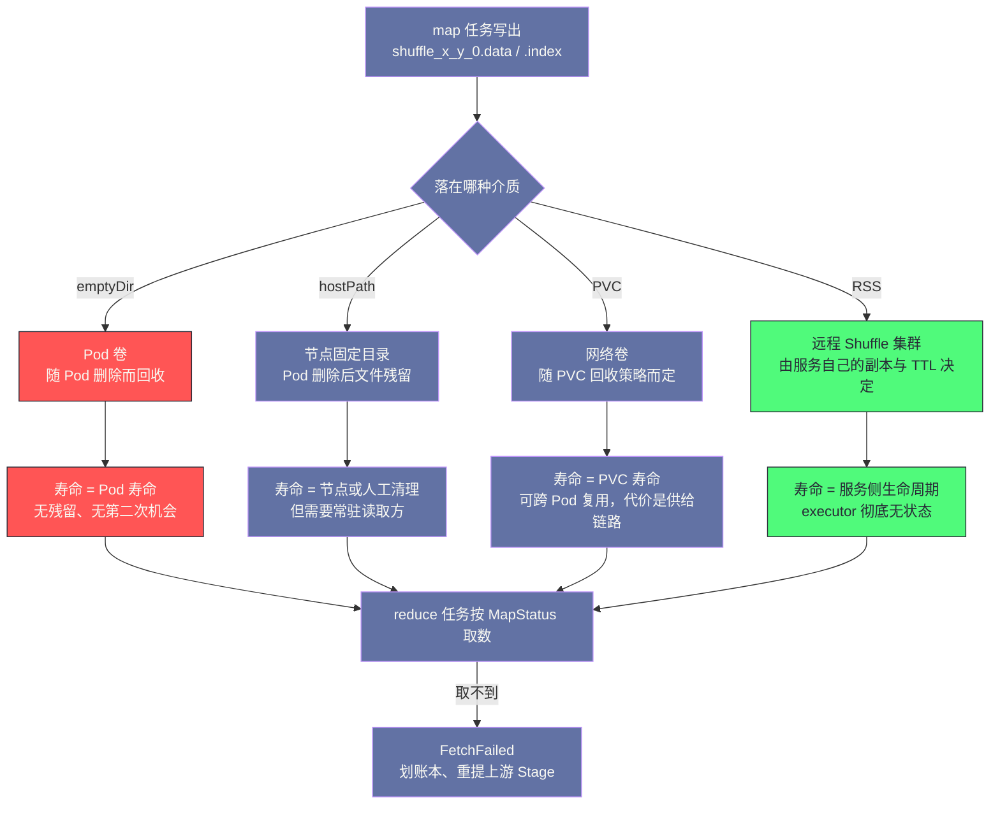
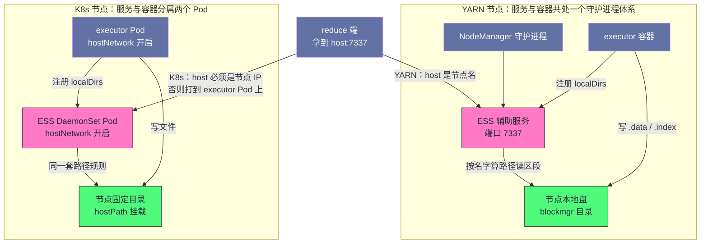
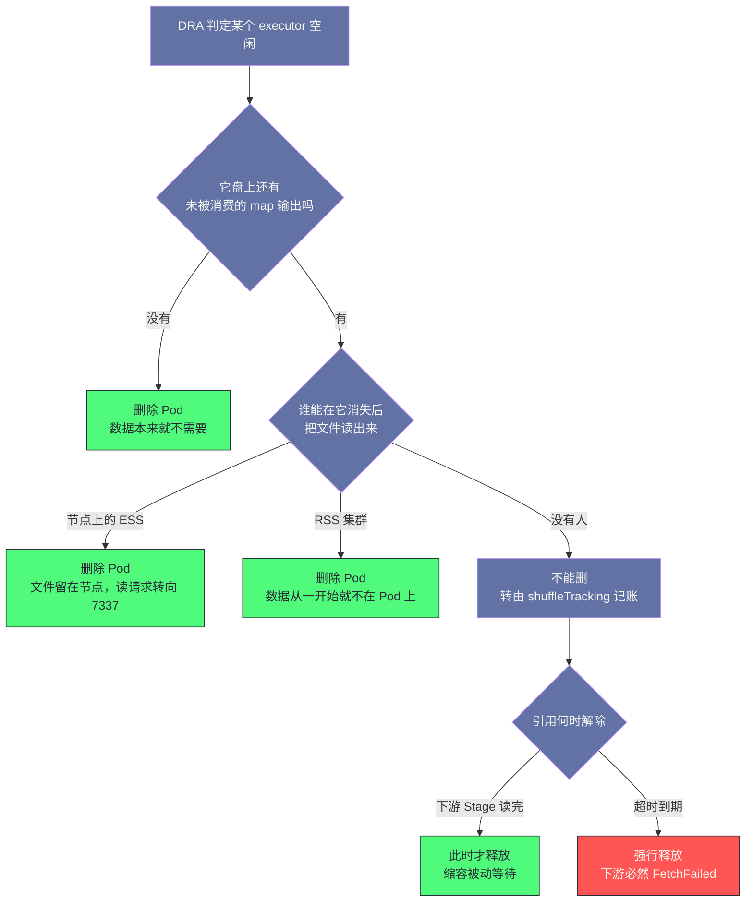
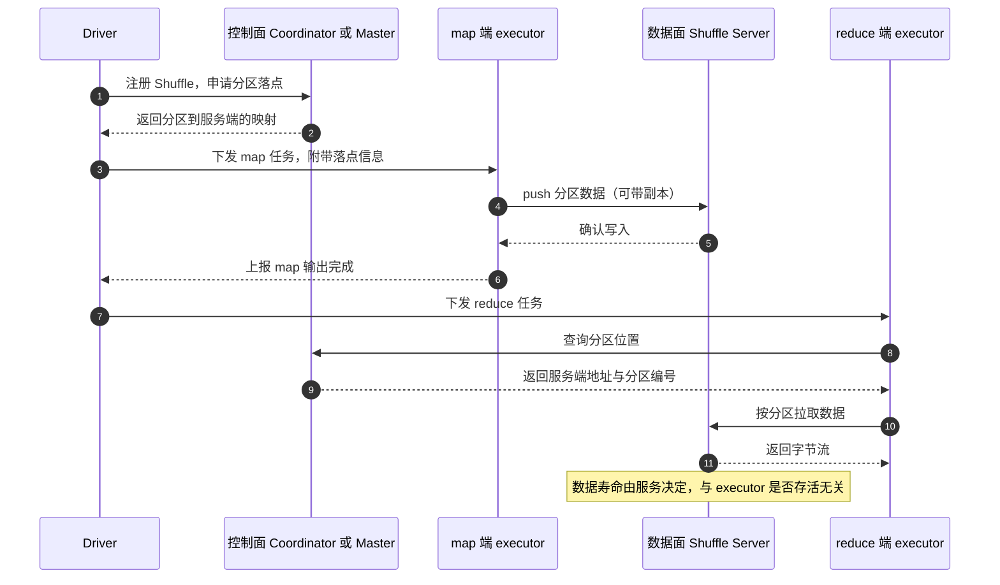
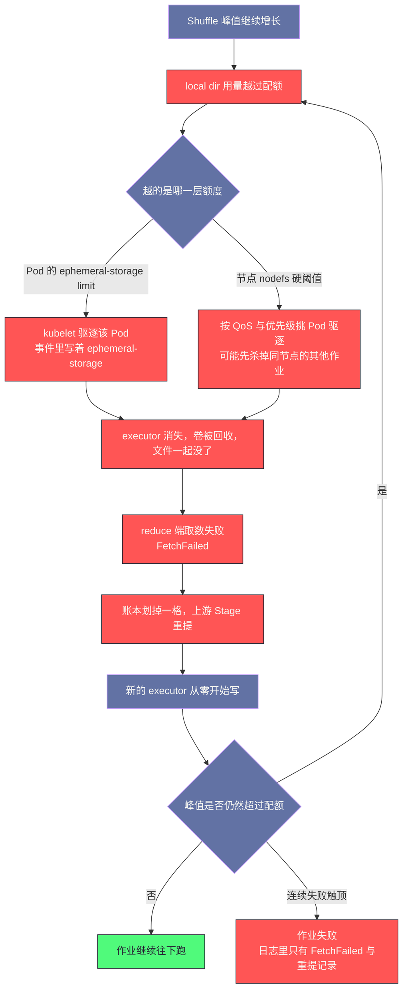
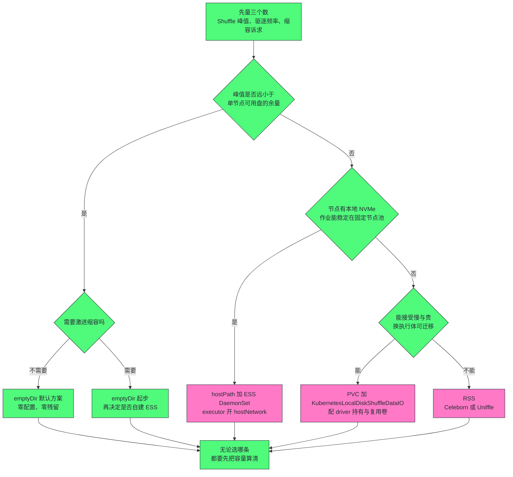

# 06 存储与 Shuffle：PVC、HostPath 与 Remote Shuffle Service

**摘要：**

Spark 的 Shuffle 输出是停在磁盘上的有状态中间产物，它的寿命必须比写下它的进程更长，才谈得上被下游读完。YARN 用每个节点上常驻的外部 Shuffle 服务（External Shuffle Service，ESS）把"谁写的"与"谁能读"拆成两件事，Kubernetes 没有这个位置：kubelet 只按 Pod 规格创建卷与容器，不是可插拔的数据服务，而 Pod 又是调度与回收的基本单位，于是一份 Shuffle 文件的命运被绑在 executor Pod 一次性的生命周期上。本文只讨论落点问题——这些文件写在什么介质上、能活到什么时候、写完之后谁还看得见它们。文章先界定矛盾，再逐一拆解 K8s 里三种本地落点（emptyDir、hostPath、PVC）的介质、记账方式与生命周期，说明 hostPath 为什么必须与常驻读取方配套才能兑现收益，外部 Shuffle Service 在 K8s 上为什么只能以 DaemonSet 加 hostNetwork 的形态出现、以及它为何是动态资源分配的前提；随后讨论以 Celeborn、Uniffle 为代表的远程 Shuffle 服务（Remote Shuffle Service，RSS）如何把有状态的部分搬出 Pod，换来哪些自由度、又新增哪些故障面；最后落在容量规划与选型边界上，把"Shuffle 峰值涨过配额、Pod 被驱逐、Stage 重算、再涨再驱逐"这条链条拆开。全文以 Spark 4.3.0（2026-10-30 发布）与 Kubernetes 1.37 为口径，参数默认值以官方文档为准。

---

## 第 1 章 一份需要活过写它的进程的中间产物

### 1.1 范围与一个贯穿全文的作业

本章所说的落点，只指 Shuffle 输出（map 端写下的 `.data` 与 `.index` 两个文件）在 K8s 集群里停在什么介质上、由谁保管、能活多久。至于这些文件如何被命名成地址、读侧如何把一次 Shuffle 切成请求、失败之后谁去重算，属于另一条叙事线，本文只在必要处借用结论，把篇幅留给存储这一侧。这个限定很重要，因为 K8s 上关于 Shuffle 的多数争论其实不在机制层面——机制在 YARN 与 K8s 上是同一套代码——而在"文件放在哪里"这个看似朴素的问题上。

为了让后面的讨论有具体的着力点，笔者设想一个每天凌晨跑的结算作业 `nightly_settle`：从 HDFS 读前一天的全量订单明细，200 个分区，按 `(merchantId, hour)` 聚合出交易额与笔数（1000 个 reduce 分区），再与一张 8GB 的商户维表做 join 补上行业分类与费率（维表超过广播阈值，走的是 SortMergeJoin，因此又一次 Shuffle），最后按支付渠道二次聚合写回数仓。这个作业有三个宽依赖，也就有三段 Shuffle；假定每个 map 分区的输出均值 200MB，那么单次 Shuffle 的落盘量就是 200 × 200MB = 40GB 的量级，而在相邻两个 Stage 交接的时刻，上一段的输出还没有被消费完、下一段的输出已经开始写，盘上同时存在两份，峰值大约 80GB。

集群侧按四台计算节点、每台 8 核 32GB、放 4 个 executor 来配，节点系统盘 200GB。把 80GB 摊到 16 个 executor 上，每个本地目录只需装下 5GB 上下的文件，看起来不紧张；但这条账要在第 7 章重算一遍，因为 spill、临时文件、镜像与日志都要与它分享同一块盘，而"估算值"与"最坏值"之间往往差着一个数量级。

### 1.2 YARN 里那个常驻的位置

在 YARN 集群上，这个问题在十几年前就已经被一次部署形态的选择解决了。每个节点常驻一个 NodeManager 守护进程，ESS 作为它的辅助服务（AuxiliaryService，配置项里叫 `spark_shuffle`）注册进去，监听 7337 端口。executor 启动时把自己的本地目录列表、子目录数、shuffle 管理器类名登记给它；map 任务写下的文件仍落在 executor 的本地盘上，但读请求不再打到 executor，而是打到那台机器上的 7337。三个动作凑在一起，才让"数据寿命"与"进程寿命"分家：

- executor 停止时，`DiskBlockManager` 不会删除本地目录——开启外部服务时 `deleteFilesOnStop` 为假，文件留在原处；
- Driver 上的 `MapStatus.location` 里放的不是 executor 自己的地址，而是 `blockManager.shuffleServerId`，开着外部服务时它指向 `BlockManagerId(execId, host, 7337)`，读方拿着这个地址去问服务；
- Shuffle 生命周期结束时 Driver 通知各节点注销，被回收的 executor 目录由 `spark.shuffle.service.removeShuffle`（3.3.0 起默认 `true`）安排清理。

这个设计的克制之处在于服务本身极薄：一张注册表、一套与 executor 内部同构的路径规则、一条从文件区段到 socket 的通道，数据从不进服务的内存。**它不理解 `StorageLevel`，不做副本，不缓存，只把"这批文件归谁读"从进程里摘出来**——盘坏了、目录被清了、服务进程自己崩了，结果一样是 `FetchFailed`。

### 1.3 Kubernetes 缺的不是功能，是位置

把同一套想法搬到 K8s，会发现三个环节都缺一个可以安放的位置。kubelet 不是可插拔的容器管理服务，容器运行时接口（Container Runtime Interface，CRI）里也没有"给节点注册一个数据服务"这样的概念；Pod 是调度与回收的基本单位，删 Pod 就把名下的卷一起带走，emptyDir 正是这样被回收的；剩下能做的只有在节点上另放一个工作负载，这又回到地址如何对齐的问题。

官方的态度写得很直白：Spark 4.3.0 的 K8s 部署文档在"Future Work"一节里仍然列着 External Shuffle Service 这一条。这句话的分量在于它是一种承诺的反面——框架作者认为这条路还没有被纳入支持范围，所以所有在 K8s 上跑 ESS 的方案，都是使用者自己在拼装。

于是 K8s 上的默认行为就只能是"把文件写在 Pod 自己身上"：Spark 为 `spark.local.dir`（默认 `/tmp`）或环境变量 `SPARK_LOCAL_DIRS` 里列出的每个目录各建一个 emptyDir 卷，卷名以 `spark-local-dir-` 开头，Pod 删除时一并回收。文档对此只有一句轻描淡写的说明：emptyDir 用 K8s 的临时存储特性，不跨越 Pod 的生命周期。

### 1.4 根本矛盾

把上面几段压缩成一句话，就是本文所有讨论的地基：**Pod 是可丢弃的调度单位，Shuffle 输出是需要被下游读完的有状态数据，K8s 上每一种存储方案的差别，都可以还原成这两者被绑得有多紧。** 这句话有三个可观测的后果，分别对应运维日常里的三类抱怨。

第一类是驱逐即重算。竞价实例被回收、节点内存压力触发驱逐、高优先级作业抢占、节点滚动升级，都会让 executor Pod 消失，文件随卷一起消失。此时 Driver 的账本还没更新，reduce 任务拿着旧地址去取数，连接被拒，重试耗尽后抛出 `FetchFailed`，账本上那一格被划掉，上游 Stage 重提，只重算缺失的 map 分区——如果新写出的输出又落在一个很快被回收的 Pod 上，就再来一轮。

第二类是缩容受限。动态资源分配（Dynamic Resource Allocation，DRA）的核心动作是"空闲就还资源"，但 Shuffle 输出恰恰是那种"看起来空闲、实际不能还"的东西：一个 executor 可能十分钟没接到任务，可它盘上躺着后面几个 Stage 要读的 5GB 文件。没有常驻读取方，唯一安全的判据只能是"账本上没人引用它"，这就是 `shuffleTracking`；而它的超时默认是 `Long.MaxValue`，也就是只要还有引用就一直等，"扩容积极、缩容保守"的不对称由此而来。

第三类是漂移无依。executor 从 A 节点被重调度到 B 节点，文件留在 A 节点。如果 A 节点上没有别的进程能替它把文件读出来，这次重调度在数据层面等同于丢失——文件还在，但地址簿已经失效。

### 1.5 一个码头比喻

不妨把 Shuffle 输出想成码头上待转运的集装箱。写它的 map 任务是卸货的船，读它的 reduce 任务是来提货的卡车，两者之间隔着一段时间，这段时间里箱子必须停在堆场上，而且要有一个人认得出"这条船的第几个箱位在哪"。YARN 里那个管理员是常驻的：船走了，箱子还在，提货单上写的是堆场编号而不是船号；K8s 里没有这个编制，船一离港，堆场跟着船一起拖走。这个比喻的技术限定在于：管理员从不向船要数据，他只按"船名-航次-箱号"这套命名规则算出堆场坐标，自己去磁盘上取——正因为如此，船沉了他也照样能取货。

把这批"集装箱"的去路画成一张全景图，四种落点各自把寿命交给了谁，就一目了然了。



图上左右两端代表两个极端：emptyDir 把数据寿命压到与 Pod 等长，RSS 把它完全搬出 Pod 的管辖；中间两支试图在节点或卷上做延长，代价各不相同。四种落点里没有一种靠副本换可靠性——除 RSS 的复制策略之外，Shuffle 数据始终只有一份。

### 1.6 本篇路线

接下来的七章按"落点由近及远"推进：第 2 章拆 emptyDir 的三种介质与记账方式；第 3 章讲 hostPath 的可用性前提与多租户目录冲突；第 4 章把 PVC 的代价一笔一笔算清；第 5 章处理 ESS 的形态之争，回答"DaemonSet 还是 sidecar"并解释它为什么是 DRA 的前提；第 6 章讲 RSS 的解耦思路与新增故障面；第 7 章把容量、驱逐与归因串成一条链路；第 8 章给出选型表、决策路径与反例速查。

---

## 第 2 章 emptyDir：默认落点与它的三种介质

### 2.1 Spark 在 K8s 上的默认动作

如果没有显式声明本地存储卷，Spark 在创建 executor Pod 时会为 `spark.local.dir` 或 `SPARK_LOCAL_DIRS` 里的每个目录挂一个 emptyDir，卷名统一带 `spark-local-dir-` 前缀。这个前缀不是命名习惯而是约定：只有以它开头的卷才会被当作 Spark 的本地存储目录，其他名字的卷挂进去也不会被 `DiskBlockManager` 认领。落进这个目录的东西不止 Shuffle 文件——`ExternalSorter` 溢写的临时文件、合并 spill 的中间文件、读侧大块落盘的临时文件，全都写在同一批目录里。**Spark 在 K8s 上并不区分"Shuffle 目录"与"spill 目录"**，这一点是后面容量规划所有麻烦的源头。

目录内部是一个以 `blockmgr-` 加 UUID 命名的父目录，下面 64 个十六进制子目录，文件按名字哈希散落。UUID 每次启动都不同，所以同一个 Pod 里重启容器之后，新进程看不到旧进程写的文件，虽然文件还在。

### 2.2 默认介质：节点根盘

不带 `medium` 字段的 emptyDir 落在节点文件系统上，物理位置在 kubelet 的 Pod 目录（`/var/lib/kubelet/pods/<pod-uid>/volumes/`）之下，与容器镜像层、容器日志、以及其他 Pod 的 emptyDir 共享同一块设备。这个"共享"在容量规划上的含义是：一个作业写满盘，受害的并不只是它自己，同节点上所有 Pod 的可写层、日志、临时卷都会一起受影响。

记账口径也随之变成两层。一层是 Pod 级：如果给容器声明了 `ephemeral-storage` 的 request 与 limit，emptyDir 的用量会计入这个额度，超限时 kubelet 驱逐该 Pod。另一层是节点级：kubelet 自身有基于 nodefs 与 imagefs 的驱逐阈值，节点盘使用率越过硬阈值时，它会按 QoS 等级与优先级挑 Pod 驱逐。两层都可能触发，而 Spark 并不会替你估算 ephemeral-storage 该填多少，这个数只能由平台侧通过 podTemplate 或准入层注入。

性能上，默认介质就是节点根盘的速度。多数云主机的系统盘是网络盘或共享盘，随机写性能有限；本地 NVMe 节点上会好一些，但也要与同节点的其他 Pod 抢 IOPS。还有一层干扰：写入先进 page cache，脏页回写由内核调度，多个 executor 同时大量写 Shuffle 时，回写带宽的抖动会让写延迟出现周期性尖峰。

### 2.3 第二种介质：内存

Kubernetes 允许把 emptyDir 的 `medium` 设为 `Memory`，此时卷背后是 tmpfs，写在内存文件系统里。Spark 为此提供了一个开关 `spark.kubernetes.local.dirs.tmpfs`（默认 `false`），打开之后所有 local dir 对应的 emptyDir 都会被配置成 tmpfs。官方的适用场景很具体：没有本地盘、远端存储通过节点文件系统挂载的环境，大量 executor 往远端盘写反而会拖垮性能。

代价是记账对象的改变。**tmpfs 的用量全额计入 Pod 的内存账**，与 JVM 堆争同一个 cgroup 额度，超限的表现不是"磁盘满"而是 `OOMKilled`——exit code 137，日志里没有磁盘相关的线索，只有容器被杀。官方文档特意提醒要相应调大 `spark.{driver,executor}.memoryOverheadFactor`，原因就在这里：堆之外要留出放 Shuffle 文件的空间。这条提示还有一层隐含意思，即内存型 local dir 让"Shuffle 量"与"堆大小"绑在了一起，一个作业的 Shuffle 峰值会倒逼它的内存规格，内存规划从单变量问题变成两难。

### 2.4 第三种介质：限额

emptyDir 自身可以带 `sizeLimit`。它不是"写满就报错"，而是"写满就驱逐"：kubelet 周期统计卷用量时发现越界，会把整个 Pod 标记为驱逐对象；如果介质是 `Memory`，这个额度同时成为 tmpfs 的容量上限，越界表现为容器因内存超限被杀。这个差异值得记住，因为它决定了故障的表象：一种是 Pod 进入 `Evicted` 状态、事件里写着 `ephemeral-storage`；另一种是容器 `OOMKilled`、重启计数加一。两条线索指向同一个根因，却出现在完全不同的观测面上。

Spark 与介质相关的入口只有 `spark.kubernetes.local.dirs.tmpfs` 一个（3.0.0 起，默认 `false`）；emptyDir 自身的 `sizeLimit` 在 Spark 的卷配置项里没有对应选项——`options.sizeLimit` 是 PVC 类型的选项，`options.medium` 则谁都没有。要精确设定 emptyDir 的限额与介质，只能落到 podTemplate 的 Pod 规格里，或由准入层统一注入。这个现状本身就说明了 Spark 对本地存储的态度：它假设 local dir 是一个"够用就好"的临时空间，而不是需要精细治理的资源。

把三种介质并排看，差异集中在"落在哪、算谁的账、超限怎么死"三处。

| 介质 | 物理落点 | 记账对象 | 超限表现 | 写性能 | 适合的场景 |
|---|---|---|---|---|---|
| 默认（不带 `medium`） | 节点文件系统，kubelet Pod 目录下 | Pod 的 ephemeral-storage 与节点 nodefs 两层 | Pod 被驱逐（`Evicted`） | 取决于节点盘，通常是网络盘或共享盘 | 中小作业、Shuffle 峰值远小于节点盘 |
| `medium: Memory` | tmpfs，内存文件系统 | Pod 的内存 cgroup | 容器 `OOMKilled`（exit 137） | 内存带宽级，远高于磁盘 | 无盘节点、远端盘性能差的集群 |
| 带 `sizeLimit` | 随介质而定 | 随介质而定，额度硬顶 | 磁盘介质驱逐、内存介质 OOM | 与介质一致 | 需要给单作业设硬边界的多租户集群 |

> [!warning] 一个容易混淆的地方
> `sizeLimit` 管的是卷的容量，`ephemeral-storage` 的 limit 管的是 Pod 所有临时存储的合计。两者都设的时候，先撞到哪个就先死哪个；两者都不设的时候，Pod 只能在节点级驱逐阈值上被挑出来，而那时节点上其他作业已经在陪葬了。

### 2.5 生命周期：删即删，重启不删

emptyDir 的生命周期绑在 Pod 上而不是容器上。容器崩溃重启，Pod 沙箱不变，emptyDir 里的文件还在；Pod 被删除或被驱逐，沙箱销毁，卷目录一起回收。这个区分对 Shuffle 反而偏负面：容器重启这一档"数据保住了"的场景在 Spark 里几乎不会发生（executor 的 `restartPolicy` 是 `Never`），而真正会发生的删除与驱逐，恰好是数据全丢的那一档。

好处是没有残留。emptyDir 的方案不需要清理 Job，不需要考虑"上一轮作业的孤儿文件"，节点回收 Pod 时顺手就把账结清了。这个特性在测试环境与小规模生产里价值很高——它把一整类运维工作直接消掉了，而这正是默认方案能在多数团队里活下来的原因。

坏处是没有第二次机会。文件随 Pod 一起消失，意味着任何"先缩容、等会儿再扩回来读"的思路都不成立。

### 2.6 与动态分配的第一次相遇

`spark.dynamicAllocation.shuffleTracking.enabled` 自 3.0.0 起默认 `true`，在没有外部 Shuffle 服务的部署里它是必须开着的：Driver 在回收 executor 之前查一遍账本，凡是还被后续 Stage 引用的就不动。`spark.dynamicAllocation.shuffleTracking.timeout` 的默认值是 `Long.MaxValue`，也就是这个"看守"没有到期时间。

这个默认值带来的行为很有辨识度：负载明明已经下去了，executor 却迟迟不释放，`executorIdleTimeout` 到了也不动。它并不是 DRA 失灵，而是账本在说话——那几个 executor 上还挂着未被消费的 map 输出，Driver 不敢还。emptyDir 把缩容的判断依据完全推给了账本，而**账本的保守程度由那个超时值决定**；把它调小，等于允许"看守提前下班"，代价是下班之后那些数据就读不到了。

这一章要回答的问题到这里可以收一句：emptyDir 在 K8s 上不是"次优解"，它是"把复杂度降到最低"的解，代价是把数据寿命压到与 Pod 等长，再用 DRA 的账本把这个缺口堵上。当作业的 Shuffle 峰值足够小、或者集群很少发生驱逐时，这笔交易是划算的。

---

## 第 3 章 hostPath：把节点当半持久存储

### 3.1 从 YARN 带来的直觉

从 YARN 迁过来的团队对 hostPath 往往有一种天然的好感：过去 `spark.local.dir` 就指向节点的 `/data1`、`/data2`，Shuffle 文件躺在那上面，性能可控、容量可算、清理脚本现成；到了 K8s，最省事的迁移方式就是把同一块盘用 hostPath 挂进 executor Pod，其余配置照抄。这个直觉在性能上通常成立——数据不进网络卷、不经过 CSI、不经过 unionfs 的可写层，写路径几乎与裸机一致。

声明方式也不复杂，三行配置就能把卷挂进去：卷类型选 `hostPath`，`options.path` 指向节点上的目录，`mount.path` 指定容器内的挂载点，容器内的路径再交给 `spark.local.dir`。这里有一个必须遵守的细节：卷名仍要以 `spark-local-dir-` 开头，否则 Spark 不认为它是本地存储目录，挂了也不会往里写。

```properties
# 卷名必须带 spark-local-dir- 前缀，否则不会被当成 Spark 本地目录
spark.kubernetes.executor.volumes.hostPath.spark-local-dir-nvme.options.path=/mnt/nvme/spark-local
spark.kubernetes.executor.volumes.hostPath.spark-local-dir-nvme.mount.path=/mnt/spark-local
spark.kubernetes.executor.volumes.hostPath.spark-local-dir-nvme.mount.readOnly=false
```

### 3.2 它只改变"写到哪"，不改变"谁来读"

这里先拆掉一个流传很广的误解：有些笔记把注意力放在"reduce 任务能不能访问这个目录"上，然后自我安慰说"reduce 是通过网络向 map 端拉数据的，不直接读盘，所以节点漂移不是问题"。前半句是对的，后半句却推不出想要的那个结论：reduce 端确实不直接读盘，但它读的是 `MapStatus.location` 指向的那个地址，而那个地址上的监听者就是写文件的 executor 进程。进程没了，端口没了，那么节点上文件还在不在，对读方毫无意义。

更准确地说，**hostPath 单独使用时，它带来的净收益只有两条：Pod 删除后文件残留在节点上，以及写入路径更短**；前者在没有常驻读取方的前提下甚至算不上收益，只是把"数据丢失"变成了"垃圾堆积"。要让它兑现成"数据活得比进程久"，必须同时有一个进程能在 executor 消失后按同一套路径规则把文件读出来——在 K8s 上这个进程就是第 5 章的 ESS DaemonSet。这也解释了为什么很多团队试过 hostPath 之后觉得"性能提升不明显"：Shuffle 的端到端时间由写侧与读侧共同决定，读侧那一跳仍然是网络，换盘只改了其中一半。

### 3.3 三个可用性前提

hostPath 看起来是把节点目录借给 Pod，实际上是把 Pod 钉在了节点上，这个隐含约束会产生三条前提。

第一条是调度必须可控。文件在哪个节点，取决于 Pod 被调度到哪个节点，而 Spark 的 executor 由 Driver 动态申请、由 K8s 调度器决定落点。要让数据可预期，就得用 nodeSelector 或节点亲和性把 executor 限制在有盘的那批节点上。代价是资源碎片：有盘的节点被作业占满时，没盘的节点不能顶上，集群的整体利用率下降。

第二条是目录必须可写。Spark 官方镜像默认以 UID 185 运行，而 `type: DirectoryOrCreate` 建出来的目录属主是 root、权限是 0755，容器里的进程写不进去，报错是 `Permission denied`，表现为 Shuffle 写入阶段直接失败。解决办法有三种：节点初始化时由运维脚本建目录并设成组可写、用 initContainer 做一次 chown、或者给 Pod 设 `fsGroup` 让 kubelet 在挂载时改属主。三种都有人用，但都要在平台层统一，不能指望每个作业自己配。

第三条是节点不能随意换代。换盘、重装系统、缩容下线都会让上面的目录消失，而这些操作在云上往往是自动化的。hostPath 上的数据寿命因此由节点的运维节奏决定，比"节点不宕机"这个假设脆弱得多。

| 前提 | 不满足时的表现 | 检查手段 |
|---|---|---|
| executor 被钉在有盘的节点 | Shuffle 写入落在无盘节点的根盘上，容量与性能都失控 | `kubectl get pod -o wide` 看 nodeName，对照节点标签 |
| 目录对 UID 185 可写 | 任务报 `Permission denied`，Stage 反复失败 | 在节点上 `ls -ld` 目标目录，或在 Pod 内 `touch` 试探 |
| 节点不被重建或换盘 | 目录凭空消失，历史残留与在写数据一起没了 | 节点上线流程里是否有"初始化本地盘目录"这一步 |

### 3.4 多租户下的目录冲突

一块节点盘被所有作业共用时，冲突不在于文件互相覆盖——每个 executor 的子目录名里有随机 UUID，撞名概率极低——而在于三件更隐蔽的事。

其一是**容量与 inode 共享，责任却不共享**。A 作业写满盘，B 作业的 Shuffle 写入会以 `No space left on device` 失败，而 B 的日志里不会出现"A 作业"这三个字。inode 是同一回事：大量小文件（分区极细的作业会写出海量小文件）耗尽 inode 之后，任何新建文件都会失败，报错同样是那句 `No space left on device`，但它与容量无关，`df -h` 看着还有大半空闲，`df -i` 才是真相。

其二是清理责任无人认领。hostPath 上的文件不会随 Pod 消失，于是必须有人清；清理器通常是节点上的一个 DaemonSet，按目录的最后修改时间做差集。问题在于"最后修改时间"是文件写完的时刻，而读取窗口可能在几十分钟之后——一个 executor 的 Shuffle 输出要等下一批 reduce 任务起来才会被读，中间隔着调度、排队、其他 Stage 的执行。按 30 分钟阈值清理的脚本，在高负载集群上删掉正在被读的文件是常态，而故障表现又是 `FetchFailed`，与网络故障长得一模一样。

其三是权限边界被击穿。不同 namespace 的 Spark 作业共用同一个 UID 185，目录属主相同、权限相同，于是"换个 namespace"不再意味着隔离：任何能挂上这块盘的 Pod，都能读到别的租户写在里面的 Shuffle 中间数据。订单明细的聚合中间态、用户维表的 join 输出，这些都是真实的数据泄漏面，而它在 K8s 的 RBAC 模型里是隐形的——RBAC 管的是 API 访问，不管文件系统。

### 3.5 准入与清理

安全侧还有一层。Pod Security Standards 的 Restricted 档位只放行 `configMap`、`csi`、`downwardAPI`、`emptyDir`、`ephemeral`、`persistentVolumeClaim`、`projected`、`secret` 这八类卷，hostPath 不在其中；多租户集群里如果启用了这一档，就必须给 Spark 的命名空间开例外，而例外一旦开了，限制就形同虚设。较常见的折中是只在专用的"计算型命名空间"里允许 hostPath，并用准入策略把 `options.path` 限制在固定前缀上，不允许挂 `/`、`/var/lib/kubelet`、`/etc` 这类路径。

清理策略则需要在三个参数上做取舍：目录年龄阈值要大于作业的最大 Stage 间隔，否则会误删在用的文件；清理范围要按 appId 前缀分组、与活跃作业集合求差，而不是单纯按时间；删除方式要先改名再删，避免读方在遍历目录的中途看到半删状态。这些都不是高深设计，但缺一条就会在生产里以"偶发 FetchFailed"的形式反复出现。

---

## 第 4 章 PVC：把 Pod 的一次性换成卷的常驻

### 4.1 声明形态与 OnDemand

持久卷申领（PersistentVolumeClaim，PVC）在 K8s 上的定位是"与 Pod 解耦的存储"，把它挂给 executor 的逻辑很自然：卷还在，Pod 死了也没关系。Spark 为每个 executor 动态申请 PVC 的方式是把 `claimName` 设成 `OnDemand`，再给 `storageClass` 与 `sizeLimit`：

```properties
# OnDemand 让 driver 为每个 executor 现申请一个 PVC
spark.kubernetes.executor.volumes.persistentVolumeClaim.spark-local-dir-1.options.claimName=OnDemand
spark.kubernetes.executor.volumes.persistentVolumeClaim.spark-local-dir-1.options.storageClass=fast-ssd
spark.kubernetes.executor.volumes.persistentVolumeClaim.spark-local-dir-1.options.sizeLimit=100Gi
spark.kubernetes.executor.volumes.persistentVolumeClaim.spark-local-dir-1.mount.path=/data
spark.kubernetes.executor.volumes.persistentVolumeClaim.spark-local-dir-1.mount.readOnly=false
```

形态上它比 hostPath 干净得多：不需要钉节点，不需要预建目录，权限由卷的属主与 `fsGroup` 决定，容量有明确上限。但要把它当作 Shuffle 的落点，得先算清四笔代价。

### 4.2 代价一：供给链路在启动路径上

一个 PVC 从"被申请"到"能被容器写"，中间有四段：动态供给（StorageClass 背后的 CSI 去云上创建盘）、绑定（PV 与 PVC 配对）、挂接（把盘 attach 到 Pod 所在的节点，受单节点 attach 上限约束）、挂载（在节点上格式化成文件系统并 mount）。四段里最慢的通常是第一段与第四段，云盘创建在秒级到十几秒量级，首次格式化也不便宜。

**这段延迟被直接接进了 executor 的启动路径**，而 DRA 的扩容恰恰是"一批一批地要 executor"。原本 executor 的启动时间是"调度 + 拉镜像 + 起 JVM"，现在多了一段"等盘"；批次越大，等待越明显，供给端的并发与配额会在几十秒内决定这批 Pod 是全部起来、还是只起来一半。更麻烦的是失败重试：供给失败（配额不足、同可用区库存不足、attach 上限）会让 Pod 卡在 `Pending`，而 Spark 侧看到的是"executor 迟迟不注册"，重试逻辑与超时判定都不在存储这一层。

### 4.3 代价二：绑定策略与拓扑

StorageClass 的 `volumeBindingMode` 决定卷何时绑定。`Immediate` 在 PVC 创建时立刻供给并绑定，此时 Pod 还没调度，云盘已经被固定在某个可用区；调度器随后只能把 Pod 放到那个可用区的节点上——卷反过来限制了 Pod 的落点。`WaitForFirstConsumer` 反过来先让调度器选节点、再按节点所在区供给，代价是供给失败要等调度重试，容量不足时的反馈链路更长。

这条机制与 Zonal 存储结合在一起时尤其要留意：一个作业的 executor 可能因为卷的绑定被全部拉到同一个可用区，看起来像调度器偏科，实际是存储拓扑在起作用。

### 4.4 代价三：ReadWriteOnce 的真实含义

**`ReadWriteOnce`（RWO）的真实语义是"单节点读写"，不是"单 Pod 读写"**：同一个节点上的多个 Pod 可以同时挂同一个 PVC（只要卷插件支持），跨节点才被禁止。真正限制到单 Pod 的是 `ReadWriteOncePod`，它更严格，也更适合 Spark 每 Pod 一卷的模型。共享读写的 `ReadWriteMany` 需要 NFS、CephFS 这类支持多挂的文件系统，块设备的多挂会撞上文件系统一致性，不能直接拿来当共享卷用。

于是"把 Shuffle 输出写到共享卷、让任何节点都能读"这个想法，在 RWO 下不成立、在 RWX 下要付出网络文件系统的性能代价。这也是 PVC 方案在 Shuffle 场景里处境尴尬的根源：它想解决"数据不随 Pod 消失"，但 Shuffle 读侧要的是"数据能被任意节点读到"，而 RWO 恰好卡在中间。

### 4.5 代价四：回收策略与泄漏

`OnDemand` 生成的 PVC 默认带 ownerReference 指向使用它的 Pod，Pod 删除则 PVC 级联删除，再往下由 PV 的回收策略决定后端盘怎么处理：`Delete` 让 CSI 去删云盘，`Retain` 只解除绑定，留给人处理。

`Delete` 的问题在时序：PVC 删掉之后，云盘的删除是异步的，中间失败或漏掉的情况要靠存储侧对账发现；一个每天跑几百个 executor 的集群，漏掉的盘不会立刻可见，但账单会。`Retain` 的问题在责任：卷留下来了，但没人知道它属于哪个作业、能不能删，多租户环境下这种"无主卷"越积越多，最后变成存储团队的清理任务。

### 4.6 它真正的价值：把 Shuffle 数据搬到卷上

如果只看性能与启动延迟，PVC 在 Shuffle 场景里几乎一无是处——网络存储的 IOPS 打不过本地 NVMe，供给延迟又长。它真正的价值在另一处：Spark 内置了 `KubernetesLocalDiskShuffleDataIO` 这个插件，让 shuffle 数据在 executor Pod 消失之后，可以被挂载同一个 PVC 的新 Pod 重新读到。这是 K8s 上官方提供的、唯一一种能把 Shuffle 数据的寿命从 Pod 转移到卷上的手段。

它的前提并不轻松：PVC 必须能被复用，所以要让 driver 持有并允许复用（`spark.kubernetes.driver.ownPersistentVolumeClaim` 与 `reusePersistentVolumeClaim`），必要时再用 `waitToReusePersistentVolumeClaim` 让 driver 在卷库存耗尽时先等一会儿而不是继续申请 Pod；新 Pod 还必须能挂上这个卷（RWO 的挂载点是节点级的），卷的拓扑与调度要一起考虑。这几个开关自 3.4 起被称为"面向 PVC 的 executor 分配"。

写透这一点，也就理解了 PVC 方案的角色：它不是性能方案，而是**生命周期方案**里最笨的一条路——用卷的常驻换 Pod 的一次性，代价是每一层存储子系统的问题都会在 executor 的启动与回收路径上重现一遍。

### 4.7 Spark 4.3.0 的两个新旋钮

4.3.0 引入了 `ExecutorPVCResizePlugin`，思路与内存扩容插件一致：executor 自报本地目录的使用率，driver 定期读，超过 `spark.kubernetes.executor.pvc.resizeThreshold` 就按 `spark.kubernetes.executor.pvc.resizeFactor` 把该 Pod 上所有 `spark-local-dir-*` 的 PVC 扩容。约束写得很清楚：只能是 0 或 5 分钟的正整数倍，只能增不能减，没有上限，扩容失败的 PVC 在该应用生命周期内不再重试，而 StorageClass 必须 `allowVolumeExpansion` 且驱动支持在线扩容。它缓解了"Shuffle 峰值估不准"这个老问题，但也把容量规划换成了"容量自动增长的账单"，且增长本身不设边界。

另一条是 PVC 复用：当 driver 持有并复用 PVC 时，下一个复用该卷的 executor 会继承已经扩容过的容量。两条合起来，等于让"本地盘"具备了云盘式的弹性——这是 K8s 存储抽象第一次真正贴近 Shuffle 的节奏，代价是权限面（driver 的 ServiceAccount 要能读写 PVC）与状态面（PVC 成为作业的持久资产，作业异常退出会留下卷）都扩大了。

| 代价 | 具体表现 | 缓解手段 | 残余风险 |
|---|---|---|---|
| 供给链路 | executor 启动多出等盘时间，批量扩容更明显 | 预热卷池、复用 PVC、`waitToReusePersistentVolumeClaim` | 卷池与调度耦合，空闲卷占成本 |
| 绑定与拓扑 | 卷绑定反向限制 Pod 落点，executor 被拉到一个可用区 | 用 `WaitForFirstConsumer` 让调度先发生 | 供给失败的重试链路变长 |
| RWO 语义 | 跨节点不可读，共享卷只能走 RWX | 每 Pod 一卷；需要共享时换文件系统类存储 | RWX 的性能与一致性问题 |
| 回收 | 异步删除导致漏盘，Retain 导致无主卷 | 存储侧对账、按作业标签打标 | 多租户下标签本身可能缺失 |

---

## 第 5 章 外部 Shuffle Service：K8s 上的形态之争

### 5.1 服务本身只做三件事

ESS 的内部结构可以一句话概括：一张注册表、一套路径规则、一条通道。注册表的键是 `(appId, execId)`，值里装的不是数据，而是这个 executor 的本地目录列表、每个目录下的子目录数（默认 64）、以及 shuffle 管理器的元信息。路径规则与 executor 内部的 `DiskBlockManager` 完全同构：同一个非负哈希、同样的取模、同样的十六进制子目录名，因此服务能凭块名算出绝对路径。通道那一端更省事：按块名找到索引文件、读出起点与长度、返回一个指向文件区段的对象，由传输层把这段字节推进 socket。

**三件事里没有一件需要 executor 活着**。这正是它在 YARN 上成立的全部理由，也是它在 K8s 上需要被重新组装的三个零件。

### 5.2 DaemonSet：唯一能同时满足三个条件的形态

在 K8s 上跑 ESS，只能把它做成每节点一个的 DaemonSet。理由不是"DaemonSet 比较像 NodeManager"，而是三个必要条件同时指向它。

第一个条件是共享路径。服务要能算出文件路径，就必须与 executor 看到同一份目录与同一套规则。如果 executor 用的是 emptyDir，目录落在 kubelet 的 Pod 卷目录下，路径里带着 Pod UID，DaemonSet 里的进程根本看不到——除非把 `/var/lib/kubelet/pods` 整个挂进服务 Pod，那等于把节点上所有租户的 Pod 卷暴露给一个进程，安全上不可接受。譬如 executor 的本地目录是 `/var/lib/kubelet/pods/3f2a…/volumes/kubernetes.io~empty-dir/spark-local-dir-1`，这个路径里除了 kubelet 自己，没有第二个进程能可靠地拼出来。所以 **ESS 与 hostPath 天然是一对**：executor 写固定目录，服务读同一个固定目录，路径规则才有意义。这一条反过来解释了上一章为什么说 hostPath 单独用意义不大——它需要一个搭档，而搭档就是这一章的服务。

第二个条件是地址能对上。reduce 端拿到的地址来自 `MapStatus.location`，也就是 `shuffleServerId`，它由 `blockTransferService.hostName` 与 shuffle 服务端口拼成。K8s 里 `hostName` 默认是 Pod IP，而 7337 端口开在"另一个 Pod"（DaemonSet 的实例）里，reduce 拿着 executor 的 Pod IP 去连 7337，连到的是那台 executor Pod 自己的空闲端口，必然失败。要让地址对上，常见做法是让 executor Pod 也开 `hostNetwork: true`，此时 `hostName` 退化成节点 IP，`节点IP:7337` 正好命中该节点上的 DaemonSet 实例。**地址簿里的 host 与服务的实际位置必须落在同一台机器上**，这个约束是很多自建方案踩过的坑：服务跑起来了、注册也成功了，读侧却全量失败，根因在于两个 Pod 的网络命名空间不同。

第三个条件是要先于 executor 存在、晚于 executor 消失。DaemonSet 的实例生命周期与节点绑定，天然满足这一点；代价是它自己的升级窗口。滚动升级时该节点上的服务会短暂消失，那些节点上残留的 Shuffle 文件在那段时间不可读，所以升级策略要按节点分批，并且避开作业高峰。

把 YARN 与 K8s 两侧的部署形态并排画出来，那两处差异会显得格外刺眼，因为它们都不在 Spark 的配置文档里写着。



图上左右两侧的结构差异只有两处：多了一个 Pod 的边界，以及 host 的取值从节点名变成了必须对齐的节点 IP。这两处差异足以让"照搬 YARN 经验"的做法失效，而它们都不在 Spark 的配置文档里写着。把它落成清单大致是下面这个样子，关键在三处：`hostNetwork` 让地址退化成节点 IP、`hostPath` 让服务与容器看到同一份目录、镜像与主容器同源以免版本错位。

```yaml
apiVersion: apps/v1
kind: DaemonSet
metadata:
  name: spark-shuffle-service
spec:
  selector:
    matchLabels: {app: spark-shuffle-service}
  template:
    metadata:
      labels: {app: spark-shuffle-service}
    spec:
      hostNetwork: true                 # 让 shuffleServerId 里的 host 等于节点 IP
      priorityClassName: system-node-critical   # 服务必须先于 executor 就绪
      containers:
        - name: shuffle-service
          image: registry/spark:4.3.0
          command: ["/opt/spark/sbin/start-shuffle-service.sh"]
          env:
            - name: SPARK_NO_DAEMONIZE
              value: "true"
          ports:
            - {name: shuffle, containerPort: 7337, hostPort: 7337}
          volumeMounts:
            - {name: local, mountPath: /mnt/local}
      volumes:
        - name: local
          hostPath: {path: /mnt/local, type: Directory}   # 与 executor 同一路径
```

清单里最容易漏的是 `hostPath.type` 与目录属主：`Directory` 要求目录已存在，正好强制节点侧先做完初始化，避免 `DirectoryOrCreate` 建出 root 属主、UID 185 写不进去的目录。

### 5.3 sidecar 为什么不成立

既然每节点一个 Pod 麻烦，能不能把 ESS 塞进 executor Pod 里当 sidecar？答案是不能，理由在回收动作的粒度上。DRA 缩减容量时删的是 Pod，不是进程；sidecar 与 executor 同属一个 Pod，Pod 一删两个容器一起走，Shuffle 文件与能读它的人同时消失。要想让 sidecar 活下来，就得在"executor 进程退出"时只杀主容器、保留 Pod——可动态分配要归还的是 Pod 占用的资源，Pod 留着就没还，缩容等于没做。

所以 sidecar 形态的 ESS 只在"Pod 长期存活"的场景里成立，而批作业的模型恰恰相反。**真正的分野在这里：ESS 需要一个比 Pod 更长的生命周期，所以它只能是节点级的工作负载；RSS 需要的是一个不依赖 Pod 的存储服务，所以它的客户端可以是 sidecar，服务端一定不是。** 把这两个东西混为一谈，是很多方案文档里含糊的地方。

### 5.4 为什么它是动态分配的前提

DRA 只有两个动作：扩容与缩容。扩容是"按需建 Pod"，从来不难；缩容是"判断哪个能删"，难在判据。没有常驻读取方时，唯一安全的判据是"账本上没人引用"，也就是 `shuffleTracking`，而它的超时默认无穷大，缩容自由度接近于零。有常驻读取方时，判据回到"这个 executor 还闲不闲"：文件留在节点上、服务还能读，删 Pod 只影响计算资源。

这就是"前提"二字的准确含义：ESS 不是让 Shuffle 更快的加速器，而是让 DRA 的收益真正兑现的那把钥匙。缺了它，我们会看到 DRA 在 K8s 上收敛成一个"扩容积极、缩容保守"的半成品。

把缩容这个动作碰到分岔口的几种走法画出来，就能看清每条出口背后各需要一个什么样的读取方。



这张图的四条出口把四种部署形态的差别讲完了：能自由删的两条出口，背后各有一个不依赖 Pod 的读取方；不能自由删的那条，只能靠账本与时间。

### 5.5 removeShuffle 与 shuffleTracking 的分工

ESS 跑起来之后，清理成了必须回答的问题：Pod 删了，文件留在节点上，谁来删？答案是 `spark.shuffle.service.removeShuffle`（自 3.3.0 起默认 `true`）：Driver 在回收 executor 之后通知 shuffle 服务，服务把该 executor 的目录删掉。这条链路依赖"通知能路由到那台机器"，也就依赖 5.2 里那个地址对齐的前提；地址对不上时，通知发不到，目录就慢慢堆满节点盘。

`shuffleTracking` 则完全是另一条路：它不延长数据的寿命，只延长持有数据的 executor 的寿命，因此不需要任何额外进程，也不依赖地址，只需要 Driver 的账本。两者在语义上是互斥的替代关系——有 ESS 时通常把 `shuffleTracking` 关掉或把超时设小，让缩容更果断；没有 ESS 时它是唯一的保险。优雅下线（`spark.decommission.enabled`，默认 `false`）是第三条路：在 executor 退出前把 shuffle 块迁移到别的 executor 上，代价是迁移带宽，且要有接收方。

| 手段 | 数据活在哪 | 额外组件 | 缩容自由度 | 容忍节点漂移 | 失效后的后果 |
|---|---|---|---|---|---|
| ESS | 原节点的本地盘，由独立进程托管 | 每节点一个 DaemonSet | 高，只看是否空闲 | 不涉及，读请求按节点地址路由 | 服务进程或节点故障即不可读 |
| shuffleTracking | 原节点的本地盘 | 无 | 低，账本有人引用就不还 | 不涉及 | 超时到点释放后必然重算 |
| 优雅下线迁移 | 迁到另一台 executor 的本地盘 | 无 | 中，受迁移耗时约束 | 天然支持 | 迁移未完成即退出会丢数据 |
| PVC 复用 | 网络卷，可重新挂给新 Pod | 无，但需要卷可复用 | 中，受卷库存与拓扑约束 | 受 RWO 挂载点约束 | 卷供给失败则 Pod 起不来 |
| RSS | 远程 Shuffle 集群 | 一整套有状态服务 | 最高，与账本无关 | 完全支持 | 服务侧故障波及所有作业 |

---

## 第 6 章 远程 Shuffle 服务：把状态搬进一个有主人的服务

### 6.1 两层结构

前面四条路都在回答同一个问题的变体：怎么让节点上的那份文件活得更久。远程 Shuffle 服务换了个问法——为什么文件一定要写在计算节点上？它的答案是把 Shuffle 数据的所有权从 executor 手里拿走，交给一个专门的服务集群：控制面负责注册 Shuffle、分配分区、记录位置（Uniffle 叫 Coordinator，Celeborn 叫 Master），数据面负责接收 map 端的推送、落地、按分区供下游拉取（Shuffle Server 或 Worker）。

写侧的动作变成 `push`：map 任务算完一个分区，不落本地盘，而是通过网络把这段字节推给被分配到的服务端；服务端可以放在内存里，也可以落本地盘，再由它自己的策略决定何时下沉。读侧的动作变成"问控制面要位置，再去数据面拉"：reduce 任务拿到的不是某个 executor 的地址，而是一组服务端地址与分区编号。两边都只与 RSS 打交道，谁也不关心对方是不是还活着。

这个改变看似只是换了个写入目的地，实际把一整类约束消掉了：**Shuffle 数据不再依赖写它的进程、不再依赖那台机器、也不再依赖那个 Pod**。

### 6.2 谱系

这条路不是新想法。LinkedIn 在 2020 年公开的 Magnet 就把 map 输出推到远程服务并在服务侧合并，随后在 VLDB 2021 上有完整论文；阿里在 2022 年前后开源了 Celeborn（最初就叫 Remote Shuffle Service），其后进入 Apache 孵化器；Uniffle（原名 Firestorm）也在相近的时间进入 Apache。三者的共同点是"数据与计算分离"，差别在合并策略、存储分层与生态绑定：Magnet 强调服务侧合并以减少小文件与拉取次数，Celeborn 与 Uniffle 更强调对 Spark 多版本的原生支持，以及把内存、本地盘、HDFS 或对象存储做成可选的存储层。

对使用者而言，选型的关键往往不在这些差异，而在两件事：客户端与服务端的版本兼容策略，以及故障时谁兜底。前者决定了升级节奏能不能与 Spark 大版本解耦，后者决定了 RSS 出问题时作业是失败还是自动退回本地 Shuffle。

### 6.3 接入方式

Spark 从 3.x 起把 shuffle 的落盘与读取抽成了 `ShuffleDataIO` 插件接口，默认实现是 `LocalDiskShuffleDataIO`，通过 `spark.shuffle.sort.io.plugin.class` 换成别的实现。这是一条"只替换落盘与读取行为"的路，改动面小，兼容性好。另一条路是直接替换 `spark.shuffle.manager`，用各项目自己的 `ShuffleManager` 接管整个 Shuffle 生命周期——控制力更强，与 Spark 内部结构的耦合也更紧。

两条路的取舍很现实：插件路对 Spark 版本不那么敏感，但能改的东西有限；`ShuffleManager` 路能力强，代价是每次 Spark 大版本升级都要等客户端跟进。多版本混跑的集群里，前者通常更省心。

```properties
# 插件路：只换落盘与读取，Shuffle 其余机制不动
spark.shuffle.sort.io.plugin.class=<rss 客户端提供的 ShuffleDataIO 实现>
# ShuffleManager 路：接管整个 Shuffle 生命周期，耦合更紧
spark.shuffle.manager=org.apache.spark.shuffle.celeborn.SparkShuffleManager
# 两条路都必须处理的一件事：数据不在 Pod 上之后，缩容不必再看账本
spark.dynamicAllocation.shuffleTracking.enabled=false
```

最后一行的组合值得留意：`shuffleTracking` 在 RSS 下关掉不是因为它与 RSS 冲突，而是因为账本要保护的那份文件已经不在 Pod 上了，留着只会让缩容白白保守。

### 6.4 解耦换来的四样东西

第一样是**executor 彻底无状态**。既然 Shuffle 数据不在 Pod 上，DRA 缩容就不需要账本，`shuffleTracking` 可以关掉，`executorIdleTimeout` 到了就删；竞价实例被回收时，损失只是那一批正在跑的任务，不需要重提上游 Stage，也不需要重算已经完成的 map 输出。

第二样是调度自由。调度器可以只看资源、不看数据，不需要为了"让 executor 留在有它数据的节点上"而打亲和性标签，集群的碎片率因此下降。作业之间也不再因为"某台机器上还有别人的 Shuffle 文件"而互相占位。

第三样是硬件分工。计算节点不再需要本地 NVMe，可以做成纯 CPU 的规格；Shuffle 集群单独按 IO 规划，用同构的机器、统一的盘型，容量与性能都更好估算。

第四样是跨作业共享与削峰。RSS 集群的容量被所有作业共用，夜间高峰一起打上去，凌晨空下来给别人用；单个作业不必按自己的峰值申请磁盘，集群整体也不必按所有峰值之和准备空间。

### 6.5 新增的五个故障面

天下没有白拿的自由。把状态搬到一个服务里，等于把原来分散在每个 Pod 上的风险集中到了一处。

其一，RSS 自己成了有状态服务。它要有副本策略（否则单节点故障就丢分区）、要有 TTL 与清理（否则异常退出的作业留下孤儿数据）、要有控制面的高可用（否则控制面抖动时所有作业的 Shuffle 都卡住）、要有上下线时的分区迁移策略。这四件事在本地落点的方案里根本不存在，因为 Pod 的生死已经把所有麻烦一并带走了，现在得自己造一遍。

其二，写侧多了一跳网络。map 端的输出从"写本地盘"变成"推远端"，Shuffle 写吞吐受 RSS 集群的入带宽与副本数限制；开两副本就是双倍写入流量。读侧的路径反而变短了：原来要跨节点读 executor 的本地盘，现在读的是同一个服务集群，连接复用更好做，但总体是否更快取决于 RSS 的部署密度——RSS 与计算混部时，写流量会和读流量抢同一块网卡。

其三，两套容错并存。Spark 侧有 Stage 重提，RSS 侧有副本与重算，两者要在语义上对齐：分区丢失时是 RSS 内部用副本补，还是回报给 Spark 让它重算 map 分区？如果两边都以为对方会兜底，就会出现"数据没了但没人报错"；如果两边都兜底，就会出现重复计算。这个边界必须在接入时验证清楚，而不是等第一次故障时才发现。

其四，版本与协议耦合。客户端 jar 与服务端协议要匹配，升级窗口需要双向兼容；不同团队用不同 Spark 版本时，它会被放大成"谁的作业能连上新集群"。

其五，多租户与配额。RSS 是跨租户共享的组件，一个作业能把整个集群的容量写满，于是认证、授权、按队列的配额与限流都成了必需品。

还剩一处断裂：观测路径变了。Shuffle 的问题从"某台机器上的某个目录"变成"某个服务的某个分区"，按节点看盘、按 Pod 看日志的排障习惯直接失效，需要新的仪表盘与新的归因方法。

### 6.6 K8s 上的部署形态

RSS 在 K8s 上的部署没有 ESS 那些形态上的纠结，因为它本来就是一个独立服务。控制面用 Deployment 起两三个副本，客户端通过地址列表（Uniffle 的 quorum、Celeborn 的 Master 列表）发现，不依赖 Service 的负载均衡语义；数据面用 StatefulSet 配 PVC，或者用 DaemonSet 配本地盘——前者容量可伸缩、后者延迟低，与第 3 章的取舍同构。客户端与服务端之间用 Headless Service 暴露具体实例，让拉取能直接命中持有分区的那个 Pod，而不是被 kube-proxy 随机转发。

有一条边界要提前说清：不要对有状态的数据面用水平自动扩缩。新扩容的实例接不到已有分区，扩出来的容量只对新数据生效；缩容更糟，会把已有分区搬走或丢掉。数据面的容量要按集群总量规划，用队列配额去约束作业，而不是用副本数去追流量。

把一次 Shuffle 从注册到读完的往返画成时序，收益产生在哪一步、代价落在哪一跳，就很清楚了。



时序图里第 4 步是全部收益的来源：数据在 map 任务结束时已经离开了计算节点，此后 executor 是死是活都不影响第 10 步。第 6 步之后 map 端就不再参与，这也是"executor 无状态化"在协议层的具体含义。

---

## 第 7 章 容量：从 Shuffle 峰值到被驱逐的 Pod

### 7.1 三个量共用一块盘

要算容量，先要把"落盘的东西"数清。第一个量是未被消费的 map 输出，这是 Shuffle 的主项，它的峰值不等于整个 Stage 的总输出，而等于"某一时刻还没被下游读完的那部分"，最坏情况接近全部。第二个量是聚合与排序的溢出：`reduceByKey` 的 `ExternalAppendOnlyMap`、`sortByKey` 的 `ExternalSorter` 在执行内存不够时会把中间状态写进同一个目录。第三个量是读侧的临时文件：单个请求超过 `spark.network.maxRemoteBlockSizeFetchToMem`（默认 `200m`）时，取回的数据会落到 local dir 的临时文件里而不是堆内。

三个量的共同点是共用 `spark.local.dir`。所以**容量规划的对象不是"Shuffle 有多大"，而是这三项在同一时刻的合计峰值**，且必须按同一节点上并发运行的 executor 数量求和，再加上镜像层、容器日志、以及节点自身的系统占用。

### 7.2 一个算例

回到 1.1 的 `nightly_settle`，把假定值代进去算一遍：单次 Shuffle 40GB，两个 Shuffle 的输出在交接时刻并存即 80GB；spill 按 30% 追加约 24GB；合计约 104GB。节点上 4 个 executor 均摊，每个 executor 的 local dir 要能装 26GB；再乘 1.3 的安全系数，实际按 34GB 一个来规划。若这四个 executor 的 emptyDir 落在 200GB 的系统盘上，加上镜像与日志，余量已经很薄；若节点同时还在跑别的作业，撞上配额只是时间问题。

这个算例的价值在它暴露的两个习惯性错误：一个是拿输入数据量当 Shuffle 量——`nightly_settle` 的输入是 600GB，Shuffle 峰值才 104GB，因为聚合把数据压了下去；另一个是拿单个 Stage 的输出当峰值——真正撑爆盘的是两个 Stage 交接的那段时间，而不是任何一个 Stage 内部。估算要按"最坏时刻"而不是"平均时刻"来算。笔者倾向于把 1.3 这个安全系数写进平台侧的默认模板，而不是留给每个提交作业的人自己拍，因为它是个不该由业务方决定的数字。

### 7.3 驱逐链条

容量不足在 K8s 上不会以"写入报错"的形式出现，而是以"Pod 消失"的形式出现。链条是这样的：Shuffle 峰值增长，local dir 的用量越过配额；越界的是 Pod 的 `ephemeral-storage` limit 时，kubelet 驱逐这个 Pod，事件里写着 `ephemeral-storage`；越界的是节点 nodefs 的硬阈值时，kubelet 按 QoS 等级与优先级挑一批 Pod 驱逐，被挑中的可能根本不是写盘的那个作业。Pod 消失、卷被回收、文件随之消失；reduce 端拿着旧地址取数失败，抛出 `FetchFailed`；账本划格、上游 Stage 重提；新的 executor 从零开始写，如果峰值与配额没变，就会在同一个位置再撞一次；直到 `spark.stage.maxConsecutiveAttempts`（默认 4）触顶，作业失败。

把这条回路画成图，会更清楚它为什么会自己加速：每一轮重试都把更多的写入压回同一块已经满了的盘。



这条链条最麻烦的地方在于两侧的日志不通。K8s 侧记录的是 `Evicted`，Spark 侧记录的是 `FetchFailed` 与 Stage 重提，两个事件在不同系统里、由不同的人看，中间隔着一层"卷被回收"的因果关系。把这两条日志接到一起，是平台侧最值得做的一件事，比任何参数调优都有用。

### 7.4 参数面

| 参数 | 默认值 | 作用面 | 什么时候需要动 |
|---|---|---|---|
| `spark.local.dir` | `/tmp` | 本地目录，逗号分隔可指定多个 | 需要在单 Pod 内使用多块盘时；K8s 上每个目录会变成一个卷 |
| `spark.kubernetes.local.dirs.tmpfs` | `false` | 把 local dir 的 emptyDir 换成 tmpfs | 无盘节点、远端盘性能差；需同步调大内存 overhead |
| `spark.executor.memoryOverheadFactor` | `0.10` | 堆外内存比例 | 使用 tmpfs 或 Python 作业时上调 |
| `spark.shuffle.compress` | `true` | 是否压缩 map 输出，算法由 `spark.io.compression.codec` 决定（默认 `lz4`） | 换 zstd 可减字节，关掉压缩省 CPU 但盘与网络字节上升 |
| `spark.network.maxRemoteBlockSizeFetchToMem` | `200m` | 读侧大块落盘阈值 | 大分区多时下调以减少堆压力 |
| `spark.dynamicAllocation.shuffleTracking.timeout` | `Long.MaxValue` | 看守数据的超时 | 需要更激进缩容时设有限值，代价是超时后重算 |
| `spark.kubernetes.executor.pvc.resizeThreshold` | 以官方文档为准 | PVC 扩容触发阈值 | 用 4.3.0 的卷扩容插件时 |

表里最容易被误用的是最后一行与最后第二行。`shuffleTracking.timeout` 调小是一次"用重算换资源"的交易，调之前要确认重算的代价小于空转的成本；PVC 扩容阈值调低会让卷频繁变大，而卷只能增不能减，等于把容量规划的失误永久写进账单。

### 7.5 归因：从节点到 Pod 再到作业

盘满之后的排查顺序应当自下而上：先看节点 `Allocated resources` 与实际磁盘使用，确认是 nodefs 还是 imagefs 紧张；再看 Pod 的 `Last State` 与 Events，确认是 `Evicted` 还是 `OOMKilled`，前者查临时存储、后者查内存；最后看 Spark UI 里 `Disk Bytes Spilled` 与 shuffle 读写量，定位落盘异常的 Stage。

指标侧要补的观测点是 emptyDir 的用量。它不在 PV 指标里（`kubelet_volume_stats_*` 只覆盖 PV），只能从容器文件系统指标或节点 exporter 上取，按 namespace 与 Pod 标签聚合，才能回答"是哪个作业在写满盘"。譬如 `df -h` 还有大半空闲而写入仍然失败时，该看的是 `df -i` 而不是容量，而这条判断只有把节点侧的原始指标拿出来才做得了。这一步不做，容量问题永远只能在事故之后复盘。

### 7.6 spark.local.dir 与多盘

最后回到两个具体配置。`spark.local.dir` 允许多个目录，Spark 把文件按名字哈希分散到其中；在 YARN 时代这通常对应节点的多块盘，分散之后 IOPS 与容量都能线性叠加。在 K8s 上，如果这多个目录都落在同一个 emptyDir 或者同一块节点盘上，哈希分散只是换了子目录，物理 IOPS 一点没变——**要让多目录有意义，它们必须真的落在不同的物理设备上**，而这一点只能用 hostPath 分别指向不同盘来实现。

`spark.kubernetes.local.dirs.tmpfs` 的选择则要反过来想。它不是"让 Shuffle 变快"的开关，而是"把磁盘问题换成内存问题"的开关：在无盘节点上这是唯一的出路，在有盘节点上打开它等于主动把 Shuffle 挤进 executor 的内存账，OOM 风险随 Shuffle 量线性上升。判断依据很朴素：如果节点的本地盘本来就够快，没有任何理由用内存去替它。

---

## 第 8 章 取舍

### 8.1 五种落点的横比

把前面几章的内容收进一张表，维度按性能、可靠性、运维成本、与 DRA 的关系、适用规模排列。先说口径：五种落点都不做副本，可靠与否只取决于有多少种原因会让读取方失效。

| 维度 | emptyDir | hostPath | PVC | hostPath + ESS | RSS |
|---|---|---|---|---|---|
| Shuffle 写吞吐 | 中，取决于节点盘 | 高，可用本地 NVMe | 低到中，网络存储 | 高，同 hostPath | 中高，受 RSS 集群带宽与副本数约束 |
| 读路径 | 跨节点读 executor 端口 | 跨节点读 executor 端口 | 跨节点读 executor 端口 | 跨节点读节点上的 7337 | 跨节点读 RSS，路径更短 |
| 数据寿命 | 等于 Pod 寿命 | 等于节点寿命或人工清理 | 等于卷寿命 | 延长到进程之外、节点之内 | 由服务侧副本与 TTL 决定 |
| 一个 Pod 消失会不会丢数据 | 会，且不可恢复 | 不会，但需要有人能读 | 不会，卷可重新挂载 | 不会，服务还能读 | 不会，与 Pod 无关 |
| 驱逐后的代价 | 重算 map 分区，重提 Stage | 取决于有无 ESS | 受卷复用与拓扑约束 | 仅损失计算资源 | 仅损失计算资源 |
| 与 DRA 的关系 | 必须开 shuffleTracking | 必须开 shuffleTracking | 必须开 shuffleTracking | 可以关，缩容只看空闲 | 可以关，缩容只看空闲 |
| 部署复杂度 | 最低，零配置 | 中，需要钉节点与建目录 | 中高，需要 StorageClass 与供给链路 | 高，需要自建服务并解决地址对齐 | 最高，一整套有状态集群 |
| 运维成本 | 低 | 中，清理与权限 | 中高，卷生命周期 | 高，服务自身也要运维 | 最高，容量、副本、升级、配额 |
| 适用规模 | 小到中，Shuffle 峰值远小于节点盘 | 中，节点盘稳定且作业集中 | 特殊场景，需要跨 Pod 复用数据 | 中大，且需要激进缩容 | 大，多作业共享、弹性到零 |

### 8.2 决策路径

选型不该从"哪个方案先进"出发，而该从三个可量化的数出发：Shuffle 峰值与单节点可用盘的比例、集群发生驱逐的频率、以及业务对缩容速度的诉求。按这三个数展开，路径大致如下。



这张图里靠下的两条分支（PVC 与 RSS）在多数团队里会被选错：PVC 常被当成"便宜的本地方案"而引入，结果发现它既不便宜也不快；RSS 常被当成"性能优化"而引入，结果背上一个没有人运维的有状态集群。判断标准其实只有一句话——**它们买的都不是速度，而是数据寿命与调度自由，愿意为这份自由付多少运维成本，才是选型的真问题。**

### 8.3 反例速查

有些结论只有踩过才记得住，集中列出来便于对号入座。

| 现象 | 常见误判 | 实际机制 |
|---|---|---|
| reduce 端大量 `FetchFailed`，map 端日志干净 | 网络抖动 | 写方的 Pod 已被驱逐或删除，emptyDir 随 Pod 回收，文件一起消失 |
| 扩容很快，缩容几乎不动 | DRA 参数没生效 | `shuffleTracking` 默认开启且超时无穷，账本上有引用就不还 |
| 用了 hostPath 但 Shuffle 没变快 | 盘没换对 | 写侧换了盘，读侧仍然跨节点走网络，端到端时间由两段共同决定 |
| hostPath 目录 `Permission denied` | 卷挂载失败 | 目录属主是 root，容器以 UID 185 运行，`DirectoryOrCreate` 不会替你改属主 |
| executor 启动慢但盘并不慢 | 存储性能问题 | 供给、绑定、挂接、挂载四段延迟都在启动路径上，与 IOPS 无关 |
| 节点盘满却找不到大文件 | 日志写爆了盘 | emptyDir 在 kubelet 的 Pod 目录下，路径带 Pod UID，要按 UID 去找 |
| `No space left on device` 但 `df -h` 有余量 | 读数错 | inode 耗尽，`df -i` 才看得到，海量小分区文件是常见成因 |
| RSS 上线后作业更不稳定 | 客户端有 bug | RSS 成了新的单点，副本策略与控制面高可用是否真的落地要逐项验证 |

### 8.4 落点

行文至此，可以把这几章的判断压成三句话。

第一，K8s 上 Shuffle 落点的所有分歧，本质上是"你愿意让状态活在多长的时间尺度上"。emptyDir 把状态压到与 Pod 等长，换来零运维；hostPath 把状态延长到节点，换来性能与残留；PVC 把状态延长到卷，换来可迁移与供给链路；ESS 把状态延长到进程之外，换来缩容自由；RSS 把状态搬到另一个服务里，换来的是"状态有了主人"。

第二，**让状态有主人，比让状态更快重要**。一个有状态的服务可以被监控、被备份、被扩容、被写进值班手册；一份躺在某个 Pod 卷里的文件不能。RSS 的价值不在于它比本地盘更快——多数情况下它更慢——而在于它把一个散落在几百个一次性 Pod 里的问题，收敛成了一个可以像数据库一样对待的组件。

第三，容量永远要先算。五种方案里没有一种能免疫"Shuffle 峰值超过配额"这条链条，差别只在于撞线之后是丢一份文件、丢一台机器上的所有作业，还是一整个服务集群不可用。第 7 章那个算例值得在每个作业上线前重做一遍，因为它是唯一一件不需要引入任何新组件就能做的事。

至于 K8s 上会不会出现原生的、像 YARN 那样开箱即用的 Shuffle 服务，目前仍然言之尚早：官方文档把它留在未来工作里，社区方案各自解决地址对齐与目录共享这两个老问题，而 RSS 正在用另一种方式绕开它们。可以确定的是，只要 Pod 仍然是可丢弃的调度单位、Shuffle 输出仍然是需要被读完的有状态数据，这道题就不会消失，只会换一种形态重新出现。

---

## 参考资料

1. Apache Spark 4.3.0 文档：Running Spark on Kubernetes，含 Using Kubernetes Volumes、Local Storage、Using RAM for local storage、PVC-oriented executor pod allocation、Executor PVC Resize 与 Future Work 各节。https://spark.apache.org/docs/latest/running-on-kubernetes.html
2. Apache Spark 4.3.0 文档：Configuration，`spark.local.dir`、`spark.decommission.enabled`、`spark.shuffle.service.*`、`spark.dynamicAllocation.*` 等配置项的默认值与引入版本。https://spark.apache.org/docs/latest/configuration.html
3. Apache Spark 4.3.0 文档：Job Scheduling，动态资源分配与外部 Shuffle 服务的依赖关系。https://spark.apache.org/docs/latest/job-scheduling.html
4. Apache Spark 源码（4.3.0）：`core/src/main/scala/org/apache/spark/storage/BlockManager.scala`，`shuffleServerId` 的构造与 `deleteFilesOnStop` 的取值条件。https://github.com/apache/spark/blob/v4.3.0/core/src/main/scala/org/apache/spark/storage/BlockManager.scala
5. Apache Spark 源码（4.3.0）：`core/src/main/scala/org/apache/spark/deploy/ExternalShuffleService.scala` 与 `common/network-shuffle` 模块，外部 Shuffle 服务的入口与路径规则。https://github.com/apache/spark/blob/v4.3.0/core/src/main/scala/org/apache/spark/deploy/ExternalShuffleService.scala
6. Kubernetes 文档：Volumes，emptyDir 的 `medium`、`sizeLimit` 语义与 hostPath 的安全说明。https://kubernetes.io/docs/concepts/storage/volumes/
7. Kubernetes 文档：Local ephemeral storage，临时存储的记账口径与驱逐机制。https://kubernetes.io/docs/concepts/storage/ephemeral-storage/
8. Kubernetes 文档：Pod Security Standards，Restricted 档位允许的卷类型。https://kubernetes.io/docs/concepts/security/pod-security-standards/
9. Apache Celeborn 项目文档：架构、Master 与 Worker 的职责划分、客户端接入方式。https://celeborn.apache.org/
10. Apache Uniffle 项目文档：Coordinator 与 Shuffle Server 的分配协议、副本与存储层配置。https://uniffle.apache.org/
11. LinkedIn Engineering：Introducing Magnet，远程 Shuffle 服务的服务侧合并思路（2020）。https://engineering.linkedin.com/blog/2020/introducing-magnet
12. VLDB 2021：Magnet 论文，Shuffle 数据服务化后的合并与推送模型。

---

> [!note] 思考题
> 1. 如果强制要求 executor Pod 也可以被任意重调度，那么 emptyDir 方案还剩下哪些合法用法？换句话说，什么条件下"数据随 Pod 一起消失"是可以被业务接受的？
> 2. ESS 在 K8s 上需要 executor 开 `hostNetwork` 才能命中节点上的 7337，这个约束会连带影响哪些东西（端口规划、网络策略、DNS、多租户隔离）？
> 3. PVC 的 `KubernetesLocalDiskShuffleDataIO` 把数据寿命搬到了卷上，但它要求新 Pod 能挂上同一个卷。如果集群的可用区分布与卷的绑定区不一致，这条链路会在哪一步断掉？
> 4. RSS 让 executor 无状态化，于是"缩容只看空闲"成立。代价是 RSS 自己成了有状态服务——你会用什么指标判断这个新组件的健康度，才不会等到作业失败才发现它病了？
> 5. 第 7 章的驱逐链条里，K8s 侧记录 `Evicted`、Spark 侧记录 `FetchFailed`。如果只能加一个观测手段把两侧接起来，你会加在哪里？