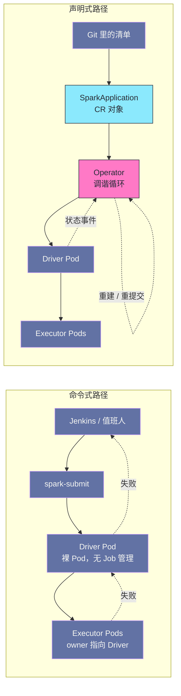
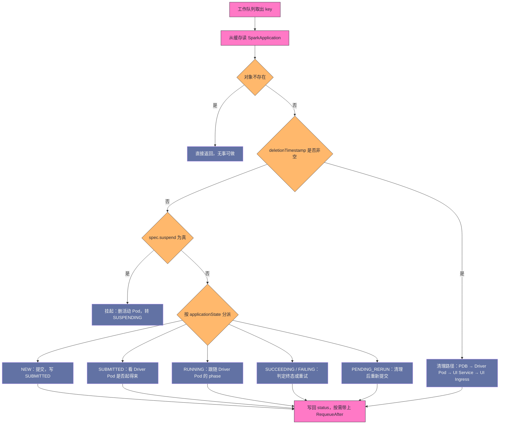
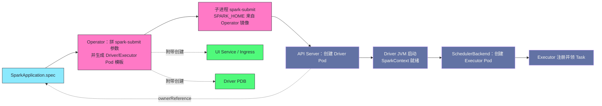
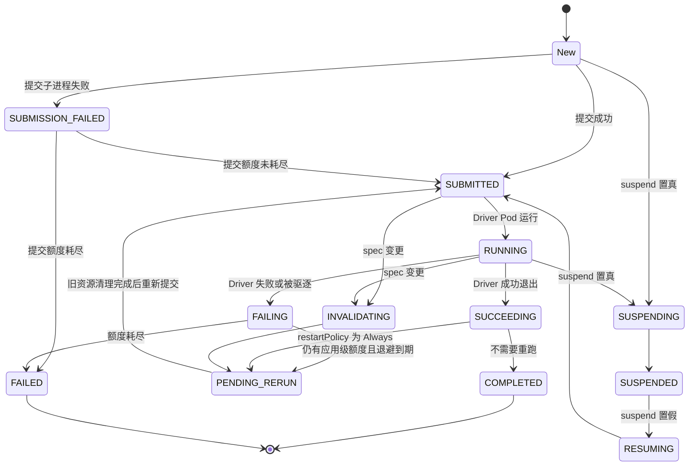
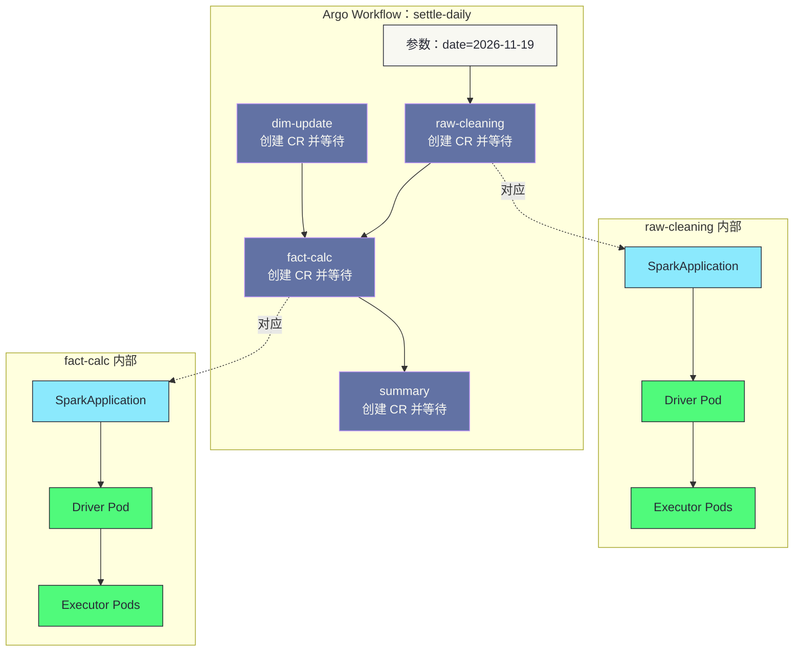
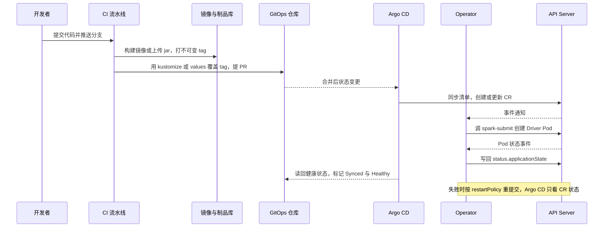

# 07 Spark Operator：声明式作业管理与 CI/CD 集成

**摘要：**

2018 年，Google 把内部在 Kubernetes 上跑 Spark 用的控制器开源，取名 spark-on-k8s-operator；几年之后项目迁入 Kubeflow，API 从 v1beta1 走到 v1beta2，发行版本改用语义化的 v2 系列。与此同时 Apache Spark 自己也在 4.x 里带了一个独立演进的 operator 项目，于是"用声明式方式提交 Spark 作业"从一家公司的工程技巧，变成两条并存的技术路线。

本文要回答的不是"怎么装一个 Operator"，而是**声明式究竟把哪一部分责任从人手里拿走了**。沿五问推进：期望状态归谁所有，`spark-submit` 与自定义资源（Custom Resource Definition，CRD）的差别落在哪一层；一份 `SparkApplication` 清单怎样被翻译成 Driver Pod 与 Executor Pod；调谐循环（Reconcile Loop）为什么必须幂等，控制器自己宕机时作业会怎样；`ApplicationState` 状态机、两级重试与清理策略如何在"作业失败但 Pod 还在"这种形态里互相纠缠；以及 Argo Workflow 与 GitOps 各自该管哪一段，哪些场景根本不该引入 Operator。

全文落点在取舍：哪些责任适合交出去、哪些必须留在自己的账上，判断的依据不是工具的先进程度，而是作业的时长、失败之后的语义与开发循环的形态。文中口径为 Spark 4.3.0（2026-10-30）、Kubernetes 1.37；Operator 以 kubeflow/spark-operator v2.6.0（2026-11-11）的 `sparkoperator.k8s.io/v1beta2` 为例。两个发行版的 CRD 字段命名差异不小，凡涉及具体字段而两者不一致处，均以对应项目文档为准。

---

## 第 1 章 期望状态归谁所有

### 1.1 一条命令的一生

`spark-submit` 做的事情，说穿了只有一件：把散落在命令行、`spark-defaults.conf`、环境变量与镜像里的意图，翻译成一份 Driver Pod 的清单，POST 给 API Server，再把 Pod 名字打印出来。整个过程中它没有留下任何守护性质的进程，翻译完成就是它的全部使命。

这里有个容易被忽略的后果：Spark on K8s 创建出来的 Driver Pod 是裸 Pod（bare Pod），不是 Job，也不在任何控制器名下。于是 Kubernetes 为 Job 准备的那一整套语义——`backoffLimit`、`podFailurePolicy`、完成与失败的终态判定、失败后的重试计数——统统用不上。集群里唯一还记得"这个 Pod 属于某个应用"的证据，是 `spark-role=driver`、`spark-app-selector` 这类标签和 Spark 自己写的注解；标签能帮你把它筛出来，但不会有任何控制器在它失败之后替你做决定。

所以"谁来重试、谁来清理、谁来汇总状态"这三个问题，在纯 `spark-submit` 的世界里根本没有承载者，只能由提交动作之外的那一层来补：Jenkins 的一个 stage、Airflow 的一个 task、一段 `while` 循环，或者值班的人。补得好的团队能把这层做得很薄，补得不好的团队会在三个地方各写一份重试逻辑，最后谁也不确定线上到底是什么状态。

Operator 的介入方式，是把"翻译与守护"这两件事从提交动作里拆出来，交给一个常驻的控制器：人只提交意图，控制器反复比对意图与现状，负责补上中间那段没人负责的时间。这层交接改变了三件事的归属，值得逐项摊开。

### 1.2 三种所有权的转移

| 维度 | 命令式（`spark-submit`） | 声明式（`SparkApplication`） |
|---|---|---|
| 期望状态存放在哪 | 那次执行的命令行参数里，进程退出即消散 | etcd 里的 CR 对象，可长期读取与比对 |
| 失败后谁决定重试 | 外层脚本或调度器，每个团队一套 | 控制器按 `restartPolicy` 判定，逻辑只有一份 |
| 终态如何表达 | 退出码 + Pod `phase`，两者还可能打架 | `status.applicationState.state` 枚举值 |
| 清理由谁负责 | 手工、CronJob、或 TTL 控制器各自为政 | 删除 CR 时走控制器的清理路径，附带 TTL |
| 审计与回滚 | 翻构建历史、翻 shell 脚本的参数 | 翻 Git 提交历史与 CR 的 `status` 快照 |
| 观察运行中作业 | `kubectl get pods -l spark-role=driver` | `kubectl get sparkapp`，带状态与尝试次数列 |
| 谁在持续观察 | 人，或者外部的轮询脚本 | 控制器的事件监听与周期重排 |

这张表里真正的分歧只有一行：**期望状态存放在哪**。其余六行都是它的推论——状态一旦落到 etcd 里，读取、比对、重试、清理就有了统一的着力点；状态一旦只存在于那条已经退出的命令行里，后续每件事都得靠外部补丁。

### 1.3 两条路径的对照

把两条路径的箭头画出来，差别落在"失败之后箭头指向谁"这一个细节上：命令式路径里箭头指向人，声明式路径里箭头指回控制器自己。



图中左侧那条从 Driver 回到人的虚线，就是所有"重试逻辑散落在三处"的起点；右侧把这条线收进了控制器内部，代价是控制器本身成了必须被高可用对待的组件。

### 1.4 不这样会怎样

不妨把不引入 Operator 的代价具体化。第一笔账在 API Server 里：Driver 与 Executor Pod 结束后默认保留，一个每晚几十个作业、每个作业十个 Executor 的集群，一天就能攒下几百个 `Succeeded` 对象，一年之后 `kubectl get pods` 的输出会长到没人愿意读，etcd 的存储与 list 请求的延迟都跟着上涨。清理当然可以交给一个 CronJob 按标签批量删，不过那等于把"资源生命周期"这件事外包给了一个恰好没被忘记的定时任务。

第二笔账在重试语义上。裸 Pod 失败之后没有 `backoffLimit`，重试必须由外层重放整条命令；而重放意味着重新解析参数、重新拼清单、重新拉镜像，还要处理"上一次的 Driver Pod 还没删干净"这类边界。每个团队都会写出一个能跑但有细微差异的 `retry.sh`，运维在复盘时面对的是五种不同的退避策略。

第三笔账在可追溯性上。事故之后要回答"那天到底传了哪些参数、用的哪个镜像 tag"，命令式路径的答案在构建历史里，而构建机的工作目录往往已经清空。声明式路径的答案在 Git 提交里，同时还留着一份带终态与尝试次数的 `status`，两者的取证成本不在一个量级。

### 1.5 一条贯穿全文的流水线

后面的论述需要一个具体的着力点。笔者设一条电商数仓的夜间结算流水线 `settle_daily`：先把当天的订单明细清洗成宽表，再并行更新商品维表，然后按商品标识连接、按品类汇总成交额，最后生成对账汇总。四个作业之间有并行也有扇入——清洗与维表可以同时跑，汇总必须等两者都结束。

这套流水线起初放在 Jenkins 的 shell 步骤里，用 `spark-submit` 逐个提交，失败由 shell 的 `set -e` 与人工重跑兜着。迁到声明式之后，形态变成四个 `SparkApplication` 加一个 Argo Workflow：Workflow 描述依赖，Operator 描述单个作业，镜像与清单都进 Git。后面几章反复回到这条流水线上的三个具体形态：某个作业失败后 Pod 仍在、某个清单被 GitOps 重复 apply、以及某个 DAG 里的重试被两层同时打开。

### 1.6 一个比喻：承运商与自运

自己开货车送货，路线、装卸、抛锚后的处理全在自己手里，代价是每一趟都要有人在车上；把货交给承运商，你只需要填一张运单，改派、退回、丢件补发都由对方按规则处理。Operator 之于 `spark-submit`，就是承运商之于自运。

这个比喻可以一直用下去，因为三处偏差正好对应后文三章。其一，运单上写的是"送到哪、什么时候到"，不是"走哪条高速"——CRD 描述的是终态与约束，不是执行步骤，所以调谐循环有空间自行决定先创建什么、何时重试。其二，改派规则由承运商定——重试次数、退避间隔、清理范围都是控制器解释清单后的行为，不写清楚就只能接受默认值。其三，运费与时效是承运商的报价——声明式换来的是一致的失败语义与可审计性，付出的则是"调度与重试细节不再由你直接控制"，以及一个必须高可用对待的控制面。

---

## 第 2 章 把旗标写成字段：SparkApplication 的字段语义

### 2.1 一份清单的三层与两个发行版

任何 CR 都是三层：`metadata` 描述它作为 K8s 对象的身份，`spec` 描述期望状态，`status` 描述观测到的现状。`SparkApplication` 的特殊之处只在于 `spec` 的形状——按 kubeflow 版源码里的说法，它承载的是 `spark-submit` 命令能够识别与接受的每一条信息。换句话说，CRD 不是对 Spark 提交接口的重新设计，而是把同一个接口从"旗标"换成"字段"，从"一次性"换成"可反复读取"。

这里必须先把发行版分清楚，否则后面每个字段都可能对不上。kubeflow 的 spark-operator 用 `sparkoperator.k8s.io/v1beta2`，本文以它为叙述主线；Apache Spark 4.x 生态里的独立 operator 项目用 `spark.apache.org/v1`，两者的 `kind` 都叫 `SparkApplication`，但字段组织方式差别明显：前者把重试写成 `spec.restartPolicy` 下的一组 `onFailureRetries`，后者写成 `restartConfig.maxRestartAttempts`；前者用 `timeToLiveSeconds` 表达终态保留时长，后者还多出 `resourceRetainPolicy`、`ttlAfterStopMillis` 这类更细的保留语义。遇到这类分歧，唯一可靠的做法是回到对应项目的 CRD 定义核对，而不是照抄博客里的片段。

### 2.2 会被校验的那几个字段

`type`、`sparkVersion`、`mainApplicationFile` 与 `driver`/`executor` 两段，是清单里绕不过去的部分。`type` 取 `Java`、`Scala`、`Python`、`R` 四值之一，决定提交时用 `--class` 还是直接给主文件；`sparkVersion` 是 Operator 拼参数与做兼容判断的依据，它的值必须与镜像里实际安装的 Spark 版本对齐，写错的症状通常不是报错，而是运行期出现难解的类冲突。

`mainApplicationFile` 在 kubeflow 版里是必填项（字段定义上没有 `omitempty`），取值有三种典型形态，后文第 8 章会把它们与 GitOps 的关系展开。`mode` 取 `cluster` 或 `client`，默认 `cluster`；需要特别提醒的是 `client` 模式在 v2 系列里已经被标注为弃用，其移除计划写在项目的 issue 里，新清单不应再写 `client`。`image` 反而是可选的，不写就落到 Operator 部署时的默认镜像上——这条默认值看着方便，实际是"清单没写清制品来源"的隐患。

把这些字段与 `spark-submit` 的旗标并排放，映射关系一目了然：

| CRD 字段 | 对应的 `spark-submit` 物 | 最终落到哪个对象 | 常见错法 |
|---|---|---|---|
| `spec.type` | `--class` 是否存在、主文件类型 | Driver 容器的启动命令 | Python 作业误填 `mainClass` |
| `spec.sparkVersion` | `--version` 与实际发行版 | Driver 镜像里的 Spark 安装 | 与镜像版本不一致，运行期类冲突 |
| `spec.image` | 无直接对应，属 K8s 侧 | Driver 与 Executor 容器镜像 | 省略后跟随 Operator 默认镜像 |
| `spec.mainApplicationFile` | 位置参数（主文件） | 容器内路径或远端 URL | 用 `local://` 指向镜像里不存在的路径 |
| `spec.arguments` | 主文件之后的位置参数 | Driver 进程的 `argv` | 日期参数写成注释里的占位符 |
| `spec.sparkConf` | `--conf key=value` | SparkConf 与 Pod 注解 | 与 Operator 生成的 `spark.kubernetes.*` 打架 |
| `spec.driver.*` | `--driver-cores`、`--driver-memory` | Driver Pod 的 requests/limits | `memory` 当成容器总内存 |
| `spec.executor.*` | `--executor-cores`、`--executor-memory`、`--num-executors` | Executor Pod 模板 | `instances` 与动态分配同时写 |
| `spec.restartPolicy` | 无对应，纯 Operator 语义 | 控制器的重提交决策 | 与 `sparkConf` 里的重试项混用 |

### 2.3 Driver 与 Executor 两段的分工

`driver` 与 `executor` 是结构体，且在 kubeflow 版里都是必填的。两段里的同名项含义一致，但落点不同：`cores` 对应容器的 CPU 请求，`coreLimit` 可以单独给上限；`memory` 是 JVM 堆，`memoryOverhead` 是堆外那部分，两者相加才是容器的内存 limit。这条换算关系在 Pod 层面看是"requests 与 limits 怎么写"，在 Spark 层面看是"堆与堆外的比例"，笔者在此只强调结论：**清单里写的 `memory` 不是容器总内存**，把它当成总内存来规划，线上就会周期性地出现被 OOM 杀掉的 Executor。

`driver` 段还有几项只有它才有的字段：`serviceAccount` 决定 Driver 创建 Executor Pod 时的身份，缺了它最简单的症状是 Executor 起不来、日志里一片 `Forbidden`；`labels` 与 `annotations` 会带到 Driver Pod 上，监控抓取与成本归集都靠这两项；`podTemplate` 允许把 Pod 模板文件挂进容器，把安全上下文、sidecar、卷这类与业务无关的配置从清单里剥离出去。`executor` 段则多出 `instances`，它与 `spec.dynamicAllocation` 是互斥的两种意图——一个要求"给我十个"，另一个要求"在 2 到 50 之间自己看着办"，同时写会让行为取决于 Operator 与 Spark 版本的具体实现。

至于这些字段如何变成 Pod 的 requests/limits、如何被调度器看见、Executor 起来之后怎样注册，那是 Pod 生命周期那一层的话题；本章只关心清单到提交参数的翻译，下一章关心清单到实际对象的收敛。

### 2.4 mainApplicationFile 的三种取值

`mainApplicationFile` 是整个清单里最值得单独讨论的字段，因为它决定了"代码算不算清单的一部分"。常见取值有三类，各自对应一种制品策略。

第一类是 `local:///opt/spark/jars/settle-daily.jar`，路径指进镜像内部。制品随镜像走，清单里只剩下一个 tag；好处是 Driver 启动时不必下载任何东西，离线集群也能跑，回滚代码等于回滚镜像 tag，追溯链天然闭合。代价是改一行代码就要重推镜像，多个作业共享同一份基础镜像时耦合会越来越重。

第二类是 `s3a://bucket/artifacts/settle/2026-11-19/settle-daily.jar`，制品放在对象存储，镜像退回成通用运行时。好处是镜像可以只维护几个版本、制品的发布与运行时的发布解耦、多个作业共用一个镜像而互不影响；代价是 Driver 启动时要下载，凭据要注入，路径一旦被覆盖写，清单与代码之间的那根线就断了。

第三类是 `http://` 或 `https://` 的直链，让 Spark 的初始化容器去拉。这种做法在早期很流行，现在少见于线上环境，原因是凭据管理与完整性校验都难做得干净，而且它与"制品仓库"通常已经存在的事实重复。

三类取值的分界可以用一句话概括：**清单里放的是指针，不是代码**。指针指向一个不可变位置时，这份清单本身就是审计凭证；指针指向一个会被覆盖的位置时，清单只是"大概跑过什么"的记录。第 8 章讨论 GitOps 时会回到这条分界上。

### 2.5 一份能跑起来的清单

把上面的字段拼起来，一份用于日常结算的清单大致长这样。注释只写"为什么这么写"的那几句，重复的样板留给模板：

```yaml
apiVersion: sparkoperator.k8s.io/v1beta2
kind: SparkApplication
metadata:
  name: settle-fact-calc          # 名字里带业务，不带日期，日期走 arguments
  namespace: spark-production
spec:
  type: Scala
  mode: cluster                   # client 在 v2 已弃用，新清单不要再写
  sparkVersion: "4.3.0"           # 必须与镜像内 Spark 版本一致
  image: registry.internal/spark/settle:1.14.2
  imagePullPolicy: IfNotPresent
  mainClass: com.example.SettleFactCalc
  mainApplicationFile: local:///opt/spark/jars/settle-daily.jar
  arguments:
    - "--date"
    - "2026-11-19"                # 业务日期由上游传入，不写死在镜像里
  restartPolicy:
    type: OnFailure
    onFailureRetries: 2           # 应用级重试，与 Pod 级重启是两码事
    onFailureRetryInterval: 60
    onSubmissionFailureRetries: 3 # 提交阶段的失败单独计数
    onSubmissionFailureRetryInterval: 30
  driver:
    cores: 2
    coreLimit: "2500m"
    memory: "4g"
    memoryOverhead: "1g"          # 堆外单列，容器 limit 是两者之和
    serviceAccount: spark-driver   # 缺了它，建 Executor 会 Forbidden
    labels:
      team: data-platform
  executor:
    cores: 4
    coreLimit: "4500m"
    memory: "8g"
    memoryOverhead: "2g"
    instances: 8
  sparkConf:
    spark.sql.adaptive.enabled: "true"
    spark.eventLog.enabled: "true"
    spark.eventLog.dir: "s3a://bucket/spark-events/"
  timeToLiveSeconds: 86400        # 终态之后留一天，够排查也够对账
```

这份清单在 Operator 内部被翻译成一串 `spark-submit` 参数，再由 Operator 作为子进程执行。kubeflow 版的提交器里有一行注释说得很直白：由 Operator 触发的 `spark-submit` 不应等待应用结束。也就是说，Operator 镜像里必须装着一份完整的 Spark 发行版，`SPARK_HOME` 指向它，清单里的 `sparkVersion` 与这份发行版相互约束。**声明式没有绕开 `spark-submit`，它只是把 `spark-submit` 收进了控制器里**，由控制器负责在需要的时候重放这个动作。

这条实现细节解释了两类常见故障：升级时只改了 `image` 忘了改 `sparkVersion`，运行期会出现难以定位的类冲突；Operator 镜像与业务镜像的 Spark 版本不一致时，Driver 侧与提交侧对同一组配置项的解释可能不同。

### 2.6 三个容易写错的组合

第一处是 `restartPolicy` 与 `failureRetries`/`retryInterval` 并存。后两个是 `spec` 层的遗留字段，源码注释里写明它们是"尽力而为"（best effort），实际重试次数可能大于所填值；而 `restartPolicy` 是后来引入的完整策略。两份同时写在清单里，行为取决于版本的实现顺序，读清单的人无法一眼判断真实意图。

第二处是 `executor.instances` 与 `spec.dynamicAllocation.enabled` 并存。前者是"我要八个"，后者是"在区间里自己伸缩"，这是两种互相排斥的意图，同时出现时以谁为准要看具体版本。

第三处是在 `sparkConf` 里覆盖 `spark.kubernetes.*` 系列配置。Operator 会通过 Pod 模板文件注入容器名、所有者引用等一批 K8s 侧参数，用户再手写同族配置，很容易把模板里的设置顶掉，症状是 Driver 起来了但 UI 服务没建、或者 Pod 的 owner 引用丢失导致清理失效。这类配置交给 Operator 生成，清单里只保留与业务语义相关的项，是更省心的分工。

---

## 第 3 章 调谐循环：控制器怎样把清单变成 Pod

### 3.1 它不是轮询，而是收敛

把 Operator 想成一个"每三十秒扫一遍所有作业"的定时脚本，是最常见的误解。真实的控制器是事件驱动的：进程内维护着一份从 API Server 同步来的对象缓存，监听 `SparkApplication` 与 Pod 的创建、更新、删除事件，把受影响对象的 key 放进工作队列，若干个工作者从队列里取 key，执行调谐函数（Reconcile），把结果写回 API Server。整个过程里没有"遍历全表"的动作，只有"被通知到的那几个对象"。

这一点直接决定了两件事。其一，调谐函数的输入不是一个对象，而是一个 key；函数内部要用缓存去取该 key 对应的最新对象，取不到就说明对象已删，直接返回即可。其二，同一个 key 可能在很短时间内被处理两次甚至更多次——事件合并、队列重试、控制器重启后的全量重同步，都会让"同一个调谐"反复发生。幂等的要求就是从这里长出来的，不是一种编码风格，而是模型本身的约束。

### 3.2 它在看哪些对象

kubeflow 版的控制器在装配阶段注册了三类监听：`SparkApplication` 对象本身（带命名空间与 TTL 相关的过滤）、Pod（按 Operator 注入的标签把 Pod 事件映射回所属的应用）、以及需要时的 Driver 的 PDB 对象。这里有个容易被忽略的取舍：控制器没有用"拥有关系"（OwnerReference）来声明它对 Pod 的监听，Pod 的所有权是通过注入 Pod 模板交给 Kubernetes 垃圾回收器的，控制器只负责"看见事件"。

这个选择让清理变成两套并行的机制：一套是垃圾回收器的级联删除，异步、无条件、不需要控制器在场；另一套是控制器在删除路径上按顺序显式删除，可控、可观测。第 6 章会把两套机制的清单列出来。

除了事件，还有两类定时重排必须提。一是重试退避：当控制器判定"还要再试一次，但没到时间"，它会带着一个延迟重新入队，等窗口到期再处理；二是终态保留：作业进入终态后，控制器按 TTL 剩余时间重新入队，到期删除对象。这两处是"定时"在控制器里的全部含义，与"每三十秒扫一遍"是两回事。

### 3.3 一次调谐的决策流

调谐函数的骨架其实很短：先判断对象是否正在被删除，再看是否被挂起，然后按 `status.applicationState.state` 分派给对应的处理函数，各处理函数在自己的事务里改状态、建资源，最后决定是否重排。



图中每个分支都对应源码里的一个处理函数，而每个处理函数都在"读最新对象—改副本—写回"这个循环里带上乐观并发的冲突重试。分支看似很多，真正决定作业命运的只有 `SUCCEEDING` 与 `FAILING` 两处——其余分支要么在等，要么在补。

### 3.4 从 CR 到 Pod 的转换链

清单里的字段要变成真正跑起来的进程，中间隔着五次交接，每一次交接的责任人都不相同。这条链画出来，很多"为什么状态不对"的疑问就有地方落脚了。



从 Driver JVM 启动那一步开始，动作已经与 CRD 无关：Driver 启动、Executor 注册、Task 分发，全是 Spark 自己的机制。Operator 能影响的只到"把 Driver 交出去"为止，此后它能做的只有看——看 Pod 的 phase，看 Driver 是否写出了成功或失败的证据。把这条边界记住，就不会问出"Operator 能不能帮我加快 Shuffle"这种问题。

### 3.5 幂等：反复调谐的硬要求

不妨设想一次调谐要做两件事：创建 Driver Pod，然后把状态写成 `SUBMITTED`。如果第一件成功、第二件因为冲突失败，控制器会在下一次重入时把两件事重做一遍，而创建动作此时会收到 `AlreadyExists`。代码若把这个错误当成失败往上抛，控制器就会永远卡在"创建失败"的循环里；正确写法是把"创建"实现成"确保存在"，把 `AlreadyExists` 与 `NotFound` 分别当成成功。

这不是某一段代码的例外，而是整个控制器的通行规则：删除路径要对 `NotFound` 免疫，提交路径要能判断"已经提交过"，状态更新要用乐观并发重试，一切外部副作用（创建 CR、写 ConfigMap、建 Service）都必须能被重复执行而不产生第二份结果。控制器模型的正确性建立在"至少一次"的驱动之上，**幂等不是优化，而是这个模型成立的前提**。

把这一点放到 Spark 作业上，会得到一个略刺眼的结论：控制器可以保证"提交动作"至多产生一个 Driver，但它完全无法保证"作业的副作用"只发生一次。控制器重试的是提交，不是计算；计算重跑之后，目标表里是不是多了一份数据，取决于作业自己有没有做幂等写。声明式把"重试"变得便宜，副作用却一步都没有减少。

### 3.6 控制器宕机时会发生什么

这是评估任何 Operator 时都该问的问题。答案分两半：数据面不受影响，控制面停摆。已经在跑的 Driver 与 Executor 与 Operator 之间没有心跳依赖，Operator 进程消失，作业照常计算、照常写结果；停摆的是重试决策、清理、状态同步与 TTL。

恢复时，控制器重新建立缓存并做一次全量重同步，把每个 CR 与集群里的实际对象重新对一遍。这里会出现一个时间差：宕机期间 Driver Pod 已经失败，而 CR 的 `status` 还停在 `RUNNING`，直到下一次调谐看见 Pod 的 phase 才被纠正。状态列偶尔"滞后于现实"不是 bug，而是"状态由控制器写、控制器不在场就只能等它回来"的必然。

由此派生两条实践。其一，Operator 本身要有副本与选主，把它当成普通的控制面组件对待，而不是"装一次就不管"的工具。其二，告警不要只盯 `SparkApplication` 的 `status`，同时盯 Driver Pod 的 phase 与作业侧的产出，两条线互为校验，才能发现"控制器不在场"这段盲区。

---

## 第 4 章 状态机：作业的终态怎么表达

### 4.1 十四种状态各管什么

`ApplicationState` 不是"成功、失败、运行中"三态，而是一台十四个状态的机器。多出来的那些状态几乎都在回答同一个问题：此刻这个作业到底"算不算数"——是在等重试、在等退避、在等清理、还是已经尘埃落定。

| 状态值 | 含义 | 进入条件 | 停留多久 |
|---|---|---|---|
| `""`（New） | 对象刚建，尚未提交 | CR 创建完成 | 一个调谐周期 |
| `SUBMITTED` | 已调用提交，Driver Pod 正在创建 | 提交动作返回 | 视调度与镜像拉取 |
| `RUNNING` | Driver Pod 处于运行态 | 观测到 Pod Running | 作业时长 |
| `SUCCEEDING` | Driver 已成功退出，等判定 | 观测到 Pod 成功 | 一个调谐周期 |
| `COMPLETED` | 终态成功 | 判定不必重跑 | 到 TTL 到期 |
| `FAILING` | Driver 失败，等退避窗口 | 观测到 Pod 失败 | 退避间隔内 |
| `FAILED` | 终态失败 | 重试额度耗尽 | 到 TTL 到期 |
| `SUBMISSION_FAILED` | 提交动作本身失败 | 子进程报错 | 等下一次提交重试 |
| `PENDING_RERUN` | 等待重新提交 | 旧资源清完 | 一个调谐周期 |
| `INVALIDATING` | 变更需要作废旧运行 | `spec` 发生变更 | 一个调谐周期 |
| `SUSPENDING`/`SUSPENDED`/`RESUMING` | 挂起三态 | `spec.suspend` 变化 | 人为控制 |
| `UNKNOWN` | 无法判定 | 状态读取异常 | 不确定 |

这张表里最容易被忽略的是 `SUCCEEDING` 与 `FAILING` 两个"过渡态"。它们的存在说明控制器并不把 Pod 的 phase 直接当成作业的终态，而是先记下一个中间结论，再在下一轮里按策略决定往哪走。`Always` 策略下，成功也要重跑，`SUCCEEDING` 就是"已经成功但还没决定是否收工"的那个位置。

### 4.2 主链与支线

把主要迁移画出来，几条支线会显得很突兀：提交阶段的失败、人为挂起、以及 `spec` 变更带来的作废重跑。前两条都不经过"运行中"，因此也不受运行阶段重试策略的约束。



图中 `FAILED` 与 `COMPLETED` 都是吸收态，但它们只表示"控制器不再推进"，不表示"相关资源已经消失"。这个区别是下一节的主题。

### 4.3 "作业失败但 Pod 还在"的五种形态

线上最常被问到的一句话是："我明明看到 Spark 作业失败了，为什么 `kubectl get pod` 里 Driver 还挂在那儿？"答案取决于状态停在哪一格，而五种形态的处置方式完全不同。

| 形态 | `sparkapp` 状态 | Pod 现状 | 真实含义 | 该做什么 |
|---|---|---|---|---|
| 退避窗口内 | `FAILING` | Driver Pod 为 `Failed`，未被删除 | 在等下一次重试的时间窗 | 什么都不做，等重试 |
| 终态失败 | `FAILED` | Driver Pod 为 `Failed`，UI Service 仍在 | 重试额度耗尽，控制器只写状态、不清理 | 看日志排因，再决定删或改清单重跑 |
| 提交失败 | `SUBMISSION_FAILED` | 没有任何 Pod | 提交动作就没成功 | 查事件、查 RBAC、查镜像与主文件路径 |
| 状态滞后 | `RUNNING` | Driver Pod 已 `Failed` | 控制器不在场，还没看见 | 查 Operator 副本与事件，等重同步 |
| 人为挂起 | `SUSPENDED` | 活动 Pod 已被删除 | 作业被主动停下，随时可恢复 | 恢复前确认数据是否已写一半 |

第一、二两种形态合起来，正是"失败但 Pod 还在"的完整解释：控制器判失败时只做一件事——把状态改成 `FAILED`，并记下终止时间，它并没有顺手删掉现场。保留现场是有意的，因为排障要靠它：Driver 的日志、退出码、UI 服务里残留的最后一个 Stage，都在 Pod 与 Service 上。清理被推给了 TTL 或人工删除，这是"可观测性优先于资源整洁"的一次明确取舍。

第三种形态更具欺骗性。`SUBMISSION_FAILED` 说明 `spark-submit` 子进程没能把 Driver 交出去，常见原因是 ServiceAccount 缺权限、镜像拉不下来、`mainApplicationFile` 指向的路径不存在、或者必填参数拼错。此时既没有 Pod 也没有 Spark 侧日志，CR 的 `status` 与 `events` 是唯一线索；把它当成"作业跑失败了"去查 Driver 日志，会白花半小时。

第四种形态与控制器可用性有关，第 3 章已经解释过成因。这里补一句判据：若同一时刻多个作业的状态都停在原地不动，先查 Operator，再查作业。

第五种形态与失败无关，是主动停机。`suspend` 置真之后控制器会删掉活动 Pod 并把状态推到 `SUSPENDED`，CR 本身留着，随时可以恢复。它的风险在"停到半路"：数据可能已经写了一部分，恢复前要确认输出分区的可见性与完整性，否则重跑一次会在目标表上叠出两份。

### 4.4 两个计数器与三种读法

`status` 里有两个容易混淆的计数：`executionAttempts` 记录"把应用跑到完成"的尝试次数，`submissionAttempts` 记录"把应用提交出去"的尝试次数。前者对应应用级重试，后者对应提交级重试；一次提交失败不会增加前者，一次运行失败也不会增加后者。排查时先看哪个数字在涨，就能判断失败发生在哪一段。

读状态的习惯也值得固定下来。列视图靠 CRD 定义的打印列，`kubectl get sparkapp` 会直接给出状态、尝试次数、开始与结束时间；要取值就用 `-o jsonpath` 精确到字段；要看来龙去脉就配合事件。三条命令覆盖了九成的日常需求：

```bash
# 列视图：状态、尝试次数、起止时间
kubectl -n spark-production get sparkapp

# 精确取值：状态与执行尝试次数
kubectl -n spark-production get sparkapp settle-fact-calc \
  -o jsonpath='{.status.applicationState.state}{"\n"}{.status.executionAttempts}{"\n"}'

# 来龙去脉：控制器写下的事件
kubectl -n spark-production describe sparkapp settle-fact-calc | tail -20
```

还有一条隐性提醒：**终态不等于资源消失**。`COMPLETED` 只说明控制器得出了结论，Pod 与 UI 服务会按 TTL 继续留着。反过来说，Pod 消失也不等于作业被记住了——若 TTL 设得很短，第二天回头查时，CR 与 Pod 一起没了，能依靠的只剩事件日志与 Spark 自己的 event log。

---

## 第 5 章 两套重试账：Pod 级与应用级

### 5.1 三个同名的 restartPolicy

"`restartPolicy`"这个词在这套技术栈里出现了三次，指的不是同一件事，混起来会导致非常离谱的配置。

第一个是 Kubernetes 的 Pod 级字段 `spec.restartPolicy`，取 `Always`、`OnFailure`、`Never`，语义是"同一个 Pod 里的容器退出后，kubelet 要不要把它再拉起来"。容器重启不改变 Pod 名与 IP，也不产生新的"尝试"。

第二个是 `SparkApplication.spec.restartPolicy`，取 `Never`、`OnFailure`、`Always`，语义是"这个应用终止之后，控制器要不要重新提交一次"。重提交意味着删掉旧 Driver Pod、重新跑一遍提交、产生一个新的 Driver JVM。

第三个不是配置项而是事实：Spark 在创建 Driver Pod 时，把 Pod 的 `restartPolicy` 固定写成了 `Never`。源码里这一行是硬编码的，含义很清楚——Driver 容器不该被 kubelet 原地重启，因为它重启后带着旧的任务状态与端口信息，Kubernetes 与 Spark 都没有为这种重入准备语义。Executor Pod 默认同样是 `Never`，Executor 挂了由 Driver 重建一个新 Pod，而不是让 kubelet 在原 Pod 里重启容器。

三者对照，就能看出第二套账的价值：**声明式的重试是"换个 Pod 重来"，不是"在原地重启容器"**。

| 维度 | Pod 级重启（kubelet） | 应用级重提交（Operator） |
|---|---|---|
| 触发者 | kubelet，依据 Pod 的 `restartPolicy` | 控制器，依据 CR 的 `restartPolicy` |
| 作用对象 | 同一 Pod 内的容器 | 整个应用，含 Driver 与全部 Executor |
| Pod 名与 IP | 不变 | 全新 Pod，全新 IP |
| 计数器 | 容器重启次数，写在 Pod `status` | `executionAttempts`，写在 CR `status` |
| 状态迁移 | 不产生新状态 | `FAILING → PENDING_RERUN` 或 `FAILED` |
| 能否续跑 | 谈不上续跑，进程从入口重来 | 同样从头跑 `main`，除非作业自己从 checkpoint 恢复 |
| 适用判断 | Spark 场景下基本不适用 | 偶发失败、节点故障的兜底 |

表里最后两行是全部要害。无论是 Pod 级重启还是应用级重提交，都没有"断点续跑"这回事：Driver 的 `main` 会从第一行重新执行，Shuffle 输出重新生成，已经写出去的结果可能被写第二遍。重试解决的是"这一次失败别让整条流水线停摆"，不解决"失败之前的计算白做了"。

### 5.2 三个取值的真实语义

`Never` 是最容易理解的：失败就记失败，不重试。它适合两类场景，一类是还在调试、希望失败立刻暴露；另一类是重试责任已经被上层接走，比如 Argo 的 `retryStrategy` 或 Airflow 的 task retry，这时 Operator 再重试就成了乘法。

`OnFailure` 是线上批处理的默认答案。它有两个独立的额度：`onFailureRetries` 管"跑起来之后失败"的重试次数，`onSubmissionFailureRetries` 管"提交动作失败"的重试次数，两者各有退避间隔。这个拆分不是设计者的洁癖，而是两类失败的成因完全不同：前者要去查数据倾斜、OOM、下游不可用；后者要去查权限、镜像、参数。分开计数，排障时能立刻定位阶段。

`Always` 最容易被误用。它的语义是"无论成功还是失败都再跑一次"，看上去像流处理，实际不是：Structured Streaming 作业本身是常驻的，进程结束意味着流已经不可恢复地中断了，用 `Always` 反复重提交只会把它变成"每次启动都从 checkpoint 恢复、再一次中断"的循环，而且每次重启的 reason 都不会被认真记录。真正需要常驻的流作业，应当让 Spark 自己的重启机制生效，而不是靠 Operator 把它当批作业反复拉起。

### 5.3 重试次数的命名差异与"尽力而为"

重试次数这个数字，在两个发行版里有三种写法。kubeflow 版放在 `restartPolicy.onFailureRetries` 里；Apache 的独立 operator 放在 `restartConfig.maxRestartAttempts` 里；kubeflow 的 `spec` 层还留着一对遗产字段 `failureRetries` 与 `retryInterval`。三种写法名字不同，语义都是"应用级最多再来几次"。有的文档与资料把这一项统称为 `maxRetries`，那只是个笼统叫法，落到具体 CRD 上并不存在这个字段名；写清单时以手上那份 CRD 的字段说明为准，是最省事的做法。

有一处措辞值得单独拎出来。kubeflow 的字段注释里写着，重试次数是"尽力而为"的，实际尝试可能大于所填值。原因在于控制器的判定依赖内存缓存里的计数，在状态写回与下一次调谐之间，缓存可能滞后，于是同一轮失败被多算一次。这类"不精确"并不是缺陷补丁没打好，而是所有基于最终一致性的控制器共有的性质：它能保证"不会无限重试"，不保证"重试次数精确等于配置值"。把重试次数当成计费依据或 SLA 承诺，是很危险的做法。

### 5.4 重试的代价与失败归因

重试不是免费的。第一笔代价是副作用重复：譬如向 Hive 表 insert 覆盖分区是幂等的，向消息队列投递事件不是；向对象存储写固定路径是幂等的，写带时间戳路径不是。第二笔代价是资源争抢：一次重试意味着再向调度器要一批 Executor，如果集群正紧，重试会与别的作业互相挤压，退避间隔设得太短，等于让失败在集群里排队重演。

第三笔代价最隐蔽：重试把真正的失败原因盖住了。一个因为堆外内存不足而被杀的作业，加上三次重试之后，看到的现象是"偶发失败、偶尔成功"，于是团队把更多注意力放在"稳定性"而不是"内存配额"上。失败归因该在重试之前完成，而不是之后：

| 失败签名 | 常见机制 | 该不该重试 | 真正该动的旋钮 |
|---|---|---|---|
| Driver 正常起、task 阶段反复失败 | 数据倾斜、下游不可用 | 可以，但要限次 | 分区策略、下游容量 |
| Driver Pod 退出码 137 | 容器内存越界被内核杀掉 | 不该 | `memory` 与 `memoryOverhead` |
| Driver Pod 退出码 143 | 收到 SIGTERM，多为抢占或驱逐 | 可以 | 优先级、PDB、节点池 |
| 退出码 1 且栈里有业务异常 | 代码或数据问题 | 不该 | 代码、数据校验 |
| `SUBMISSION_FAILED` | RBAC、镜像、路径、参数 | 提交级重试可以 | ServiceAccount、镜像仓库、主文件路径 |

写这张表的用意不是穷举，而是提醒一件事：重试策略应当分成"偶发基础设施故障"与"确定性错误"两类，前者值得退避重试，后者越重试越浪费。控制器的 `OnFailure` 无法区分这两类，它只能数字数；区分它们是人该做的判断。

---

## 第 6 章 清理与保留：删一份 CR 到底删掉什么

### 6.1 两套清理机制并行

删除一个 `SparkApplication`，实际发生的事比"删一个对象"复杂，因为清理走了两条并行的路。

第一条是 Kubernetes 的垃圾回收。Operator 在提交前会把 Driver 与 Executor 的 Pod 模板取出来，在模板里写入指向 CR 的所有者引用（ownerReference），并把 `controller` 与 `blockOwnerDeletion` 都置为真；UI 的 Service、Ingress、Driver 的 PDB、监控用的 ConfigMap 由 Operator 直接创建，同样带着这份引用。这些对象的所有者都是 CR，而 Kubernetes 的垃圾回收器会在所有者消失后异步清掉它们，不需要 Operator 在场。

第二条是控制器的显式删除。当控制器在调谐中看见对象的删除时间戳，它会按固定顺序清理：先删 Driver 的 PDB，再删 Driver Pod，然后删 UI 的 Service 与 Ingress。顺序不是随意的——PDB 先拆，是为了避免一个正在 `kubectl drain` 的节点被"目标 Pod 已消失"的 PDB 卡住；Driver Pod 先于 UI 资源删，是为了让最后几秒的 UI 请求不至于打到空服务上。

两条路同时存在，原因在于它们各自的短处正好互补。垃圾回收保证最终一致，哪怕控制器进程根本没起来、或对象是被人手工删的，Pod 与 Service 照样会被清掉；显式删除保证顺序可控、动作可观测，日志里能看到"先删了什么"，也方便在 PDB 挡住排空时做人工处置。判定清理是否成功，两条都要看。

这里最值得记住的一个细节是：**控制器从不枚举 Executor Pod**。它只删 Driver，Executor 随 Driver 一起走——因为 Spark 在创建 Executor Pod 时把 Driver Pod 设成了它的所有者（`controller` 为真），删掉 Driver 之后，垃圾回收器会顺手带走全部 Executor。理解了这一层，就不会出现"手工删掉几个 Executor 试图提速"的误操作，也不会困惑于"为什么没有一段清理 Executor 的代码"。

### 6.2 不删的东西，以及为什么

清理清单是一条有限的枚举，清单之外的一切都不会被动到。这一点经常被误解，尤其是在"删了 CR 为什么 PVC 还在"这个问题上。

| 资源 | 谁创建 | 删 CR 之后 | 为什么是这个结果 |
|---|---|---|---|
| Driver Pod | 提交子进程 | 删除 | 带 CR 的所有者引用，也是显式删除路径的第一目标 |
| Executor Pod | Driver | 随 Driver 级联删除 | 所有者是 Driver Pod，不是 CR |
| UI Service / Ingress | Operator | 删除 | 带 CR 的所有者引用 |
| Driver PDB | Operator | 先于 Pod 删除 | 避免阻断节点排空 |
| 监控 ConfigMap | Operator | 删除 | 属于 Operator 自建对象 |
| 业务挂载的 PVC | 用户或存储类 | 保留 | 用户预建资源，不带 CR 的所有者引用 |
| Spark 相关 ConfigMap | 用户 | 保留 | 同上，属于共享配置 |
| 对象存储上的输出数据 | 作业自己 | 保留 | 不在 K8s 对象体系内，控制器无从知晓 |
| Spark event log | Driver | 保留 | 落在对象存储，与 CR 生命周期无关 |

PVC 之所以默认不被删除，理由可以归成三条，缺一条这个默认值就该改。

其一是所有权。挂载进 Pod 的 PVC 几乎总是用户预先创建或由存储类动态供给的资源，它的所有者不是这份 CR；控制器删掉自己没创建、也不知道还有谁在用的对象，属于越权。其二是共享。同一个 PVC 经常被多个作业复用——放 Shuffle 中间结果、放临时落盘、放本地缓存，删掉一份 CR 就连带毁掉别人的中间态。其三是不可逆。Pod 与 Service 删错了，重跑一次作业就能重建；PVC 删错了，里面的数据与 PV 的实际存储可能一起消失，而 PV 的回收策略即便是 `Retain`，也只是把卷留下来，绑定的元数据已经没了，恢复成本极高。

两害相权，泄漏是可回收的（人工巡检、按标签批量清），误删是不可逆的。默认值选择前者，是这类控制器通行的判断方式。

### 6.3 `deletionPolicy` 这一项该怎样理解

有些资料把"删除时保留还是清理"这一项写成 `deletionPolicy`，取 `Delete` 或 `Retain` 两个值，读起来像"一键决定清不清"。实际核对下来，kubeflow 的 v1beta2 里并没有同名字段——在 v2.6.0 的源码里搜不到这个词，删除范围由所有者引用的枚举与显式删除路径共同决定，保留时长由 `timeToLiveSeconds` 表达。Apache 的独立 operator 项目则把这一层写成 `resourceRetainPolicy`，取 `Always`、`Never`、`OnFailure`，另有 `ttlAfterStopMillis` 与 `resourceRetainDurationMillis` 描述保留期。

名字不同，落点一致：删哪些、留多久。写清单前先确认手上是哪个发行版、哪个 API 组，再对着那份 CRD 的字段说明写；把一处读到的字段名直接搬到另一处，最常见的后果是字段被 API Server 静默忽略，于是"我明明写了 Retain，为什么还是被清了"。

### 6.4 TTL 的两层与保留窗口

终态保留时长有两处可以设置：CR 里的 `timeToLiveSeconds`，与 Operator 启动参数里的默认 TTL。取值顺序是 CR 优先、缺省落到默认值；两处都不设，对象就永久保留，直到有人手工删。这个设计把决定权交给了每一次提交，也埋了一个团队级隐患：不同人写的清单 TTL 五花八门，一段时间后集群里躺着一批没人认领的旧 CR。

保留窗口该多长，取决于你想留住什么。想留的是排障现场（Driver 日志、退出码、UI 里最后一个 Stage），那么窗口只要覆盖"下一个工作日有人来看"就行，一天到三天足够；想留的是审计凭证（某天某个作业用了哪个镜像、传了哪些参数），那么 TTL 应当设得很长，或者干脆不设，改为按标签定期归档。两者可以兼顾，前提是 **event log 落在对象存储里**——Pod 删了、CR 删了，event log 还在，History Server 依然能把那次运行的 Stage 与 Task 摊开给你看。

反过来，把 TTL 设为极短、同时没开 event log，等于主动放弃事后取证能力。事故复盘时想看一眼当天的运行细节，只能翻监控曲线与下游表的写入时间，那是最难受的一种处境。

### 6.5 清理卡住时的排查顺序

删除请求发出之后迟迟不返回，通常卡在三个地方，按顺序看即可。

第一步看 PDB。如果 CR 被删时 PDB 保护着的 Driver Pod 还在，而节点正在排空，PDB 会阻止 Pod 被逐出，删除就会挂在那儿等。第二步看 Pod 的删除时间戳与终止宽限期：Pod 进入 `Terminating` 之后，若容器不响应 SIGTERM，会一直等到宽限期结束；节点失联时这个等待会更久。第三步看 CR 本身是否被"阻塞删除"标记挡住——所有者引用里的 `blockOwnerDeletion` 意味着在子对象清完之前，父对象不能真正消失，这正是设计意图，不是故障。

这三步之外的情况少见但存在：命名空间整体处于删除中，或者存储侧删 PVC 卡住（如果清单里确实挂了自己的 PVC 且被 CR 之外的机制管理）。处置顺序上，先解决 PDB 与 Pod，再动 CR，最后才碰存储；反过来操作，往往会把一个可回收的等待变成一次不可逆的删除。

---

## 第 7 章 与 Argo 的分工：DAG 归谁管

### 7.1 Operator 管不到的那一半

一个 `SparkApplication` 对应一个 Spark 应用，这是它的能力边界，也是它的设计前提。四个作业之间的依赖、谁先谁后、上游产出怎样作为下游入参、某个非 Spark 步骤（一次 SQL、一次 dbt 模型、一次数据质量校验）该放在哪里——这些问题它一个都回答不了。

把依赖塞进一个 Spark 应用里当然可行：一个 Driver 里顺序调用四个 `main`，失败就整体失败。代价是并行度没了（本该同时跑的清洗与维表变成串行）、失败粒度变粗（维表更新失败要重跑清洗）、可观测性变差（一个应用四个阶段，UI 上却只有一个作业）、资源曲线也更难看。这条路的本质是用"一个应用"去模拟"一个工作流"，能跑，但把编排问题藏进了代码里。

Argo Workflows 补的正是这一半。它把"步骤与依赖"抽象成 DAG，每个步骤可以是任意 Kubernetes 动作，其中一种就是把一份 `SparkApplication` 清单创建出来、然后等它的状态变成 `COMPLETED`。两个工具通过 CRD 这个接口拼在一起，各管一段。

### 7.2 resource 模板的四个旋钮

Argo 的 `resource` 模板允许工作流直接对 Kubernetes 资源做动作，用于 Spark 场景时，四个属性决定行为：`action` 取 `create`（也可以 `apply`，但对一次性资源用 `create` 更符合语义）、`successCondition` 与 `failureCondition` 是本步骤的成败判据、`setOwnerReference` 决定创建出来的资源是否归工作流所有。

判据直接读 CR 的状态字段，这是整个集成的关键：

```yaml
resource:
  action: create
  setOwnerReference: true          # 让 CR 随 Workflow 回收
  successCondition: status.applicationState.state == COMPLETED
  failureCondition: status.applicationState.state == FAILED
```

`setOwnerReference` 是一个需要想清楚再开的开关。打开之后，工作流被删时 CR 会被级联删除，进而触发第 6 章那条清理路径；好处是不会留下孤儿对象，坏处是排障窗口被工作流的生命周期绑定了——工作流按 TTL 清掉，现场也就跟着没了。反过来不开，就要自己承担 CR 泄漏的巡检成本。

### 7.3 DAG 与 Spark 作业的嵌套

把嵌套关系画出来，层次很清楚：工作流层面是四个节点与三条依赖边，每个节点内部又是一个 Spark 应用的完整生命周期。



这张图里有两层状态机各自独立运转：Argo 关心节点是否完成，Operator 关心应用是否完成。它们之间的唯一契约就是 `status.applicationState.state`，一旦有人改了字段名或状态枚举，集成就会静默失效——`successCondition` 永远不成立，工作流卡在 `Running` 直到超时。这是跨组件集成必须写进回归测试的那类约定。

### 7.4 三层重试与它们的乘法

Spark on K8s 的重试其实有三层，很多人只看见其中一层。

最底下是 task 级：某个 Task 失败，TaskScheduler 在同一个 Executor 或换一个 Executor 上重跑，这是 Spark 内部的机制，与 K8s 无关。中间是应用级：Driver 失败，Operator 按 `restartPolicy` 重新提交整个应用。最上面是工作流级：某个 DAG 节点失败，Argo 按 `retryStrategy` 重试该节点，而"重试该节点"的含义是再创建一份 CR。

三层的边界面不同，叠加起来却是乘法。若 Argo 允许重试三次、Operator 允许失败重试三次，最坏情况下同一个逻辑作业会执行九次，而每一次执行内部还带着无数次 task 重试。九次全量重跑意味着九批 Executor 申请、九份重复写入的风险、以及一条几乎无法阅读的排障时间线。

| 层次 | 重试对象 | 触发条件 | 计次单位 | 建议 |
|---|---|---|---|---|
| Task 级 | 单个 Task | Task 失败或 Executor 失联 | Task 尝试次数 | 保留，属于 Spark 内部容错 |
| 应用级 | 整个 Spark 应用 | Driver 失败或提交失败 | `executionAttempts` | 只在一处开启 |
| 工作流级 | 一个 DAG 节点 | 节点失败或超时 | `retryStrategy` 计数 | 与应用级二选一 |

判据很简单：**同一类失败只交给一层重试**。偶发的基础设施抖动交给应用级，Operator 最了解自己的作业状态；跨作业的、需要重新满足依赖关系的失败交给工作流级，因为它能连带重跑上游；确定性的错误交给谁都不合适，该修的是代码或配额。

### 7.5 三个反例

第一个反例是把整条流水线做成一个 `SparkApplication`。它把编排藏进代码，换来的是串行执行、粗粒度失败与不可观测，第 7.1 节已经说过，这里补一条运维视角的后果：你没法只重跑失败的那一段，只能整条重跑。

第二个反例是用 Argo 的 `script` 模板直接跑 `spark-submit`。这条路让 Argo 重新变回"命令式提交器"——CR 没了、状态没了、清理没了、重试语义回到了 shell 的 `exit code`。看起来只是少装一个组件，实际上是放弃了第 1 章讨论的全部收益。

第三个反例是两层都开重试，或者用 Argo 自己起 Driver Pod 绕过 Operator。前者的代价是乘法，后者的代价是"作业不在 CR 体系内"，GitOps 的审计链断在 Pod 模板上。

### 7.6 Airflow、Argo 与 Operator 的分工

| 维度 | Airflow | Argo Workflows | Spark Operator |
|---|---|---|---|
| 主要职责 | 通用任务编排与调度 | K8s 原生 DAG 编排 | 单个 Spark 应用的生命周期 |
| 运行位置 | 通常在集群外 | 集群内 | 集群内 |
| 单作业状态 | 自带 task 状态库 | 工作流节点状态 | CR 的 `status` |
| 与 K8s 的关系 | 通过执行器间接对接 | 每个节点就是一个 Pod 或资源 | 本身就是控制器 |
| 重试层 | 工作流级 | 工作流级 | 应用级 |

三者不是替代关系。Airflow 擅长跨系统的任务依赖与补数逻辑，Argo 擅长在 K8s 内部组织容器与资源，Operator 擅长把单个 Spark 应用管好。选型的落点从来不是"哪个更好"，而是"这段依赖关系由谁表达最自然、失败由谁记录最清楚"。

---

## 第 8 章 GitOps：作业是资源，不是编译产物

### 8.1 从提交到运行的一条链

GitOps 把"集群状态"的权威源头挪进 Git，所有变更经由提交、评审、合并，再由同步工具落到集群。把这条链摊到 Spark 作业上，会经过六个环节，其中只有后两个真正与 Spark 有关。



链上**最容易出错的一环在制品与清单之间**：制品打了不可变 tag，清单里却还写着旧 tag，或者用了 `latest`；一旦如此，后面所有"可复现"的承诺全部作废，Git 里那份清单只能说明"当时大概是这个意思"。

### 8.2 清单里放指针，仓库里放制品

把作业当资源，第一个推论是"清单不该包含代码"。代码在镜像里或在对象存储里，清单里只留一个指向它的位置。两种放法各有清晰的取舍。

| 维度 | 镜像内 jar（`local://`） | 对象存储 jar（`s3a://`） |
|---|---|---|
| 不可变性 | 由镜像 digest 保证 | 由路径约定或版本标识保证 |
| 回滚粒度 | 回滚镜像 tag，一并回滚依赖 | 回滚路径，运行时不变 |
| 启动开销 | 无下载，直接读本地 | 需要下载，受带宽与凭据影响 |
| 镜像复用 | 每个作业一份镜像 | 多作业共用运行时镜像 |
| 审计链 | Git tag → 镜像 digest → jar | Git 清单 → 对象路径 → jar |
| 主要风险 | 镜像膨胀、构建链路长 | 覆盖写、凭据泄露、路径漂移 |

判断的依据是团队更怕哪一种失败。怕"线上跑的代码与 Git 里的不一致"，就走镜像路线，让 digest 成为唯一凭证；怕"一个依赖升级要重推十个镜像"，就走对象存储路线，代价是把不可变性交给命名约定来维持。两条路都能用，不过混着用最容易出事——同一个流水线里一半作业 `local://`、一半 `s3a://`，排障时没人能立刻说清"这个作业的代码到底从哪来"。

### 8.3 一次性资源在 GitOps 里的四个坑

`Deployment` 的期望状态是"长期维持 N 个副本"，反复同步、持续纠偏都合乎语义。`SparkApplication` 的期望状态是"这一次运行跑到完成"，一次 apply 之后就进入只读历史。这个语义差异带来四个具体的坑。

第一个坑是**重复 apply 不会重跑**。清单没变，控制器就认为无事可做，即使上一次运行已经失败并被放弃。想让作业再跑一次，得改点什么——改 `metadata.name` 加日期后缀、改一个触发用的注解、或者删了重建。理解这一点之后，"为什么我把清单重新 apply 了一遍却没动静"就不再是谜题。

第二个坑是**prune 会杀掉刚落地的作业**。若不启用 TTL，Git 里保留着历史清单，集群里就会不断堆积已完成的 CR；若启用 TTL，CR 到期消失，Argo CD 又会判定集群与 Git 不一致并尝试重建。两种都不对，正确的做法是把"清单的生命周期"与"运行的生命周期"分开：Git 里保存的是模板与参数，运行时对象由 ApplicationSet 或工作流按次生成，并带上足够短的 TTL。

第三个坑是**状态噪音**。CR 的 `status` 不参与 diff，这本身是好事；但 Argo CD 默认不知道 `SparkApplication` 的健康语义，应用会一直停在 `Progressing`，于是"健康"这个信号失效。解决办法是给 CRD 配一段健康判定脚本，把业务状态映射成 Argo CD 的三态。

第四个坑是顺序。CRD、Operator、作业清单之间存在天然依赖，首次部署若顺序颠倒，同步会因"资源类型未注册"直接失败。用同步波次（sync-wave）把 CRD 与 Operator 排在前面，并给作业清单加上跳过 dry-run 的标记，是常见的组合。

```yaml
# Argo CD 侧：把 SparkApplication 的业务状态翻译成红黄绿
resource.customizations.health.sparkoperator.k8s.io_SparkApplication: |
  hs = {}
  if obj.status == nil or obj.status.applicationState == nil then
    hs.status = "Progressing"
    hs.message = "等待控制器写入状态"
    return hs
  end
  local state = obj.status.applicationState.state
  if state == "COMPLETED" then
    hs.status = "Healthy"; hs.message = state
  elseif state == "FAILED" or state == "SUBMISSION_FAILED" then
    hs.status = "Degraded"; hs.message = state
  else
    hs.status = "Progressing"; hs.message = state
  end
  return hs
```

### 8.4 三种触发方式与它们的可审计性

"每次合并都跑一次"在实现上有三条路，代价不同。

改名字后缀是最土也最直接的一种：清单里的 `metadata.name` 拼上日期或提交号，每次合并都是一份新的 CR。可审计性最好，Git 里能一眼看到每次运行；代价是对象数量随天数线性增长，必须有配套的 TTL 与归档策略。

ApplicationSet 是折中方案：由模板与生成器按次产出 Application，运行时对象不进 Git 主干，只留模板。仓库干净，代价是多一层间接，出问题时要在"生成器—模板—运行时对象"三层之间追。

PostSync 钩子则是另一种思路：清单本身不变，由工作流的钩子在同步完成后创建一次 CR。它把触发时机交给同步事件，适合与 Argo Workflows 已经配套的团队，缺点是"合并即运行"的因果链多绕了一步，不看钩子配置很难看出作业是怎么被拉起来的。

### 8.5 CI 该做的与不该做的

CI 的职责边界可以一句话说清：**产出不可变制品，生成或更新清单里的指针，然后停手**。

值得做的三件事：构建镜像并打上由提交号派生的 tag、扫描镜像与依赖、用 kustomize 或 Helm values 覆盖清单中的镜像 tag 与参数。这样做的结果是"改动集中在结构化的字段上"，评审时看得到实质差异。

不值得做的两件事：其一是用 `sed` 直接改 YAML 字符串。这类脚本改一处、漏一处，参数与业务值混在同一段文本里，半年后没人敢动。其二是让 CI 直接对集群 `kubectl apply`。一旦如此，Git 不再是唯一源头，GitOps 就退化成了"用 Git 记了个账"。

---

## 第 9 章 边界与反例

### 9.1 短任务付不起固定开销

从 apply 一份 CR 到一个 Executor 真正领到 Task，中间排着一串固定动作：控制器调谐、拉起的 `spark-submit` 子进程解析参数、Driver Pod 调度与沙箱创建、镜像拉取、JVM 启动、Executor 申请与注册。这一串在镜像已缓存、集群空闲时以十秒计，在冷启动与资源紧张时要按分钟计。

因此把三四十秒就能跑完的作业包成 `SparkApplication`，**固定开销可能比计算本身还长**。更糟的是把它拆成 DAG 里的多个节点——每个节点都付一次固定开销，整条流水线的耗时被控制面吃掉大半。短作业更适合留在调度器的容器里直跑，或者干脆合并成一个作业。

### 9.2 调试与交互式场景不合适

`client` 模式在 v2 系列已经被标注弃用，这个信号值得认真对待：声明式的整套设计都是围绕 cluster 模式与"提交即离手"展开的，它假设作业在提交之后不需要人再伸手进去。

需要 REPL、需要反复改一行看一行、需要把结果 `collect` 到本地看一眼的开发循环，用 `spark-shell` 直接提交或改用交互式会话，比走一遍 CR 再等控制器调度要快得多。把调试流程也搬进 CR 体系，换来的是每次试错都要等一轮提交与调度，开发节奏被拖慢，最后大家会在本地另开一条野路子。

### 9.3 三个常见误解

第一个误解是"Operator 会替我调度"。它只是一个提交器与状态同步器，真正的落点由 Kubernetes 调度器决定；需要成组调度、队列、抢占时，要在 `batchScheduler` 里接 Volcano 或 Yunikorn，那是另一层组件的事。

第二个误解是"重试等于续跑"。第 5 章已经说清：重提交会让 `main` 从头执行。把重试当成"断点续跑"来设计，会在下游看到重复数据。

第三个误解是"声明式等于可复现"。清单只是意图，镜像 tag 若用了浮动标签、制品若被覆盖写、集群若换了调度器版本，同一份清单跑出来的结果就可能不同。**可复现需要三个条件同时成立：清单进 Git、制品不可变、运行时版本受控**。

### 9.4 一张反例速查表

| 现象或做法 | 常见误判 | 实际机制 |
|---|---|---|
| 重新 apply 清单而作业没重跑 | GitOps 同步失败 | 清单未变，控制器认为无需动作 |
| 作业失败但 Driver Pod 仍在 | 清理逻辑坏了 | `FAILED` 只写状态，现场按 TTL 保留 |
| 没有任何 Pod 却显示失败 | 作业跑失败了 | `SUBMISSION_FAILED` 发生在创建 Pod 之前 |
| 改了镜像 tag 就重跑了一次 | 正常行为 | 镜像字段变更触发 `INVALIDATING` |
| 重试后下游出现重复数据 | 控制器重试有 bug | 重提交从头跑，作业自身不幂等 |
| CR 删了很久没消失 | 控制器卡死 | PDB 或终止宽限期挡住，或命名空间在删 |
| PVC 在删 CR 后仍在 | Operator 有泄漏 | 用户预建资源不带 CR 所有者引用 |
| 工作流卡在 Running 不动 | Argo 故障 | `successCondition` 的字段名或枚举对不上 |

---

## 第 10 章 落点

回到最初的问题：声明式把哪一部分责任从人手里拿走了。答案可以收成三句话——期望状态从命令行搬进了 etcd，重试与清理从脚本搬进了控制器，作业从"一次执行"变成了"一份可读的记录"。三件事共同换来的是一致性：同一种失败在所有作业上被同样地处理，同一次运行在所有时候都能被同样地读出。

交出去的同样清楚：重试次数与退避由控制器解释，清理范围由所有者引用划定，落点由调度器决定。这些细节不再由提交者直接控制，只能通过清单与配置去影响。把这部分控制权交出去是否划算，取决于三件事——作业之间有没有依赖、失败之后能不能承受从头重跑、开发过程是否需要在集群里反复试错。三个答案都指向"独立、幂等、无人值守"时，声明式是合适的；只要有一个指向"短、交互、强依赖"，就还有更轻的做法。

至于工具本身，两个发行版并存、API 仍在演进，`client` 模式被标注弃用、CRD 的字段名在不同项目里各有一套，这些都在提醒一件事：把"以对应项目文档为准"当成长期的工作方式，而不是一句免责声明。**声明式的价值不在于某个字段写得多漂亮，而在于那份清单能不能被下一个接手的人读懂**，以及它失败时的样子是否可预期。

---

## 参考资料

1. Apache Spark 4.3.0 文档：Running Spark on Kubernetes，含集群模式提交、Pod 模板、PVC 复用与 Spark Kubernetes Operator 一节。https://spark.apache.org/docs/latest/running-on-kubernetes.html
2. Apache Spark 4.3.0 文档：Configuration，`spark.kubernetes.executor.deleteOnTermination`、`spark.kubernetes.driver.ownPersistentVolumeClaim` 等 K8s 相关配置项与默认值。https://spark.apache.org/docs/latest/configuration.html
3. Apache Spark 源码：`BasicDriverFeatureStep.scala`，Driver Pod 固定使用 `Never` 重启策略的硬编码位置。https://github.com/apache/spark/blob/master/resource-managers/kubernetes/core/src/main/scala/org/apache/spark/deploy/k8s/features/BasicDriverFeatureStep.scala
4. Apache Spark 源码：`BasicExecutorFeatureStep.scala`，Executor Pod 的所有者引用与按分配器选择重启策略的逻辑。https://github.com/apache/spark/blob/master/resource-managers/kubernetes/core/src/main/scala/org/apache/spark/deploy/k8s/features/BasicExecutorFeatureStep.scala
5. kubeflow/spark-operator 仓库，v2.6.0（2026-11-11）发布，API 组 `sparkoperator.k8s.io/v1beta2`。https://github.com/kubeflow/spark-operator
6. kubeflow/spark-operator 文档：Working with SparkApplication，`restartPolicy` 各字段与重启行为说明。https://kubeflow.github.io/spark-operator/
7. kubeflow/spark-operator API 文档：`sparkoperator.k8s.io/v1beta2` 字段定义，含 `ApplicationStateType` 全部枚举值。https://github.com/kubeflow/spark-operator/blob/master/docs/api-docs.md
8. kubeflow/spark-operator 源码：`internal/controller/sparkapplication/controller.go`，调谐分派、状态机注释、删除路径与 TTL 处理。https://github.com/kubeflow/spark-operator/blob/master/internal/controller/sparkapplication/controller.go
9. kubeflow/spark-operator 源码：`internal/controller/sparkapplication/submission.go`，以子进程调用 `spark-submit` 并注入 Pod 模板。https://github.com/kubeflow/spark-operator/blob/master/internal/controller/sparkapplication/submission.go
10. Apache Spark Kubernetes Operator 项目，CRD 字段含 `restartConfig.maxRestartAttempts` 与 `resourceRetainPolicy`。https://github.com/apache/spark-kubernetes-operator
11. Argo Workflows 文档：Kubernetes Resources，`resource` 模板的 `action`、`successCondition`、`failureCondition`、`setOwnerReference` 语义。https://argo-workflows.readthedocs.io/en/latest/walk-through/kubernetes-resources/
12. Argo Workflows 文档：Retries，工作流级重试的 `retryStrategy` 配置。https://argo-workflows.readthedocs.io/en/latest/retries/
13. Argo CD 文档：Resource Health，自定义 CRD 健康判定的 Lua 脚本写法。https://argo-cd.readthedocs.io/en/stable/operator-manual/health/
14. Argo CD 文档：Sync Options，`SkipDryRunOnMissingResource` 与同步波次的使用场景。https://argo-cd.readthedocs.io/en/stable/user-guide/sync-options/
15. Kubernetes 文档：Owners and Dependents，所有者引用与级联删除、`blockOwnerDeletion` 的语义。https://kubernetes.io/docs/concepts/overview/working-with-objects/owners-dependents/
16. Kubernetes 文档：Pod Lifecycle，`restartPolicy` 三值与容器重启的关系。https://kubernetes.io/docs/concepts/workloads/pods/pod-lifecycle/

---

> [!note] 思考题
> 1. 如果把 `restartPolicy` 设成 `OnFailure`，同时又在 Argo 侧开启节点重试，一个每晚失败两次的作业最多会全量重跑多少次？这个数字对下游幂等意味着什么？
> 2. 控制器宕机半小时期间，一个 Driver Pod 失败并留下 `Failed` 的现场；控制器恢复后第一轮调谐会先看见什么、可能把状态写成什么？这与"状态滞后"的告警设计有何关系？
> 3. 为什么清理清单里只有 Driver Pod 而没有 Executor Pod，删除 Driver 之后 Executor 是靠什么机制消失的？
> 4. `mainApplicationFile` 指向对象存储时，如果发布流程用同一路径覆盖写 jar，一次事故复盘能从 Git 与对象存储各自拿到什么、拿不到什么？
> 5. 短作业改成 `SparkApplication` 之后，固定开销里哪几段是可以通过预热镜像与预留资源压缩的，哪几段无论怎样都省不掉？
