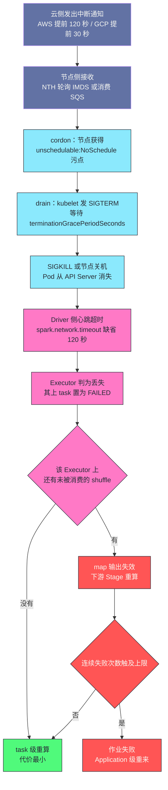
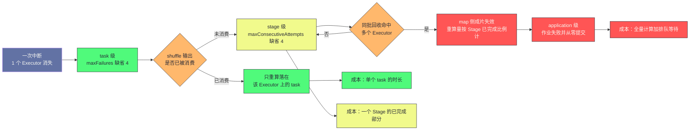
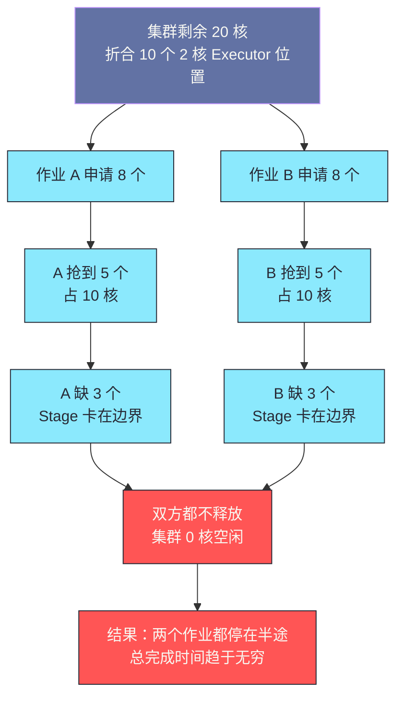
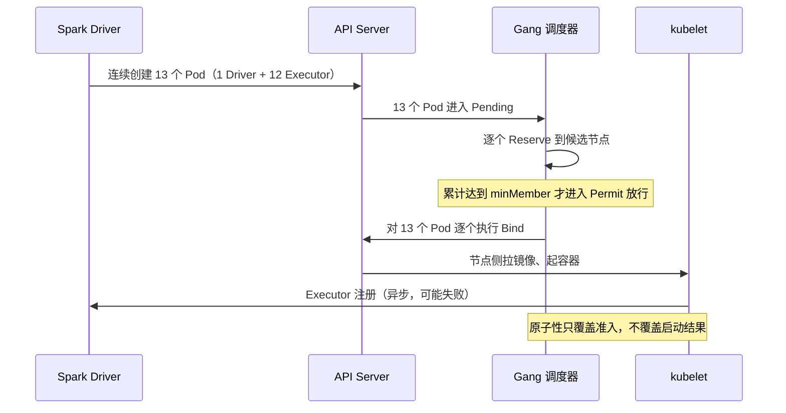
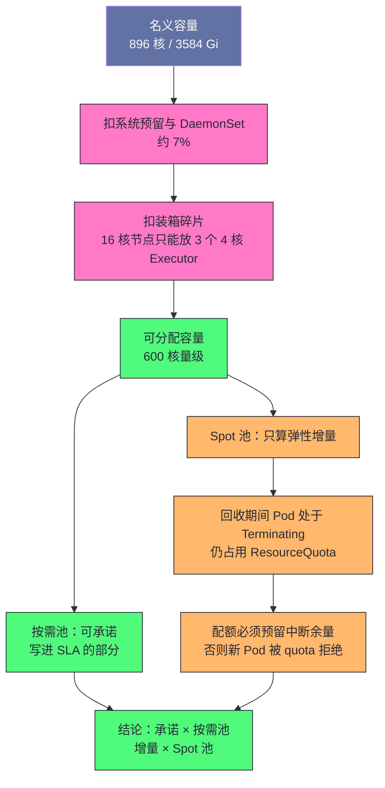

# 08 资源优化：Spot 实例、Gang Scheduling 与容量规划

**摘要：**

资源优化的账本有三种记法，而现场讨论最常犯的错误是把它们当成了同一种。云厂商用大幅折扣卖出的 Spot 实例（Spot Instance）省的是单价，代价是节点寿命不再由自己掌握；团伙调度（Gang Scheduling）买的是作业级的确定性，代价是集群级的吞吐；容量规划则是直接用钱买余量。三者共用同一组隐藏变量——资源的原子性与生命周期——所以它们的账必须一起算，单独看任何一本都会得出看起来正确、落地以后处处别扭的结论。

本文沿五问推进。先界定这三本账各自的计量单位，再用一套贯穿全文的集群与作业把算术固定下来；随后拆解 Spot 的中断模型：通知窗口有多长、污点与宽限期在链路的哪一段生效、Spark 侧为什么会比节点更晚发现 Executor 已经没了。接着把一次中断在 Spark 内部放大成 task 级、Stage 级与 Application 级三档重算，给出"期望成本 = 单价 ×（1 + 重算率）"这个公式的适用边界，算清楚 Spot 到底要坏到什么程度才会比按需更贵，并说明这个公式漏掉的三项成本。再往后是团伙调度：默认调度器逐 Pod 的语义如何制造出"两组各占一半、互相等待"的死锁，原子绑定究竟原子在哪一步，以及它必须依赖调度器扩展而非 Kubernetes 原生能力的现实约束。容量规划一章把输入、输出与缓冲的三个来源摊成可复算的算术，并给出"按峰值配"与"按 P95 配 + 排队"的取舍口径。最后处理两处容易被忽略的连带效应——节点规格与 CPU 单位，并单列边界与反例。

文章口径为 Spark 4.3.0（2026-10-30 发布）与 Kubernetes 1.37。文中的单价一律是示例单价，用于演示算术，不代表任何云厂商的实际报价。全文要回答的两个问题是：Spot 在什么条件下反而更贵，以及团伙调度买到的确定性究竟值多少吞吐。

**关键词（Keywords）**: Spot实例, 抢占式实例, 中断通知, **terminationGracePeriodSeconds**, Gang Scheduling, **PodGroup**, minMember, Volcano, Yunikorn, 混合部署, 容量规划, **CPU单位**, cpu-manager

---

## 第 1 章 三本账：省下的钱、丢掉的可用性、算错的容量

### 1.1 一份两边都对的季度复盘

一次迁移的复盘材料里，两张表的结论恰好相反。第一张是账单：批处理作业的 Executor 从按需节点整体挪到 Spot 节点池，Driver 留在按需池，下一个季度的计算成本降了四成有余。第二张是交付：作业超时工单从每月个位数涨到三十几件，值班表上多了一个中断告警看板，数据开发的排期开始往"预留重跑窗口"上挪。

两张表都是真的。财务算的是"单位计算量花了多少钱"，交付算的是"一个作业在承诺时间内跑完的概率"，两者之间没有换算公式，因为它们记的不是同一本账。**资源优化真正的难点不在参数，而在承认这是三本账，并且在一个决策里同时结清。**

三本账的科目可以列得很清楚：

- 单价：同样一个核时，你付多少钱。它由实例类型与购买方式决定，是唯一能直接写进预算表的一项。
- 时间：作业完成时间的分布，而不是均值。均值好看而尾部糟糕的集群，在报表上是优等生，在排期会上是灾难。
- 容量：在任意时刻，集群能对外承诺多少资源。它不是"总核数"，而是"在承诺时间内一定拿得到的核数"。

三个科目之间可以互相兑换，但汇率不是常数，而且兑换方向常常是单向的：钱可以买到时间和容量，时间和容量买不回已经错过的窗口。

### 1.2 一套贯穿全文的集群

后面的算术需要一个具体的着力点。笔者设一个中等规模的数据平台：一个 40 节点的池子，按生命周期分成两半。文中的单价是示例单价，只用于演示算术。

| 池 | 节点规格 | 台数 | 核数 | 内存 | 示例单价 |
|---|---|---|---|---|---|
| Spot 池 | 16C / 64Gi | 24 | 384 | 1536 Gi | 0.21 元/核·小时 |
| 按需池 | 32C / 128Gi | 16 | 512 | 2048 Gi | 0.60 元/核·小时 |
| 合计 | — | 40 | 896 | 3584 Gi | — |

Executor 的容器请求统一为 4 核、14 Gi（12 Gi 堆加 2 Gi 堆外余量）。于是每个 Spot 节点能放 4 个（核数 16÷4 与内存 64÷14 都取到 4），每个按需节点能放 8 个（32÷4 取 8，128÷14 取到 9，核数先卡住）。全集群一共 96 + 128 = 224 个 Executor 位置，其中 Spot 占 43%。

承载其上的三个作业代表三类负载，后面每一章的算术都用它们：

| 作业 | 触发方式 | 时长 | 峰值 Executor | Shuffle 落点 | 时间窗口 |
|---|---|---|---|---|---|
| `gmv_daily` | 每日 01:00 | 约 2 小时 | 12 | 本地 emptyDir | 06:00 前出报表 |
| `uv_hourly` | 每小时整点 | 约 8 分钟 | 6 | 远程 Shuffle 服务 | 下一小时开始前 |
| `log_join_adhoc` | 分析师随时提交 | 20 到 90 分钟 | 4 到 12 | 本地 emptyDir | 无硬窗口 |

这套参数的规模不大不小，正好让算术的误差落在"看得见但不致命"的区间：一个 Executor 位置算错，损失的是一个作业的尾巴；算错一成容量，损失的是几万块月成本。

### 1.3 一个比喻：自有货车、回程车与整车发运

把集群想成一家物流公司的车队。按需节点是自有货车，折旧照付、随时可用，雨天雪天都在院子里。Spot 实例是挂靠在别人线路上的回程车，价格三折，但对方随时可能把车抽走，只提前两分钟打个电话。团伙调度是"整车发运"——要么凑够一车皮的货一次发走，要么一件也不发，因为半车皮的货停在站台上既占道又不出货。容量规划是排班表：按峰值排班，车和司机都闲着；按 P95 排班，就要接受旺季排队。

比喻的限定有两处，恰好对应后面两章要展开的机制。其一是真实的回程车会跟你商量，而 Spot 的通知是"告知"而不是"协商"，两分钟之后车一定走，你只能决定在这两分钟里做什么。其二是真实的站台允许半车货先拉走，而团伙调度恰恰不允许——它宁可让站台空着等整车，也不接受半车在途。这两处限定，就是 Spot 与 Gang Scheduling 各自的全部代价来源。
---

## 第 2 章 Spot 的中断模型：两分钟到底有多长

### 2.1 折扣买的是什么

云厂商卖 Spot 实例，卖的是容量使用权而不是所有权。数据中心里总有一批算力在按需实例的峰谷之间空着，与其让它空置，不如以极低价格卖出去，但卖方保留随时收回的权利。这份收回权就是折扣的对价，它不是一份可以谈判的条款，而是一个写进产品定义的前提。厂商文档里的"最高可节省九成"与"提前两分钟通知"，说的是同一件事的两面。

值得区分的是三种不同的信号，它们的窗口与可靠性并不相同：

- 中断通知（Interruption Notice）：确定性的回收通知。AWS 在终止前 2 分钟发出，GCP 的抢占通知后 30 秒终止，Azure 的 Spot 虚拟机给 30 秒。
- 再平衡建议（Rebalance Recommendation）：更早，但只是"尽力而为"的预警，可能比中断通知早，也可能与之同时到达，甚至不发。AWS 明确写了它不保证先于中断通知。
- 计划内维护事件（Scheduled Events）：与 Spot 回收无关，但走同一条节点下线通道，处理方式可以复用。

三种信号的差别决定了处理器行为。以 AWS 的节点终止处理器（Node Termination Handler，NTH）为例：收到中断通知时它 cordon 并 drain，收到再平衡建议时默认只 cordon——因为再平衡不必然意味着机器马上被收回，贸然 drain 反而制造一次无谓驱逐。**信号的含义不同，你能做的动作就不同；把预警当成通知处理，等于自己制造中断。**

### 2.2 通知窗口不是你能用的时间

现场最常见的误解，是把"厂商提前 120 秒通知"直接当成"我有 120 秒做收尾"。真实的可用时间由三个层级的配置取最小。

第一层是节点侧。kubelet 的优雅节点关机（Graceful Node Shutdown）由 `shutdownGracePeriod` 与 `shutdownGracePeriodCriticalPods` 两个参数控制，出厂值都是 0，也就是不启用——自建集群上不显式配置，ACPI 软关机信号到了以后 Pod 得不到任何额外宽限。第二层是 Pod 侧：`terminationGracePeriodSeconds` 决定 kubelet 发完 SIGTERM 之后等多久再发 SIGKILL，缺省 30 秒，它只有在节点侧宽限覆盖它时才有意义。第三层是 Spark 侧：Executor 收到 SIGTERM 后的收尾由 Spark 的关闭钩子完成，是否来得及取决于前两层给了多少时间。

三层叠加的结论有点反直觉。GKE 的 Spot 虚拟机文档写得很直白：收到抢占通知后整个虚拟机 30 秒后关机，这 30 秒被切成 15 秒给普通 Pod、15 秒给系统 Pod，而且在 Pod 清单里把 `terminationGracePeriodSeconds` 设成大于 15 秒不会有任何效果。你在 pod template 里设的 90 秒宽限期，在一个 30 秒窗口的平台上根本不会生效，它被节点侧的关机期限截断了。

> [!warning] 一个容易做反的配置
> 把 `terminationGracePeriodSeconds` 从 30 秒抬到 120 秒，在自建集群上是有效的（前提是 kubelet 的 `shutdownGracePeriod` 也跟着抬），在按 30 秒窗口回收的托管平台上则完全无效。配置的有效性取决于链路最窄的那一段，而不是你改的那个值。

Spark 侧没有专门为 Pod 宽限期提供的配置项，要改只能通过 `spark.kubernetes.executor.podTemplateFile` 指向的 Pod 模板，在 `spec.terminationGracePeriodSeconds` 上写。这个细节值得记住：当一个参数没有对应的 Spark 配置时，通常意味着 Spark 认为这件事应由平台层统一决定，而平台层统一决定的结果，往往是所有租户共享同一个值。

### 2.3 从通知到重算：四段延迟与两个时钟

一次 Spot 中断从云端发出通知，到 Spark 真正开始重算，中间隔着四段延迟，其中只有前三段发生在通知窗口里。

第一段是通知到达节点：NTH 在 IMDS 模式下按秒级间隔轮询，队列模式下消费 SQS 事件，多一层投递延迟。第二段是 cordon 与 drain：cordon 把节点标记为不可调度，等价于给它打上 `node.kubernetes.io/unschedulable:NoSchedule` 污点，新的 Pod 从此不落这台机器；drain 逐个驱逐存量 Pod，耗时主体是每个 Pod 的 `terminationGracePeriodSeconds`。第三段是 Pod 消失：SIGKILL 之后容器退出、节点关机、Pod 从 API Server 里消失。

第四段的时钟是独立的：Executor 每 `spark.executor.heartbeatInterval`（缺省 10 秒）发一次心跳，Driver 超过 `spark.network.timeout`（缺省 120 秒）收不到才判它丢失。**这意味着即使节点在 30 秒内干净地消失，Driver 也可能再等接近 120 秒才开始重算。**节点被直接断电时，Pod 会长时间停在 Unknown，感知延迟只会更长，连 SIGTERM 都不会有。

两个时钟的错位解释了一类现场困惑：节点早就没了，作业却还在"等"——它等的不是资源，是心跳超时。把这条链路画出来，四段延迟各自的位置就清楚了：



图里最值得盯住的是 E 到 F 那一段：它不在任何一家的通知窗口里，却实实在在占着作业的等待时间。下面第三章会说明，这一段延迟还有第二个副作用——它决定了"一次中断"会被放大成多大的重算量。

### 2.4 污点、容忍与分池

既然 cordon 会自动产生 `unschedulable` 污点，那么"Spot 节点上不再接收新 Pod"这件事几乎不需要额外配置。真正需要设计的是另一件事：哪些 Pod 允许落在 Spot 节点上。

正规做法是在节点池这一层打标签，再用 Spark 的节点选择器把它表达出来。Driver 与 Executor 走两套不同的规则，这是全文唯一一处"两个组件必须分开配置"的地方：

```yaml
# Driver：只落在按需池，宁可等也不上 Spot
spec:
  driver:
    nodeSelector:
      node.kubernetes.io/lifecycle: on-demand
    tolerations: []            # 不写容忍，就不会被调度到带污点的按需节点之外

# Executor：只落在 Spot 池
spec:
  executor:
    nodeSelector:
      node.kubernetes.io/lifecycle: spot
    tolerations:
      - key: "node.kubernetes.io/lifecycle"
        operator: "Equal"
        value: "spot"
        effect: "NoSchedule"
```

这段配置之所以要写容忍，是因为多数云平台的 Spot 节点池默认带污点，不显式容忍就落不上去。以 GKE 为例，Spot 节点池默认带 `cloud.google.com/gke-spot` 污点；自建节点池则要自己在节点模板里种一对标签与污点，让"这台机器是临时的"变成集群可识别的事实。

分池还有一个更本质的取舍，它通常不在配置文档里出现：Spot 池与按需池之间要不要允许溢出。物理分池（污点加节点选择器）的好处是隔离彻底，关键作业不会因为节点被回收而受影响；代价是 Spot 池空闲时按需池的作业无法借用那部分容量，反之亦然。允许溢出（靠 PriorityClass 抢占而不是污点隔离）能把利用率拉高，但会引入一个新的失败模式：高优先级作业把低优先级作业从按需节点上挤出去，被挤的作业如果落到 Spot 节点，就在一个更不稳定的位置上继续运行。这个失败模式在账单上看不见，只会在中断率上升时露头。

配套的中断处理组件可以用 Helm 装，几个开关的含义值得逐条看清：

```bash
# 装上之后每个节点一个 DaemonSet，监听 IMDS 或消费 SQS
helm install aws-node-termination-handler eks/aws-node-termination-handler \
  --namespace kube-system \
  --set enableSpotInterruptionDraining=true \
  --set enableScheduledEventDraining=true
```

`enableSpotInterruptionDraining` 控制的是收到中断通知后 cordon 加 drain，`enableScheduledEventDraining` 管的是计划内维护事件；再平衡建议走的是另一个开关，缺省只 cordon，理由在 2.1 节已经说过。三个开关的粒度不同，说明组件设计者清楚地知道三类信号的置信度不同。

### 2.5 三家云的中断语义对照

把三种信号、窗口与 K8s 侧的可用时间整理成一张表，配置时的边界就清楚了：

| 维度 | AWS EC2 Spot | GCP Spot VM（GKE） | Azure Spot VM |
|---|---|---|---|
| 回收通知提前量 | 2 分钟 | 30 秒 | 30 秒 |
| 是否有更早的预警 | 有，再平衡建议，尽力而为 | 无对等信号 | 无对等信号 |
| 节点被回收时 Pod 的可用宽限 | 取决于 kubelet 优雅关机配置与 `terminationGracePeriodSeconds` | 默认 15 秒给普通 Pod、15 秒给系统 Pod，整段 30 秒 | 取决于节点侧关机策略 |
| 宽限期能否超过通知窗口 | 能，宽限受 Pod 侧约束 | 不能，Pod 侧设大于 15 秒无效 | 需按平台文档确认 |
| K8s 侧的接入点 | NTH，监听 IMDS 或 SQS | GKE 侧统一处理，向 kubelet 发优雅关机 | 平台事件驱动 |
| 额外信号面 | 再平衡建议、计划内维护事件 | 抢占通知 | 计划事件 |

最有用的是第四列，它回答同一个问题：你能在节点消失前干多少活。这个数量由平台给的窗口、平台给的宽限、你自己的 Pod 配置三者取最小，而多数人只改了第三项。

---

## 第 3 章 中断在 Spark 内部放大成什么

### 3.1 两条恢复路径，只有一个方向是好的

Executor 消失之后，Spark 有两种恢复动作，代价差着数量级。

第一种是 task 级重算：Driver 把该 Executor 上正在运行的 task 标记为 FAILED，重新放回队列由其他 Executor 接手，代价是这几个 task 已经做过的工作白费。第二种是 stage 级重算：若该 Executor 上还留着未被消费的 shuffle 输出，这些 map 输出就失效了，下游 Stage 必须连同上游一起重算，代价是一个 Stage 的已完成部分——往往十几分钟到半小时。

两种路径的分岔点不在中断本身，而在数据落在哪里。这不是修辞：同样的中断、同样的作业，只要 shuffle 数据的位置不同，重算量可以从"几个 task"变成"整个 Stage"。所以下面这张表才是 Spot 上真正需要设计的东西，Executor 的副本数、节点数都不是关键。

还必须说清一件事：**Pod 重建不等于状态恢复**。Executor Pod 设的是 `restartPolicy: Never`，Pod 失败后 K8s 不重启它，Driver 也不会"认领"同名的新 Pod；新起来的 Executor 是全新进程，不持有旧状态，也不会去读前一个进程留在本地盘上的文件。Spot 场景下的"重建 Pod"只是补上一个计算单元。

### 3.2 Shuffle 数据的三个落点

| 落点 | Pod 重建后是否还在 | 节点回收后是否还在 | 中断时的重算范围 |
|---|---|---|---|
| `emptyDir`（本地盘） | 否，随 Pod 删除 | 否 | map 输出失效，下游 Stage 重算 |
| `hostPath`（本地盘挂载） | 是 | 否，盘随节点消失 | 与 `emptyDir` 相同，但多一层"以为它持久"的误判 |
| PVC（网络块存储） | 是 | 是 | 只需重算被中断的 task |
| 远程 Shuffle 服务（RSS） | 是 | 是 | 只需重算被中断的 task |
| 对象存储（经 RSS 或自定义 `ShuffleDataIO`） | 是 | 是 | 只需重算被中断的 task |

第三行是 Spot 场景里最容易踩的坑。`hostPath` 常被当成"比 `emptyDir` 更持久"的选项，因为它在 Pod 重建时确实保住了文件。但 Spot 回收的是整台虚拟机，磁盘跟着一起没了，`hostPath` 的"持久"只对容器重启有效，对节点消失无效。把 shuffle 放在 `hostPath` 上再上 Spot，等于给自己一个双重错觉：既以为数据安全，又因此放松了对中断的警惕。

反过来，把 shuffle 挪到与节点生命周期无关的地方（RSS 或 PVC），中断的代价立刻从"一个 Stage"降到"几个 task"。这是本文里投入产出比最高的一处改动，比调任何调度参数都有效——它改变的是重算的粒度，而调度参数只能改变重算发生的概率。

### 3.3 三级放大器

一次中断被放大成多大，由三道闸门依次决定。

第一道闸门是 task 重试。`spark.task.maxFailures` 缺省为 4，意思是同一个 task 连续失败 4 次才会让整个 Stage 失败。4 这个数字对偶发的机器故障绰绰有余，对 Spot 上成片回收则未必——如果同一批 Executor 在同一个可用区被同时回收，重试的 task 会被调度到剩下那些同样位于该可用区的节点上，然后一起再失败一次。

第二道闸门是 Stage 连续失败次数。`spark.stage.maxConsecutiveAttempts` 缺省为 4，一个 Stage 连续失败 4 次会让作业中止。这一道闸门才是真正的放大器：它把"若干 task 失败"升级成"作业失败"。

第三道闸门是 Executor 失败次数。Spark 对 Executor 级失败也有计数上限（缺省按 Executor 总数的两倍、最少 3 计），越过之后作业直接失败。

三道闸门串起来，就得到一条从"一个 Pod 没了"到"整个作业从零开始"的升级路径：



图里 F 那个判断是全文最贵的一个分支：Spot 的回收往往是相关的（同一实例类型、同一可用区、同一批容量池），三个任务同时被回收的概率远高于独立事件的乘积。这就是为什么"分散到多可用区"这条建议在 Spot 上不是可选项而是前提——它把 F 分支的概率从"经常"压到"偶尔"。

### 3.4 checkpoint 应该放在哪

对 Structured Streaming 作业，checkpoint 是唯一能把重算量压在"一个微批"量级的手段，它的位置有三个硬要求。其一，必须在与 Spot 节点生命周期无关的存储上：对象存储、或落在按需池的 PVC 都行，`hostPath` 与 `emptyDir` 不行，理由是"备份与被备份对象同生共死"。其二，写入必须能被中断而不损坏：checkpoint 的写入本身是多文件动作，被 SIGKILL 切在中间会留下不完整版本，多数实现靠"先写临时目录再原子改名"规避，而这要求可用的时间窗口足以完成一次改名。其三，粒度要匹配中断率：微批间隔越大，一次中断损失的计算越多；间隔越小，写入开销占比越高，最优值只能在实测中断率下找。

批作业没有这条退路：它没有 checkpoint，RDD 血缘是唯一依据，而这个依据只能指向"从头算"。所以批作业在 Spot 上的着力点不是加快恢复，而是缩短失败单元——把一条两小时的管道切成四段半小时的作业、中间结果落表，一次中断最多损失半小时。参数只能让中断发生得少一些，结构才能让中断变得便宜。

### 3.5 中断时机决定代价

同样是丢一个 Executor，发生在作业的哪个位置，代价相差数倍。这张表值得在评审 Spot 方案时逐行过一遍：

| 中断时机 | Executor 上的状态 | 重算范围 | 相对代价 |
|---|---|---|---|
| 作业刚启动，Executor 还在拉镜像与注册 | 无 task、无 shuffle 输出 | 无，直接补一个 | 极低 |
| Stage 开头，task 刚运行 | 少量 task 进度 | 那几个 task | 低 |
| Stage 中段，shuffle 正在写 | 部分 shuffle 文件，可能不完整 | 该 Executor 的 map 输出与其下游 | 中 |
| Stage 尾部，大部分 task 已完成 | 几乎全部 map 输出 | 整段 Stage 的已完成部分 | 高 |
| 最后一个 Stage 的收尾阶段 | 结果尚未落盘 | 全部重算加结果重写 | 极高 |
| 多个 Executor 同批回收 | 成片 map 输出失效 | 多个 Stage 连锁 | 最高 |

这张表解释了一个反直觉的现象：**长作业并不因为"跑得久所以中断概率高"而更贵，它是因为"中断大概率落在中后段"而更贵。**一个两小时的作业，被中断的时刻在时间轴上均匀分布，落在后半段就损失一半以上的工作；一个八分钟的作业，即使被中断，损失的绝对量也只有几分钟。概率与损失比例这两项，随作业时长的增长方向一致，所以代价随时长超线性增长——这是第 4 章成本模型的核心。

---

## 第 4 章 成本数学：便宜多少，什么条件下反而更贵

### 4.1 一个只有两个变量的公式

把 Spot 与按需放在一起比，最朴素的口径是：

```
期望成本 = 单价 × 计算量 × (1 + 重算率)
```

其中单价是每核时的价格，计算量是原始作业需要的核时，重算率是"因中断而额外付出的计算量占原始计算量的比例"。设按需单价为 `p`，Spot 的折扣为 `d`（即 Spot 单价 `p × (1 - d)`），重算率为 `r`，则 Spot 更便宜的条件是：

```
p × (1 - d) × (1 + r) < p    ⟺    r < d / (1 - d)
```

这个不等式给出的临界值高得有点不真实：

| 折扣 `d` | Spot 单价（相对按需） | 重算率临界值 `d/(1-d)` |
|---|---|---|
| 30% | 0.70 | 43% |
| 50% | 0.50 | 100% |
| 65% | 0.35 | 186% |
| 75% | 0.25 | 300% |
| 90% | 0.10 | 900% |

按常见的六五折（Spot 单价为按需的 35%），重算率要到 186% 才会亏——意味着每跑一份活要额外重跑一点八六份。**在纯算力单价这一栏，Spot 的容错空间大得离谱，现场几乎不可能触及边界。**所以听到"Spot 其实不一定省钱"时，要追问的是：说的是哪一项成本。

### 4.2 公式漏掉的三项

公式之所以算不出"什么时候更贵"，是因为它只记了一本账。三项被漏掉的成本如下。

第一项：重算在满载集群上不是免费的。空集群里重算一份活，用的是本来闲置的核，边际成本为零；集群水位到 85% 时重算一份活，挤掉的是别人的作业，边际成本是"另一个作业的排队时间"。于是同一个重算率在两种集群上价格完全不同：前者几乎免费，后者是 1:1 的容量税。这一点把 Spot 的经济性与集群利用率绑在了一起——**越是把集群压得满，中断的代价越贵**，而这恰好与"提高利用率省钱"的直觉相反。两者能同时成立，是因为它们记的是不同的账：省的是单价，赔的是别人排队的时间。

第二项：时间价值与窗口余量。作业有截止时间时，中断带来的不是钱而是违约。判断一个作业适不适合上 Spot，可计算的口径是窗口余量比：

```
余量比 = (窗口时长 - 作业实际时长) / 作业实际时长
```

`gmv_daily` 的窗口是 5 小时、实际 2 小时，余量比 1.5，一次中断即使多花 60% 时长（3.2 小时）也还在窗口内，它适合 Spot。反过来，一个窗口 2.5 小时、实际 2 小时的作业，余量比 0.25，一次中断就违约，它不适合。判据是余量比，不是"是否无状态"。"无状态所以适合 Spot"这条流传很广的说法只回答了一半：无状态决定的是"能不能恢复"，余量比决定的是"恢复得起不起"。

第三项：兜底容量与工程成本。全 Spot 的策略隐含一份按需兜底：Spot 池抢不到容量时，作业必须能落到按需池上，而这份按需容量平时是闲置的。它的成本不能记在 Spot 头上，但它是 Spot 策略的必要条件。工程侧还有一笔固定投入：NTH、RSS、Pod 模板、中断看板、值班手册。这笔投入在 896 核的池子里摊薄到可以忽略，在 50 核的池子里会占掉省下来的钱的一大块。所以"我们也该上 Spot"这句话在中小集群上常常不成立，不是因为 Spot 不好，而是因为固定成本摊不开。

### 4.3 重算率的来源

`r` 不是一个可以拍的数字，它由三项相乘得到：

```
重算率 ≈ 中断概率 × 单次中断的平均损失比例 × 级联系数
```

中断概率近似服从指数分布，`P ≈ 1 - exp(-T / MTBF)`，`T` 是作业时长，MTBF 是该 Spot 池的平均无中断时长。按 `gmv_daily` 的 2 小时、假设 MTBF 为 6 小时，`P ≈ 28%`；`uv_hourly` 的 8 分钟在同一个池里 `P ≈ 2%`。单次中断的平均损失比例按 3.5 节那张表取中段，约 0.5。级联系数取决于 shuffle 落点：本地盘的成片失效会放大到 1.2 左右，RSS 把它压到 0.05 上下。

代入：本地盘方案 `r ≈ 0.28 × 0.5 × 1.2 ≈ 17%`；换成 RSS 之后 `r ≈ 0.28 × 0.5 × 0.05 ≈ 0.7%`。两者都远低于 186% 的临界值，结论是 `gmv_daily` 该上 Spot，而且不需要犹豫。这也侧面说明了一件事：在这个池子的参数下，RSS 的价值不在省成本，而在把 P95 的尾巴削平——成本账上 17% 与 0.7% 都是零头，时间账上却是"偶尔超时"与"几乎不超时"的差别。

那 `r` 什么情况下会冲到临界值以上？只有一种机制能做到：**正反馈**。重算本身要占资源，重算占得越多，池子里可用的 Spot 容量越少，容量越少中断越频繁，中断越频繁重算越多。这个循环在 Spot 池被多个团队共享、且大家都用同一批实例类型时最容易出现。它解释了一个经验现象：Spot 出问题的现场，中断率往往不是"比平时高一点"，而是"突然高出一截"——那不是概率波动，是踩踏。打断这个循环只能靠把重算的粒度做小（RSS）与把实例类型做散（多规格、多可用区），两者都在降低"单次中断的损失比例"，而不是降低中断概率。

### 4.4 成本是一个分布

到这里可以给出一句结论：**中断拉高的不是平均成本，而是成本的方差。**均值上 Spot 几乎总是赢，P95 上它经常输，而资源决策真正约束的是 P95——没有哪个团队会因为"季度平均成本降了四成"而容忍每月三十几件超时工单。

于是混部的目的从"尽量多用 Spot"变成"用 Spot 吸收对延迟不敏感的量，用按需兜住尾部"。按这个口径重新分配三个作业：

| 作业 | 余量比 | 重算粒度（数据落点决定） | 建议实例类型 | 理由 |
|---|---|---|---|---|
| `gmv_daily` | 1.5 | Stage 级（本地盘） | Executor 上 Spot，Driver 上按需 | 余量充足，中断最坏情况仍在窗口内 |
| `uv_hourly` | 0.1 | task 级（RSS） | 全部上 Spot | 时长极短，中断概率本身接近零 |
| `log_join_adhoc` | 无窗口 | Stage 级（本地盘） | Spot 优先，抢不到则排队 | 没有截止时间，排队不产生违约 |

这张表最重要的不是结论，而是它的排序依据：第一列是时间约束，第二列是重算粒度，两者共同决定一个作业能承受多少不确定性。实例类型只是这个判断的输出，不是输入。

### 4.5 反例：把 Driver 放在 Spot 上

Driver 上 Spot 是这一章里唯一一个"无论算术怎么算都不划算"的决定。

先看它省下多少。按案例集群的配置，Driver 容器 1 核 3 Gi，12 个 Executor 各 4 核 14 Gi，Driver 占全部核数的 1/49，即使按 65% 的折扣算，它贡献的成本节约不到 2%——省下的是一个零头。

再看它赔上什么。Driver 持有 DAGScheduler 的 Stage 划分、TaskScheduler 的队列状态、MapOutputTracker 的 shuffle 位置映射，进程一消失，所有 Executor 因为没有心跳对端而退出，作业完全失败——不是重算一个 Stage，是从零提交。前面那三道闸门在这里全部失效，因为闸门本身住在 Driver 进程里。

"Streaming 作业有 checkpoint，能恢复"这句辩解只说对了一半：checkpoint 恢复的是数据与进度，恢复不了已经发生的时间。更要紧的是，Spark 原生 cluster 模式的 Driver 是一个裸 Pod，Pod 失败后不会自动拉起，要让它自愈必须由 Operator 或 Deployment 托管——"Driver 用 Spot"在架构上要求的是另建一套 Driver 托管机制，而不是改一个 nodeSelector。为一个不到 2% 的成本项引入一套新的控制面，这笔交易明显不对称。

因此规则只有一条：Driver 落在按需池，用 `nodeSelector` 排除 Spot 节点，并配合 PriorityClass 与 PodDisruptionBudget 顶住它的可用性。这条规则的价值不在于省了多少钱，而在于它把"作业会整体失败"这种最贵的失败模式从概率表里划掉了。

---

## 第 5 章 团伙调度：死锁的形状

### 5.1 默认调度器的语义单位是 Pod

Kubernetes 默认调度器（kube-scheduler）的调度单元是单个 Pod。它的决策过程是：过滤出所有能放下这个 Pod 的节点，打分，选一个，绑定。整个流程里没有"这一组 Pod 能不能一起放下"这个概念。

Spark 的 Driver 恰好是按这个语义申请 Executor 的：它一次 POST 一个 Pod，重复 12 次。每一次申请都是独立的，调度器也独立地为每一个找到位置。在集群空闲时这没有问题；在集群紧张时，它会产生一种特殊的僵局。

### 5.2 死锁的形状

设想集群还剩 20 核，折合 10 个 2 核的 Executor 位置。作业 A 要 8 个，作业 B 要 8 个，两者在同一分钟内提交。

调度器按到达顺序逐个处理，中间还夹着其他 Pod 的插队。结果是 A 拿到 5 个、B 拿到 5 个，20 核被占满。此时 A 缺 3 个，B 缺 3 个，两个作业的 Driver 都在等自己的第 6 个 Executor；而那些已经起来的 10 个 Executor 既不会释放（不会主动退出），也做不完活（Stage 需要全部 Executor 才能推进到最后）。



要害不在于"资源不够"——资源刚好够其中一个作业完整跑完，要害在于**资源被锁在两个都不完整的手里，谁都不够解锁**。若 A 先拿到全部 8 个、跑 40 分钟后释放，B 再跑 40 分钟，两个作业 80 分钟都完成了；僵局之下这个时间是无穷，直到有人手动 kill 掉其中一个。四十倍以上的差距来自一个纯粹的调度语义问题，与机器性能、Spark 参数、数据量都无关。

### 5.3 真死锁与伪死锁

上一节描述的是静态分配下的**真死锁**：没有任何机制能自己解开，必须外部介入。现场更常见的是一种会缓慢推进的变体，笔者称之为**伪死锁**。Executor 起来之后并不空转，它会立刻跑当前 Stage 的 task，所以僵局的真实形态是"A 的 5 个 Executor 跑完了 map 阶段，reduce 阶段需要更多并行度却没有更多 Executor，于是 A 卡在 Stage 中间；B 同理"；开了动态分配之后两个 Driver 继续申请，而申请排在谁前面取决于调度器与配额，于是两个作业以极慢的速度交替推进，谁都不失败，谁都不按时完成。

伪死锁的诊断难度远高于真死锁：一切都在动，就是慢，Executor 数在缓慢增长，Stage 时长被同比拉长，而所有告警阈值一个都没被触发。判据要换成"同一批次提交的多个作业是否同时出现 Executor 数不足且完成时间同比拉长"。

### 5.4 为什么"部分启动"比"完全不启动"更糟

直觉上，能跑一半总比一个都跑不了要好。在 Spark 的 Stage 语义下，这个直觉是错的，理由有四条。

第一，部分启动占着资源却没有对应产出。5 个 Executor 占着 10 核，如果这个 Stage 需要 8 个 Executor 才能推进到下一个 Stage，那 10 核在等待期间是纯粹的沉没成本。

第二，部分启动让排队指标失真。队列系统看到的是"这个作业已经在运行"，于是不再把它计入等待队列，而调度器看到的是"还有 3 个 Pod 在 Pending"，两边都不认为自己该动。责任在两个系统的交界处蒸发了。

第三，部分启动让告警失效。多数告警规则写的是"Executor 数为 0 持续 N 分钟"或"作业运行超时"，前者捕捉不到部分启动，后者要等到窗口末尾才响——那时已经晚了。

第四，部分启动破坏调优的口径。你按 12 个 Executor 算出的并行度、分区数、每任务数据量，在只有 5 个 Executor 时全部不成立：分区数相对槽位数变成了 2.4 倍（原本是 1 倍），每个槽位要串行处理更多 task，Stage 时间被拉长，而你会误以为是数据倾斜。

### 5.5 团伙调度解决什么，不解决什么

团伙调度（Gang Scheduling）的语义很干脆：一个作业的所有 Pod 必须同时被调度成功，否则一个都不占用资源。放到 5.2 节的场景里，结果是 A 拿到全部 8 个、跑完释放，B 再拿全部 8 个——落到"80 分钟"那条路径上。

但它的射程有限，边界必须写清楚，否则它会被当成万能药。

它解决的是多作业争抢同一资源池时的部分分配僵局。它不解决以下三类问题：

其一，单作业内部的扩缩容僵局。开了动态分配的作业需要从 5 个 Executor 扩到 12 个，而集群只有 7 个位置——这是同一个作业内部的资源不足，与"多作业互相等待"无关，团伙调度管不到。

其二，装箱碎片。20 核散在 10 台机器上、每台剩 2 核，而 Executor 需要 4 核。此时团伙调度会诚实地告诉你"凑不齐"，然后什么都不给——它把一个"勉强能跑"的场景变成了"确定跑不了"。碎片要靠容器尺寸与节点规格的整除关系解决，不是调度语义能解决的。

其三，优先级倒置。一个低优先级的作业占了 6 个位置不放，高优先级作业永远凑不齐自己的 8 个。这不是死锁，是排队顺序问题，需要 PriorityClass 抢占或队列权重来处理。

---

## 第 6 章 团伙调度的实现前提：调度器扩展

### 6.1 原生 Kubernetes 不提供这个语义

到 1.37，kube-scheduler 的默认行为仍然是逐 Pod 调度，团伙语义不在其中。上游确实在往这个方向走：KEP-4671 提出用 Workload 对象表达分组，KEP-5832 把 PodGroup 从 Workload 里拆出来做成独立的运行时对象，kube-scheduler 侧则新增一个 `GangScheduling` 插件，在 Permit 阶段等待同组 Pod 全部到齐。但这套能力目前挂在 `GenericWorkload` 这个特性门（feature gate）后面，缺省关闭，属于 alpha。

更要紧的是接入方式对不上：按 KEP 的设计，PodGroup 由 Job、JobSet、LeaderWorkerSet 这类控制器创建，Pod 通过 `spec.schedulingGroup.podGroupName` 指向它；而 Spark 的 Driver 是自己直接 POST Pod 的，既没有控制器替它建 Workload 与 PodGroup，也不会去填那个字段。即使打开了特性门，Spark 的 Pod 也进不了这个 gang——对 Spark 而言，团伙调度只能从调度器扩展里拿。

### 6.2 两条接入路线

调度器扩展分两种形态，选择哪一种基本决定了运维负担的量级。

替换式：把集群的默认调度器换成支持 gang 的调度器，所有 Pod 都走它。Volcano 是这条路线的代表，它提供 PodGroup 这个 CRD 表达"一组 Pod 加最小成员数"，并提供 Queue 做资源池与权重。

插件式：保留 kube-scheduler，通过调度框架的扩展点插入 gang 逻辑。scheduler-plugins 里的 coscheduling 插件与 Apache Yunikorn 都属于这一类。插件式的接入成本低，但它的能力也受限于框架提供的扩展点。

### 6.3 原子绑定究竟原子在哪一步

把"全有或全无"当成一个事务是一种误解，Kubernetes 的调度过程并没有事务。真实时序是：调度器逐个为 Pod 完成节点筛选与打分，把候选位置记在缓存里（Reserve），在 Permit 阶段等待同组 Pod 全部到达，等到达数满足 `minMember` 才逐个执行 Bind。



这张时序图里有两处值得盯住。第一处是最后的注释：**原子性覆盖的是"能不能开始"，不是"能不能跑起来"。**Bind 之后每个 Pod 仍要经过拉镜像、起容器、注册，任何一步失败它就退出了，而同组伙伴已经在运行——团伙调度此时不会把整组拆掉，它只是让作业回到"部分启动"的状态。第二处是 Permit 阶段的超时：有的实现超时后放行已 reserve 的部分（放弃原子性换取不饿死），有的超时后全部拒绝（保住原子性但可能饿死）。这个分歧没有对错，选型时值得直接问一句：超时之后你放不放。

### 6.4 Volcano 的配置口径

以案例里的 `gmv_daily` 为例，1 个 Driver 加 12 个 Executor，容器请求分别是 1 核 3 Gi 与 4 核 14 Gi，于是 PodGroup 的最小成员数是 13，最小资源是 49 核、171 Gi：

```yaml
apiVersion: scheduling.volcano.sh/v1beta1
kind: PodGroup
metadata:
  name: gmv-daily-pg
  namespace: spark-prod
spec:
  minMember: 13            # 1 Driver + 12 Executor，少一个就整组不放行
  minResources:
    cpu: "49"              # 1 + 12 × 4
    memory: "171Gi"        # 3 + 12 × 14
  queue: data-eng          # 队列决定权重与借用上限
```

提交时通过调度器名与注解把 Pod 与 PodGroup 关联起来：

```
spark.kubernetes.scheduler.name=volcano
spark.kubernetes.driver.annotation.scheduling.volcano.sh/pod-group=gmv-daily-pg
spark.kubernetes.executor.annotation.scheduling.volcano.sh/pod-group=gmv-daily-pg
```

这三行配置里，第一行是关键：`spark.kubernetes.scheduler.name` 决定 Pod 的 `schedulerName` 字段，而只有 `schedulerName` 指向 volcano 的 Pod 才会被它调度。如果只写了注解而漏了这一行，注解不会生效，Pod 仍由默认调度器逐个调度——配置看起来齐了，行为却是没有 gang 的。这类"注解对了但调度器名没对"的故障在接入阶段非常常见，判据是看 Pod 的 `spec.schedulerName` 而不是看注解。

### 6.5 四种方案对照

| 维度 | Volcano | Apache Yunikorn | coscheduling 插件 | 不做 gang |
|---|---|---|---|---|
| 接入方式 | 替换默认调度器 | 调度器插件，与 kube-scheduler 共存 | 调度器插件 | 无 |
| 分组表达 | PodGroup CRD + `minMember` | 按 application 分组，队列层级在 `queues.yaml` 定义 | PodGroup CRD + Permit 等待 | 无 |
| 原子性实现点 | Reserve 与 Permit | application 级资源预留与准入 | Permit 阶段等待 | 无 |
| 与 Spark 的接法 | `scheduler.name` 加注解 | `scheduler.name` 加队列标签 | `scheduler.name` 加 PodGroup 引用 | 无 |
| 队列与配额 | Queue，支持权重与借用 | 层级队列，支持公平份额与抢占 | 需自行与其他机制拼接 | ResourceQuota |
| 主要代价 | 全集群 Pod 都要走它，升级耦合 | 需要维护队列配置与配额模型 | 能力受框架扩展点限制 | 保留死锁 |
| 适用规模 | 中大型批处理集群 | 多租户、需要层级配额 | 已有 kube-scheduler 且不想换 | 单一作业、独占集群 |

最后一行是这张表里最容易被忽略的：**独占集群上不需要 gang。**如果整个集群只服务一个作业，部分分配不会造成死锁，只会让作业慢一点，而 gang 带来的复杂度一点都不会少。这条判据能挡掉相当多"我们是不是也该上 Volcano"的讨论。

---

## 第 7 章 团伙调度的代价：利用率、队头阻塞与调度开销

### 7.1 原子性的账单是预留

gang 保证"要么全给要么不给"，代价落在"给出去但还没用上"的那段。Executor Pod 从 Bind 到真正开始跑 task，要经过拉镜像、启动 JVM、向 Driver 注册三步，这段时间资源已被占住，一毫秒的计算都没产出，对 4 核 14 Gi 的容器通常是几十秒。

这笔浪费占总成本的比例完全取决于作业时长。`gmv_daily` 跑 2 小时，40 秒占 0.5%，可以忽略；`uv_hourly` 跑 8 分钟，同样 40 秒占 8%；跑 5 分钟的作业则上到 13%。**同样的 gang 配置，在长作业上是合理的代价，在短作业上是明显的浪费。**

### 7.2 队头阻塞与吞吐下降

先到先服务的 gang 队列有一个著名副作用：队头阻塞。一个需要 200 核的作业排在队首、集群只有 180 核可用，它拿不到；排在后面的小作业本来可以立刻跑，也因为队列顺序拿不到，集群利用率在那段时间里掉到很低，直到某个运行中的作业退出。调度开销还随组内 Pod 数增长：调度器每次都要回答"这一组能不能一起放下"，单个作业的 Pod 数超过单次调度周期的处理能力时，收益会被调度延迟吃掉。

这是团伙调度最本质的取舍：**它提高的是作业级的确定性，降低的是集群级的吞吐。**两者不可兼得，只能按队列分而治之。Volcano 用队列权重与抢占缓解，让高权重队列插队、把低权重队列的资源收回来；Yunikorn 用层级队列与公平份额，让每个队列拿到与权重相称的份额。两者都在做同一件事：把"集群吞吐"这一个目标拆成多个队列目标，代价是配置本身变成一门需要维护的学问。

### 7.3 与 Spot 的张力

把两章的内容叠在一起，会看到一个不太舒服的结论：**gang 保证的是"开始时的原子性"，Spot 破坏的是"运行中的完整性"，两者合起来会在运行期把死锁重新制造出来。**

想象 `gmv_daily` 的 13 个 Pod 被 gang 一次性放行、全部落在 Spot 池。运行到 40 分钟时一次回收带走 8 个 Executor，作业只剩 4 个——它又回到 5.2 节那个"半途卡住"的形态，只不过这次不是调度器造成的，是节点造成的。gang 此时帮不上忙，因为它已经完成了自己的职责。

所以两者组合时，配置原则要分开写：gang 只负责"起始准入"，运行期的完整性要靠另外三件事——PriorityClass 防止被其他作业抢占、回收收敛（多实例类型、多可用区）降低同批回收的概率、RSS 或 PVC 降低单次中断的损失。指望 gang 解决 Spot 的可用性问题，是把一个准入机制当成了容错机制。

一个更实用的分工是：把 gang 用在按需池里的关键作业上，保障它们不会因为资源被切碎而死锁；Spot 池里的作业用"软 gang"——分批申请、允许降级到部分启动，用排队和重试吸收不确定性。两者的资源池不同、语义要求不同，混在一套配置里必然有一边妥协。

### 7.4 团伙调度的参数决策

| 决策项 | 取值口径 | 配错的后果 |
|---|---|---|
| `minMember` | 必须等于 Driver 加全部 Executor 数 | 配小了退化成部分启动；配大了永远凑不齐 |
| `minResources` | 按容器请求逐项累加，不要按堆内存算 | 低估内存导致 gang 放行后被节点拒绝 |
| 分组粒度 | 一个作业一个 PodGroup，不要跨作业复用 | 复用时一个作业失败会拖住同组其他作业 |
| Permit 超时 | 大于正常调度耗时，小于业务可接受等待 | 太短破坏原子性，太长让队列空转 |
| 队列与权重 | 按作业等级分队列，权重对应 SLA | 全塞一个队列等于没有优先级 |
| 是否抢占 | 关键队列开抢占，普通队列关 | 全开导致频繁驱逐，全关导致高优作业饿死 |

表里第二行最容易算错。`minResources` 要按容器请求累加，而容器请求是"堆加堆外余量"，不是 `spark.executor.memory`；按堆内存填的结果是 gang 认为资源够了、放行，然后 Pod 在节点侧起不来——失败从分配阶段挪到启动阶段，报错却指向节点资源不足，排查方向会被带偏。

---

## 第 8 章 容量规划的算术

### 8.1 五个输入，两个输出

容量规划之所以经常变成拍脑袋，是因为输入没有被写全。真正需要的输入只有五个：峰值并发作业数 `N`、单作业峰值 Executor 数 `E`、单容器的资源请求 `R`、每节点实际可容纳的 Executor 数 `k`、目标水位 `η`。输出有两个：节点数，以及它在 Spot 池与按需池之间的分配。

```
Executor 位需求 = N × E
节点数 = ceil(N × E / (k × η))
```

`k` 是算术里最容易想当然的一项，因为它不是"节点核数除以 Executor 核数"这么简单的一句话，后面 8.3 节会看到它被系统开销与装箱余量削掉了四分之一。这条主线可以画成一条直白的流水线：


图里那个汇合点把"名义容量"与"可承诺容量"分成了两个数：前者是所有节点核数的加总，后者是扣除系统开销、装箱余量与 Spot 不确定性之后敢写进 SLA 的那一部分。

### 8.2 用案例集群算三遍

案例的 30 个作业里，峰值并发出现在每日 01:00 到 02:00，`N = 18`；单作业峰值 Executor 数取 `E = 12`。于是 Executor 位需求是 216。按 Spot 节点的 `k = 4`、水位 `η = 0.85` 计算，需要 64 台。

同样的作业，换一个口径就完全不同：过去 30 天的 P95 并发只有 11，折合 132 个位置，39 台就够；按均值 3.3 个并发算，12 台就够。三种口径的容量与成本差得极远：

| 口径 | 峰值并发 | Executor 位需求 | 节点数（k=4，η=0.85） | 相对月成本（示例单价） |
|---|---|---|---|---|
| 按峰值 | 18 | 216 | 64 | 基准 |
| 按 P95 + 排队 | 11 | 132 | 39 | 约为基准的 61% |
| 按均值 + 大量排队 | 3.3 | 40 | 12 | 约为基准的两成 |

64 台与 39 台之间差的 25 台，按 16 核、0.21 元/核·小时的样例单价折算，是 400 核、每月六万量级的差额；如果这 25 台按需计价，差额会到十七万量级。**这就是容量规划真正在决策的东西：不是"够不够"，而是"愿意为尾部付多少钱"。**

### 8.3 缓冲的三个来源

`η = 0.85` 这个水位要覆盖三处损耗，它们的量级差别很大。

第一处是系统占用与装箱余量，它最大，也最常被漏掉。一个 16 核节点要为系统进程预留（`kube-reserved` 与 `system-reserved`），随后 DaemonSet 又要吃掉一两个核的一部分。假设合计 1.5 核，剩下 14.5 核，能放几个 4 核 Executor？答案是 3 个，不是 4 个——12 核用掉，2.5 核变成无法使用的碎片。**`k` 从 4 掉到 3，容量直接差 25%。**按 `k = 3` 重算峰值口径：216 ÷（3 × 0.85）= 84.7，需要 85 台而不是 64 台。这就是为什么容量规划必须用"每节点能放几个"做校验，而不能用"总共申请了多少核"。

第二处是峰值同步：整点触发、凌晨日结、上游数据落地后的一波提交，都会让并发在同一分钟冲上去，用泊松到达估算峰值必然偏低。第三处是中断重建：要留的不是"常年零点几个百分点在重建"这个零头，而是中断风暴的瞬时缺口——一次回收带走 8 个 Executor，这 8 个位置得由其他节点的余量吸收，所以缓冲里该有"一个作业峰值规模"这一项，而不是一个百分比。

### 8.4 按峰值还是按 P95：一条会发散的曲线

三种口径的选择本质上是排队论的取舍。在 M/M/c 一类的模型里，等待时间随利用率 ρ 的增长近似正比于 `ρ / (1 - ρ)`：ρ 从 0.5 升到 0.8，等待时间涨约 4 倍；从 0.8 升到 0.9，再涨约 2 倍；从 0.9 升到 0.95，再涨约 2 倍。这条曲线在接近 1 的地方是发散的，不是线性的。

由此得到两个判断。其一，**水位不是一个可以逐步逼近的旋钮**：0.7 提到 0.85，等待时间可能翻倍而成本只降一成七；0.85 提到 0.95，成本再降一成，等待时间可能翻四倍。其二，按 P95 配容量的前提是排队可接受，而这取决于作业有没有窗口——`gmv_daily` 有 5 小时窗口，排 20 分钟无所谓；`uv_hourly` 只有 1 小时窗口，排 20 分钟就意味着下个小时被挤掉。

| 维度 | 按峰值配 | 按 P95 配 + 排队 | 按均值配 |
|---|---|---|---|
| 容量 | 最高 | 中 | 最低 |
| 月成本 | 基准 | 六成左右 | 三成左右 |
| 峰值期 P95 完成时间 | 不受影响 | 拉长数十分钟 | 不可控 |
| 超时风险 | 极低 | 需要窗口余量兜住 | 高 |
| 运维复杂度 | 低，不用管队列 | 中，要设队列与上限 | 高，要常态化处理积压 |
| 适用场景 | 有硬 SLA 的日结作业 | 有余量比、可容忍排队的批作业 | 交互式与临时分析 |

### 8.5 混部下的资源账

把三个池子的账摊开，会发现名义容量与可承诺容量之间隔着一整层损耗，而损耗里还藏着两处只有混部才会出现的问题：



图里那条从 Spot 池拐到配额的支线，是混部特有的第二处损耗。淡出的 Pod 在 Terminating 状态下不会立刻从配额统计里消失，于是中断风暴期间 Driver 申请 Executor 时会撞上 `exceeded quota`，而集群的节点其实还有余量。解决办法不是把配额调大，而是把配额按"名义值加中断余量"来配——这个余量的量级与 2.3 节那四段延迟直接相关。

除此之外，还有一个更本质的结论：**SLA 承诺只能建立在按需池上，Spot 只能算弹性增量。**这不是保守，而是算术的必然——一个容量如果会在任意时刻以 30 秒的提前量消失，它就不能用来承诺任何有截止时间的东西。把这个结论落到配额设计上，就是"每个团队的配额按需池覆盖，超出部分走 Spot 队列并且不承诺完成时间"。

---

## 第 9 章 节点规格与 CPU 单位：两处连带效应

### 9.1 节点大小的账在别处

节点规格的选择常被简化成"大节点还是小节点"的偏好之争，实际的账算在三处。

第一处是 shuffle 的传输路径：同节点的两个 Executor 交换数据走本地回环，跨节点走物理网络，节点越大、一个作业越可能自给自足。第二处是爆炸半径：一次故障或一次回收带走的 Executor 数等于该节点的 `k`，案例里 `k = 3` 或 `4`，一个 12 个 Executor 的作业损失三成还能继续跑；换成 64 核、`k = 16` 的节点，一台机器就是整个作业。可以把它写成一条可计算的规则：**让 `k ≤ E / 4`**，即单台节点最多承担作业峰值的四分之一，代入 `E = 12` 得 `k ≤ 3`，恰好落在 16 核节点上。第三处是装箱的整除关系：16 核扣掉系统占用后放 3 个 4 核 Executor、浪费 2.5 核；32 核放 7 个、同样浪费 2.5 核，浪费比例反而更低。节点越大碎片比例越小，爆炸半径越大，中间那个点由上面那条规则定。

至于"节点切小就能减轻回收影响"这个直觉，只在回收彼此独立时成立。真实的回收是相关的：同一实例类型的容量池、同一可用区的物理资源，往往在同一时刻紧张。案例里 24 台 16 核节点分布在 3 个可用区，一次区域级回收命中 8 台就损失 32 个 Executor；换成 12 台 32 核节点，同比例命中 4 台、`k = 7` 时损失 28 个，几乎一样。**相关性淹没了粒度**，真正有效的手段是让回收单元在类型与区域上分散，而不是把节点切小。

### 9.2 `500m` 与 `0.5`：两个 CPU 口径

Kubernetes 的 CPU 是十进制小数，`1` 等于 `1000m`，`0.5` 与 `500m` 完全等价；内存才是二进制，`Gi` 与 `G` 差着 7%。这一条本身是常识，但它与 Spark 的一个双口径设计叠在一起，就会产生一类很难发现的浪费。

Spark 侧有两个关于核的配置，语义完全不同。`spark.executor.cores` 决定**槽位除法**：一个 Executor 能同时跑几个 task，等于它除以 `spark.task.cpus` 后向下取整。`spark.kubernetes.executor.request.cores` 决定**K8s 侧的记账**：这个 Pod 向调度器申请多少 CPU。两者可以不一致，而且不一致时 Spark 不会报任何错。

| `spark.executor.cores` | `spark.kubernetes.executor.request.cores` | K8s 记账 | 槽位数 | 后果 |
|---|---|---|---|---|
| 4 | 未设（缺省取 4） | 4 核 | 4 | 一致，推荐 |
| 4 | `2000m` | 2 核 | 4 | 超卖，4 个 task 抢 2 核，CPU 竞争激烈而调度器仍认为节点有余量 |
| 4 | `6000m` | 6 核 | 4 | 反超卖，多付 2 核的租金而只开 4 个槽位 |
| 2 | 未设 | 2 核 | 2 | 一致，另一种常见组合 |

第三行的错误方向相反，但根因相同：两个口径分别被不同的人配置过，一个来自 Spark 的默认值，一个来自 K8s 的配额规范，谁也没错，合起来就是错的。

### 9.3 cpu-manager 的 static 策略与独占核

默认的 CPU 管理策略是 `none`：CPU 以 CFS 配额的形式分配，Pod 之间共享物理核。共享意味着上下文切换、cache 争用、以及"同一个核上两个 task 互相拖慢"。静态策略（static）改变这件事：满足条件的容器会拿到独占的 cpuset，不再与别人共享。

拿到独占核需要三个条件同时满足，缺一不可：

其一，节点 kubelet 的 `cpuManagerPolicy` 设为 `static`，并配置了大于零的 CPU 预留（零预留会让共享池为空，策略无法生效）。其二，Pod 的服务质量等级必须是 Guaranteed，也就是所有容器的 CPU 与内存的 request 都等于 limit。其三，CPU request 必须是整数（4 或 4000m，不能是 3500m）。

第三条把分数核的用法挡在门外，于是 Spark 的配置要成对写：

```
spark.kubernetes.executor.request.cores=4        # 记账与独占核的前提
spark.kubernetes.executor.limit.cores=4          # 不写 limit 就是 Burstable，拿不到独占核
```

内存那一侧 Spark 默认已经把 request 与 limit 都设成"堆加堆外余量"，所以只要 CPU 侧补齐，QoS 就是 Guaranteed。漏掉 `limit.cores` 是这一类配置最常见的失败点：request 写了 4，没有 limit，Pod 是 Burstable，cpu-manager 的 static 策略对它视而不见，节点上一切正常，只是独占核这个能力从来没有生效过。

static 还有一个副作用：可超卖的 CPU 变少，`k` 可能从 3 掉到 2。所以它不适合全集群铺开，只适合用在确实需要单核性能可预测的负载上——复杂 UDF、单线程解析、加解密。判据是：如果 Stage 时长方差主要来自同机邻居，就值得开；如果方差来自数据倾斜，开了也没用。

---

## 第 10 章 边界与反例

### 10.1 小作业上团伙调度

一个跑 5 分钟、需要 4 个 Executor 的作业，用 gang 的代价是：40 秒启动空窗占 13% 的时长，队头阻塞让它在高峰时段多等十几分钟，而它本来也不太可能造成死锁。判据是"单作业 Pod 数相对集群位置数的比例"，比例低于一成时，gang 的收益抵不上它的预留浪费与调度开销。

### 10.2 按峰值配容量

按峰值配最安全也最贵，隐性成本不在账单上，而在于它把不确定性转移给了财务：按峰值配了 85 台的集群，日均水位可能只有两成，于是"提高利用率"成为下一年的 KPI，有人把水位推到 0.9，P95 开始劣化。根因是最初选型时没把两种口径的差别写进决策记录。

### 10.3 全 Spot 集群

技术上可行，组织上不可行。全 Spot 意味着没有容量可以承诺，所有作业的完成时间都变成分布，而排期需要确定的时间点。可落地的比例取决于团队对延迟的容忍度，把 Driver 与关键作业放在按需池是这条线的下限。

### 10.4 一张反例速查表

| 现象 | 常见误判 | 实际机制 |
|---|---|---|
| Spot 中断后作业卡很久 | 集群没资源 | Driver 在等心跳超时，`spark.network.timeout` 缺省 120 秒 |
| 中断风暴时新 Executor 创建失败 | 配额给少了 | Terminating 的 Pod 仍占配额，需要按名义值加余量配 |
| 设了 90 秒宽限期但没生效 | 配置写错了 | 平台侧关机窗口只有 15 到 30 秒，宽限期被截断 |
| 注解写了 PodGroup 却没有 gang | gang 没装好 | 漏了 `spark.kubernetes.scheduler.name`，Pod 仍走默认调度器 |
| gang 配好之后作业更慢 | gang 有性能问题 | 作业本身慢了，gang 只是让它多等一次整组资源 |
| 容量按 4 个 Executor 每节点算 | 算术没错 | 扣掉系统预留与 DaemonSet 后每节点只能放 3 个 |
| 核申请 4 个但只跑 2 个槽位 | Spark 调度有问题 | `executor.cores` 与 `request.cores` 被分别配置过 |
| 开了 static 策略仍无独占核 | 节点没生效 | Pod 是 Burstable，缺 `limit.cores` 或内存 request 不等于 limit |

---

## 第 11 章 落点

三本账最终要合成一本。Spot 用节点寿命换单价，团伙调度用集群吞吐换作业级确定性，容量规划用钱买余量——三个旋钮转的是同一根轴，即资源的原子性与生命周期。省下的每一分钱，都对应某一处可用性的让渡；这不是修辞，而是可以在算式里逐项核对的事实：Spot 的 65% 折扣对应的是"可承诺容量归零"，gang 的确定性对应的是"队列吞吐下降"，按峰值配容量的安全对应的是"日均水位两成"。

由此得到的判断顺序是：先算容量，用 `N`、`E`、`k`、`η` 四个量把"每节点能放几个"算准，这一步错了后面全错；再分级，用窗口余量比与重算粒度把作业分成"必须按需""可以 Spot"两类，实例类型是这个判断的输出；最后才选调度语义，只有当一个作业的 Pod 数占集群位置数的比例足够大、且多作业并发提交时，gang 的收益才盖得住它的代价。反过来做——先上 Volcano、再上 Spot、最后发现容量算错了——是这类项目最常见的失败路径。

因地制宜这四个字在这里有很具体的含义。896 核的池子上，RSS 与 NTH 的固定投入摊得开，值得做；50 核的池子上，一套完整的 gang 调度器带来的复杂度可能超过它解决的问题；独占集群上，gang 甚至不需要存在。同一个方案在不同规模的集群上会有相反的结论，这不是方案不稳定，而是固定成本的摊薄比例不同。

上游确实在往原生分组调度走，Workload 与 PodGroup 已经在特性门后面跑起来了，但默认关闭、alpha、且没有为 Spark 这种自建 Pod 的客户端准备接入点。至于它什么时候能成为可以依赖的能力，目前仍然言之尚早。

---

## 参考资料

1. Amazon EC2 用户指南：Spot 实例最佳实践（最高节省比例、两分钟中断通知）。https://docs.aws.amazon.com/AWSEC2/latest/UserGuide/spot-best-practices.html
2. AWS 白皮书：管理 Spot 实例中断。https://docs.aws.amazon.com/whitepapers/latest/cost-optimization-leveraging-ec2-spot-instances/managing-instance-termination.html
3. Google Cloud 文档：GKE 中的 Spot 虚拟机（30 秒终止、Pod 15 秒宽限）。https://cloud.google.com/kubernetes-engine/docs/concepts/spot-vms
4. aws-node-termination-handler README（cordon 与 drain 行为）。https://github.com/aws/aws-node-termination-handler
5. Kubernetes 文档：Node Resource Managers（static 策略与独占核条件）。https://kubernetes.io/docs/concepts/policy/node-resource-managers/
6. Kubernetes 文档：Pod Priority and Preemption。https://kubernetes.io/docs/concepts/scheduling-eviction/pod-priority-preemption/
7. KEP-4671：Gang Scheduling using Workload Object。https://github.com/kubernetes/enhancements/tree/master/keps/sig-scheduling/4671-gang-scheduling
8. KEP-5832：Decouple PodGroup from Workload API。https://github.com/kubernetes/enhancements/blob/master/keps/sig-scheduling/5832-decouple-podgroup-api/README.md
9. Volcano 文档：PodGroup 与 gang 调度、Queue 与权重。https://volcano.sh/en/docs/
10. Apache Yunikorn 文档：层级队列与资源预留。https://yunikorn.apache.org/docs/
11. Kubernetes SIG Scheduling：scheduler-plugins 的 coscheduling 插件。https://github.com/kubernetes-sigs/scheduler-plugins
12. Apache Spark 4.3.0 文档：Configuration（`spark.kubernetes.executor.request.cores`、`spark.kubernetes.executor.limit.cores`、`spark.kubernetes.scheduler.name`、`spark.network.timeout`、`spark.stage.maxConsecutiveAttempts`）。https://spark.apache.org/docs/latest/configuration.html
13. Apache Spark 4.3.0 源码：`resource-managers/kubernetes/core/src/main/scala/org/apache/spark/deploy/k8s/Config.scala`（decommission 与 `request.cores`、`limit.cores` 定义）。https://github.com/apache/spark/blob/v4.3.0/resource-managers/kubernetes/core/src/main/scala/org/apache/spark/deploy/k8s/Config.scala
14. Apache Spark 4.3.0 源码：`core/src/main/scala/org/apache/spark/internal/config/package.scala`（两处缺省值 4）。https://github.com/apache/spark/blob/v4.3.0/core/src/main/scala/org/apache/spark/internal/config/package.scala

---

> [!note] 思考题
> 1. 案例里按 `k = 4` 算出的 64 台，在扣除系统预留与 DaemonSet 之后实际需要 85 台。这个 25% 的误差为什么在规划阶段几乎必然发生，用什么方法能在提交采购前发现它？
> 2. 如果把 `terminationGracePeriodSeconds` 从 30 秒抬到 120 秒，在自建集群与托管平台上分别会发生什么？链路上的三个截断点里，哪一个是你真正能改的？
> 3. 团伙调度在 Permit 阶段等不到 `minMember` 个 Pod 时，放行与拒绝各有什么后果？对于一个每天有 30 个作业、峰值并发 18 的集群，你会选哪一种？
> 4. 重算率 `r` 要靠"中断概率 × 损失比例 × 级联系数"三项相乘，其中哪一项最容易被低估？把它压下去的手段分别是什么？
> 5. 一个需要 200 核的作业排在队首、集群只剩 180 核时，gang 会让后面所有小作业一起等。这个等待换来的确定性，应该用什么指标衡量它值不值？