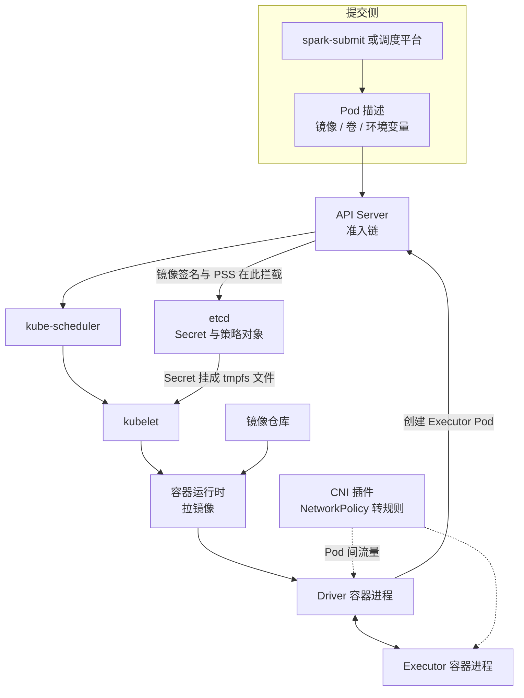
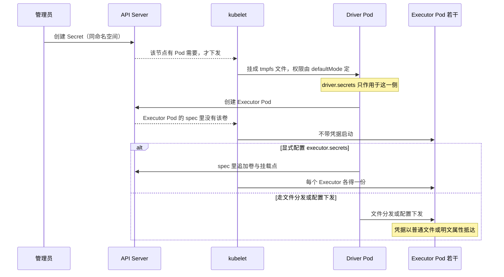
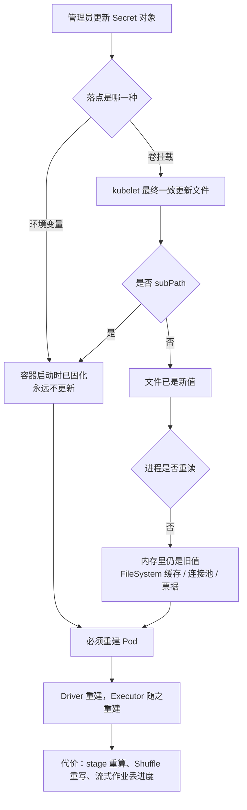
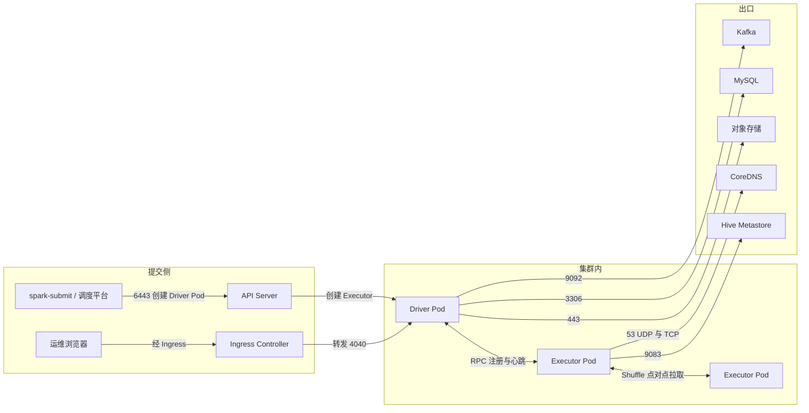
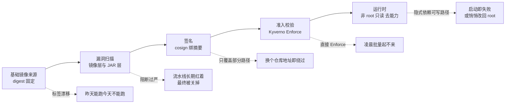
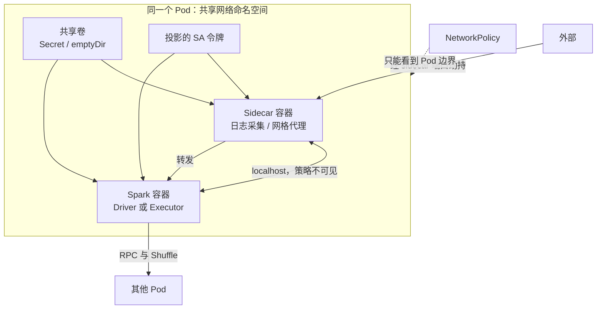

# 09 安全加固：Secrets 管理、网络策略与镜像安全

**摘要：**

把 Spark 作业搬上 Kubernetes 之后，安全这件事的面貌换了：YARN 时代作业缩在 NodeManager 圈起来的容器里，凭据多半是提交机上的一次 kinit，网络是管理员划好的队列与机架，镜像是运维装好的那台机器；到了 Kubernetes，作业自己创建 Pod，凭据要穿过一层 Secret 对象落进容器文件系统，网络变成默认全通的扁平 Pod 网，镜像则成了每次拉起都要重新验一遍的输入。本文沿五问推进，把这条边界拆成三段：先看凭据的三类落点——Secret 卷挂载、`--files` 分发与 `secretKeyRef` 环境变量——以及它们各自的泄露面；再看 Driver 与 Executor 之间那条隐形分界线，解释 Executor 为什么默认看不见 Driver 的凭据，却常常因为一个图省事的 `--files` 看个满眼；接着讨论轮转为什么必须重建 Pod，以及「版本化 Secret 名字」这个折中；然后把 NetworkPolicy 的默认拒绝摊开，逐条列出 Spark 必须放行的流量、端口随机性造成的表达力缺口与 CNI 实现差异；最后落到镜像供应链的四道关与 Pod Security Standards 的 restricted 档位，说明官方镜像为什么从 root 改成 UID 185，以及改回去要付什么代价。贯穿全文的两个问题是：这三道闸门各自究竟拦在哪一层，以及每收紧一格，可用性与排障成本会以什么形式被抬高。口径为 Spark 4.3.0（2026-10-30 发布）与 Kubernetes 1.37，配置项与档位以对应版本文档为准。

---

## 第 1 章 三条边界：为什么这三件事会凑到一篇里

### 1.1 一次提交里消失的那道墙

在 YARN 上谈 Spark 的安全，讨论的对象通常只有三个：Kerberos、队列权限、以及那个被反复叮嘱「不要用 client 模式」的提交机。凭据以一张 TGT（Ticket Granting Ticket，票据授予票据）的形式落在某个票据缓存文件里，keytab 由 `--keytab` 随作业下发，续约由 ApplicationMaster 自己负责；网络是机架与交换机的拓扑，跨队列的访问由管理员在 ResourceManager 的 ACL 里写死；镜像则根本不是一个话题，因为节点上的 Spark 是运维用包管理器装好的，版本与内容由集群统一维护，作业只是往那台机器上送一个 jar。这三件事之所以很少被放在一起讲，是因为它们分属三个不同的责任方，而作业本身对它们几乎没有决定权。

Kubernetes 把这道墙拆了。作业不再被「放进」一个事先存在的环境，而是自己描述环境：Driver 拿着一个 ServiceAccount 的令牌，调用 API Server 创建 Executor Pod，Pod 的镜像、卷、环境变量、安全上下文，全部写在作业自己的配置里。这就产生了一个不太直观的后果——**安全的三个维度同时从「集群的属性」变成了「作业的属性」**。凭据怎么进容器，取决于提交命令里的那几个 `--conf`；Pod 能不能访问某个内网地址，取决于命名空间里有没有一条 NetworkPolicy 恰好选中它；镜像里有什么，取决于构建流水线那一刻执行了什么。

一句话概括：安全边界的位置没有变，仍然在容器与进程那一层；但决定这条边界画在哪里的人变了，从集群管理员变成了写提交脚本的人。

### 1.2 三段边界的共同形状

凭据、网络、镜像这三件事看起来毫不相干，却共享同一个形状：**它们都在 Pod 之外被决定，在 Pod 之内生效**。Secret 是 API Server 里的一个对象，由 kubelet 在容器启动前挂成文件，容器里的进程只是「发现某个路径下有东西」；NetworkPolicy 是 API Server 里的一个对象，由 CNI 插件翻译成 iptables 或 eBPF 规则，容器里的进程只是「发现某个连接被重置」；镜像的准入校验同样发生在 API Server 的准入链上，容器里的进程对此一无所知。

这个共性带来一个共同的困境：三者的成败都在 Pod 之内显现，而三者的配置都不在 Pod 之内。于是排障时看到的现象高度同构——「作业起不来」「作业跑到一半失败」「连不上」，三种完全不同的根因给出几乎一样的症状。本文在关键章节的末尾各给一张症状到根因的对照表，理由就在这里。

### 1.3 一个贯穿全文的作业

为了让讨论落在具体的东西上，本文虚构一个足够普通、又足够贪心的作业，名为 `settle_daily`：它每天凌晨跑一次对账，从对象存储（S3 或 OSS）读昨天的流水，从 Hive Metastore 拉维表，把结果用 JDBC 写进 MySQL，同时把指标推给 Kafka；它还要从一个 Kerberos 认证的 HDFS 路径读黑名单；整个作业由调度平台在 02:00 触发，跑在 `spark-data-eng` 命名空间里，Executor 峰值 120 个。

这个作业之所以「贪心」，是因为它把三类凭据、五个方向的网络出口和一套第三方依赖全占了：S3 的访问密钥、MySQL 的口令、HDFS 的 keytab，对应三种不同的凭据形态；对象存储、Hive Metastore、MySQL、Kafka、HDFS，对应五个出口；而它依赖的 Python 三方包与内部 SDK，则落在镜像里。后文每讲一个机制，都回到这个作业上看它具体会怎么坏。

### 1.4 一个比喻：钥匙、走廊与门禁

不妨把三条边界各配一个物件。凭据是钥匙：钥匙本身可以被复制、被遗忘在门框上、被临时借出，而门锁从不检查钥匙是谁的；网络是走廊：走廊决定谁能走到哪扇门前，但走廊的图纸通常写在物业手里，租户只能申请「把这条通道封掉」，封完之后自己怎么走，得自己想清楚；镜像是门禁卡上的照片：它证明这栋楼里跑的这个东西是经过批准的，却完全不证明它进门之后不会干坏事。

三个比喻各有一个技术限定，值得当场说破。钥匙的比喻漏掉了「钥匙放在哪」这一层——在 Kubernetes 里，Secret 的可读性约等于「在这个命名空间里创建 Pod」的权限，后文第 2 章会算这笔账。走廊的比喻漏掉了「封路要物业同意」——NetworkPolicy 是声明式意图，真正执行它的是 CNI 插件，插件不支持就是一句空话。门禁卡的比喻漏掉了「照片可以换」——镜像签名绑定的是摘要（digest），而摘要之外的构建过程、基础镜像、依赖来源，签名一概不管。

### 1.5 一张全景图

下图把三道闸门与它们的执行者画在同一张图上，注意每一道闸门右侧的执行组件都不是 Spark：



图里最容易被忽略的是那条虚线：NetworkPolicy 的对象存在 API Server 里，但作用点是节点上的数据平面，中间隔着一次翻译。翻译是否发生、翻译成什么，取决于集群装了哪个 CNI——这一点在第 4 章末尾会展开。

---

## 第 2 章 凭据：三个落点与各自的泄露面

### 2.1 Secret 只是把密码挪了个地方

把明文口令从 YAML 里挪进 Secret 对象，是几乎所有团队做的第一件事，但这一步换来的东西比多数人以为的少得多。Kubernetes 文档写得很直白：Secret 默认以未加密的形式存放在 etcd 里，能访问 etcd 的人、或者有 API 访问权的人，都能取到内容；更要紧的一句是——**任何有权在某个命名空间里创建 Pod 的人，都能读到该命名空间里的任意 Secret**，因为创建 Pod 时可以把它挂进去。

这句话在 Spark 场景下有特别尖锐的含义。Driver 的 ServiceAccount 必须有创建 Pod 的权限，否则它起不了 Executor；而这份权限恰好构成一条通往命名空间内所有 Secret 的路径。换句话说，Secret 的隔离边界不是「谁被授权读它」，而是「谁被授权在这个命名空间里创建 Pod」。在共享命名空间里跑多个团队的作业时，这条边界约等于没有边界。

所以正确的预期是：Secret 解决的是「凭据不出现在代码仓库、不出现在 `kubectl get pod -o yaml` 的输出里、可以被集中轮换与审计」这几个问题，它不解决「容器里的进程读不到凭据」——后者在架构上无解，进程要用凭据，凭据就必须在进程能读到的地方。真正能减小的，是**凭据在容器里停留的形状与时长**。

### 2.2 三个落点

Spark 在 Kubernetes 后端上把凭据送进容器，只有三条正规路径，每条路径在 Spark 侧对应一组配置。

第一条是卷挂载，配置形式为 `spark.kubernetes.driver.secrets.[SecretName]=<挂载路径>`。方括号里是 Secret 的名字，等号右边是容器内的挂载点；kubelet 会把该 Secret 的每个键挂成这个目录下的一个文件。Executor 侧的写法是把前缀换成 `spark.kubernetes.executor.secrets`。这条路径有三个隐含约定：Secret 必须与 Driver、Executor 处在同一个命名空间（配置里没有命名空间字段）；挂载点是目录而不是文件，单个键的文件名就是键名；同一组里多个 Secret 必须挂到不同路径，否则后写的会覆盖先写的挂载定义。

第二条是环境变量，形式为 `spark.kubernetes.driver.secretKeyRef.[ENV_NAME]=<secretName>:<key>`，冒号左边是 Secret 名，右边是键名，等号左边是容器里的环境变量名。它的好处是应用代码零改造——用 `os.environ` 或 `System.getenv` 直接取；坏处是后文要展开的那一堆。

第三条是 `--files` 与 `--archives`，也就是 Spark 自己的文件分发机制。严格说它不是「凭据机制」，但它是最常被当作凭据机制用的一条路：把 `jdbc.properties`、`core-site.xml`、`*.keytab` 放进 `--files`，路径由 `spark.files` 承接，作业代码按相对路径读。它之所以危险，是因为 Spark 的文件分发语义是「作业要用的文件，Driver 与 Executor 都要有」。

还有一条不算落点的落点：不使用静态凭据，改用工作负载身份。EKS 的 IRSA、GKE 的 Workload Identity、Azure 的 Workload Identity，机制上都是把云厂商的信任建立在 Kubernetes 的 ServiceAccount 上，由 kubelet 把一个有受众（audience）和有效期的投影令牌写进容器，SDK 拿它去换临时凭据。这条路径把「长期密钥」换成了「短期令牌」，是四者里唯一能真正压缩泄露窗口的做法，但它并没有让凭据离开容器——令牌文件就在挂载路径下，能被容器里的任何代码读到。

### 2.3 配置语义的一张表

| 配置 | 落点形态 | 作用域 | 关键约束 |
|---|---|---|---|
| `spark.kubernetes.driver.secrets.<name>` | 目录挂载，键即文件名 | 仅 Driver 容器 | Secret 必须同命名空间；挂载点必须是目录 |
| `spark.kubernetes.executor.secrets.<name>` | 目录挂载，键即文件名 | 仅 Executor 容器 | 与 Driver 侧互不影响，需分别声明 |
| `spark.kubernetes.driver.secretKeyRef.<ENV>` | 环境变量 | 仅 Driver 容器 | 值形如 `secret:key`，容器启动时求值一次 |
| `spark.kubernetes.executor.secretKeyRef.<ENV>` | 环境变量 | 仅 Executor 容器 | 同上，需单独声明 |
| `spark.files` / `--files` | 工作目录下的普通文件 | Driver 与全部 Executor | 客户端文件先上传到 `spark.kubernetes.file.upload.path` 指定的存储 |
| `spark.kubernetes.authenticate.driver.*` | Spark 自动创建的 Secret | Driver 容器 | 与 ServiceAccount 方式互斥，后者会被丢弃 |

表里最后一行值得多说一句。当提交侧显式提供了 CA 证书、客户端证书或 OAuth 令牌，Spark 会自己造一个 Secret 挂进 Driver Pod，并放弃 `spark.kubernetes.authenticate.driver.serviceAccountName` 指定的身份；官方文档明确说这种情况会打一条警告。这意味着「我用的是 ServiceAccount」这句话在配了证书之后就不再成立，而身份层的后果——它到底能创建什么、能读什么——会随之变化。

### 2.4 环境变量的三个泄露面

把凭据塞进环境变量是最省事的做法，也是泄露面最大的一种，理由有三个层次。

第一层是 `/proc`。Linux 上进程的环境变量在 `/proc/<pid>/environ` 里可读，读的权限判据是同一个用户；容器里以同一 UID 运行的任何进程——包括被恶意 UDF 拉起的子进程、被注入的调试工具、以及 `kubectl exec` 进去的人——都能把它读出来。更麻烦的是，环境变量会被子进程继承：Spark 的 Python worker 是 Driver 或 Executor 拉起的子进程，它继承了父进程的全部环境变量，于是凭据的可见范围从「一个 JVM」扩散成「整棵进程树」。

第二层是转储。凭据进了 `SparkConf`（`--conf` 形式）或环境变量之后，就成了一块长期驻留的字符串。堆转储（heap dump）会把它原样写进文件；那些为了排查 `OutOfMemoryError` 而在生产上随手打开的 `-XX:+HeapDumpOnOutOfMemoryError`，恰好是最好的泄露工具。异常栈里打印配置、诊断脚本里 `env | grep`、以及把 `SparkConf` 整个打出来的日志，都是同一类事故。

第三层是日志与事件。Spark 会把作业的配置属性写进事件日志（EventLog），也展示在 Spark UI 的 Environment 页。为此它内置了一个脱敏正则 `spark.redaction.regex`，默认值为 `(?i)secret|password|token|access[.]?key|credential`，匹配到键或值就把值替换成掩码。这条机制有效，但它是按名字猜的：`spark.hadoop.fs.s3a.secret.key` 会被打码，而一个自造的 `spark.my.jdbcPass` 不会——`Pass` 不在正则里。**脱敏正则只是一张关键词黑名单，不是一道边界**。

### 2.5 卷挂载也不是保险箱

卷挂载比环境变量好，好在三点：它不进入进程的环境块，因此不出现在 `/proc/1/environ`；它不随子进程扩散；它可以被 `defaultMode` 收窄权限。但它同样有三处需要注意。

其一，默认权限是 `0644`，即容器内所有用户可读。对 keytab 这类文件，`0400` 是更合适的取值；不过要留意 Pod 以非 root 用户运行时，文件属主与运行用户必须能对上，否则 `0400` 会把作业自己锁在门外——这是把「安全」配成「不可用」的经典姿势。

其二，挂载点是共享的。同一个 Pod 里的 sidecar 若挂了同一个卷（或挂了整个父目录），读到的东西完全一样；`subPath` 挂载还能让「同一个 Secret 只暴露一个键」，但它同时带来第 3 章要讲的更新失效问题。

其三，Secret 卷不会落到节点磁盘上。kubelet 把数据写进 tmpfs，Pod 删除时本地副本一并销毁；而且一个 Secret 只会被送到「该节点上确有 Pod 需要它」的地方。这两条是卷挂载相对 `--files` 的实质优势——后者会把文件写进容器的工作目录，而工作目录通常是一个 `emptyDir`，落盘与否取决于介质配置。

### 2.6 三类落点的对照

把上述讨论收成一张表，评价维度取「泄露面大小」「轮转可行性」「改造成本」三项：

| 落点 | 泄露面 | 轮转 | 改造成本 | 适用场景 |
|---|---|---|---|---|
| Secret 卷挂载 | 中：容器内可读，权限可收窄，不扩散到子进程 | 需重建 Pod，但文件可最终一致更新 | 中：代码读文件路径 | keytab、证书、多键配置 |
| `secretKeyRef` 环境变量 | 大：`/proc` 可读、被子进程继承、进堆转储 | 必须重建 Pod，值在容器创建时固化 | 低：代码读环境变量 | 单值、短生命周期、无文件形态的凭据 |
| `--files` 分发 | 大：Driver 与全部 Executor 都有副本，且会上传到共享存储 | 必须重建整个作业 | 最低：代码按相对路径读 | 只应放非敏感配置 |
| 工作负载身份 | 小：短期令牌，kubelet 自动轮换 | 自动 | 中：需改造 SDK 认证链 | 云上对象存储访问 |

表里第二行与第三行的差别，正是很多团队踩坑的地方：环境变量被当成「轻量方案」，实际上它是泄露面最大的方案，而它省下的那点改造成本，通常只值半天工时。

---

## 第 3 章 分发链：谁看得见、什么时候失效、怎么轮转

### 3.1 Executor 的眼睛

第一个必须说清的问题是：Executor 能不能看到 Driver 的 Secret。默认答案是不能。Kubernetes 的 Secret 挂载是 Pod 级的：`spark.kubernetes.driver.secrets` 只在 Driver Pod 的 spec 里生成卷与挂载点，Executor Pod 的 spec 里没有这一段，kubelet 也就不会给它送数据。同理，`secretKeyRef` 生成的是某一侧容器的环境变量。

但这个「不能」有三条越界的路，其中两条是显式配置，一条是事故。

第一条是显式配置 `spark.kubernetes.executor.secrets`。这是完全正当的用法——Executor 读对象存储也需要凭据，尤其是 Driver 端只做协调、真正的数据读写全在 Executor 上完成的作业。此时凭据在 120 个 Executor 容器里各存一份，暴露面按副本数放大，这一点在评估「该给多大的权限」时必须算进去。

第二条是 `spark.hadoop.*` 系列配置。这些键不会以 Secret 的形式下发，而是打进 Hadoop 的 Configuration 对象，随作业一起被序列化并送到 Executor。也就是说，写在 `--conf` 里的 `spark.hadoop.fs.s3a.secret.key` 会出现在每一个 Executor 进程里——**它不是 Secret 挂载，但效果等同于把明文分发给所有 Executor**。

第三条是 `--files`。这是最常见的事故形态：有人为了图方便，把 `jdbc.properties` 或 keytab 放进 `--files`，期望「只有 Driver 读」，实际结果是 Spark 把这批文件分发到了每一个 Executor 的工作目录。事故的隐蔽性在于作业完全正常——它只是安静地让凭据多了一百多份副本，同时把其中一份留在了 `spark.kubernetes.file.upload.path` 指向的共享存储上（当 `--files` 引用的是提交机本地文件、作业又以 cluster 模式运行时，这批文件必须先落到那里），作业结束后那份副本还在。**文件的寿命不再由 Pod 决定，而由对象存储的清理策略决定**。

下图把凭据从 Secret 对象走到容器的三条路径摊开，注意每条路径的终点数量不同：



这张图上有一个细节值得盯住：Executor Pod 的 spec 由 Driver 在运行时拼出来，所以「Executor 有没有凭据」取决于提交时写下的那几行配置，而不取决于 Secret 对象本身的范围。把 Secret 的权限收得再紧，也管不住 `--files`。

### 3.2 轮转为什么必须重建 Pod

凭据要轮转，这是合规要求，也是事故之后的第一反应。但在 Kubernetes 上，「更新了 Secret」与「作业用上了新值」之间隔着三段距离，任何一段没走通，轮转就是自欺。

第一段是 Pod。容器里的环境变量在容器创建的那一刻求值并固化，之后无论 Secret 怎么改都不会变——这是设计使然，不是缺陷，因为环境块属于进程的启动参数。卷挂载要好一些：kubelet 会检测 Secret 变化并最终一致地更新卷内文件，延迟量级是「kubelet 同步周期加上缓存传播延迟」；但有两个例外必须记住——用 `subPath` 挂载的卷不会收到自动更新，而任何以文件形式读取的凭据，如果进程在启动时已经读进内存，文件更新也与它无关。

第二段是进程。Hadoop 的 `FileSystem` 实例是带缓存的，S3A 的客户端会把凭据留在实例里；JDBC 连接池在建立连接时已经完成了认证；Kerberos 的票据在票据缓存里。这些都意味着，即使文件在磁盘上换了新值，运行中的进程仍然拿着旧的。

第三段是 SparkConf。`spark.kubernetes.driver.secrets` 这类配置决定的是 Pod 的形态，Pod 一旦创建就不再改变；作业代码里 `spark.hadoop.*` 读到的值同样是启动时定下的。

三段叠加的结论很干脆：**在不重建 Driver Pod 的前提下，任何凭据轮转都只是把新值写进了一个运行中的进程不会去读的地方**。下图把这条失效链画成一条线：



图里最后一格是全部代价的所在。对有状态的长跑作业，重建不是「重启一下」，而是「从上一个检查点重来」；这也是为什么轮转方案必须在作业设计阶段就考虑，而不是等到合规审计前一周。

> [!warning] 轮转的假完成
> 「Secret 已更新」这件事在监控面板上看不出任何区别：Pod 没重启、状态没变化、作业照跑。要等到下一次重建才会发现新值生效，或者在新旧凭据并存的窗口关闭之后，才发现某个作业仍拿着已被吊销的旧值。把「Secret 对象的更新时间」与「引用它的 Pod 的创建时间」放进同一张看板对照，是识别这类假完成最省力的办法。

### 3.3 版本化 Secret 名字

既然重建不可避免，能做的是让重建这件事变得可控、可分批、可回滚。笔者见过的最实用做法是**把「内容轮转」换成「引用轮转」**：不去修改 `spark-db-creds` 的内容，而是新建 `spark-db-creds-v3`，把提交配置里的 Secret 名字改掉。

这个做法换来三件事。第一，新旧凭据可以并存一个窗口期，数据库侧同时接受两把钥匙，于是重建可以按作业、按批次慢慢来，不必在一个维护窗口里把所有引用它的作业一次性重启。第二，回滚是改一行配置，而不是把已经被覆盖的旧值再想办法找回来。第三，审计上干净：Secret 对象的创建与删除时间就是轮转的时间线。

代价也很明确：Secret 对象会堆积，命名空间里散落着 `v1` 到 `v3`，需要一个明确的淘汰纪律——旧版本在窗口期结束后删除，凭据本身在服务端吊销。没有这条纪律，版本化就从「可控轮转」退化成「凭据考古现场」。

### 3.4 Kerberos：两条时效叠在一起

`settle_daily` 要读 Kerberos 保护的 HDFS，这让它比别的作业多一层麻烦。keytab 是长期有效的密钥文件，本身不会过期；真正会过期的是用 keytab 换来的 TGT，其有效期由 KDC 的票据生命周期决定（常见量级是十小时，以实际 KDC 配置为准）。作业跑得比 TGT 久，就会出现「跑上几个小时后开始报认证失败」这种极具迷惑性的现象。

处理办法是让 Spark 自己在票据到期前重新 kinit：配置 `spark.kerberos.keytab` 与 `spark.kerberos.principal`，Spark 会在内部定期刷新票据，只要 keytab 文件还在、还有效。这里有一个容易被忽略的耦合：**票据续约发生在 Spark 进程内部，与 kubelet 无关**。也就是说，keytab 的轮转不会自动传导到正在运行的作业——文件换了新值，进程里的续约逻辑仍然用旧文件，直到重建 Pod 为止。keytab 泄露后的补救因此不能只靠「换一个 keytab 文件」，必须同时吊销服务账号的密钥（重新导出 keytab 时旧密钥通常仍被 KDC 认作有效，除非显式移除），并重建所有使用它的 Pod。

`settle_daily` 还有一个 Kerberos 与容器的摩擦点：kinit 需要可写的票据缓存目录，默认在 `/tmp` 下。一旦把根文件系统设成只读，或者把 `/tmp` 换成了不可写的挂载，续约就会失败，而失败的表现是几小时后 HDFS 读超时——离根因非常远。第 5 章讲运行时最小权限时会再回到这个点。

### 3.5 一次轮转排演

以 `settle_daily` 的 MySQL 口令为例，把上面的判断落成可以照做的步骤：

1. 在数据库侧给新账号开户，或者给旧账号加第二把钥匙，让新旧两套凭据同时有效。
2. 在命名空间里创建 `spark-db-creds-v4`，内容是新口令；旧对象 `v3` 原样保留。
3. 改调度平台的提交模板，把 `spark.kubernetes.driver.secretKeyRef.DB_PASSWORD` 指向 `v4`。此时新建的作业用新值，正在跑的作业仍用旧值。
4. 按作业分批重建：批作业等下一次自然调度，流式作业等一个检查点窗口。
5. 全部切完之后观察一个完整周期，再在数据库侧吊销旧口令，最后删除 `v3`。

五步里没有「更新 Secret 内容」这一项，这正是它可靠的原因——所有变化都发生在对象引用与 Pod 生命周期上，而不是发生在运行中的进程里。每一步也都有可验证的检查点：第二步看 Secret 的创建时间，第三步看新建 Driver Pod 的 spec 里 `secretKeyRef` 指向的名字，第五步看数据库侧的登录审计。

还有一处容易漏掉：如果口令同时被 `--files` 带进了工作目录、或者被写进 `spark.hadoop.*` 下发给 Executor，那么第 3 步只改 Secret 引用是不够的，那两条路径上的值要一起改，否则 Driver 用新口令、Executor 用旧口令，作业会在最不该出问题的地方报认证失败。

### 3.6 轮转手段的对照

| 手段 | 生效时机 | 作业影响 | 回滚难度 | 适用 |
|---|---|---|---|---|
| 更新 Secret 内容 | 卷：最终一致；环境变量：不生效 | 对运行中作业基本无效 | 需找回旧值 | 仅配合重建使用 |
| 版本化 Secret 名字 | 下次创建 Pod 时 | 按作业分批，可控 | 改一行配置 | 常规轮转的首选 |
| 滚动重启作业 | 立即 | 有状态作业要回退到检查点 | 重跑成本 | 应急吊销 |
| 改用工作负载身份 | 令牌自动轮换 | 无 | 无需 | 云上对象存储、新建作业 |

---

## 第 4 章 网络：默认拒绝之后，必须放行什么

### 4.1 两层「默认」

谈 NetworkPolicy 最容易混淆的是两个「默认」。第一个默认是集群的：如果一个 Pod 没有被任何 NetworkPolicy 选中，它是非隔离的，出入流量全部放行——这就是「Pod 网是扁平的」这句话的技术含义。第二个默认是策略的：一旦某个 Pod 被选中，并且策略的 `policyTypes` 里列出了 Ingress 或 Egress，那么该方向就变成默认拒绝，只有规则里明确放行的流量才通过。

第二层默认是很多人第一次配策略时翻车的地方：他们写下一条「只允许来自 Executor 的 7077」，以为这是一条白名单增量，实际是把该 Pod 的入站流量整体切断，只留下 7077。DNS 没放行，于是所有域名解析失败；API Server 没放行，于是 Driver 创建不了 Executor。**NetworkPolicy 不是防火墙的补充，它是把默认值从 allow 翻成 deny 的那只手**。

`settle_daily` 的处境可以说明为什么这件事非做不可：Executor 是跑用户代码的地方，用户代码里可能有一个从外部拉进来的 UDF，也可能是从数据里反序列化出来的执行路径。在扁平网络里，这样一个 Executor 的内网视野与提交机无异——它能扫到同命名空间的其他服务、能连到隔壁团队的数据库、能访问云上的元数据端点。把 Executor 当作「不可信代码的执行容器」来设计，是这套隔离最站得住的理由。

### 4.2 三段隔离

把 Spark 作业的流量按方向切开，可以分成三段，每段的策略目标不同：提交侧管「谁能从集群外碰到这个作业」，集群内管「Driver 与 Executor 之间怎么走」，出口管「作业能去哪」。下图把三段与各自的流向摊在一起：



三段里最容易做对的是集群内，最容易做错的是出口。集群内的规则可以完全用标签选择器表达——「允许来自 `spark-role=executor` 的流量」，不需要关心 IP；出口则往往要落到 `ipBlock` 上，而对象存储的 IP 段既不稳定也不可控。

### 4.3 必须放行的流量清单

下表的每一行都不是可选项，漏掉任何一条，`settle_daily` 都会以某种「看起来与安全无关」的方式失败：

| 方向 | 来源或目的地 | 端口 | 漏掉之后的现象 |
|---|---|---|---|
| Egress | CoreDNS（`kube-system`） | 53 UDP 与 TCP | `UnknownHostException`，所有域名解析失败 |
| Egress | API Server | 443 或 6443 | Driver 无法创建 Executor，`403` 或连接超时 |
| Ingress | Executor → Driver | RPC 端口（默认随机） | Executor 注册不上，作业停在等待 |
| Ingress | Executor ↔ Executor | 块管理器端口（默认随机） | Shuffle 拉取失败，任务反复重试 |
| Ingress | Ingress Controller → Driver | 4040 或自定义 UI 端口 | Spark UI 打不开，但作业正常 |
| Egress | 对象存储 | 443 | 读写失败，`SocketTimeoutException` |
| Egress | Hive Metastore | 9083 | 元数据查询失败，表找不到 |
| Egress | MySQL、Kafka | 3306、9092 | 结果写不进去，或指标推不出去 |
| Egress | KDC | 88 TCP 与 UDP | kinit 失败，Kerberos 认证超时 |

第一行值得单独强调。DNS 的放行要写两条协议：UDP 53 承担绝大多数查询，TCP 53 在响应超过 UDP 报文上限、发生截断重试时才会用到；只放 UDP 的配置在大部分时间里正常，在查一个大记录集时随机失败，这类间歇性故障最难查。

第三、四行合起来是 Spark 的「RPC 端口族」：Driver 一侧的 `spark.driver.port` 承担注册与心跳，块管理器端口承担 Shuffle 数据的点对点传输，两者默认都随机，写策略时要么把它们钉死，要么放弃端口维度。若集群另外部署了外部 Shuffle Service，读取走的是 `spark.shuffle.service.port`（默认 7337），策略里要单独放行这一条；不过 Spark 的 Kubernetes 后端本身并不自带外部 Shuffle Service 的实现，这条路在多数部署里由专门的远程 Shuffle 方案承担。

### 4.4 端口随机性带来的表达力缺口

「默认随机」这四个字，是 Spark 与 NetworkPolicy 之间最实质的摩擦。Spark 的 `spark.driver.port` 默认值是 `(random)`，`spark.blockManager.port` 同样是 `(random)`；随机端口的理由很充分——同一台机器上可能并排跑多个 Driver，固定端口会撞车。但对 NetworkPolicy 而言，端口是规则的基本维度之一，遇到随机端口只有两个选择：要么把端口维度整体放开，只按标签控制来源；要么在提交时把端口钉死。

钉死端口的写法是显式设置 `spark.driver.port` 与 `spark.blockManager.port`——后者对所有块管理器生效，另有 `spark.driver.blockManager.port` 可以只给 Driver 指定一个不同值——代价是同节点上不能并排跑两个端口相同的 Driver。在独占的命名空间里这是可以接受的，在共享集群里就得靠节点亲和性把它们岔开。

这里要澄清一个常见的误解：**Spark 并没有一组 `spark.kubernetes.network.*` 配置**。在 4.3.0 的配置表里搜这个前缀会一无所获，网络相关的旋钮是散的——IPv4 与 IPv6 的族策略在 `spark.kubernetes.driver.service.ipFamilyPolicy` 与 `spark.kubernetes.driver.service.ipFamilies` 上，超时在 `spark.network.timeout` 上，Pod 侧的网络注解要靠 `spark.kubernetes.driver.annotation.*` 与 Pod 模板传，而 RPC 加密与认证属于 Spark 自身的安全配置，不是 Kubernetes 后端的配置。凡是看到「用 `spark.kubernetes.network.*` 调网络」的说法，以对应版本文档为准去核一遍。

下表把「想做的事」映射到「实际该动的键」：

| 意图 | 实际配置 | 备注 |
|---|---|---|
| 固定 Driver RPC 端口 | `spark.driver.port` | 默认随机，不钉死则策略无法按端口收窄 |
| 固定块传输端口 | `spark.blockManager.port` | 影响 Shuffle 拉取方向 |
| 让 Driver Service 支持双栈 | `spark.kubernetes.driver.service.ipFamilyPolicy` | 另有 `ipFamilies` 指定族顺序 |
| 给 Pod 打 CNI 专用注解 | `spark.kubernetes.driver.annotation.*` | 也可走 Pod 模板 |
| 调长 RPC 超时 | `spark.network.timeout` | 不是 Kubernetes 专属配置 |
| 开启 RPC 加密 | `spark.network.crypto.enabled` | 需先开启认证，默认关闭 |

### 4.5 一份可以直接改的策略

把上面的清单落成对象，Driver 与 Executor 各一条。写法上刻意用了两层选择器：同一命名空间内按角色标签放行，跨命名空间（监控、DNS、Ingress）按命名空间标签放行：

```yaml
apiVersion: networking.k8s.io/v1
kind: NetworkPolicy
metadata:
  name: spark-driver
  namespace: spark-data-eng
spec:
  podSelector:
    matchLabels:
      spark-role: driver
  policyTypes: [Ingress, Egress]
  ingress:
    # Executor 的注册与心跳；端口维度因随机性而放开
    - from:
        - podSelector:
            matchLabels:
              spark-role: executor
    # Spark UI 只对 Ingress Controller 开放
    - from:
        - namespaceSelector:
            matchLabels:
              kubernetes.io/metadata.name: ingress-nginx
      ports:
        - port: 4040
          protocol: TCP
  egress:
    - to:
        - namespaceSelector:
            matchLabels:
              kubernetes.io/metadata.name: kube-system
      ports:
        - port: 53
          protocol: UDP
        - port: 53
          protocol: TCP
    # API Server：跨命名空间对象，按 ipBlock 表达
    - to:
        - ipBlock:
            cidr: 10.96.0.1/32
      ports:
        - port: 443
          protocol: TCP
    - to:
        - ipBlock:
            cidr: 0.0.0.0/0
      ports:
        - port: 443
          protocol: TCP
```

这份策略里最需要按现场改的是 API Server 那一条：`10.96.0.1/32` 只是常见 Service CIDR 下的取值，抄错网段的表现是 Driver 连一行日志都写不出来。Executor 侧的策略形状相同，区别在入站：只接受 Driver 与同角色的 Executor，端口维度整体放开；出站除 DNS 与对象存储外，再加 Hive Metastore 与 KDC。这样写出来的策略有一个明确的副作用需要提前接受：**Executor 的出站到 443 是全网放开的**，为了能访问对象存储，实际把「任意 HTTPS 目标」也一起放开了。第 4.6 节讨论这个缺口有没有更好的填法。

### 4.6 出口的难题：域名与 CIDR 之间

NetworkPolicy 的规则语言只认 IP 块、命名空间与 Pod 标签，不认域名。这条限制在出口方向特别难受：对象存储的地址是域名，云厂商的 IP 段会随扩容与调度变化，把它们抄进 `ipBlock` 里，等于给自己维护一份注定过期的清单。

三种填法各有代价。其一是按 443 全放开，接受「任一 HTTPS 目标」这个缺口，靠应用层的凭据最小化来兜底——这是多数团队的现实选择，也是最容易被审计挑战的选择。其二是部署出口网关或代理，把 Pod 的出口收敛到网关 IP，由网关按域名做白名单；代价是多一跳、多一个要运维的组件，且代理自身成了单点。其三是用支持 L7 策略的 CNI（譬如 Cilium 的 FQDN 策略），把域名写进策略；代价是绑定 CNI 实现，迁移成本随之上升，而且 FQDN 策略依赖 DNS 观测，启动瞬间的解析可能漏判。

这三种填法没有哪一种更「正确」，它们分别把成本放在了审计、运维与可移植性上。**出口管控的粒度越细，对基础设施的依赖就越深**，这是网络策略这条线上最实在的一笔权衡。

### 4.7 CNI 决定的边界

最后必须说清一件事：NetworkPolicy 是声明式意图，执行者是 CNI 插件。Apache Flannel 的默认后端不实现 NetworkPolicy；Calico、Cilium、Antrea、Kube-router 等实现它。集群如果用的是一套不支持的 CNI，策略对象照样能创建成功、`kubectl describe` 照样显示规则，但一个包都不会被拦——这种「策略看起来生效了」的假象，比没有策略更危险。

即便 CNI 支持，还有几条边界要记在账上。`hostNetwork: true` 的 Pod 不受策略约束，因为它用的就是节点网络栈；节点自身的流量始终被放行，与策略里写的 IP 块无关；策略通常在连接建立时生效，已经建立的连接不会因为新策略而中断，因此「加了策略但流量照走」的现象，多数是长连接还没断；Pod 内的回环流量不经过 CNI，同一个 Pod 里两个容器之间的 `localhost` 通信不受任何策略约束——这一条在第 6 章会变成 sidecar 的信任问题。

| 现象 | 更可能的根因 | 从哪确认 |
|---|---|---|
| 所有域名解析失败 | 未放行 DNS 的 53 UDP 与 TCP | 在 Pod 内 `getent hosts` 与 `kubectl exec` 对照 |
| Executor 一直不注册 | 入站未放行随机 RPC 端口 | 对比 `spark.driver.port` 与策略端口 |
| Shuffle 阶段大面积重试 | 未放行 Executor 之间的块传输 | 看 Executor 日志里的连接重置 |
| 作业正常但 UI 打不开 | 只配了 Egress，Ingress 未放行 4040 | `kubectl port-forward` 能否访问 |
| 策略已建但流量不受影响 | CNI 未实现 NetworkPolicy | 同一命名空间内互 ping 验证 |
| 新策略生效但旧连接还通 | 长连接未被中断 | 重启客户端进程后再试 |

---

## 第 5 章 镜像：四道关

### 5.1 第一道关：来源与摘要

镜像的第一道关不是扫描，而是「这个镜像从哪来、是不是我以为的那个」。标签（tag）是可变的，`spark:4.3.0` 今天指向的内容与下个月可能不同，`latest` 更是完全没有约束力。把引用写成 `image@sha256:...` 之后，内容就被钉死了——这是唯一能让「昨天能跑、今天不能跑」这类问题从镜像层消失的办法。

钉死摘要有两处代价要认。其一，安全补丁不再自动到达：基础镜像修了一个 CVE，摘要不变，你就拿不到修复，必须显式改摘要、重建、重测、重发布。其二，摘要让「重新拉一次就好了」这种直觉失效——节点上缓存的是哪个摘要，跑的就是哪个。因此摘要固定的前提是流水线足够健康，能把「重建」这件事做得足够便宜。

来源控制是第二层：私有仓库要禁止匿名推送，构建凭证要能追溯到具体的流水线，仓库的保留策略要保证被引用的摘要不会被清理。第二层不成立时，第一层是空的——能往仓库里推东西的人可以把标签重新指向另一个摘要，也可以让摘要固定所依赖的那份内容本身被替换；摘要固定只防「拉到了别的东西」，不防「源头换了东西」。

### 5.2 第二道关：漏洞扫描

扫描的对象是镜像里的软件包与依赖。Spark 的镜像有个特点：真正装进来的东西分两类，一类是基础镜像里的系统库（glibc、OpenSSL、Python 运行时），由操作系统包管理器维护；另一类是 `$SPARK_HOME/jars` 下的一堆 JAR（Hadoop、Hive、Arrow、Netty 等），由 Maven 依赖树决定。镜像扫描器擅长前者，对后者往往只能识别出「某个 JAR 存在」并匹配已知漏洞，误报与漏报都多。

这条分界决定了两件事。第一，扫描要分两段：镜像层用 Trivy 或 Grype 这类工具扫操作系统的 CVE，JAR 层用依赖分析（SCA）扫传递依赖的漏洞，后者的告警量会大得多，需要独立的处置流程。第二，阻断策略要按「有修复版本」过滤（Trivy 的 `--ignore-unfixed`），否则一条无法修复的 CVE 会让流水线永久红着，团队最终的选择一定是关掉扫描。

把扫描放进 CI 的正确姿势是把它当成**分级的门**而不是一个报告工具：严重与高危且已有修复版本的，阻断；中低危的，进看板、按周期消化；无法修复的，走例外登记。第三档最容易做坏——如果没有一个明确的例外清单，例外就会变成「反正都点忽略」。

### 5.3 第三道关：签名与准入

签名回答的问题是「这个镜像是不是我们那条流水线构建的」。做法是用 cosign 在构建完成后对摘要签名，私钥放在 KMS 或使用无密钥（keyless）模式由 OIDC 身份签发；然后在准入链上挂一个校验器（Kyverno 的 `verifyImages` 或 Sigstore 的 policy-controller），只放行签名可验证的镜像。

```yaml
apiVersion: kyverno.io/v1
kind: ClusterPolicy
metadata:
  name: verify-spark-images
spec:
  validationFailureAction: Enforce
  rules:
    - name: verify
      match:
        any:
          - resources:
              kinds: [Pod]
              namespaces: [spark-data-eng]
      verifyImages:
        - imageReferences:
            - "registry.example.com/spark/*"
          attestors:
            - entries:
                - keyless:
                    subject: "https://github.com/org/spark-image/.github/workflows/build.yml@refs/heads/main"
                    issuer: "https://token.actions.githubusercontent.com"
```

这段策略的效力边界值得逐条说清。它只匹配 `registry.example.com/spark/*`，别的路径根本不进校验——攻击者换一个仓库地址就绕过了，所以 `imageReferences` 要么覆盖全部可能的路径，要么配合一条「只允许来自该仓库」的独立规则。`subject` 绑定的是具体的 workflow 与分支，改分支名就会让所有镜像失效，这是把「签名」与「构建来源」绑在一起时必须维护的配置。`Enforce` 之外还有 `Audit` 档，先跑一段时间 `Audit` 看有没有存量镜像被拦，是上线这条策略的常规做法——直接 `Enforce` 的后果通常是半夜整个命名空间的作业起不来。

还有一处常被忽略的优先级问题：准入链上可能同时有多个 webhook，镜像校验与镜像改写（mutating webhook 把标签换成摘要）的执行顺序会影响校验对象。**校验签名要对着摘要做，而不是对着标签做**，否则「校验时是 A 镜像、拉取时是 B 镜像」的窗口就存在。

### 5.4 第四道关：运行时最小权限

前三道关管的是「镜像里有什么」，第四道关管的是「容器跑起来能做什么」。这一层的旋钮都在安全上下文里，取值相对固定：不以 root 运行、禁止提权、丢弃全部能力、启用 seccomp 默认档、根文件系统只读。

Spark 在这一层有一个具体的历史包袱。Spark 2.x 的官方 Dockerfile 没有 `USER` 指令，容器默认以 root 启动；原因不难理解——镜像要在 `/opt/spark/work-dir` 下工作，entrypoint 要处理用户与权限，宿主机目录挂进来时属主对不上，root 是最省事的选择。Spark 3.0 起官方镜像改用 `USER ${spark_uid}`，默认 UID 为 185，并把 root 组放进补充组，以便进程仍能执行 Spark 自带的脚本；官方文档在 User Identity 一节明确写着这个默认值，并建议有安全要求的部署自行构建镜像指定 UID 与 GID。

保留 root 的诱惑一直存在，因为代价具体且立现：工作目录要有写权限，`/tmp` 要有写权限（kinit 的票据缓存、Spark 的临时文件都在这里），Ivy 缓存与 Python 的字节码缓存也各要一个可写路径，宿主机目录挂进来时属主要对得上，sidecar 与主容器的 UID 还要协调。这些都能解决——`emptyDir` 挂到可写路径、镜像构建时 `chown`、`fsGroup` 处理卷属主——但要一项项配，漏一项就是启动失败。**把容器从 root 改到非 root，工作量不在改那一行 `USER`，而在把所有隐式依赖可写路径的地方显式化**。

### 5.5 PSS restricted 档位与 Spark 的硬限制

把上述要求系统化的现成机制是 Pod Security Standards（PSS），三档中 restricted 最严，通过命名空间标签启用。它继承 baseline 的全部要求，再叠加若干条；下表逐项对照 Spark 作业的处境：

| 控制项 | restricted 要求 | `settle_daily` 的处境 |
|---|---|---|
| 卷类型 | 仅 configMap、csi、downwardAPI、emptyDir、ephemeral、persistentVolumeClaim、projected、secret | 本地盘方案若用 hostPath 直接不可用；PVC 与 emptyDir 可用 |
| 提权 | `allowPrivilegeEscalation` 必须为 false | 需显式写，官方镜像不会替你写 |
| 非 root | `runAsNonRoot` 为 true，且 `runAsUser` 不得为 0 | 官方镜像 UID 185 满足；自建镜像若保留 root 则不满足 |
| seccomp | 必须显式设为 `RuntimeDefault` 或 `Localhost` | 需显式写；不写则拒绝，PSS 不会替你补 |
| 能力 | 必须 `drop: [ALL]`，只允许加回 `NET_BIND_SERVICE` | 需显式写；Spark 本身不需要额外能力 |
| 主机命名空间 | `hostNetwork`、`hostPID`、`hostIPC` 必须为 false | 默认满足 |
| 特权与端口 | `privileged` 为 false，`hostPort` 禁止 | 默认满足 |

这张表说明一件事：**restricted 档位对 Spark 的硬限制主要落在卷类型和「必须显式声明」上，而不是落在「Spark 做不到」上**。真正会卡住的是本地盘方案与那些依赖宿主机目录的部署形态；而 seccomp 与能力这些项，卡的是「没人写」而不是「写了不行」。

PSS 的另一个性质要提前知道：它只校验 Pod 的安全上下文，不管网络策略、不管凭据、不管镜像里有什么。把命名空间标成 restricted 之后觉得「合规了」，是把一个 Pod 级的检查项当成了体系。准入层能做的事远不止这些，Kyverno 之类的策略引擎可以把镜像签名、资源上限、标签规范一起写进同一层，但这一层的信任前提是「攻击者不能改策略对象」——能改 ClusterPolicy 的人，等于能改所有规则。

### 5.6 四道关的失败形态

四道关是串联的，下图把它们与各自最常见的翻车方式画在一起：



四道关是串联的，任何一道被绕过，后面的都不再成立；但它们拦的是不同的东西——来源挡的是「拿错东西」，扫描挡的是「已知的坏」，签名挡的是「不是我们造的」，运行时挡的是「造出来之后被用坏」。把这四件事混成一句「镜像安全」，就会在出事时找不到该看哪一道。

---

## 第 6 章 同一个 Pod 里的邻居：sidecar 与信任边界

### 6.1 共享的那张网络栈

Kubernetes 的 Pod 是一个共享网络命名空间的容器组：同一个 Pod 里的容器共用一张网卡、一个 IP、一份端口空间。这条基本事实在安全上的含义是——**所有以 Pod 为作用对象的机制，在 Pod 内部一律失效**。NetworkPolicy 看的是 Pod 的身份与 IP，同一个 Pod 里两个容器之间的 `localhost` 流量根本不经过 CNI，策略没有机会介入；Service 的访问控制也是同一个道理。

于是 sidecar 成了一处特殊的存在：它是 Pod 里的合法居民，天然拥有对主容器的网络可达性。如果 sidecar 是服务网格注入的，它还会改写 iptables，把主容器的出入流量重定向到自己的端口。日志采集 sidecar 通常只读共享的日志卷，风险有限；而一个能从外部拉取配置、能执行远程命令、或者镜像来自第三方 chart 的 sidecar，实质上是一个「在防火墙内侧」的进程。

### 6.2 卷、令牌与进程可见性

sidecar 与主容器共享的不只是网络。三条通道值得逐一看。

共享卷是第一条。同一个 Pod 里两个容器挂同一个 Secret 卷，读到的内容完全一样；日志 sidecar 挂的 `emptyDir` 如果被主容器用来存放凭据文件，那就是把凭据交给了 sidecar 的镜像。这里有一条实用原则：**凭据卷只挂给需要它的容器**，不要图省事挂在 Pod 级再由各容器各自决定。

ServiceAccount 令牌是第二条。它由 kubelet 投影进每个容器的固定路径，除非显式关掉自动挂载，否则 sidecar 也有。一个只需要读日志的 sidecar，拿到了 Driver 的 API 令牌，就等于拿到了「创建 Pod 进而读取命名空间内全部 Secret」的能力——第 2 章算过这笔账。

进程可见性是第三条，由 `shareProcessNamespace` 控制。开启之后，sidecar 能看到主容器里的进程，于是 `/proc/<pid>/environ`、`/proc/<pid>/cmdline` 都进入它的视野；环境变量里放凭据的方案，在这条通道面前彻底失效。反过来，调试用的 `kubectl debug` 临时容器也走同一条路——它能进容器排障，也能读走一切，这正是它必须被审计的原因。

### 6.3 网格 sidecar 与 Spark 的摩擦

服务网格的 sidecar 在 Spark 上有一处具体的摩擦：它劫持端口。Istio 的 sidecar 会把入站流量重定向到 15006 之类的端口，再由它转发给应用；出站同理。对 NetworkPolicy 来说，这意味着策略里写的端口与实际的连接端口不再是同一个，规则的表达需要跟着调整；对 Spark 的 RPC 来说，这意味着一次额外的代理跳转，长连接与心跳的时序都会受影响。

常见的绕法是给 Spark 的端口加注解，让 sidecar 不劫持这些端口（Istio 的 `traffic.sidecar.istio.io/excludeInboundPorts` 与 `excludeOutboundPorts`），注解通过 `spark.kubernetes.driver.annotation.*` 或 Pod 模板传给 Pod。这条绕法的代价是把「网格统一管控」的承诺打了个洞——被排除的端口不再受 mTLS 保护，也不再出现在网格的遥测里。**这意味着安全能力的覆盖范围与流量的可观测性同时被削掉一块，而这一块恰好是 Spark 最核心的 RPC 与 Shuffle**。

下图把同一 Pod 内的信任通道与外部策略的可见范围画在一起：



### 6.4 怎么收紧

收紧 sidecar 的思路是把「Pod 内一律可信」这个默认假设改掉三处。第一处是权限：给 sidecar 单独写安全上下文，非 root、只读根文件系统、丢弃全部能力、关闭令牌自动挂载（`automountServiceAccountToken: false`），让它即使被攻破也拿不到集群身份。第二处是卷：把凭据卷精确挂给需要的容器，而不是挂在 Pod 级。第三处是准入：用策略限制「哪些镜像的 sidecar 允许注入」，把注入器本身当成供应链的一环来管。

这三处的共同点是它们都不需要改动 Spark 侧的配置，全部落在 Pod 模板与准入策略上。也正因为如此，它们很容易在「先把作业跑起来」的阶段被跳过，然后一直跳过下去。

---

## 第 7 章 边界与反例

### 7.1 「Secret 挂上就安全了」

这是最常见的一句误判。Secret 的作用范围是「让凭据不出现在代码与清单里，并且可以被集中管理与审计」，它不改变「容器里的进程读得到」这个事实，也不改变「能创建 Pod 就能读」这个推论。真要往安全的方向走，能做的是缩短凭据的寿命（工作负载身份）、缩小它的可见范围（只挂给需要的容器）、以及减少它的副本数（不让 `--files` 把它撒到每个 Executor 上）。

### 7.2 「默认拒绝可以直接上生产」

默认拒绝的正确上线顺序是「先观察、再 Audit、最后 Enforce」，原因不在于策略难写，而在于流量清单难穷举。Spark 的流量里有一批「不写就不通、通了也不报错」的项：DNS 的 TCP 53、Shuffle 的点对点拉取、Kerberos 的 KDC 88 端口、以及某些对象存储客户端在分片上传时用到的额外连接。这些都在作业跑起来之后才暴露，而且往往在凌晨。

### 7.3 「签名能防供应链攻击」

签名证明的是「这个摘要是某条流水线签的」，它不证明「这条流水线没被攻破」，也不证明「镜像里的依赖没有漏洞」。一个被攻破的构建流水线签出来的镜像，签名完全合法；一个用官方基础镜像构建、依赖树里带着高危 CVE 的镜像，签名同样合法。签名的价值在于把「谁能往生产推镜像」这件事收敛到一条可审计的路径上，而不是替代漏洞管理。

### 7.4 「restricted 一开就合规」

restricted 管的是 Pod 安全上下文这一层，网络、凭据、审计、镜像来源都不在它的范围内。合规检查表里的项目通常比这多得多，把命名空间标成 restricted 只是完成了其中一行。

| 反例 | 它成立的部分 | 它漏掉的部分 |
|---|---|---|
| Secret 挂上就安全 | 凭据离开了代码仓库 | 容器内可读；创建 Pod 即可读；etcd 默认不加密 |
| 默认拒绝直接上生产 | 边界的默认值被翻转 | 流量清单未穷举，故障集中在凌晨与长跑作业 |
| 签名即供应链安全 | 推送路径被收敛 | 构建流水线本身、基础镜像、依赖漏洞都不在校验范围 |
| restricted 即合规 | Pod 安全上下文达标 | 网络、凭据、镜像来源、审计均不覆盖 |
| 工作负载身份免维护 | 长期密钥消失，令牌自动轮转 | 令牌文件仍在容器内可读，代码执行即等于拿到身份 |

---

## 第 8 章 落点

回到开头那句判断：这三件事之所以能凑到一篇里，是因为它们的形状相同——都在 Pod 之外决定，在 Pod 之内生效，也都在 Pod 之内失效。凭据的闸门在 kubelet 挂载那一刻合上，网络的闸门在 CNI 翻译那一刻合上，镜像的闸门在准入链那一刻合上；而三道闸门的钥匙，分别握在提交脚本、命名空间管理员和构建流水线手里。

把全文收成五条：凭据的可见范围等于「能在命名空间里创建 Pod」的范围，Secret 隔离的是对象而不是进程；三类落点里，卷挂载的泄露面最小、环境变量的改造成本最低而代价最高、`--files` 只应装非敏感文件；轮转的瓶颈不在 Secret 对象，而在 Pod、进程与 SparkConf 三重固化，版本化 Secret 名字是让重建变得可控的那个折中；网络策略的表达力受限于随机端口与「只认 IP 不认域名」，出口收敛越细，对基础设施的依赖越深；镜像的四道关拦的是四种不同的坏，任何一道被绕过，其余三道都不再成立。

由此得到一条排障顺序。看到「作业起不来」，先分它是被准入拦住（镜像签名、PSS、配额）还是根本没调度上；看到「跑起来但连不上」，按目的地分类——域名解析失败看 DNS 规则，注册不上看 RPC 端口，Shuffle 重试看 Executor 之间的块传输，写结果失败看出口白名单；看到「跑了几小时突然失败」，先想凭据时效，TGT 与临时令牌都可能在这个时间尺度上过期，而不是先怀疑网络抖动。

取舍也都在明面上：环境变量换来零改造，付出的是整棵进程树的可见性；把凭据挂成文件换来可收窄的权限，付出的是代码要改读文件、轮转要重建 Pod；默认拒绝换来爆炸半径的收缩，付出的是流量清单的维护与凌晨的排障；摘要固定换来内容确定性，付出的是补丁要自己搬；非 root 换来运行时的最小权限，付出的是把所有隐式可写路径显式化的工作量；网格 sidecar 换来统一的 mTLS 与遥测，付出的是把 Spark 的核心端口排除在保护之外。**每一处收紧都不是免费的，区别只在于代价被记在了谁的账上**。

这三个领域本身也还在动：Secret 的静态加密与外部凭据存储正在从「可选加固」变成默认要求，NetworkPolicy 的表达力在被 Cilium 这类 L3-L7 方案推着走，而镜像的签名与证明（attestation）正在从「签一个摘要」扩展到「签一份构建过程的声明」。但只要那条界线还在——凭据必须进容器、流量必须过网卡、代码必须来自某个镜像——这三道闸门就仍然要有人一格一格地画清楚。至于将来会不会有某一层把这些事一次性收走，目前仍然言之尚早。

---

## 参考资料

1. Kubernetes 文档：Secrets，Secret 的存储形态、etcd 未加密的默认行为、1MiB 上限、tmpfs 挂载、`subPath` 不接收更新、环境变量在容器启动时固化。https://kubernetes.io/docs/concepts/configuration/secret/
2. Kubernetes 文档：Good practices for Kubernetes Secrets，最小权限、按容器限制 Secret 访问、启用静态加密。https://kubernetes.io/docs/concepts/security/secrets-good-practices/
3. Kubernetes 文档：Network Policies，隔离与非隔离 Pod、默认拒绝的语义、`ipBlock` 与选择器、节点流量始终放行、`hostNetwork` Pod 不受约束、对已有连接的影响、CNI 支持前提。https://kubernetes.io/docs/concepts/services-networking/network-policies/
4. Kubernetes 文档：Pod Security Standards，restricted 档位的卷类型白名单、`allowPrivilegeEscalation`、`runAsNonRoot`、seccomp、能力丢弃等逐项要求。https://kubernetes.io/docs/concepts/security/pod-security-standards/
5. Apache Spark 4.3.0 文档：Running Spark on Kubernetes，Secret Management（`spark.kubernetes.driver.secrets`、`executor.secrets`、`secretKeyRef` 的写法与同命名空间假设）、User Identity（默认 UID 185）、Volume Mounts 的安全提示。https://spark.apache.org/docs/latest/running-on-kubernetes.html
6. Apache Spark 4.3.0 文档：Configuration，`spark.driver.port`、`spark.blockManager.port`、`spark.shuffle.service.port`、`spark.redaction.regex`、`spark.kubernetes.driver.service.ipFamilyPolicy` 的默认值与语义。https://spark.apache.org/docs/latest/configuration.html
7. Apache Spark 4.3.0 文档：Security，`spark.authenticate`、`spark.network.crypto.enabled` 与 RPC 认证加密的前提。https://spark.apache.org/docs/latest/security.html
8. Apache Spark 源码（4.3.0）：`resource-managers/kubernetes/docker/src/main/dockerfiles/spark/Dockerfile`，`USER ${spark_uid}` 与默认 UID 185 的构建定义。https://github.com/apache/spark/blob/v4.3.0/resource-managers/kubernetes/docker/src/main/dockerfiles/spark/Dockerfile
9. Apache Spark 源码（3.0.0）：同一 Dockerfile 引入 `USER ${spark_uid}` 的版本，可对照 2.4.x 无 `USER` 指令的写法。https://github.com/apache/spark/blob/v3.0.0/resource-managers/kubernetes/docker/src/main/dockerfiles/spark/Dockerfile
10. Sigstore 文档：Cosign 签名、无密钥模式与 OIDC 身份绑定。https://docs.sigstore.dev/cosign/overview/
11. Kyverno 文档：`verifyImages` 规则、`imageReferences` 匹配范围与 `validationFailureAction` 的 Enforce 与 Audit 档。https://kyverno.io/docs/
12. Aqua Security 文档：Trivy 镜像扫描，`--ignore-unfixed`、`--severity` 与退出码控制。https://trivy.dev/latest/docs/

---

> [!note] 思考题
> 1. `settle_daily` 的 Driver 有创建 Pod 的权限。在不改动 RBAC 的前提下，你能用哪两行命令证明「它能读到命名空间里任意一个 Secret」？如果要堵住这条路，除了收窄 Secret 的读权限，还有哪些层面可以动手？
> 2. 某团队把 JDBC 口令放进 `--files` 的 `jdbc.properties`，作业跑得完全正常。这份凭据在哪些位置留下了副本，作业结束后哪些副本还会活着？
> 3. 一个流式作业已经连续跑了三周，现在需要轮转 Kafka 的 SASL 凭据。版本化 Secret 名字这个办法在流式场景下会遇到什么额外麻烦，检查点能不能救？
> 4. Driver 的 NetworkPolicy 入站只放行了 7077，Executor 侧一切正常，但作业仍然卡在等待。你会先怀疑哪一类流量，为什么它不会报错而是表现为等待？
> 5. 集群装了 Flannel 的默认后端，策略对象创建成功、`kubectl describe` 显示规则完整，但同一命名空间内两个 Pod 依然互 ping 通。请给出两步确认「策略根本没被执行」的验证方法。
> 6. 官方镜像已经是 UID 185，团队为了省事在自建镜像里写了 `USER root`。改成非 root 时，除工作目录之外，还有哪些路径必须变成可写，各自对应 Spark 的哪个行为？