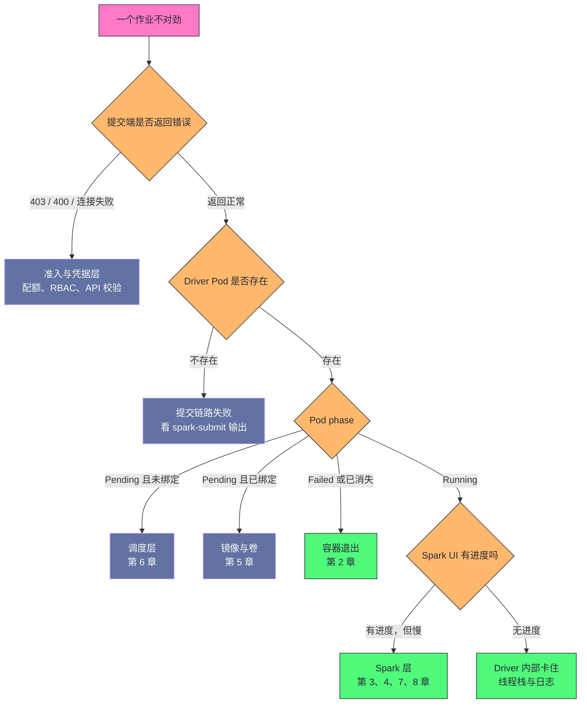
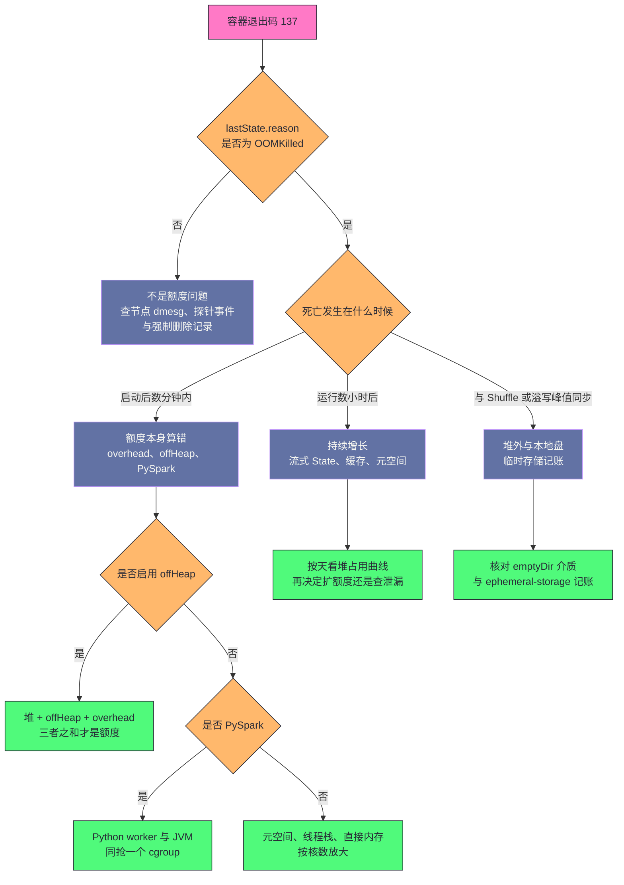
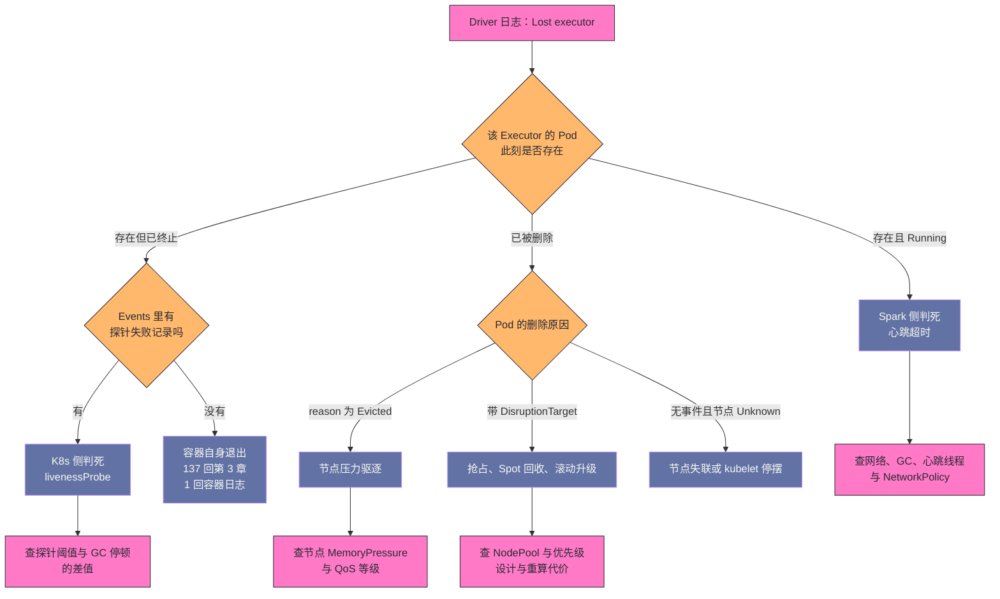
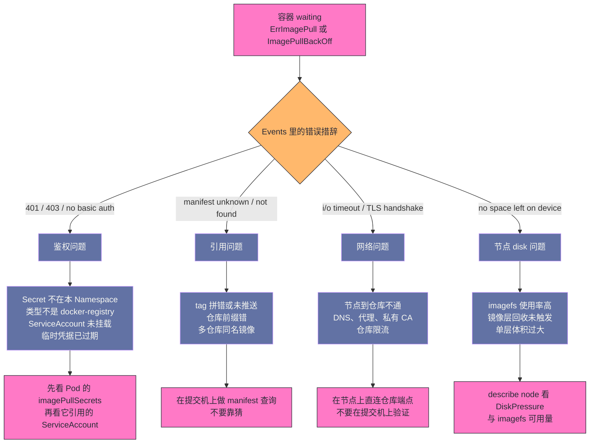
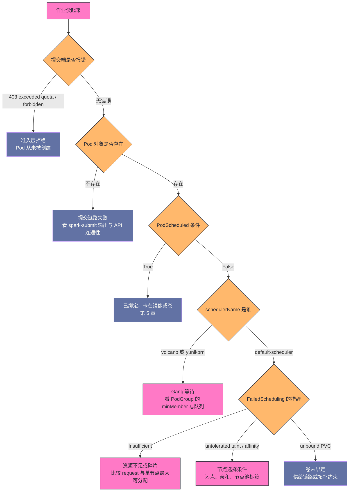
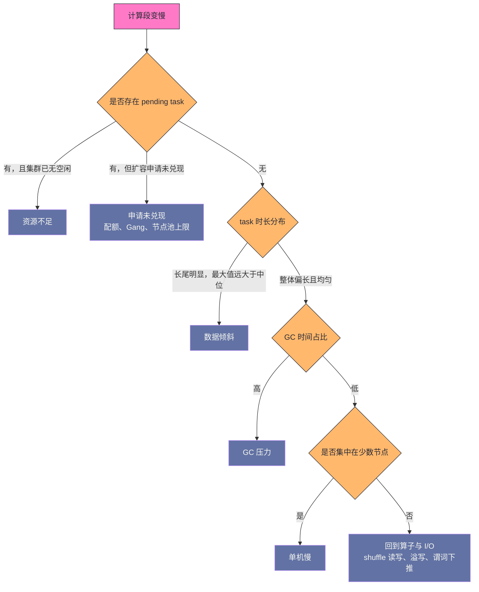

# 10 故障排查手册：从 Pod 状态到性能瓶颈的诊断链路

**摘要：**

Spark on Kubernetes 的故障现场，最贵的从来不是修复，而是判断。同一个"Executor 丢失"，在 K8s 的事件流里可能是一次节点驱逐，在 Spark 的日志里只是一行 `ExecutorLostFailure`，两边对"死亡"的定义不同，指向的排查方向也不同；同一个退出码 137，既可能是容器的 cgroup 内存越界，也可能是节点级 OOM killer、livenessProbe 超时，或者一次强制删除，而处置动作彼此相反。本文不写现象清单，只讲一条从现象收敛到根因的路径：先确定作业停在哪一段（提交、准入、调度、拉镜像、启动、计算、收尾），再确定问题落在 K8s 层还是 Spark 层，最后才轮到具体参数。

全文沿五问推进。先界定两个观测面各自的记账方式，说明"先看 Pod phase 还是先看 Spark UI"这个顺序本身为什么就是一条判据；再把入口判据落到 Pod 状态、Events 与退出码上，讲清 `kubectl describe` 的 Events 与容器日志各管哪一段、137 与 143 与 1 与 139 分别在说什么；随后依次拆开 OOMKilled 的额度算术（含 `memoryOverhead` 与 `offHeap` 同时打开后的总量）、Executor 丢失的三条判死路径与 `exitCausedByApp` 的读法、ImagePullBackOff 的四个分支、Driver Pending 的排除顺序、无外部 Shuffle 服务时 Shuffle 拉取失败的结构性成因；再落到性能瓶颈，把"资源不足、数据倾斜、GC、单机慢"四类慢的判据与优先级摆清楚；最后以反例收束，指出这套链路在什么情况下会失效，以及该往哪里补观测。全文以 Spark 4.3.0（2026-10-30 发布）与 Kubernetes 1.37 为口径，配置项的默认值与参数名以对应版本文档为准。

---

## 第 1 章 两个账本，一条收敛路径

### 1.1 第一次误判长什么样

凌晨两点的告警通常只有一句话：结算作业 `settle_daily` 跑到第四个还没结束。值班的人打开 Spark UI，转圈，打不开；切到终端敲 `kubectl get pods`，Driver 还在 `Running`，Executor 只剩两个，其余的一栏里全是新建出来的 Pod。于是判断"资源不够，扩容"，加了三台节点，作业依旧卡着；又判断"是不是对象存储慢了"，翻了半天对象存储的监控，没有异常。真正的答案藏在 `kubectl describe pod` 的 `Last State` 里：那些消失的 Executor 全都是 `Reason: OOMKilled`、`Exit Code: 137`，死因是 PySpark worker 的内存没有算进 `memoryOverhead`，跟节点数量、跟对象存储都没有关系。

这个现场值得反复回看，因为它把三件事同时摆了出来：第一，症状（跑得久）与根因（内存额度不够）隔了两层；第二，同一个人手上握着两套证据（K8s 的事件与 Spark 的日志），却没有确定该以哪一套为准；第三，每一次误判都对应一次真实的动作（扩节点、翻监控），而动作越贵，回头的成本越高。排障手册的价值不在于收录多少种故障，而在于给出一套**在证据之间排出先后的规则**。

### 1.2 为什么 K8s 上的诊断比 YARN 多一层

在 YARN 模式下，一个 ResourceManager 页面能回答三个问题：应用在哪个队列、ApplicationMaster 有没有起来、容器批下来了没有。三个答案出自同一个记账人，口径一致，所以当年的排障套路是"先看 RM 页面，看不到就去翻 AM 日志"。

Kubernetes 把这三个答案拆给了三个组件。对象存不存在、`phase` 是什么、`Events` 写了什么，由 API Server 与 etcd 记录；Pod 落不落得下节点，由 kube-scheduler 写进 `PodScheduled` 条件；容器有没有起来、镜像拉没拉到、进程怎么退的，由 kubelet 写在容器状态里。而 Spark 的知识——哪个 Executor 失联了、哪个 Stage 重算了、哪个 task 跑了多久——仍然只在 Driver 的日志与 UI 里。**两个账本，两套语法，记账的时刻还不同**：K8s 在容器退出后几秒内就把终态写完，Spark 要等到心跳超时（默认约两分钟）才承认这个 Executor 没了，这中间的差值就是所有误判的温床。

### 1.3 入口判据：先看 phase 还是先看 UI

这个问题有一个干脆的答案：**Spark UI 只能回答"Driver 活着之后"的问题**。Driver 没起来，UI 里连一个端口都不会有，此刻去查 UI 只是在验证一个已知的否定；反过来，Driver 起来了而 UI 打不开，那是 UI 暴露层的问题（Service、Ingress、端口、认证），与作业为什么慢是两件事。

所以真正的入口判据不是"先 K8s 后 Spark"这种教条，而是先确定作业停在哪一段。提交动作结束后，一个作业必然处于下列七段之一：提交端校验、准入、调度、拉镜像与挂卷、容器启动、计算、收尾。每一段只可能出某几类故障，先把段定下来，可疑集合就从十几种缩到两三种，这就是"收敛"两个字的实际含义。

还有一条容易被忽视的反向判据：**Pod `Running` 不等于 Spark 健康**。Spark 默认不给 Driver 与 Executor 注入任何探针，kubelet 只检查容器主进程在不在，所以在 JVM 卡在长时间 Full GC、或在等待一个永远不返回的网络调用时，Pod 的 `phase` 依然是 `Running`，`Ready` 依然是 `True`。从 K8s 的角度看一切正常，从 Spark 的角度看已经停摆——两边的账本在这里正式分岔。

### 1.4 Events 与容器日志的分工

`kubectl describe pod` 的输出里，上半截是规格与状态，下半截是 Events。Events 是控制面写的，记的是"谁对哪个对象做了什么"：调度器说某节点资源不足、kubelet 说镜像拉取失败、驱逐器说节点内存吃紧、探针说容器无响应。容器日志是进程写的，记的是"应用看到了什么"：异常栈、Shuffle 取数失败、SparkContext 初始化到了哪一步。

分工的判据可以简化成一条：**事件里出现的是 Kubernetes 的动词（Scheduled、Pulling、Killing、Evicted），问题在 K8s 层；日志里出现的是 Spark 的异常类名（`FetchFailedException`、`ExecutorLostFailure`、`SparkException`），问题在 Spark 层**。两者都出现时，事件在前、日志在后，因为容器先被杀，应用才有机会报错。

这条分工有两个边界，现场几乎人人都踩过。

第一个边界是 Events 的存活期。Events 是集群里的一类普通资源，由 API Server 按保留时长回收，默认一小时量级（具体值取决于 `--event-ttl` 的配置）。一个跑了六小时的作业，前两小时发生的 `FailedScheduling` 早就被清掉了，此刻 `describe pod` 下半截可能干干净净，这只说明事件过期，不说明没有发生过。要补这段空白，得靠集群级的事件落盘（事件导出到日志系统），或者靠节点的 kubelet 日志。

第二个边界是日志的存活期。`kubectl logs` 读的是节点上的日志文件，而文件的生命周期绑在 Pod 对象上，不是绑在作业上；`--previous` 读的是同一 Pod 内上一次容器实例，而 Spark 的 Pod 用 `restartPolicy: Never`，容器退出即终止，根本不存在"上一次实例"。于是 `deleteOnTermination` 保持默认真时，Executor 一消失，日志随之蒸发，只剩 Driver 日志里那一行转述——不是配置错误，而是一处被默认值掩盖的取舍。

### 1.5 收敛路径的形状

把上面的判据串起来，就得到一张从现象往层收敛的图。它不解决任何具体故障，但它决定了后面每一章该被翻开的顺序。



图里四个菱形的顺序就是判据的顺序：先问提交端（它决定了 Pod 有没有被创建的机会），再问对象（它决定了该查 K8s 还是查 Spark），再问 `phase`（它决定了卡在哪一段），最后才问 UI。跳过任何一问，都会把排查带到错误的层上；而错层排查的代价不是白费几分钟，而是可能触发一次不必要的扩容或参数改动，把现场改掉。

### 1.6 一个比喻：分诊台

急诊的分诊台不治病，只做一件事：把病人分到正确的科室，并且决定谁先看。分诊护士量体温、量血压、问一句"哪里疼"，这三个动作都很便宜，但它们决定了后面是去做 CT 还是直接进手术室。

这套判据就是分诊台。Pod 的 `phase` 是体温计，`Events` 是血压计，退出码是那句"哪里疼"。它们都不产生诊断，但能把人送到对的科室——送到错的科室，检查做得再细也是浪费，甚至有害：给一个内存越界的容器去扩节点，等于给一个骨折的病人做胃镜。

### 1.7 贯穿案例与全文路线

后面的章节需要一个具体的着力点，笔者沿用前面的 `settle_daily`，把它的设定补齐：电商数仓的夜间结算作业，从对象存储读入当天的订单明细与商品维表，按商品连接、按品类汇总成交额，最后写回宽表；用 PySpark 写了两段 UDF，开了动态资源分配，没有部署外部 Shuffle 服务，节点池里混着按量节点与 Spot 节点；Namespace 为 `spark-etl`，Driver 要 2 GiB 堆，Executor 要 8 GiB 堆，`memoryOverhead` 显式写成 `1g`，初始 24 个 Executor。

接下来九章按"从外到内"展开：第 2 章讲入口判据，第 3 到第 6 章处理四类"起不来或跑不稳"，第 7 章处理"反复重算"，第 8 章处理"跑完太慢"，第 9 章收反例与失效边界，第 10 章收束。

---

## 第 2 章 入口判据：状态、事件与退出码

### 2.1 phase 只是摘要，不是诊断

`kubectl get pods` 那一列 `STATUS` 之所以容易骗人，是因为它把四层信息压成了一个词。Pod 的 `phase` 只有五个取值：`Pending`（已被集群接受但容器未全部运行）、`Running`（已绑定节点且至少一个容器在运行或正在启动）、`Succeeded`、`Failed`、`Unknown`（通常是节点失联，kubelet 不再上报）。真正决定诊断方向的信息在下面三层：`status.conditions` 里的四个条件（`PodScheduled`、`Initialized`、`ContainersReady`、`Ready`）、每个容器的 `state`（`waiting`、`running`、`terminated`）、以及 `terminated` 里的 `reason` 与 `exitCode`。

四层信息的关系可以这样记：`phase` 回答"整体到哪一步了"，条件回答"卡在哪一道门上"，容器状态回答"进程怎么了"，`reason` 与 `exitCode` 回答"谁让它停的"。`Pending` 尤其需要拆开看——它同时覆盖两种完全不同的处境：没被调度（`PodScheduled=False`，节点还没定）和已被调度但起不来（`PodScheduled=True`，卡在拉镜像、挂卷或 initContainer）。前者要查调度器，后者要查 kubelet，查错方向就是南辕北辙。

### 2.2 四种容器状态与它们的读法

`waiting` 一定有 `reason`，常见的几个词各有归属：`ContainerCreating`（kubelet 还在准备）、`ErrImagePull` 与 `ImagePullBackOff`（拉镜像失败与退避）、`CrashLoopBackOff`（容器反复退出后 kubelet 拉长重启间隔）、`CreateContainerConfigError`（引用的 ConfigMap、Secret 或 key 不存在）。这四个词里只有前两个能在 Spark 的 Pod 上常见，后两个属于配置错误——但它们在 Spark 场景下几乎不会出现，因为 `restartPolicy: Never` 让 kubelet 根本不重启容器，`CrashLoopBackOff` 的前提"反复重启"就不成立。这条细节有个实用的推论：在 Spark 的 Pod 上报 `CrashLoopBackOff`，第一件事是确认这个 Pod 是不是 Spark 自己创建的，它更可能是同 Namespace 里别的 workloads。

`terminated` 才是 Spark 的主战场，因为它带着 `reason` 与 `exitCode` 两个字段，而这两个字段的组合决定了后面所有分支。`reason: Completed` 配 `exitCode: 0` 是正常结束；`reason: OOMKilled` 是 cgroup 内存越界（第 3 章）；`reason: Error` 配 `exitCode: 143` 多半是被优雅终止（驱逐、缩容、人工删除）；`reason: Error` 配 `exitCode: 1` 是应用自己报错退出；`reason: Evicted` 则是 Pod 在启动前或运行中被 kubelet 以资源压力为由驱逐，此时容器可能压根没跑起来，`exitCode` 会是空的。

### 2.3 退出码的语义

退出码是进程留给世界的最后一句话，而 shell 与容器运行时对它的编码有一条固定规矩：**被信号杀死时，退出码等于 128 加信号编号**。这张换算表值得记住，因为它把"容器怎么死的"这个问题变成了一次减法。

| 退出码 | 信号 | 谁发出的 | 在 Spark on K8s 上的典型成因 | 判据 |
|---|---|---|---|---|
| 0 | 无 | 进程自己 | 任务正常结束、Executor 被优雅释放 | 无需处置 |
| 1 | 无 | JVM 自己 | 用户代码异常、类找不到、`JAVA_HOME` 指错、依赖冲突 | 容器 stderr 第一段通常就是答案 |
| 137 | SIGKILL（128+9） | 内核 OOM killer、kubelet、运维删除动作 | cgroup 内存越界、节点级 OOM、探针超时后强杀、`--force` 删除 | `reason` 是否等于 `OOMKilled` |
| 143 | SIGTERM（128+15） | 驱逐器、缩容、抢占、人工删除 | 节点压力驱逐、Spot 中断、动态分配缩容、滚动升级 | 同刻有删除或驱逐事件，日志正常收尾 |
| 139 | SIGSEGV（128+11） | 内核 | JVM 原生崩溃、JNI 与 UDF 的本地代码、glibc 不匹配 | 容器内是否留下 `hs_err_pid` 文件 |
| 134 | SIGABRT（128+6） | 内核 | 断言失败、`abort()`、某些 JVM 致命错误路径 | 与 139 同类，看 `hs_err_pid` |

137 与 143 的区分在实战里价值最高：137 是"被剥夺"，通常意味着额度或健康判定出了问题；143 是"被要求退出"，通常意味着调度层做了决定，属于设计内的行为。把一个 143 当成内存问题去加 `memoryOverhead`，是一类很常见的空转——额度加上去了，驱逐照旧发生。

### 2.4 137 的四个来源

137 之所以不能直接等同于 OOMKilled，是因为至少有三条判死路径都会以 SIGKILL 收场，此外还有一类运维动作同样如此，而它们的处置完全不同。

第一条是 cgroup 内存越界，这也是唯一会让 `reason` 写成 `OOMKilled` 的一条。内核在容器的内存 cgroup 里回收失败后杀掉进程，kubelet 从 cgroup 的 OOM 记录里读到这次事件，把 `reason` 填成 `OOMKilled`。判据很硬：`lastState.terminated.reason == "OOMKilled"`。

第二条是节点级内存压力下的全局 OOM killer。节点的内存被多个 Pod 共同耗尽时，内核可能在全局回收中挑一个"分数最高"的进程杀掉，被选中的进程未必越过了自己容器的 limit。这时容器同样以 137 退出，但 `reason` 往往是 `Error` 而不是 `OOMKilled`，判据要去节点侧找：`dmesg` 或 `journalctl -k` 里是否有一行 `Out of memory: Killed process ...`，以及该节点此刻是否 `MemoryPressure=True`。

第三条是 livenessProbe 超时。kubelet 判定探针失败后先发 SIGTERM，等 `terminationGracePeriodSeconds`（默认 30 秒）再发 SIGKILL；如果进程在宽限期内没退出，最终退出码就是 137。判据是 Events 里那条 `Liveness probe failed` 与随后的 `Killing container`，两者成对出现。Spark 默认不注入探针，所以这条路径只在平台侧用 podTemplate 加过探针时存在。

第四条不是一条判死路径，而是一类运维动作：`kubectl delete --grace-period=0 --force` 会跳过优雅终止，节点 NotReady 之后 Pod 被标记删除也可能走到强杀，判据是审计日志里的删除记录。

把这四条并排放，就能理解为什么现场常见的争论"到底是内存问题还是被杀了"其实是个假问题：**先定 `reason`，再定时间点，最后才谈参数**。`reason: OOMKilled` 才轮到第 3 章的额度算术；`reason: Error` 配 137 要往节点与探针上找；`reason: Evicted` 要往容量与优先级上找。

### 2.5 一张入口判据总表

把第 1 章的分诊判据与本章的退出码语义合起来，可以得到一张现场最常用的对照表。它的用法是"从上往下匹配第一行"，而不是"挑一行最像的"。

| 症状 | 首查位置 | 判据 | 常见误判 |
|---|---|---|---|
| 提交命令返回非 0，Pod 不存在 | `spark-submit` 终端输出 | 403 `exceeded quota` 或 `forbidden` 属准入层；400 属请求格式 | 当成"集群资源不足"去扩节点 |
| Pod 长时间 `Pending`，`PodScheduled=False` | `describe pod` 的 Events | `0/N nodes are available` 后面跟的具体原因词 | 一律归为"资源不够" |
| Pod `Pending`，`PodScheduled=True`，容器 `waiting` | 容器的 `waiting.reason` | `ErrImagePull`、`ImagePullBackOff`、`ContainerCreating` | 与调度失败混为一谈，去查节点资源 |
| Pod `Failed`，`lastState.reason=OOMKilled` | 容器内存额度与 JVM 参数 | 额度 = 堆 + 堆外 + overhead，三者是否配平 | 只加 `-Xmx`，不动 overhead |
| Pod `Failed`，`reason=Error`、`exitCode=143` | Events 里的删除与驱逐记录 | 同刻是否有 `Evicted`、`DisruptionTarget`、缩容日志 | 当成内存越界加 overhead |
| Pod 消失，且 Driver 报 `Lost executor` | Events（可能已过期）与节点条件 | 节点是否 `Unknown`、是否 Spot 节点池 | 归因为"Spark 不稳定" |
| Pod `Running` 但作业无进度 | Driver 日志与线程栈 | 是否卡在 `SparkContext` 初始化、等待资源、或长 GC | 认为 K8s 层正常即可排除 |
| 作业有进度但反复重算 | Driver 日志中的 `FetchFailed` | 失败地址是否对应已消失的 Executor | 归因为网络抖动 |

这张表有一个刻意的设计：第一列写症状而不是故障名。故障名是结论，症状才是入口；用结论去找入口，等于拿答案去对题目。

### 2.6 命令链与它们的边界

命令本身不难，难的是知道每条命令能回答什么、不能回答什么。下面三条构成最小集合。

```bash
# 一次取全四层信息：phase、条件、容器状态、退出码
kubectl get pod <pod> -n spark-etl -o jsonpath='{.status.phase}{"\n"}{range .status.conditions[*]}{.type}={.status} {end}{"\n"}{range .status.containerStatuses[*]}{.name} restarts={.restartCount} last={.lastState.terminated.reason}/{.lastState.terminated.exitCode}{"\n"}{end}'

# 事件按对象过滤，适合脚本化；只覆盖事件保留期内
kubectl get events -n spark-etl --field-selector involvedObject.name=<pod> --sort-by=.lastTimestamp

# 日志只在 Pod 对象还在时有意义；Spark 的 Pod 没有上一次实例，--previous 通常为空
kubectl logs <pod> -n spark-etl -c executor --tail=200
```

第一条的用意是避免"分三次查"：现场最容易犯的错是按 `get pods` → `describe pod` → `logs` 逐条来，每条都要等，而信息本可一次取全。第二条的边界是事件保留期，第三条的边界是对象生命周期，两者合起来解释了为什么许多故障"事后完全无据可查"。

---

## 第 3 章 OOMKilled：额度与堆之间的那道缝

### 3.1 没有 OutOfMemoryError 的死亡

现场最常见的困惑是这一句：日志里没有 `java.lang.OutOfMemoryError`，为什么 Pod 被 OOMKilled 了。

答案在于两个"内存"不是同一个东西。JVM 的 `OutOfMemoryError` 是 JVM 自己的分配器在它管的区域里失败时抛出的：堆满了抛 `Java heap space`，元空间满了抛 `Metaspace`，直接内存越过 `MaxDirectMemorySize` 抛 `Direct buffer memory`。而 cgroup 的内存上限管的是整个容器的物理内存：堆、元空间、代码缓存、线程栈、直接内存、JNI 分配、Python worker、甚至文件页缓存，全都记在同一个额度里。只要这一堆加起来越过额度，内核就动手，进程连一句遗言都留不下。

换句话说，`OutOfMemoryError` 是 JVM 的"我管的那块不够了"，OOMKilled 是内核的"你这间屋子总面积超了"。前者可以捕获、可以让 task 失败重试，后者不可捕获、直接终结进程。**这两个信号之间的空白地带，就是 Spark on K8s 上绝大多数 OOMKilled 的发生地**。

### 3.2 额度的算术

容器内存额度不是由 JVM 参数决定的，而是由提交参数换算出来的。在 K8s 模式下，Executor 容器的 `resources.requests.memory` 与 `resources.limits.memory` 被设成同一个值，算法是：

```
容器内存 = spark.executor.memory            # 换算成 -Xmx
         + spark.executor.memoryOverhead     # 未显式设置时按因子推算
```

`memoryOverhead` 的取法有两层。显式写了 `spark.executor.memoryOverhead`（单位如 `1g`、`1024m`）时以它为准；没写时按堆的某个比例推算，这个比例在 K8s 模式上有一个专用参数 `spark.kubernetes.memoryOverheadFactor`，它与通用的 `spark.executor.memoryOverheadFactor`（默认 0.10）之间的优先级在不同版本间调整过，取值口径以对应版本文档为准。这里有一处从 YARN 迁过来的作业最容易踩的差异：**K8s 模式的 overhead 因子历来给得比 YARN 的 10% 宽，一旦有人在迁移时照抄了 YARN 的 `1g` 写死进去，额度就比预期小了一截**，而这截差额会以 137 的形式在凌晨三点结算。

第二层是堆外的独立预算。打开 `spark.memory.offHeap.enabled` 并设置 `spark.memory.offHeap.size` 之后，这部分内存由 Unsafe 直接向操作系统申请，不进 `-Xmx`，也不会让 JVM 抛出 `OutOfMemoryError`。于是总额度必须重算：

```
容器内存 = spark.executor.memory         # 堆，-Xmx
         + spark.memory.offHeap.size     # 堆外，Unsafe 直接分配
         + memoryOverhead                # 元空间、线程栈、直接内存、Python
```

一个具体的算例：堆 8 GiB、`offHeap.size` 2 GiB、overhead 1 GiB，容器至少要 11 GiB。如果照着"堆 + overhead"的老习惯配成 9 GiB，那么剩下那 2 GiB 的堆外预算就变成了越界额度——现象是打开堆外之后 OOM 反而更频繁，而 GC 日志一片正常。这条误算在把缓存或 Shuffle 挪到堆外的调优里出现得最多，因为调优的初衷是"减轻堆压力"，结果把压力整个搬到了 cgroup 上。

PySpark 的作业要在同一本账上再加一项。Python worker 是独立进程，它的内存完全不经过 JVM，自然也不受 `-Xmx` 约束；`spark.executor.pyspark.memory` 可以给 worker 单独设上限，不设时它就在 overhead 的预算里浮动。`settle_daily` 的死因正是这一项：两段 UDF 在大分区上各拉起了若干 worker，单个 worker 处理一个几十万行的小批次时瞬时占用远高于预期，`1g` 的 overhead 被吃穿。

### 3.3 判定树

拿到一个 137，先别动参数，按下面的顺序走。



树的第一道分叉决定了后面全部工作的方向：`reason` 不等于 `OOMKilled` 时，调内存参数是纯粹的浪费。第二道分叉是时间维度，它比任何参数都更能区分"额度不够"与"内存在长"，第 3.6 节会专门讲这条判据。

### 3.4 三类 OOM 的证据

同样是 `OOMKilled`，堆内、堆外与临时存储三类成因留下的证据并不相同，混着查很容易得出错误结论。

堆内越界的证据在 GC 与 spill 上：`spark.executor.extraJavaOptions` 里打开 GC 日志后，能看到堆占用在死亡前贴着上限爬升、Full GC 越来越密而回收量越来越小；Spark UI 的 Executors 页里 `Spill (Memory)` 与 `Spill (Disk)` 明显偏大，说明数据在堆里放不下只能落地。处置方向是控数据形状（减少单分区数据量、处理倾斜）或加大堆，而加大堆要同步加大 overhead，否则只是把死亡原因从"堆内不够"换成"总额度不够"。

堆外越界的证据在 JVM 参数与死亡形态上：堆的占用曲线平稳，GC 正常，但进程还是以 137 死；如果开了 `-XX:MaxDirectMemorySize` 且设得偏小，会看到 `OutOfMemoryError: Direct buffer memory`，没设则由 `-XX:MaxDirectMemorySize` 默认跟随堆大小；而 Netty 与 Unsafe 的分配失败有时连异常都不抛，直接表现为"进程突然没了"。这类越界与核数强相关，因为并发 task 数、Shuffle 连接数、序列化缓冲都随核数放大，第 3.5 节会给出这条因果链。

临时存储的越界最隐蔽：如果 `spark.local.dir` 落在 `emptyDir` 上，而该卷的介质声明成 `medium: Memory`，Shuffle 溢写占的就是内存、记的是同一个 cgroup 额度，越界的表现不是写入报错而是 `OOMKilled`，日志里没有半个与磁盘相关的字眼。判据是 Pod 规格里那个卷的 `medium` 与 `sizeLimit`；处置要么换介质，要么把这部分量算进额度。

### 3.5 一个被忽略的放大器：核数

`settle_daily` 曾经在把 `spark.executor.cores` 从 4 调到 8 之后变得更容易 OOM，现场的第一反应是"配置改坏了"。改坏的其实不是配置，而是那些不随配置显式变化的部分。

核数翻倍带来三件事：同时运行的 task 数翻倍，线程栈总量翻倍；Netty 的 Shuffle 与 RPC 连接数、每次读写的缓冲总量翻倍；单 Executor 上的并发序列化与反序列化压力翻倍，元空间因为更多 task 闭包类被加载而增长更快。三件事都不在 `-Xmx` 里，却都在 cgroup 里。于是"给 Executor 加核"这个看起来纯粹提升并行的动作，实际是在不动声色的地方抬高了堆外开销，而 `memoryOverhead` 仍按旧值给，差额只能靠 137 结算。

这条因果链还解释了另一个反直觉现象：**在 K8s 上，给 Executor 加内存有时不如给它减核**。堆外开销与核数的关联比与堆大小的关联更紧，一个 4 核 16 GiB 的 Executor 往往比一个 8 核 8 GiB 的 Executor 更稳，前者并行度低但每个 task 的堆外压力小，后者的额度被并发撑爆。

### 3.6 为什么"加 overhead"经常无效

`ExecutorLostFailure` 的日志末尾常常自带一句建议，大意是提高 `memoryOverhead`。照着改，一部分现场确实好了，另一部分只是把崩溃间隔拉长了。分界线在时间上。

死亡发生在作业启动后几分钟内，多半是额度确实不够：offHeap 没算进去、PySpark 的 worker 没算进去、或者 overhead 因子被误改。这类情形加额度是正解，但加之前要先把账算对，否则加多少都是猜。

死亡发生在运行数小时之后，多半是内存在持续增长：Structured Streaming 的 State 没有配 watermark 而无限膨胀、缓存越积越多没有释放、长驻应用的元空间只增不减、或者某个 `collect` 把结果集越拉越大。这类情形加额度只是把撞墙时间往后推，推不过一个通宵；正确的动作是查增长源，额度只作为过渡期护栏。

死亡与某个峰值同步，要看那个峰值是什么：Shuffle 溢写峰值、广播变量分发、大批量 `collect`、Python worker 的批次拉取。这类情形错开峰值或降低单批规模往往比加额度更有效，因为峰值是周期性的，额度加得再大也只覆盖一个周期。

还有一处代价必须记在账上：overhead 加进去的不是"可用空间"，而是"上限"。它把容器整体撑大，直接减少单节点可放置的容器数；一个 56 GiB 的节点，9 GiB 的容器能放六个，12 GiB 的只剩四个。当 overhead 加到使单容器规格超过节点可分配量时，症状会从 OOMKilled 变成"永远 Pending"——第 6 章会讲这个转变，它比 OOM 更难查，因为集群看起来资源充足。

### 3.7 观测面：cgroup 里记了什么

要把判断落到数字上，先要知道这几个计数器的口径不同。

| 观测项 | 含义 | 与故障的关系 |
|---|---|---|
| `memory.current`（cgroup v2） | 当前记账总量，含页缓存 | 与 limit 比较，接近即临界的信号 |
| `memory.max` | 容器的内存上限 | 就是堆加 overhead 换算出的大小 |
| `memory.events` 的 `oom_kill` | 该 cgroup 内的 OOM 强杀次数 | 大于零即证明是 cgroup 越界 |
| `memory.stat` 的 `anon` 与 `file` | 匿名页（堆与栈）与文件页缓存 | 区分"应用吃掉的"与"缓存吃掉的" |
| `container_memory_working_set_bytes` | 用量减去不活跃文件页 | kubelet 驱逐的判据，不是 OOM 的判据 |

表里最后一行最值得记住：kubelet 驱逐看工作集（减掉可回收文件页），cgroup 的 OOM 看记账总量（含页缓存），两个口径不同，于是"Pod 被驱逐但工作集不高"与"页缓存把 `memory.current` 顶到上限"可以同时成立。cgroup v1 与 v2 的字段名不同，读法按节点所用运行时的口径，跨版本集群最易读错。

---

## 第 4 章 Executor 丢失：三张死亡证明

### 4.1 症状被统一，原因被抹平

Spark 在 Executor 消失这件事上做了刻意的统一。无论那个进程是被内核杀死的、被探针杀死的、被驱逐的、还是因为网络断开而失联，Driver 记录下来的都是同一句话：

```
WARN TaskSchedulerImpl: Lost executor 7 on 10.244.3.12:  ...
```

后面跟着的 `ExecutorLostFailure` 再补一点信息，但也就到"是否与运行中的 task 有关"为止。这个设计有它的道理——容错路径只需要一套，Spark 不该关心集群管理器为什么收走了一个进程；代价是可观测性的损失，运维视角下"被杀"与"崩溃"长着同一张脸。Spark 心跳与 K8s 探针这两套判死机制的构造见本专栏第 4 篇，这里只取判据。

于是问题变成：手上有三张可能的死亡证明（Spark 的心跳判死、K8s 的探针判死、节点的驱逐与回收），怎么用最小的动作分辨出是哪一张。

### 4.2 三条判死路径

第一条路是 Spark 自己判死。Executor 定期向 Driver 发心跳，间隔由 `spark.executor.heartbeatInterval` 决定（默认 10 秒）；Driver 侧按 `spark.network.timeoutInterval` 的节奏扫一张记录最后心跳时间的表，超过 `spark.network.timeout`（默认 120 秒）没有心跳的，判定失联。这条路的特征是：判据全在应用层，Pod 可能完好无损。网络分区、长时间 Full GC、心跳线程被阻塞、NetworkPolicy 把心跳端口拦掉，都会走到这里。

第二条路是 K8s 判死。如果平台侧通过 podTemplate 注入了 livenessProbe，kubelet 就多了一个裁判：探针连续失败达到阈值，kubelet 杀掉容器，进程以 137 或 143 退出，Pod 变成 `Failed` 或被删除。这条路的特征是：Pod 上有探针失败的证据，`describe pod` 的 Events 里会出现 `Liveness probe failed` 与 `Killing container`，而 Spark 日志里记录的是"Command exited with code 143/137"，不是心跳超时。

第三条路是节点层面收走。节点内存或磁盘压力触发驱逐（`reason: Evicted`）、高优先级 Pod 抢占（Pod 带 `DisruptionTarget` 条件）、Spot 实例被回收、节点 NotReady 后 Pod 被 GC、滚动升级时被 drain——这些动作都不是针对 Spark 的，它们清的是节点。这条路的特征是：Pod 已经不在，或带着驱逐条件，判据要到节点与事件里找。

把三条路画成分叉，形状就清楚了：先看对象还在不在，再看对象上有没有 K8s 留下的痕迹，最后才回到应用层。



这张图的第一道分叉是所有判断的关键：**先看 Pod 对象，不要先看 Spark 日志**。日志里的"丢失"是结论，对象上的状态才是证据；而对象的证据有时效，Pod 被 `deleteOnTermination` 删掉之后就什么都不剩了，这也是为什么第 4.5 节要讲侦察顺序。

### 4.3 `exitCausedByApp` 怎么读

`ExecutorLostFailure` 带两个参数，第二个是布尔量，日志里翻译成一句自然语言。取真值时写的是 "exited caused by one of the running tasks"，意思是 Spark 认为这次退出由它正在运行的 task 引起；取假值时写的是 "exited unrelated to the tasks running in it"，意思是与该 Executor 上的 task 无关。

这个字段回答的是一个归因问题：**这次退出该记在应用账上，还是记在集群账上**。应用账包括 task 级别的内存超限导致 JVM 退出、task 连续失败触发 Executor 自杀、用户代码里调用了 `System.exit`；集群账包括容器被外部杀死、节点消失、容器 OOM。它的用途是决定下一步该查代码还是查环境。

但它不能替代第 4.2 节的分辨。原因很直接：**假值是个大口袋**，容器 OOMKilled、探针杀、驱逐、节点失联全都落在里面，Spark 无从区分，它只知道"不是 task 干的"。所以正确的用法是把 `exitCausedByApp=false` 当成"去 K8s 层接着分"的指令，而不是当成"集群有问题"的结论。反过来，看到真值也不要立刻改代码——一个 task 把 JVM 撑爆，仍然可能是 Executor 的额度给得太小，代码无辜。

### 4.4 三条路径的对照

把判据摊成一张表，现场就可以照着勾选。勾选的意义在于：三条路径的处置方向互斥，勾错一条就会做无用功。

| 维度 | Spark 心跳判死 | K8s 探针判死 | 节点驱逐与回收 |
|---|---|---|---|
| Pod 对象状态 | 存在且 `Running` | 存在但 `Failed` 或已删除 | 已删除，或 `reason: Evicted` |
| Spark 日志措辞 | 心跳超时、连接超时 | `Command exited with code` 143 或 137 | 同上，或只有一次 Lost |
| K8s Events | 无异常，或只有网络类事件 | `Liveness probe failed` 与 `Killing container` | `Evicted`、`DisruptionTarget`、节点条件变化 |
| 时间特征 | 与网络抖动、GC 峰值同步 | 周期性强，隔一段时间来一批 | 与运维动作、Spot 回收、容量水位同步 |
| 分布特征 | 可能一次影响多个 Executor | 集中在注入过探针的那批 Pod | 集中在同一节点或同一节点池 |
| 首要处置 | 查网络与 GC，调心跳与超时比值 | 放宽探针阈值或去掉探针 | 调 QoS、优先级、容量与节点池 |

表里"分布特征"这一行是最容易被忽略、也最好用的一行。三条路径的分布形状不同：网络问题往往一次打掉一批但跨节点分散，探针问题随着注入范围批量出现，驱逐问题高度集中在某个节点或某个 Spot 池。看到一个夜里丢了十个 Executor，先问"这十个原来在几台机器上"，答案往往直接指向路径。

### 4.5 侦察顺序

顺序的价值在于用最便宜的动作排除最贵的可能。

第一步，确认对象还在不在。`kubectl get pods -n spark-etl -l spark-role=executor` 列一遍，与 Spark UI 的 Executors 页对数量。数量对不上且 Pod 少，走第 4.2 节的删除路径；数量对不上且 Pod 多，说明有幽灵 Pod，见 4.6。

第二步，若对象还在，取 `lastState.terminated.reason` 与 `exitCode`，按第 3 章与本章的判据分流。若对象已删，取事件——但要有心理准备，删除事件很可能已经过期，此时能依靠的只剩节点状态与作业日志的时间戳。

第三步，看节点。`kubectl describe node` 的 `Conditions` 与 `Allocated resources`，判断节点是否经历过压力、是否 Spot 节点、是否在同一时刻被 drain。这一步要结合节点池的标签做，因为"这台机器是 Spot"这个事实在 Pod 规格里看不出来。

第四步才是应用层。走到这一步，说明对象与节点都干净，剩下的可能只有网络与 GC：查 CNI 与 NetworkPolicy 的变更记录，查 GC 日志里死亡前的停顿，查心跳间隔与超时阈值的比值是否过紧。

这四步里，第一步与第二步的成本是秒级的，第三步是分钟级的，第四步往往要翻几个小时前的日志。**顺序错了不是慢一点，而是可能永远查不出来**——因为第四步的证据（Pod 对象）在前两步之后就不存在了。

### 4.6 幽灵 Pod 与它占的资源

有一类形态与丢失相反：Spark 认为 Executor 已经死了，把它从调度器里除名，但 Pod 还在节点上活着、还在占着 CPU 与内存。它的判据很简单：`kubectl get pods` 的数量明显多于 Spark UI 上的 Executor 数，且多出来的那些 `phase` 是 `Running`。

成因是两套时钟的差值。Spark 判死只看消息，可以把一个健康的进程除名；除名之后它会尝试删除对应的 Pod（`deleteOnTermination` 为真时），但如果这个 Pod 卡在长时间 GC 或磁盘 I/O 里，删除动作可能迟迟不生效，或者被某些 finalizer 拦住。于是这个 Pod 进入一种既不工作也不释放的状态，占着节点资源直到被回收。

处置方向不是加参数，而是把"除名"与"删除"这两件事绑紧：`deleteOnTermination` 保持默认的真，同时确保 Driver 对 Pod 的删除权限完整（第 03 篇的 RBAC 清单里 `delete` 是必须项）。权限缺一个动词，幽灵 Pod 就会一直留着，而 Spark 的日志只会告诉你"Executor 丢了"，不会告诉你"我删不掉它"。

---

## 第 5 章 ImagePullBackOff：进场之前的四道关

### 5.1 它站在生命周期的哪一格

把镜像拉取放到第 1 章那条七段路径上看，它站在"调度之后、启动之前"这一格：Pod 已经绑定了节点（`spec.nodeName` 有值，`PodScheduled=True`），kubelet 正在按容器规格准备运行时，卡在第一步——把镜像从仓库搬下来。

这一格有个与别处不同的性质：**镜像拉取没有超时语义，只有退避**。调度失败会给出明确的 `0/N nodes are available`，容器退出会留下 `exitCode`，而拉镜像失败留下的是一句错误措辞，加一段越来越长的重试间隔（`ErrImagePull` 首次失败，之后转成 `ImagePullBackOff`，间隔按指数增长，上限在五分钟量级）。于是一个拼错的 tag 可以在集群里安静地重试一整夜，而作业那边只会表现为"一直没有进度"。

判据就在这里：`Pending` 且 `PodScheduled=True` 且容器 `waiting.reason` 是 `ErrImagePull` 或 `ImagePullBackOff`，说明问题在镜像，不在调度也不在内存。反过来，`Pending` 且 `PodScheduled=False` 时，镜像还没轮到出场，去查镜像纯属浪费。

### 5.2 四个分支

错误措辞是这四个分支的唯一入口，因为 kubelet 会把运行时返回的原始错误原样写进 Events。四类措辞对应四个完全不同的处置方向。



四个分支里，前两个占现场的大多数，后两个更容易被误判。鉴权与引用的错误措辞有一个共同点：它们都是确定性的，同一个镜像重试一万次也是同一个结果；网络与磁盘的错误则带随机性，一会儿成功一会儿失败，或者只在部分节点上失败。这条确定性差异可以直接用于分流：先看失败是"全量且稳定"还是"局部且抖动"，前者查配置，后者查环境。

### 5.3 鉴权这一支的四个断点

鉴权失败最容易被简化成"Secret 配错了"，实际断点有四处：名字空间（Secret 必须与 Pod 同 Namespace，建在 `default` 里与没建一样）、类型与键名（只认 `kubernetes.io/dockerconfigjson` 配 `.dockerconfigjson`，`Opaque` 类型无效）、挂载路径（Pod 规格里的 `imagePullSecrets` 与 ServiceAccount 上带的是两条来源，作业模板换了 ServiceAccount 就丢）、凭据时效（云厂商临时凭证只有小时级，凌晨批量扩容时全部失败）。

第四处的时间特征比措辞更有辨识度：失败集中在某个时刻之后创建的新 Pod 上，此前的全部正常。

### 5.4 引用与网络这两支的判据

引用的错误措辞通常是 `manifest unknown`、`not found`、`repository does not exist` 这一类。判断方式是拿"提交机"当参照物：在提交机上用同一套凭据做一次 manifest 查询（`docker manifest inspect` 或 `crane manifest`，取决于镜像仓库的认证方式），如果提交机也查不到，问题在引用；如果提交机能查到而节点上拉不到，问题在节点侧的环境——同一条 tag 在提交机能解析，说明仓库与凭据都没问题，差异只可能出在网络路径或节点运行时配置上。

网络的错误措辞是 `dial tcp ...: i/o timeout`、`TLS handshake timeout`、`no such host`、`connection refused` 这几类。它们的共性是需要在节点上验证，而不是在提交机上验证：提交机能连通仓库不代表节点能，节点的网络策略、出网代理、私有 CA 信任链、DNS 解析器都可能是断点。验证方式是在节点上直接请求仓库端点，或用一个临时 Pod `curl` 一下；这一步看着笨，却能把"网络问题"与"凭据问题"当场分开。

### 5.5 磁盘这一支：容量问题，不是配置问题

`no space left on device` 与 `failed to register layer` 属于第四支。它出在节点上，与镜像内容和节点容量有关：镜像层解压时要占用 `imagefs`，而 kubelet 的镜像回收依赖使用率阈值（高水位与低水位两个参数），一旦回收跟不上写入，新镜像就写不进去。

这一支最容易被误判成"镜像坏了"或"仓库有问题"，因为错误出现在拉取阶段，而实际原因是节点盘。判据很直接：`kubectl describe node` 里是否有 `DiskPressure=True`，`imagefs` 与 `nodefs` 的可用量是否接近零，以及同一节点上是否有一批 Pod 都在报同一个错。如果故障集中在少数节点而不是全部节点，容量问题的可能性远高于配置问题。

处置方向也与前两支不同：它不是改参数能解决的，要么清理节点（`crictl rmi --prune` 或让 kubelet 的 GC 跑起来），要么把大镜像拆小（分层策略，第 02 篇讲过），要么扩容节点盘。这也解释了为什么同一份作业在不同节点池上的表现会不一样——节点盘的大小从来不是均匀的。

### 5.6 一张判据表与两条边界

| 错误措辞 | 分支 | 判据动作 | 处置方向 |
|---|---|---|---|
| `401 Unauthorized`、`403 Forbidden`、`no basic auth credentials` | 鉴权 | 对照 Pod 的 `imagePullSecrets` 与 ServiceAccount | 补 Secret、修正类型与名字空间、换成长期凭据 |
| `pull access denied`、`repository does not exist` | 鉴权或引用 | 用提交机的同一套凭据查一次 manifest | 确认仓库路径与权限域 |
| `manifest unknown`、`not found` | 引用 | 提交机上验证 tag 是否存在 | 修正 tag 或补推送 |
| `dial tcp ... i/o timeout`、`TLS handshake timeout`、`no such host` | 网络 | 在节点上直连仓库端点 | 修网络策略、代理、CA 或 DNS |
| `no space left on device`、`failed to register layer` | 磁盘 | `describe node` 看 `DiskPressure` 与 imagefs 可用量 | 清理、拆层、扩盘 |
| 全部新 Pod 同时失败、旧 Pod 正常 | 凭据时效 | 看失败开始的精确时刻 | 换长期凭据或加自动刷新 |

两条边界值得单独记下。

第一条，`ErrImagePull` 与 `ImagePullBackOff` 是同一件事的两个阶段，前者是第一次失败，后者是退避期的状态；看到后者不要以为"重试就能好"，退避只是把失败摊开，不会改变结果。

第二条，`latest` 这个 tag 有个隐式后果：引用省略 tag 或写成 `latest` 时，`imagePullPolicy` 的默认值会从 `IfNotPresent` 变成 `Always`，于是"节点上明明有缓存"与"每次启动都要去仓库拉"同时成立，仓库一限流，整批 Executor 就卡在拉取上；反过来，用 `IfNotPresent` 配一个可变的 tag，节点上会一直用旧镜像，表现为"改的代码没生效"。

---

## 第 6 章 Driver Pending：四种等待与一种不存在

### 6.1 先分清"没起来"的两种含义

现场说"作业没起来"，可能指两件完全不同的事。

第一件是对象根本没被创建。提交请求在准入层就被拒绝，API Server 返回 403，错误信息里写着 `exceeded quota` 或 `forbidden`；此刻 `kubectl get pod` 查不到任何东西，因为 Pod 从未存在过。这一类的根因在配额、在 RBAC、在准入控制器，与调度器没有任何关系。

第二件是对象存在但没被绑定。Pod 已经写进 etcd，`phase` 是 `Pending`，`PodScheduled` 条件是 `False`，Events 里有一行 `FailedScheduling`。这一类的根因在调度器：节点选不出来。

这两件事在症状上都能说成"作业起不来"，在处置上没有任何交集。**把配额拒绝当成 Pending 去查，是这条链路上最常见的空转**：查节点资源、查污点、查亲和性，查一晚上也不会有结果，因为调度器压根没参与，那个 Pod 不存在。判据只有一条，而且很硬——`kubectl get pod` 能不能查到；查不到就往提交端与准入层走，查得到才轮到调度。

### 6.2 排除顺序

确认 Pod 存在之后，按下面的顺序排除。顺序的设计原则是"先问对象自己，再问调度器，最后问别人"。



图里最上面那个菱形是最容易被跳过的一格。它便宜到只需要看一眼提交日志，却能把整条排查路径砍掉一半。

### 6.3 四类等待的具体判据

第一类，节点选择条件。污点与容忍、节点亲和、节点选择器、拓扑分布约束，任一条件不满足都会让 Pod 停在 `Pending`。Events 的措辞会明说，形如 `node(s) had untolerated taint {dedicated: spark}` 或 `node(s) didn't match Pod's node affinity/selector`。这一类的特点是确定性：条件不改，等多久都不会变好。它常出现在两种场合：节点池被打了专用污点而作业模板没带对应容忍（Spot 池、GPU 池最常见），以及作业带了一个写死的主机名或可用区标签而集群已经换过节点池。

第二类，资源不足与碎片。Events 里的措辞是 `Insufficient cpu` 或 `Insufficient memory`，但它背后的情形至少有两种，处置相反。一种是总量不足：集群里真的没有这么多空闲资源，等别人释放或扩容即可。另一种是碎片：每个节点都只剩一些零散资源，凑不出一个完整的 Pod；或者单个 Pod 的规格超过了任何节点的最大可分配量，此时无论等多久都等不到，因为约束在数学上无解。

区分方式是一次除法：把 Pod 的 request 与所有节点里最大的 `Allocatable` 比一遍，再与当前空闲量比一遍。前者不过，是规格问题，只能改规格；后者不过，是容量问题，可以等也可以扩。这条判据在 Gang 场景下尤其重要，因为 Gang 要求同时凑齐一组资源，碎片的杀伤力被成倍放大。

第三类，Gang 等待。部署了 Volcano 或 YuniKorn 之后，Pod 的 `schedulerName` 不再是默认调度器，而是这些调度器的名字；它们不按 Pod 逐个调度，而按一组（PodGroup）整体判定，凑不齐 `minMember` 就一个都不启动。这类 `Pending` 有两个反常特征：一是 Events 里没有 `FailedScheduling`，因为默认调度器根本没参与；二是节点资源看起来充足，因为等待发生在队列层面而不是节点层面。

判据要换一套工具：看 `schedulerName` 字段，看 PodGroup 对象的状态与 `minMember`，看调度器侧的队列与作业视图。把这类等待当成资源不足去扩节点，是最典型的错层排查——扩了节点，PodGroup 依然凑不齐，因为缺的可能是某一类资源的比例，而不是总量。

第四类，卷未绑定。如果 Driver 或 Executor 挂了 PVC，而 PVC 的 `volumeBindingMode` 是 `WaitForFirstConsumer`，就会出现一个循环：Pod 要等卷绑定才能调度，卷要等 Pod 调度才知道落在哪。这个循环不是缺陷，而是设计——它保证卷与 Pod 在同一拓扑域。但它要求存储类与节点拓扑配合好，否则 Pod 会停在 `Pending` 并报 `pod has unbound immediate PersistentVolumeClaims`。判据是先看 PVC 的状态与事件，再看存储类的绑定模式，最后看可用区的余量。

### 6.4 FailedScheduling 措辞对照

| 事件措辞 | 根因 | 判据动作 | 处置方向 |
|---|---|---|---|
| `Insufficient cpu` / `Insufficient memory` | 总量不足 | 空闲量对比 request | 等释放或扩容 |
| 同上，但只在部分节点失败 | 碎片或规格过大 | 与单节点最大 `Allocatable` 比较 | 改规格或调整节点池机型 |
| `had untolerated taint` | 污点不匹配 | 看节点污点与作业容忍 | 补容忍或换节点池 |
| `didn't match Pod's node affinity/selector` | 选择条件不满足 | 看 `nodeSelector` 与节点标签 | 修正标签或选择器 |
| `node(s) had volume node affinity conflict` | 卷的拓扑与节点不符 | 看 PV 的可用区与节点区 | 调存储类或节点池 |
| `pod has unbound immediate PersistentVolumeClaims` | 卷未绑定 | 看 PVC 状态与绑定模式 | 修供给链路 |
| 无 `FailedScheduling`，`Pending` 不变 | Gang 等待或非默认调度器 | 看 `schedulerName` 与 PodGroup | 调 `minMember`、队列或优先级 |
| `0/N nodes are available: N node(s) were unschedulable` | 节点被 cordon | 看节点是否被标记不可调度 | 恢复节点或扩新节点 |

### 6.5 Driver Pending 与 Executor Pending 是两回事

这两种 `Pending` 在日志上相似，在症状上完全不同，值得单独分辨。

Driver 卡在 `Pending` 时，作业的进度是零：没有 SparkContext，没有 UI，没有任何 task。Executor 卡在 `Pending` 时，作业已经跑起来了，只是并行度上不去——UI 里能看到 stage 在推进，只是 task 排队，每个 task 的启动延迟变长。前者的判据是"UI 不存在"，后者的判据是"UI 存在但并行度低于预期"。

这个区分决定了该查什么：Driver 的 `Pending` 是准入与调度问题（本章与第 5 章）；Executor 的 `Pending` 多半是资源兑现问题——Driver 已经发出了创建请求，Pod 也建出来了，但落不下节点。在动态分配开启的作业里，后者的表现还会更绕：`spark.dynamicAllocation.maxExecutors` 允许它一直要，而集群一直给不出来，于是作业在"能跑但慢"的状态下持续很久，看起来不像故障。

### 6.6 边界：Pending 有时是设计行为

最后要提醒一处容易误判的边界：**不是所有 Pending 都需要处置**。

Gang 调度下的等待是设计行为，它用"一个都不启动"换"不会启动一半"，这是有意的取舍（第 08 篇算过这笔账）；动态分配的 Executor 在扩容窗口内短暂 `Pending` 也是正常现象，因为创建请求是批量的、异步的，Pod 从创建到绑定天然有一段延迟。判据是时间：一次扩容的正常等待在秒到分钟量级，超过十分钟仍无任何 Pod 被绑定，才值得介入。

---

## 第 7 章 Shuffle 拉取失败：人走了，数据没走

### 7.1 一种"没有失败却反复重来"的故障

有一类故障在告警上很安静：作业没有失败，但时间越跑越长，Stage 一次次重算，最后在某个阈值上突然失败。翻 Driver 日志，会看到 `FetchFailedException` 或者 `Failed to connect to ...:7337` 这样一串记录，夹在 `Lost executor` 与 `Resubmitted stage` 之间。

它的因果链比前几章短，但更隐蔽。Executor 写下的 Shuffle 输出落在自己的本地目录里（`emptyDir` 或本地盘），这份数据的地址被登记在 Driver 的 `MapOutputTracker` 上；Executor 消失之后，地址还在，数据没了。下游的 reduce task 拿着地址去连接，连不上或读不到，重试若干次之后抛出 `FetchFailedException`；DAGScheduler 收到之后，把对应的 map 输出标记为丢失，重新提交上游的 Shuffle Map Stage，让那些分区被重新算一遍。

于是症状不是"报错"，而是"重算"。一次 Executor 丢失可能引发一个 Stage 的整段重算，而重算又会在新的 Executor 上写出新的 Shuffle 文件，如果那些 Executor 也不稳定，链条就会重复。第 06 篇把这条链的存储侧拆得很细，本章只取它的判据。

### 7.2 判据：地址在，宿主不在

区分"Shuffle 数据丢了"与"网络抖了"的判据有三条，三条同时成立时基本可以定案。

第一条，map 端的日志是干净的。写 Shuffle 的 task 早已成功结束，没有任何异常；失败全部发生在读端。第二条，**失败地址对应一个已经消失的 Executor**，把日志里的 IP 与端口与 Spark UI 的 Executor 列表对照，或在 Driver 日志里搜同一个 Executor 编号的 `Lost executor` 记录。第三条，失败集中在特定的 map 输出上，而不是全对全的随机失败。

三条判据里第二条最有说服力，因为它把"网络问题"直接排除了一半：网络抖动时宿主还在，连接失败是双向的、随机的；数据丢失时宿主已不在，连接失败是单向的、定向的。

| 现象 | 更可能是数据丢失 | 更可能是网络故障 |
|---|---|---|
| 失败地址对应的 Executor | 已不在 Spark UI 列表中 | 仍在列表中且活跃 |
| 失败的时间分布 | 集中在一次 Executor 消失之后 | 与网络指标波动同步 |
| 失败的范围 | 定向到少数地址 | 大面积随机，跨多个 Executor |
| map 端日志 | 完全干净 | 可能伴随 RPC 超时与重连 |
| 重试结果 | 重试不会好，只能重算 | 有时重试就过去了 |
| 后续动作 | 上游 Stage 重算 | 无重算，只有延迟 |

### 7.3 处置梯度

处置不是"调大重试次数"，那只是把发现时间往后推。可用的手段有四级，代价依次上升。

第一级是让 Spark 自己别急着释放有数据的 Executor。开启动态分配时，`spark.dynamicAllocation.shuffleTracking.enabled` 让调度器追踪每个 Executor 上还有多少未被读取的 Shuffle 输出，有未读数据的不释放。它解决的是"主动缩容导致的丢失"，对驱逐与崩溃无效，但成本最低。

第二级是给缩容加缓冲。`spark.dynamicAllocation.executorIdleTimeout` 控制空闲多久才释放，把它从默认的 60 秒调大，能覆盖一部分"刚写完就被释放"的时序；代价是资源利用率下降。这一级与第一级经常一起用，因为它们治的是同一类成因的不同侧面。

第三级是把数据搬出 Executor，也就是部署远程 Shuffle 服务（Celeborn、Uniffle 一类）。数据有了独立的生命周期，Executor 消失只是少了一个计算单元，Shuffle 文件还在服务侧，reduce 端照常读。这是结构性解法，代价是多一套有状态服务要运维，故障面从"作业内"扩大到"作业外"。

第四级是放弃弹性：关掉动态分配，固定 Executor 数量，让 Executor 尽量活到作业结束。它把问题从"数据会丢"变成"资源不能回收"，只在作业时长可控、集群容量宽裕时划算。

四级之间不是替代关系，而是覆盖不同的失效原因：前两级治缩容，第三级治驱逐与崩溃，第四级治一切但付出弹性。选哪一级，取决于集群里 Executor 消失的主要原因是哪一种——这个判断要靠第 4 章那三条路径的统计，而不是靠猜。

### 7.4 边界：重试把故障藏起来了

重试与退避决定的是"多久才承认失败"，而最终把作业判死的是 `spark.stage.maxConsecutiveAttempts`（默认 4）：同一个 Stage 连续重算四次仍失败，作业才会以失败收场。在这之前，作业一直处于"重算中"的状态，从外部看只是慢。所以当一个作业跑了六个小时后失败，报错指向最后一个 Stage 时，真正的现场往往在两个小时前的第一次 `FetchFailed` 上；定位要靠时间戳往前翻，而不是从报错处往下读。

---

## 第 8 章 性能瓶颈：四类慢的判据与次序

### 8.1 先把"慢"切成三段

"作业慢"这句话不含任何诊断信息，因为一个作业至少有三段时间，各自的原因完全不同：启动段（提交到全部 Executor 就绪）、计算段（Stage 推进与 task 执行）、收尾段（结果写出、文件提交、资源回收）。三段的判据都写在时间戳里：Driver 日志与 Spark UI 的 Jobs 页面都能给出每段的起止时刻，把总时长减去这三段，剩下的才是"不知道为什么"的部分。

### 8.2 四类慢的判据

计算段变慢，原因大体落在四类里。它们的判据互不相同，优先级也不相同。



**资源不足**的判据是"有活没人干"：Stage 的 task 排队，集群的可用核数已到上限，executor 申请发不出去或发出去批不下来。UI 上表现为 task 的启动延迟高、`Scheduler Delay` 占比大、并行度低于 `spark.executor.instances × cores`。它有两种子情形：真没资源（集群满），与申请没兑现（配额、Gang、节点池上限、单 Pod 规格过大）。后者更隐蔽，因为 UI 只显示"没有新 Executor"，不显示为什么没有。

**数据倾斜**的判据是"有人扛得多"：同一个 Stage 内 task 时长的最大值远高于中位数，Shuffle Read Size 的最大值远高于 75 分位，溢写集中在少数 task 上。UI 的 Stage 详情页给出 min、25th、50th、75th、max 五个分位，倾斜的形状一眼可见：中位数很小而最大值高出一个数量级。倾斜的危险在于它会被误判成资源不足——因为加 Executor 之后作业确实快了一点点（更多 task 能并行），但那个超大的 task 依然是关键路径，总时长不会实质下降。

**GC 压力**的判据是"内存在反复打扫"：Executors 页的 `GC Time` 占 task 总时间的比例明显偏高，堆占用锯齿状贴近上限，Full GC 频繁而回收量小。它常与倾斜同时出现，因为一个超大的 task 会在堆里堆积大量对象；区分方式是看 GC 时间是否集中在少数 Executor 上——集中在少数即倾斜的后果，普遍偏高才是 GC 配置或堆大小的问题。

**单机慢**的判据是"有人脚下是泥"：同一 Stage 内，位于少数几个节点上的 task 普遍更慢，而这些节点的 CPU、磁盘、网络指标也异常。原因在节点侧：邻居抢 CPU（`steal` 时间）、本地盘打满、网络带宽被别的 Pod 占用、节点机型偏旧、虚拟机迁移后的 NUMA 错位。K8s 上这一类的排查工具是 `kubectl top node`、节点条件与节点级监控，而不是 Spark 参数。

### 8.3 优先级与它的理由

四类的排查次序不是随意的，理由有两条：先排除代价小的解释，先排除会伪装成别类的解释。

资源不足排在最前，因为它的验证成本最低（看一眼集群核数与 pending task 就够），且它的处置动作最容易被误触发。倾斜排在第二，因为它最会伪装成资源不足：加了资源没变快，往往不是资源没用，而是关键路径上只有一个 task。GC 排在第三，因为它通常需要一个观测手段（GC 日志或 UI 指标）才能确认，且它是前两类的结果的时候更多——倾斜与堆超配都会表现为 GC 高。单机慢排在最后，因为它的证据在最外层（节点），而它影响的往往是个别 task 而不是整批。

还有一个反直觉的现象：加 Executor 不变快。判据在时间线上，如果 Stage 的最后阶段只有一个或几个 task 在跑，其余都已完成，说明关键路径是单个 task 的时长，加并行度对它无效，处置方向是倾斜治理与分区重划，而不是扩容。

---

## 第 9 章 边界与反例

### 9.1 这套链路依赖三个前提

前面八章的所有判据，都建立在三个前提上，而这三个前提在真实的集群里都会失效。

第一个前提是证据还在。Events 有保留期，Pod 会被删除，日志随对象消失。一个发生在六小时前的故障，能拿到的可能只有 Driver 日志里的几行转述；此时任何"按链路逐步查"的方案都会在第一步断掉。

第二个前提是两套时钟可比。K8s 在容器退出的几秒内写完终态，Spark 要等心跳超时才承认丢失，两者的时间戳不能直接对齐。用 K8s 的事件时间减去 Spark 的日志时间，得到的差值里既有真实延迟，也有判死阈值的贡献，不能当成"故障持续了多久"。

第三个前提是观察者不改动现场。排障动作本身会改变状态：`kubectl delete pod` 删掉了证据，扩节点改掉了资源水位，重提作业覆盖了失败现场。链路上的每一步都该先问一句"这个动作之后，我还剩下什么证据"。

### 9.2 七个反例

| 现象 | 常见误判 | 实际机制 |
|---|---|---|
| Pod `Running`，作业无进度 | K8s 层正常，问题在 Spark | 无探针时 `Running` 不表达健康，JVM 可能卡在长 GC |
| 退出码 137 | 一定是 OOMKilled | 节点级 OOM、探针超时、强制删除都走 137 |
| `ExecutorLostFailure` | 加 `memoryOverhead` 即可 | 假值口袋里有 OOM、探针、驱逐、节点失联四种 |
| 配额已满 | 所以 Pod 在 `Pending` | 配额拒绝发生在准入层，Pod 从未被创建 |
| `FetchFailed` | 网络抖动 | 更常见的是写数据的 Executor 已被删除 |
| 加 Executor 没变快 | 资源还没给够 | 关键路径是单个倾斜 task，加并行度无效 |
| `FailedScheduling` 出现 | 集群资源不足 | 亲和、污点、卷绑定、碎片都写在这条事件上 |

七个反例有一个共同结构：**把一个多义的信号读成了单义的结论**。137 是多义的，`Pending` 是多义的，`FetchFailed` 也是多义的；排障的专业性就体现在愿不愿意在信号上多花一步，把它拆成单义的证据。

### 9.3 观测投资是一笔取舍

既然链路依赖证据，"该买什么观测"本身就是一个决策。事件落盘解决保留期，代价是存储与噪声；日志外聚解决对象消失，代价是采集量与成本；容器指标持续采集解决"死前那一刻"，代价是监控基数；终止容器的日志先落地再删，代价是一段额外 I/O。

四项的优先级取决于故障分布：`deleteOnTermination` 保持默认且失败频繁，先做日志聚合；事件过期导致的误判更多，先做事件落盘。四项全上而不看分布，得到的是一堆没人看的指标——观测的成本不只在采集，更在解释。

---

## 第 10 章 落点

回到开头那个凌晨：如果值班的人第一步看的是 `Last State`，故事会在十分钟内结束——`reason: OOMKilled`、`exitCode: 137`，算一遍额度，发现 PySpark worker 没算进 overhead，改参数重提，收工。拖长这件事的不是故障，而是判断顺序：先看 UI、再看 Pod 数量、再猜资源不足，每一步都合理，合起来却把一个单义的证据读成了多义的结论。

这篇十章只讲一件事：**把"是什么故障"这个问句，换成"作业停在哪一段、问题落在哪一层"这一串更小的问句**。七段路径、两个账本、三条判死路径、几张判据表，都是这串问句的具体形式。它们不保证找到根因，但能保证不在错误的层上花掉一整夜。

取舍也在这里。判据越细，需要的证据越多；证据越多，观测成本越高，而观测本身会改变系统。**诊断能力与运行成本之间没有免费的平衡点，只有被明确记在账上的选择**：关掉 `deleteOnTermination` 留住日志，代价是墓碑 Pod 占资源；调短心跳超时更快发现故障，代价是更频繁的误杀；加探针能回收卡死的容器，代价是长 GC 的健康容器被误杀。没有一条是纯收益。

编排器与计算框架之间的判死协议还会继续变，但"两个系统共同管理一个进程的生死"这个结构不会变，于是那条最朴素的判据也不会变：**先确认对象，再确认进程，最后才谈参数**。对象在不在是 K8s 的回答，进程活着没有是 Spark 的回答，两者不一致时，差值就是这次排障要找的东西。

## 参考资料

1. Apache Spark 4.3.0 文档：Running Spark on Kubernetes，Pod 模板、资源规格换算法、Executor 回收与动态分配前提。https://spark.apache.org/docs/4.3.0/running-on-kubernetes.html
2. Apache Spark 4.3.0 配置参考：`spark.executor.memoryOverhead`、`spark.kubernetes.memoryOverheadFactor`、`spark.memory.offHeap.*`、`spark.network.timeout`、`spark.shuffle.io.*`、`spark.dynamicAllocation.*`。https://spark.apache.org/docs/4.3.0/configuration.html
3. Apache Spark 4.3.0 文档：Job Scheduling，动态资源分配、Shuffle 追踪与优雅下线的前提条件。https://spark.apache.org/docs/4.3.0/job-scheduling.html
4. Apache Spark 源码（4.3.0）：`ExecutorPodsAllocator.scala`、`ExecutorPodsLifecycleManager.scala`、`KubernetesClusterSchedulerBackend.scala`（`resource-managers/kubernetes/core/src/main/scala/org/apache/spark/scheduler/cluster/k8s/`），Executor Pod 的创建、快照与丢失处理。https://github.com/apache/spark/tree/v4.3.0/resource-managers/kubernetes/core/src/main/scala/org/apache/spark/scheduler/cluster/k8s
5. Apache Spark 源码（4.3.0）：`CoarseGrainedExecutorBackend.scala` 与 `ExecutorLossReason.scala`，退出码归类与 `ExecutorExited(exitCode, exitCausedByApp, reason)` 的构造。https://github.com/apache/spark/blob/v4.3.0/core/src/main/scala/org/apache/spark/scheduler/ExecutorLossReason.scala
6. Apache Spark 源码（4.3.0）：`HeartbeatReceiver.scala`，心跳超时的判定与 Executor 移除路径。https://github.com/apache/spark/blob/v4.3.0/core/src/main/scala/org/apache/spark/HeartbeatReceiver.scala
7. Kubernetes 文档：Debug Pods，容器状态、Events 与常见等待原因。https://kubernetes.io/docs/tasks/debug/debug-application/debug-pods/
8. Kubernetes 文档：Pod Lifecycle，phase、conditions、容器状态与探针语义。https://kubernetes.io/docs/concepts/workloads/pods/pod-lifecycle/
9. Kubernetes 文档：Images，`imagePullPolicy` 的默认规则与私有仓库凭据。https://kubernetes.io/docs/concepts/containers/images/
10. Kubernetes 文档：Resource Quotas，配额在准入层的生效方式与拒绝形态。https://kubernetes.io/docs/concepts/policy/resource-quotas/
11. Kubernetes 文档：Node-pressure Eviction，驱逐信号、QoS 等级与 `Evicted` 状态。https://kubernetes.io/docs/concepts/scheduling-eviction/node-pressure-eviction/
12. Linux 内核文档：Control Group v2，`memory.current`、`memory.max`、`memory.events` 与 `memory.stat` 的口径。https://docs.kernel.org/admin-guide/cgroup-v2.html

---

> [!note] 思考题
> 1. 一个 Executor 的 `lastState.reason` 是 `Error`、`exitCode` 是 137，而它的 Pod 至今仍在 `Running`。这三个事实能同时成立吗，分别对应第 4 章里的哪条路径？
> 2. `spark.executor.memory=8g`、`offHeap.size=2g`、`memoryOverhead=1g`，容器额度配成 9 GiB 与配成 11 GiB，在 GC 日志与退出码上会呈现什么不同？
> 3. 集群里配额已满，提交 Driver 时返回 403；另一台集群配额充足，Driver Pod 停在 `Pending`。这两个现场的排查入口为什么不能共用一套动作？
> 4. 若只能给集群加一项观测，用来缩短"Executor 消失"到"找到原因"的时间，你会加事件落盘、日志聚合、容器指标，还是别的？
> 5. 无外部 Shuffle 服务时，一个开启了动态分配的作业在深夜反复重算。除了部署远程 Shuffle 服务，还有哪两条路径，各自的代价是什么？
> 6. 第 8 章把"资源不足"排在"数据倾斜"之前。如果集群确实一直满载，这个次序是否还成立？
