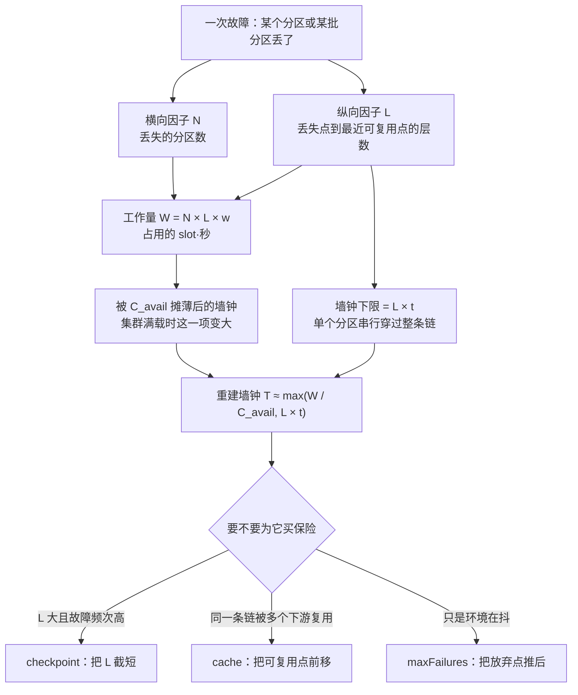
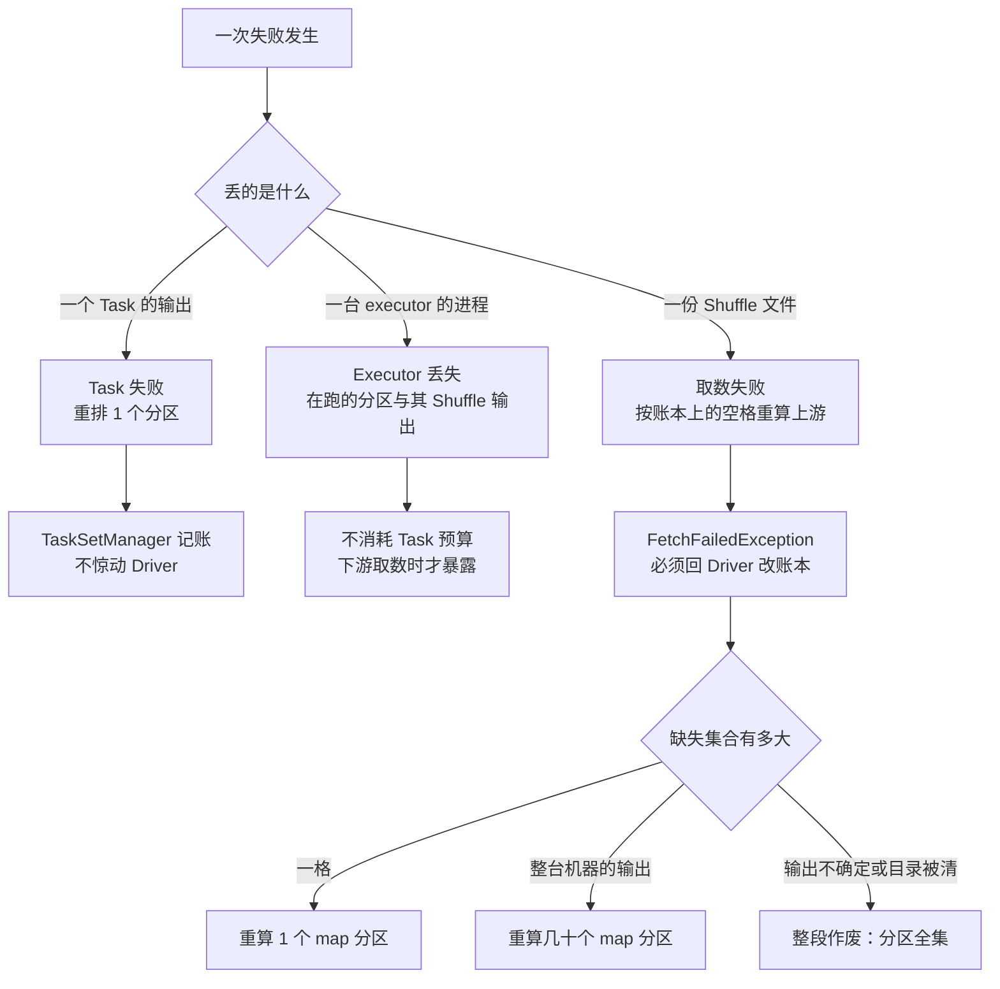
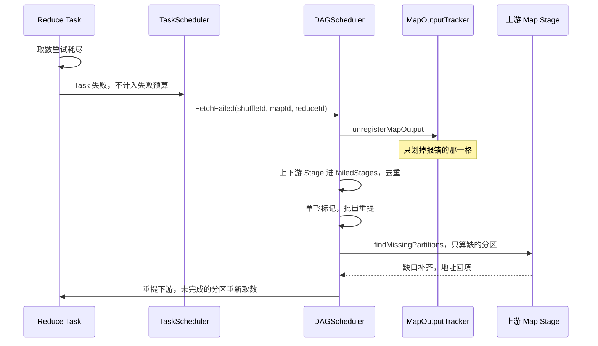
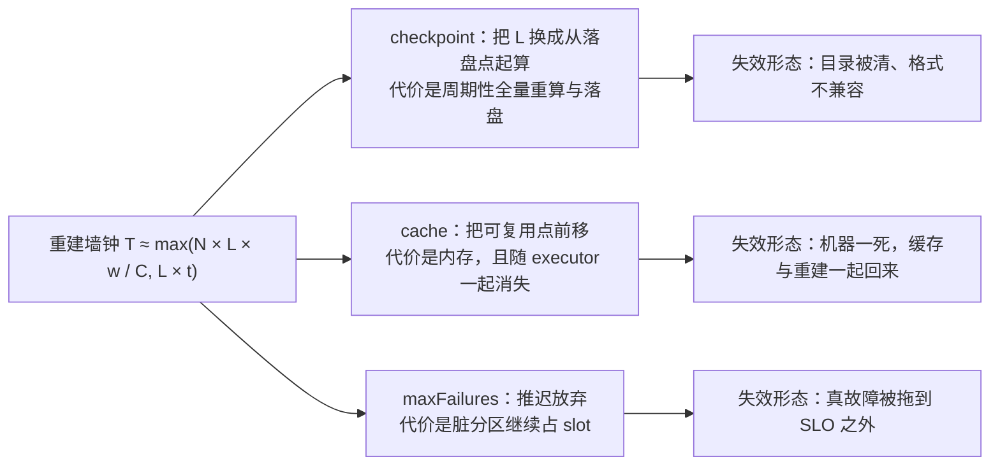
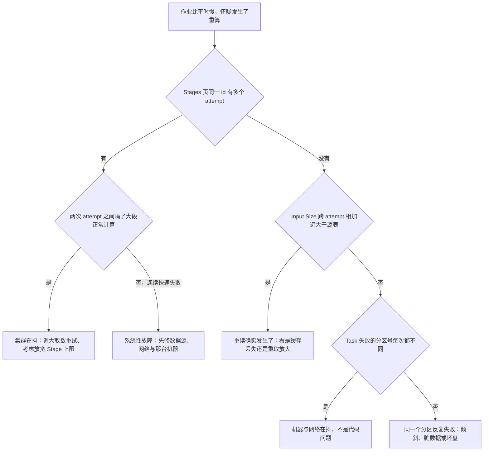
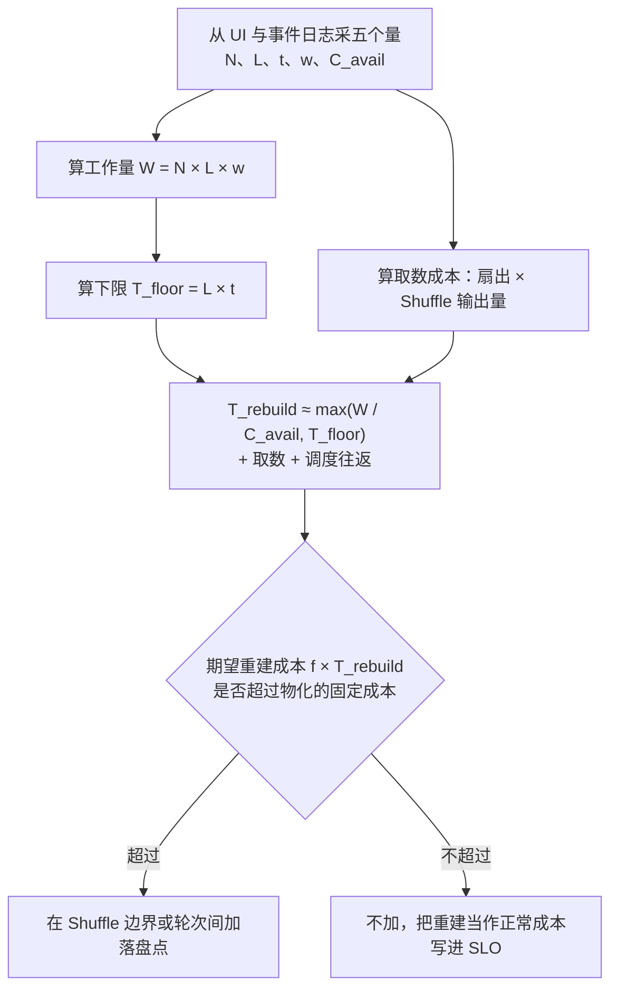

# 01 RDD Lineage 血缘容错：分布式计算的重建之道

**摘要：**

血缘（Lineage）容错把"存一份数据"换成了"记一份算法"，这个交换在论文里是优雅的，在运维台账上却是一笔要按月结算的支出。血缘怎样记录依赖、DAGScheduler 怎样按缺失分区重算，机制在内核系列已逐段拆过，本文不重讲，只回答三个问题：一次重建要多久，什么情况下重建会失败，以及怎样把重建的次数与单次成本压下来。为此先把重建成本拆成横向与纵向两个因子，**横向的重算量可以被并行度摊薄，纵向的链长不能**，所以重建的墙钟有一个由血缘长度决定的下限，而这个下限正是 checkpoint 存在的理由。接着对比三种触发——Task 失败、Executor 丢失、Shuffle 输出不可达——的重算范围与代价形态，把 `FetchFailedException` 从取数失败到上游重提的完整链条摊开，给出 `spark.shuffle.io.maxRetries` 一类参数的判据。最后落到可操作的部分：Spark UI 上怎样认出"血统重算"、`spark.stage.maxConsecutiveAttempts` 这类上限改的到底是什么、四个常见反例，以及一套标注为示例推算的估算方法。

---

## 第 1 章 重建要多久：把容错代价写成时间

### 1.1 一条告警背后的四十分钟

凌晨两点半，值班的同学收到告警：作业 `profile_agg` 的 Stage 12 连续失败三次，正在准备第四次重提。集群里同时跑着两百多个作业，Stage 重提本身算不上异常，异常的是接下来的事——这个作业重提之后又花了四十分钟，而它正常只需要二十五分钟。

要解释这四十分钟，只看"丢了多少数据"不够。故障只带走一台 executor 和它手上的 30 个 map 分区，相对 1.2 TB 的输入不过百分之几；但在重提之后的那段时间里，集群对这批重建 task 只能挤出一百多个 slot，而每一个都要把十几层算子串行走一遍。作业变慢的原因不在数据量，在"重建这条路有多长、有几条能同时走"。

### 1.2 先把范围限定住

为容错付的钱散在三张报表上：Spark UI 的 Stage attempt、事件日志里的重提记录、以及监控上那段"利用率不高"的空窗。本文把它们拼成一张时间账单。

边界先划清楚。血缘的数据结构、窄依赖与宽依赖的差异、`DAGScheduler` 怎样按 `missingPartitions` 裁剪重算范围、`FetchFailed` 的去抖与两道上限，这些机制的实现细节在 [[大数据/Spark/读书笔记-spark内核/04_存储与容错机制/4. Spark容错机制与Runtime生命周期|Spark 容错机制与 Runtime 生命周期]] 里已经逐段拆过，本文不重复。重算成本在"量"上的口径——丢失分区数、血缘长度、单分区输入量、扇出这四个乘数，以及重算账、写放大账、资源账、审计账四本账——见 [[大数据/Spark/读书笔记-spark内核/04_存储与容错机制/5. Spark错误容忍机制|Spark 容错的代价与失败模式]]。本文换的是时间口径：一次重建占用多长的墙钟、这段墙钟里集群在干什么、在哪一栏能看出来。

### 1.3 一个贯穿全文的作业画像

后面所有的算术都围绕同一个作业，先把它的参数摆出来，数字全部标注为示例推算，换一个作业只需换这张表。

| 维度 | 取值 | 说明 |
|---|---|---|
| 集群规模 | 300 节点，每节点 8 个 slot | 白天常驻两千个作业，该作业实际能拿到的并发约 100 到 200 slot，不是 2400 |
| 输入 | 200 个分区，每分区约 6 GB | 合计约 1.2 TB 明细，外加一张几十 MB 的商户维表，走广播 |
| 血缘 | 26 层算子，4 个 Stage | 从明细读入到快照写出，中间两次聚合各切一刀，剪出三个 Shuffle 边界 |
| 单层单分区耗时 t | 约 8 秒 | 含读取、反序列化、聚合、序列化，示例推算 |
| Stage 内单分区重建 | 约 2 分钟 | Stage 0 有 14 层，14 × 8 秒，示例推算 |
| 从数据源重建整条链 | 约 3.5 分钟 | 26 × 8 秒，只在可复用点被一起抹掉时才发生 |
| 正常整作业耗时 | 约 25 分钟 | 四个 Stage 依次推进，示例推算 |

这张表有一处容易读错：一个 task 并不穿过全部 26 层。Stage 0 的 task 只走它那 14 层，Stage 3 的只走 2 层，Shuffle 边界既是数据边界也是重算边界。"从数据源重建整条链"是特例不是常态，但正是这个特例决定了 checkpoint 要不要加。

### 1.4 两个因子：横向与纵向

把重建的代价拆开，会看到两个方向完全不同的因子。

横向因子是 N，丢了多少个分区，决定"要补几处"，单位是分区数。它对集群规模敏感：丢 30 个分区，有一百个空 slot 就并行补，只有十个就排队补，墙钟能差一个数量级。

纵向因子是 L，从丢失点往上游退到最近的可复用点，中间还有多少层算子。它决定"每一处要串行走多远"，单位是层。这个因子对集群规模完全不敏感：一个分区的重建必须一层一层穿过整条链，这是串行路径，再加三百个节点也不会让它变短一毫秒。

衍生出的量有三个。工作量 W = N × L × w，w 是单层单分区占用的 slot·秒；读回量是 N 乘上链上每一层输入之和，决定这次重建要把多少数据重新搬一遍；墙钟下限 L × t，t 是单层单分区的墙钟耗时。三者不能互相替代，运维真正关心的是最后一个，它决定下游要等多久。

> [!info] 一句可以直接用的话
> 横向的重算量可以被并行度摊薄，纵向的链长不能，**容错的代价与血缘长度成正比**。"加机器"能救"一次丢了太多分区"，救不了"一个分区要穿过四千层血缘"。

### 1.5 墙钟公式与它的下限

把上面的量拼起来，重建的墙钟近似为：

```text
T_rebuild ≈ max( N × L × w / C_avail ,  L × t )  +  取数成本  +  调度往返
```

式子里 C_avail 是故障时这个作业真正能拿到的并发，不是集群总 slot 数。这一项解释了一种常见困惑：同一个故障为什么白天发生比凌晨贵得多。凌晨集群空闲，C_avail 接近 N，横向因子被摊平，T 就等于下限 L × t；白天满载，C_avail 可能只有几十，横向因子放大成主导项，重建变成排队等 slot。

后半部分那个 L × t 最容易被忽略。作业从 25 分钟变成 65 分钟时，监控上会看到一段奇怪的空窗：队列里几千个 task 在等，重建的那几十个 task 在一层一层地走，占不满集群也加不了速。这段算力浪费不在账面上，却是这次故障真实成本的大头。

### 1.6 下限这一项怎样决定 checkpoint

用 1.3 的画像算一遍，三种情形摆在一起对比，差别就出来了。

| 情形 | N | L | W（slot·秒） | 下限 L × t | 重建墙钟（示例推算） |
|---|---|---|---|---|---|
| task 失败，一个分区重排 | 1 | 14 | 112 | 112 秒 | 约 2 分钟 |
| executor 丢失，30 个 map 分区 | 30 | 14 | 3360 | 112 秒 | 约 3 分钟 |
| 缓存随机器一起丢失，要从数据源重建 | 30 | 26 | 6240 | 208 秒 | 约 5 分钟 |
| 上游整段作废，缺失分区扩到 200 个 | 200 | 26 | 41600 | 208 秒 | 10 分钟量级 |

前两行的差别全在横向：N 从 1 涨到 30，W 涨 30 倍，墙钟只从 2 分钟涨到 3 分钟，因为集群并行补掉了。第三行 L 从 14 涨到 26，W 涨不到一倍，墙钟却明显变长，下限被抬高了。第四行才是坏消息：N 和 L 同时变大，W 涨到四万多 slot·秒，C_avail 再大也兜不住。

这张表解释了**checkpoint 的位置要放在链的中段**。把落盘点放在两次聚合之间，L 从 26 降到 4，下限从 208 秒降到 32 秒，工作量降八成以上，代价是每个周期一次全量物化加一次落盘。所以它从来不是"要不要用"的问题，而是"用多少次的重算，换一次落盘的确定性"的问题；机制——打标记、触发、写路径、切血缘——见 [[大数据/Spark/读书笔记-spark内核/04_存储与容错机制/6. Spark_Checkpoint机制|Spark Checkpoint 机制]]。

下面这张图把成本模型的两个因子与三个应对手段摆在一起，注意三个手段分别作用在式子的不同项上，没有一个能同时压住两项。



---

## 第 2 章 三种触发，三种重算范围

### 2.1 Task 失败：一个分区，一次排队

判据在日志里最直白：`Lost task 77.0 in stage 12.0 (TID 1234)`，配上 `numFailures` 里第 77 格加一。UI 上的表现是 Stage 的 Tasks 计数出现 failed，而 attempt 号不变——这一点很关键，attempt 号不变说明只重排了一个分区，整段 Stage 没有被提交第二次。

重算范围是一个分区，从它所在 Stage 的输入边界往上，穿过这个 Stage 内属于它的那些层。输入若来自上游 Shuffle，读的是已写在磁盘上的 map 输出，不牵连上游。墙钟是一次 task 的耗时加排队，按 1.3 的画像约 2 分钟。

三种触发里，只有这一种不会连坐。它也是唯一一种能被 `spark.task.maxFailures` 直接管住的，因为预算按分区记账（记账单位为什么是分区而不是 Task，见内核 04 册第 4 篇）。

### 2.2 Executor 丢失：这台机器上的东西一起作废

判据是 `ExecutorLostFailure`、`Container killed by ...` 一类的收尾，紧接着往往是一串 `FetchFailedException`。两者前后脚出现，容易被当成两个故障，实际是一个。

范围有两层。第一层是这台机器上正在跑的分区，几十个，重排重算；第二层是它算完写在本地磁盘上的 Shuffle 输出，几十格账本，地址全部作废。第二层要不要重算，取决于下游有没有把数据取走：已完成的下游 task 不会因为上游机器死了而重跑，只有那些"还要取数"的 task 会失败，把账单推回上游。所以这个代价**是一个区间而不是一个数**——最轻是重跑这台机器上的几十个分区，最重是上游整段重算加下游正在跑的 task 全部重取。

它还有一个容易忽略的属性：这类失败不消耗 Task 的失败预算。不稳定的机器可以无限次掉线而 `numFailures` 一直是零，作业既不熔断也不结束，唯一的收口是 Stage 级的连续失败上限。

### 2.3 Shuffle 输出不可达：账本上的空格

判据是一行 `org.apache.spark.shuffle.FetchFailedException: Failed to connect to /10.12.8.31:7337`，或者外部 Shuffle 服务场景下的 `FileNotFoundException: .../shuffle_12_45_0.data`，紧接着 Driver 侧一行 `Resubmitting failed stages`。

重算范围不是笼统的"整个 Stage"，而是账本上的空格集合。一台 executor 丢失，划掉的是它持有的那些 map 分区，几十格；一块盘坏掉，划掉的可能只是一格；Stage 被判定为输出不确定、Shuffle 目录被清理、外部 Shuffle 服务不可用，才会整段作废，`findMissingPartitions` 返回全集。判定用 Stage，执行用分区，这个粒度切换是 Stage 级容错的核心（机制见内核 04 册第 4 篇第 4 章）。

"Shuffle 文件丢要重算整个 Stage"这句话，在分区数很少的作业上近似成立，在分区数上千的作业上会高估。但高估的方向是安全的，最坏形态确实是全量：两千个分区的作业整段作废，意味着 2000 × 6 GB 共 12 TB 的重新读取，与 30 个分区的 180 GB 差两个数量级。

### 2.4 三种触发的对照

把三种触发逐项对照，差别不只是重算多少，还有谁会被连坐。

| 触发 | 判据 | 账本上划掉几格 | 重算范围 | 连坐 |
|---|---|---|---|---|
| Task 失败 | `Lost task 77.0 in stage 12.0`，attempt 号不变 | 不进 Shuffle 账本 | 1 个分区 | 不会 |
| Executor 丢失 | `ExecutorLostFailure`、`Container killed` | 该 executor 上全部 map 分区 | 在跑的分区 + 上面那些格 | 会：下游取数失败 |
| Shuffle 输出不可达 | `FetchFailedException`、`Resubmitting failed stages` | 报错的那一格到整段 | 缺失分区集合，最坏是全集 | 会：上下游两个 Stage 一起进 failedStages |

第二行与第三行常被混为一谈，因为日志顺序恰好是"先 FetchFailed，后 Resubmitting"。区分只需问一句：这台机器的 executor 还在不在。在，是单格或单盘的丢失；不在，是 executor 级连带作废。Executors 页上就有答案。

### 2.5 三者互相冒充的三种情形

三种触发在日志上互相冒充：executor 丢失被当成 Shuffle 文件丢失，于是去调取数重试；单盘损坏被当成机器抖动，于是去放宽 Stage 上限；OOM 杀掉的 executor 让一切看起来像网络问题，根因却在执行侧的内存配置。

下图把三种触发与它们的重算范围画在一起，注意第三种的落点是缺失分区集合而不是整个 Stage。



---

## 第 3 章 FetchFailedException 的完整链条

### 3.1 三种日志文本

同一个故障在三处留下三种文本，先认全。

```text
# reduce 端：重试耗尽，抛给调度器
Lost task 77.0 in stage 12.0 (TID 1234) (worker-31, executor 87):
  org.apache.spark.shuffle.FetchFailedException: Failed to connect to worker-12/10.12.8.31:7337

# driver 端：账本划掉之后，批量重提
Resubmitting failed stages

# 外部 Shuffle 服务场景：节点上的文件真的没了
java.io.FileNotFoundException: .../blockmgr-7f3a.../shuffle_12_45_0.data
```

三行分别是"我没取到"、"我改了账本"、"文件确实不在"。信息量最大的是第一行携带的三元组：哪个 Shuffle、哪个 map 分区、哪个 reduce 分区——这三个值决定了账本上划掉哪一格，也就决定了重算范围。

### 3.2 从取数失败到上游重算

链条一共七步，每一步都对应一处判据或一个配置。

1. reduce task 向某个 Map 输出发起取数，连接失败或超时后按 `spark.shuffle.io.maxRetries` 重试，耗尽即抛 `FetchFailedException`。
2. 这个失败在 Task 层被标记为不计入失败预算，直接上报 `DAGScheduler`，不走 Task 的重试预算（这类失败为什么要另行处理，见内核 04 册第 4 篇）。
3. Driver 调 `unregisterMapOutput`，把那一格地址从账本里抹掉。这一步决定了后面重算多少——抹掉一格就补一格，抹掉几十格就补几十格。
4. 上下游两个 Stage 一起进 `failedStages`，同一 attempt 的多次失败只记一次，避免一次掉线推高几十号 attempt。
5. 去抖：单飞标记保证同一时刻只有一个重提事件在队列里，于是几十条 FetchFailed 被合并成一轮重提。
6. 重提上游：`findMissingPartitions` 只返回缺的分区，不是整个 Stage。
7. 上游补齐、地址回填，重提下游；未完成的 reduce 分区重新取数，已完成的分区不重跑——下游的重算范围由 Job 的完成账本裁剪。

第 6 步与第 7 步合起来，才是这次故障真正的重算量。只看第 3 步会高估，只看日志行数会低估。这条往返的时序如下。



### 3.3 为什么这比 task 失败贵得多

这五笔账不是简单相加的。

第一笔是范围。task 失败补一个分区，FetchFailed 补的是缺失集合，几十格起步，两者的量级不同。

第二笔是串行下限。补的那几十个分区，每个都要从它所在 Stage 的输入边界重新走一遍那些层，L × t 压在那里，集群再空也压不下去。

第三笔是下游重取。重跑的 reduce task 要把全部 map 输出重新取一遍，包括从未变化过的那些。案例里 100 个 reduce task 各取 1.5 GB，就是 150 GB 传输，其中真正因重算而变化的只有 30 份、二十几个 GB，其余全是重复搬运。

第四笔是调度往返。fetch 失败要跨进程上报、去抖、重提、等 slot、再取数，秒到分钟级，这段时间上游 Stage 的 slot 空着。

第五笔最少被算进成本，却最影响结果：每次重提消耗一个 Stage attempt，连续上限一到 Job 直接失败。**Stage 重试不是免费的容错，它花的是熔断预算**；调大重试次数，等于在同一个预算池里多买几次机会，而不是把池子变大。

### 3.4 配置判据：重试几次才算够

取数相关的参数不多，但每一个都有对立面的代价。

| 参数 | 默认 | 管什么 | 调大的代价 | 调小的代价 |
|---|---|---|---|---|
| `spark.shuffle.io.maxRetries` | 3 | 一次取数失败前允许重连的次数 | 单次失败的等待变长，占着取数额度，尾延迟放大 | 网络一抖就上升成 Stage 重提 |
| `spark.shuffle.io.retryWait` | 5s | 两次重连之间的等待 | 故障确认更慢，Stage 重提被推迟 | 抖动没熬过去就开始烧上游 |
| `spark.shuffle.io.connectionTimeout` | 继承 `spark.network.timeout`，约 120 秒 | 建立连接愿意等多久 | 失联机器上挂得更久 | 慢机器被误判成死机器 |
| `spark.reducer.maxSizeInFlight` | 48m | 单个 reduce task 同时在飞的数据量 | 内存压力上去，GC 变长 | 取数并发低，尾延迟被单点拖住 |
| `spark.reducer.maxBlocksInFlightPerAddress` | 不限 | 对同一个 Map 地址的并发取数 | 打爆某台机器的网卡 | 单个地址成为瓶颈 |
| `spark.shuffle.service.enabled` | 关 | Shuffle 文件的生命周期挂在节点常驻进程上 | 需要额外部署与端口管理 | 关着则 executor 一死文件就丢 |

判据的分界线在日志里，而不在参数表里。重试之后取到了，说明是网络抖动或对端 GC 停顿，调大重试划算——等十几秒换一次不重算上游；重试到上限仍然报同一个地址，说明文件真的没了，这段等待纯属白等，还占着 reducer 的取数额度，把别的 map 输出挡在外面。前一种情形调 `maxRetries`，后一种情形去查那台机器为什么消失。

### 3.5 外部 Shuffle 服务的边界

开不开外部 Shuffle 服务，决定了"丢文件"的触发面。开了之后 Shuffle 文件的生命周期从 executor 挪到节点常驻进程，executor 重启、被杀、被回收，文件都还在，丢文件收缩到节点级故障；没开时一次 executor 被杀就带走它全部 Shuffle 输出，一次执行侧的内存配置失误于是被放大成一次上游 Stage 的重算。

还有一条同样隐蔽的路径：开启动态分配的集群按"空闲"回收 executor，而一个刚跑完 map Stage、等着下游取数的 executor 看起来很空闲——没在跑 task，磁盘上却压着几十 GB 的 Shuffle 文件。Shuffle Tracking 替 Driver 补的就是这笔账（`spark.dynamicAllocation.shuffleTracking.enabled`），关掉它，缩容就成了重算的另一个来源。

### 3.6 一次掉线不等于几十次重提

一次 executor 掉线会瞬间产生几十条 FetchFailed，日志里通常只有一行 `Resubmitting failed stages`，因为去抖把同一批失败合并成了一轮重提。判读陷阱就在这里：用 `Resubmitting` 的行数估会严重低估，用 FetchFailed 的行数估会严重高估。可靠的计量单位是 attempt 号——同一个 Stage id 有几个 attempt 就是被提交了几次。

> [!warning] 一个常被调错的旋钮
> 把 `spark.shuffle.io.maxRetries` 调到十几次，看起来在"提高容错能力"，实际是把 FetchFailed 的出现推迟一两分钟。文件真丢了，这段等待只是把失败从一分钟推到三分钟，Stage 该重提还是要重提；文件没丢，它确实救了一次重算。两种情形在日志上几乎一样，区别只在重试之后有没有取到。

---

## 第 4 章 减少重建的三个手段，各要付钱

### 4.1 checkpoint：把 L 换成 1

checkpoint 只做一件事：把"从数据源重算整条链"换成"从落盘点往后重算"。用 1.4 的模型看，它压的是 L，收益直接写在下限上——L 从 26 降到 4，下限从 208 秒降到 32 秒。

代价有三笔，第一笔最容易被漏算：触发时如果这个 RDD 没有先缓存，物化本身就是一次完整的血缘重放；已经缓存的话，这一笔退化成"从缓存读一遍再推出去"，遍历与传输一分不少。第二笔是落盘，数据量乘副本数，压缩省带宽不省遍历。第三笔是治理：目录长期累积，序列化兼容性锁住升级路径；血缘被短路后，那份文件从"备份"变成"唯一副本"——目录被清、路径写错、格式不兼容，就无处可退。

判据是拿期望值比。设这个 Stage 一次重建的墙钟为 T_rebuild，每天被故障打到的期望次数为 f，一年的重建成本就是 f × 365 × T_rebuild；checkpoint 的周期成本是物化次数乘上单次物化开销。L 越大、f 越高越划算；反过来，二十五分钟就跑完的批作业一次物化接近作业本身，除非故障一天来好几次，否则加了是净亏。真正需要它的是迭代算法与流式作业，那里的 L 随轮次增长。

### 4.2 cache：改的是重算起点，不是重建的必然性

cache 让中间结果留在 executor 的内存或磁盘上，重算时不必回到数据源。它把"最近可复用点"往前推，L 与读回量都变小，正常路径也更快。

但它替代不了 checkpoint，原因在物理位置上：缓存块与 executor 同生共死。机器一死，缓存和它本该避免的重算一起回来，L 反而从 14 跳回 26——这就是 1.6 表里第三行比第二行贵的原因。想靠缓存抗丢失，只有带副本的存储级别才有意义，代价是双倍占用加一次复制写；`MEMORY_AND_DISK` 只是换了介质，副本数还是 1。

第二个代价在内存账上：缓存占存储内存，挤占执行内存之后 spill 与 GC 都上升，作业整体变慢。容错预算与性能预算花的是同一张账单，这笔账在内核 05 册第 5 篇第 3 章算得很清楚。

判据可以压成一句话：同一条链被多个 Action 复用，或宽依赖之前有一段昂贵计算，cache 是对的；需要"跨故障仍有一个确定的重算起点"，只有 checkpoint。顺序也讲究，先 cache 再 checkpoint，物化能少走一次全量血缘重放。

### 4.3 maxFailures：改的是放弃的时点

`spark.task.maxFailures`（默认 4）按分区记账，调大它不会让重算的量减少一分，只是允许同一个分区多试几次。它对偶发环境故障有效——磁盘抖动、GC 长停顿、网络瞬断，多给两次机会就过去了。它对"这个分区在这份数据上必然算不出来"完全无效：脏记录、损坏的 Parquet 块、倾斜到几十 GB 的分区会一直反复试，占着 slot 不产出，把重算从一次性支出变成持续性支出。

还有两处连带影响。黑名单默认是关的（`spark.blacklist.enabled`），调大失败次数意味着坏机器更晚被排除；Stage 熔断也会被推后，于是作业既不成功也不失败，值班的人只能看着它转。

### 4.4 三个手段与一个变体

| 手段 | 作用在模型哪一项 | 代价科目 | 失效形态 | 适用判据 |
|---|---|---|---|---|
| 可靠 checkpoint | 把 L 截短 | 周期性全量重算 + 落盘 + 目录治理 | 落盘那份成了唯一副本，目录或格式出问题就无处可退 | L 大、故障频次高、输入不可重放 |
| `localCheckpoint` | 同样截短 L，但不落可靠存储 | 只截断血缘，不产生副本 | executor 一死，截断点一起没了 | 只为免重复计算，不指望故障恢复 |
| cache | 把可复用点前移，压 L 与读回量 | 存储内存 + 失效后回到数据源 | 缓存随 executor 消失 | 同链多 Action 复用、宽依赖前的昂贵中间结果 |
| 调大 maxFailures | 不改成本，只推迟放弃 | 脏分区占 slot、黑名单晚生效 | 真故障被拖到 SLO 之外 | 环境抖动为主、分区失败互不相关 |

四者的作用点互不重叠：**checkpoint 压 L，cache 前移可复用点但只在机器活着时有效，maxFailures 什么成本都不改**。把任意两个当成可以互换的选项，都会在故障那天发现少买了一份保险。三个旋钮的落点如下。



---

## 第 5 章 在 UI 上认出"血统重算"

### 5.1 attempt 号是唯一直接证据

同一个 Stage 被提交两次，Spark 会给它一个新的 attempt 号。这是"血统重算发生过"的唯一直接证据，其余现象都是间接推断。

看的地方有四处：Stages 页上同一个 Stage id 出现多行，每行带 attempt 序号；Jobs 页的 Stage 描述里出现 `stage 12.0`、`stage 12.1` 这样的编号；事件日志里同一个 stageId 的 `SparkListenerStageSubmitted` 出现多次（需 `spark.eventLog.enabled`，History Server 上可查）；REST 接口 `/api/v1/applications/<appId>/stages` 的返回里带 `attemptId`。

有一个坑必须提醒：`spark.ui.retainedStages` 默认 1000，长跑作业的早期 attempt 会被挤出内存，UI 上看不到不等于没发生。要判断这个作业一天被重算了几次，判据得落在事件日志上。

### 5.2 Input Size 与实际数据量的差

Stage 页的 Input Size 是这一轮 attempt 里成功 task 汇总的读入量。把同一个 Stage 每个 attempt 的 Input Size 相加再和源表比，超出部分就是重读量。按 1.3 的画像，源表 1.2 TB，某个 Stage 两轮 attempt 合计 1.8 TB，那 600 GB 就是重复读的。

Shuffle 侧同理。一个 Stage 的 Shuffle Read Size 之和，没有重取时约等于上游的 Shuffle Write 总量；跨 attempt 相加后超出的部分就是重取放大。案例里 150 GB 的重取，在报表上表现为"Shuffle Read 比 Shuffle Write 多 150 GB"。

口径要交代清楚：失败或被杀掉的 task 读过的那部分不计入汇总，所以报表给的是**下限**，真实重读只会更多。写容量报告时容易搞错方向——不是报表夸大了重算，是报表说不全。

> [!note] 一个反向用法
> 反过来也可以用它做验证：加完 checkpoint 之后，同一个 Stage 的跨 attempt Input Size 之和应当明显下降。没降，说明落盘点没打在你想的位置上。

### 5.3 三个容易被误读的现象

第一种是推测执行：同一个分区被两个 task 各算一遍，一个成功、一个 `TaskKilled`，Input Size 会翻倍，但这是重复计算不是重算，`spark.speculation` 默认还是关的。第二种是黑名单重排，只换机器，不产生重算。第三种最常见：同一条链被两个 Action 各算一遍，中间没有故障，Input Size 照样翻倍——判据是看 Jobs 页有没有两个 Job 引用同一个 Stage，而不是看数字变大就喊重算。

### 5.4 判读路径

| 现象 | 看哪里 | 说明什么 | 下一步 |
|---|---|---|---|
| 同一 Stage id 多个 attempt | Stages 页、事件日志 | 上游被重算过 | 查 attempt 之间隔了多久、缺了几个分区 |
| Input Size 跨 attempt 远超源表 | Stage 页每一行 | 发生了重读 | 判断是缓存丢失还是 Shuffle 重取 |
| `ExecutorLostFailure` 后紧跟 FetchFailed | Executors 页 + Driver 日志 | executor 级连带作废 | 查那台机器为什么消失 |
| 同一分区号反复失败 | Task 列表的 Index 列 | 数据或倾斜问题，不是机器问题 | 查该分区的数据质量与大小分布 |
| 分区号每次都不同 | Task 列表的 Index 列 | 集群在持续抖动 | 查网络与磁盘，不要调业务参数 |

下图是现场的判读顺序，从"作业变慢"往下走，每层用一个可观测的事实分流。



---

## 第 6 章 Stage 重试的上限：多给机会不等于少花成本

### 6.1 两道上限，取大者生效

Stage 级熔断有两道尺子。`spark.stage.maxConsecutiveAttempts` 默认 4，管"连续失败了几次"，成功一次就清零；`spark.stage.maxAttempts` 默认 `Int.MaxValue`，管"一共尝试过几次"，只增不减。两者不各判各的，而是取较大者共同参与判断，内部字段叫 `maxConsecutiveStageAttempts`。

取 max 这个设计很关键：各判各的话，把 `maxAttempts` 设成 2 就等于把连续上限压到 2，两个语义缠在一起；取 max 之后连续上限是硬底线，总量上限只能在它之上再加一道成本约束。

| 维度 | `spark.stage.maxConsecutiveAttempts` | `spark.stage.maxAttempts` |
|---|---|---|
| 默认值 | 4 | `Int.MaxValue` |
| 计量对象 | `failedAttemptIds` 的大小 | `getNextAttemptId` 的编号 |
| 成功时是否清零 | 是 | 否 |
| 回答的问题 | 故障是不是持续性的 | 总体成本是否还可接受 |
| 调大的代价 | 每次重提都要重跑 N × L × w 的活，支出线性上涨 | 同左，且长跑作业会在无感中攒满 |
| 调小的代价 | 一次抖动就让 Job 失败 | 长跑作业可能在正常抖动下被掐断 |

### 6.2 两个上限回答两个不同的问题

连续上限度量"故障是否持续"。一个跑八小时的作业零星重提十几次，每次之间隔着几十分钟正常计算，连续计数早已清零，上限不会命中；某个 Stage 在几分钟内连续四次失败，才说明故障是持续性的，继续重试只是把钱丢进同一个坑。

总量上限度量"总体成本是否可接受"，它是给长跑作业准备的第二道闸：即便每次失败都不连续，累计几十次重提的成本也可能超过重跑整个作业，这时候让作业早点失败、由外部重新提交反而更便宜。

### 6.3 调大它换来什么、花掉什么

换来的是"再多给几次机会"，仅此而已。**单次重建的成本一点没变**——每次重提都要把缺失分区按链长重跑一遍，调大只是把这份支出重复买几次。

花掉的有三样。集群容量：重提期间这些 slot 被占着，同队列的作业在排队。尾延迟与 SLO：熔断点后移意味着作业在交付窗口之后才失败，下游调度全部重排。排查时机：失败推得越晚，现场越难保留，机器可能已重启、日志可能已滚动。

判据可以写成两条。两次 attempt 之间有大段正常计算、缺失集合不扩大，属于抖动，放宽合理；连续快速失败、缺失集合一次比一次大、缺的分区集中在同一台机器上，属于系统性故障，收紧上限、先去修机器比放宽有用得多。

---

## 第 7 章 四个反例

### 7.1 血缘几百层却不 checkpoint

迭代算法的血缘随轮次线性增长：每轮新增十五层，三百轮就是四千五百层。中途没有落盘点，一次 executor 丢失就要从数据源把四千五百层串行走一遍，按每层 8 秒算下限十个小时（示例推算）——这不是加机器能压下来的，瓶颈是串行路径而不是并发度。

RDD 论文当年把 checkpoint 写进设计，动机正在这里：它不负责让作业更快，它负责让最坏情况有一个上界。没有上界的容错，在长跑作业上等于没有容错。

### 7.2 用 cache 替代 checkpoint

把 RDD 缓存起来，然后认为"有缓存就不用 checkpoint"，这个推理漏掉了缓存的物理位置：缓存块没有副本，executor 一死就没了，而这次死亡往往正是触发重算的那次故障——缓存和它本该避免的重算一起被带走。第二个问题是内存：缓存占存储内存，作业一大就 spill，容错的账被转到性能账上。

cache 让正常路径更快，**checkpoint 让故障路径有界**，一个管平时一个管出事，不是可以互相替代的关系。

### 7.3 把 maxFailures 调到近乎无限

把 `spark.task.maxFailures` 设成 100 的动机通常是"让作业别再失败"。后果是一串连锁：脏分区长期占着 slot 反复试，坏机器因为黑名单晚生效而继续接活，Stage 熔断被推后，作业既不成功也不失败。值班的人只能看着它转，每一分钟都在烧集群。

真正决定收敛的是数据与机器，不是这个数字：失败集中在同一个 Index 上是数据问题，散落在不同 Index 上是环境问题，两种都不该靠调大重试次数解决。

### 7.4 把取数重试当成容错能力

把取数重试调到几十次，看起来"更稳"，实际是把 FetchFailed 推后几分钟。真丢文件时，等待期间 reducer 的取数额度被占着，别的 map 输出取不进来，尾延迟变长，Stage 该重提还是要重提；没丢文件时它确实救了一次重算——但那种情况本该由网络与 GC 调优解决。

| 反例 | 现象 | 为什么错 | 正确做法 |
|---|---|---|---|
| 几百层血缘不 checkpoint | 一次丢失后作业耗时翻数倍 | 纵向因子没有上界 | 在 Shuffle 边界或迭代轮次里加落盘点 |
| 用 cache 替代 checkpoint | 掉机器后缓存与重建一起回来 | 缓存没有副本，位置在 executor 上 | cache 管平时，checkpoint 管出事 |
| maxFailures 调到近乎无限 | 作业既不成功也不失败 | 改的是放弃时点，不是单次成本 | 按分区号分布定位数据或机器问题 |
| 取数重试调到几十次 | 故障确认变慢、尾延迟变长 | 只推迟失败，不改重算量 | 先分清是抖动还是文件真丢 |

---

## 第 8 章 估算一次重建要多久

### 8.1 要采的五个量

估算不需要精确，只要能落到一句话：这个 Stage 一次最坏重建要多少分钟。为此采五个量。

| 量 | 从哪取 | 怎么用 |
|---|---|---|
| N，缺失分区数 | Stages 页的 attempt 明细、事件日志里的 `SparkListenerStageSubmitted` | 乘进工作量 |
| L，到最近可复用点的层数 | DAG 可视化里数节点，或 `rdd.toDebugString` 数缩进 | 决定下限与读回量 |
| t，单层单分区墙钟 | Stage 页 Task Duration 的中位数除以层数 | 算下限 L × t |
| w，单层单分区的 slot·秒 | 同上，乘上该 Stage 的 slot 占用 | 算工作量 W |
| C_avail，故障时段的可用并发 | 当时的 Executor 数与队列长度，不是集群总容量 | 摊销横向因子 |

用中位数而不是平均值：重建的墙钟由最大的那个分区决定，倾斜作业上平均值会低估一个数量级。

### 8.2 一次完整算例（示例推算）

用 1.3 的画像，executor 丢失带走 30 个 map 分区：N = 30，L = 14，w = 8 slot·秒，t = 8 秒，C_avail 白天约 100。

工作量 W = 30 × 14 × 8 = 3360 slot·秒，摊到 100 个 slot 上是 34 秒；下限 L × t = 112 秒，取大者 112 秒。加取数成本（100 个 reduce task 各取 1.5 GB 共 150 GB，按 8 GB/s 聚合带宽估约 19 秒，量级判断）与调度往返 30 秒，单次重建约 3 分钟。

这个数字与值班看到的"重提之后又跑了四十分钟"差一个数量级，差额来自三处：下游重新取数并重算自己那一段，150 GB 的重取在拥塞时远不止 19 秒；attempt 之间作业被别的作业挤出，C_avail 实际远低于 100，横向项成倍抬高；这一次故障也不止一次重提。单次重建的估算要乘上重提次数与下游放大，才是这次故障的账单。

把 L 换成 26（缓存随机器丢失，要从数据源重建），W 涨到 6240 slot·秒，下限抬到 208 秒；把 N 换成 200（上游整段作废），W 变成 41600 slot·秒，摊到 100 个 slot 上是 416 秒，重建墙钟在 10 分钟量级——这就是"整段作废"和"缺几十格"的差距。

### 8.3 拿估算结果去和 checkpoint 比

有了 T_rebuild 就可以做决定：把这个 Stage 一年被故障打到的次数乘上 T_rebuild，与 checkpoint 一年的物化成本比，前者大就加，否则不加。

这个比较会给出一个反直觉的结论：二十五分钟就跑完的批作业，一次物化接近作业本身的耗时，除非故障一天来好几次，否则加 checkpoint 是净亏；迭代算法与流式作业的 L 随轮次增长，物化成本相对于"最坏重建"极小，不加才是净亏。同一套机制，两种相反的结论，**决定分界的是故障频次与血缘长度**。

估算流程如下。



---

## 第 9 章 落点

血缘容错容易被误读成一句"丢了就重算，所以很稳"。真相难听一些：它把容错从"存储的确定性"换成"重算的确定性"，而重算的代价随血缘长度无界增长。一条四千五百层的链，在代码里可能只有二十行，在重算那天的台账上却是十几个小时。

由此得到的三条判据都不复杂。看清楚丢的是哪一种东西——一个分区、一台机器上的全部输出、还是一份 Shuffle 文件，三者的重算范围差两个数量级。看清楚要补的那一段有多长——L 决定下限，下限不受机器数量影响，这是唯一一个加机器救不了的因子。手上有三个旋钮，彼此不可互换。

落点仍然是那句老话：容错不是"重试到成功"，而是"把重建的成本压到 SLO 之下"。对一个凌晨跑批、二十五分钟就结束的作业，什么都不加、出事重跑一遍，可能就是最便宜的选择；对一个跑六个小时的迭代模型，不加落盘点等于把最坏情况交给运气。取舍的依据是故障分布与血缘长度，不是"容错能力越强越好"这种没有信息量的判断。

---

## 参考资料

1. Zaharia M., Chowdhury M., Das T., et al. Resilient Distributed Datasets: A Fault-Tolerant Abstraction for In-Memory Cluster Computing. NSDI 2012. [https://www.usenix.org/system/files/conference/nsdi12/nsdi12-final138.pdf](https://www.usenix.org/system/files/conference/nsdi12/nsdi12-final138.pdf)
2. Apache Spark 官方文档：Configuration（各级重试与取数参数的默认值与语义）。[https://spark.apache.org/docs/latest/configuration.html](https://spark.apache.org/docs/latest/configuration.html)
3. Apache Spark 官方文档：Tuning Spark（序列化、内存与并行度对重算成本的影响）。[https://spark.apache.org/docs/latest/tuning.html](https://spark.apache.org/docs/latest/tuning.html)
4. Apache Spark 官方文档：Web UI（Stages、Executors 页的字段口径与 attempt 编号）。[https://spark.apache.org/docs/latest/web-ui.html](https://spark.apache.org/docs/latest/web-ui.html)
5. Apache Spark 源码：`org.apache.spark.scheduler.DAGScheduler`（`handleTaskCompletion`、`resubmitFailedStages`、`stageAbortReason`）。[https://github.com/apache/spark/blob/master/core/src/main/scala/org/apache/spark/scheduler/DAGScheduler.scala](https://github.com/apache/spark/blob/master/core/src/main/scala/org/apache/spark/scheduler/DAGScheduler.scala)
6. Apache Spark 源码：`org.apache.spark.MapOutputTracker`、`org.apache.spark.shuffle.RetryingBlockTransferor`（取数重试与地址作废）。[https://github.com/apache/spark/tree/master/core/src/main/scala/org/apache/spark](https://github.com/apache/spark/tree/master/core/src/main/scala/org/apache/spark)

---

> [!note] 思考题
> 1. 1.5 的墙钟公式里，下限 L × t 与集群规模无关。如果一个作业的 SLO 是"两小时内跑完"，而它的最坏重建下限已经接近两小时，还有哪些手段能把最坏情况压下来，代价分别落在谁身上？
> 2. 一次 executor 丢失在日志上常常先表现为 FetchFailed。如果只看日志行数而不看 attempt 号，会把这个故障的代价估高还是估低，为什么？
> 3. 案例里的作业二十五分钟跑完，加 checkpoint 是净亏；换成三百轮迭代的模型，结论相反。决定这个分界的量是哪几个，它们各自怎么测？
> 4. 调大 `spark.shuffle.io.maxRetries` 与调大 `spark.task.maxFailures`，一个盯的是取数链路，一个盯的是分区预算，两者在什么故障形态下会互相掩盖，导致真正的根因被推后很久才暴露？
> 5. 如果你的作业在 UI 上显示同一个 Stage 有很多个 attempt，但 Input Size 几乎没有增长，最可能的解释是什么？这时该查哪一页？