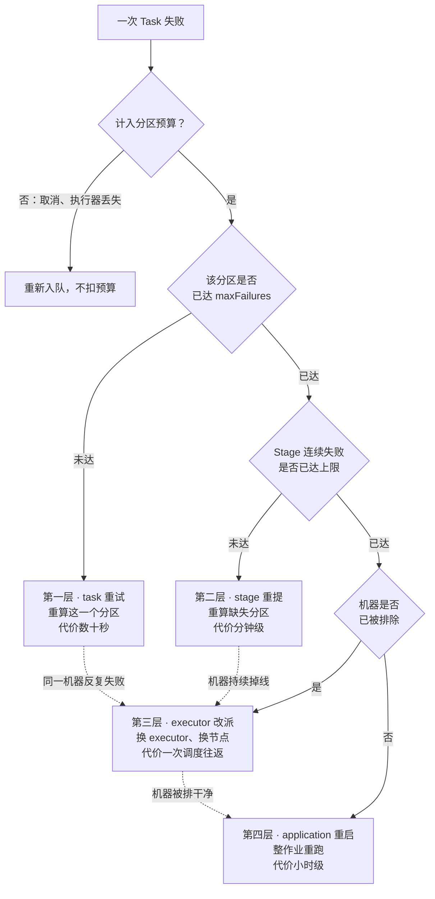
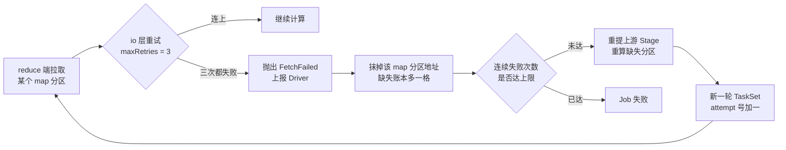
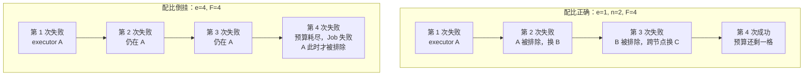
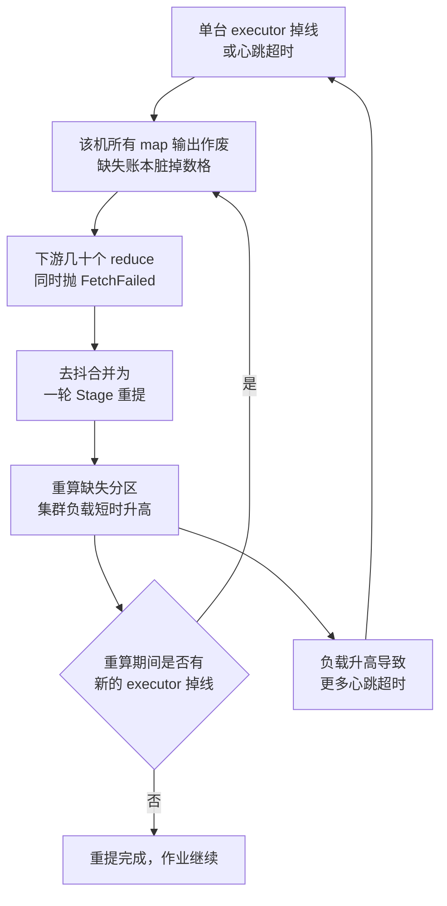
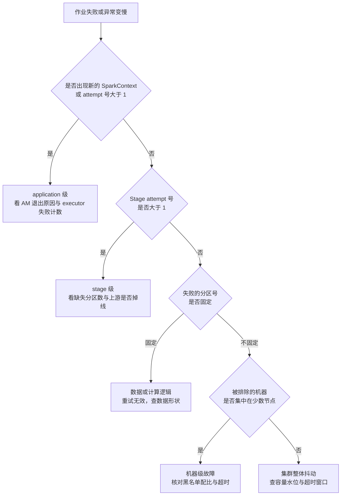

# 02 Task 与 Stage 的多级重试机制

**摘要：**

重试是容错体系里最容易被当成免费午餐的一层。机器会坏、网络会抖、磁盘会慢，所以失败就再跑一次——这套直觉在单机程序里成立，在一套按秒计费、按 slot 排队的集群上不成立。本章把重试当成有配额的预算来读，按"重算什么"切成四层：task 级重算一个分区，stage 级重算缺失的那几个分区连同上游 Shuffle，executor 级换一台机器，application 级把整个作业从零再跑一遍。

四层各有配置项，而四个默认值之间藏着一组没人明写的配比：`spark.task.maxFailures` 给分区四次机会，黑名单的 `maxTaskAttemptsPerExecutor` 只给同一分区在同一台机器上一次机会。前者是预算，后者是路线，路线不通时预算再多也是空转。这个配比一旦倒过来，重试就从修复动作退化成时间税。

本章还要回答另一半问题：什么情况下重试会越试越糟。数据本身有问题时，重试只是把一次确定的失败摊成四次；机器只是慢而不是坏时，黑名单会把还能干活的机器一起踢掉；到了 `FetchFailedException`，一次重试会反过来要求上游重算几十个分区。判据因此不是"重试几次合适"，而是**重试的成功率会不会随次数上升**。

---

## 第 1 章 四个默认值写下的前提

### 1.1 上限不是算出来的

翻 Spark 的容错配置会发现一个耐人寻味的现象：四层重试的默认上限反复出现 4、2、1 这几个很小的整数，而它们之间没有任何一条公式联系起来。task 级给四次尝试，stage 级给四次连续失败，YARN 侧给两次应用尝试，黑名单把"同一分区在同一台机器上失败两次"当成换机器的信号。这些数字是十余年里从事故中攒出来的经验值，默认了一个前提：故障是偶发的、彼此独立的、与数据无关的。前提在多数日子里成立，默认值看起来就一直很好；一旦变了，比如一批 Spot 实例在同一分钟被回收，或者几个分区大到能把 executor 撑爆，这组数字就会同时朝坏的方向合力，把一次局部故障放大成一次作业失败。

重试怎么实现的那一侧——`handleFailedTask` 的三段主干、`countTowardsTaskFailures` 的取舍、Stage 重提的三层去抖——在 [[大数据/Spark/读书笔记-spark内核/04_存储与容错机制/4. Spark容错机制与Runtime生命周期|Spark 容错机制与 Runtime 生命周期]] 里已按判据与动作逐层拆开，本文不复述。这里只问四件事：各层重算什么、代价量级差多少、阈值之间该保持什么比例、什么时候应当干脆不重试。

### 1.2 按"重算什么"切四层

把四层并列摆出来，最要紧的一列不是配置项，而是"重算什么"。同样是"再试一次"，四层动用的资源差着数量级。

| 层级 | 生效配置 | 默认值 | 重算什么 | 由谁判定 | 单次代价量级（示例推算） |
|---|---|---|---|---|---|
| task 级 | `spark.task.maxFailures` | 4 | 该分区的计算，一条血缘链算到该分区 | `TaskSetManager` | 一个分区耗时，数十秒 |
| stage 级 | `spark.stage.maxConsecutiveAttempts` | 4 | 账本上缺失的那些 map 分区，连同上游 Shuffle | `DAGScheduler` | 缺失分区耗时之和，分钟级 |
| executor 级 | `spark.excludeOnFailure.*` | 关闭 | 不重算，只改派；失败分区换机器再试 | `TaskSchedulerImpl` 与排除账本 | 一次调度往返，秒级到数十秒 |
| application 级 | `spark.yarn.maxAppAttempts` | 跟随 YARN 全局配置 | 整个作业从读取开始全量重跑 | 集群管理器，Spark 侧只提请求 | 整个作业墙钟，小时级 |

第一行与第二行的差别常被含糊过去：task 重试是"这一格重画"，stage 重提是"这一片重画"，第三行根本不重画，只换一支笔。这个区别决定了黑名单的性质——它不是重试，而是重试的路由策略，阈值只能与 `maxFailures` 比大小。

下面的图把四层按"触发概率递减、代价递增"排成一道漏斗，虚线是层与层之间真正的耦合路径。



三条虚线的用法是反向的：作业慢而不死，虚线通常在起作用；作业反复失败，箭头往往已经走到底了。

### 1.3 与机制篇的分工

内核系列按"谁在判"切过一遍：Task、Executor、Stage、Job、Driver 五级，落点是指挥链与 Runtime 生命周期。本文按"重算什么"切，得到 task、stage、executor、application 四级，落点是配置配比与代价。两刀切出来的边界并不重合，最明显的一处是 application 一级：在内核篇里它是"Driver 那道不可恢复的悬崖"，在本文里它是一个可配置、可观测、可以刻意关掉的重试层级。

重试"量"的那一侧——丢失分区数、血缘长度、扇出怎样相乘——在 [[大数据/Spark/读书笔记-spark内核/04_存储与容错机制/5. Spark错误容忍机制|Spark 容错的代价与失败模式]] 里用四本账算过，本文只取结论当常数，不复述推导。

### 1.4 换邮差，还是改地址

把重试想成投递失败后的二次派送。快递公司能做的有两件事：换一个邮差再送一次，或者认定地址本身写错了，退回去让寄件人核对。换邮差解决"这个人今天走错了路"，改地址解决"信封上写的就是错的"，两者在成本与收效上毫无可比性。

Spark 的四层重试都在做换邮差。体系里没有改地址的机制，没有哪个开关能说"这个分区跳过吧"。这个缺失不是疏忽，跳过分区会让结果悄悄少一块，比作业失败更危险；但它意味着**当失败原因落在数据那一侧时，四层重试全部失效**。

### 1.5 一个贯穿全文的集群

为了让算术有对象，笔者设一个场景：某离线数仓集群 300 个节点、日均提交约 2000 个作业，跑在 YARN 上。核心作业 `user_tag_daily` 每晚读两张 ODS 表做 join，再按用户维度聚合打标，两次 Shuffle，输出两千个分区，正常四十分钟跑完。两千个分区足以让分区级重试的统计效应显现，四十分钟又长到任何一次 Stage 重提都会被下游感知，后文的算例都落在它身上。

---

## 第 2 章 task 级：预算按分区记

### 2.1 四次尝试，不是四次重试

`spark.task.maxFailures` 默认 4，常被口头说成"最多重试四次"，这个说法错了一格。计数在失败之后自增，自增到与上限相等时就地把整个 TaskSet 判死，所以四次是尝试总数：第一次运行加三次重试。日志里 `Task 77 in stage 12 failed 4 times; aborting job` 的 4，含义是"已经失败了四次"。

这个偏差在调参时会被放大。想"多给一次机会"就把 4 改成 5，实际增加的是第五次尝试，成本是一轮排队加一轮重算；想把容错关掉就改成 1，实际效果是任何一次计入预算的失败都直接让作业失败，连一次重试都没有。

### 2.2 计数归属：一格一格记，互不挪用

失败次数按分区累计，这是整套重试逻辑的记账基础。一个两千分区的 Stage，如果每个分区各失败一次，计数器里两千格都停在 1，没有一格达到 4，于是这个 Stage 一次都不会熔断——它在 UI 上显示成"两千个 Task 失败后又成功"，作业照常结束。反过来，如果一个分区连续失败四次，熔断立刻发生。

同一个参数在同一种失败分布下表现出相反的后果，靠的就是"计数按格"这个设计。下表把两种形态并列，这也是排查时最该先分清的一件事。

| 失败分布形态 | 计数器形态 | Stage 是否熔断 | 结局 | 判定含义 |
|---|---|---|---|---|
| 两千个分区各失败一次 | 两千格各为 1 | 否 | 成功，耗时被拖长 | 集群持续抖动，问题在机器与网络 |
| 一个分区失败四次 | 一格为 4 | 是 | Job 失败 | 数据或逻辑有问题，重试无解 |
| 一个分区三次、另一个两次 | 最高格为 3 | 否 | 成功，但反复重排 | 局部劣化，通常是单机或单盘 |
| 大量分区失败后在别处成功 | 多格为一到二 | 否 | 成功，Stage 耗时翻倍 | 一批机器同时劣化，看黑名单是否开启 |

第二行是本章最要紧的一条：**一个分区能把整个 Stage 拖死**。两千个分区里出问题的概率并不低，只要有一个分区的数据形状特殊——单条记录超过序列化缓冲、字段类型与 schema 不符、join 键在一侧缺失——它每次都会失败，四次之后 Stage 熔断，前面四十分钟白跑。

### 2.3 哪些失败不扣预算

不是所有失败都消耗这四格。判断依据写在 `TaskFailedReason` 的 `countTowardsTaskFailures` 字段上，执行器丢失、任务被取消、输出提交被拒这三类都不扣预算，但照样重新入队。这条区别在排查时极有用：executor 反复掉线的集群上，日志里失败行非常多，计数器却一直是零，作业跑很久都不熔断，只是变慢。

### 2.4 调大与调小的代价

| 参数动作 | 换来什么 | 调大与调小的代价 | 适用前提 |
|---|---|---|---|
| `maxFailures` 由 4 调到 8 到 10 | 偶发的、与机器相关的失败更容易熬过去 | 确定性失败暴露时间翻倍；毒分区每次运行多烧四到六轮重算 | 失败原因确认为机器相关且偶发，且已开黑名单 |
| `maxFailures` 由 4 调到 1 到 2 | 失败暴露快，不浪费时间 | task 级容错基本关闭，一次抖动即上升为 Job 失败 | 调试期，或数据质量已有强校验 |
| 保持 4，只改黑名单阈值 | 同样预算内换更多机器试，成功率上升而预算不变 | 多维护一套排除账本；误排除损失容量 | 失败与机器强相关，集群规模够大 |

第三行是本文的立场：默认值够用，前提是背后还配着一套换机器的路线。把**路线**修好，比把**预算**加大划算得多。**

### 2.5 一次重试花多少钱

一次 task 重试的成本有三段。第一段是排队，失败的分区重新入队后要等空闲 slot，在 300 节点、常态几十个作业排队的集群上，这段等待从几秒到几十秒，完全取决于当时负载。第二段是重算，也就是这个分区从最近的可恢复点算到出结果的时间，对 `user_tag_daily` 这种带两次 Shuffle 的作业，单分区重算会连带触发上游对应分区的重算，量级数十秒。第三段是本地性降级带来的额外读取，原节点挂掉之后数据要走网络。三段相加，一次 task 重试在数十秒量级（示例推算）。四次尝试就是两三分钟，一个分区失败一次与失败四次之间的差额，往往就是下游看到的延迟抖动。

---

## 第 3 章 stage 级：重提不是"再试一次 Stage"

### 3.1 两道上限，取 max 的关系

Stage 级有两把尺子。`spark.stage.maxConsecutiveAttempts` 自 2.2.0 起存在，默认 4，度量"连续失败了几次"，Stage 成功一次就清零；`spark.stage.maxAttempts` 自 3.5.0 起存在，默认 `Int.MaxValue`，度量"一共尝试过几次"，编号只增不减。两者不是各判各的，而是先取较大值再参与判断：连续上限是硬底线，总量上限只能在它之上再加一道，不能把它放松。

这个键在不少内部规范与老文档里被简写成 `maxFailure`，grep 配置时两种写法都会撞见，真正生效的是 `maxConsecutiveAttempts`。

连续与总量的区别在运维里很实在。一个跑八小时的作业，中间因 executor 抖动零星重提十几次，每次之间隔着几十分钟正常计算，连续上限不会命中，因为每次重提后 Stage 都成功过，账清零了；但某个 Stage 连续四次在几分钟内失败，说明故障是持续性的，继续重试只是把同一次失败重演。

### 3.2 重算范围由缺失账本决定

"Stage 重试就是重算整个 Stage"是流传最广的一句错话。`submitMissingTasks` 一进来只问一件事：这个 Stage 这次要算哪些分区。ShuffleMapStage 去问 `MapOutputTracker` 还有哪些 map 分区没有地址，ResultStage 去看本次 Job 的完成标记取反。首跑返回全集，重提只返回被划掉的那几格。

这句话错得有市场，是因为它的最坏情况确实等于全量。三种情形会让缺失账本一次划掉一大片：整台机器消失，该机上所有 map 输出同时作废；Stage 被标记为输出不确定，重提前整体回滚，缺失集合直接变成全集；缺失的那格恰好是全 Stage 最大的一个，重算它一个的代价超过其余全部。判断一次重提贵不贵，看的不是 Stage 有多少分区，而是这次脏了多少格。

### 3.3 调大上限只抬高天花板

这是本章的核心判据：`maxConsecutiveAttempts` 从 4 调到 10，改的是"最多允许失败几次"，不是"每次失败便宜一点"。单次重提的成本一分没降，只是把可承受的总损失抬高了。

算一笔账。设单次重提的代价是六分钟（示例推算：两千分区里三百个缺失，每个平均一点二秒），作业总预算四十分钟。上限为 4 时最坏允许烧掉二十四分钟；调到 10 之后最坏允许烧一小时，作业墙钟直接翻倍，而它最终能否成功完全取决于第 7 到第 10 次重提时故障是否已经消失。故障若是"某台机器网络间歇丢包"，抬高上限确实有用；故障若是"上游 Shuffle 所在的磁盘阵列降级"，抬高上限只是让作业在失败之前多跑一小时，可观测上的效果是失败来得更晚、更难归因。

### 3.4 Fetch 失败的两层重试

`FetchFailedException` 是唯一必须回到 Driver 处理的 Task 失败，但它的前置还有一层网络重试：reduce 端拉取某 map 分区时，先按 `spark.shuffle.io.maxRetries`（默认 3）与 `spark.shuffle.io.retryWait`（默认 5 秒）自行重试，三次都失败才抛出异常，再由 `DAGScheduler` 决定是否重提上游。

两层的关系常被混淆。网络层重试很便宜，它不重算任何东西，只是等一会儿再连一次，代价约十几秒；Stage 层重提很贵，它要重算上游分区。调大 `maxRetries` 是用零重算成本的等待去换免于一次昂贵重提的机会，调大 `maxConsecutiveAttempts` 则是用昂贵重算硬扛。前者通常更划算，除非失败原因根本不是瞬时抖动。



这条回路每转一圈代价都在放大：重算期间若又有机器掉线，第二圈要补的分区会比第一圈更多，因为上一圈刚算好、还没被下游读走的输出也一并作废。

---

## 第 4 章 executor 级：黑名单的四个阈值与配比

### 4.1 黑名单不是重试，是改派

黑名单（`spark.blacklist.*`，3.1 起更名为 `spark.excludeOnFailure.*`，旧键以弃用别名形式保留，以对应版本文档为准）一次计算都不重做，它把"下一次尝试落到哪台机器"这个决定从随机改成有记忆：某台机器上同一个分区已经失败过，就别再往那儿派。

性质不同，讨论方式就不同。重试的阈值要和作业能承受的损失比，黑名单的阈值要和重试的预算比，因为**黑名单唯一的价值是在预算被同一台坏机器吃光之前把它排除掉**。

### 4.2 四个阈值，两个口径

| 配置项 | 默认值 | 计量对象 | 触发后的效果 | 调小的代价 | 调大的代价 |
|---|---|---|---|---|---|
| `task.maxTaskAttemptsPerExecutor` | 1 | 同一分区在同一 executor 上的尝试次数 | 该 executor 不再接收这个分区 | 一次抖动就换机，本地性丢失 | 坏机器多吃预算，重试空转 |
| `task.maxTaskAttemptsPerNode` | 2 | 同一分区在同一节点上的尝试次数 | 该节点不再接收这个分区 | 多 executor 节点被过早放弃 | 节点上第二个 executor 仍在试错 |
| `stage.maxFailedTasksPerExecutor` | 2 | 一个 Stage 内该 executor 上失败的任务数 | 整个 Stage 不再用这个 executor | 繁忙节点被误排除，容量损失 | 坏节点在 Stage 内持续消耗算力 |
| `stage.maxFailedExecutorsPerNode` | 2 | 一个 Stage 内该节点被排除的 executor 数 | 整个节点在 Stage 内不可用 | 大节点过早整机下线 | 内存有问题的机器只被局部排除 |

前两行与后两行的口径完全不同，这是最容易搞错的地方。前两行按分区记：某个分区在这台机器上试了几次；后两行按 Stage 记：这台机器在这个 Stage 里总共害了几个任务失败。前者回答"这个分区该不该换地方"，后者回答"这台机器该不该整体停用"。

口径差异对应故障形态。单分区毒数据只触发前两行，换机器没用，它到哪都失败，最终把四格预算耗光；机器级故障很快触发后两行，因为这台机器上任何任务都不稳定。看到分区号固定就往第一组看，看到任务号四处开花、机器号固定就往第二组看。

### 4.3 配比判据：必须比预算更早触发

现在可以把两本账摆到一起。设 `F` 为 `spark.task.maxFailures`（默认 4），`e` 为 `maxTaskAttemptsPerExecutor`（默认 1），`n` 为 `maxTaskAttemptsPerNode`（默认 2）。

一个分区在整个预算期内的失败次数上限是 `F`。要让黑名单在预算被吃光之前起作用，必须 **`e < F` 且 `n < F`**。默认值满足且宽松地满足：`e = 1` 意味着同一分区在同一台机器上的第二次尝试已经被换走，`n = 2` 意味着它在同一节点上最多失败两次就必须跨节点。四次预算因此可以摊到至少两台节点、三台 executor 上。

把这个关系倒过来看，就知道什么配置是白开的。假如把 `e` 也设成 4，同一分区要在同一台 executor 上失败四次才会被换走，而四次正好是预算的全部——黑名单在预算耗尽那一刻才动手，等于从未生效。这不是极端假设：把 `maxFailures` 从 4 调到 100 的集群上，如果不同步下调 `e`，得到的就是这种配比，一百次机会里前几次全在同一台坏机器上烧掉。

反过来还有一个上界。`e` 最小是 1，也可以把 `n` 调到 1，让分区一次失败就跨节点，代价是任何瞬时抖动都触发跨机重算。判据可写成一条经验比例：`F / e` 不应超过集群可用 executor 的合理份额。默认 4/1 在 300 节点上毫无压力；在只有 6 个 executor 的小集群上，一个分区可能试遍一半容量，反而把仅有的几台机器都染上嫌疑。



第二条路径的荒谬之处在于，排除动作发生在结果已经没有意义之后，它唯一的作用是让复盘时日志里多一行 `executor excluded`，容易被误读成机制生效了。

### 4.4 三个连带配置

`enabled` 默认为假，这决定了本章所有讨论在默认配置下都不发生，第三层是关着的。开启它的动机很明确：只要集群偶发机器级故障，这一层的收益就大于维护成本。

`timeout` 默认一小时，被排除的 executor 与节点一小时后自动解禁。这个值要跟故障的持续性对齐：硬件坏掉等运维换件，一小时够；网络分区这类会自行恢复的故障，一小时太长，排除期内的容量白损失；云上 Spot 批量回收，十几分钟就够，因为那批机器不会再回来。

`killExcludedExecutors` 默认为假，被排除的 executor 并不会被杀，只是不再接收新任务，已跑着的任务继续跑完。开启之后容量才真正释放，但回收动作是否计入集群管理器的 executor 失败上限，要在自己版本上核对——这条直接决定 application 级的上限会不会被排除动作自己顶穿。

### 4.5 阈值的取舍与规模效应

| 调整方向 | 收益 | 风险 | 前提 |
|---|---|---|---|
| `e` 由 1 调到 2 | 减少因一次瞬时失败就跨机的本地性损失 | 坏机器多消耗一格预算 | 网络抖动频繁、本地性敏感 |
| `stage.maxFailedTasksPerExecutor` 调到 3 到 4 | 避免繁忙节点被少量偶发失败误排除 | 坏节点在 Stage 内多害几个任务 | 单机 executor 多、Stage 任务数大 |
| `timeout` 由 1 小时调到 15 分钟 | 排除期容量损失更小 | 未修复的机器很快解禁，故障复现 | 故障多为瞬时，修复由编排层自动完成 |

---

## 第 5 章 application 级：整作业重启是谁的权力

### 5.1 最粗的一层不在 Spark 手里

`spark.yarn.maxAppAttempts` 控制 ApplicationMaster 的尝试次数，默认跟随 YARN 侧全局配置 `yarn.resourcemanager.am.max-attempts`（社区默认 2，以集群侧配置为准）。这一层的特殊之处在于**判断与动作都不在 Spark 进程里**：AM 死了，Spark 侧没有代码在跑，是 ResourceManager 决定要不要再拉起一次，Spark 只能提交"我希望最多试几次"的请求，且不能超过 YARN 的全局上限。

它算作第四层的理由是它确实在重试，而且是最贵的一种。AM 重启不是断点续跑：新 AM 会重建 `SparkContext`、Stage 图与 Shuffle 账本，之前算完的 Stage 全部作废，机制细节见内核篇第 6 章与第 7 章。结论是**application 级重试的代价约等于作业全量重跑**，次数上限该按"作业可承受的总时长"来设。

### 5.2 executor 失败上限与它的窗口

YARN 模式下还有一个与重试直接耦合的上限：`spark.yarn.max.executor.failures`，控制 AM 在杀掉整个应用之前容忍多少个 executor 失败，默认按申请的 executor 数量推算（申请数乘二，最少三个，以对应版本文档为准）。配套的窗口参数决定失败计数是否随时间重置。

这组参数与黑名单之间有一条隐蔽的因果链。黑名单把机器排除、任务重新排队、新 executor 被申请、又一台机器被排除；如果排除后的回收被计成 executor 失败，一个坏机架可以在几分钟内把失败计数顶到上限，AM 主动退出，application 级重试被触发，整个作业从头再来。排除机制本意是止损，配比不当反而成了触发最贵那层重试的扳机。

算一笔量级账。300 个 executor 的集群，上限约六百次失败（示例推算）。一次机架级故障可能同时带走二十台机器，每台都计一次失败就是二十次，五六次这样的抖动就能把上限顶穿。判断这条链是否成立，看 AM 日志里失败计数的增长曲线：如果退出原因写着 executor 失败数超限，而同期排除日志很密集，就成立。

### 5.3 四级代价的对照

| 层级 | 单次代价（示例推算） | 恢复的粒度 | 什么时候值得 |
|---|---|---|---|
| task 重试 | 数十秒 | 一个分区 | 失败偶发、与机器相关 |
| stage 重提 | 分钟级 | 缺失分区集合 | 上游输出丢失，且缺失范围小 |
| executor 改派 | 秒级到数十秒 | 不重算，只换落点 | 失败与特定机器相关 |
| application 重启 | 小时级 | 全量 | 故障已排除，且重跑比修更快 |

---

## 第 6 章 越重试越糟：三种情形

### 6.1 数据本身有问题

第一种情形最直白：失败原因是确定性的，重试的成功概率为零。

判据可以收敛成四条：同一个分区号反复出现；失败分布跨越三台以上不同机器；异常类型与堆栈每次都相同；重算耗时与首次运行基本一致。四条同时成立，基本可判定为数据或计算逻辑问题，再试一百次也是同一个结果。

这类失败消耗的不是重试次数，而是时间。四格预算意味着同一份脏数据要被完整解析失败四次，每次都要经历排队与重算。两千分区的 Stage 上，一个毒分区可以把作业从四十分钟拖到一个半小时，最后依然失败；把 `maxFailures` 调成 1，这个作业会在第一次失败时立刻报错，四十分钟就拿到明确的失败信号。

正确的处理不在重试参数上，而在数据入口：schema 强校验、超长记录预检、join 键空值过滤。这些动作放在读取之后、Shuffle 之前，成本是每个分区多一次扫描，收益是把"每次运行随机失败"变成"每次运行确定地知道哪几条记录有问题"。

### 6.2 机器慢而不是坏

第二种情形更隐蔽：机器没有坏，它只是慢。磁盘老了、带宽被同机其他进程吃掉、CPU 被邻居容器挤占，任务没有失败，只是比同类任务慢三到五倍。

黑名单的判据在这里会误伤，它**只看失败率，不看时长**。一台健康但繁忙的节点因承载更多任务而累计更多失败，会被优先排除；一台安静但缓慢的节点因任务少、失败也少，一直留在池子里。排除之后容量下降，剩余节点负载更重，失败更多，下一轮排除更激进——这是一条自我强化的退化回路。

判断这条回路是否启动，看三个量：被排除的 executor 数量随时间的变化、排除发生前后的平均任务时长、剩余容量的水位。如果排除数量在上升而平均时长没有下降，说明排掉的不是病因。

### 6.3 Fetch 失败与重算放大

第三种情形最贵：`FetchFailedException` 触发的重试会放大故障。

一次 executor 掉线会在几十个 reduce 任务上同时引发取数失败，因为那台机上的所有 map 输出同时不可达。去抖会把它们合并成一轮重提，但若重提期间又有机器掉线，第二轮算出的输出还没被下游读走就又作废了。放大倍数取决于两个量：单机上承载的 map 分区数，以及从产出到被消费的时间窗。

`user_tag_daily` 这类带两次 Shuffle 的作业，第一个 Shuffle 有两千个 map 分区分布在三百台机器上，单机平均七格。一次掉线脏掉七格，重算七格；如果掉线发生在 reduce 阶段刚开始时，第二个 Shuffle 还没产出可复用的中间结果，这七格的重算会连带把对应的 reduce 分区重算一遍。一次几秒钟的 GC 停顿造成的误判掉线，可以换来几分钟的重算。



断开这个环的办法不在重试参数上，而在两处：把 Shuffle 输出从 executor 生命周期里摘出去（外部 Shuffle 服务或远端 Shuffle 服务），以及把心跳超时窗口按 GC 停顿的现实调宽。前者消除"机器掉线即数据丢失"这个前提，后者减少误判。

### 6.4 一条共同的判据

三种情形指向同一条判据：重试的价值取决于**成功率是否随次数上升**。

偶发的、与机器相关的失败，第一次说明环境有问题，换机器成功率显著上升，重试划算。确定性的数据失败，每次都是同一结果，成功率恒定为零，重试纯粹是时间税。慢机器导致的失败，成功率随集群负载波动，比"重试几次"更重要的是"换机器的规则对不对"。

---

## 第 7 章 推测执行也在花同一份预算

推测执行（Speculative Execution）常被当成与重试并列的另一种容错手段，但从预算角度看，它是重试的消费者。副本执行失败会走同一条失败处理路径，同样按分区计入 `numFailures`，同样消耗那四格预算。

这条关系在配比上有直接影响。开启推测之后，一个分区的尝试次数不再只由失败驱动，还由"太慢"驱动。设 `spark.speculation.multiplier` 为 1.5、`quantile` 为 0.75，一个 Stage 里可能有四分之一的分区被判定为慢并启动副本，副本若失败，预算照扣。在高失败率环境下，副本与重试叠加，预算消耗速度接近翻倍——原本能撑四次的预算，可能两次实质失败之后就耗尽了。

---

## 第 8 章 从症状到层级

### 8.1 一张排查表

四层在运维中的表现差别很大，症状与层级之间的映射相对稳定。下表按"看到的第一个异常"组织，最后一列是区分本层与下一层的判据。

| 症状 | 先看哪里 | 归属层级 | 区分判据 |
|---|---|---|---|
| 作业反复重启，每次从零开始 | YARN 应用页 attempt 列表、AM 退出原因 | application 级 | attempt 号大于 1，每次在不同阶段失败，日志里没有 Stage 连续失败记录 |
| 某 Stage 的 attempt 号持续增长 | Stages 页 attempt 表、`Resubmitting failed stages` 日志 | stage 级 | 同一 Stage 有多个 attempt，且每次 Task 数不同（缺失集合在变） |
| 同一分区号反复失败 | Task 详情页按分区号过滤 | task 级 | 分区号固定，Stage 总分区数不变，堆栈每次都相同 |
| 大量分区各失败一两次又成功 | Executors 页 Failed Tasks 列 | task 级，集群抖动 | 失败分散、无固定分区号、执行器数量在波动 |
| executor 反复被排除 | Executors 页排除标记、黑名单日志 | executor 级 | 被排除的多是同一批机器或同一机架，作业变慢但仍推进 |
| 作业慢而不死，最终超时 | Stage 时长分布、executor 掉线次数 | stage 级与 executor 级叠加 | 无明确失败，只有大量重提与容量波动 |

第一行与第二行的区分最有价值。application 级重试的特征是"从零开始"，日志里会出现新的 `SparkContext` 初始化、新的 Stage 图，前面 attempt 里跑过的 Stage 一个都没留下；stage 级重提则保留上下文，`MapOutputTracker` 的账本还在，只是缺了几格。

### 8.2 一段日志的读法

四层各有一句标志性日志，认出它们比记住参数名更实用。

```text
# task 级：某分区失败并重新排队
WARN TaskSetManager: Lost task 5.0 in stage 2.0 (TID 25): java.io.IOException: ...
INFO TaskSetManager: Starting task 5.1 in stage 2.0 (TID 125, worker-3, ...)

# task 级熔断：四次尝试耗尽
ERROR TaskSetManager: Task 5 in stage 2.0 failed 4 times; aborting job

# stage 级：取数失败引发的重提
INFO DAGScheduler: Resubmitting stage 1 (map at ...) due to fetch failure
WARN DAGScheduler: Marking stage 2 (reduce at ...) as failed due to a fetch failure

# executor 级：排除账本动手
INFO TaskSetManager: excluding executor 12 for this task
INFO BlacklistTracker: excluding node worker-7 for this stage

# application 级：AM 被判失败后重新拉起
INFO ApplicationMaster: Application attempt 2 started
```

### 8.3 一条决策路径

把排查顺序画成决策树，从最外层症状往里收敛。



第三与第四个判断之间的分岔就是本章的落点：分区号固定与不固定，是数据问题与机器问题的分水岭，也是"该不该重试"的分水岭。

---

## 第 9 章 反例与一份配比清单

### 9.1 反例：把 `maxFailures` 调到 100

这个动作的动机通常是"让作业更不容易失败"，实际效果是把预算放大二十五倍，路线却一寸没改。

后果有三层。其一，毒分区的暴露时间从四次尝试变成一百次，作业不会更快失败，只会更晚失败，期间一直占着 slot。其二，黑名单的相对位置失效：一百次预算里如果 `e` 仍为 1，机器会被快速换掉，但换到第二十几台都失败之后，问题显然不在机器上，剩下七八十次尝试全是浪费。其三，作业平均墙钟被拉长，排队时间上升，影响的不只是这一个作业。

需要调大这个值的场景很窄：失败原因确认与机器相关且偶发，且黑名单已开启、配比正确。黑名单关着的时候调大 `maxFailures`，等于把预算喂给同一批坏机器。

### 9.2 反例：把黑名单关掉

默认配置就是关的，所以"关掉"往往不是主动选择，而是没人打开。代价在正常日子里看不出来：一台坏机器持续接收任务并持续失败，四格预算被它吃掉大半，最终表现为"某些作业总比预期慢两三分钟"。

这个代价难归因，是因为它不产生错误，只产生延迟。判断方法很直接：如果开启排除机制之后作业失败率没变但平均时长下降，说明之前一直在为看不见的坏机器付费。

### 9.3 反例：不区分确定性失败与偶发失败

两种失败对重试的响应完全相反，用同一套参数对付它们，必然在其中一边浪费。

| 失败类型 | 重试成功率趋势 | 调大预算的效果 | 正确动作 |
|---|---|---|---|
| 偶发、与机器相关 | 随次数上升 | 有效，成功率提升 | 保持默认预算，把黑名单配好 |
| 确定性、与数据相关 | 恒定为零 | 只延后失败时间 | 预算调小，把校验前移 |
| 与负载相关 | 随集群水位波动 | 不稳定，取决于重试落点 | 先降负载与调超时，不调重试 |

两类作业并存时，正确的做法不是找一组通用参数，而是按作业分类：对时效敏感、数据质量有保障的用默认值甚至更小；对完成时间不敏感、机器抖动多的长跑批作业，才值得加大预算并配好排除。

### 9.4 反例：四层同时拉满

把四个层级的上限一起调大，是"提高稳定性"这个直觉最常见的落地方式，效果通常是反的：预算变大让失败更晚暴露，排除变激进让容量抖动，应用级上限变大让作业在失败前多耗几个小时。

| 参数 | 默认 | 稳妥值 | 调大的代价 | 调小的代价 |
|---|---|---|---|---|
| `spark.task.maxFailures` | 4 | 4 到 6 | 确定性失败暴露延迟，槽位空转 | 一次抖动即 Job 失败 |
| `spark.stage.maxConsecutiveAttempts` | 4 | 4，机器不稳时 6 到 10 | 单次故障墙钟放大，最长可到数小时 | 偶发掉线即作业失败 |
| `spark.excludeOnFailure.enabled` | false | true | 误排除导致容量抖动 | 坏机器持续消耗预算 |
| `task.maxTaskAttemptsPerExecutor` | 1 | 1 | 坏机器吃预算，排除失效 | 本地性丢失，跨机读取增多 |
| `stage.maxFailedTasksPerExecutor` | 2 | 2 到 3 | 坏节点在 Stage 内多害任务 | 繁忙节点被误排除 |
| `excludeOnFailure.timeout` | 1h | 15 到 30 分钟 | 排除期容量损失 | 未修复机器很快复现 |
| `spark.yarn.maxAppAttempts` | 跟随 YARN | 2 | 全量重跑次数上限抬高，成本失控 | 一次 AM 故障即作业丢失 |

这份清单的读法是：前两行决定"失败多快暴露"，后五行决定"失败落到哪里"。先调后五行（路线），再考虑前两行（预算）；顺序反过来，就是本文反复说的那件事——把重试当成免费的，然后为它付账。

---

## 第 10 章 落点

回到开头那个问题：重试到底在买什么。四层机制买的是同一样东西——一次重新抽签的机会，抽的是这次落到的机器、这段执行时间窗口、这份内存布局与上次不同。抽签能改变结果，前提是结果本身依赖这些环境因素；一旦结果只由输入数据决定，抽多少次都是同一张签。

这条判断把四层的适用范围划得很清楚。task 级与 executor 级买的是环境重抽，在机器相关故障上有效，在数据问题上无效；stage 级买的是"上游输出重新可用"，只在缺失范围小时划算；application 级买的是"整个作业重来一次"，最贵，也该最少被动用。

配置配比的本质，是让四层的动用顺序与代价顺序一致：先用最便宜的改派，再用次便宜的 task 重试，然后才是 Stage 重提，最后才是整作业重启。默认值大致表达了这层意思，但它们分属四个配置命名空间、由四个组件读取，没有任何一处文档把关系写下来。于是最常见的失误不是某个值设错，而是四个值各自看起来都合理、合起来却让最便宜的那层永远不生效。

---

## 参考资料

1. Zaharia M., Chowdhury M., Das T., et al. Resilient Distributed Datasets: A Fault-Tolerant Abstraction for In-Memory Cluster Computing. NSDI 2012. https://www.usenix.org/system/files/conference/nsdi12/nsdi12-final138.pdf
2. Apache Spark 配置文档（4.3.0）：`spark.task.maxFailures`、`spark.stage.maxConsecutiveAttempts`、`spark.stage.maxAttempts`、`spark.excludeOnFailure.*`。https://spark.apache.org/docs/latest/configuration.html
3. Apache Spark 源码（4.3.0）：`core/src/main/scala/org/apache/spark/scheduler/TaskSetManager.scala`，`handleFailedTask` 与排除账本更新入口。https://github.com/apache/spark/blob/v4.3.0/core/src/main/scala/org/apache/spark/scheduler/TaskSetManager.scala
4. Apache Spark 源码（4.3.0）：`core/src/main/scala/org/apache/spark/scheduler/BlacklistTracker.scala`，四个排除阈值的口径。https://github.com/apache/spark/blob/v4.3.0/core/src/main/scala/org/apache/spark/scheduler/BlacklistTracker.scala
5. Apache Spark 源码（4.3.0）：`core/src/main/scala/org/apache/spark/scheduler/DAGScheduler.scala`，`stageAbortReason` 与 `resubmitFailedStages`。https://github.com/apache/spark/blob/v4.3.0/core/src/main/scala/org/apache/spark/scheduler/DAGScheduler.scala
6. Apache Hadoop YARN 默认配置：`yarn.resourcemanager.am.max-attempts` 与 `spark.yarn.maxAppAttempts` 的约束关系。https://hadoop.apache.org/docs/stable/hadoop-yarn/hadoop-yarn-common/yarn-default.xml

---

> [!note] 思考题
> 1. 两千分区的 Stage 里每个分区各失败一次，Stage 不会熔断，作业照常成功。这个设计在什么情况下会掩盖真正的故障？如果要为这个集群设计一条告警，你会选"分区失败次数"还是"失败分区的离散度"？
> 2. 黑名单的 `maxTaskAttemptsPerExecutor` 默认为 1，同一分区在同一机器上第二次失败就换机器。调到 2 能减少跨机读取，代价是坏机器多消耗一格预算，这个取舍在什么规模上值得做？
> 3. `maxConsecutiveAttempts` 调大只抬高上限、不降单次成本。若单次重提六分钟、作业时效窗口四十分钟，这个上限最多能设到几，为什么答案不取决于你有多想让它成功？
> 4. 推测副本与重试共享同一份分区预算。在推测开启、失败率又偏高的作业上，先关推测还是先调预算？两种做法分别会掩盖什么现象？
> 5. 本章说 application 级的判断权不在 Spark 手里，在 Kubernetes 上这个缺口更明显：Spark 自身没有这一层。从 YARN 迁来的作业若没在提交器里补重试策略，会表现成什么症状？