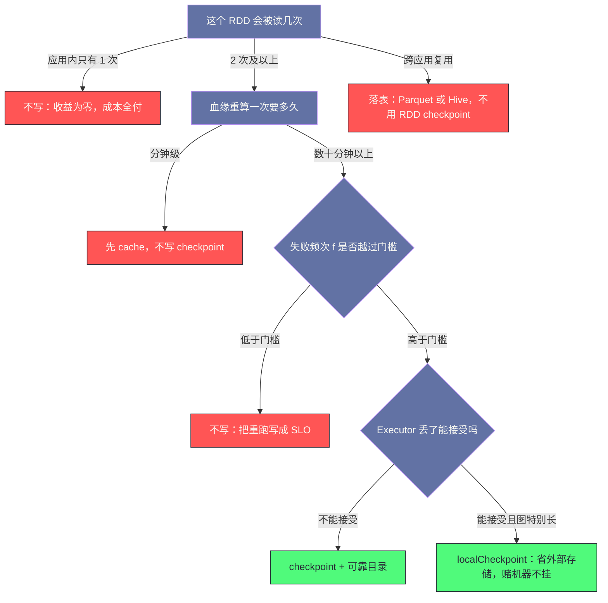
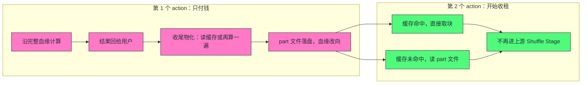
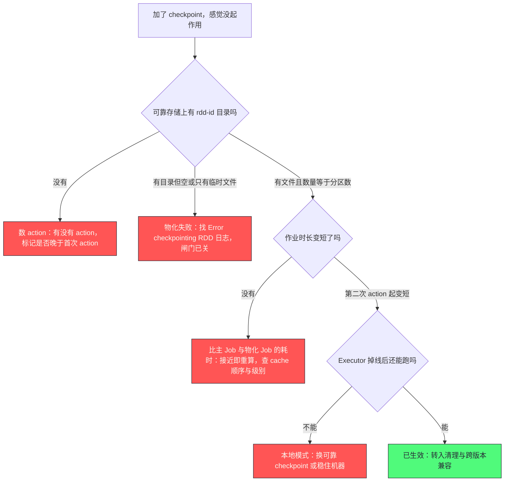
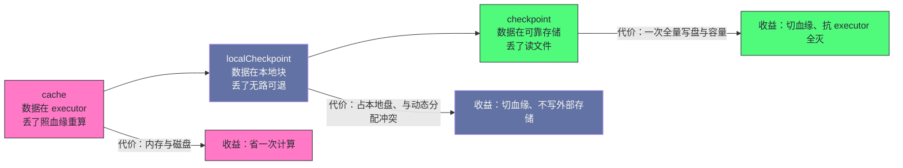
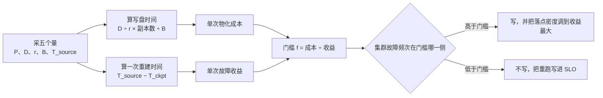

# 03 RDD Checkpoint：截断 Lineage 的工程权衡

**摘要：**

checkpoint 难用，不在写不出来，而在它把成本与收益摆在了两条不同的时间线上：写盘的成本在这一轮作业里立刻兑现，截断血缘的收益却要等到缓存丢失之后的那次读取才可能兑现。于是"加了 checkpoint 反而更慢"与"加了 checkpoint 救了一次故障"，在代码上往往只差两行——差的是有没有先 cache、有没有第二次 action、目录是不是真的落在可靠存储上。本文不重讲 checkpoint 怎么把数据写出去、断了血缘之后又怎么找回来，那部分机制在内核系列的 Checkpoint 一篇里已逐段拆过；本文只算这本账：一笔"用可靠存储换截断血缘"的交易，在什么条件下划算，在什么条件下白付。为此先把成本拆成物化写入、物化重算、血缘重算与存储占用四栏，给出一条可以拿 Spark UI 数据直接代入的盈亏平衡式；再把三个最容易踩的坑——惰性求值、第一次 action 仍走血缘、忘记 cache 导致多算一遍——逐一对到可见的症状上；然后过一遍四个配置项与它们各自的代价，把"写了却没生效"的三种成因摊成一张排障表；最后给出该不该写的五问判据、四则反例与一组标注为示例推算的数字。

---

## 第 1 章 一笔交易：一次写盘换一次不回溯

### 1.1 一个 92 分钟的作业，和一个 118 分钟的改法

笔者的集群每天跑两千个左右的作业，三百个节点，其中有一个推荐模型训练作业 `reco_train`：凌晨从 HDFS 读两份行为日志，各两百个分区，join 之后聚合成一张宽表，然后在宽表上跑二十轮迭代。宽表构建那一段血缘上有三次 Shuffle，实测十二分钟；之后每轮迭代四分钟，二十轮八十分钟，加上收尾写出，整个作业九十二分钟。

季度评审时有人提了一句："三次 Shuffle 加二十轮迭代，任何一台 executor 掉线都要回到读数据源那一步，该加 checkpoint。"理由站得住，于是改动很小：宽表算完之后挂 `checkpoint()`，每五轮触发一次物化，目录指向 HDFS 上一个带日期分区的路径。改完重跑，时长变成一百一十八分钟。

多出来的二十六分钟，后来查清楚是两笔账。第一笔是明确的：四次物化，每次把两百个分区的宽表序列化写进 HDFS，约三分钟一次，合计十二分钟；这笔钱买的是"以后读它不必回溯血缘"。第二笔则一半是冤枉钱：`cache()` 那一行写在了 `checkpoint()` 后面，紧接着的第一次物化发生时缓存尚未建立，那一次从数据源把整条血缘重算了一遍；之后又有一次，因为缓存级别是 `MEMORY_ONLY`，宽表在内存压力下被驱逐，物化同样落到了重算上。两次重算各约七分钟，合计十四分钟。

而那一整晚，集群没有任何一台 executor 掉线。也就是说，这二十六分钟里，十二分钟是保费，十四分钟是保费买错了险种，理赔一次都没有发生。

这个案例真正的价值不在"该不该加"，而在它暴露了一个常被跳过的前提：checkpoint 的收益不是"让迭代变快"，同一次运行里迭代读的是缓存，缓存还在的时候 checkpoint 一分钱收益都产生不了。它保的是缓存丢了以后的那一次读取。所以这笔账从一开始就该按概率算，而不是按"血缘很长"算。

### 1.2 一句话的取舍，与它推出的唯一判据

checkpoint 的取舍可以压成一句话：用"把数据写进可靠存储"换"把血缘截断"，也就是**一次写盘换一次不回溯**。截断之后，恢复路径从"回溯到数据源"缩成"读那一份文件"；代价是这份数据要重新算一遍、序列化一遍、经由网络写进副本，还要在存储上占一份位置。

于是判断标准也只剩一条：血缘重算的成本，与写 checkpoint 的成本，哪个更高。这句话说起来简单，落到具体作业上却有两个容易漏掉的限定。其一，两边必须放在同一条时间线上比较——写盘的成本发生在这一次运行，重算的成本发生在未来那些不确定的时刻，中间隔着"缓存会不会丢"这个概率。其二，重算的范围不是"整个作业"，而是"从最近的可复用点到丢失点"那一段；缓存还在的时候那一段长度为零，所以收益也为零。

机制那一侧的事——打标记挂的是哪个对象、物化 Job 从哪里发出来、写完之后血缘怎么改向——在 [[大数据/Spark/读书笔记-spark内核/04_存储与容错机制/6. Spark_Checkpoint机制|Spark Checkpoint 机制]] 里已经逐段拆过，本文不再重复。缓存那一侧的存储级别、写入落点与驱逐顺序，见 [[大数据/Spark/读书笔记-spark内核/04_存储与容错机制/3. Spark_数据缓存机制|Spark 数据缓存机制]]。这里只关心它落到运维上的形态：哪些量能测、阈值卡在哪、出问题先看哪里。

### 1.3 成本的四个栏目

把成本摊开成四栏，账才看得清。下面这张表用的是 `reco_train` 的量级，数字标注为示例推算，换作业只需换这张表。

| 栏目 | 构成 | 示例推算 | 由谁承担 |
|---|---|---|---|
| 物化写入 | 序列化、按 `spark.checkpoint.compress` 压缩、网络传输、三副本 | 宽表逻辑 240 GB，压缩后约 80 GB，三副本约 240 GB 物理写，单次约 3 分钟 | HDFS 带宽、DataNode 磁盘、NameNode 元数据 |
| 物化重算 | 缓存未命中时，物化 Job 重新走一遍血缘 | 三次 Shuffle 重跑，单次约 7 分钟；四次全未命中即 28 分钟，1.1 那个例子只碰上两次 | 集群 slot、上游存储的读带宽 |
| 血缘重算 | 故障恢复时从最近可复用点回溯 | 无落点时从数据源重建约 80 分钟；有落点时最多重跑五轮约 20 分钟 | 下游等待、SLO |
| 存储占用 | 目录长期留存，默认不自动清理 | 每天四个落点约 1 TB，一年按两百个运行日算是 O(100 TB) 量级 | HDFS 容量、平台侧清理人力 |

四栏里只有第一栏是显式的，它会出现在作业时长上；第二栏只在缓存不当时才现形，很容易被误记到"checkpoint 本身很慢"头上；第三栏是这份保险的赔付额，只有真出事那天才可见；第四栏压根不出现在作业时长里，而是出现在半年后的存储账单和容量评审上。

> [!info] 一句话可以直接用
> checkpoint 的收益不是"让作业变快"，而是"让故障恢复变短"。缓存没丢的时候它一分钱不赚，只收保费——**收益按概率兑现，成本按次兑现**。

### 1.4 盈亏平衡：把概率算进来

把上面四栏拼成一条式子，判断就有了着力点。设一次运行里做了 k 次落点，单次物化的墙钟成本是 `T_write + T_recompute`，一次故障若从数据源重建需要 `T_source`，从最近落点重建最多需要 `T_ckpt`，这次运行中至少发生一次需要重建的故障的概率是 `f`，那么：

```text
期望收益 = f × (T_source − T_ckpt)
期望成本 = k × (T_write + T_recompute) + 存储的机会成本

划算的条件： f > k × (T_write + T_recompute) / (T_source − T_ckpt)
```

代进 `reco_train`：四次落点，每次三分钟写盘加平均三点五分钟重算，成本约二十六分钟；无落点重建八十分钟，有落点重建二十分钟，收益一次六十分钟。门槛落在 `f ≈ 43%`。一个九十二分钟的作业，两百个运行日里碰上两三次相关故障，`f` 在百分之一到百分之二之间，这条线划不过去。

同样的作业换一种改法，结论就翻了：把 cache 顺序修正、存储级别换成 `MEMORY_AND_DISK`，重算那一栏归零，落点减到每十轮一次，成本降到约六分钟，收益变成四十分钟，门槛掉到 `f ≈ 15%`。如果这个作业跑在按需回收的 Spot 实例上，或者单轮迭代从四分钟涨到二十分钟，`f` 轻松越过这条线。

这就是为什么"血的教训"式建议常常互相矛盾：有人说迭代必须 checkpoint，有人说 checkpoint 纯属浪费，两边举的作业在血缘长度上差不多，差别在故障频次与缓存配置。门槛式子的用处不是给出一个普适数字，而是把"该不该"变成三个可测的量——写盘要多久、重算一遍要多久、故障多大概率。

### 1.5 判据速查

把场景与判据并排放，判断可以在一分钟内完成。注意最后两行的反转：跨作业复用与流式作业，都不该拿 RDD 的 checkpoint 去接。

| 场景 | 复用量级 | 血缘重算一次 | 判据 | 结论 |
|---|---|---|---|---|
| 五十轮以上的迭代训练，宽表每轮复用 | 数十次 | 小时级 | 重算远贵于写盘，且缓存级别不满 | 该，每五到十轮一个落点 |
| 复杂 ETL 的高代价聚合，被本应用内多个 action 读 | 三到五次 | 数十分钟 | 一次写盘能换掉后面每次回溯 | 该，落点放在那次 Shuffle 之后 |
| 一次性作业，跑完即弃，只有一个 action | 0 | 十五分钟 | 收益为零 | 不该，把重跑写进 SLO 更便宜 |
| 血缘只有五到八层，二十分钟跑完 | 两三次 | 二十分钟 | `cache` 就够，不必落盘 | 不该，先 cache |
| 同一张中间表被多个作业读 | 跨应用 | — | 裸 RDD 的 checkpoint 文件不跨应用 | 不该，落成 Parquet 或 Hive 表 |
| 流式作业的容错 | 每批 | — | 存的是元数据、位点与状态 | 另一套，见 [[大数据/Spark/Spark-容错与状态管理深度解析/04 Structured Streaming 容错模型：Offset 与 Checkpoint\|Structured Streaming 容错模型]] |

下面这张图把上面六行收成一条判断路径，注意它先问"会不会被第二次读"，而不是先问"血缘长不长"。



---

## 第 2 章 三个坑：成本在前，收益在后

三个坑有一个共同形状：成本发生在"这次计算"里，收益发生在"下次读取"里。凡是把这两件事混在一起的用法，都会在某个环节白付一次钱。

### 2.1 坑一：没有 action 就没有文件

`checkpoint()` 一个 record 都不读，只在一个对象上挂个标记。这一点在内核篇里讲过，但它在运维上的形态值得单独点名：代码看起来改了，目录里一个文件都没有，而且不报错。

判据很短：去可靠存储上找 `<checkpointDir>/<uuid>/rdd-<id>/`。目录不存在，说明物化根本没被触发；目录在、里面只有以点开头带 attempt 编号的临时文件而没有 `part-*`，说明物化跑过但失败了。再去 Spark UI 的 Jobs 页，看那次 action 之后有没有跟着一个同规模的 Job——物化是以 Job 的形式跑的，**没有那个 Job 就没有那份文件**。

这个坑还有第二种更隐蔽的形态：标记挂晚了。一个 RDD 的物化机会在它的第一次 action 收尾时用掉，用掉之后不再重来；如果 `checkpoint()` 写在这行 action 之后，标记挂上去了，物化却永远不会被触发，文件永远不出现，日志里也没有任何异常。笔者的经验是，这种"代码里明明有 checkpoint"的报障，一半以上属于这一类，而且用 grep 找得到调用、用目录找不到文件，靠肉眼读代码很难发现。

代价也要说清楚：没有文件，血缘就没断，所谓"降级"只是回到了未加 checkpoint 的状态，业务语义上无害。真正的问题是它骗过了评审与自测——在代码评审里看到 `checkpoint()` 就会认为容错已到位，而实际上那个作业的容错能力一点没变。

### 2.2 坑二：第一次 action 仍走血缘

物化发生在 action 的收尾处，这个时序带来一个违反直觉的后果：`checkpoint()` 之后紧接着的第一次 action，从头到尾走的仍然是完整血缘，因为它开始计算的时候，文件还不存在。

于是"checkpoint 之后算一次就以为省了"是错的。**省只从第二次 action 开始**：第一次 action 把文件写出来并让血缘改向，第二次 action 才有机会读它。如果这个 RDD 在一个应用里只会被读一次，那 checkpoint 的收益是零，付掉的是全部成本——这也是 1.5 里第一行判据"只有一个 action 就不该写"的由来。

还有一个更细的推论：物化发生在 action 收尾，意味着它保护不了这次 action 自身的失败。如果第一次计算跑到一半某台 executor 掉了，checkpoint 文件还没写，恢复照样从血缘重算；这份保险的生效时间，严格来说在第一次 action 成功返回之后。把 checkpoint 当成"给第一次计算上保险"的预期，从一开始就落空了。

时间线摊开看会更清楚：



### 2.3 坑三：不 cache，物化那一遍白算

物化 Job 要从这个 RDD 把全部分区读出来序列化，读的时候先问缓存；缓存命中，它做的就是"搬数据"；缓存没有，它就只能从血缘把整条链再算一遍。后者是 1.1 里那十四分钟冤枉钱的来源。

官方文档在 `checkpoint()` 的说明里写得很直白：强烈建议先持久化，否则保存到文件的过程会把 RDD 重新计算一遍。这句话常被当成风格建议，其实是成本结构。

判据在 UI 上很好认：把那两次 Job 的耗时并排放，物化 Job 的时长与主 Job 基本相等，说明它重跑了一遍业务逻辑；再看物化 Job 的 Stage 图，如果里面有完整的上游 Shuffle Stage，缓存肯定没兜住。反过来，若物化 Job 的 Task 全部是几秒钟的读块与写文件，耗时只有主 Job 的一个零头，说明缓存生效了。

顺序也要对。先 `cache()` 再 `checkpoint()` 与先 `checkpoint()` 再 `cache()`，代码都能跑，但后一种写法里，物化那一次的账已经付掉了：物化 Job 在主 Job 收尾时立即执行，那时 `cache()` 那一行还没执行到。**顺序影响物化的成本，是否 cache 影响读取的成本**，这两件事必须分开想。

还有两个容易叠加进来的因素。其一，缓存级别选 `MEMORY_ONLY` 时，宽表在内存压力下会被驱逐，物化恰好落在被驱逐之后，就等于没 cache；这也是 1.1 里第二次重算的来源。其二，物化 Job 是全量的，与触发它的 action 要几个分区无关：用 `take(5)` 看一眼数据，收尾照样触发两百个分区的物化，一次轻量的探查动作后面可能跟着一次全量重算加全量写盘。

### 2.4 三个坑的同一形状

把三个坑并排放，形状是一致的：成本确定地付在这一次，收益条件地兑现在下一次。

| 坑 | 表面现象 | 判据 | 白付的代价 | 处置 |
|---|---|---|---|---|
| 没有 action，或标记晚于首次 action | 代码里有 `checkpoint()`，存储上没有文件 | 可靠存储目录不存在；Jobs 页没有后续物化 Job | 容错能力为零，但评审以为已到位 | 把标记移到首次 action 之前，并保证之后至少有一次 action |
| 第一次 action 仍走血缘 | "加完了，第一次跑没变快" | 第二次 action 的 Stage 图才变短 | 第一次 action 算了两遍的错觉，其实是必然 | 数清楚这个 RDD 被读几次，只有一次就别写 |
| 不 cache 或顺序反了 | 物化 Job 很慢，接近主 Job | 物化 Job 耗时与主 Job 相当，Stage 图带完整上游 | 一整遍血缘重算，通常是数分钟到数十分钟 | `cache()` 在前，级别选 `MEMORY_AND_DISK`，物化后再按需 `unpersist` |

这三行也解释了为什么 checkpoint 的自测不能看"有没有报错"，只能看"数了几个 action、物化 Job 长什么样、目录里有什么"。

---

## 第 3 章 四个配置项与它们各自的代价

### 3.1 `spark.checkpoint.dir`：可靠存储的位置

可靠模式的落脚点由 `setCheckpointDir` 或配置项 `spark.checkpoint.dir` 决定，后者自 4.0.0 起允许在配置里给默认目录，`SparkContext` 构造时用它调一次 `setCheckpointDir`，用户代码仍可覆盖。实际路径是"给定目录 + 一个 UUID + `rdd-<id>`"，UUID 按 `SparkContext` 生成，所以同一个应用里的多次运行、多次落点，各自占一个命名空间。

这一项是四个配置里唯一必填的；没设就调 `checkpoint()` 会直接抛错，错误文案就是"Checkpoint directory has not been set in the SparkContext"。它的代价不在参数本身，而在选什么存储：HDFS 上是"三副本的网络写"，对象存储上是"rename 退化成复制加删除"的写，本地路径上则等于把可靠性交还给机器。选对象存储时，写入时间通常是 HDFS 的数倍，物化成本那一栏要按这个量级重算，1.4 的门槛也随之抬高。

### 3.2 `spark.checkpoint.compress`：拿 CPU 换字节

写盘时是否压缩由这一项控制，自 2.2.0 起默认为真，编码器取自 `spark.io.compression.codec`。默认开启本身就是一个判断：官方认为 checkpoint 的瓶颈在容量与网络，不在 CPU，所以用一点核换掉成倍的字节数是划算的。

代价有两层。显性的一层是序列化与压缩吃掉的 CPU，在物化 Job 上表现为"任务不多但每个都不快"，譬如两百个分区每个都多花几秒压缩。隐性的一层是兼容性：读的时候必须用同一套编解码配置，换编码器、换 Spark 大版本、换序列化器（默认是 `JavaSerializer`），旧文件都可能读不回来。所以 checkpoint 目录不是长期档案，它的合理生命周期是"这个应用这一轮"，跨版本恢复要么重建，要么显式落一份自管格式的表。

### 3.3 本地模式：省掉外部存储，也省掉可靠性

`rdd.localCheckpoint()` 把数据留在 executor 的块存储里，血缘照样截断。它与可靠模式在使用姿势上的差别是：不需要目录，也不需要先 `cache()`——它自己就把持久化写进了实现，没有存储级别时用 `MEMORY_AND_DISK`，已有级别时在其上强制加磁盘。这一点让它看起来"更省事"，但**它省掉的是外部存储，换掉的是可靠性**。

边界必须说准。executor 掉线之后，本地块随之消失，而血缘已经被自己切断了，所以此时不是"重算那个分区"，而是"没有路可退"：作业直接失败，报的是 `CHECKPOINT_RDD_BLOCK_ID_NOT_FOUND` 一类错误，要恢复只能整个应用从头再跑。这也是为什么它适合"血缘极长、主要想压 Driver 端图与序列化开销、集群足够稳定"的场景，而不适合关键路径上的容错。

它还有两个运维上的坑。一个是与动态资源分配冲突：空闲 executor 被回收时，那些机器上的本地 checkpoint 块一起消失，官方给的对策是把 `spark.dynamicAllocation.cachedExecutorIdleTimeout` 设得足够大（默认 `Int.MaxValue`，即不回收有缓存的 executor）。另一个是非确定性算子叠加推测执行或 Stage 重提时，同一个分区可能被两个尝试各存一份、内容还不一样；4.3.0 里靠 `spark.checkpoint.local.verifyChecksum.enabled`（默认为真）在物化收口时按分区挑一个版本、踢掉不一致的副本，关掉它可以省一次哈希，代价是这种分歧不再被拦下。

### 3.4 没有 `reliability` 开关，只有一组相关项

社区里流传着一个说法，似乎有一个 `spark.checkpoint.reliability` 之类的开关，可以在可靠与本地之间切换。4.3.0 里没有这个东西。**可靠与否由你调哪个方法决定**，`checkpoint()` 走可靠模式，`localCheckpoint()` 走本地模式，同一个 RDD 上先调哪个就是哪个，不存在配置项覆盖。真正与可靠性相关的是一组旁支配置：`spark.checkpoint.checkpointAllMarkedAncestors` 决定一次 action 里要不要连带物化祖先（默认假，一条链上多个标记只处理最近的一个），`spark.cleaner.referenceTracking.cleanCheckpoints` 决定 RDD 被回收后要不要删目录（默认假），加上 3.3 里那两个本地模式的校验项。

理解这一点有实际好处：当有人问"怎么把 checkpoint 改成可靠的"，答案是改调用方法加配目录，而不是翻配置文档找一个布尔量。

### 3.5 配置一览

| 配置 | 默认值 | 管什么 | 调大或开启的代价 | 调小或关闭的代价 |
|---|---|---|---|---|
| `spark.checkpoint.dir` | 空（未设则 `checkpoint()` 抛错） | 可靠模式的落盘根目录 | 指到对象存储：省本地容量，换来写入时间成倍 | 指到 `file:` 路径：单机跑得通，集群模式失去可靠性 |
| `spark.checkpoint.compress` | 真（2.2.0 起） | 写盘是否压缩 | 物化 Job 多耗 CPU，编解码配置被绑定 | 字节数按压缩比放大，网络与容量成本上升 |
| `spark.checkpoint.checkpointAllMarkedAncestors` | 假 | 一次 action 是否连带物化祖先 | 物化量按链长累加 | 链上多个标记只生效一个，祖先的血缘不断 |
| `spark.checkpoint.local.verifyChecksum.enabled` | 真（4.3.0 起） | 本地模式的分区版本一致性 | 物化收口多一次哈希 | 推测执行叠加非确定性算子时可能读到不一致副本 |
| `spark.cleaner.referenceTracking.cleanCheckpoints` | 假 | RDD 被回收后是否删目录 | 还有别处读这份数据时文件先没了 | 目录长期累积，清理责任落到平台侧 |
| `spark.dynamicAllocation.cachedExecutorIdleTimeout` | `Int.MaxValue` | 有缓存的 executor 何时被回收 | 资源利用率下降 | 本地 checkpoint 的块随回收一起消失 |

这张表里最容易被忽略的是倒数第二行。默认为假意味着绝大多数作业的 checkpoint 目录不会被自动清理，一个日更作业跑一年就在 HDFS 上留下一年份的 `rdd-*`；而打开它也解决不了全部问题，长跑应用里 RDD 一直活着，回收条件根本触发不到。

---

## 第 4 章 "没生效"的三种成因与判据

### 4.1 目录里没有 `rdd-<id>`

第一种成因是没有 action，或者标记挂在了首次 action 之后。判据只有两条，都指向"物化有没有被触发"：可靠存储上有没有那个目录，Jobs 页有没有多出一个同规模的 Job。两条都不成立时，先别查 HDFS 权限，先回去数 action。

物化失败也会落到这个现象上，但要与"没触发"分开。失败时日志里有 `Error checkpointing RDD ...` 一类的告警，随后物化闸门关闭，本应用内不会再重试：第一次 action 可能已经成功返回，紧接着抛一个写盘异常；重跑同一个 action 又正常了，存储上却始终没有文件。这种"报一次错之后再也不报"的表现，是**物化闸门一次性**造成的，不是偶发网络抖动，处置只能是修好目录、权限或容量之后重建 RDD 图重跑。

### 4.2 作业没变快

第二种成因是 checkpoint 前没 cache，或者顺序写反了。判据在第 2.3 节：把主 Job 与物化 Job 的耗时并排，接近就说明重算发生了一次。这种情况下的"没变快"有两层含义——物化的成本被抬高了，而收益本来就只在缓存丢失时才兑现，于是账面上只剩成本。

笔者还见过一种被误报成"没变快"的情形：作业确实生效了，但因为这个 RDD 只被读了一次，收益为零。判据是数 action，而不是看目录——目录里有文件，只说明钱花了，不说明赚回来了。

### 4.3 文件写在了单机上

第三种成因是目录配错，把可靠存储写成了 driver 的本地盘。常见形态，譬如 `setCheckpointDir("file:///data/ckpt")`、写一个相对路径，或者在容器化部署里指向一个只有 driver 容器可见的挂载点。非 local 模式下 Spark 会打印一条告警，说 checkpoint 目录不应落在本地文件系统上，这条告警是配置有问题的唯一直接证据；它只是告警，不会阻断运行，所以经常被日志洪水淹没。

后果分三种。写盘时 executor 看不到那个路径，物化 Job 失败，落在 4.1 的现象里；写盘时恰好所有 executor 与 driver 同机（单机伪分布式），文件写成了，但机器一换就没了；driver 容器重启，整个目录随容器生命周期消失，血缘却已经改向，作业在后续读取时报找不到文件。三种里最难查的是第二种：它跑得通、也不报错，只是这份"可靠存储"其实一点也不可靠。

### 4.4 附带一种：本地模式在 executor 重启后失效

本地 checkpoint 的失效不表现为"没生效"，而表现为"生效过，然后突然全崩"。判据是时间点：作业前半段正常，某台 executor 重启或回收之后，出现 `CHECKPOINT_RDD_BLOCK_ID_NOT_FOUND`，并且失败的分区集中在那台机器上。这时不要去查 Shuffle 服务，也不要去查 HDFS，直接确认两件事——这个 RDD 用的是 `localCheckpoint()` 而不是 `checkpoint()`，以及是否开了动态资源分配、`cachedExecutorIdleTimeout` 是否被调小过。

### 4.5 排障次序

把四种情形收成一条顺序，先看有没有文件，再看钱花得值不值，最后看可靠性够不够。



对应的判据表：

| 症状 | 先查什么 | 判据 | 与下一层的分界 |
|---|---|---|---|
| 目录不存在 | action 数与标记位置 | 有没有 action，标记是否在首次 action 之前 | 有 action 仍无目录，才是权限或容量问题 |
| 目录在但文件数不足 | 物化日志 | 有没有 `Error checkpointing RDD` | 有异常是写盘失败，无异常是分区数对不上 |
| 作业没变快 | 主 Job 与物化 Job 的耗时 | 两者接近即发生了重算 | 两者差距大，则是复用次数不足 |
| 第一次之后才变快 | 复用次数 | 该 RDD 被读了几次 | 只有一次，收益本来就是零 |
| executor 重启后失败 | 用的是哪个方法 | `localCheckpoint` 还是 `checkpoint` | 本地模式无路可退，只能整作业重跑 |
| 换集群后读不到旧文件 | 路径与配置 | 目录前缀、codec、序列化器是否变化 | 变了就是兼容性问题，不是权限问题 |

---

## 第 5 章 该不该写：五问

### 5.1 第一问：会被读几次

先数应用内这个 RDD 被几个 action 读。**只有一次，收益为零，直接放弃**；两次，收益刚够抵一次物化，属于可做可不做；三次以上，收益才稳定为正。这一问排在最前，因为它是唯一能一票否决的问题，而它又最常被跳过——人们习惯先问"血缘多长"，却忘了血缘长但只读一次的作业，checkpoint 一分钱不赚。

跨应用复用要单独排除：裸 RDD 的 checkpoint 目录里只有数据文件，没有图与元数据，另一个应用重新执行代码拿到的是全新的 RDD 图，它不知道那些文件存在。所以"同一张中间表被三个作业读"这种需求，正确做法是落成 Parquet 或 Hive 表，而不是把上游作业的 checkpoint 目录当共享数据集。

### 5.2 第二问：血缘重算一次多久

这个量可以直接从 UI 拿：把该 RDD 所在 Stage 到数据源之间各 Stage 的 `Duration` 相加，再乘一个"重算时并发不如当初"的折扣（集群满载时重建的排队时间要算进去）。更粗的口径是靠血缘层数估，譬如二十六层血缘乘单层单分区的八秒，再除以可用并发。前者准、后者快，两者都该标注为估算。

### 5.3 第三问：故障多大概率

这个量没法精确测，但可以按实例类型与作业时长给量级判断。跑在 Spot 或抢占式实例上、单次运行两小时以上的作业，`f` 往往在两位数百分比；跑在稳定机型上、四十分钟结束的批作业，`f` 是个位数。门槛式子的意义在这里：`f` 不需要准，只需要知道它落在门槛的哪一侧。

### 5.4 第四问：可靠性要到什么程度

能接受"executor 掉了就整个应用重跑"，本地模式是划算的，它省掉了全部外部写盘；不能接受，就得走可靠模式，并把目录选在真正的可靠存储上。这一问还牵出另一个边界：可靠模式的 checkpoint 也救不了"应用重启接着跑"，它只是让本应用内的恢复变短。把这两件事混起来的预期，最终会落在一次"重启之后从数据源重算"的事故上。

### 5.5 第五问：三种留数据手段，运维口径差在哪

`cache`、`localCheckpoint`、`checkpoint` 三者的差别，在机制篇里讲的是存储级别与血缘，落到运维上则是一组更实际的问题：数据在哪、谁能救、谁清理、在哪看。

| 维度 | `cache` / `persist` | `localCheckpoint` | 可靠 `checkpoint` |
|---|---|---|---|
| 数据落在哪 | executor 的内存与本地磁盘，受存储级别约束 | executor 的块存储，强制带磁盘 | 可靠文件系统上的 `part-*` 文件 |
| 血缘 | 完整保留，缓存丢了照血缘重算 | 已截断，缓存丢了无路可退 | 已截断，文件在就能读回来 |
| 谁能救它 | 只有血缘；机器活着才有缓存 | 谁都不行，只能整应用重跑 | 文件系统本身，executor 全灭也不影响 |
| 跨应用可复用 | 否 | 否 | 否，文件没有主人，但有手工构造的偏门用法 |
| 谁负责清理 | 驱逐与 RDD 回收自动完成 | 随 executor 生命周期消失 | 默认没人管，靠 `cleanCheckpoints` 或平台脚本 |
| 在哪看 | Storage 页的 RDD 条目 | Storage 页，且与缓存条目混在一起 | Jobs 页的物化 Job 与存储目录，Storage 页看不到它 |

最后一行值得单独强调。**Storage 页只列有存储级别的 RDD**，checkpoint 本身不产生存储级别，所以一个只做了 checkpoint 的 RDD 不会出现在那里；如果它先被 `cache()` 了，出现的那一条是缓存条目，不是 checkpoint 生效的证据。把 Storage 页当成检查点生效的判据，是一个流传很广的误读。

三种手段的可靠性梯度可以画成一条线，从左到右，代价与保障同时上升。



---

## 第 6 章 反例四则

### 6.1 checkpoint 之后只 action 一次，就以为省了

最典型的自测方式，笔者见过不止一次："加完跑一遍，时长没变，以为 checkpoint 不生效"。其实它必然如此：第一次 action 走的是完整血缘，文件在它收尾时才写出来。判据是把 action 数清楚，再看第二次的 Stage 图有没有变短。只读一次的作业，写 checkpoint 就是把保费花在一份永远不会被理赔的保单上。

### 6.2 不 cache 直接 checkpoint

代码上是两行，账上是一整遍血缘重算。这个反例在高代价 Shuffle 之后尤其贵：物化 Job 要把那几次 Shuffle 再走一遍，而 Shuffle 恰恰是整条链最贵的部分。正确写法是 `cache()` 在前、`checkpoint()` 在后，物化完成之后按需 `unpersist`；存储级别优先 `MEMORY_AND_DISK`，避免内存压力把宽表驱逐出去，让物化恰好落在缓存之外。

### 6.3 用 localCheckpoint 做关键路径容错

它的名字里有 checkpoint，行为上切了血缘，于是很容易被当成"便宜的 checkpoint"。但在关键路径上，它把"一台 executor 掉线"从"重算一批分区"升级成"整个应用重跑"，因为它把退路自己切断了。判断它合适与否只需要一个问题：这台机器上的缓存块消失时，你能不能接受从头再来。不能接受，就不该用它。

### 6.4 把 checkpoint 目录当共享数据集或长期档案

有两种误解指向同一件事：把上游作业的 checkpoint 目录当共享中间表给别的作业读，或者把 checkpoint 文件当成可以跨版本回读的快照。前者不成立，因为文件里没有图与元数据；后者不成立，因为字节格式绑定序列化器与压缩编码器，升级后很可能读不回来。目录还会长期累积，默认不清理，一年下来是一笔不小的存储开支。真正需要跨应用、跨版本的中间结果，应当落成显式格式的表，由数仓的版本与生命周期去管。

---

## 第 7 章 量化：写入量与重算量的对比

### 7.1 要采的五个量

估算不需要跑基准，五个量足够，全部可以从 UI 与配置里拿：分区数 `P`（Storage 页或 Stage 的 Task 数）、逻辑数据量 `D`（Storage 页的 Size 或输入大小）、压缩比 `r`（`spark.checkpoint.compress` 与实测文件大小）、写带宽 `B`（一次物化 Job 的写入时长反推）、重算一次要多久 `T_source`（各 Stage 的 Duration 相加并打折）。

| 量 | 从哪里拿 | 备注 |
|---|---|---|
| `P` | Stage 详情页的 Task 数 | 物化 Job 的 Task 数等于分区数 |
| `D` | Storage 页的 Size，或上一 Stage 的 Output Size | 序列化前的大小 |
| `r` | 物化目录的实际大小除以 `D` | 未开压缩时为 1 |
| `B` | 物化 Job 的耗时与目录大小的比值 | 对象存储上明显更慢 |
| `T_source` | 各 Stage 的 `Duration` 之和乘折扣 | 重建时并发通常不如当初 |

### 7.2 一次完整算例

按 `reco_train` 代入：`P` 为 200，`D` 为 240 GB 逻辑，`r` 约 3，写三副本，`T_source` 约 80 分钟，从落点重建约 20 分钟。

写盘量是 `D / r × 3`，约 240 GB 物理；按 1.5 GB/s 的有效写带宽估，约 160 秒，与实测的三分钟吻合。这个数说明一件事：**写盘成本由字节数乘副本数决定**，压缩比直接决定它是三分钟还是九分钟，副本数决定它是 240 GB 还是 80 GB。血缘重算量则是另一套账：它不搬字节，它花的是 slot·秒，200 个分区乘三次 Shuffle 的恢复成本，落到墙钟就是几十分钟。

两者的量纲不同，所以不能直接比"多少 GB 对多少 GB"，只能比时间：一次写盘三分钟，一次重建六十分钟，中间差二十倍。这个二十倍就是 checkpoint 存在的空间，也是 1.4 里那个门槛的分子。

### 7.3 门槛落在哪

把复用次数与故障频次放进同一张图，能看到门槛的形状：复用次数决定收益上限，故障频次决定收益期望，两者相乘才与成本可比。



落点密度也是一个可算的量：落点越密，`T_ckpt` 越小、收益越大，但成本按次数线性增长。在 `reco_train` 的例子里，每五轮一个落点比每十轮一个的成本翻倍、收益只从四十分钟涨到六十分钟，门槛反而从 15% 抬到 43%。所以"多打几个点更保险"是个错觉，落点密度要按门槛反推：先定 `f` 的量级，再挑能让门槛落在 `f` 以下的最小密度。

---

## 第 8 章 落点

回到开头那个 92 分钟变成 118 分钟的作业。它的错不在于 checkpoint 这个动作，而在于它被当成了一次没有任何前提的优化：没有人问这个宽表会被读几次，没有人确认 cache 写在前面，也没有人算过这台集群一年会掉几次 executor。三件事里任何一件先做，那二十六分钟都不必付。

由此得到几条判据，都不复杂。**checkpoint 是保险，不是加速器**，它的收益条件地发生在缓存丢失之后的那次读取上，所以先数 action，再谈血缘。成本分四栏，只有第一栏可见，剩下三栏分别在缓存配置、故障那一天和半年后的存储账单上现形。三个坑共用一个形状——成本在前、收益在后，因此自测只能看"物化的 Job 长什么样、目录里有什么"，不能看"代码里有没有那一行"。可靠性不是配置项，是 API 的选择；本地模式省掉的是外部存储，换掉的是退路。

什么时候不写，值得单独记一句：一次性作业、只读一次的中间结果、血缘五到八层的短链、以及跨应用共享的中间表，这四种情况下写 checkpoint 都是净亏，而它们恰好是最容易被"血缘很长"一句话说服的四种。什么时候该写，则取决于门槛落在故障频次哪一侧，而故障频次这件事，只能由每个集群自己的历史去回答。

机制与判据的分工也就清楚了：机制篇回答"它怎么把数据写出去、断了血缘怎么找回来"，这篇回答"什么时候值得写、写了为什么没生效、没省到该先修哪一处"。前者是读懂，后者是取舍，而取舍的依据从来不是机制本身，是账。

---

## 参考资料

1. Zaharia M., Chowdhury M., Das T., et al. Resilient Distributed Datasets: A Fault-Tolerant Abstraction for In-Memory Cluster Computing. NSDI 2012. [https://www.usenix.org/system/files/conference/nsdi12/nsdi12-final138.pdf](https://www.usenix.org/system/files/conference/nsdi12/nsdi12-final138.pdf)
2. Apache Spark 4.3.0 文档：RDD Programming Guide，RDD Persistence 与 Checkpointing 一节，含"先持久化再 checkpoint"的建议原文。[https://spark.apache.org/docs/latest/rdd-programming-guide.html](https://spark.apache.org/docs/latest/rdd-programming-guide.html)
3. Apache Spark 4.3.0 文档：Configuration，`spark.checkpoint.*`、`spark.cleaner.referenceTracking.cleanCheckpoints`、`spark.dynamicAllocation.cachedExecutorIdleTimeout` 的默认值与语义。[https://spark.apache.org/docs/latest/configuration.html](https://spark.apache.org/docs/latest/configuration.html)
4. Apache Spark 4.3.0 文档：Web UI，Jobs 与 Storage 页的字段口径。[https://spark.apache.org/docs/latest/web-ui.html](https://spark.apache.org/docs/latest/web-ui.html)
5. Apache Spark 源码（4.3.0）：`org.apache.spark.rdd.RDD`，`checkpoint`、`localCheckpoint`、`doCheckpoint`、`markCheckpointed`、`computeOrReadCheckpoint`。[https://github.com/apache/spark/blob/v4.3.0/core/src/main/scala/org/apache/spark/rdd/RDD.scala](https://github.com/apache/spark/blob/v4.3.0/core/src/main/scala/org/apache/spark/rdd/RDD.scala)
6. Apache Spark 源码（4.3.0）：`org.apache.spark.rdd.RDDCheckpointData`、`ReliableRDDCheckpointData`、`ReliableCheckpointRDD`、`LocalRDDCheckpointData`、`LocalCheckpointRDD`。[https://github.com/apache/spark/tree/v4.3.0/core/src/main/scala/org/apache/spark/rdd](https://github.com/apache/spark/tree/v4.3.0/core/src/main/scala/org/apache/spark/rdd)
7. Apache Spark JIRA：SPARK-8582（物化时重复计算 RDD 的已知浪费）。[https://issues.apache.org/jira/browse/SPARK-8582](https://issues.apache.org/jira/browse/SPARK-8582)

---

> [!note] 思考题
> 1. 1.4 的门槛式子里，`f` 是最难测的量。如果一个作业每季度才失败一次，却每天都要付一遍物化成本，你会用什么方式把这个差异摊平？
> 2. 物化 Job 的成本与触发它的 action 规模无关。这个特性在产品化的作业里可能造成什么后果，应当由谁在什么环节拦住？
> 3. 本地模式省掉了外部存储，却把"重算那个分区"变成了"整个应用重跑"。这个交换在什么故障分布下是划算的，在什么分布下是陷阱？
> 4. 跨应用共享中间结果与 checkpoint 目录的复用边界为什么对不上？如果要让两个作业共享同一份物化结果，最小改动是什么？
> 5. 一个作业的 checkpoint 目录默认不清理。把清理责任交给平台侧时，需要哪些信息才能安全删除，缺了哪一条最容易删错？