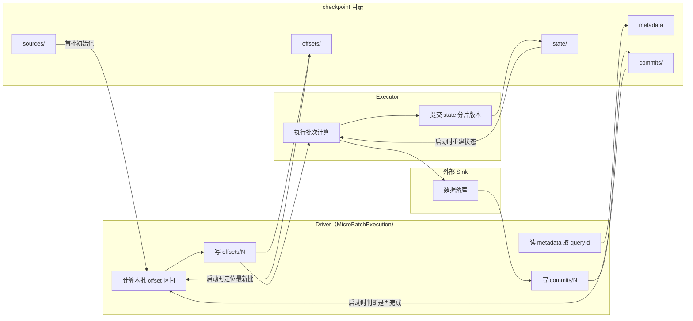
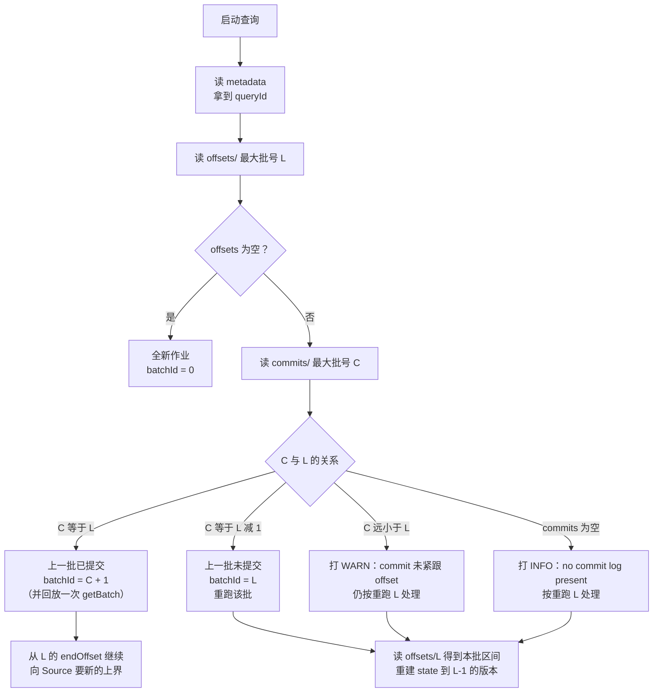
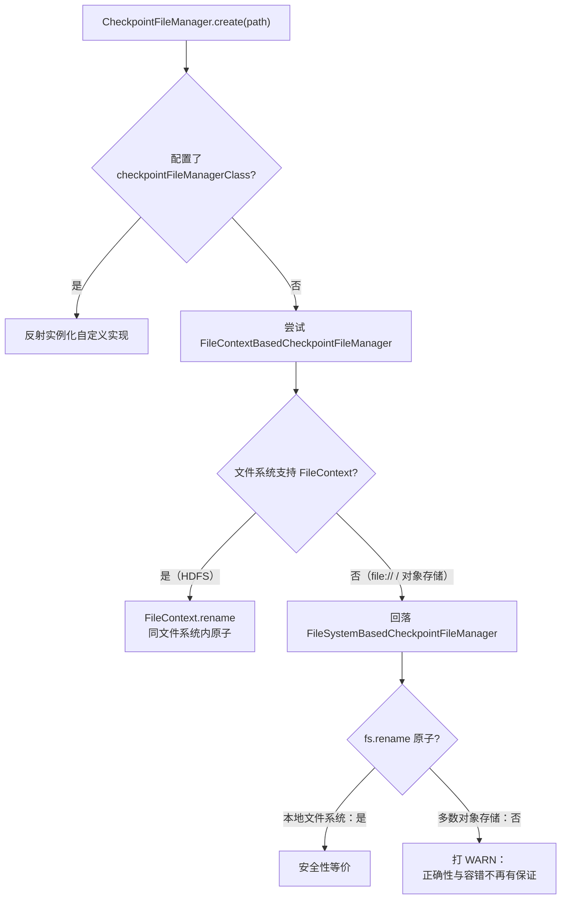
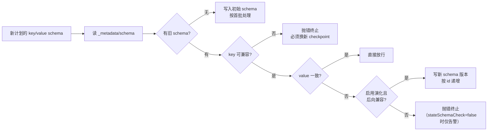
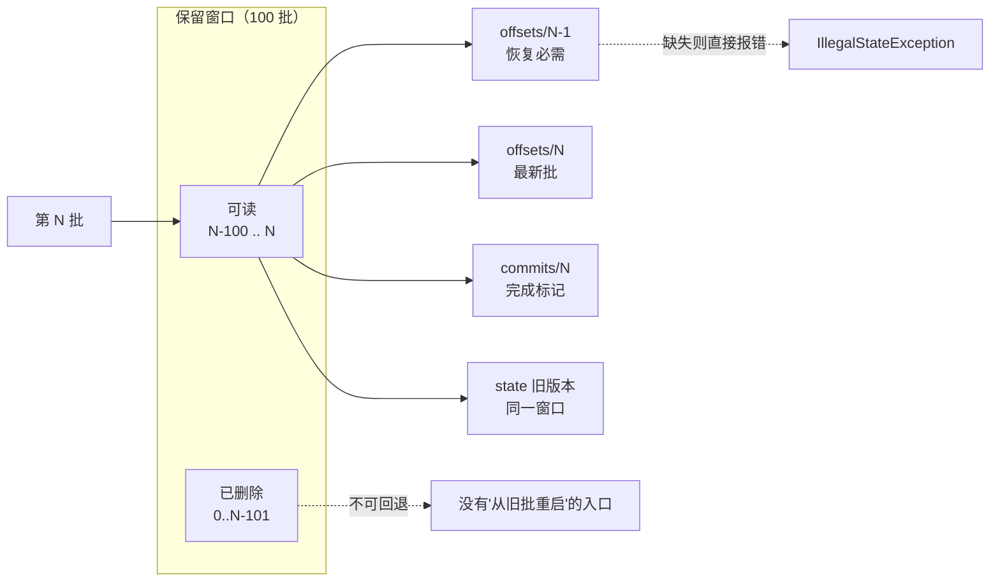

# 04 Structured Streaming 容错模型：Offset 与 Checkpoint

**摘要：**

流处理的容错不像批处理那样可以靠"重跑一遍"兜底，因为输入没有边界，谁也说不清"从头"是哪里。Structured Streaming 给出的答案是一个目录：checkpoint。它把"这一批要读哪一段数据""这一批跑完了没有""这一批留下的状态在哪"三件事分别落到不同的文件里，恢复时按固定顺序读回来。本文不讨论编程模型，只回答一个问题：这个目录里究竟有什么、恢复时程序按什么顺序读它们、哪些前提一旦被破坏就再也起不来。全文以 `offsets/`、`commits/`、`metadata`、`state/`、`sources/` 五类记录为骨架，逐层拆解两份进度日志的格式与配合方式，`CheckpointFileManager` 如何在本地文件系统、HDFS 与对象存储上提供（或不提供）原子性，`state/` 下的版本号与 `_metadata/schema` 怎样把一次 schema 变更变成一次启动失败，以及 `spark.sql.streaming.minBatchesToRetain` 这个参数真正管理的到底是"回溯窗口"还是"容错余量"。最后落到运维：目录共用、删目录、换 provider、升级 Spark 这四类动作为什么危险，各自的症状是什么，以及判据该从日志的哪一行、目录的哪一个文件去看。文中的目录结构、字段含义与失败判据都对照 4.3.0 的源码核对过；涉及容量与时间的数字一律标注为示例推算，不当作实测。

---

## 第 1 章 一个目录里的五类记录

2018 年 4 月，Spark 社区用一个 PR 收掉了一处持续两年的麻烦：checkpoint 文件的写入逻辑原本散落在三个地方，offset 日志自己写一套、状态存储自己写一套，各自拿 Hadoop 的 `FileSystem` 试 rename，谁都以为自己是原子的，可对象存储上根本不是。那个 PR（SPARK-23966）把它们统一到 `CheckpointFileManager` 一个接口下，接口注释写得很直白——不同文件系统提供原子性的手段不同，有的是"写临时文件再改名"，有的是"直接写、失败就取消"，把这层差异藏在接口后面，调用方只需要关心 `createAtomic` 之后是 `close` 还是 `cancel`。

这段历史值得记住，因为它解释了本篇后面所有关于"原子性"的讨论为什么落在文件系统层而不是引擎层：引擎从来没有自己实现过原子写，它只是挑了一个文件系统相信。

那么一个 checkpoint 目录里到底有什么？五类记录，各自的写者、写时刻、读者都不同：

| 路径 | 内容 | 谁写、何时写 | 恢复时被谁读 | 丢了会怎样 |
|---|---|---|---|---|
| `metadata` | 一行 JSON：`{"id":"<UUID>"}` | Driver，首次启动、且该文件不存在时 | 每个作业启动的第一步 | 会生成新 queryId，幂等 Sink 的去重依据失效 |
| `offsets/<batchId>` | 版本行 + 元数据行 + 每个 source 一行 offset | Driver，**在批次执行之前** | 定位最新批、确定本批输入 | 无法确定"读到哪了" |
| `commits/<batchId>` | 版本行 + 提交元数据（水位、状态文件 id） | Driver，**在 Sink 返回之后** | 判断最新批是否已完成 | 重启后重跑最新批，Sink 端可能重复 |
| `state/<opId>/<partId>/` | `_metadata/`、`_metadata/schema`、`<version>.delta`、`<version>.snapshot` | Executor，任务末尾提交 | State Store 恢复 | 状态丢失或版本错位，只能删目录重来 |
| `sources/<n>/` | source 自己的持久化记录（Kafka 的初始 offset、File source 的位点日志） | Driver/Source，首批或每批 | 确定起始位置 | `startingOffsets` 被重新解析，可能跳读或漏读 |

目录树长得像这样，注意 `state/` 的层级比另外几个深一层，因为它要按算子和分区拆：

```text
hdfs:///streaming/risk_events/
├── metadata                     {"id":"5f1c...-...-8a2b"}
├── offsets/
│   ├── 1360                     3 行起步的进度日志
│   ├── 1361
│   └── 1362
├── commits/
│   ├── 1359
│   ├── 1360
│   └── 1361
├── state/
│   ├── 0/                       算子 0（窗口聚合）
│   │   ├── _metadata/
│   │   │   ├── metadata
│   │   │   ├── schema
│   │   │   └── v2/              checkpoint format v2 才有
│   │   ├── 0/                   partition 0
│   │   │   ├── 12.snapshot
│   │   │   ├── 21.delta
│   │   │   └── 22.delta
│   │   └── 1/
│   └── 1/                       算子 1（去重）
└── sources/
    └── 0/
        └── 0                    Kafka 首次解析出的起始 offset
```

这张图里已经能看出两个容易被忽略的事实。第一，`offsets/` 与 `commits/` 的批号并不总是对齐，图上 offset 到 1362、commit 到 1361，说明最后一次执行没有走完，重启后会重跑 1362。第二，`sources/0/0` 这个文件名里的 `0` 不是批次号，而是 Kafka Source 在第一批时写入的"初始 offset 决议"，一个作业的生命周期里只会写一次。

五类记录里，`metadata` 最像"户口本"：它只在目录刚建好时写一次，用的是 `createAtomic(overwriteIfPossible = false)`，如果文件已存在就抛 `FileAlreadyExistsException`，然后被翻译成"多个查询共用同一路径"的错误。这个设计说明了一件事——**同一个 checkpoint 目录在 Spark 的设计里本来就只属于一个查询**，它没有做任何多写者协调。

`sources/` 这一类经常被误解为"和 offsets 重复了"。它重复的是内容，不重复的是用途：`offsets/` 记的是每一批读了哪一段，`sources/` 记的是 Source 自己的初始化决定。以 Kafka 为例，`startingOffsets` 在第一批被解析成具体的 partition-offset 映射之后立刻写进 `sources/<n>/0`，后续所有重启都不再重新解析。这带来一个副作用：改 `startingOffsets` 对已有 checkpoint 的作业完全无效，它只对新建目录的作业有意义。想把"从头再读一遍"作为补救手段的人，往往就是在这里被绊住的。

`sources/` 还经常被和另外两个名字混为一谈，而这三样东西的位置、写者、用途各不相同，混起来会把排障方向带偏：

| 名字 | 位置 | 写者 | 存的是什么 |
|---|---|---|---|
| `sources/<id>/` | checkpoint 目录内 | Source | File source 的位点日志：每批新发现了哪些文件，用来判断哪些已经读过 |
| `_spark_metadata/` | **Sink 的输出目录**内，不在 checkpoint 里 | Sink（`ManifestFileCommitProtocol`） | File sink 的提交清单：每一批登记了哪些文件 |
| `receivedData/` | legacy DStream 的 checkpoint 目录 | Receiver | 接收到的数据块本体，Structured Streaming 里根本不存在 |

把 `_spark_metadata` 说成 source 的 WAL、或者以为 Structured Streaming 还留着 `receivedData/`，都是从 DStream 时代带过来的惯性。顺带把 File sink 的原子性也摆正：3.0 之后它靠的是这份清单而不是 rename——`commitJob` 把本批文件一次性追加进日志，`addBatch` 的第一句按批号比较，批号不大于清单里最新号就整批跳过；部分失败时目录里仍会留下未登记的孤儿文件，所以"清单不重复"不等于"目录不重复"（四种 Sink 的能力对照见 [[05 WAL 与幂等写出：Exactly-once 的两道保险|WAL 与幂等写出]]）。



---

## 第 2 章 `offsets/`：先落笔，再动手

### 2.1 文件格式：三行起步的纯文本

`offsets/<batchId>` 不是 JSON 文件，虽然它的中间部分确实是 JSON。它是一份逐行的纯文本，第一行是版本号，第二行是这一批的元数据，之后每个 source 占一行：

```text
v1
{"batchWatermarkMs":0,"batchTimestampMs":1763500800000,"conf":{"spark.sql.streaming.aggregation.stateFormatVersion":"2", ...}}
{"topic":{"risk_events":{"0":88207113,"1":88206402,"2":88209177}}}
```

版本行只有 `v1` 与 `v2` 两种取值，`v2` 的差别在后续行的组织形式：`v1` 按 source 在计划里出现的顺序逐行排列，`v2` 改成 `sourceId:offset` 的键值对，为的是让 source 增删不再依赖位置。写入侧的默认值仍是 `v1`，由 `spark.sql.streaming.offsetLog.formatVersion`（4.2.0 引入，内部配置，默认 1）控制，只有开启了需要按名字追踪 source 的特性时才会自动抬到 `v2`。这条演进线索本身说明了一件事：**日志格式的版本号和引擎版本号不是一回事**，升级 Spark 不会自动改写已有文件。

第二个细节是 `-`。某个 source 在这一批没有产生新数据时，它那一行写的不是空行也不是 `null`，而是一个减号，反序列化时被还原成"这个 source 本批没有 offset"。这是有意的：空行会让"行数等于 source 数"这个隐含约定失效，而 `-` 把位置占住了。这条约定在 2.5 节会变成一条硬断言，`-` 的存在正是为了让断言总能被检查，而不是靠猜。

### 2.2 元数据行装的是"这一批的世界设定"

第二行那份 JSON 是 `OffsetSeqMetadata`，字段只有三个：本批开始时的水位（`batchWatermarkMs`）、本批的处理时间戳（`batchTimestampMs`），以及一份配置快照（`conf`）。

前两个字段的用途很明确——水位要在崩溃重启后恢复到原处，否则窗口会重复触发或漏触发；批次时间戳让 `current_timestamp()` 这类按批求值的函数在重跑同一批时得到同一个值，这是"重跑必须幂等"的前提之一。第三个字段才是真正容易被低估的：那份 `conf` 里固定收录了约二十个与状态格式相关的配置项，包括 `spark.sql.streaming.stateStore.providerClass`、`spark.sql.streaming.stateStore.rocksdb.formatVersion`、`spark.sql.streaming.stateStore.compression.codec`、`spark.sql.streaming.aggregation.stateFormatVersion`、`spark.sql.streaming.stateStore.encodingFormat` 等等。

这些配置在恢复时会被**反向覆盖**当前会话。`MicroBatchExecution.populateStartOffsets` 里读回最新 offset 之后立刻调用 `OffsetSeqMetadata.setSessionConf`，把日志里的值写回 `SQLConf`，如果当前会话里的值与日志里的不一致，还会打一条 WARN：

```text
WARN MicroBatchExecution: Updating the value of conf 'spark.sql.streaming.stateStore.providerClass'
in current session from '...RocksDBStateStoreProvider' to '...HDFSBackedStateStoreProvider'.
```

这条日志是排障时最有用的几条之一。它意味着你以为改生效了的配置实际上被 checkpoint 顶回去了，而 checkpoint 之所以要顶回去，是因为这些配置决定了状态的物理格式，一旦中途换掉，旧的状态文件就没人读得懂。想把 HDFSBacked 换成 RocksDB，唯一的正路是换个新的 checkpoint 目录，而不是改配置重启。

### 2.3 为什么必须在执行之前写

`markMicroBatchStart` 里只有一件事：把本批的 offset 写入 `offsets/<batchId>`，写不进去就抛 `concurrentStreamLogUpdate`。这次写入发生在任何计算任务被提交之前，这是整个协议里最关键的一个顺序决定。

我们不妨反事实地想一想：假如先算完再记 offset，那么"算完了但没来得及记"这个窗口里崩溃，重启后引擎会认为这一批没跑过，于是去问 Source"现在最新到哪了"，而 Source 给的是**现在**的最新位置，不是崩溃那一刻的位置。中间进来的数据会被这一批的边界跨过去，形成一段永远不会被处理的空洞。先记 offset 就堵住了这个洞：offset 一旦落盘，这一批的输入范围就被钉死了，无论后面崩在哪里，重启后重放的都是同一段输入。

代价是另一个方向的：钉死的范围可能被重复处理。这不是缺陷，是取舍——**在"可能重复"和"可能丢失"之间，流处理引擎一律选前者**，因为重复可以由下游的幂等或去重消掉，丢失不能。后面第 4 章讲的恢复三分支，本质就是这套取舍在不同崩溃点上的表现形式。

### 2.4 写日志本身也在花时间

`offsets/` 的写入是同步的，位于批次的关键路径上：从 `latestOffset` 返回，到第一个 Task 启动，中间隔着一次 HDFS 的临时文件写入加 rename。这批数据量越大、source 越多、分区越多，这一行 JSON 就越长，写一次就越慢。一条 12 分区的 Kafka source 大约几百字节到一两 KB，HDFS 上一次 create-rename 在正常负载下是毫秒级，但 NameNode 一忙就不是了。

这个开销在批次时长里占比很小，可它对批次时长很敏感的场景（譬如秒级触发）会成为隐性下限：你不可能把批次间隔压到比"写两份日志 + 提交一次状态"还短。4.x 里针对这一点做了两件事，一件是把进度日志的写入异步化（`AsyncOffsetSeqLog`、`AsyncCommitLog`，目前服务于 Real-Time Mode，做法是允许某几批只在内存里留记录、批量落盘），另一件是异步清理旧日志（`spark.sql.streaming.asyncLogPurge.enabled`，3.4.0 起默认开启）。两件事都指向同一个方向：把 checkpoint 从"每批必做的同步 IO"变成"可以攒一攒的后台活"。这条路的风险也显而易见——异步意味着"已提交"的定义被放松了，只在特定模式下才敢用。

### 2.5 行数契约：多一个 source 就起不来

版本行的下一层约束更硬：`v1` 格式下，日志里的行数必须等于当前计划里的 source 个数，少一个多一个都不行。读回时 `OffsetSeq.toStreamProgress` 的第一句就是一个断言：

```text
assert(sources.size == offsets.size, s"There are [${offsets.size}] sources in the checkpoint
offsets and now there are [${sources.size}] sources requested by the query. Cannot continue.")
```

这条断言把一类非常常见的需求直接挡在门外。原本一条 Kafka 流做聚合，现在要按业务加一张广播用的维表——如果这张维表是以 `readStream` 的形式接进来的，source 就从 1 个变成 2 个，旧 checkpoint 立刻不可用；反过来把某条流的读取拆成两条再 `union`，同样会触发。报错信息本身是清楚的（"checkpoint 里有 1 个 source，现在查询要 2 个"），但它出现在启动的第一秒，配合一个跑了几个月的状态目录，处置方式往往就是"删了重来"，代价是全量重算。

这个限制正是 `v2` 格式要解决的问题。`v2` 把后续行从"按位置排列"改成 `sourceId:offset` 的键值对，读回时按 source 的标识去匹配，多一个少一个不再让整个文件失效。但格式切换是 checkpoint 级别的一次性决定（新建目录时定，之后不改），已有目录没法"就地升级"——这也解释了为什么这个改动从提出到默认启用走了好几年：收益明确，迁移路径却没有捷径。

工程上能做的规避不复杂：把可能变化的输入在方案阶段就固定成 source 的数量上限，能做 `broadcast` 的维表不要用 `readStream` 接；确实要加，就在变更窗口里用"新目录 + 指定起始位点"重算，而不是指望旧目录兼容。

---

## 第 3 章 `commits/`：一行版本号撑起的账本

### 3.1 从只记水位到记索引

`commits/<batchId>` 的格式最简单，简单到经常被当成一个空标记：一行版本号，一行元数据。

```text
v3
{"nextBatchWatermarkMs":1763500860000,"stateUniqueIds":{"0":[ ["a1b2c3..."], ["d4e5f6..."] ]},
 "sinkMetadataMap":{"default":{"sinkName":"default","commitOffset":"-","providerName":"...","apiVersion":"v2","isActive":true}}}
```

第一版只有一个字段 `nextBatchWatermarkMs`，记录这一批结束时的水位，重启时用它恢复水印跟踪器。水位的恢复不能靠 offset 日志里那份——那是**本批开始时**的水位，而 commit 里这份是**本批结束时**的，差一批就可能让过期策略多留或少留一批的状态。

第二版加了 `stateUniqueIds`：把每个算子、每个分区在这一批写出的状态文件标识记下来。这份映射是 checkpoint format v2 的核心，第 6 章会展开。第三版又加了 `sinkMetadataMap`，为"运行中更换 Sink"这件事留出记录位——每个 Sink 有自己的提交进度与实现标识，历史 Sink 以 `isActive=false` 留在账上，用来发现"有人把已经退场的 Sink 名字又用回来了"。

三版的字段对比：

| 版本 | 引入目的 | 关键字段 | 恢复时的影响 |
|---|---|---|---|
| `v1` | 记号"这批完成了" | `nextBatchWatermarkMs` | 水位能恢复，状态文件靠版本号推断 |
| `v2` | 让状态文件的定位不再靠推断 | `stateUniqueIds` | 每批的状态文件由 id 直接指定，重跑不会误用半成品 |
| `v3` | 支持运行中换 Sink | `sinkMetadataMap` | 每个 Sink 的提交进度独立记录 |

需要说清楚的是，`v3` 不是"新版本 Spark 就会写"的东西，它要求 `sinkMetadataMap` 非空且恰好一个 `isActive=true`，是给开启了 Sink 演化的作业用的。绝大多数作业读到的仍是 `v1`，因为写哪个版本由建 checkpoint 时的特性组合决定，之后不再变。

### 3.2 提交记录里没有"处理了多少条"

打开任何一个 `commits/` 文件，你都找不到"本批处理了多少行""耗时多少毫秒"这类信息。这些数据在 `StreamingQueryProgress` 里，只存在于 Driver 内存和 `spark.sql.streaming.numRecentProgressUpdates`（默认 100）条内存环形缓冲里，作业一停就没了，除非你把它们推给外部系统。

这个设计的后果经常在事故复盘时咬人：checkpoint 能告诉你"第 1359 批处理的是 offset 区间 A 到 B"，但告诉不了你"这一批从 A 到 B 之间读到了 12 万条还是 0 条"。想事后算清楚"那段时间到底丢没丢数据"，只能拿 offset 区间回查 Kafka 的位点，或者去 Sink 侧按批次号核对。这也是为什么生产环境基本都会挂一个 `StreamingQueryListener` 把 progress 落到表里——checkpoint 只管语义正确，不管可观测性（监听器的指标口径见 [[11 监控与可观测性：StreamingQueryListener 与生产指标体系|监控与可观测性]]）。

---

## 第 4 章 恢复：两条日志怎么对账

### 4.1 三个分支，一段不到五十行的代码

恢复的入口是 `MicroBatchExecution.populateStartOffsets`。它做的事可以拆成三步：先看 `offsets/` 里最大的批号，再拿它去和 `commits/` 里最大的批号比，最后决定从哪一批开始。



笔者见过的口径里，流传最广的简化说法是："恢复时取有 commit 的最大 batchId，从它后面继续"。这句话在多数时候是对的，但它把两件事揉成了一件，进而导致两个常见误判。

第一，**恢复点不是 commit 决定的，offset 决定的**。代码先取 offset 的最大批号 `L`，再把 `L` 当成"候选执行批"。commit 的作用是回答"候选批是否已经跑完"，不是提供起点。所以在 `C == L - 1` 的分支里，引擎重跑的是 `offsets/L` 里记的那一批，而不是从 `C+1` 向 Source 重新要数据——这两件事在 offset 与 commit 差一批时恰好等价，在差更多批时就不等价了。

第二，**"有 commit"不等于"结果可见"**。commit 落盘发生在 Sink 的 `addBatch` 返回之后，但"返回"只表示 Sink 认为写成功了，不表示下游读者已经能看到。Delta 的事务日志提交了，Hive Metastore 的元数据可能还没刷新；JDBC 的 `executeBatch` 返回了，MySQL 的主从同步可能还没追上。这中间的时间差里如果下游先做了一次对账，读数就会和 checkpoint 的进度对不上。这不是 checkpoint 的错，是"提交"这个词在两套系统里指的不是同一件事。

### 4.2 为什么还需要 `offsets/<L-1>`

上面三个分支都隐含了一个前提：`offsets/<L-1>` 必须存在。代码里专门有一段校验，注释和错误信息都写得相当露骨：

```text
The offset log for batch 1361 doesn't exist, which is required to restart the query from the
latest batch 1362 from the offset log. Please ensure there are two subsequent offset logs
available for the latest batch via manually deleting the offset file(s). Please also ensure
the latest batch for commit log is equal or one batch earlier than the latest batch for offset log.
```

为什么要前一批？因为一批的输入区间是"上一批的 endOffset 到本批的 endOffset"。`offsets/<L>` 里只记了本批的 endOffset，startOffset 要靠 `offsets/<L-1>` 反推。这也解释了为什么日志文件里没有 startOffset 字段——它是推导出来的，不重复存。

于是恢复对存储的要求就很清楚了：**任意时刻，存储上至少要能看到最后两个 offset 文件**。`minBatchesToRetain` 的默认值 100 远大于 2，所以正常情况下这个前提不构成问题；但一旦有人把它改成 1、或者手工删了文件、或者存储端的可见性出现偏差，这个前提就断了。断了之后的表现不是"退回到更早一批"，而是直接 `IllegalStateException` 终止——引擎没有"猜一个更早的起点"这种降级路径。

### 4.3 那个"多调一次 getBatch"的补偿

`C == L` 分支里有一句看起来多余的代码：明明上一批已经提交完成了，为什么还要对每个 source 再调一次 `getBatch(start, end)`，而且调完的返回值直接丢掉？

注释给了答案：某些 V1 Source（典型是 Kafka Source）在重启后的假设是"上一批会先被重放一次"，它在 `getBatch` 里会做一些只做一次的状态初始化，如果引擎跳过这次调用，后续 `getOffset` 就可能拿到错的结果。于是引擎用一次"空跑"来满足这个约定。V2 API 的 `MicroBatchStream` 没有这个历史包袱，代码里对应的分支是空的——什么都不做。

这种"为了兼容一个实现的隐含约定而在公共路径上多走一步"的痕迹，在 checkpoint 这一层还有好几处。它们不影响语义，但会影响恢复耗时：恢复时要对每个 source 调一次 `getBatch`，对 Kafka 而言这一步会初始化消费者并预取元数据，一个有几十个 source 的宽表作业，光这一段就能花掉十几秒。

### 4.4 一次重启的日志长什么样

把上面的逻辑翻译成日志，一次正常重启落在前面那张图的"重跑"分支里，大致长这样（行首的组件名做了简化）：

```text
INFO MicroBatchExecution: Starting [id = 5f1c..., runId = 91ab...]. Use hdfs:///streaming/risk_events to store the query checkpoint.
INFO HDFSMetadataLog: Getting latest batch 1362
INFO MicroBatchExecution: Resuming at batch 1362 with committed offsets {KafkaV2[...]@88207003} and available offsets {KafkaV2[...]@88209450}
INFO MicroBatchExecution: Committed offsets for batch 1362. Metadata OffsetSeqMetadata(1763500860000, ...)
INFO HDFSMetadataLog: Writing atomically to hdfs:///streaming/risk_events/offsets/1362 using temp file hdfs:///streaming/risk_events/offsets/.1362.4f2b....tmp
INFO HDFSMetadataLog: Renamed temp file .../.1362.4f2b....tmp to .../offsets/1362
INFO HDFSBackedStateStoreProvider: Read snapshot file for version 12 of 209715200 bytes
INFO HDFSBackedStateStoreProvider: Read delta file for version 21 of 20971520 bytes
INFO MicroBatchExecution: Completed batch 1362
```

有几处可以直接当判据用。`Resuming at batch` 那一行里的两个 offset 集合，`committed` 是即将重跑的区间起点，`available` 是终点——如果这两个值相等，说明这一批其实没有数据，重跑只是一次空转。`Writing atomically ... using temp file` 与 `Renamed temp file` 是成对出现的，只有前者没有后者，就是写到一半进程没了，那个 `.1362.xxx.tmp` 会成为目录里的垃圾文件。`Read snapshot file for version X` 与随后的一串 `Read delta file for version Y` 是状态重建的现场：快照版本加上重放的 delta 条数必须能接到 `1362`，接不上就是状态版本落后于 offset，引擎会自己去补，补不上就报错。恢复时要重放多少个 delta，直接决定这一次重启要花多久。

### 4.5 这条路径只在查询重启时被走一遍

一个容易混淆的点：Executor 挂掉、节点失联、Task 失败重试，这些高频故障**不会**触发 checkpoint 恢复。它们的处置在另一层——Task 重试、Stage 重算、Shuffle 重取，Driver 全程活着，`execCtx` 里的 offset 与状态版本继续在内存里推进，checkpoint 目录一个字节都不用读（重试机制的展开见 [[02 Task 与 Stage 的多级重试机制|Task 与 Stage 的多级重试机制]]，Executor 丢失为何"不记账"见 [[大数据/Spark/读书笔记-spark内核/04_存储与容错机制/4. Spark容错机制与Runtime生命周期|容错机制与 Runtime 生命周期]]）。

只有"查询重新启动"才会走 `populateStartOffsets`，具体有三种入口：Driver 进程整个重启、作业被重新提交、以及在同一个 `SparkSession` 里对查询调用了 `stop()` 之后再 `start()`。第三种在开发环境里很常见，也最容易误判——作业看起来"没重启过"，实际上状态与 offset 都从磁盘读了一遍，如果目录被别的进程动过，症状就会很奇怪。

这条区分对排障有直接价值：看到批次号从某个值开始往回跳，说明走了恢复路径；批次号连续递增但耗时抖动，问题在计算层而不在 checkpoint 层。Spark UI 里 `Streaming` 页面的 `batchId` 只会单调增，真正的判据在 Driver 日志的第一屏——`Resuming at batch N` 出现一次，就意味着一次恢复。

还有一个边界值得单独提：Driver 崩了但查询不会自己回来。Structured Streaming 没有内建的 Supervisor，YARN 或 Kubernetes 上的重启是集群管理器与外部调度的事。所以"checkpoint 能不能恢复"这个问题在生产上真正被问到的时刻，永远是外部拉起一个新进程的时候——那个新进程用的 Spark 版本、配置、代码，都可能与写 checkpoint 时不同，这正是第 7 章和第 9 章要处理的问题。

### 4.6 "重复"的三条边界

"精确一次"这个词在流处理里被用得太宽，落到 checkpoint 这一层，能说清楚的只有三条边界，它们的责任方完全不同。

第一条在重放区间内部：offset 已写、commit 未写，重启后整批重跑。这条重复是必然发生的，取决于崩溃时机而不是配置，唯一能压的是单次重放的量——批次越短，重放的数据越少，但踩到这个窗口的次数越多。

第二条在 Sink 侧：commit 已写，可 Sink 的写入在这之后才对下游可见，或者 Sink 本身不幂等。这条重复不由引擎负责，取决于接收方愿不愿意拿批次号或业务主键判重。文件 Sink 靠 `_spark_metadata` 清单、事务表靠表事务、内置 Kafka Sink 的 `commit`/`abort` 在 4.x 里是空实现（`useCommitCoordinator=false`），只能给到至少一次——要事务就得自己在 `foreachBatch` 里管 `transactional.id` 与 `transaction.timeout.ms`。三者能给的保证差别很大（各自的边界见 [[05 WAL 与幂等写出：Exactly-once 的两道保险|WAL 与幂等写出]]，"副作用重复"这一类失败形态的通用分析见 [[大数据/Spark/读书笔记-spark内核/04_存储与容错机制/5. Spark错误容忍机制|Spark 错误容忍机制]]）。

第三条在 Source 侧：区间内的数据本身就有重复投递。上游的至少一次生产、业务侧重发、同名文件被写两次，都会让"同一段 offset"里出现语义上重复的行。checkpoint 对此无能为力，它只保证"读的是同一段"，不保证"这一段里没有重复"（应用层怎么兜住，见 [[09 dropDuplicates 与精确去重：Exactly-once 的应用层保障|dropDuplicates 与精确去重]]）。

顺带把一个对照说清楚：早期 Spark Streaming 的 WAL 是冲着"Source 不可重放"去的——先把收到的数据块落盘，再处理，这样上游不认账也能重算。微批模型的前提换成"Source 一定可重放"之后，WAL 就不再承担保存数据的职责，剩下的位置让给了 Sink 侧的提交清单与幂等键。这个交接解释了 checkpoint 目录里为什么只有进度而没有数据：它记的是"读到哪了"，数据本身要从 Source 重新读出来。反过来，RDD 层的 checkpoint 存的是数据本身，用一份物化结果换掉前半段血缘（写入路径与切血缘的机制见 [[大数据/Spark/读书笔记-spark内核/04_存储与容错机制/6. Spark_Checkpoint机制|Spark Checkpoint 机制]]），两套东西同名，职责正好相反。

---

## 第 5 章 原子性落在谁身上：`CheckpointFileManager`

### 5.1 三条实现路线

`CheckpointFileManager` 是一个 trait，核心方法只有一个：`createAtomic(path, overwriteIfPossible)`，返回一个带 `cancel()` 的输出流。调用方写完 `close()` 就算成功，中途失败就 `cancel()`，让"文件要么完整存在、要么根本不存在"这件事由实现方负责。

`create()` 工厂的挑选顺序是固定的：



HDFS 走 `FileContext` 而不是 `FileSystem`，原因写在注释里：HDFS 的 `FileContext.rename` 提供原子重命名，而 `FileSystem.rename` 的原子性依赖具体实现。回落到 `FileSystemBasedCheckpointFileManager` 时，源码会打一条警告，笔者把措辞完整抄在下面：

```text
Could not use FileContext API for managing Structured Streaming checkpoint files at <path>.
Using FileSystem API instead for managing log files. If the implementation of FileSystem.rename()
is not atomic, then the correctness and fault-tolerance of your Structured Streaming is not
guaranteed.
```

"正确性与容错不再有保证"——这不是夸张的修辞，是精确的陈述。原子性一旦失去，`createAtomic` 的名字就成了谎言，调用方基于它的所有推理（包括第 4 章的对账逻辑）全部失效。

### 5.2 临时文件的命名与垃圾清理

原子写的实现是"写临时文件再改名"，临时文件名由 `generateTempPath` 生成：在目标文件同目录下，名字是 `.<目标名>.<UUID>[.TID<taskAttemptId>].tmp`。三点设计意图：同目录保证 rename 是同文件系统内的操作（跨文件系统的 rename 会退化成拷贝加删除）；UUID 保证并发写同一目标时不互相覆盖；带上 task attempt id 是为了在任务重试时可以追溯是哪个 attempt 留下的。

反过来看，这也意味着临时文件是 checkpoint 目录里唯一会"泄漏"的东西。取消路径（`cancel()`）会尽力删除临时文件，删除失败只打 WARN；进程被 kill 的话连 WARN 都没有。所以一个跑了很久的目录里出现几个 `.1362.xxx.tmp` 是常态，它们不影响恢复（`HDFSMetadataLog.listBatches` 只认能解析成数字的文件名），但会让目录的 `list` 结果变长。清理它们要小心：正在运行的作业可能正在写其中某一个。

### 5.3 对象存储：rename 不是原语

`s3a` 的 rename 是"拷贝对象 + 删除源对象"，两步之间没有任何原子性可言；`rename` 返回成功也不代表目标对象已经对所有人可见。更麻烦的是"覆盖式 rename"：目标已存在时的语义在各家实现里并不一致，有的抛异常，有的覆盖，有的静默失败返回 `false`。

Spark 对这件事的态度是"不假装支持"。`HDFSMetadataLog` 的类注释里有一句很干脆的话：

```text
Note: HDFSMetadataLog doesn't support S3-like file systems as they don't guarantee listing files
in a directory always shows the latest files.
```

这句话写在 2020 年之前，那时 S3 的 list 还不保证强一致；今天 S3 对 PUT/DELETE/LIST 已经提供了强一致，所以注释里指的那个具体问题基本消失了。但**注释背后的结论依然成立，只是理由换了**：真正致命的是 rename 的两步性，以及"临时文件写入与改名之间"那段窗口。哪怕 list 是强一致的，一个正在被改名的 checkpoint 文件也可能被另一个读者以"旧名字不存在、新名字也还不存在"的状态看到。

工程上的处置有三层，可以叠加：

1. 把 checkpoint 放在 HDFS 上，这是最省事的答案，代价是对象存储上做流处理就得配一套 HDFS。
2. 打开 `spark.sql.streaming.checkpoint.renamedFileCheck.enabled`（3.4.0 引入，默认 `false`）。打开之后，rename 返回成功还要再 `exists` 一次，不存在就把整批判失败，而不是带着一个其实没写成的 checkpoint 继续跑。配置文档自己也说了适用场景："当 checkpoint 位置在 rename 不保证原子的对象存储上时，考虑开启"。
3. 用 `spark.sql.streaming.checkpointFileManagerClass` 换上自己实现的 `CheckpointFileManager`，针对具体对象存储的语义写原子写（譬如利用 S3 的多段上传完成即原子、或用外部锁服务）。

第 2 条的成本是一批每写一个 checkpoint 文件就多一次 `exists` 调用。一批要写 2 个进度日志文件、几十个状态文件，一个 300 节点、每天 2000 个批作业的集群，折算下来是每天几十万次额外的元数据请求——对 NameNode 是压力，对对象存储是账单。这就是它默认关闭的真实原因：**原子性检查买到的是确定性，付出的是每批固定的一次往返**。

### 5.4 校验和：坏文件比丢文件更难查

4.1.0 起 Spark 给 checkpoint 文件加了可选的校验和（`spark.sql.streaming.checkpoint.fileChecksum.enabled`），只在状态存储的 checkpoint format 为 v2 时生效。写入时同目录多写一个校验和文件，读取时比对。

这个特性针对的故障形态和 rename 完全不同：rename 出问题表现为"文件不存在"，校验和出问题表现为"文件在、内容坏了"。后者在对象存储上并不罕见——写入被截断、并发覆盖、存储侧静默损坏。没有校验和时，这类故障的典型症状是反序列化异常、状态 map 里出现莫名其妙的 key、或者更糟：一切正常但聚合结果偏了。有了校验和，至少在读取的第一时间就能定位到具体哪个文件坏了，而不是靠对账反推。

同一个版本还引入了"自动快照修复"（`spark.sql.streaming.stateStore.autoSnapshotRepair.enabled`，4.1.0，默认开启）：加载状态时如果发现最新的快照坏了，跳过它、改从更早的快照加 delta 重放，而不是让整个查询起不来。这类"自愈"能力是 checkpoint 这一层近几年最实际的变化——它承认了存储不可靠，并把恢复从"全有或全无"改成"能退几步就退几步"。

### 5.5 路径本身也能让作业起不来

还有一个和原子性无关、但同样能把恢复卡死的机制：路径转义检查。Spark 2.4 及更早的版本在拼 checkpoint 路径时会把 URI 转义三次，导致实际目录名里多出 `%25` 之类的字符。为了不让人在升级后莫名其妙读到旧目录，`spark.sql.streaming.checkpoint.escapedPathCheck.enabled`（默认开启）会在启动时检查"转义三次后的路径是否存在"，存在就报错，并在错误信息里给出迁移办法。

这类检查的共同点是：它们不属于容错协议，但都属于"恢复路径上的前置断言"。排障时如果作业连第一批都没跑起来就失败了，先怀疑的不是 checkpoint 内容，而是这些前置断言。

---

## 第 6 章 `state/`：目录、版本与 checkpoint id

### 6.1 三层目录的物理含义

`state/` 下的第一层是算子 id，第二层是分区 id，第三层才是文件。这个结构由 `StateStoreId` 决定：

```text
<checkpoint>/state/<operatorId>/<partitionId>/
```

`operatorId` 不是算子的类名，也不是某个稳定哈希，而是 `IncrementalExecution` 在执行计划上按出现顺序自增分配的序号。这一点后面会变成一个具体的坑：**调整有状态算子的顺序，等于给状态换了房间**。

每个分区目录里的文件分三类：`<version>.delta` 增量、`<version>.snapshot` 快照、以及 `_metadata/` 目录。`_metadata/metadata` 是算子级元数据（算子 id、状态存储的名字、key 前缀列数、分区数、算子属性），`_metadata/schema` 是状态 schema 的记录，`_metadata/v2/<batchId>` 是 checkpoint format v2 下的按批算子元数据（含当批使用的 schema 文件路径）。

### 6.2 快照与增量：恢复要读多少个文件

状态存储每个批次写一个 delta，delta 攒够 `spark.sql.streaming.stateStore.minDeltasForSnapshot`（内部配置，默认 10）个之后合并成一个 snapshot，旧的 delta 与旧 snapshot 按保留策略删除。

恢复时要做的事是从某个版本开始读：先找到不晚于目标版本的最近一个 snapshot，把它整份读进内存，再把之后的 delta 逐个重放。于是恢复时间取决于两个量——snapshot 的大小（决定读取的绝对量）和 delta 的数量（决定重放的轮数）。这两个量都不由"批次间隔"决定，而由"状态变更速率"与"快照间隔"共同决定。一个状态 5 GB、每分钟新增 200 MB 的作业，快照间隔 10 批意味着最坏情况下要重放 2 GB 的 delta，恢复时间自然比状态 50 MB 的作业长一个量级。

这条链上的细节（内存 map 的结构、delta 的编码、提交时的协调）在 [[06 State Store 内幕：HDFSBackedStateStore 的读写路径|State Store 内幕]] 与 [[07 RocksDB State Store：为超大状态而生|RocksDB State Store]] 里展开，本篇只关心"这些文件怎么被 checkpoint 记账"。

### 6.3 checkpoint id：从推断到指定

默认（`spark.sql.streaming.stateStore.checkpointFormatVersion`，内部配置，4.0.0 引入，默认 1）的状态恢复是**靠版本号推断**的：批次 N 的状态版本就是 N，读 `state/<opId>/<partId>/` 下不晚于 N 的 snapshot 加 delta 即可。这套做法在"批次 N 只执行一次"的前提下成立，一旦某一批被重跑，就有麻烦了。

麻烦在于重跑会复用同一批的状态文件名。设想批次 1362 执行到一半崩溃，部分分区已经写出了 `1363.delta`（状态版本号是批次号加一），重启后重跑 1362，那些分区会重新写 `1363.delta`——覆盖同名文件。如果崩溃发生在写入中途，文件可能是半截的；如果某些分区这次写出的内容与上次不同（譬如上游数据源有重复数据、计算不是确定性的），覆盖就会把上次的残留和新算的结果混在一起。4.3.0 加的那个逃生开关的文档把危害说得很清楚：

```text
Real-Time Mode re-executes a failed batch, and with checkpoint format version 1 the re-execution
can reuse the state file names of the partially-written failed batch, so starting on a version 1
checkpoint exposes the query to data loss on failure.
```

format v2 的做法是把"这批的状态文件叫什么"从推断改成指定：每个批次写出的状态文件带一个唯一 id，这些 id 被汇总进 `commits/<batchId>` 的 `stateUniqueIds` 字段，下一批恢复时直接按 id 去取文件，不再猜文件名。这正是第 3 章那张表里 `v2` 一行的来由——commit 日志不再只是一个完成标记，它成了状态文件的索引。

代价是耦合更紧：commit 与 state 变成强绑定，两者任何一个缺失都会让那一批不可恢复；并且 v2 是内部配置，切换意味着不兼容旧目录。默认仍留在 v1 的原因也在这里——v1 在"每一批至多成功执行一次"的常规微批模式下够用，只有重跑同一批成为常态的 Real-Time Mode 才必须上 v2。

### 6.4 operatorId 才是隐藏的主键

回到 6.1 留的那个坑。既然状态目录是 `state/<operatorId>/<partitionId>/`，而 operatorId 是按计划顺序自增分配，那么下面这些改动都会让状态"搬错房间"：

- 在两个有状态算子之间插入一个新的有状态算子，后面那个的 id 全部后移；
- 删掉一个前面的有状态算子，后面的整体前移；
- 把 `union` 的两条支路调换顺序，如果两支路上有状态算子。

后果分两种。轻的一种是启动时报 schema 不兼容——新写法的算子拿着自己的 key/value schema 去读别人的 `_metadata/schema`，对不上就抛错。重的一种更隐蔽：如果两个算子的状态 schema 恰好相同（譬如都是 `(key, count)`），它会安静地把别人的状态读进来，作业照跑，结果全错。

这个坑的残酷之处在于它的触发条件不显眼：改一行 SQL 的算子顺序，肉眼看不出任何"schema 变更"，但 checkpoint 认的是位置，不是语义。

---

## 第 7 章 改了 schema 之后为什么起不来

### 7.1 校验发生在哪一步

状态 schema 的校验不是一个可选的体检，而是每批执行前的必经步骤。有状态算子在构造 State Store Provider 之前会调用 `StateSchemaCompatibilityChecker.validateAndMaybeEvolveStateSchema`，把当前的 key/value schema 与 `_metadata/schema` 里记录的旧 schema 做比对。

比对结果分三种处置：一致就放过；不一致但允许演化就写入新 schema 并继续；不一致且不可演化就抛异常终止查询。最后由 `spark.sql.streaming.stateStore.stateSchemaCheck`（3.1.0 起，默认 `true`）决定"不可演化"时是抛错还是只打日志——把它关掉能让查询起来，但这相当于允许用错误的解码方式读旧数据，属于自找麻烦的那类开关。

### 7.2 key 与 value 的两套规则

两套规则严格程度不同，这是整章最需要记牢的一点。

| 对象 | 校验规则 | 允许的变更 | 不允许的变更 |
|---|---|---|---|
| key schema | 字段数与字段类型必须一致，名称不参与比较 | 改字段名、放宽可空性 | 加字段、删字段、改类型、改嵌套结构 |
| value schema | 在启用 schema 演化时用 Avro 的后向兼容校验，新 schema 必须能读所有历史版本 | 尾部追加带默认值的字段 | 删字段、改字段类型、改字段名 |

key 之所以没有商量余地，是因为状态存储本质是个 key-value 结构，key 的编码直接决定了分区、比较与查找；key 一变，旧的记录就再也定位不到了。value 之所以可以放宽，是因为它只需要"新代码能解出旧数据"，尾部追加字段天然满足这个条件。

启用 value 演化还有额外条件：需要新的状态 schema 格式与 checkpoint 组合（`_metadata/v2/` 那套），并且演化次数受 `spark.sql.streaming.stateStore.valueStateSchemaEvolutionThreshold` 限制。这条阈值的存在说明设计者并不鼓励频繁改 value schema——每次演化都要保留旧版本，查询生命周期里的演化次数是有上限的。

### 7.3 三档变更，三种结局

把常见的改动按结局分档，比背规则实用：

| 改动 | 结局 | 处置 |
|---|---|---|
| 只改输出列、过滤条件、无状态算子的表达式 | 不涉及状态 schema，直接可恢复 | 无需处理 |
| 在有状态算子的 value 尾部加字段 | 取决于是否启用 schema 演化：启用则通过，否则报不兼容 | 确认演化开关与格式版本；不行就换新目录 |
| 改 key（窗口长度、分组键、去重键、join 键） | 必失败 | 换新 checkpoint，从指定位置重算 |
| 增删、重排有状态算子 | 极可能静默错乱，OperatorId 位移 | 换新 checkpoint |
| 换 State Store Provider（HDFSBacked ↔ RocksDB） | 必失败，且配置会被 checkpoint 顶回去 | 换新 checkpoint |
| 换状态格式版本类配置（aggregation/join stateFormatVersion、rocksdb formatVersion） | 必失败或被顶回 | 换新 checkpoint |

"换新 checkpoint"这句话说起来轻松，实际做起来要回答一个问题：新目录意味着从零开始、历史状态全部丢失，那些需要几小时甚至几天才能攒起来的窗口状态怎么办。所以在生产上，能提前设计的就不要留到变更时解决：把去重键、窗口长度这些会进 key 的东西在方案评审阶段定死，比在上线三个月后改要便宜得多。



### 7.4 变更前的三次验算

schema 与算子结构的变更不该靠"起一次试试"来判断，试错的成本是一次失败启动加一轮回滚，而验算的成本只有几条命令。

第一次验算是读旧 schema。`state/<opId>/<partId>/_metadata/schema` 是一份 Avro schema 的文本表示，`hdfs dfs -cat` 就能看到 key 与 value 的字段名与类型。把新计划里算子的输出字段与之逐项对照，key 字段有任何差异就不必尝试启动了。

第二次验算是数算子。SQL 计划里的有状态算子数量与 `state/` 下的最大目录号必须对得上：如果旧目录里有 `0` 和 `1` 两个算子，而新计划只剩下一个有状态算子，那么即便 schema 完全一致，id 的语义也已经变了：新计划里那个唯一算子拿到的是 `0` 号房间，它读到的却是旧 `0` 号算子留下的状态，而这份状态本属于另一段逻辑。这一步不需要读数据，在 `EXPLAIN` 输出里数一遍有状态算子的个数与顺序即可。

第三次验算是拿副本演练恢复。把生产目录 `distcp` 到临时路径，代码换成新版，用 `Trigger.AvailableNow` 启动一次并立刻停掉。这条演练会完整走一遍 `populateStartOffsets`、schema 校验与状态加载，成败一目了然，且不产生长期写入。要点是副本必须完整（连 `metadata` 一起），并且演练作业的 checkpoint 指向副本而不是生产目录——指向生产目录就是 9.1 那个事故。

---

## 第 8 章 保留窗口：`minBatchesToRetain` 与增长曲线

### 8.1 purge 的边界在哪

每写完一批 offset，`MicroBatchExecution` 会顺手清理旧日志：

```scala
// 注意 purge 是排他的：它清掉阈值之前的所有批次
if (minLogEntriesToMaintain < execCtx.batchId) {
  if (useAsyncPurge) purgeAsync(execCtx.batchId)
  else purge(execCtx.batchId - minLogEntriesToMaintain)
}
```

`minLogEntriesToMaintain` 就是 `spark.sql.streaming.minBatchesToRetain`。按排他语义，在第 N 批时保留的是 `[N - 100, N]`，也就是 101 个 offset 文件与 101 个 commit 文件。这个参数同时被状态存储复用：`StateStoreConf.minVersionsToRetain` 直接取它的值，所以状态文件的旧版本也按同一个窗口清理。

还有一处实现细节：purge 的默认路径是异步的（`spark.sql.streaming.asyncLogPurge.enabled`，3.4.0 起默认 `true`）。异步清理意味着"目录里的文件数"与"引擎认为保留的批数"之间会短暂不一致，监控目录文件数时看到抖动的几个文件属于正常现象。

### 8.2 参数表：每个旋钮换来什么

| 配置 | 默认值 | 作用 | 调大的代价 | 调小的代价 |
|---|---|---|---|---|
| `spark.sql.streaming.minBatchesToRetain` | 100 | 保留多少批的 offset/commit/状态旧版本 | 目录文件数线性增长，`list` 与 purge 变慢，元数据压力上升 | 容错余量归零：文件缺失、损坏、异步可见性延迟都会直接变成启动失败 |
| `spark.sql.streaming.ratioExtraSpaceAllowedInCheckpoint` | 0.3 | 允许额外滞留的空间比例，用于摊薄清理成本 | 旧文件滞留更多，磁盘与对象数上升 | 清理更频繁，每批的删除开销上升 |
| `spark.sql.streaming.stateStore.minDeltasForSnapshot` | 10 | 攒多少个 delta 合成快照 | 快照变少、写放大降低，但恢复要重放的 delta 变多 | 快照变多、目录文件数上升，每批写快照的概率上升 |
| `spark.sql.streaming.checkpoint.renamedFileCheck.enabled` | false | rename 后再确认文件存在 | 每文件一次额外 `exists`，元数据压力与延迟上升 | 对象存储上可能带着不一致的 checkpoint 继续跑 |
| `spark.sql.streaming.checkpoint.fileChecksum.enabled` | true（需 format v2） | 写读校验和，检测文件损坏 | 每文件多一次写、磁盘与 IO 上升 | 坏文件只能靠反序列化异常或对账发现 |
| `spark.sql.streaming.stateStore.maintenanceInterval` | 1 分钟 | 状态维护（快照、清理）的触发间隔 | 维护不及时，文件堆积 | 维护过于频繁，抢占正常计算资源 |

### 8.3 一个常见误解：以为能"回滚到 100 批之前"

把 `minBatchesToRetain` 理解成"回滚窗口"是最普遍的一处误读，它来自参数名里的 `Retain` 和默认值 100 的组合暗示——好像引擎在说"我给你留了 100 批的历史，随时可以退回去"。

实际上 checkpoint 里没有"从第 N 批重启"的入口。`populateStartOffsets` 永远从 `offsets/` 的最大批号出发，没有任何参数能指定"从 1360 批重新开始"。所谓保留 100 批，保的是**容错余量**，不是**回滚能力**：

- 余量一：恢复需要 `offsets/<L-1>`，窗口越小，这个前提越脆弱；
- 余量二：状态版本清理与日志清理共用同一个窗口，窗口太小会把某次恢复需要的旧快照删掉；
- 余量三：存储层的问题（对象存储可见性延迟、单个文件损坏、误删）需要"多几个备胎"，一个文件坏了还有别的可读。

真要做"回退到某个时间点重算"，手段是换 checkpoint 目录并从指定 offset 重新消费（Kafka 用 `startingOffsets` 的 JSON 形式指定分区位点），跟 `minBatchesToRetain` 没有关系。把这个区别想清楚，就不会出现"把参数调大以求可回滚"这种既没用又加负担的操作。

### 8.4 增长曲线：算一遍

笔者以那条 `risk_events` 为例，量化一下 checkpoint 到底占多少。设：

- 触发间隔 1 分钟，一天 1440 批；
- 一条 Kafka source，12 个分区，一个窗口聚合算子，200 个状态分区；
- offset 文件约 1.5 KB（元数据行占大头），commit 文件约 0.4 KB；
- 状态约 300 MB，每批新增 delta 约 20 MB，每 10 批一次快照。

按默认保留 100 批，稳态的进度日志是 101 × (1.5 + 0.4) KB ≈ 190 KB，可以忽略；文件数 202 个，对 NameNode 也是小事。状态目录的稳态是"一个快照 + 最多 10 个 delta"约 500 MB，加上更多历史版本，整体在 1 GB 量级。

真正需要盯住的是写入量：每批 20 MB delta，一天 1440 批，约 28 GB 写入（示例推算，用于说明量级而非实测）。这 28 GB 里绝大部分是"同一批 key 的值在变"，也就是状态在反复重写。一个 300 节点、每天 2000 个批作业的集群，如果其中一成是有状态作业，checkpoint 写入就是一个 PB 级存储系统上不可忽略的常驻负载——这也解释了为什么 4.x 在状态存储上持续投入（增量检查点、changelog、本地磁盘缓存），思路都是"少写"。

再看不清理会怎样。假设 purge 因为配置错误失效，一年下来 offset 与 commit 各累积 52 万个文件（示例推算），状态目录按每批一个 delta 计算更是天文数字。这不是容量问题，是元数据问题：NameNode 每个文件对象占几百字节堆内存，百万级小文件足以把一次全量 `list` 拖到分钟级，而 `list` 恰恰出现在启动、purge、恢复这三个最不能慢的地方。



---

## 第 9 章 运维手册：动作、症状与判据

### 9.1 两个作业共用一个目录

这是最经典的一类事故，也是 checkpoint 设计里少数几处明确设了防线的地方之一，只不过防线很浅。

浅在哪：`metadata` 文件用 `createAtomic(overwriteIfPossible = false)` 写，第二个作业启动时读到文件已存在，不会报错，而是**直接沿用那个 queryId**——`StreamMetadata.read` 返回 `Some` 就当自己的身份用。真正的冲突要等两个作业开始写同一个 `offsets/<batchId>` 才会暴露：先到的写成功，后到的拿到 `FileAlreadyExistsException`，被翻译成"多个查询正在同时使用该路径"的错误。

于是事故的形态有两种。如果两个作业的批次节奏恰好错开，它们会在很长时间里"和平共处"：各自读同一个最新 offset、各写各的批号、互相 purge 对方的文件、各自把 commit 追加进去。等某一天批次号追上，才突然大面积报错。如果节奏一致，第一次写就撞上。前者的破坏力大得多——两份进度日志混在一起之后，这个目录已经无法判断"到底谁跑到哪了"，唯一的处置是删掉重来。

还有一层不体现在日志里的损失：queryId 相同意味着下游幂等 Sink 的 `(queryId, epochId)` 判重失效。以为两个作业写的是两份数据，实际上它们的批次号会被下游当成同一批。这一类问题往往要等到对账发现缺数才被发现，而那时已经过去几天了。

判据很简单：启动日志里 `Starting [id = X, runId = Y]` 的 `id` 如果和上一个作业的 `id` 相同，而你以为自己新建了一个目录，那就说明配错了路径。`runId` 每次启动都不同，`id` 应该只在删目录后才变。

### 9.2 删 checkpoint 等于从头开始

这句话本身没错，但"从头"的起点由 `sources/<n>/0` 和 `startingOffsets` 共同决定，很容易踩到两个坑。

第一个坑：删掉目录后 `startingOffsets` 会被重新解析。原本设为 `latest` 的作业，停机两小时后重启，那两小时的数据不会被读——不是丢了，是从来没读。这类事故在"删目录重跑"这种应急操作里高频出现，因为操作者往往只想着"清掉状态让它起来"，忘了起始位置也会一起重置。

第二个坑：删目录时如果只删了一半。`metadata` 删了但 `offsets/` 还在，4.2.0 起会直接报错（`spark.sql.streaming.checkpoint.verifyMetadataExists.enabled`，默认 `true`），错误信息指向"checkpoint 元数据文件缺失"，而不是让你悄悄生成一个新 queryId 继续跑。这个检查是近几年补上的，理由就写在配置说明里：防止"在已有 checkpoint 数据时生成新 queryId，导致 exactly-once Sink 出现数据重复"。所以说，删目录必须是全删，删一半比不删更危险。

### 9.3 升级与迁移

升级 Spark 版本时，checkpoint 的兼容性由三样东西决定，任何一样不满足都会在启动时失败，且失败信息各不相同：

| 变更对象 | 兼容性由谁判定 | 不兼容时的表现 |
|---|---|---|
| offset/commit 日志格式 | 文件首行的 `v<N>` 与 `MAX_VERSION` 比对 | `log version ... greater than supported` 一类错误 |
| 状态文件格式 | 状态存储实现自身的 `_metadata/metadata` 版本 | 状态加载失败或格式校验错误 |
| 相关 SQL 配置 | offset 日志里的 `conf` 快照会在恢复时覆盖当前会话 | 启动后 WARN 显示"配置被改回去了" |

反向（降级）同理，而且更严格：高版本写出的 `v2` offset 日志，低版本引擎读到 `v2` 会直接判不支持。这也是这些格式普遍遵循"可读旧、不写新"节奏的原因——升级路径要能回退，写侧就得保守。

迁移目录（换存储、换路径）时，硬要求是"整体搬、且作业停着搬"。checkpoint 里没有绝对路径引用，理论上 `distcp` 之后改配置里的路径就能用；但搬运过程中任何一次"部分可见"（对象存储上尤其常见）都会让新位置的目录处于半成品状态，而 `metadata` 又是 `overwrite=false` 写的，一个半成品目录加一个"看起来能读"的 metadata 会让作业带着不完整的历史起来。安全做法是搬到新路径后先跑一次只读校验：列出 `offsets/` 与 `commits/` 的最大批号，确认差不超过 1，再启动。

### 9.4 没配 checkpoint 位置会怎样

`DataStreamWriter` 的 `checkpointLocation` 是可选的，`spark.sql.streaming.checkpointLocation` 也是可选的。两个都没配时，引擎会创建一个临时目录（4.x 里固定为 `file://` 下的临时路径）并在查询停止时尽力删除。源码在这里打了一条 WARN，措辞已经说明了它的定位：

```text
Temporary checkpoint location created which is deleted normally when the query didn't fail:
<path>. If it's required to delete it under any circumstances, please set
spark.sql.streaming.forceDeleteTempCheckpointLocation to true. Important to know deleting temp
checkpoint folder is best effort.
```

"正常结束就删、异常结束就留着"这种设计对调试友好，对生产是灾难：Driver 重启后临时目录名变了，作业从零开始；同一个集群上并行跑两个开发中的作业，两个临时目录互不相干，看上去都对，一上线才发现全量重算。

配了全局 `spark.sql.streaming.checkpointLocation` 但不给作业 `name()` 时还有另一层问题：路径会拼上一个随机 UUID，也就是说每个作业每次启动都换目录。4.x 的做法是 `new Path(location, userSpecifiedName.getOrElse(UUID.randomUUID().toString))`，没有名字就没有稳定身份。要用全局配置，就必须给每个查询起名字。

### 9.5 位置怎么选：三种存储的对照

checkpoint 放在哪里，决定了第 5 章那些原子性讨论落到哪一种实现上。三种常见选择的差别不在容量，在"引擎能不能拿到它需要的语义"：

| 位置 | rename 原子性 | 主要风险 | 适用判断 |
|---|---|---|---|
| 本地文件系统 | POSIX 语义，同目录 rename 原子 | 节点重启即丢；不跨机共享 | 仅用于开发与单元测试 |
| HDFS | `FileContext.rename` 原子，list 强一致 | NameNode 小文件压力；跨机房访问延迟 | 生产默认选择，状态与日志放同一集群 |
| 对象存储（S3/OSS 等） | 拷贝加删除，非原子；覆盖语义各家不同 | 半写 checkpoint、临时文件残留、rename 失败静默 | 需配套开 `renamedFileCheck`、校验和，或换自定义 `CheckpointFileManager` |

这三种之外还有一类折中做法：进度日志放 HDFS、状态放对象存储，或者反过来。它比纯对象存储稍好，但会引入一个新的不一致面——恢复时进度日志说"这批完成了"，状态文件却因为对象存储的可见性延迟还看不到。若要做这种混合，最省事的判据是"状态与进度日志同源"，让两者共享同一套原子性假设。

### 9.6 监控什么，怎么判断是哪一层

checkpoint 相关的问题，绝大多数不需要看 Spark UI 就能定位，因为判据都在日志和目录本身：

| 现象 | 先查哪里 | 指向的层 |
|---|---|---|
| 启动报 `batch N doesn't exist` | `offsets/` 里的最大两个批号是否连续 | 保留窗口被压得太小，或文件被删 |
| 启动报"多个查询共用路径" | 是否有另一个作业指向同一目录 | 部署配置冲突 |
| 启动后配置被改回旧值 | 日志里 `Updating the value of conf` 那一行 | checkpoint 里的 `conf` 快照，需换目录 |
| 状态加载失败、schema 不兼容 | `state/<opId>/_metadata/schema` 与 `_metadata/metadata` | 计划结构或 schema 变更 |
| 每批耗时随运行时间上升 | `state/` 目录大小与 delta 数量 | 状态膨胀，见 [[08 状态过期与 TTL：让 State Store 不再无限膨胀|状态过期与 TTL]] |
| 重启后重复数据出现在 Sink | `commits/` 最大批号与 Sink 侧批次号对账 | 提交窗口内的重复，见 [[05 WAL 与幂等写出：Exactly-once 的两道保险|WAL 与幂等写出]] |
| 目录里出现大量 `.tmp` 文件 | 是否有频繁失败重启 | 写入被中断，属泄漏不影响恢复 |

Spark UI 的 Structured Streaming 页面提供的是另一类信息：`batchDuration` 的构成、`stateOperators` 的 `numTotalStateRows` 与 `memoryUsedBytes`、`sources` 的 `endOffset`。这三组数据合起来能回答"是不是 checkpoint 在拖慢批次"——如果 `walCommit` 段（进度日志写入）的耗时超过总批次的 10%，问题就在元数据层而不在计算层。恢复耗时的全流程拆解与各故障类型的时间成本，见 [[09 故障恢复全流程拆解：从宕机到续跑|故障恢复全流程拆解]]。

### 9.7 反例清单

把上面散落的坑收进一张表，按"动作—后果—判据"组织：

| 反例 | 后果 | 怎么发现 |
|---|---|---|
| 两个作业共用 checkpoint 目录 | 两套进度日志混写，queryId 相同致下游判重失效 | 启动日志 `id` 与预期不符；批次号突然对不上 |
| 改 schema 后原地恢复 | key 变更直接失败；operatorId 位移则静默错乱 | 启动抛 schema 不兼容；或结果异常而日志正常 |
| 把 `minBatchesToRetain` 设成 1 | 保留窗口只剩两个文件，任何缺失都导致无法启动 | 报 `batch N doesn't exist` |
| 在 S3 上依赖 rename 原子性且不开检查 | checkpoint 可能缺失或半写，恢复时随机失败 | 日志只有 `Writing atomically` 没有 `Renamed` |
| 换 State Store Provider 后原地重启 | 配置被 checkpoint 顶回去，或状态格式不兼容 | 日志出现 `Updating the value of conf ... providerClass` |
| 只删 `metadata` 不删其余 | 启动即报元数据缺失；或生成新 queryId 致重复 | 报 checkpoint 元数据文件缺失 |
| 不配 checkpoint 位置就跑生产 | 每次重启从零开始 | WARN 提示临时目录 |
| 用 `startingOffsets` 重置进度但沿用旧目录 | 修改无效，作业仍从旧位点续 | `sources/<n>/0` 里仍是旧的初始决议 |

---

## 小结

checkpoint 这套机制的骨架并不复杂：两份进度日志一前一后落笔，一个元数据文件定身份，一个状态目录存版本。它的全部精妙之处都在"顺序"上——offset 先写换来不丢数据，commit 后写换来确定性重放，两者之间那段没有原子保护的窗口则留给下游的幂等去兜。理解这一层之后，剩下的都是边界问题：存储的原子性是不是真的、schema 与算子的位置是不是稳定、保留窗口是不是还够用。

本篇刻意没有展开三件事：状态存储内部的读写路径、WAL 与两阶段提交的具体写法、恢复过程的时间成本。它们分别属于另外的边界，而 checkpoint 在这里的角色是那个"记账的人"——它不生产数据，只负责在每一次崩溃之后，让后来的人知道账记到了哪一行。

---

## 参考资料

1. Apache Spark 源码：`org.apache.spark.sql.execution.streaming.checkpointing.CheckpointFileManager`（含 `FileContextBasedCheckpointFileManager` 与 `FileSystemBasedCheckpointFileManager`）
2. Apache Spark 源码：`org.apache.spark.sql.execution.streaming.checkpointing.HDFSMetadataLog`、`OffsetSeqLog`、`CommitLog`、`StreamMetadata`
3. Apache Spark 源码：`org.apache.spark.sql.execution.streaming.runtime.MicroBatchExecution`（`populateStartOffsets`、`markMicroBatchStart`、`markMicroBatchEnd`）
4. Apache Spark 源码：`org.apache.spark.sql.execution.streaming.runtime.ResolveWriteToStream.resolveCheckpointLocation`
5. Apache Spark 源码：`org.apache.spark.sql.execution.streaming.state.StateSchemaCompatibilityChecker`、`OperatorStateMetadata`、`HDFSBackedStateStoreProvider`
6. Apache Spark 源码：`org.apache.spark.sql.internal.SQLConf`（`MIN_BATCHES_TO_RETAIN`、`STATE_STORE_CHECKPOINT_FORMAT_VERSION`、`CHECKPOINT_RENAMEDFILE_CHECK_ENABLED`、`STREAMING_CHECKPOINT_VERIFY_METADATA_EXISTS`）
7. [Structured Streaming Programming Guide — Fault Tolerance Semantics](https://spark.apache.org/docs/latest/structured-streaming-programming-guide.html#fault-tolerance-semantics)
8. [SPARK-23966: Refactoring all checkpoint file writing logic in a common CheckpointFileManager interface](https://github.com/apache/spark/pull/21048)
9. [SPARK-60533: Enable spark.sql.streaming.checkpoint.renamedFileCheck.enabled by default](https://issues.apache.org/jira/browse/SPARK-60533)
10. [SPARK-48891: Refactor StateSchemaCompatibilityChecker to unify all state schema formats](https://issues.apache.org/jira/browse/SPARK-48891)

---

> [!note] 思考题
> 1. `offsets/<batchId>` 里没有 startOffset 字段，恢复时靠什么反推？如果 `offsets/<L-1>` 恰好被清理掉，引擎会退回到更早一批，还是直接失败？
> 2. commit 落盘发生在 Sink 返回之后。如果 Sink 是"写成功但下游暂时读不到"的那种（主从延迟、元数据未刷新），这段窗口里的重复应该由谁负责消掉？
> 3. `minBatchesToRetain` 默认 100，如果把状态目录、offset 日志、commit 日志三者的保留策略分开配置，会出现哪些新的不一致？
> 4. 一个作业在两个有状态算子之间插入了一个新的有状态算子，状态 schema 恰好相同。你能设计出什么检查手段，在上线前发现 operatorId 位移？
> 5. checkpoint format v1 在批次被重跑时会复用状态文件名。常规微批模式下这个风险为什么可以接受，Real-Time Mode 下为什么不行？